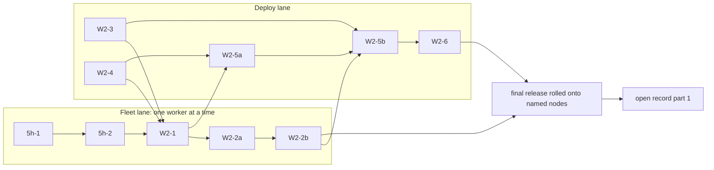

# W2 decisions: the ccrc history replay eval (5h-1 to W2-6)

Every W2 plan cites this document by section and decision number (W2-D*n*). It was built read-only from spec rev 3.6 at `bd363a76b`. Its sources are:
- the W2 scope and its critic;
- the five clusters' draft rulings and their checkers;
- the cross-cluster consistency report. Its adoptions C-A to C-R and its §2 picks are applied as written. Where this document goes further, it says so.
- the quiz rulings QZ-1 to QZ-23, with the quiz checker's fixes applied;
- the two checkers of this document (fold applied; decisions W2-D89 and W2-D90 are appended numbers, so no earlier number moved).

A departure is written `D-TBD-<slug>` until the coordinator allocates its number. It is defined only in the `## Deviations found` of the plan of the PR named in its "Defined in" entry (section 6 and the D-numbers list): the first PR in merge order that ships any part of it. Every other plan cites it. Family ids, seeds, node names and account names never appear here.

## 1. In short

- **Two lanes.** The fleet lane runs one PR at a time: 5h-1 → 5h-2 → W2-1 → W2-2a → W2-2b. In the deploy lane, W2-3 and W2-4 dispatch now, W2-5a follows W2-1 and W2-4, W2-5b follows W2-2b and W2-5a, and W2-6 comes last. No two running workers ever claim the same path.
- **Everything first, then a frozen tree.** Every W2 PR, including W2-5b and W2-6, merges and is rolled onto the named nodes before part 1 of the open record is signed. From that rollout to close, the named nodes' trees do not move: update intent is off and a `tree-moved` preflight enforces it.
- **The gate.** `deploy/history-gate.mjs` is pure. It holds every scoring decision: the labeller, the answer protocol, the writer prompt, the rubrics, run classification, the hand-check override, and `decideGate`, which applies the spec's three criteria and the halts (W2-D89). The record pins the sha256 of it, `measure-history.py`, `history-replay.mjs` and `lib.mjs`, and every `--record` consumer re-checks those hashes.
- **The window.** `measure-history.py` emits raw rows, and Node builds each window over ten assistant **turns**. A window ends at turn 11 or at the next main boundary, and is `unmeasured` whenever the row cap truncated its copy before turn 11 was seen. The producer is read from `pickHoldingCopy`'s copy over every assistant row after the summary, and the window from W1's longest copy.
- **The open record has two signed parts, both kept off the repo:**
  - a **draft**, before the pilot: the seed, constants, models, versions, pilot section and code hashes;
  - a **final**, after the pilot: the census, Q18 figures, assignment, frozen quiz and window.
  After window start, a final may be superseded only to append amendments (W2-D90). Only hashes and counts go public.
- **The quiz.**
  - It sources SHA, path, command and error facts. Decisions are not sourced.
  - It admits a fact by substring test against an in-memory Baseline B.
  - It scores only a single `ANSWER:` line.
  - The question list is frozen by sha256 before the window.
- **recall-off.** The verb gains a generation check: `--generation`, `generation-malformed` and `generation-mismatch`. File presence is recorded in meta rows that are journaled through the outbox. The schema does not change.
- **ASOF and the env seam.** ASOF cuts by time at the boundary, also hides every row after the boundary in N's holding copy, and keeps kept(N) visible. The env seam takes the family from ASOF, requires both ARM and ASOF, and reads a marker whose first line names the store.
- **Departures and errata.** Nineteen departures need D-numbers. Each spec sentence that W2 changes is amended in place by W2-1, W2-5b or W2-6, the only W2 PRs that hold the spec path.

## 2. PR split and order

*Figure 1. Merge order. An arrow means "merges before the next one dispatches". Every box merges before the release that part 1 pins.*

**Rules for both lanes (W2-D1 to W2-D5):**
- **Claims.** Before each dispatch, the coordinator reads `GET /api/claims?project=ccrc-pwa` and checks it against the PR's file list below. A PR is dispatched only if no running worker claims any of its paths. Clauses 10 and 11 apply all or nothing.
- **The spec path.** `docs/superpowers/specs/2026-10-05-ccrc-history-lossless-dag-design.md` is claimed only by 5h-1, 5h-2, W2-1, W2-5b and W2-6, and never by two running workers at once. Section 6 says which of these PRs amends each erratum.
- **Tests.** Exactly one new test file is created in W2: `server/test/history-replay.test.ts`, created by W2-4. Every other PR appends to existing files. A worker who finds a new test file unavoidable stops and reports to the coordinator first.
- **Pin halves.** Where a spec pin is built by more than one PR, each half is named (for example RP1-contract, RP1-writer) and has exactly one owner, listed under that PR's Pins.

### 5h-1 (fleet, already planned)
- **Ships:** its approved plan, unchanged.
- **W2 needs from it:**
  - its Task 6 (`expandEntryText`'s variant handling) lands before W2-1 splits the body-pick helper;
  - it leaves the W2 paths alone. Its plan's never-edit list covers `deploy/**`, `shared/*.ts`, `.github/workflows/*`, README.md and CLAUDE.md. The coordinator also confirms it claims none of `server/test/{measure-history,history-replay,lifecycle}.test.ts`.
- **Waits for:** the operator's approval of its plan.
- **Never touches:** any path in W2-3's or W2-4's file lists.

### 5h-2 (fleet, already ledgered)
- **Ships:** its plan, the redaction value-class widening and its re-clean, the relay window, the op marker's identity and lag-high's remedy. Its Task 4 keeps the '87 B → 86 B' correction, in the same edit as the op marker's new bound (shared/lifecycle.ts's history-store-id row, its lifecycle.test.ts pin and spec §9.4's row; W2-D3 as amended by the coordinator).
- **Files:** per its plan. Its never-edit list is 5h-1's plus `server/test/measure-history.test.ts` and `server/test/history-replay.test.ts`. It edits `shared/lifecycle.ts` and `server/test/lifecycle.test.ts` in Task 4 only, on the history-store-id row and its pin (W2-D3).
- **Waits for:** 5h-1 merged, and the operator's pending redaction rulings. Those rulings are a stated dependency of the window, because pilot sourcing waits on 5h-2 (W2-D8).
- **Never touches:** the deploy lane's paths.

### W2-1 (fleet): the recall-off verb, the presence record, and the exports for the deploy lane

**Ships:**
- the `recall-off` verb, end to end through the shim (W2-D26 to W2-D28);
- the O13 one-writer pin (W2-D29);
- the per-tick presence record (W2-D30);
- `status --json` `recall_off` (W2-D31);
- RP8 end to end (W2-D32);
- the exports for the deploy lane, including `stampAtOrBefore` moved into lib (W2-D33);
- the `isSyntheticModel` extraction, with the gate rewired to import it (W2-D17);
- the gate rewired to import `RECALL_OFF_META`, with a Python twin pin (W2-D23);
- `measure-history.py`'s `recall_off` raw rows (W2-D23);
- `RECALL_OFF_META` appended to O14's `VOCABS` (W2-D12);
- the spec errata for W2-1, W2-3 and W2-4 (section 6).

**Files modified:**
- `ccd/history/lib.mjs`, `lib.d.mts`;
- `ccd/history/sweep.mjs`;
- `ccd/history/cli.mjs`: the relay replaces the stub; an in-place `export` on `pairIndexOf`; status;
- `ccd/history/derive.mjs`: export `bodyOf`, `keptOf`, and a new exported `blobReadStmts(db)` that `stmts(db)` itself uses; `stampAtOrBefore` removed and imported from lib;
- `ccd/history/recall.mjs`: the body-pick helper split from `expandEntryText`;
- `deploy/history-gate.mjs` (the two import rewires only) and `deploy/measure-history.py`;
- `shared/lifecycle.ts` (the history-recall-off row);
- `server/test/lifecycle.test.ts` (appends 'W2-1');
- README.md (the verb);
- the spec.

**Files created:** none.

**Tests (appended):** history-op, history-recall, history-lib, history-recover, history-sweep, history-cli, measure-history.test.ts, single-definition.test.ts, lifecycle.test.ts.

**Pins:** RP8 and RP10; C16 (its two words), C64 (the recall-off forms), C66, C67, C68 (re-run); O13 (recall-off: exactly one writer); O14 (`RECALL_OFF_META`); O17 (history-recall-off); the `RECALL_OFF_META` Python twin.

**Decisions:** W2-D3, D9, D10, D17, D23, D26 to D33.

**Waits for:** 5h-2, W2-3 and W2-4 merged; 5h-1's Task 6 on main.

**Never touches:** `deploy/history-replay.mjs`, `server/test/history-replay.test.ts`, `.github/workflows/*`. No deploy worker is running while W2-1 runs: W2-3 and W2-4 have merged, and W2-5a waits for W2-1.

### W2-2a (fleet): the as-of cut

**Ships:**
- lib's single cut definition (W2-D34 to W2-D38);
- the cut applied to every site in recall.mjs and regex-worker.mjs, including `coveringLeaves`, `leafHeads` and `scopePrefixes`;
- the cursors;
- the CLI refusing the three seam variables inside a pane;
- the env allow-list growing to 7;
- `asof-invalid` with its store half (W2-D39).

**Files modified:** `ccd/history/recall.mjs`, `regex-worker.mjs`, `lib.mjs`, `lib.d.mts`, `cli.mjs`.

**Tests (appended):** history-recall, history-cli, history-lib, single-definition.test.ts (ALLOWED at :5364 goes from 4 to 7, and the describe title drops 'four-name').

**Pins:** C31 (in-process, plus the in-pane refusal); C4's in-pane half; C11; C16 (its one word); C27 (cut before LIMIT); C59 and C69 stay green; the positional-hide CONTROL (W2-D34).

**Decisions:** W2-D34 to W2-D39.

**Waits for:** W2-1 merged.

**Runs alongside:** W2-5a, whose files are disjoint.

**Never touches:** the spec; `deploy/**`; `shared/**`; README.md; lifecycle.test.ts; derive.mjs (W2-1 already moved `stampAtOrBefore`).

### W2-2b (fleet): the headless seam

**Ships:**
- env identity from ASOF (W2-D40);
- the widened-scope guard (W2-D41);
- `RECALL_ARMS`, with ARM and ASOF required (W2-D42);
- the `arm` field on counter lines, and the drain skip (W2-D43);
- the marker's parser and formatter (W2-D44);
- `decideHeadless` in the ruled order (W2-D45, W2-D46);
- box verbs that ignore the seam (W2-D47);
- `headless-malformed` and `headless-arm-unknown` (W2-D48);
- the history-switches lifecycle row (W2-D49);
- `RECALL_ARMS`, `HEADLESS_LIST_MAX_BYTES` and `HEADLESS_LIST_MAX_PAIRS` appended to O14's `VOCABS` (W2-D12).

**Files modified:** `ccd/history/lib.mjs`, `lib.d.mts`, `cli.mjs`, `sweep.mjs`, `shared/lifecycle.ts`, README.md (the seam).

**Tests (appended):** history-cli, history-lib, history-recall, history-sweep, single-definition.test.ts (the VOCABS append), lifecycle.test.ts (the pin at :1183-1184).

**Pins:** C4 (complete), C16 (its two words), C24 under env, C28, C30, C50; O13 (headless-on holders stay `['ccd/history/lib.mjs']`, and the symbolic write scan stays green); O14 (the three new constants); O17 (the switches row); the C-R pin (a treatment-arm call writes a non-null `arm`).

**Decisions:** W2-D40 to W2-D50.

**Waits for:** W2-2a merged.

**Never touches:** the spec (W2-5b amends its errata), `deploy/**`, lifecycle keys other than the switches row.

### W2-3 (deploy): the gate module and the census, dispatched now

**Ships:**
- `deploy/history-gate.mjs`, pure, holding:
  - the window builder (W2-D14, W2-D15) and producer strata;
  - the first-exit-8 split;
  - the bootstrap (W2-D18), assignment (W2-D19), the active rule with its newest-family comparator (W2-D20) and Q18 (W2-D21);
  - `assembleReports` (W2-D22) and the changed-family function (W2-D23), with a module-local `recall_off:` prefix marked temporary until W2-1's rewire;
  - the gate_code check (W2-D24) and the `OPEN_RECORD_V1` validator for both parts and their amendments (W2-D25, W2-D90);
  - `decideGate`: the three criteria, their denominators and the halts (W2-D89);
  - `GATE_REASONS` and the closed word sets (W2-D12);
  - the quiz's pure decisions: `FACT_KINDS`, `LABELS`, `LABELLER`, `collapseWs`, `factVariants`, `admitFact`, `labelCorrect`, `ANSWER_PROTOCOL`, `parseAnswerField`, `WRITER_PROMPT`, `parseQuestionLine`, `RUBRICS`, `parseLabelLine`, `classifyRun`, the hand-check sampler, the override and the agreement rule (W2-D60 to W2-D64, W2-D72, W2-D79 to W2-D81);
  - `COUNTERS_DEF_V1`, the frozen text of the five counter definitions, and its sha constant (W2-D87);
  - the model-id patterns the validator enforces (W2-D25);
  - the `turnsOf` export that W2-6 imports.
- `measure-history.py`: the raw-row output, census mode, self-hash and `user_version` (W2-D13).

**Files:** create `deploy/history-gate.mjs`; modify `deploy/measure-history.py` and `server/test/measure-history.test.ts`. Exactly those three.

**Pins:** RP6-pure (verbatim, including the 11th-turn case, the truncation case and the task-embedded clause); RP7-pure (independent draws per store, `assembleReports` keying); O32 narrowed; O52 re-pinned (W2-D14); O14 (no VOCABS name declared in `deploy/*.mjs`); a purity pin over history-gate.mjs's imports; the no-blob pin on the .py; the newest-family parity pin against recall.mjs (W2-D20); the producer parity CONTROL (W2-D15); every `decideGate` boundary and halt (W2-D89); one mutant per labeller rule.

**Decisions:** W2-D11 to W2-D25, W2-D60 to W2-D64, W2-D72 (its text), W2-D79 to W2-D81 (their pure parts), W2-D87 (its text), W2-D89, W2-D90 (its validator rule).

**Waits for:** nothing beyond this document. The K unit is ruled (W2-D14).

**Runs alongside:** 5h-1, 5h-2 and W2-4.

**Never touches:** `ccd/**`, `shared/**`, the spec, README.md, `.github/**`, `deploy/history-replay.mjs`.

### W2-4 (deploy): the driver core, dispatched now

**Ships:**
- argument parsing and the `--out` rule (W2-D53);
- the TMUX_PANE refusal;
- account admission from the roster (W2-D52);
- the spawn contract: launch per kind, the `env -i` allow-list with the arm values passed in as parameters, the explicit PATH, an empty 0700 cwd, the flags, `--tools` and the three `--allowedTools` spellings;
- the writer and judge spawn mode with `--tools ""`;
- redaction for spawned text (W2-D54);
- the limits stop and the spend budget, with the required `--budget` for spawns before part 1 (W2-D55);
- the version, tree and wrapper preflights, against part 1 or, before part 1, against the step 0a output (W2-D56);
- the recall-off presence preflight, `lstatSync(recallOffPath(…))` (W2-D78(ii));
- the stream-json reader;
- the step 0a subcommand (recording `codeShas()` and the release stamp), the probe, and the step 0b mechanics that run without the seam (W2-D57, W2-D58);
- the `codeShas()` helper that W2-D24 consumes;
- `DRIVER_REASONS` (W2-D59).

**Files:**
- create `deploy/history-replay.mjs` and `server/test/history-replay.test.ts`;
- modify `.github/workflows/ci.yml` (one line in the node-floor heredoc), `shared/lifecycle.ts` (the history-replay-out row) and `server/test/lifecycle.test.ts` (the key split, W2-D9).

**Pins:** RP1-contract (argv, env and launch per kind; the arm env parameterised; the writer and judge spawn modes, all on a stub); RP2; RP3-admission (every account refusal, before any spawn); RP4; RP9; O17 (history-replay-out); a scan that no `deploy/history-*.mjs` imports `node:sqlite` (W2-D51). O13's existing `ALL_MJS`/`DECL_CORPUS` scans already cover `deploy/` (single-definition.test.ts:5053, :5243) and stay green; this is not a new pin.

**Decisions:** W2-D5, W2-D9, W2-D50 to W2-D59.

**Waits for:** nothing. Runs alongside 5h-1, 5h-2 and W2-3.

**Never touches:** `ccd/**`, the spec, README.md, `deploy/history-gate.mjs`, `deploy/measure-history.py`.

**CI:** runs the full suite, because of the `.github/` edit.

### W2-5a (deploy): reconstruction, admission, the quiz builder and the record subcommands

**Ships:**
- reconstruction through W2-1's exports (W2-D74, W2-D75);
- RP5 boundary admission (W2-D66);
- fact mining (W2-D61, W2-D65);
- the redaction discard (W2-D67);
- Baseline B (W2-D68, W2-D69);
- answerability, and the same-millisecond hit count (W2-D70, W2-D34);
- sampling (W2-D71);
- the writer spawn (W2-D72);
- the frozen list, and the pilot frozen list written by `pilot-source` (W2-D73);
- the fidelity pilot's payload construction and its overhead arithmetic (the spawns are W2-5b's);
- subcommands `pilot-source`, `quiz-source`, `freeze`, `power` (with the census assembler that checks nodes only), `open --draft`, `open --finalize` (which re-derives the assignment), `open --template`, and `verify --registry` / `verify --section ab` (W2-D84);
- the `codeShas()` re-check wired into each of its own `--record` subcommands (W2-D24);
- the `keptOf` scan (W2-D33).

**Files:** modify `deploy/history-replay.mjs` and `server/test/history-replay.test.ts`.

**Pins:** RP5 (with the straddle CONTROL and the two-copy CONTROL); RP1-writer and RP3-writer (the writer call goes through W2-4's spawn in writer mode; a refused account leaves the stub's log absent); the `keptOf` scan; the admission, B, answerability and freeze pins named in W2-D61 to W2-D75.

**Decisions:** W2-D61, W2-D65 to W2-D75, W2-D84 (its first half).

**Waits for:** W2-1 and W2-4 merged.

**Runs alongside:** W2-2a and W2-2b.

**Never touches:** `ccd/**`, `shared/**`, the spec, README.md, `deploy/history-gate.mjs`, `deploy/measure-history.py`, `.github/**`.

### W2-5b (deploy): arms, judge, hand-check, uptake, marker and report

**Ships:**
- the arm runs, with RP1's full env and the ARM values from `RECALL_ARMS`;
- the treatment card through `lib.cardLine` over boundary N's leaf, with its parent only when visible under `asOfCut(N)` (W2-D75);
- step 0b's treatment-arm assertions (W2-D58);
- the fidelity pilot's spawns and comparison (the `fidelity` subcommand);
- the usage pilot and its extrapolation;
- the judge spawn (W2-D79);
- the failed-run handling (W2-D80);
- the hand-check sheet and label reader (W2-D81);
- quiz uptake (W2-D82);
- the absent-rate guard (W2-D64);
- the `marker` subcommand, and `verify`'s headless-on half (W2-D84);
- `open --amend` (W2-D90);
- the arm-batch preflights (W2-D78);
- `report`, which gathers the inputs and calls `decideGate` (W2-D85, W2-D89);
- the `codeShas()` re-check wired into each of its own `--record` subcommands (W2-D24);
- README's driver paragraph and the W2 operator flow;
- the spec errata for W2-2a, W2-2b, W2-5a and W2-5b.

**Files:** modify `deploy/history-replay.mjs`, `server/test/history-replay.test.ts`, README.md and the spec.

**Pins:** RP6-e2e (through the report); RP7-e2e; RP1-arm (the exact env with the real ARM values); RP1-judge and RP3-judge (the judge call goes through W2-4's spawn in judge mode); the W2-D78 refusals with the stub's log absent; the W2-D84 round trip; a scan that `deploy/history-replay.mjs` never spells the arm words (W2-D42).

**Decisions:** W2-D58, W2-D64, W2-D76 to W2-D85, W2-D90 (its subcommand).

**Waits for:** W2-2b, W2-3 and W2-5a merged.

**Never touches:** `ccd/**`, `shared/**`, `deploy/history-gate.mjs`, `deploy/measure-history.py`, `.github/**`.

### W2-6 (deploy): the report-only counters (required, despite the name)

**Ships:** `deploy/history-counters.mjs`, a standalone entry. It is not imported by history-replay.mjs, and it imports `turnsOf`, the window builder and `COUNTERS_DEF_V1` from the gate. It provides the five spec counters (compliance, echo hits, lag, `card_served`, `card_id_mismatch`) plus re-discovery, each by arm and by producer (W2-D86 to W2-D88). It also adds the single-definition pin naming the two callers of `turnsOf`, a pin that its definitions match `COUNTERS_DEF_V1`, one README line, and the §10.2:2729-2730 errata.

**Files:**
- create `deploy/history-counters.mjs`;
- modify `server/test/history-replay.test.ts` (appended), `server/test/single-definition.test.ts`, README.md and the spec.

**Decisions:** W2-D86 to W2-D88.

**Waits for:** W2-5b merged. Its claims on history-replay.test.ts, README.md and the spec are then released, and the fleet lane has finished with single-definition.test.ts.

**Never touches:** `deploy/history-gate.mjs`, `deploy/history-replay.mjs`, `deploy/measure-history.py`, `ccd/**`.

**Merges before part 1** (W2-D88).

## 3. Decisions

Each entry gives the ruling, then: **kind** (build / open-record-default / operator / spec-decides) · **departure** · **owner PR** · **grounds**.

### A. Structure and sequencing

**W2-D1. The split.** W2 ships as eight build PRs (ten with 5h-1 and 5h-2) in two lanes, as shown in section 2. Earlier names map as follows:
- P1 = W2-1; P2 = W2-2b; P3 = W2-2a;
- P4 = W2-3; P5 = W2-4, its "shared replay-read module" moving to W2-5a; P6 = W2-5a; P7 = W2-5b; P8 = W2-6.

G1's `ccd/history/gate.mjs` is withdrawn. W2-DQ1's "the driver is a fleet PR" is withdrawn (C-D).

build · no · coordinator · C-A, C-C, C-D, PS1 as corrected by §4 of the consistency report.

**W2-D2. Order and dispatch.**
- Fleet lane, strictly serial: 5h-1 → 5h-2 → W2-1 → W2-2a → W2-2b.
- W2-3 and W2-4 dispatch now.
- W2-1 waits for 5h-2, W2-3 and W2-4.
- W2-5a waits for W2-1 and W2-4.
- W2-5b waits for W2-2b, W2-3 and W2-5a.
- W2-6 waits for W2-5b.
- At most three workers run at once.
- The critical path to the window is: 5h-1 → 5h-2 → W2-1 → max(W2-2a → W2-2b, W2-5a) → W2-5b → W2-6 → the final release rolled onto the named nodes → the open-record sequence (section 5). W2-5a, the largest deploy PR, runs beside W2-2a → W2-2b, and whichever finishes later gates W2-5b.

build · no · coordinator · PS11; C-I (W2-2a, W2-2b and W2-5b are on the critical path); C-Q; split checkers X5/F11. W2-1 does wait on W2-3, but the K unit is ruled here (W2-D14), so no operator question gates the fleet lane.

**W2-D3. Claims and the spec path.**
- No two running workers claim one path, except where the coordinator rules a line-disjoint edit beside a live claim under the peer protocol, naming the lines each side keeps off. Whichever PR lands second merges main and keeps both sides. (Amended by the coordinator: the strict form would have moved 5h-2's lifecycle edit away from the plan that measures it.)
- Only 5h-1, 5h-2, W2-1, W2-5b and W2-6 claim the spec, and their run windows never overlap: the fleet lane is serial, W2-1 runs with no deploy worker alive, and W2-5b and W2-6 run after the fleet lane ends.
- **Who amends which errata:**
  - W2-1 amends W2-1's, W2-3's and W2-4's errata in place (those PRs have merged);
  - W2-5b amends W2-2a's, W2-2b's, W2-5a's and its own;
  - W2-6 amends its own.
  - Each erratum cites its D-number, defined in the plan named in section 6's "Defined in".
- The '87 B → 86 B' correction (the history-store-id row, §9.4:2162 and `shared/lifecycle.ts:65`; note at :3551) STAYS in 5h-2's Task 4, which rewrites the same cell for the op marker's new bound. If W2-4 still holds `shared/lifecycle.ts` or `server/test/lifecycle.test.ts` when 5h-2 dispatches, the coordinator rules the two edits line-disjoint: 5h-2 edits the history-store-id row and its pin; W2-4 the history-replay-out row, the 'W2' key split and HISTORY_LANDED.

build · no · coordinator · Clauses 10 and 11; split checkers X1, X10, F8. This replaces PS13's coordinator rev-3.7 docs PR. That PR could not be timed against 5h-1's claim, which holds the spec from dispatch.

**W2-D4. Plans, D-numbers and authority.**
- There is one plan per PR, each written just in time and anchored on the main it builds on. W2-3 and W2-4 are written now, W2-1 while 5h-2 runs, and the others when they become dispatchable.
- Each plan gets adversarial review before merge.
- This document is the authority. Dispatching W2-3 and W2-4 waits on no spec revision.
- A departure is defined once, in the plan of the PR named in its "Defined in" entry (section 6 and the D-numbers list): the first PR in merge order that ships any part of it. Every other plan cites it.

build · no · coordinator · PS12; X10/F8; deviation-refs.test.ts (a number defined in two plans goes red).

**W2-D5. CI.**
- W2 creates exactly one test file, `server/test/history-replay.test.ts`, in W2-4. W2-4 adds it to the node-floor heredoc in `.github/workflows/ci.yml` in the same commit.
- W2-3's tests go in measure-history.test.ts.
- Only W2-4 selects the full suite. Every other PR runs its selection, and the node-floor leg runs every history test on every PR.

spec-decides · no · W2-4 · PS10; ci-pipeline.test.ts:1010-1016.

**W2-D6. The build freeze: everything installed before part 1, then nothing moves.**
- Every W2 PR (W2-1 to W2-6) merges before the final W2 release is cut. The operator rolls that release onto every named node before part 1.
- **From that rollout to close:**
  - each named node's update intent is off, or pinned to that tag;
  - the driver refuses any spawning or scoring subcommand with `tree-moved` when the node's installed release stamp differs from part 1's `gate_code.release_tag` (W2-D56).
- Merges to main continue, but they reach no named node.
- **An exception** is an operator ruling, recorded in the ledger with its time (and, after part 2 exists, as an amendment, W2-D90), after the coordinator measures `git diff --quiet <piloted-tag> <candidate> -- <surface>`. The surface is:
  - `ccd/history/**`, `ccd/ccd-history-sweep`, `ccd/history-skill/**`, `ccd/install-history-skill.sh`, `ccd/session-hook.sh`, `ccd/install-session-hooks.sh`, `ccd/compact-card.mjs`;
  - ccd/ccrc's `history)` dispatch block and the preamble it depends on (CCRC_HERE), diffed as a block;
  - ccd/ccd's `CCRC_SESSION_GENERATION` export and `.generation` writer, diffed as blocks;
  - `shared/wrapper.mjs`, `deploy/systemd/ccd-history-sweep.{service,timer}`, `deploy/history-*.mjs`, `deploy/measure-history.py`.
- After an exception, before window start the remedy is a re-pilot and a superseding draft. After window start, outputs are stamped `code-changed` and the operator rules whether the window stands.
- The live sessions' Claude Code version is not frozen. It is recorded per named node at window start and at window end, and reported.

open-record-default · no · W2-4 (preflight), W2-5b (wiring); the update intent is the operator's · C-I (scoring frozen before part 1; "P7 lands during the window" struck); W2-DQ11 with checker CHK1-F3, CHK1-F10 and DRV-5; §10.2:2723.

**W2-D7. The maintenance freeze.**
- It runs from the start of **pilot** sourcing to close, on every named node and every node that pilot or quiz families come from. A node named later (W2-D8) enters it when named, with its time recorded.
- During it, the operator runs none of: `prune --apply`, `reparse`, `import --apply` in any form, or `doctor --repair|--adopt|--restore|--rebuild|--migrate`. No `history-off`, except under §10.7's W1 kill rule, and `history-max-gb` is not lowered.
- Still allowed: scheduled ticks, B4's export as ticks run it, `status`, read-only `doctor`, `doctor --backup`, and the recall-off verb at window start and at close.
- A frozen act forced by a cap or disk emergency is done and recorded with its time (as an amendment once part 2 exists, W2-D90). Before the next arm batch, the answerability re-check (W2-D78) must then pass, and the operator rules whether the quiz and the window stand.

open-record-default · no · operator act; W2-5b re-check · W2-DQ10 moved earlier per C-Q.

**W2-D8. What must be complete before pilot sourcing.**
- On every node that pilot or quiz families come from:
  - the backfill re-run is complete, with the sweep timer paused around it;
  - 5h-2 is rolled out, and its re-clean is measured complete.
- The quiz sha256 must be in the record before the window. The coordinator does not relax this.
- **A node added after pilot sourcing** (a Q18 decision, W2-D21) gets, before the draft is superseded: the 5h-1 and 5h-2 rollouts and the re-clean, the backfill re-run, the final W2 release with its update intent off (W2-D6), step 0a (W2-D57), and the start of its maintenance freeze.
- The ledger's sentence "only the quiz waits on the backfill" is superseded.
- Relaxing the freeze to "before any arm data" is an operator ruling, offered at open.

spec-decides (the freeze) plus build (the 5h-2 timing, the added-node checks) · no · operator acts · §10.2:2723; W2-DQ4 split per CHK1-F6. The 5h-2 timing is a coordinator sequencing ruling: admission discards facts that match the redaction set, so a later widening could reclassify admitted facts (DRV-2, C-Q).

**W2-D9. Lifecycle keys.**
- W2-4 splits HISTORY_ROWS_BY_PR's 'W2' key into `'W2-1': ['history-recall-off']` and `'W2-4': ['history-replay-out']`, appends 'W2-4' to HISTORY_LANDED, and declares history-replay-out: pattern O, creator `deploy/history-replay.mjs`, collector null with the ruling text.
- W2-1 appends 'W2-1' and declares history-recall-off. Its row text also names the writer's temp `recall-off/~tmp.<pid>` (W2-D28). The history-store-id row's 87 B → 86 B correction is 5h-2's (W2-D3).
- W2-2b edits the history-switches row and its pin (W2-D49).
- No other W2 PR edits shared/lifecycle.ts or lifecycle.test.ts. Outside W2, 5h-2's Task 4 edits the history-store-id row and its pin (W2-D3).
- **Amended (coordinator, 2026-10-19, W2-3/W2-4 plan review):** W2-4's lifecycle case (its one `it` for the history-replay-out row) sits in lifecycle.test.ts directly after the B3 numbers case, the describe's last case. It is ruled here as part of W2-4's line-disjoint edit beside 5h-2 (W2-D3), with the key split and the `HISTORY_LANDED` line above.

build · no · W2-4, W2-1, W2-2b · PS9; DRV-7; CHK1-F5(a); lifecycle.test.ts:1077-1102 and :1183.

**W2-D10. No schema change.**
- SCHEMA_VERSION stays 2 through W2, so no node owes a `doctor --migrate`.
- No W2 PR raises it without a prior coordinator ruling. If one ever does, its PR body lists the per-node migrate as an operator act before the freeze, together with the rollback hazard.

build · no · every W2 PR · RA-5, RA-4.

### B. The gate module and the census (W2-3)

**W2-D11. Location and purity.**
- The module is `deploy/history-gate.mjs`. It imports only `node:crypto` and `../ccd/history/lib.mjs`: canonicalJson, sha256Hex, EXIT, producerOf, backendOf and pickHoldingCopy, plus isSyntheticModel and RECALL_OFF_META once W2-1 has extracted them.
- It has no fs, child_process, process.env, clock or Math.random.
- A purity pin over its import block lives in measure-history.test.ts.
- history-replay.mjs and history-counters.mjs import it.

build · no · W2-3 · C-A (PS5); C-B.

**W2-D12. Deploy-local vocabularies.**
- `GATE_REASONS`, `FACT_KINDS = ['sha','path','command','error']`, `LABELS = ['correct','uncertain','fabricated']`, `RUBRIC_IDS`, and the closed list of substream labels are each frozen once in history-gate.mjs. `DRIVER_REASONS` is frozen once in history-replay.mjs.
- lib REASONS gains CLI words only:
  - `generation-malformed` and `generation-mismatch` (W2-1);
  - `asof-invalid` (W2-2a);
  - `headless-malformed` and `headless-arm-unknown` (W2-2b).
- New lib constants that other modules read are appended to O14's `VOCABS` (single-definition.test.ts:5228) by the PR that adds them: `RECALL_OFF_META` (W2-1); `RECALL_ARMS`, `HEADLESS_LIST_MAX_BYTES`, `HEADLESS_LIST_MAX_PAIRS` (W2-2b).
- No `deploy/*.mjs` declares a VOCABS name (EXIT, REASONS, BACKENDS, …); O14's DECL_CORPUS already scans `deploy/`.
- A W2-3 pin goes red if a second file under `deploy/` or `server/test` **declares** FACT_KINDS or LABELS. Importing them is allowed, so the driver and its tests stay green.
- This departs from §13:3051's "every vocabulary is enumerated once in lib.mjs", which the erratum reads as "every ccd/history vocabulary".

build · **yes** (`D-5774`) · W2-3 · C-J; QZ-1; split checkers F4 and X3; history-skill.test.ts:175-178 (REASONS is the CLI's vocabulary).

**W2-D13. measure-history.py's output.**

The `w2` key becomes `{row_cap, families: [...]}`. Python spells neither K, nor the turn rule, nor any model text.

**Amended (coordinator, 2026-10-19, W2-3/W2-4 plan review):** `w2` also echoes the window it was run over, `window_start_ms` and `window_end_ms`, so `assembleReports` can refuse reports whose windows differ (W2-D22), each compared with the record's window since the final W2-3/W2-4 plan review.

Per listed family it emits:
- `{ccrc_id, generation, found}`, so a missing family reads `found: false` and is never an empty list;
- the merged `''` generations;
- `calls`: `[ts_ms, rc, verb]` for rows with `arm IS NULL` and ts ≥ window-start, ordered by ts_ms then event_key (every `recall_calls` row is a read verb's, measure-history.py:53-54);
- `boundaries`: the main boundaries in [start, end), each `{boundary_uuid, ts_ms, copies}`.

Each copy holding a boundary is:
`{file_id, source_key, boundary_line, after_count, summary_line|null, next_boundary_line|null, next_boundary_ts_ms|null, last_ts_ms, rows, models, truncated}`
- `after_count` is the number of membership rows after the boundary line, uncapped.
- `rows` are the assistant entries after the summary, or after the boundary when there is no summary, and before the next main boundary in that file. Each is `[line, ts_ms, msg_id, request_id, uuid, model]`, up to `--row-cap`. `truncated` says the cap cut `rows`.
- `models` lists the distinct models of **every assistant row after the summary row (or the boundary, when none) to the end of the copy**, uncapped and not stopped at the next boundary, in first-appearance order. This is what `lib.producerOfCopy` (lib.mjs:1540) reads, so Node's producer matches derive's. It is still raw text, so O32 holds.
- `--row-cap` is required, with no default, whenever `--families` or `--census` is given. The W1 call (`--db --now`, measure-history.test.ts:186) takes none.

Other changes:
- Copies are found by primary-key probes (ingest_files by transcript_pk, then memberships by (file_id, entry_id)), never by a scan over entry_id.
- **Census mode:** `--census --as-of T0 --since MS --row-cap N` emits, for every family in the store: the sessions columns (merged_into, generation, first_seen_ms, session_pk), its last main-entry ts_ms, these raw rows over the look-back, and the ticks summary `{n, first_ts_ms, last_ts_ms}`.
- Every report also carries `script_sha256` (Python hashes its own file), `user_version` and `store_id`.
- The script never selects `blobs.z` and imports no compression module. A planted `SELECT z FROM blobs` CONTROL goes red.
- The existing `arm IS NULL` filters stand.
- W2-3's raw emission owns the rule that any later live counter derived from `recall_calls` filters `arm IS NULL`, pinned by a planted arm row that every live output ignores.

build · covered by W2-D14's departure · W2-3 · G3; C-M; G10 checker (the self-hash); RA-9; SEAM-e; the G3 nit (no memberships scan); the producer-parity finding (models uncapped).

**W2-D14. The window: assistant turns, the end rule, and O52.**

K counts assistant **turns** (Q14).

**A turn:**
- Take the window copy's assistant rows in file order.
- Drop rows whose model satisfies `isSyntheticModel`.
- Group consecutive rows by `turnKey = msg_id ?? request_id ?? uuid`.

**The window:**
- It opens at the boundary's ts_ms, inclusive.
- It ends, exclusive, at the earlier of the first row of turn K+1 and the next main boundary's row in that copy.
- When neither exists, it ends inclusive at the copy's last timed row.
- It is `unmeasured` when its copy has no timed row, or **whenever its copy is `truncated` and the first row of turn K+1 was not seen, whether or not a next boundary exists**: the true turn K+1 may lie between the cap and that boundary.
- The per-turn rate divides calls by the turns in the window (at most K).

**k_unit:** recorded in the record. `validateOpenRecord` refuses any value other than the module's `K_UNIT` constant.

**O52 is re-pinned with hand-worked numbers.** At `bd363a76b`, under this rule and W2-D15, the fixture gives:
- B1 in f1: turns at 3000…3900, end 4000 exclusive, calls k1, k2 and k3 (k3 at 3950 is now inside);
- B2: turns 5100, 5200 and 5300, end at B3's row 7000 exclusive, call k6.
- Totals: **windows 2, with_call 2, calls 4, turns 13, unmeasured 0**.
- W2-3 adds a call at exactly 4000 and one at exactly 7000. Both are outside, and the totals are unchanged.
- The plan re-derives these numbers from the fixture before pinning them, and its PR body names the change to W1's pin.

**RP6's window cases**, each with its mutant measured red:
- three rows sharing a msg_id are one turn;
- a call between turn 10's last row and turn 11's first is inside;
- a call at turn 11's first ts is outside;
- a `<synthetic>` row is not a turn;
- two boundaries three turns apart: a call after the second counts once, in the second window;
- a copy truncated before turn 11 that has a later next boundary is `unmeasured` (a mutant that applies the next-boundary end goes red).

build · **yes** (`D-5770`: the window statistic is built in Node from raw rows rather than "run by measure-history.py", the unit is turns, the window ends at the next boundary, and O52 is re-pinned) · W2-3 · G3/G4/G5 as fixed by C-O and both gate checkers (G3/G5-O52, the next-boundary rule, G5-k-unit); the truncation finding; §10.2:2734-2737; §15.1 Q14.

**W2-D15. The copy rules.**
- The **producer** uses `lib.pickHoldingCopy` (live first, then the smallest file_id) and `producerOf` over that copy's `models` (W2-D13). This keeps parity with derive, pinned by RA-10's parity pin (Node's producer from Python's output equals derive.mjs:316's for planted boundaries), plus a CONTROL fixture whose first non-unknown model lies after the next main boundary (a mutant that stops `models` at the next boundary or the cap goes red).
- The **window** uses W1's longest-copy rule: the copy holding the boundary with the greatest `after_count`. Ties go to lib's rule. It is spelled once, in the gate module, as `windowCopyOf`.
- A CONTROL fixture where the two rules disagree goes red under a mutant that swaps them.
- RA-11's `copy_short` is dropped, because it is moot under this rule.
- RA-11's "unrecorded divergence" ledger line is not written: W1's rule is recorded (W1 plan; measure-history.py:46-47).
- **Amended (coordinator, 2026-10-19, W2-3/W2-4 plan review): the summary rule.** measure-history.py keeps W1's rule for which summary row belongs to a boundary. It diverges from lib's `summaryRowFor` only when a non-unknown assistant row lies between a boundary and its summary row. Producer strata are report-only, so this divergence is a named residual (section 7), not a gate defect, and the parity fixtures stay off that shape. A boundary whose summary row lies past the next main boundary reads `unmeasured`.

build · **yes** (`D-5771`: pickHoldingCopy for the producer departs from W1's documented single rule; the window keeps W1's rule) · W2-3 · C-N; ab checkers RA-11; gate checkers G3-copy-rule; the producer-parity finding.

**W2-D16. O32 narrowed.**
- `measure-history.py` emits raw `entries.model` strings and never tests, compares or classifies them.
- O32's literal-absence pin stays, and a "no classification" pin is added.
- §10.2's "backend strata arrive already folded by the sweep" (:2624) is amended: for windows, Node folds them through `lib.producerOf`.

build · **yes** (`D-5772`) · W2-3 · ab checker RA-10-11; split checkers F2/X2; spec O32 (:2439).

**W2-D17. isSyntheticModel.**
- W2-3 ships `turnsOf` with a module-local angle-bracket predicate, marked temporary in its plan.
- W2-1 extracts `isSyntheticModel` into lib.mjs, has `backendOf` use it, rewires history-gate.mjs to import it, and adds a single-definition pin naming lib as its sole definer.
- Null-model rows remain turns.

build · no · W2-3, then W2-1 · C-E.

**W2-D18. The bootstrap.**
- **Seed:** 32 bytes from `crypto.randomBytes`, drawn by `open --draft`, recorded as 64 lowercase hex characters.
- **Substreams:** `state = sha256Hex(seed + ':' + label)` over the closed list `['quiz-ci','live-ci','q18','handcheck','quiz-sample','judge-order']`. `'assign'` is a hash label (W2-D19), and `'pilot-sample'` is used only with the pilot's own seed.
- **PRNG:** xoshiro128** seeded from the first 16 bytes; an all-zero state is refused.
- **Integers:** drawn by rejection sampling.
- **Percentile:** nearest-rank at ranks ceil(0.025·B) and ceil(0.975·B).
- **Statistic:** pooled per resample, with each replicate kept as an exact integer fraction and compared by cross-multiplication.
- **Resampling:** paired in the quiz, within-arm in the A/B, B = 10,000.
- A family with 0 measured windows is not a cluster.
- **Pins:**
  - RP6's boundary cases (exactly 40%, exactly control + 3, a lower bound of exactly 0, exactly 10%), applied through `decideGate` (W2-D89);
  - a known vector for xoshiro128**;
  - the same seed gives the same verdict twice;
  - a different label gives a different stream.

build · no · W2-3 · G8; QZ-11; QZ-14 checker (judge-order).

**W2-D19. Assignment.**
- Each family's arm is independent of list membership: take `sha256` over the UTF-8 bytes of `seed + ':assign:' + canonicalJson([store_id, ccrc_id, generation])`. Bit 0 of the first byte decides: 1 is treatment, 0 is control.
- No CLI flag accepts a seed. Tests inject it through the function parameter.
- The record stores the list and `assignment_sha256 = sha256Hex(canonicalJson(list sorted by canonicalJson))`. The validator re-derives both.
- **Pins:**
  - removing one family leaves every other family's arm unchanged;
  - shuffled input gives the same list;
  - RP7-pure: equal id strings on two stores give two independent draws;
  - a tampered arm is refused.

build · no · W2-3 · C-F (it replaces RA-8's and G9's sequential draws).

**W2-D20. Families active at W2 open.**

**W2 open** is each node's census instant T0, recorded per node in part 2.

A family `(store_id, ccrc_id, generation)` is active iff all three hold:
- (a) `merged_into IS NULL` and its generation matches UUID_RE;
- (b) it is its id's newest unmerged family, by the order of recall.mjs's private `NEWEST_FAMILY_SQL` (recall.mjs:89: `first_seen_ms DESC, session_pk DESC`);
- (c) a main transcript of one of its confirmed epochs has an entry with ts_ms in [T0 − 7 d, T0).

Python emits raw rows and Node applies (a)–(c). The gate imports only lib, so W2-3 spells (b)'s order as a comparator in history-gate.mjs and pins **parity** against recall.mjs: on a fixture store with a tie on `first_seen_ms`, the gate's newest family equals the one recall.mjs's resolver answers for the same id (a mutant that drops the `session_pk` tie-break goes red). Moving the order into lib is not done in W2.

**Legacy `''` families are excluded, and this is fixed.** A re-key mid-window would turn their control file stale with no change row, and the W2 flow cannot write a legacy control file: `--generation` takes only a lowercase UUID (W2-D27) and `marker --section ab` always prints it (W2-D84). `active_rule.legacy_excluded` is therefore a fixed field: `validateOpenRecord` refuses `false`. The record states the exclusion as a departure, which the operator confirms by signing. "No exemptions" is struck.

**Registry check, before the flip.** `verify --registry` reports each active family as `ok`, `registry-mismatch`, `registry-absent` or `unreadable`. None of these is ever folded into another. Families not `ok` are removed before Q18 and before the flip. The removal list and its reasons go into part 2, so the committed list never changes afterwards.

open-record-default (the look-back) plus build (the exclusion, fixed) · **yes** (`D-5773`) · W2-3 (the rule, the comparator, the parity pin), W2-5a (`verify --registry`) · RA-7 with the ab checkers (the RA-7 legacy exclusion is a departure; RA-7/b); C-P; CHK1-F7 (the instant defined); the legacy-unimplementable finding; the newest-family-order finding.

**W2-D21. Q18, the smallest passing point uptake.**

**Inputs:**
- the census rows of the W2-D20 active list, after the registry removals;
- the identical population the flip uses.

**Per-family expected windows:**
- n_f = round(windows_f × planned_days / covered_days);
- covered_days is the look-back clipped to the node's tick coverage;
- families with n_f = 0 are dropped.

**Procedure** (`'bisection-on-grid-crn'`):
- a bisection over a 0.5-point grid from X to 100%, using common random numbers from the draft seed's `'q18'` substream;
- S simulations per point, each of which:
  1. flips per family;
  2. draws p_f from a Beta with mean p and ICC rho;
  3. draws Binomial(n_f, p_f);
  4. runs the gate's own clusterBootstrap.
- It returns the smallest grid point whose pass share is at least the power level and whose upper neighbour also passes.

**Reporting:**
- pre-window uptake;
- `card_consumed:main`, labelled **all-time**.

**Defaults:** rho_headline 0.3 (rho 0 and rho_hat reported beside it); headline power 0.5 with 0.8 beside it; look-back 14 d; planned 14 d; S = 1000; grid step 0.005.

**Pins** (with small injected S and B):
- determinism;
- the figure is at least X.
The Monte-Carlo monotonicity pins are dropped.

**Commands:** `power --record <draft>` reads the census files through an assembler that checks only store_ids against the draft's nodes. It prints to stdout. A decision that adds nodes runs W2-D8's added-node checks before the draft is superseded.

open-record-default (the model choices) plus build · no · W2-3 (math), W2-5a (`power`) · G6 and G7 with the gate checkers' fixes (G6-grid-vs-bisection, G6-pins-and-inputs); C-G.

**W2-D22. assembleReports.**
- Families are keyed by `canonicalJson([store_id, ccrc_id, generation])`.
- **Refused, with GATE_REASONS words:**
  - a null store_id;
  - a duplicate store_id;
  - a store_id outside the record's nodes;
  - a family outside the assignment;
  - a row_cap different from `ROW_CAP`;
  - a `script_sha256` different from `gate_code`'s (unless the run carries `--allow-code-change` and is stamped);
  - **Amended (coordinator, 2026-10-19, W2-3/W2-4 plan review; its comparison replaced at the final review, next bullet):** reports whose windows differ (their echoed `window_start_ms`/`window_end_ms`, W2-D13) are refused with `window-mismatch`. The record-window comparison of the next bullet replaces the report-against-report comparison: no report is compared with another, because two reports that differ cannot both match the record.
  - **Amended (coordinator, 2026-10-19, final W2-3/W2-4 plan review):** each report's echoed window is compared with the record's window, part 2's `window` field (`start_ms`, `end_ms`), instead of with the other reports; a report whose window differs is refused with `window-mismatch`. `assembleReports`' input gains that window (`record.window`). A record carrying no window is refused with `window-mismatch` too, before any report is read (W2-3's chosen word), so an absent window never matches an absent echo.
- `found:false` families, 0-window families and unmeasured windows are excluded and reported by count and key.
- **Amended (coordinator, 2026-10-19, W2-3/W2-4 plan review):** `excluded` gains `not_listed`: an assigned family that no report lists. It is distinct from `not_found` (a listed family a report answers `found: false`), and the two are never folded.
- No void threshold is added.

build · no · W2-3 · G11, with local words per C-J; G10 checker (the script hash). Pin: the window-mismatch case (a single report over another window than the record's, two reports agreeing with each other and not with the record, a report echoing none, a record carrying none), with a mutant per check (W2-3 Task 5's M5b, M5c and M5d).

**W2-D23. Changed families.**
- The meta-row shape is fixed in W2-3's plan (W2-D30's keys). W2-3's pure `changedFamilies(rows, window, list)` drops a family when any of its change rows satisfies `(prev_seen_ms ?? −∞) < window_end && ts_ms >= window_start`. Gap rows are reported and never dropped.
- W2-3 spells the `recall_off:` prefix module-locally, marked temporary. W2-1 defines `RECALL_OFF_META` in lib, rewires history-gate.mjs to import it, and adds a Python twin pin in measure-history.test.ts: the prefix measure-history.py spells equals lib's constant (a changed copy on either side goes red).
- A control family whose recall-off write was refused or never made is `assignment-unrealised`. It is dropped the same way.
- **Both drops apply only to the reported arm comparisons** (per-arm uptake, the first-call difference, per-arm counters). Criterion 3 is computed over every listed treatment family.
- W2-1's measure-history.py emits the raw `recall_off:*` rows, so the reader ships with its writer.
- **Pin:** a treatment family with an in-window change row still counts in the gate share and is absent from the comparison block.

build · no · W2-3 (function), W2-1 (emission, the rewire, the twin pin) · C-K; RA-4/c; §10.2:2733; the second-spelling finding.

**W2-D24. gate_code.**
- The record carries `gate_code = {release_tag, files: {...}}`, the sha256 of the installed bytes of four files: `deploy/history-gate.mjs`, `deploy/measure-history.py`, `deploy/history-replay.mjs` and `ccd/history/lib.mjs`.
- **Every** `--record` consumer recomputes them through W2-4's `codeShas()` before any spawn or computation:
  - W2-5a's: `quiz-source`, `freeze`, `power`, `open --finalize`, `verify --registry`, `verify --section ab`;
  - W2-5b's: arm, judge and pilot batches, `fidelity`, `marker`, `verify --section pilot|quiz`, `open --amend` and `report`.
  - So does `assembleReports`, using each report's `script_sha256`.
  - Each PR wires its own subcommands.
- Spawns before part 1 (step 0a, `pilot-source`) record `codeShas()` and the release stamp instead, and the validator checks them against part 1's `gate_code` (W2-D25).
- On a mismatch the consumer refuses with `code-changed`. The only exception is `--allow-code-change`, which stamps every output and the verdict `code-changed`; whether that verdict stands is the operator's ruling.
- **Amended (coordinator, 2026-10-19, W2-3/W2-4 plan review):** `--allow-code-change` covers a measured mismatch only. It never covers an unmeasured code file, which refuses with `code-unmeasured` whether or not the flag is given (W2-D56).
- Pure scoring decisions live in history-gate.mjs (W2-D60 to W2-D64, W2-D72, W2-D79 to W2-D81, W2-D89). The impure scoring path (spawn, composer, admission) is pinned by history-replay.mjs's hash. Its imports (recall.mjs, derive.mjs, cli.mjs, store.mjs) are not hashed: they are covered by the `release_tag` comparison and the `tree-moved` preflight (W2-D56).

build · no · W2-3 (validator), W2-4 (helper), W2-5a and W2-5b (each its own consumers) · G10 with the gate checkers' fixes (lib, script hash); split checkers F3/X4; the quiz checker's code-freeze coverage finding (both of its options taken); the consumer-list and consumer-owner findings.

**W2-D25. The open record: location, publication and validator.**
- `open` writes no file. It prints canonical JSON to stdout and `sha256 <hex>` to stderr. **Amended (coordinator, 2026-10-19, W2-3/W2-4 plan review):** the bytes it prints are the record's canonical JSON and one newline, the same bytes the operator saves, and `sha256 <hex>` is their sha (W2-3's `recordSha256`).
- The operator saves it with mode 0600, outside every git tree and outside every `--out`.
- Consumers take `--record PATH --record-sha256 HEX`. They refuse when the path is inside a git tree, on a sha mismatch, or when the validator fails.
- **What may go public:** only the record's sha256 values and non-identifying fields, in the ledger and PR bodies, before window start. These are:
  - K, X and k_unit;
  - B, the method and the PRNG;
  - the window times;
  - the quiz and frozen-list shas;
  - the Q18 figures;
  - the tolerance;
  - per-arm family counts and the node count;
  - the model ids.
- **Never public:** store_ids, ccrc_ids, generations, the account, node labels, and the seed until close.
- The repo holds no template file. `open --template` prints a skeleton derived from `OPEN_RECORD_V1`.
- **The validator refuses:**
  - a seed change across a supersede;
  - K, X, B, k_unit, `row_cap`, or any labeller field other than `sha_min_prefix`, differing from the module constants;
  - `active_rule.legacy_excluded` other than `true`;
  - `sha_min_prefix` outside {7, 40};
  - `rubric_id` outside `RUBRIC_IDS`;
  - `writer_input` outside {'excerpt', 'leaf-span'};
  - an alias-shaped model id for any role;
  - an `arm_model` matching the module's Fable pattern (`/fable/i`), or a `writer_model` or `judge_model` not matching its Opus pattern (`/^claude-opus-/`);
  - `answer_protocol_sha256`, `writer_prompt_sha256`, `rubric_sha256` or `counters_def` sha differing from the module's;
  - a step 0a entry or the pilot section whose recorded code shas or release stamp differ from `gate_code`;
  - **Amended (coordinator, 2026-10-19, final W2-3/W2-4 plan review):** a part 1 step 0a entry whose `store_id` names no node in part 1's `nodes`, refused with `value-outside-set`, so each step 0a output is bound to a named node;
  - **Amended (coordinator, 2026-10-19, final W2-3/W2-4 plan review, and the settings-mode ruling the same day):** a part 1 step 0a entry whose `flags_accepted` holds `false` for any flag, refused with a new `GATE_REASONS` word, `flag-rejected`, with no exception. Step 0a records a rejected flag and exits 0 (W2-4 Task 8); this validator is the component that refuses it. The exception once given to `--restricted` under the spec's fallback settings mode (§10.2: `--setting-sources` without user, plus `disableAllHooks`) is withdrawn: in that mode step 0a writes no `--restricted` key, so nothing is lost;
  - **Amended (coordinator, 2026-10-19, settings-mode ruling):** a part 1 step 0a entry whose `settings_mode` differs from part 1's top-level `settings_mode`, refused with `value-outside-set` at `step0a[i].settings_mode`. Only part 1's `settings_mode` binds step 0a: a switch recorded in part 2's `pilot_result.settings_mode` is a later record, not an excuse;
  - a pilot section whose recorded labeller, `sha_min_prefix`, `writer_input`, `baseline_files`, `writer_prompt_sha256`, `answer_protocol_sha256` or `writer_model` differs from part 1's own fields;
  - `quiz.families` inconsistent with the frozen file or with `n_families`;
  - any quiz family whose (store_id, ccrc_id) holds a control-assigned family;
  - any overlap between pilot and quiz families;
  - a part 2 whose `window.end_ms − window.start_ms` lies outside [planned_days × 86,400,000, planned_days × 86,400,000 + 86,400,000] of the draft it finalizes (*chosen* tolerance: one day longer, never shorter);
  - a superseding part 2 whose `finalized_ms` is at or after its predecessor's `window.start_ms` and which differs from it by anything other than appended `amendments` (W2-D90);
  - a missing field.
- **Amended (coordinator, 2026-10-19, W2-3/W2-4 plan review):** the validator is closed, chained and self-checking:
  - **closed:** a field outside `OPEN_RECORD_V1`'s schema refuses with `field-unknown`;
  - **chained:** a record's `supersedes` is compared with its predecessor's sha (`recordSha256`: the sha256 of its canonical JSON and one newline, the bytes `open` prints), and a mismatch refuses with `chain-mismatch`;
  - every amendment's `detail_sha256` is recomputed from its `detail`, and a mismatch refuses with `amendment-detail-mismatch`;
  - a null or missing validation context (`ctx`) is refused with `field-missing` at `ctx`, never read as a narrower check, and so is each context key the record needs, at `ctx.<key>`: `ctx.draft` and `ctx.frozen` for every final, and `ctx.predecessor` for a superseding draft;
  - the step 0a fields it checks follow W2-4's producer shape (step 0a's output as W2-4 writes it), and in part 1 `writer_init` and `judge_init` must be non-null.
- **Accepted as written (coordinator, 2026-10-19, final W2-3/W2-4 plan review):** `recordSha256 = sha256(canonicalJson(record) + '\n')`; a null or missing `ctx` is `field-missing` at path `ctx`; a null where the schema allows none is `field-missing` everywhere, as a missing key is; and `decideGate` (W2-D89) answers a union tagged by `ok` (a verdict carries `ok: true`, its `question-not-run` refusal `ok: false`). W2-3 pins each with a case and a mutant (Task 9's M43, M33 and M36; Task 8's H21).
- **Pins:** one refusal per bullet, including a Fable arm model, a non-Opus judge, a 13-day window, a pilot section signed under another `writer_input`, a step 0a entry on no named node, a step 0a entry under another settings mode than part 1's, and a rejected flag (no flag excused, under either settings mode).

build · no · W2-3 · G10 with the G10 checkers' fixes (supersede re-roll, quiz.families missing); C-G; the quiz checker's validator-owner finding (every field and check is in W2-3); the pre-record-spawn, window-length and model-constraint findings.

**W2-D89. The gate: `decideGate`, its criteria, denominators and halts.**

`decideGate(inputs)` is pure and lives in history-gate.mjs (W2-3). W2-5b's `report` only gathers its inputs and calls it. It restates spec §10.2:2713-2718 (Q7, Q14) with every operator:

**Denominators.**
- **Quiz:** Q = the frozen questions minus `run-failed` ones (excluded from both arms, W2-D80). Each arm's accuracy is `correct / Q` and its fabrication rate `fabricated / Q`, with labels after the hand-check override (W2-D81). `unknown` and `absent` answers count in Q and are not correct.
- **Live A/B:** the measured windows of every listed treatment family (registry drops removed, W2-D20; changed-family and `assignment-unrealised` drops **not** applied, W2-D23; `unmeasured` windows and 0-window families excluded, W2-D14, W2-D18).

**Criteria** (all exact integer comparisons by cross-multiplication):
1. **Accuracy:** the treatment **point** accuracy ≥ 0.40, **and** the lower bound of the **paired** session-cluster bootstrap 95% CI of (treatment − control) accuracy is **> 0**.
2. **Fabrication:** the treatment **point** fabrication rate ≤ the control point rate **+ 0.03**.
3. **Uptake:** the lower bound of the **within-arm** session-cluster bootstrap 95% CI of the treatment share of windows with at least one read-verb call (K = 10 turns, W2-D14) is **≥ X = 0.10**.

**Halts and holds** (the verdict is `halt`, the operator rules, and every criterion that could be computed is still reported):
- the absent rate exceeds `absent_rate_max` in either arm (W2-D64): criterion 1 is not computed;
- more than `run_failed_max` of questions are run-failed (W2-D80): criteria 1 and 2 are not computed;
- hand-check agreement is below `handcheck_agreement_min` (W2-D81);
- any `judge-failed` item lacks an operator label: the verdict is `incomplete` (no verdict yet).
- **Amended (coordinator, 2026-10-19, W2-3/W2-4 plan review):** an empty treatment set for criterion 1 or criterion 3 (no cluster left) halts with `empty-arm`; that criterion is not computed, and no bootstrap ever runs on an empty set.
- **Amended (coordinator, 2026-10-19, W2-3/W2-4 plan review):** a question still `not-run` at gate time is not a halt: `decideGate` refuses with `question-not-run`.

**Verdict:** `pass` iff no halt or hold and all three criteria hold; `fail` iff no halt or hold and any criterion fails. A `code-changed` stamp is carried onto the verdict.

**Pins**, each with a mutant: the four boundaries of W2-D18 (40% exactly passes; control + 3 exactly passes; a lower bound of exactly 0 fails; exactly 10% passes); each halt and the hold; a changed treatment family still in criterion 3's denominator; run-failed questions absent from both arms.

build · no · W2-3 (function, pins), W2-5b (inputs) · §10.2:2713-2718; §10.7; §15.1 Q7, Q14; both checkers' `decideGate` finding.

### C. recall-off (W2-1)

**W2-D26. No dry run.**
- `recall-off <id>`, `recall-off <id> --clear` and `recall-off --clear-all` write as invoked, as B1's `formOf` already ships.
- The spec's verb-specific text decides this: RP8's "verb-written G1 file", RP10's clear-all → "none left", and §10.6's close.
- §8.4's generic "Dry run by default" bullet (:1741) is amended to name the forms it covers (import, prune, reparse).

build · **yes** (`D-5763`) · W2-1 · lib.mjs:95-96 and :1094-1095; §8.4 (:1741, :1798-1799); RP10. The ab scope's Q3 was unruled until now.

**W2-D27. The generation checks.**

The verb's grammar becomes `recall-off <id> [--generation <uuid>] [--clear]`. Under the lock, it reads `$REG/<id>.generation` and decides in this order:

| Registry `.generation` | Without `--generation` | With `--generation G` |
|---|---|---|
| unreadable | exit 2 `generation-unreadable` (shipped C67) | the same |
| absent | write `''` (§8.4) | exit 2 `generation-mismatch` |
| empty (after trimming one LF) | write `''`, matching the hook's "absent or empty" reading | exit 2 `generation-mismatch` |
| a UUID | write it | write it iff it equals G; otherwise exit 2 `generation-mismatch` |
| any other content | exit 2 `generation-malformed` | exit 2 `generation-malformed` |

- `--generation` must be a lowercase UUID, otherwise the answer is `bad-args`. It is accepted only on the write form.
- Every refusal comes before any write.
- `marker --section ab` always prints `--generation`, so the W2 flow never writes a legacy `''` control file (W2-D20).
- Both new words go into REASON_ROWS (exit 2) with their D-number comment.

build · **yes** (`D-5764`) · W2-1 · ab scope Q1 and Q2; the ab checkers' unruled verb questions; CHK1-F8; DRV-6; IV5.

**W2-D28. Writer mechanics.**
- The executor creates `recall-off/` with mode 0700 and follows no link.
- It writes `<generation>\n`, or an empty file for `''`, with mode 0600, through a temp file named `recall-off/~tmp.<pid>` (`~` is outside ID_RE, so no reader ever takes it for an id), opened with O_CREAT|O_EXCL|O_NOFOLLOW, then renames it within the directory.
- At start, under the lock, it removes every `~tmp.*` entry, because any such entry is stale.
- `--clear` unlinks the one entry without following it. A missing entry is rc 0.
- `--clear-all` lstats every entry, whatever its name. It unlinks regular files and symlinks without following them, and skips directories, FIFOs, sockets and devices. It prints `{rc, reason, cleared, skipped: [names]}`.
- At close, the operator checks that `skipped` is empty and removes anything left by hand. §9.4's collector names `rm`.
- `history-off` refuses all of this. Recovery is exempt (RB12). The role gate and the CLAUDECODE bump apply.

build · no · W2-1 · the ab scope's owed list and Q4; the ab checkers' unruled verb questions (tmp naming, non-regular entries).

**W2-D29. O13 for recall-off, and historyPaths.**
- lib's `historyPaths(home)` gains `headlessOn` (`${h}/${SWITCHES.headlessOn}`) and `recallOffDir`. `recallOffPath` (lib.mjs:3933) returns `${recallOffDir}/${id}` after idOk.
- **Every content reader in `ccd/history` moves onto `store.mjs readBounded(recallOffPath(...), CONTROL_FILE_MAX, false)`:** sweep.mjs's `recallOffPresence`, W2-D30's scan, and cli.mjs. No line in any file then pairs `open(Sync)` with a recall-off needle.
- The driver does not read content. Its presence check (W2-D78(ii), W2-4) is `lstatSync(recallOffPath(…))`, written by W2-4 before W2-1 exists against the shipped `recallOffPath`; that line matches no write verb in O13's classifier.
- O13's last case is replaced by "recall-off/<id>: exactly one writer, sweep.mjs":
  - the needles are `['recall-off','recallOffPath','recallOffDir','RECALL_OFF_DIR']`;
  - `expect(writers).toEqual(['ccd/history/sweep.mjs'])`;
  - the bash half pins the holders of lines naming `/recall-off` to `['ccd/session-hook.sh']`, none of which write.
- **Writer shape:** every mutation in the executor names `recallOffPath(` or `.recallOffDir` on its own line.
- **CONTROLs**, each measured red at the real tip and then green again:
  - a planted `writeFileSync(recallOffPath(home, id), g)` in a cli.mjs copy;
  - sweep.mjs with its writer lines removed;
  - `touch "$H/recall-off/$id"`;
  - the readBounded line, and the driver's lstat line, which must not count as writes.
- The header comment states the KNOWN WIDTH: a path held in a variable and written on a later line is invisible.
- RA-2(b) and RA-2(c) are dropped. The existing symbolic scan at single-definition.test.ts:5381-5420 already covers `.headlessOn`.

build · no · W2-1 · RA-1 with its blocking fix (both ab checkers' RA-1 findings); RA-2(a); the RA-2 nit; the RA-4-RA-1 small-widths nit; the driver-read conflict finding.

**W2-D30. The presence record.**

No schema change. Meta rows are keyed under `RECALL_OFF_META = 'recall_off:'`:
- `state:<id>`: `{s: 'value'|'unreadable', v}`, absent when the file is absent;
- `seen_ms`;
- `change:<ts_ms>:<id>`: `{from, to, prev_seen_ms}`;
- `gap:<ts_ms>`: `{from, to}`, written when the time since the last observation exceeds `RECALL_OFF_GAP_MS` = 600,000 (*chosen*).

**The tick step:**
- It runs immediately before `recordTick` in the **normal pass only** (:3618), and only while no recovery step is registered.
- It never runs in the recover arm (:3301), and never under replay.
- It is a new numbered item in tick's docstring (history-sweep.test.ts:530-557).
- It reads the directory with `opendirSync` and a counted iteration that stops at `RECALL_OFF_SCAN_MAX` = 4,096 (*chosen*).
- It reads only idOk names, each through readBounded. Other names are counted, never read.
- A directory that does not exist is an empty, complete observation, and seen_ms advances.
- A capped or unreadable directory writes nothing, does not advance seen_ms, and is counted.
- When seen_ms is absent (the first observation ever, or after a recovery), a gap row `{from: null, to: ts}` is written. Changes are recorded only against existing state rows. A file with no state row is a change from `'unobserved'` with `prev_seen_ms: null`, which the analysis reads as −∞.

**Durability:**
- Each change and gap record goes through `journal_outbox` in the same transaction as its meta rows (the insertBindFacts pattern), never through recordTick's best-effort append.
- `JOURNAL_KINDS` gains `'recall-off'`.
- On replay:
  - change and gap rows are `DO NOTHING`;
  - `state:<id>` is last-wins from each record's `to` in journal order, and the row is deleted on absent;
  - `seen_ms` is not replayed.
- An older build answers `'unknown'`, which it skips and counts.

**Pins:**
- one change row per transition;
- unchanged files are not flagged;
- unreadable is never absent;
- replay rebuilds the rows without reading the directory;
- a gap row after a skipped interval;
- **a rebuild mid-window, then a tick, gives no change row for files unchanged since before the rebuild**;
- a recover pass with planted files writes no `change:` row.

build · no · W2-1 · RA-4 with the four fixes the consistency report names (from the ab checkers' RA-4 findings and the RA-4/RA-1 small-widths nit).

**W2-D31. status --json.**
- status gains `recall_off: {seen_ms: int|null, files: int, unreadable: int}`, read from the meta rows, plus one human-readable line.
- It is additive and stays identity-free.
- **Pin:** after a write and a tick, `seen_ms` is greater than the write time.
- The operator's pre-window check reads this field.

build · no · W2-1 · RA-4/d.

**W2-D32. RP8 end to end.**

One `it`, in a fixture HOME with a poisoned gh:
1. the verb writes G1;
2. purge and reuse give G2, with a driven tick;
3. the read verb exits 0;
4. the hook serves the card line;
5. the drain counts `recall_off_stale` +1;
6. the analysis runs through **W2-3's pipeline** (py raw rows → `buildWindows` → count) and does not count the G2 line.

The G1 boundary's window is planted so that it spans the G2 call's ts. A CONTROL that drops the generation filter goes red.

build · no · W2-1 · RA-3; C-L; the RA-3 nit.

**W2-D33. Exports for the deploy lane.**

W2-1 adds:
- an in-place `export` on cli.mjs's `pairIndexOf`;
- in derive.mjs, `export` on `bodyOf` and `keptOf`, plus `export function blobReadStmts(db)`, which prepares exactly the two blob SELECTs. `stmts(db)` calls it, so the SQL is spelled once. The driver calls `bodyOf(blobReadStmts(db), blobId, budget)`.
- in recall.mjs, a body-pick helper split from `expandEntryText`, which then calls it. The helper returns `{state: 'body'|'tombstone'|'over-cap'|'unparseable', body, primary}` through `pickExpandBody` and `jsonWithinStructureBound`. Its exact signature is fixed in W2-1's plan, after 5h-1's Task 6.
- in lib.mjs, `stampAtOrBefore`, **moved** from its private home at derive.mjs:206 (lib cannot import derive, which imports lib), exported, typed in lib.d.mts, and taking plain `(rows, index)` arguments; derive.mjs imports it, so there is one definition. W2-2a's cut uses it (W2-D34).

`deploy/*.mjs` never calls `keptOf`: it cannot distinguish a NULL or pruned kept blob from an empty list. A scan in history-replay.test.ts pins this; **W2-5a** writes it, beside its `keptOf` CONTROL (W2-D68), because W2-1 never touches that file.

Importing cli.mjs runs `process.umask(0o077)` at :69 and its imports. `main` runs only behind the entry guard at :1668. history-replay.test.ts sets fixture modes explicitly.

build · no · W2-1 (exports, the move), W2-5a (the scan) · C-D, amended by DRV-1, X9/F10 and the quiz checker's findings on QZ-8 and QZ-20; DRV-8; both checkers' `stampAtOrBefore` and scan-owner findings.

### D. The as-of cut (W2-2a)

**W2-D34. The cut rule.**
- `T_N` is boundary N's `ts_ms`. When that is NULL, it is the newest non-null ts at or before N in N's holding copy (lib's `stampAtOrBefore`, W2-D33, over `pickHoldingCopy`). With none, the answer is `asof-invalid`.
- **An entry is visible** iff any of these holds:
  - its ts_ms is non-null and at most T_N, **and** it is not a member of N's holding copy at a line after N's `boundary_line`;
  - it is N's boundary entry;
  - it is N's summary entry;
  - it is a **member of kept(N)** present in the store, read from N's `kept_blob_id` (option (a)).
- Every other entry is absent, including every NULL-ts entry and every row after the boundary in N's holding copy, whatever its stamp.
- `asOfCut` therefore also carries N's holding `file_id` and `boundary_line` (W2-D38).
- **CONTROL:** a post-boundary row in the holding copy stamped exactly T_N, and one stamped before T_N, are both hidden; a mutant that drops the positional clause goes red.
- **Residuals, stated honestly:** a row outside N's holding copy (another transcript or copy) that was written after N but stamped at or before T_N, by a backward clock step or in the same millisecond, stays visible. Baseline B does **not** cover such rows: B's part 3 stops at the first operator or assistant row after the boundary (W2-D68). So a fact repeated in such a row is visible to treatment and absent from B. W2-5a counts, per admitted question, the FTS hits for F_raw on entries that are visible under the cut, outside N's holding copy and stamped exactly T_N (`asof_same_ms_hits`), and reports the count, never gating. A backward clock step is not measurable and stays named in section 7.
- This departs from §8.2:1530 ("rows, nodes and epochs after that boundary as absent"), which hides by position: the time cut also hides NULL-ts rows before the boundary, and outside the holding copy it decides by stamp.

build · **yes** (`D-5766`) · W2-2a (the cut), W2-5a (the count) · SEAM-b1, with both seam checkers' SEAM-b1 findings; the consistency report's SEAM-b1 pick (a); spec G12 (:217); the as-of departure and residual finding.

**W2-D35. Nodes, epochs, sidecars, and grouping.**
- **A leaf** is visible iff its `boundary_entry_id`'s entry is visible.
- **A parent** is visible iff every descendant leaf is visible, whenever it was formed.
- `nodes_fts` hits and `node_refs` follow their node's visibility.
- **An epoch** is visible iff one of its transcripts holds a visible entry.
- `entry_variants` and sidecars follow their entry. A sidecar with a NULL entry_id is absent.
- The node cut applies at `coveringLeaves`, `leafHeads`, `scopePrefixes` (prefixes are computed over visible nodes only), `tree`, `describe` and `--node`. A hit whose only covering leaf is hidden is grouped under the live tail.
- **C31 CONTROL:** under ASOF=N, a grep hit on a kept(N) row shows neither leaf N+1's id nor its gist. A mutant that leaves `coveringLeaves` uncut goes red.

build · no · W2-2a · SEAM-b2; the SEAM-b2/b5 grouping-leak finding.

**W2-D36. Hidden means absent.**
- A cut-hidden row, node or epoch answers exactly as if it were not stored: exit 3, never `out-of-scope`.
- The cut is applied in SQL before scope and before every LIMIT and ranking cut.
- A hidden id never makes a prefix ambiguous.
- `resolveScopedId` is at lib.mjs:3880-3886.

build · no · W2-2a · SEAM-b3 and its cite fix.

**W2-D37. Cursors and the header.**
- The grep and expand cursor keys gain `asof`, only when a cut is set. A cursor minted under another cut, or under none, gets the stale-cursor answer.
- The header grammar is unchanged. Its counts are computed over what is visible.

build · no · W2-2a · SEAM-b4.

**W2-D38. One definition.**
- lib.mjs owns `asOfCut(...)`, returning `{asof, tsCut, boundaryEntryId, summaryEntryId, keptUuids, holdingFileId, boundaryLine}`, and one SQL predicate fragment.
- It rides on `rc.scope.cut` and is keyed on entries, never on blobs.
- The regex child receives the cut with its job and applies the same lib predicate.
- The driver's arms reach it only through the CLI. The driver's reconstruction defines "as of N" by the same kept(N) membership (W2-D75), and its re-check (W2-D78(iii)(c)) and card parent (W2-D75) call lib's own decision.

build · no · W2-2a · SEAM-b5.

**W2-D39. W2-2a's CLI half.**
- With any non-empty `CCRC_RECALL_*` set and `TMUX_PANE` set (including `''`), the answer is exit 2 `headless-in-pane`, before any tmux spawn.
- With no pane, the CLI still answers `no-identity`.
- The env allow-list (single-definition.test.ts:5364) grows to 7 in **this** PR, because this is the first PR that reads the names.
- `asof-invalid` is appended to REASON_ROWS here, with the store half of `asOfCut`'s validation: a boundary row, a main transcript, and T_N.

build · plan-chosen spelling (`D-5765`) · W2-2a · PS3; SEAM-g; the SEAM-asof-invalid-pr finding; C16. This resolves the consistency report's §4, which listed the allow-list under W2-2b although W2-2a is the first reader.

### E. The headless seam (W2-2b)

**W2-D40. The env family comes from ASOF.**

On the env path, the CLI looks up `entries.uuid = CCRC_RECALL_ASOF` after the store is admitted. That row must:
- have a boundaries row;
- sit on a main transcript;
- have a `cc_session_uuid` that is a confirmed epoch of exactly one family with `ccrc_id = CCRC_RECALL_SESSION`, following merged_into.

Otherwise the answer is `asof-invalid`. That family's generation, `''` for a legacy family, is the resolved generation, passed as an exact key.

On the env path:
- `CCRC_SESSION_GENERATION`, `$REG/<id>.generation` and the newest-family fallback are never read.
- `--session <own id>` uses the resolved generation (cli.mjs:745-746).
- `--workspace` anchors on the ASOF epoch's `cwd_real ?? cwd`, never on `$REG/<id>.workdir`. This changes §8.2's `--workspace` definition on the env path, under the same D-number (E8).

The pure function is `decideAsOfFamily({session, asof, rows, list, storeId})`, and its `via` is `'asof'`. The tmux path's `resolveGeneration` stays byte-identical.

**Residuals, stated:**
- the harness check still reads `$REG/<id>.harness`, so a reused id with another harness refuses (fail closed);
- `--session <other>` takes the other id's newest family before the cut, so a reused other id answers 3.

**Pins:**
- purge and reuse: (X, G1) is listed, ASOF is in G1's transcript, and `$REG` and env both say G2. Both the default scope and `--session X` must read G1. CONTROL: a mutant reading the registry goes red.
- a merged `''` family is admitted;
- C48 stays tmux-only.

build · **yes** (`D-5767`) · W2-2b · SEAM-a; both seam checkers' registry-read findings; §8.2:1508.

**W2-D41. Widened scopes are cut, not refused.**
- `--project`, `--workspace` and `--session` stay legal on env, and decideScope runs with `source: 'env'`. The cut then applies to every family in scope, and a family with no visible epoch is dropped from the scope and its count.
- An env-only guard: when the stored `sessions.project` of the resolved family differs from the registry project decideScope used, the answer is exit 2 `cross-project`.

build · no · W2-2b · SEAM-c; §8.2:1499, :1519.

**W2-D42. ARM and ASOF.**
- `RECALL_ARMS = Object.freeze(['control','treatment'])` is defined in lib.mjs, typed, and appended to O14's `VOCABS`.
- An ARM that is empty, absent or outside the vocabulary answers `headless-arm-unknown`, before the store is opened.
- ASOF is required for both arms. An empty or non-UUID value answers `asof-invalid` (the pre-store half).
- `ARM=control` answers exit 8, counted, after admission and the recall-off check.
- The driver imports `RECALL_ARMS` and never spells its words. W2-5b pins this with a scan of `deploy/history-replay.mjs`.

build · no · W2-2b (constant), W2-5b (driver scan) · SEAM-d; SEAM-U9; the arm-word pin finding.

**W2-D43. Counting.**
- `recallLine` is the single writer of `arm`. It writes `arm` on every counted env call, and `gen` when the resolved generation is a UUID. It never writes `arm` on a tmux call.
- The drain skips the `recall_off_stale` bump for any line carrying `arm`.
- No schema change and no new counter. §8.2:1528's "counted scope_source=env" **reads as** `recall_calls.arm IS NOT NULL` (an erratum, not a departure).
- **C-R pin:** a treatment-arm run on a listed family that is also a live A/B family writes a non-null `arm`, and W2-3's window does not count it.

build · no · W2-2b; the `arm IS NULL` owner is W2-3 (W2-D13) · SEAM-e and the SEAM-e-interpretation nit; C-R.

**W2-D44. The marker grammar.**
- **Path:** `historyPaths(home).headlessOn`.
- **Read:** through a generic bounded reader that takes a path argument (the `presenceOf(p)` shape), so that no line pairs `open` with `.headlessOn`. It uses O_RDONLY|O_NOFOLLOW|O_NONBLOCK, requires a regular file, and reads at most `HEADLESS_LIST_MAX_BYTES` + 1 = 65,537 bytes.
- **Parse:** `parseHeadlessList(text)` is pure, decodes UTF-8 fatally, splits on LF, and allows an optional final LF.
  - The **first non-comment line must be** `store <store_id>`.
  - After it, each line is empty, a `#` comment, or exactly `<ccrc_id> <generation>`. The generation is a lowercase UUID or `-` (the legacy `''`).
  - The whole marker is malformed on any CR, leading or trailing whitespace, any other line, a missing or second store line, more than 65,536 bytes, or more than `HEADLESS_LIST_MAX_PAIRS` = 1,000 pairs (*chosen*).
  - Duplicate pairs are tolerated.
- **Answers:**
  - absent: `headless-unarmed`;
  - unreadable or malformed: `headless-malformed`;
  - **zero pairs: `headless-unlisted`** (spec-decided);
  - a store line that is not this store's meta `store_id` (checked at admission, after the store opens): `headless-unlisted`.
- `formatHeadlessList({storeId, pairs})` is the paired formatter. It is the only producer of marker text, and `marker` uses it.
- `HEADLESS_LIST_MAX_BYTES` and `HEADLESS_LIST_MAX_PAIRS` are appended to O14's `VOCABS`.

build · **yes** (`D-5768`: a required store line and a grammar beyond "one pair per line") · W2-2b · SEAM-f with the empty-marker-word and legacy-portability findings; the SEAM-f O13 open nit; §8.2:1526; §9.7.

**W2-D45. Empty means unset.**
- A `CCRC_RECALL_*` variable is set iff it is non-empty. The seam is engaged iff at least one is set.
- `TMUX_PANE` is set iff it is defined, so an empty value counts as set.
- With nothing set, the read path is byte-identical to today's.

build · no · W2-2b (and W2-2a for the in-pane half) · SEAM-g.

**W2-D46. Decision order, and which refusals count.**

The order is:
0. the darwin/server-role table;
1. `decideHeadless`: no seam → the tmux path; pane set → `headless-in-pane`; marker absent → `headless-unarmed`; unreadable or malformed → `headless-malformed`; SESSION unset → `no-identity`; bad id → `bad-id`; not on a list line → `headless-unlisted`; ARM → `headless-arm-unknown`; ASOF grammar → `asof-invalid`;
2. the harness;
3. the store table, the read-only open, decideStatusRead;
4. `decideAsOfFamily` and the store-line check: **admitted here**;
5. recall-off against the resolved generation gives 8;
6. ARM=control gives 8;
7. scope, the W2-D41 guard, the cut, the verb.

A counter line is written iff step 4 admitted the family. Under history-off, nothing is written.

The ordering consequence for a quiz family that is also a control family is handled by W2-D77 and W2-D78.

build · no · W2-2b · SEAM-h and the SEAM-h-U8 nit.

**W2-D47. Box verbs ignore the seam.**
- status, doctor and the operator verbs derive no identity and ignore every `CCRC_RECALL_*`.
- C28 is extended: with SESSION and ARM set, the answer is exit 0 and no line is written.

build · no · W2-2b · SEAM-box.

**W2-D48. The new refusal words.**
- `headless-malformed` and `headless-arm-unknown` go into REASON_ROWS (exit 2). REFUSALS stays derived.
- SKILL.md is not edited, because its exit-2 row is generic.

build · plan-chosen spelling (`D-5769`) · W2-2b · SEAM-U11; C16.

**W2-D49. The history-switches lifecycle row.**
- Its root gains `~/.ccrc/history/headless-on`.
- Its tier becomes: "<64 B each; `headless-on` bounded at 64 KiB (HEADLESS_LIST_MAX_BYTES), one store line plus one line per listed family".
- The pin at lifecycle.test.ts:1183-1184 is updated in the same PR.

build · no · W2-2b · the SEAM-lifecycle findings (unowned row, pin); §9.4 (:2170).

**W2-D50. The arm env.**

The env carries exactly these keys:
- `HOME`;
- the explicit `PATH`;
- `LANG`;
- the account's `CLAUDE_CONFIG_DIR`;
- `CCRC_RECALL_SESSION`;
- `CCRC_RECALL_ARM` (a value from `RECALL_ARMS`);
- `CCRC_RECALL_ASOF`.

RP1 asserts the exact key set, and the absence of `CCRC_SESSION_GENERATION`, `TMUX`, `TMUX_PANE`, `CLAUDECODE` and `CLAUDE_CODE_SESSION_ID`. For a generated account, it checks by name only that `CLAUDE_CODE_OAUTH_TOKEN` reaches the stub. The writer and the judge get the same allow-list with no `CCRC_RECALL_*`. RP1-contract (W2-4) asserts the key set with parameter values; RP1-arm (W2-5b) asserts the real values.

spec-decides · no · W2-4 (parameterised), W2-5b (values) · SEAM-U9; SEAM-C5; §10.2:2660-2668.

### F. The driver core (W2-4)

**W2-D51. Driver core.** The spawn contract is as spec §10.2 states it:
- launch per account kind;
- `env -i` plus W2-D50's allow-list;
- the TMUX_PANE refusal;
- an empty 0700 mktemp cwd outside any git tree;
- `--no-session-persistence`, `--strict-mcp-config`, `--output-format stream-json`, `--max-turns 12`;
- `--verbose`, which print mode needs for `--output-format stream-json`: added by W2-D57's 2026-10-19 amendment (section 6, E26), not by spec §10.2's Flags;
- `--restricted`, with the `--setting-sources`/`--settings` fallback as a parameter (W2-D57);
- `--model`, `--tools Bash,Agent` and the three `--allowedTools` spellings, never bypass;
- writer and judge with `--tools ""`, input on stdin;
- at most 2 concurrent runs;
- the stream-json reader: usage, the init event's tools, MCP, plugins and skills, permission denials, tool_use/tool_result pairs.

The driver names recall-off only through lib's `recallOffPath` (shipped, lib.mjs:3933), and headless-on only through `historyPaths(home).headlessOn` once W2-1 adds it (W2-5b's use). **Every store read in `deploy/history-*.mjs` opens through `store.mjs openReader`** (read-only plus `query_only`); W2-4 pins that no `deploy/history-*.mjs` imports `node:sqlite`.

build · no · W2-4 · PS6; §10.2:2625-2705; the store-access finding.

**W2-D52. Account admission.**
- The driver reads `~/.ccrc/accounts.json` once.
- It validates it with `shared/roster-json.mjs`'s `rosterFromJson`.
- It then reads `exec.provider` and `hidden` from the **same parsed object**, so `shared/` is not edited.
- **Admitted:** `upstream`, and `generated` with `provider: 'anthropic'`. Everything else is refused before any spawn, for the arms, the writer and the judge alike.
- **Also refused:**
  - a generated account with no declared `secretsFile`;
  - one whose `secretsFile` is absent or unreadable (no `.credentials.json` is ever read);
  - a `hidden` account;
  - an `upstream` account whose config dir is not exactly `$HOME/.claude`.
- The launch path and config dir come from the roster.

build · no · W2-4 · CHK1-F5(b, c); RP3; RP9.

**W2-D53. --out.**
- If `--out` does not exist, it is created 0700 under umask 077 with a marker file `.ccrc-history-replay` (holding the driver's kind word).
- If it exists, it is reused only when it is a real directory (not a symlink), owned by the user, mode exactly 0700, outside any git tree, and holding that marker. Otherwise it is refused (RP4).
- Reuse is what lets an interrupted batch resume: finished (qid, arm) outputs are skipped.

build · no · W2-4 · CHK1-F5(c); W2-DQ9 (resume).

**W2-D54. Redaction of spawned text.**
- Every field is passed whole through `redactField` over the CLI's `pairIndexOf` index, built once per run, before any cut. The 4,000-character tool_result cut and the excerpt windows are applied afterwards.
- `redactDisplayWindow` is never used for a spawned payload.
- A field above `blobOverDecodeCap` discards its boundary or candidate. It is never truncated before redaction.

build · no · W2-4 (helper), W2-5a, W2-5b · §10.2:2629; §8.3; CHK1-F5(c).

**W2-D55. The limits stop and the spend budget.**

Before each batch, the driver reads `~/.cc-limits/<account id>.json` read-only, applying `limits.ts`'s rules. A parity test against `readLimits` uses shared fixtures. It **stops** the batch when:
- the row is absent, not a regular file, unreadable or malformed;
- either `five` or `seven` is null;
- a value is inferred as 0 from age (stale, never "rolled over"); only a `resetAt` fact counts as a reset;
- the row's ts is older than `limits.max_age_ms` (default 3,600,000): stop with `limits-stale`; the operator refreshes the row with one interactive statusline render on the account;
- `max(five, seven) ≥ limits.threshold_pct` (default 70): stop with `limits-threshold`;
- the driver's own cumulative stream-json usage under `--out` (input + cache_creation + cache_read + output, summed over every writer, arm and judge spawn) reaches the budget: stop with `budget-exhausted`.

**The budget in force:**
- **Before part 1** (step 0a, `pilot-source`): a required `--budget N`, with no default; a missing flag is refused before any spawn. Each subcommand records its budget and its measured spend in its output, and part 1 carries them (step 0a entries, the pilot section).
- **From part 1 to part 2:** part 1's `pilot_budget` (default 3,000,000 token-equivalents, *chosen*).
- **From part 2:** part 2's `spend_budget`, which is the pilot's extrapolation for the frozen list × 1.25.

Before part 1, the limits values used are the driver's defaults, which part 1 then records in `limits`. A batch is at most 10 spawns. A stop exits non-zero, and the batch can be resumed.

open-record-default (the values) plus build · no · W2-4 · W2-DQ9 with CHK1-F2 and DRV-4; §10.2:2697; both checkers' pre-record-spend findings.

**W2-D56. Preflights before every batch.**

Before any spawn, against part 1 (or, before part 1 exists, against the step 0a output passed as `--step0a PATH --step0a-sha256 HEX`, which `pilot-source` requires):
- `<launcher> --version` must equal the recorded version for the node (or the newest version-move amendment's, W2-D90), otherwise `claude-version-moved`;
- the installed release stamp must equal `gate_code.release_tag` (before part 1: the stamp step 0a recorded), otherwise `tree-moved`;
- a generated account's wrapper file sha256 must equal the recorded one, otherwise `wrapper-moved`;
- W2-D24's code shas must match (before part 1: the shas step 0a recorded), otherwise `code-changed`.
- **Amended (coordinator, 2026-10-19, W2-3/W2-4 plan review, and the rulings that followed it the same day):** each word above names a measured mismatch only. An input that cannot be measured refuses its own word at its place, never the `moved` or `changed` word:
  - the version: `version-unmeasured`, a `<launcher> --version` that cannot be measured;
  - the release stamp: `tree-unmeasured`, a stamp that is absent, unreadable, malformed or untagged;
  - the wrapper: `wrapper-unmeasured`, a generated account's wrapper that cannot be read, refused when its sha is taken, before the comparison;
  - the code shas: `code-unmeasured`, a code file whose sha cannot be measured (absent or unreadable), never `code-changed`; `--allow-code-change` never covers it (W2-D24).

After a re-pilot for a version change, both arms of every question that has only one arm done are re-run on the new version, and the move is recorded as an amendment before the next batch (W2-D90).

build · no · W2-4 (mechanism), W2-5b (wiring, the amendment) · W2-DQ8b; CHK1-F3; CHK1-F9; DRV-5; the pre-record-preflight and version-move-record findings.

**W2-D57. Step 0, split.**
- **Step 0a** runs before pilot sourcing, on each node, with a required `--budget`. It records:
  - `--version` as launched;
  - the wrapper sha;
  - that every flag the contract uses is accepted;
  - the init event of one writer spawn and one judge spawn (no tools, no MCP, no plugin);
  - `codeShas()` and the installed release stamp;
  - its budget and measured spend.
  It writes its output under `--out` and prints its sha256. Its results go into part 1, whose validator checks the recorded shas and stamp against `gate_code`.
- **Step 0b** runs after part 1, as the pilot's first step, with headless-on listing the pilot pairs. It checks:
  - `--max-turns 12` is honoured (a 20-call request ends within 12 turns);
  - `--no-session-persistence`: no transcript is named by the init event's session_id, and no projects subdirectory is keyed by the arm's mktemp cwd;
  - the arm's init event.
  A failure halts W2 for an operator ruling.
- **Amended (coordinator, 2026-10-19, W2-3/W2-4 plan review): reading the turn bound.** It reads held only when the result event shows the max-turns stop (stream-json's `error_max_turns` result subtype) and the run shows at most 12 assistant turns. A run showing more than 12 turns reads false (the bound did not hold); every other reading is unmeasured, never held. The `error_max_turns` value is unmeasured until step 0b's turn-bound run first reaches the bound: W2-5b's step 0b verifies it, and a different spelling is a coordinator ruling before the pilot proceeds.
- **Amended (coordinator, 2026-10-19, W2-3/W2-4 plan review):** every spawn argv carries `--verbose`, which print mode needs for `--output-format stream-json`; step 0a's accepted-flags check covers it (section 6, E26).
- A node added after the draft (W2-D8) runs step 0a before the draft is superseded.

operator act (run), build (mechanism) · no · W2-4 (0a, 0b mechanics), W2-5b (0b arm assertions) · W2-DQ8a with DRV-3, DRV-9 and CHK1-F7.

**W2-D58. The probe, and the treatment-arm pilot.**
- W2-4's `probe` (a box verb, needing no identity) is an early check only.
- The spec's treatment-arm pilot assertions are W2-5b's, run at step 0b before any full run. They drive the treatment arm through the shipped skill and card, and assert from stream-json that:
  - each taught spelling is admitted;
  - `…; cat <transcript>`, `$(…)` and an `rg` of the transcript path are denied;
  - only Bash and Agent are available, with no MCP and no plugin;
  - an Agent subagent's tool list is recorded;
  - the `ccrc-history` skill is listed.
- If `--restricted` drops the skill, the fallback settings mode is recorded in part 2 before the full run.

build · no · W2-5b · split checkers F7/X7; §10.2 Tools.

**W2-D59. Driver-local words.**
`DRIVER_REASONS` in history-replay.mjs holds:
- `family-unlisted`, `family-recall-off`;
- `quiz-unanswerable`, `quiz-sha-mismatch`;
- `claude-version-moved`, `tree-moved`, `wrapper-moved`, `code-changed`;
- `limits-threshold`, `limits-stale`, `budget-exhausted`;
- `record-invalid`, `record-sha-mismatch`, `input-sha-mismatch` (a step 0a, census or verify input whose sha is wrong);
- `assignment-mismatch` (W2-D73's `open --finalize` re-derivation);
- `out-refused`.
- **Amended (coordinator, 2026-10-19, W2-3/W2-4 plan review, and the rulings that followed it the same day):** W2-4 adds four coordinator-ruled words, each a refusal with a driver word rather than an internal error or a `moved` word (W2-D56): `code-unmeasured` (a `gate_code` file whose sha cannot be measured; preflight and step 0a), `version-unmeasured` (a `<launcher> --version` that cannot be measured; step 0a's `--version` and preflight's version check), `tree-unmeasured` (a release stamp absent, unreadable, malformed or untagged; preflight and step 0a) and `wrapper-unmeasured` (a generated account's wrapper that cannot be read; `wrapper-moved` stays a measured mismatch only). And `recallOffPresence` maps an id that lib's `recallOffPath` rejects to `input-invalid` (one of W2-4's own words), rather than letting the TypeError exit 1 with no word.
They are printed on stderr with a non-zero exit. They are never REASONS, and the §8.7 table and SKILL.md are untouched.

build · no · W2-4 (list), each owner PR adds its own · C-J; W2-DQ3b.

### G. The quiz (pure parts in W2-3; the store side in W2-5a)

**W2-D60. Fact kinds.**
- `FACT_KINDS = ['sha','path','command','error']`. Decisions are not sourced: nothing mines a decision mechanically, and "matched by string" has no whole-fact form for prose.
- Part 1 records `quiz.kinds`.
- Re-adding decisions later needs a new kind, a variant rule, a labeller and a new record version.

build · **yes** (`D-5775`) · W2-3 · QZ-1; §10.2:2638.

**W2-D61. How a fact is represented.**
- Each candidate carries `F_raw`, the exact stored leaf or line, and `F = collapseWs(F_raw)`. For sha and path facts, F is F_raw normalised: lower-cased, or made absolute.
- **The source side uses F_raw:** the redaction check (W2-D67), the index-text check (W2-D70(1)), the excerpt's centring (W2-D72) and the arm-time re-check.
- **Admission and scoring use F.**
- The frozen list stores both.
- **Pins:**
  - a multi-line command is mined and not dropped;
  - a short quoted command present in a kept tool_use is rejected by B.

build · no · W2-5a (W2-3 for collapseWs) · the quiz checker's fact-representation finding.

**W2-D62. Admission variants.**

`collapseWs(s)` turns every run of Unicode whitespace into one space and trims. `factVariants(kind, F, {repoRoots})` and `admitFact(kind, F, baselineText, questionText)` return `{admitted, hit: null | {where, variant}}`. Admission is a **plain substring test, with no token boundaries**. That can only reject more facts.

**Variants by kind:**
- **sha:** F lower-cased; the variant is `F.slice(0,7)`, tested against the lower-cased text.
- **path:**
  - the absolute form;
  - F relative to each recorded repo root (the epoch's `cwd` and `cwd_real`), with no length floor;
  - every `/`-boundary tail that holds at least one `/`, with no length floor;
  - the basename, when it is 8 characters or longer.
  Matching is case-sensitive.
- **command and error:** collapsed. At 40 characters or more, every 40-character window is a variant. Below that, the whole string is the only variant. Matching is case-sensitive.

**Where admission runs:** against B (W2-D68) before the writer, and against the writer's question after it (W2-D72). B is tested in both renderings (W2-D68).

**Constants:** `LABELLER` holds `sha_admit_prefix: 7`, `path_min: 8` (basename only) and `window: 40`.

**Pins**, each with its mutant measured red:
- a 6-character prefix in B admits, and a 7-character one rejects;
- a 40-character SHA in B rejects a 9-character F;
- a repo-relative tail rejects;
- F=/r/lib/x.c with `lib/x.c` in B rejects;
- F=/r/go.mod with `go.mod` in B and root /r rejects;
- a 7-character basename alone admits;
- a 39-character command is matched whole.

build · no · W2-3 · QZ-2 with the quiz checker's QZ-2 finding (repo-relative forms with no floor); §10.2:2647-2650.

**W2-D63. labelCorrect.**

`labelCorrect(kind, F, answerField, {repoRoots, shaMinPrefix})` reads only the ANSWER value (W2-D64). It returns true or false. The judge never decides `correct`.

**By kind:**
- **sha:** the value, lower-cased, holds exactly one maximal hex run r of length 7 or more, bounded by characters outside [0-9a-z] or by the ends. r and F agree on their first min(|r|,|F|) characters, and that minimum is at least `shaMinPrefix`.
  - `shaMinPrefix` comes from the record and is either 7 (default) or 40.
  - At 7, a 7-character prefix of a longer F is correct, which loosens §10.2:2706's "the exact fact, matched by string": a departure.
  - At 40, `quiz-source` samples only 40-character SHA facts, and the record states this. Then r must cover all of F, which is the spec's exact match, and the departure is void.
- **path:** the absolute form, or the form relative to a recorded repo root, appears with token boundaries:
  - left: the start, or a character outside `[A-Za-z0-9._/~-]`;
  - right: the end, a character outside `[A-Za-z0-9._/-]`, or a `.` followed by the end or whitespace.
  A basename alone is not correct. A second path-shaped token that is not one of F's forms makes the answer not correct.
- **command and error:** collapseWs(F) occurs in collapseWs(value), with boundaries:
  - left: the start, or a character outside `[A-Za-z0-9_./:=@+-]`;
  - right: the end, a character outside that set, or a final `.`.
  The value holds no `/\s(or|OR)\s/` outside the occurrence.

**Pins**, each with a mutant:
- `src/app.tsx` for `src/app.ts` is not correct;
- `npm run test:e2e` for `npm run test` is not correct;
- a 40-character SHA for a 9-character F is correct;
- a 9-character run that diverges after 7 shared characters is not correct;
- two SHAs are not correct;
- a basename alone is not correct;
- "X or Y" is not correct;
- each of the two `shaMinPrefix` values is pinned.

**Residual:** an answer relative to a git toplevel above the epoch's cwd is not correct.

build · **yes** (`D-5777`; void if the operator signs `sha_min_prefix: 40`) · W2-3 · QZ-3 with the quiz checker's labeller-block finding; G2 with the gate checkers' path and SHA fixes; C-B; §10.2:2706; the label-departure finding.

**W2-D64. The answer protocol.**
- `ANSWER_PROTOCOL` is fixed text telling the arm to end with exactly one line `ANSWER: <single exact value>`, or `ANSWER: UNKNOWN`, and never to list alternatives.
- It is appended after the question, as part of reconstruction item 3 (§10.2:2633). The fidelity pilot's empty-question run carries it too.
- `parseAnswerField(finalText)` takes the **last** `^ANSWER:[ \t]*(.*)$` line and strips one layer of matching quotes or backticks. It returns:
  - `unknown` for UNKNOWN (case-insensitive);
  - `absent` when there is no line;
  - `value` otherwise. Only `value` reaches labelCorrect.
- Scoring only the ANSWER field changes the spec's reading of `correct` (the whole answer, §10.2:2706) and reconstruction item 3. That is a departure the operator confirms by signing; no whole-answer scorer is built.
- Part 1 records `answer_protocol_sha256`.
- **Absent rate:** the absent-state rate is reported per arm. The pilot measures it. If it exceeds `absent_rate_max` (default 0.05) in the pilot or in either arm of the full run, criterion 1 is not computed and W2 halts for an operator ruling (W2-D89).
- **Pins:**
  - the last of two lines wins;
  - a missing line gives `absent`;
  - a hedged `abc1234 or def5678` is not correct;
  - an absent answer with F in the reply is counted in the absent rate;
  - a protocol text change without a record change is refused.

build (field-only scoring) plus open-record-default (`absent_rate_max`) · **yes** (`D-5776`) · W2-3 (text, parser), W2-5a (composer), W2-5b (rates) · QZ-4 with the quiz checker's QZ-4 finding; G2; the label-departure finding.

**W2-D65. Mining.**

Mining reads leaf N's span rows only, in holding-copy file order, through W2-D33's body-pick helper.

**By kind:**
- **sha:** maximal `[0-9a-f]{7,40}` runs bounded by characters outside [0-9A-Za-z], holding at least one digit and one letter, and not a segment of a UUID pattern.
- **path:** the `file_path`, `path` and `notebook_path` fields of Read, Edit, MultiEdit, Write, NotebookEdit, Glob and Grep tool_use blocks, made absolute against the epoch's cwd. Paths under any rostered account's config dir are excluded.
- **command:** Bash `input.command`, collapsed, 12 to 300 characters, with `isHistoryCommand` false.
- **error:** a `tool_result` with `is_error: true`. F is the first non-empty line that is not just "Exit code N", collapsed, 16 to 300 characters.

**Producer:** decided per row, through `lib.backendOf` only.
- A fact from an assistant row needs `backendOf(model) === 'anthropic'`.
- A tool_result inherits the backend of the assistant row in the **same span** whose `lib.toolUsesOf(body)` contains the id from `lib.toolResultIdsOf(result body)[0]`. This is the sweep's own pairing, and `entries.source_tool_use_id` is never read.
- An unpaired result, or one whose tool_use is outside leaf N's span, is not admitted, and it is counted.

**Never mined:** operator, summary, harness, ccrc-injected, recall-echo and `<synthetic>` rows.

**Deduplication:** (kind, F) is deduplicated within a family.

**Pins:**
- a tool_result that answers a gateway tool_use is not mined;
- a SHA inside a UUID is not mined;
- an operator-row path is not mined;
- a tool_result row with a NULL `sourceToolUseID` but a paired block id **is** mined.

build · no · W2-5a · QZ-5 with its blocking pairing fix; lib.mjs:1416-1438 (provenanceOf), :3104 and :3117.

**W2-D66. Boundary admission (RP5).**

`admitBoundary(copyRows, boundaryIndex, summaryIndex)` reads the copy that `lib.pickHoldingCopy` chooses:
- `after` is `producerOfCopy(rows, summaryIndex)`;
- `before` is `producerOf` over the assistant models before the boundary, in reverse file order;
- the boundary is admitted iff both are `'anthropic'`.

**The population:** main boundaries of confirmed epochs, with a non-null ts and an existing summary row, in families eligible under W2-D71.

**Pins:** RP5 verbatim. The CONTROLs are "row immediately before only" and "most rows after", each on a two-copy fixture.

build · no · W2-5a · QZ-6; C-N (pickHoldingCopy for the producer).

**W2-D67. The redaction discard.**
- The index is built once per run through the exported `pairIndexOf`.
- A candidate is discarded **first** when `redactField(F_raw, idx) !== F_raw`, or when F_raw no longer occurs verbatim in the redacted raw leaf it was mined from.
- Admission compares unredacted F against unredacted B, in memory only.
- Everything spawned is redacted: the writer's excerpt, the payload's fields, and the judge's question, answer and reply.
- Counts are reported by reason, without values.
- **Pins:**
  - a synthetic AKIA-shaped F, concatenated at runtime, is discarded;
  - a span holding one reaches the writer's stub redacted;
  - CONTROL: a mutant that filters after admission goes red.

build · no · W2-5a · QZ-7; §10.2:2652, :2654, :2629.

**W2-D68. Baseline B.**

B is held in memory only. It is never written under `--out`, never logged and never spawned. Only its byte count and the admission outcome are recorded. B is the newline-joined unredacted text of four parts:
1. the summary row's stored normalised text, whole, pointer line kept;
2. every kept(N) member present in the store, in holding-copy order:
   - the driver reads `boundaries.kept_blob_id` **itself** and calls `bodyOf`;
   - a NULL id discards the boundary as `kept-absent`; a null body, or a body that is not an array, discards it as `kept-unreadable`;
   - **`keptOf` is never used**;
   - each member is rendered whole, with its primary body **and every entry_variants body**;
3. the post-boundary rows of the holding copy after the summary row, up to but excluding the first operator-provenance or assistant row, the served card included. More than 200 such rows discards the boundary;
4. the files of W2-D69.

**Both renderings:** every row of parts 1–3 is included both as `renderEntryText` and as its `ftsTextOf` string leaves.

**Fail closed:** a pruned or over-cap member, an absent summary row, or a W2-D69 failure discards the boundary, counted. It is never treated as empty text.

B does not cover rows written after the first post-boundary assistant row; the as-of cut hides those in the holding copy, and W2-D34 names what it does not hide.

**Pins:**
- a fact present only in a post-summary kept member, only in a ccd-sanitize variant, only in the served card, or only in a fixture memory file is not admitted;
- a tombstoned kept blob discards the boundary and never gives an empty B (CONTROL: a mutant using `keptOf` goes red);
- a scan of `--out` for a planted B sentinel finds nothing.

build · no · W2-5a · QZ-8 with its blocking keptOf fix; §10.2:2642-2646; spec G12.

**W2-D69. The baseline files.**

Defaults, recorded as `baseline_files: 'v1'`:
- (a) for each distinct `cwd` and `cwd_real` of the family's epochs up to N, `CLAUDE.md`, `CLAUDE.local.md` and `.claude/CLAUDE.md` in that directory and in every ancestor;
- (b) `CLAUDE.md` in every rostered home's config dir;
- (c) every `*.md` under `<config dir>/projects/<slug>/memory/` in every rostered home, for each cwd in (a), where the slug replaces each character outside [A-Za-z0-9] with `-`;
- (d) `@`-imports from (a)–(c), resolved relative to the importing file with `~` as $HOME, to depth 5.

**Absence and failure:**
- ENOENT inside an existing directory leaves that file out.
- The boundary is **discarded** when the cwd of N's epoch does not exist, when a file exists but is unreadable, not regular, or over 1 MiB, or when the roster is unreadable.

**Reporting:** the pilot reports per-boundary file counts.

**Changing the set:** this means a W2-5a amendment before part 1.

**Pins** on a fixture HOME:
- a fact only in an `@`-imported file is not admitted;
- an unreadable memory file discards the boundary;
- a removed worktree discards the boundary.

open-record-default · no · W2-5a · QZ-9; critic M7.

**W2-D70. Answerability.**

A candidate is answerable iff all of the following hold:
1. F_raw occurs in the index text **recomputed exactly as the sweep computes it**:
   - for an entry, `entryIndexText(ftsTextOf(parsed primary, 'entry'), idx)` under the sweep's `blobOverDecodeCap` over-cap rule;
   - for a sidecar, `sidecarIndexText`.
   The source must be a leaf-N span row whose provenance is in `SEARCHABLE_PROVENANCE`, or a sidecar linked to such a row.
2. That blob has `fts_indexed = 1` and is not pruned.
3. A `blobs_fts MATCH ftsPhrase(F_raw)` returns that blob.
4. **New:** the source entry's ts_ms is non-null and at most the boundary's ts_ms. A sidecar source needs a non-null entry_id whose entry passes the same test.

Clause 4 makes every admitted fact's source visible under W2-D34's cut (a leaf-N span row is before the boundary, so the positional clause never hides it). The count of candidates it removes is reported. Sourcing also reports W2-D34's `asof_same_ms_hits` per admitted question.

**Pins**, each with a mutant:
- a fact past a sidecar's 512 KiB window is not answerable, and one inside it is;
- a harness row is not answerable;
- a NULL-ts source is not answerable;
- a NULL-entry_id sidecar is not answerable;
- a source stamped after T_N is not answerable.

build · **yes** (`D-5780`) · W2-5a · QZ-10 with the quiz checker's QZ-20 finding; SEAM-b1-null-ts option (a), assigned to W2-5a; §10.2:2651.

**W2-D71. Sampling.**

**Population:** families on the named nodes with at least one W2-D66-admitted boundary. Excluded:
- every pilot family;
- every (store_id, ccrc_id) holding a control-assigned family at any generation (W2-D77).

**Seeds:**
- the quiz uses the record seed's `'quiz-sample'` substream;
- the pilot is sourced before part 1, so `pilot-source` draws its own crypto seed, records it in the pilot section, and uses that seed's `'pilot-sample'` substream.

**Order:** families in seeded order, then candidates in seeded order. Filters run lazily:
redaction (W2-D67) → producer (W2-D65) → admission against B (W2-D62) → answerability (W2-D70) → writer (W2-D72) → admission against the question.

**Quotas, quiz:**
- target 100 questions over at least 20 families;
- at most 5 per family, 3 per boundary and 2 per kind per family.
Fewer than 60 questions or fewer than 12 families halts W2 for a ruling before part 2.

**Quotas, pilot:** 5 fidelity boundaries and 5 usage questions under the same filters. `pilot-source` records the labeller, `sha_min_prefix`, `writer_input`, `baseline_files`, `writer_prompt_sha256`, `answer_protocol_sha256` and `writer_model` it used, which the validator ties to part 1 (W2-D25).

**Reporting:** every drop reason is counted. The same seed and store give the same list.

open-record-default · no · W2-5a · QZ-11; §10.2:2638, :2711-2713.

**W2-D72. The question writer.**

**Spawn:** one per candidate, through W2-4's contract with `--tools ""`. Its stream-json is kept under `--out/{quiz,pilot}/writer/<qid>.jsonl`.

**Input:** canonical `{v: 1, kind, fact: F, excerpt}`. The excerpt is the **redacted raw leaf** holding F_raw:
- the tool_result text, the Bash command, the path field, or the text block;
- windowed to 4,000 characters centred on F_raw's first occurrence;
- for a tool_result, plus its paired tool_use rendered `[tool_use <name>] <input>`, capped at 2,000 characters;
- 8 KiB in all.

**Prompt and reply:**
- `WRITER_PROMPT` asks for one single-line question that identifies F by its context, names the answer type, and never contains F or any part of it.
- The reply is parsed by `parseQuestionLine`: the last `^QUESTION:[ \t]*(.+)$`, at most 600 characters.

**Discards, with no retry:** a malformed reply (`writer-malformed`), or a question that fails `admitFact` (`writer-leak`).

**Model:** the exact Opus id in `writer_model`, never an alias (the validator enforces Opus, W2-D25).

**`writer_input`:** `'excerpt'` (the default) or `'leaf-span'`, which sends leaf N's whole redacted span within the same budget. Both are implemented, and the D-number is void if the operator signs `'leaf-span'`.

**Pins:**
- RP1-writer and RP3-writer (W2-5a);
- a stub question holding a 7-character SHA prefix is discarded;
- a gateway account is refused before spawn.

open-record-default · **yes** (`D-5779`) · W2-3 (WRITER_PROMPT, parseQuestionLine, the `writer_input` field), W2-5a (spawn) · QZ-12; §10.2:2653-2656.

**W2-D73. The frozen list.**

**`freeze --record <draft>`** writes `--out/quiz/frozen.json` (0600) as exactly the bytes of:
`canonicalJson({kind: 'ccrc-history-w2-quiz', version: 1, writer_model, writer_prompt_sha256, answer_protocol_sha256, labeller, entries})`
- entries are sorted by qid;
- `qid = sha256Hex(canonicalJson([store_id, ccrc_id, generation, boundary_uuid, kind, F])).slice(0, 16)`;
- each entry is `{qid, store_id, ccrc_id, generation, boundary_uuid, kind, fact, fact_raw, question, source_entry_uuid, repo_roots}`.

It prints `sha256 <hex>` on stderr.

**The pilot list** is written the same way, as kind `'ccrc-history-w2-pilot'`, by **`pilot-source`** itself (it exists before part 1, so `freeze`, a `--record` consumer, cannot write it).

**`quiz-source`'s inputs:** `--record <draft>`, the per-node census files and the `verify --registry` outputs (each with its sha, refused on a mismatch with `input-sha-mismatch`). It derives the active list (W2-D20) and the assignment (W2-D19) from them, and excludes control ids and pilot families (W2-D77).

**`open --finalize`** takes the same census and verify inputs, re-derives the assignment, and refuses with `assignment-mismatch` when its `assignment_sha256` differs from the one `quiz-source` recorded beside the frozen list.

**Part 2** carries `quiz: {sha256, n_questions, n_families, families}`.

**Consumers:** every consumer recomputes the sha before any spawn. A mismatch refuses with `quiz-sha-mismatch`.

**Visibility:** the list stays under `--out`, and only its sha and counts go public.

**Pins:**
- a one-byte edit refuses, and the stub log is absent;
- a family on the list but missing from `quiz.families` refuses;
- the same inputs give byte-identical output twice;
- a census file changed between `quiz-source` and `open --finalize` refuses with `assignment-mismatch`.

build · no · W2-5a · QZ-13; G10 and its checker; the `quiz-source`-inputs and pilot-list-writer findings.

**W2-D74. The payload body.**
- The payload and mining use W2-D33's body-pick helper: the unsanitised ccd-sanitize variant when one exists, so the payload shows what `expand` shows.
- A tombstone discards the boundary.
- Answerability does **not** use it: it recomputes the primary's index text (W2-D70).
- `deploy/` holds no second decode.
- **Pins:**
  - a fixture whose primary has `...` where its variant has an empty block gives the payload the unsanitised body (CONTROL: a primary-reading mutant goes red);
  - a fact present only in the sanitised body is rejected by B.

build · no · W2-5a · QZ-20 with its fix; DRV-1.

**W2-D75. Reconstruction.**

The payload, built on the node that holds the store, is:
1. the summary row's text, with its transcript-pointer line replaced by `[pointer removed]`;
2. kept(N) members present in the store, read as W2-D68(2) reads them, in file order, role-tagged (`[tool_use <name>] <input>`, `[tool_result] <first 4,000 chars after redaction>`);
3. the question plus `ANSWER_PROTOCOL`.

Every field goes through W2-D54. The treatment arm is also given the card line, `lib.cardLine({leaf, parent})` over boundary N's leaf (W2-5b). Its `parent` is leaf N's parent **only when that parent is visible under lib's `asOfCut(N)`** (W2-D35: every descendant leaf visible); otherwise `null`, so the card never names a node that answers exit 3 under the arm's own cut. A CONTROL with a parent formed after N goes red under a mutant that passes it. `card.mjs`'s `predict` is not used.

build · no · W2-5a (items 1–3), W2-5b (the card line) · §10.2:2628-2633; X9; the card-parent finding.

### H. Arms, judge and report (W2-5b; their pure parts are in W2-3)

**W2-D76. The pilot section, and the marker during the pilot.**
- The pilot section of part 1 holds:
  - its seed;
  - 5 fidelity boundaries and 5 usage questions, sourced like the quiz;
  - the ±25% tolerance;
  - `pilot.families`;
  - its frozen-list sha;
  - `writer_model`, and the other labeller and quiz-plan values `pilot-source` used (W2-D71);
  - the code shas and release stamp it ran under, its `--budget` and its measured spend.
- It is disjoint from the quiz. Pilot data never scores toward the gate.
- The pilot runs before the window; part 2 always follows it. (The "pilot after window start" option is withdrawn.)
- For the pilot, headless-on lists exactly the pilot pairs (`marker --section pilot`). Afterwards it is removed, then rewritten with the quiz pairs after part 2.

open-record-default · **yes** (`D-5781`) · W2-5b (marker), W2-3 (field) · W2-DQ2; §10.2:2683; §8.2:1526 still holds; the pilot-option finding.

**W2-D77. The quiz and the live A/B.**
- The assignment is computed (W2-D19) before quiz sourcing, by `quiz-source` from its census inputs (W2-D73).
- Sourcing excludes every (store_id, ccrc_id) holding a control-assigned family at any generation, and every pilot family.
- Treatment families may be quiz families. This holds because replay lines carry `arm` (W2-D43, C-R).
- Quiz families are not excluded from the flip.
- Quiz arms may run during the live window. That changes no code on the named nodes (W2-D6).

open-record-default · no · W2-5a (exclusion), W2-3 (validator) · W2-DQ3; C-R; CHK1-F4.

**W2-D78. Preflights before every arm batch.**

Read-only, before any spawn, the batch is refused when:
- (i) any (ccrc_id, generation) in the batch is missing from headless-on, parsed with lib's `parseHeadlessList`, or the marker's store line is not this store: `family-unlisted`;
- (ii) any `recall-off/<id>` exists for any batch family's id, whatever its content (`lstatSync(recallOffPath(…))`): `family-recall-off`;
- (iii) for each question, (a) redaction no longer leaves `F_raw` unchanged, (b) W2-D70's clauses 1–4 no longer hold, or (c) **lib's own as-of decision** shows the source entry or sidecar as not visible under `ASOF = boundary_uuid`: `quiz-unanswerable`, naming the qid and the clause.

A frozen question is never dropped silently.

**Pins:**
- each refusal leaves the stub's log absent;
- a fact pruned after the freeze refuses;
- a widened redaction set refuses;
- CONTROL: a cut mutant that hides the source refuses.

build · no · W2-4 ((ii)), W2-5b ((i), (iii)) · W2-DQ3b; RA-2(d) reworded as the general rule; QZ-16; split checker F6.

**W2-D79. The judge.**

**Spawn:** one per non-correct (qid, arm), through W2-4's contract with `--tools ""`.

**Input:** canonical `{v: 1, kind, question, expected: F, answer_field, reply}`, with the reply redacted and capped at 16 KiB. There is **no arm token in the inputs or in any file name**, and a seeded `'judge-order'` shuffle mixes the arms across batches.

**Output:**
- the last `^LABEL:[ \t]*(uncertain|fabricated)\s*$` line;
- a malformed reply is retried once with identical input;
- if it is still malformed, the item is `judge-failed` (W2-D81).

**Rubrics:**
- `RUBRICS` holds two texts, and part 1 signs one by `rubric_id` and `rubric_sha256`.
- **`v1` (the default):** `fabricated` iff the answer asserts, without hedging, one specific value that is not F, **of any kind** (the spec's "a confident wrong specific"). Everything else is `uncertain`: unknown, a refusal, several candidates, a consistent but incomplete value, or no answer.
- **`v1-strict`:** additionally labels a hedged single wrong specific `fabricated`.
- The spec defines `uncertain` as "states it does not know" (§10.2:2707) and leaves several candidates, refusals, incomplete values and a missing ANSWER line unlabelled; both rubrics place them in `uncertain`, which widens that label and so narrows criterion 2's numerator. That is a departure, under both rubric ids.

**Model:** the exact Opus id `judge_model` (the validator enforces Opus, W2-D25).

**Residual:** the reply text can reveal the arm (the control arm's exit-8 line, the skill's stop line). Judge agreement and hand-check agreement are therefore reported split by arm.

**Pins:**
- RP1-judge and RP3-judge (W2-5b);
- the stdin carries no arm token;
- malformed twice gives `judge-failed`;
- a correct answer never reaches the judge;
- under `v1`, a confident wrong value of another kind is `fabricated`.

open-record-default (the rubric id) · **yes** (`D-5778`) · W2-3 (RUBRICS, parseLabelLine), W2-5b (spawn) · QZ-14 with the quiz checker's judge findings; G2-uncertain-widened, made a signed default; §10.2:2707-2709; the label-departure finding.

**W2-D80. Failed runs.**

`classifyRun(streamEvents, exitCode)` is pure and lives in history-gate.mjs.
- **Model-level non-answers are answers:** max turns reached, permission denials, empty text, or no ANSWER line. They are judged.
- **Infrastructure failures are not answers:** a **spawned** run with no result event, a non-zero exit with no result, or an authentication error. Each is re-run once in a later batch. A second failure makes the question `run-failed`, and it is **excluded from both arms**.
- **A stop is not a failure.** A question not spawned, or cut off, because of a `limits-*`, `budget-exhausted`, `claude-version-moved`, `tree-moved`, `wrapper-moved` or `code-changed` stop is `not-run`: it never consumes its re-run and is resumed after the stop clears. Budget stops therefore never shrink the quiz quietly.
  - **Note (coordinator, 2026-10-19):** the four unmeasured words W2-4 adds (W2-D56, W2-D59) are not in that list yet; W2-5b's plan classifies them as stops beside the `moved`/`changed` ones (section 7).
- If more than 5% of questions are run-failed, criteria 1 and 2 are not computed and W2 halts (W2-D89).

open-record-default · no · W2-3 · QZ-15; the re-run-budget finding.

**W2-D81. The hand-check.**
- **The operator** labels the sheet. No model, coordinator, worker or subagent does, and the coordinator sees aggregates only.
- **The sample:** a seeded 20% of the **judged** answers per arm, ceil(0.2·n), from the `'handcheck'` substream. Every `judge-failed` item is added outside the 20%.
- **The sheet** is written under `--out`. It shows the question, F and the redacted reply, with no arm and no judge label.
- **Effect:**
  - the operator's label replaces the judge's on sampled items;
  - the verdict waits until every judge-failed item has a label;
  - agreement below 80% halts W2 for a ruling;
  - agreement is reported split by arm.
- **Where the code lives:** the sampler, the override and the agreement rule are W2-3's. The sheet writer and the label reader are W2-5b's.

operator (labelling), open-record-default (the rule) · no · W2-3, W2-5b · QZ-18; W2-DQ6a and W2-DQ6b; split checker F9.

**W2-D82. Quiz uptake.**
- An uptake call is a Bash tool_use with `lib.isHistoryCommand(input.command)`, paired by id with a tool_result that is not `is_error`.
- Calls inside an Agent subagent count, and are reported as `via_agent`.
- Reported per arm: the share of questions with at least one call, and the calls per question. Uptake is never a gate input.
- The pilot measures the `is_error` reading: the control arm's exit-8 call must surface as an error. If it does not, quiz uptake is reported as `unmeasured`.

build · no · W2-5b · QZ-17; RP6.

**W2-D83. The task-embedded arm is not built in W2.**
- RP6's clause about it is pinned in W2-3 on a synthetic section.
- A later report-only run would need its own plan and an operator spend decision.

build · no · W2-3 (the pin) · QZ-19; W2-DQ7; §10.2:2725.

**W2-D84. marker and verify.**

**`marker --record <final|draft> --section pilot|quiz|ab`** prints per node, writing nothing:
- `pilot` and `quiz`: the exact headless-on content from `formatHeadlessList`, with its store line, plus that content's sha256;
- `ab`: one `ccrc history recall-off <id> --generation <G>` line per control family.

**`verify`** runs read-only on a node and refuses unless the local store id is one of the record's nodes. Its modes:
- `--registry`: before the flip, over the census active list (W2-D20);
- `--section ab`: each control file's content equals its generation; no treatment family's file names its generation; unreadable files are reported, never folded; `status`'s `recall_off.seen_ms` is later than the newest write;
- `--section pilot|quiz`: the headless-on bytes' sha equals the marker's.

All reads go through historyPaths, recallOffPath and readBounded.

**Pins:**
- `parse(format(pairs))` deep-equals the input;
- `marker` in a fixture HOME leaves `~/.ccrc/history` byte-identical;
- each mismatch kind is reported.

build · no · W2-5a (verify `--registry`, `--section ab`), W2-5b (marker, verify `--section pilot|quiz`) · C-H; RA-6; CHK1-F8; DRV-6.

**W2-D85. The report.**

**`report --record <final>`:**
1. checks the record (with its amendments), gate_code and the frozen-list sha;
2. reads the arm and judge outputs, the hand-check labels, and the concatenated per-node `measure-history` raw outputs from after window end;
3. computes the gate by calling `history-gate.decideGate` (W2-D89, built by W2-3); `report` gathers inputs and decides nothing;
4. writes `--out/verdict.json`, printing its sha256.

**What it reports:**
- arm accuracies, fabrication rates and bootstrap CIs;
- live uptake per window and per turn, in both arms, by producer;
- the first-call difference;
- the changed and `assignment-unrealised` drops;
- absent and run-failed rates, and the `not-run` count;
- judge and hand-check agreement, by arm;
- the `asof_same_ms_hits` counts (W2-D34);
- the `code-changed` stamp, if any, and every amendment.

The counters (W2-6) print alongside, never as inputs.

build · no · W2-5b · PS8; §10.2 Scoring and The gate; §10.7 W2 row.

**W2-D90. Amendments to part 2.**
- `open --amend --record <final> --record-sha256 H` (W2-5b) prints a superseding part 2 with the same seed and `supersedes: H`. It may differ from its predecessor only by entries appended to `amendments: [{kind, node_label_ref, at_ms, detail_sha256, detail}]`, with `kind` in `'version-move'` (the new Claude Code version per node and the re-pilot result's sha, W2-D56), `'freeze-exception'` (W2-D6) and `'forced-act'` (W2-D7) (*chosen* set).
- The validator (W2-3) refuses any other change once `finalized_ms` is at or after the predecessor's `window.start_ms` (W2-D25), and refuses a `version-move` without a re-pilot sha.
- The operator saves each amendment 0600 off-repo and posts its sha256 before the next arm batch. The version preflight then reads the newest amendment's version for the node.
- Before window start, a pre-window amendment may still supersede part 2 wholesale (§4 step 5), keeping the seed and W2-D25's window-length rule.

build · no · W2-3 (validator rule), W2-5b (subcommand) · checker 1's version-move-record finding; §10.2:2723.

### I. The counters (W2-6)

**W2-D86. Re-discovery is required.**
- It is report-only. W2 does not close without the counter report, and this overrules "optional" in PS1, PS19 and the consistency report's §4.
- **Per window of a listed family:** windows and turns come from W2-3's `turnsOf` and window builder, over `measure-history.py`'s raw rows. Entry bodies are read through `store.mjs openReader` and W2-1's exports. Python never decodes blobs.
- **A re-discovery** is a Read tool_use in turns 1–10 whose `file_path`, made absolute, is the `file_path` of a Read, Edit, MultiEdit, Write or NotebookEdit tool_use in leaf N's span.
- **Reported:** an indicator and the distinct-path count, by arm and by producer. Changed families are dropped from the arm comparison only.
- **Residual:** Bash reads are not counted.
- A single-definition pin names the gate and the counter as the only callers of `turnsOf`.

build · no · W2-6 · QZ-21; split checkers F1 and X8; §10.2:2720, :2729; RA-9.

**W2-D87. The five spec counters.**

§10.2:2730 lists compliance, echo hits, lag, `card_served` and `card_id_mismatch`, every one stratified by the producer of the window's boundary. W2-6 reports **all five, per window, by arm and by producer** (the window's boundary producer, W2-D15), as signed defaults (`counters_def: 'v1'`). The `counters` table holds node-wide totals only, so none is read from it; each has its source named:
- **Echo hits:** recall-echo rows in the window, by `provenanceOf`'s structural rule (lib.mjs:1416-1438; spec §6.2:970), whose tool_result is not an error. Source: the window copy's rows through `openReader`. Reported beside the window's `recall_calls` count; a gap between the two is reported, never repaired.
- **Compliance:** the PARSE_STATUS distribution of the leaf whose boundary opens the window, plus the ok+degraded share. Source: that leaf's `nodes` row through `openReader`. The expected value is `not-requested` throughout, which makes it W3's baseline and a check that nothing was steered.
- **Lag:** the `lag_ms` of the newest `ticks` row at or before the boundary's ts_ms that has a measured lag; `unmeasured` when none. Source: `ticks` through `openReader`. It says how stale the index was when the compaction happened.
- **`card_served` / `card_id_mismatch`:** per boundary, lib's `decideCardDelivery({ids, leafId, windowComplete})` over `cardIdsIn` of the `hook_additional_context` attachments in the first `CARD_MEASURE_ROWS` rows after the boundary in the copy `pickHoldingCopy` chooses, with `cardWindowComplete`: the same functions the sweep's card measure uses (card.mjs:405-425), so no rule is spelled again. Control windows carry no card line by design, and their figure is reported, not compared.

**Where the definitions live:** W2-3 freezes `COUNTERS_DEF_V1`, the text of these five definitions and of re-discovery, with its sha constant, in history-gate.mjs. The validator checks part 1's `counters_def` sha against it. W2-6 imports the constant, and a W2-6 pin checks that each counter it emits is named in it and that none is missing.

Descoping any counter at open takes a D-number at that point.

open-record-default · no · W2-3 (text), W2-6 (code) · QZ-22; checker 1's dropped-counters finding; checker 2's `counters_def`-owner finding.

**W2-D88. W2-6's place.**
- It is a standalone entry, `deploy/history-counters.mjs`. It is not in gate_code, and history-replay.mjs does not import it.
- It merges **before part 1**, like every W2 PR, so it is in the piloted tag and moves no named node during the window.
- The operator runs it on each named node after window end.

build · no · W2-6 · QZ-23, with the fork the quiz checker asked to remove ruled closed; W2-D6.

## 4. The open record

### Protocol (two parts: draft, then final)

1. **`open --draft`** draws the bootstrap seed and prints **part 1**: `part: 'draft'`, with `supersedes: null`, or the earlier draft's sha when superseded.
   - It takes each node's step 0a output and the `pilot-source` output (with their shas), and copies their recorded values into part 1.
   - The operator saves it with mode 0600 off-repo and posts its sha256 to the coordinator.
   - Part 1 must exist before any pilot spawn of an arm. It is signed after step 0a and after `pilot-source`, because it holds both their outputs. Spawns before it run under their own required `--budget` and preflight against the step 0a output (W2-D55, W2-D56).
2. **Census and Q18.** These run before step 0b and before any arm data:
   - `measure-history.py --census` on each node;
   - `verify --registry`;
   - `power --record <draft>`, using the draft seed's `'q18'` substream.
   The operator decides on Q18: keep, lengthen the window, or name more nodes. **The power output's sha256 and the decision are posted before step 0b.** A decision that changes the nodes or the window length supersedes the draft, keeping the same seed; added nodes first pass W2-D8's added-node checks (including step 0a), and the census is re-run.
3. **The pilot** follows (W2-D57, W2-D58, W2-D76). A failed pilot halts W2.
4. **The assignment** is derived (W2-D19) by `quiz-source` from the census and verify outputs. Then quiz sourcing and `freeze` run.
5. **`open --finalize --record <draft> --record-sha256 H`**, with the same census and verify inputs, re-derives the assignment and prints **part 2**: `part: 'final'`, `supersedes: H`.
   - The window it carries must match the draft's `planned_days` (W2-D25).
   - The operator saves it and posts its sha256 before `window.start_ms`.
   - It is signed before any recall-off file is written.
   - A pre-window amendment supersedes it with the same seed.
6. **After window start**, part 2 is superseded only by `open --amend`, which appends amendments (W2-D90).
7. **Validator:** `validateOpenRecord` checks both parts, their amendments and the chain between them (W2-D25).

The pilot always precedes part 2 and the window. The earlier option to move it after window start is withdrawn: part 2 carries the pilot's result, spend budget and settings mode, and a mid-window settings switch would change arm conditions after the window starts.

### Part 1 fields (draft)

"Default" marks a value the operator confirms or changes when signing. "Fixed" marks a module constant that the validator enforces.

| Field | Content | Status |
|---|---|---|
| `kind`, `version`, `part`, `drafted_ms`, `supersedes` | `'ccrc-history-w2-open-record'`, 1, `'draft'` | fixed |
| `nodes` | `[{label, store_id}]` | operator |
| `account` | the account id; admitted by W2-D52 | operator |
| `arm_model`, `writer_model`, `judge_model` | exact ids, never aliases; the arm model non-Fable, writer and judge Opus (validator-enforced) | operator |
| `step0a` | per node, W2-4's fifteen `Step0aOutput` keys: `kind`, `v`, `measured_ms`, `account`, `settings_mode`, `claude_code_version`, `wrapper_sha256` (or null), `flags_accepted` (a `Record<string, boolean>`, one entry per flag the contract uses), `writer_init` and `judge_init` (each non-null in part 1), `box_init` (or null), `code_shas` (the four `gate_code` files), `release_stamp`, `budget`, `spend`; plus `label` and `store_id`, which `open --draft` adds when it binds each output to its node (W2-D25) (amended: coordinator, 2026-10-19, W2-3/W2-4 plan review). Each `store_id` must name a node, each `settings_mode` must equal part 1's, and a `false` flag is refused, with no exception (W2-D25, amended at the final plan review and by the settings-mode ruling) | measured |
| `settings_mode` | `'restricted'`, or `'fallback'` (spec §10.2's fallback, recorded before the full run). Only part 1's `settings_mode` binds step 0a: each step 0a entry's `settings_mode` must equal it (`value-outside-set`, W2-D25, amended), and it excuses no rejected flag. A switch recorded in part 2's `pilot_result.settings_mode` is a later record, not an excuse | default (the pilot may switch it; recorded in part 2) |
| `window_plan` | `{planned_days: 14}` | default |
| `k`, `k_unit`, `x`, `metric` | 10, `K_UNIT`, {1, 10}, the ruled metric text | fixed |
| `row_cap` | `ROW_CAP`, default 400 (amended: coordinator, 2026-10-19, W2-3/W2-4 plan review) | fixed; the operator confirms the 400 at open |
| `bootstrap` | `{B: 10000, ci: 95, method: 'percentile', percentile: 'nearest-rank', statistic: 'pooled', prng: 'xoshiro128**', seed, substreams}` | fixed; seed drawn |
| `labeller` | `LABELLER` (`sha_admit_prefix 7`, `path_min 8`, `window 40`, `path_forms`, `boundaries 'v1'`) with `sha_min_prefix` | `sha_min_prefix` default 7 (or 40, which voids the sha-prefix departure); the rest fixed |
| `answer_protocol_sha256`, `writer_prompt_sha256` | module values | fixed |
| `rubric_id`, `rubric_sha256` | `'v1'` | default (`'v1-strict'` allowed) |
| `quiz` (plan) | `{kinds: FACT_KINDS, target: 100, min_families: 20, caps: {family: 5, boundary: 3, kind_per_family: 2}, halt_floor: {questions: 60, families: 12}, writer_input: 'excerpt', baseline_files: 'v1'}` | default (kinds fixed) |
| `counters_def` | `'v1'` and the sha of `COUNTERS_DEF_V1` | default (sha fixed to the module's) |
| `active_rule` | `{lookback_ms: 604800000, legacy_excluded: true, text}` | look-back default; `legacy_excluded` fixed `true` (D-5773) |
| `q18_settings` | `{rho_headline: 0.3, power: [0.5, 0.8], lookback_days: 14, sims: 1000, grid_step: 0.005, procedure: 'bisection-on-grid-crn'}` | default |
| `pilot` | `{seed, n_fidelity: 5, n_usage: 5, tolerance: 0.25, families, frozen_sha256, writer_model, used: {labeller, sha_min_prefix, writer_input, baseline_files, writer_prompt_sha256, answer_protocol_sha256}, code_shas, release_stamp, budget, spend}` | tolerance default; the rest measured (validator ties `used`, `code_shas` and `release_stamp` to part 1) |
| `limits` | `{threshold_pct: 70, max_age_ms: 3600000, batch_max: 10, concurrency: 2}` | default |
| `pilot_budget` | 3,000,000 token-equivalents | default |
| `halts` | `{handcheck_agreement_min: 0.8, run_failed_max: 0.05, absent_rate_max: 0.05}` | default |
| `handcheck` | `{share: 0.2, of: 'judged', per_arm: true, judge_failed: 'always'}`; the actor is the operator | default |
| `freezes` | maintenance (W2-D7, from pilot sourcing); build (W2-D6, from the final rollout); the surface list | default |
| `order` | `{quiz_arms_during_window: true}`; the pilot always precedes the window | default |
| `gate_code` | `{release_tag, files: {deploy/history-gate.mjs, deploy/measure-history.py, deploy/history-replay.mjs, ccd/history/lib.mjs}}` | measured |

### Part 2 fields (final)

| Field | Content | Status |
|---|---|---|
| `part`, `finalized_ms`, `supersedes` | `'final'`, the part-1 sha (or the superseded part 2's) | fixed |
| `census` | per node `{store_id, census_ms, census_sha256}`; **W2 open** is these instants | measured |
| `registry_drops` | `[{store_id, ccrc_id, generation, reason}]`, from `verify --registry` | measured |
| `q18` | the headline and 80% figures, rho 0 and rho_hat, per-node and per-family n_f, coverage, pre-window uptake, `power_output_sha256`, `decision` | measured plus operator |
| `pilot_result` | pass or fail per fidelity boundary, the usage extrapolation, step 0b results' sha, `settings_mode` used, absent rate | measured |
| `spend_budget` | the extrapolation for the frozen list × 1.25 | derived; the operator approves |
| `assignment`, `assignment_sha256` | `[{store_id, ccrc_id, generation, arm}]` | derived from the seed and the census inputs; re-derived by `open --finalize` |
| `quiz` | `{sha256, n_questions, n_families, families}` | measured |
| `window` | `{start_ms, end_ms}`, half-open, `planned_days` long (up to one day more) | operator |
| `amendments` | `[]` at finalize; appended only by `open --amend` (W2-D90) | measured plus operator |

Public: shas, counts, K, X, k_unit, the method, the window times, the Q18 figures, the tolerance, the model ids. Private: everything else. The seed may be published after close.

## 5. Operator acts, in order

*Italics mark coordinator checkpoints that gate the next operator act.*

**Before and during the build**
1. Name the nodes, the account, the arm model, and the writer and judge model ids (exact ids; the arm model non-Fable, writer and judge Opus). Approve 5h-1's plan. Rule 5h-2's pending redaction questions. These rulings are dependencies of the window.
2. *The coordinator merges 5h-1, and the merge releases.* Roll 5h-1 onto the named nodes.
3. *The coordinator merges 5h-2.* Roll 5h-2 onto every node that pilot or quiz families may come from. Record per node that its re-clean measured complete.
4. Re-run the backfill on each such node, with the sweep timer paused around it and resumed afterwards. Record per node that it completed. Steps 3 and 4 must be complete before step 8.

**Rollout and the build freeze**

5. *The coordinator merges W2-1 to W2-6. The final W2 release is cut and its tag is posted.*
6. Roll that release onto every named node. **Set each named node's update intent to off, or pinned to that tag, and record it.** It stays that way until close.

**Step 0a, pilot sourcing, part 1**

7. Run step 0a on each node: `history-replay.mjs step0a --budget <N>` (version, wrapper sha, flags, writer and judge init, code shas, release stamp). Post each output's sha256.
8. **The maintenance freeze begins** (W2-D7). Record its time.
9. Run `pilot-source --step0a <file> --step0a-sha256 <hex> --budget <N>` on the node or nodes holding the pilot families. This spends on the account and reads the homes' CLAUDE.md and memory files. Record the pilot frozen sha.
10. Run `open --draft` with the step 0a and `pilot-source` outputs. Save part 1 with mode 0600 off-repo. Post its sha256.

**Census and Q18 (before any arm data)**

11. Run `measure-history.py --census --as-of T0 --since T0-14d --row-cap <ROW_CAP>` on each named node, then `verify --registry` on each node.
12. Run `power --record <part 1> --census …`. Decide whether to keep the window, lengthen it or name more nodes. **Post the power output's sha256 and the decision.** If nodes are added, first do steps 2–4, 6 and 7 on each new node and start its maintenance freeze (record the time). If nodes or length change, supersede the draft (same seed) and repeat 11–12.

**Pilot**

13. Write `~/.ccrc/history/headless-on` by hand on each pilot node from `marker --section pilot`. Run `verify --section pilot`.
14. Run step 0b: the turn bound, persistence, the arm init, and the treatment-arm assertions. Then run the fidelity pilot (5 boundaries) and the usage pilot (5+5), within `pilot_budget` and the limits stop. A failure of any of them halts W2 for your ruling.
15. `rm` headless-on on each pilot node.

**Flip, quiz, part 2**

16. Run `quiz-source --record <part 1>` with the census files and `verify --registry` outputs, and then `freeze`, on the nodes holding quiz families. The assignment is derived from those inputs, and control ids and pilot families are excluded. If there are fewer than 60 questions or fewer than 12 families, stop and rule.
17. Run `open --finalize` with the same census and verify inputs. Set the window start and end (`planned_days` long, up to one day more), and approve the spend budget. Save part 2 with mode 0600. **Post its sha256 before window start.**

**Open the window**

18. On each node, run the `marker --section ab` lines (`ccrc history recall-off <id> --generation <G>`). A refused write leaves that family `assignment-unrealised`; never retry it with another generation.
19. Write headless-on by hand from `marker --section quiz`, with its store line. Run `verify --section ab` and `verify --section quiz`. Confirm with `status --json` that `recall_off.seen_ms` is later than the last write. All of this happens before `window.start_ms`.
20. *The coordinator re-measures the named nodes' release stamps and live Claude Code versions at window start.*

**During the window**

21. Run the arm batches (both arms of each question), and then the judge batches. They resume after a `limits-*` or `budget-exhausted` stop once the account recovers; stopped questions are `not-run`, not failed. Refresh the limits row by an interactive statusline render when told `limits-stale`. After a `claude-version-moved` stop, re-pilot, run `open --amend` (`version-move`), and post its sha256 before the next batch. Any forced frozen act or freeze exception is recorded with `open --amend`, and the next batch's re-check must pass.
22. Label the hand-check sheet, including every `judge-failed` item, under `--out`.

**Window end, verdict, decision**

23. *At window end, the coordinator re-measures stamps and versions.* Run `measure-history.py --families <list> --window-start --window-end --row-cap <ROW_CAP>` on each named node, then `history-counters.mjs` on each named node.
24. Gather each node's quiz outputs, measure-history output and counter output into the reporting node's `--out` (mode 0700). Run `report --record <part 2>`.
25. Record the **gate decision**: pass, fail, or a ruling on any halt or `code-changed` stamp, with the verdict's sha256. Post the aggregates and the decision.

**Close**

26. On each named node, run `ccrc history recall-off --clear-all`. Check that `skipped` is empty, and `rm` any entry it left.
27. On each named node, `rm ~/.ccrc/history/headless-on`. No verb removes it.
28. Restore each named node's update intent. Lift the maintenance freeze.
29. Copy `verdict.json`, the counters report, both record parts with their amendments and the hand-check aggregates out of `--out` into private storage. Then remove each node's `--out` by hand. The seed may now be published.

## 6. Spec errata to carry (rev 3.6 sentences W2 changes)

Each erratum is amended **in place** by the "Amended by" PR, the one that holds the spec path (W2-D3). Its D-number is defined in the plan of the PR named in brackets in the last column ("Defined in": the first PR in merge order that ships any part of the departure), and only there.

| # | Spec text | Change | Decided by | Amended by | D (defined in) |
|---|---|---|---|---|---|
| E1 | §8.3 exit table (:1670), exit 2 | add `generation-malformed`, `generation-mismatch` | W2-1 | W2-1 | recall-off-generation-checks (W2-1) |
| E2 | the same row | add `asof-invalid`, `headless-malformed`, `headless-arm-unknown` | W2-2a, W2-2b | W2-5b | asof-invalid-word (W2-2a), headless-refusal-words (W2-2b) |
| E3 | §8.4 operator verbs, "Dry run by default" (:1741) | names import, prune and reparse; recall-off's forms write as invoked | W2-1 | W2-1 | recall-off-no-dry-run (W2-1) |
| E4 | §8.4 `recall-off <id>` (:1798) and `--clear-all` (:1799) | `[--generation <uuid>]`; the malformed and mismatch refusals; the temp `~tmp.<pid>`; `--clear-all` skips non-regular entries and reports them | W2-1 | W2-1 | recall-off-generation-checks (W2-1) |
| E5 | §8.4 `status` | the `recall_off` block | W2-1 | W2-1 | — |
| E6 | §9.4 history-recall-off row (:2169) | :2169: the writer's temp (the history-store-id row's 86 B correction at :2162 is 5h-2's Task 4) | W2-1 | W2-1 | — |
| E7 | §9.4 history-switches row (:2170) | the headless-on tier: 64 KiB, a store line | W2-2b | W2-5b | marker-grammar (W2-2b) |
| E8 | §8.2:1508 generation chain, and §8.2's `--workspace` anchor | on the env path, the family comes from ASOF and the chain is not read; `--workspace` anchors on the ASOF epoch's `cwd_real ?? cwd`, not `$REG/<id>.workdir` | W2-2b | W2-5b | env-identity-from-asof (W2-2b) |
| E9 | §8.2:1524-1526, §9.7 headless-on row | marker grammar: the store line, `-`, comments; zero pairs gives `headless-unlisted`; ARM ∈ {control, treatment} required; ASOF required | W2-2b | W2-5b | marker-grammar (W2-2b) |
| E10 | §8.2:1528 "counted `scope_source=env`" | reads as `recall_calls.arm IS NOT NULL` | W2-2b | W2-5b | — (reading) |
| E11 | §8.2:1530 "rows, nodes and epochs after that boundary as absent" | the time cut at T_N plus the positional hide in N's holding copy; kept(N) visible; NULL-ts hidden; absent means exit 3 before scope; the stamp-based residual outside the holding copy | W2-2a | W2-5b | asof-time-cut (W2-2a) |
| E12 | §10.2 "The instruments" (:2620-2624) and "The queries" (:2734-2737) | raw rows from the .py; windows in Node; turns; the next-boundary end; truncation is unmeasured; copy rules; `models` uncapped | W2-3 | W2-1 | window-in-node (W2-3), window-copy-rule (W2-3) |
| E13 | §10.2 "Backend strata arrive already folded" (:2624) and O32 (:2439) | Python emits model strings and never classifies them | W2-3 | W2-1 | o32-raw-models (W2-3) |
| E14 | O52 (:2459), §10.7 W2 row data source | re-pinned against the Node builder | W2-3 | W2-1 | window-in-node (W2-3) |
| E15 | §13:3051 "every vocabulary … in lib.mjs" | ccd/history's vocabularies; the gate and driver words are local to their deploy files | W2-3 | W2-1 | deploy-local-vocabularies (W2-3) |
| E16 | §10.2:2727 and :2732 (active families, `''` mapping) | the active rule; legacy `''` excluded (fixed); W2 open means the census instant | W2-3 | W2-1 | legacy-families-excluded (W2-3) |
| E17 | §10.2:2638 "(a command, path, SHA, error string or decision)" | decisions are not sourced | W2-3 | W2-1 | quiz-no-decisions (W2-3) |
| E18 | §10.2:2697 "stops at a stated threshold" | adds the freshness rule, the null rule, the cumulative spend budget, and the required `--budget` before part 1 | W2-4 | W2-1 | — (additive) |
| E19 | §10.2:2651 Answerability | adds the non-null ts at or before the boundary's ts, and a non-null sidecar entry_id | W2-5a | W2-5b | answerable-timed (W2-5a) |
| E20 | §10.2:2655 "sees F and its span" | the default excerpt; `leaf-span` signable | W2-5a | W2-5b | writer-excerpt (W2-3) |
| E21 | §10.2:2683 headless-on "listing the quiz's families" | lists the pilot families during the pilot | W2-5b | W2-5b | pilot-families-in-marker (W2-3) |
| E22 | §10.2:2633 reconstruction item 3 and :2706-2709 Scoring | the single ANSWER field (item 3 appends `ANSWER_PROTOCOL`); a 7-character SHA prefix counts as correct by default; both rubrics place several candidates, refusals, incomplete values and no answer in `uncertain`; signed rubric ids; judge-failed goes to the operator; run-failed is excluded from both arms | W2-3, W2-5b | W2-5b | answer-field (W2-3), sha-prefix-correct (W2-3), rubric-residual-uncertain (W2-3) |
| E23 | §10.2:2723 Pre-registration | the two-part record; code hashes; the Q18 decision posted before arm data; the window tied to `planned_days`; amendments after window start only by append | W2-3, W2-5a, W2-5b | W2-5b | — |
| E24 | §10.6 item 4 | the backfill and 5h-2 before pilot sourcing (and on added nodes); the build and maintenance freezes; close steps unchanged (headless-on removed by hand) | coordinator (W2-D6 to D8) | W2-5b | — |
| E25 | §10.2:2729-2730 counters | the re-discovery unit (turns, Read and write tools); echo hits, compliance, lag, `card_served` and `card_id_mismatch` defined per window, by arm and producer | W2-6 | W2-6 | — (signed defaults) |
| E26 | §10.2 Flags (the spawn flag list) | add `--verbose`, which every spawn argv carries (print mode needs it for `--output-format stream-json`). Amended (coordinator, 2026-10-19, W2-3/W2-4 plan review) | coordinator (W2-D57) | W2-1 | — (additive) |

Not spec text, but owed: the programme ledger's sentence "only the quiz waits on the backfill" is superseded by W2-D8. The coordinator corrects it at the ledger's next edit.

## 7. Residuals, named

- **Same millisecond and clock steps outside the holding copy.** The positional clause hides every post-boundary row of N's holding copy, whatever its stamp. A row in another transcript or copy that was written after N but stamped at or before T_N (same millisecond, or a backward clock step) stays visible, and Baseline B does not cover it. Same-millisecond hits are counted per question (`asof_same_ms_hits`) and reported; backward clock steps are not measurable (W2-D34).
- **The env path's other registry reads.** The harness is still read from `$REG/<id>.harness` (fail closed for a reused id), and `--session <other>` takes the other id's newest family, so a reused other id answers 3 (W2-D40).
- **A legacy `''` family's arm line carries no `gen`.** It is excluded by `arm IS NOT NULL`, and no gate statistic reads it.
- **O13's known width.** A recall-off path held in a variable and written on a later line is invisible to the needle scan (W2-D29).
- **A generation that moves between the census and the write** leaves a control family `assignment-unrealised`. It is dropped from the reported comparisons and never moved to treatment (W2-D23, W2-D27).
- **Empty `.generation` without `--generation`** writes `''`, per spec. The W2 flow always passes `--generation`, and legacy families are excluded (W2-D20).
- **Re-discovery misses Bash reads** (`cat`, `sed`, `rg`) of a file (W2-D86).
- **Path answers relative to a git toplevel** above the epoch's cwd are not correct (W2-D63).
- **The judge's and the hand-check sheet's reply text can reveal the arm** (exit-8 and stop lines). Agreement is reported by arm (W2-D79).
- **Baseline B over-rejects.** It takes the union of every rostered home's files (W2-D69), and its tails and windows have no token boundaries (W2-D62). Admission is biased against facts, never toward them.
- **Facts carried only by NULL-ts rows or by sidecars with no entry are never asked** (W2-D70). The removed count is reported.
- **Q18 is a Monte-Carlo estimate.** Its pass share is not guaranteed monotone in p. The procedure, seed and inputs are recorded so anyone can recompute it.
- **Quiz uptake may be `unmeasured`** if the pilot shows that the exit-8 call does not surface as `is_error` (W2-D82).
- **The live sessions' Claude Code version is not frozen**, only recorded at window start and window end (W2-D6).
- **The decision kind is not quizzed** (W2-D60). Accuracy covers four fact kinds only.
- **Rows with a NULL msg_id and a NULL request_id** are each their own turn, so for such rows the window can be shorter than ten API responses (W2-D14).
- **Windows cut by the row cap before turn 11 are `unmeasured`**, so a small `ROW_CAP` lowers criterion 3's denominator; the count is reported (W2-D14, W2-D22).
- **The summary rule's divergence** (coordinator, 2026-10-19, W2-3/W2-4 plan review). measure-history.py keeps W1's summary rule, which differs from lib's `summaryRowFor` only when a non-unknown assistant row lies between a boundary and its summary row. The producer strata it can move are report-only (W2-D15).
- **Lag is per window but reads the node's tick series**, so two windows on one node near the same instant share a reading (W2-D87).
- **The gate's newest-family order is a second spelling**, held equal to recall.mjs's by a parity pin, not by one definition (W2-D20).
- **A counter descoped at open** takes a D-number at that point (W2-D87). None is reserved now.
- **The four `gate_code` paths are spelled twice**: W2-4's `CODE_SHA_FILES` in history-replay.mjs and W2-3's `GATE_CODE_FILES` in history-gate.mjs (W2-D24). Neither PR loads the other's module, so no pin ties the two lists, and a drift would surface only at open time, as a validator refusal (`field-unknown` or `field-missing` on a step 0a entry's `code_shas`), not at build. The first PR that loads both modules (W2-5a) is where a parity assertion (`CODE_SHA_FILES` deep-equals `GATE_CODE_FILES`) fits.
- **The unmeasured stop words are not yet classified** (coordinator, 2026-10-19). W2-D80's "A stop is not a failure" names `limits-*`, `budget-exhausted` and the `moved`/`changed` stops, but not the four unmeasured words W2-4 adds (W2-D56, W2-D59): `code-unmeasured`, `version-unmeasured`, `tree-unmeasured` and `wrapper-unmeasured`. W2-5b's plan must classify each of them as a stop beside the `moved`/`changed` ones, so a question not spawned, or cut off, because of one is `not-run`: it never consumes its re-run and is resumed after the stop clears. No W2-5b plan exists yet, so this residual is carried to it.
