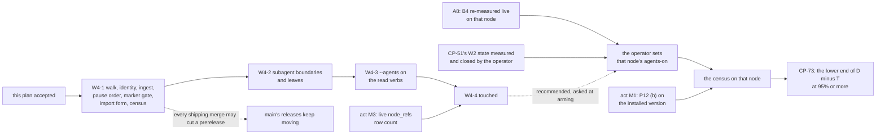
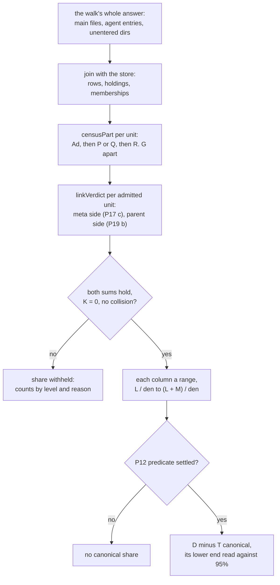

# ccrc history W4: subagent history and `touched` Implementation Plan

> **For agentic workers:** REQUIRED SUB-SKILL: Use superpowers:subagent-driven-development (recommended) or superpowers:executing-plans to implement this plan task-by-task. Steps use checkbox (`- [ ]`) syntax for tracking.

> [!CAUTION]
> **A draft for review. It authorises nothing.** It was drafted under programme item CP-71 and is not accepted. Its independent review is the gate, and no W4 implementation starts before the plan is accepted (the addendum's approval note).
> This plan does **not** authorise any of the following:
> - a feature implementation, or the merge of this document;
> - setting, removing or writing an ingest arming marker on any node;
> - a store read, a transcript read, a host probe, a release, a promotion or a rollout.
>
> What still gates W4, carried from the addendum unchanged:
> - **W1-B4 live before any subagent capture** (A8), on every session-hosting node. The coordinator measures it read-only at each W4 dispatch and again before a W4 release, and it is measured on each node before the operator sets that node's ingest arming marker. CP-34(b)'s record of 2026-10-27 is not taken as the prerequisite;
> - **CP-51's W2 close acts, which are not waived.** Before a W4 release, the operator measures on the node any W2 live state those acts name: a recall-off generation, a headless-on marker, an update freeze or an `--out` file. None is assumed absent, and closing one is the operator's act;
> - **the operator's ingest arming marker per node** (P15 (b), ruled). It has no writer in the tree, and no session sets it;
> - **the parent-link coverage check** (A9, by the census) and **the resource-bound checks** (P5, P9), measured as this plan's steps and acts say.
>
> W2 is recorded as **evaluation not run** (the operator's conditional skip ruling of 2026-11-02). This plan claims no W2 result. The operator's rulings R-B1 to R-B4 stand: if W2 is expressly resumed, no W4 release is installed inside R-B2's span (acts 6 to 28). Nothing here claims that W1's acceptance is complete: W1-k's miss of 2026-10-01 waits on the operator's ruling, and W1-b, W1-e and W1-f wait to be re-measured (CP-37).

**Goal:** Subagent and workflow-agent transcripts join the lossless store, each linked to its parent, with a census that measures that link against A9's 95% bar; and a read-only `ccrc history touched <path|symbol>` names the history nodes whose stored refs name a file.

**Architecture:**
- Discovery's own walk, `sweep.mjs` `walkTranscripts`, gains a subagent arm below each session directory (P20 (a)). Ingest and the census's op arm both call it, so they never disagree about what the tree holds.
- Every decision is a pure decider in `lib.mjs`: the file and directory grammar, the identity (P1), the meta link (P17), the pause order (P5), the pre-install predicate (P6), the census parts, sums, verdicts and range (P11, P12, P18, P19), and `touched`'s split, normalisation, match and rank (P8, P13). `sweep.mjs`, a new `census.mjs`, `derive.mjs` and `recall.mjs` act on them.
- No schema change: every W4 column exists since schema v1 (`transcripts.agent_id`, `parent_tool_use_id`, `workflow_run_id`, `agent_type`), and the install record is a `meta` row.
- Four PRs in the addendum's order, W4-1 to W4-4 (section 8). W4-1 carries the arming marker's gate and the pause order, so no build ingests subagent text without them.

**Tech Stack:** Node ESM (`ccd/history/*.mjs`) on `node:sqlite`; one `shared/*.mjs` grammar holder if P10's measurement allows; bash in `ccd/ccrc`'s help text only; vitest.

**Spec:**
- `docs/superpowers/specs/2026-10-29-ccrc-history-w4-subagents-touched-design.md`, the W4 addendum, approved by the operator on 2026-11-09 (item 121). Its decision table (P1 to P20, every row ruled), its pin table (section 5), failure table (section 6), files and ownership (section 7) and PR split (section 8) are this plan's requirements;
- `docs/superpowers/specs/2026-10-05-ccrc-history-lossless-dag-design.md`, rev 3.6, at the sections the addendum names: §6.2, §7.4, §8.2, §8.4, §9.3, §9.7, §9.15, §10.4, §10.6 item 5 and §10.7;
- `docs/superpowers/plans/2026-10-29-ccrc-history-w3-steering.md`, for the paths W3 and W4 share and the coordinator's switch-region ruling.

**Authority, in order:** the addendum's rulings and its "Already approved" list (A1 to A11), then the spec, then `main`. The addendum's section 4 lists the canonical-spec amendments and §8.4 departures its rulings need; they are the coordinator's, in a docs PR, and are cited here, not re-listed.

**Base.** Every anchor below was re-measured by content, read-only, from source, at `origin/main` `ec07e0bdfc32f39af243c76543722c2c3c513556`. The three inputs are unchanged there since `a760833a62738fbec4ea9f57fea2605bc0d77e1b`, where the brief cut them. Fix round 1 (review 1726) re-read every anchor it touches at `origin/main` `e933f1ec7c440302b08df450d42fd407d3d12e35`: no cited path under `ccd/history`, `ccd/compact-card.mjs`, `ccd/session-hook.sh`, `shared/lifecycle.ts`, `server/src/workflows`, the single-definition helpers or the history tests changed, and the changes to `ccd/ccrc` and `README.md` touch neither the history help paragraph nor the writing verbs' sentence. Fix round 2 (review 1728) re-read every anchor it touches at `origin/main` `0ec5e6381f5ad8e6fa44a58b0401abf1d6b521e0`:
- in `sweep.mjs`: `walkTranscripts`, `discoverTranscriptsWithin`, `candidateFiles`, `tickStmts`' `behindPaths` and `behindRows`, `behindFiles`, `behindStats`, `ingestScanDue`, `newBudget`, `makeIngestCtx`, `ingestTick`, `importEvidence` and `importApply`;
- in `lib.mjs`: `parseOpVerbArgs`' `import` arm, `COMMON_READ_OPTIONS`, `READ_OPTIONS` and `deriveHealth`;
- `store.mjs`' `createStore` and `openWriter`, and `history-ingest.test.ts`' `openFixtureStore`;
- README's writing-verbs sentence.

Nothing under `ccd/history` changed after `e933f1ec7`, and README's changes since then do not touch that sentence. Fix round 3 (review 1731) re-read the following at `origin/main` `8b0fab68f`, where none of them has moved since `0ec5e6381`:
- in `sweep.mjs`: `scheduledPassBody` (the run arm, its `setMeta(db, 'capture_pause', …)` and its `tick()` call), `tick()`'s `ingestTick` gate, `importRoom`, `importPaused`, `transcriptsUnder`, `importApply`, `mapRegistryUuid`'s `skipped` and `refused` outcomes, `hintedUuids` and `idOfDrainingName`;
- in `cli.mjs`: the status envelope's `history_off`, and `healthInputsOf`;
- in `lib.mjs`: `readOpt`, `parseReadArgs`' defaults literal, `capBytes`, and the module's one import, `node:crypto`, which `history-lib.test.ts` pins twice: the case "imports exactly node:crypto" and lib's row of its `RINGS` table. P10's shared arm amends both (Task 1B); on the copy arm both stand;
- in `historyHelpers.ts`: `runDriver`, `DriverDeps.sizeBytes`, `counters` and `openStoreRO`. W3-1 had not landed at the base: its carries and `nodeRangeText` are absent (below). A line number is never cited; each task re-finds its anchor by the symbol or quoted content named, and a moved line is a corrected prediction, never a stop.

Fix round 4 (review 1735) re-read the following at `origin/main` `04bbaa82a`, where none of them has moved since `8b0fab68f`:
- in `sweep.mjs`: `sideStmts`' `notCaughtUp` and its two callers, `passCtx`, the run arm's `planRun` call and its `passCtx` call, `tick()`'s `makeIngestCtx` call, and `importFile`'s stop message;
- in `lib.mjs`: `historyPaths`;
- in `history-lib.test.ts`: the import pin, `RINGS`, the case "every ccd/history/*.mjs has a ring", `CARD_FORMS` and the `historyPaths` cases;
- in `historyHelpers.ts`: `makeHistoryBox`'s `roster` option and `recordOpenFlags`.

## Global Constraints

- **Gate.** No task runs before this plan is accepted. No W4 release before the W2 live state CP-51's close acts name has been measured on the node and, if any stands, closed by the operator. A8 is measured as the box above says, by the coordinator, read-only. A build worker never measures live state.
- **Order.** W4-1, W4-2, W4-3, W4-4 (Figure 1). Each PR is its own run, opened before the previous run closes, with a held-out review, landed under rule L. W4-3 and W4-4 both edit `cli.mjs` and `recall.mjs`, so they run one after the other.
- **W3 and W4 are independent waves** (A10). The coordinator's ruling sets no order between W4-1 and any W3 PR. They do share files:
  - **the switch regions**: the `history-switches` root in `shared/lifecycle.ts` (W3-3, W4-1), its root pin in `server/test/lifecycle.test.ts` (W3-3, W4-1), and `server/test/single-definition/switches-history.test.ts`'s `HOLDERS` (W3-1, W3-3, W4-1) and `KEYS` (W4-1). The ruling, verbatim: "when one of W3-1, W3-3 and W4-1 lands after another that edited the same switch regions (the history-switches root in shared/lifecycle.ts, lifecycle.test.ts's root pin, switches-history.test.ts's HOLDERS and KEYS), the later one absorbs main only on worker clause 16's triggers (a conflict there is the expected one), by merge and never a rebase, and carries the earlier edits; a clean merge needs no absorb, and the merge queue's combined run tests it. The plan's order W3-1, W3-2, W3-3 stands; the ruling sets none between W4-1 and the W3 PRs.";
  - **whole-path claims**: W3-1 and W4-1 both claim `ccd/history/lib.mjs`, `lib.d.mts`, `sweep.mjs` and `README.md`, and the tests `history-lib.test.ts` and `history-sweep.test.ts`. Every other overlap of the two claims tables is serialised by the claims rule below (review 1696, V3).
- **Claims are whole paths, measured when the work starts.** Run `ccrc-api claims list --project ccrc-pwa` at the wave's start and claim every path of the task group, all or nothing. A path another run holds is mailed to its holder through the 409's `mailHint`, and is edited only after it is released or handed over. A claims line in this plan is not permission.
- **The ingest arming marker has no writer in the tree** (P15 (b)): `~/.ccrc/history/agents-on` (name: build question `history-w4-agents-on-marker-name`), defined once as `SWITCHES.agentsOn` in `lib.mjs`, named in `switches-history.test.ts`'s `HOLDERS` and `KEYS`, and added to the `history-switches` lifecycle root. It has two readers and no writer. Both ask one lib helper, `agentsArmedOf(st)` (Task 1C), over one `lstat` of `historyPaths(home).agentsOn` (a field Task 1C adds), handing it `{ isFile: st.isFile(), isSymbolicLink: st.isSymbolicLink() }`, or `null` when the `lstat` throws:
  - the sweep's ingest gate, in `ingestTick`, which then asks `decideAgentsPause` (Task 1E). `planRun` takes no armed input, so the pass reads no marker;
  - the status's health input, `cli.mjs`'s status envelope (`agents_armed`), which `healthInputsOf` reads as `agentsArmed` (Task 1E).

  No test, step or tool sets the marker on a live node.
- **The pause order** (P5): subagent capture pauses at 90% of the store cap, counted `capture_paused_agents_at_cap`, with a doctor WARN, while main capture continues to the cap; at the cap or below the floor, all capture pauses as today (§9.3). `capture_paused_agents_at_cap` does not join W1's `capture_paused_*` kill rule, and the 90% WARN is its watch: the coordinator's ruling under P5 (2026-11-09, fix round 1), which the operator may override.
- **One admitted set for subagent files, literally one.** A subagent file is ingested only when its parent session's uuid is in `knownUuids` (a confirmed epoch's uuid, or a `$REG/*.uuid` of the UUID grammar), of which the tick's hinted uuids are a subset. The tick ingests the post-install files of that set, and `import --agents --apply` the pre-install ones. The import uses `knownUuids` too, never `importEvidence`'s wider map: a parent known only through that wider evidence (a `$REG/<id>.compactions` line) is not admitted until a plain `import --apply` has confirmed its epoch (Task 1F; departure `history-w4-agent-import-known-parents-only`, the coordinator's ruling in fix round 2).
- **At a tick, only the two gated arms read a subagent file** (the coordinator's ruling in fix round 2, review 1728 F1: filter, not gate). They are the scan tick's agent arm (Task 1C) and `activeAgentRows` (Task 1E). Outside a tick, the operator's `import --agents --apply` is the one other reader. It is the operator's own act: it reads no marker, but it is refused in a session and under `history-off`, and it pauses at 90% (Task 1F). Each is ruled by `decideAgentIngest`, so the marker, `history-off` and the 90% pause reach both, and each binds by the file's `(uuid, agent key)`. Every other route selects main rows only (`agent_id = ''`):
  - the hinted walk and `indexedTranscripts` pass no agent sink;
  - `behindPaths`, and so `behindFiles`, select main rows only;
  - `sideStmts`' `notCaughtUp`, the sidecar gate, selects main rows only. It is the same "behind" predicate, its second site (D-4309), and it withholds a uuid's sidecars while a row of that uuid is short; P3 and P5 keep main capture, sidecars included, from waiting on a subagent row (the coordinator's ruling in fix round 4, review 1735 F2);
  - `activeRows` already does.
  `behindRows` follows `behindFiles`, as `behindStats`' doc requires ("counted the way behindFiles selects them", D-4309), so a subagent row that no route reads never holds `files_behind` above 0. A stored subagent row left short of its size, whose parent is not active, waits for the next scan tick. While its node is disarmed or paused it waits unread, and holds none of its parent's sidecars back.
- **The census's withholding rules** (P11, P12, P17 to P19): no share prints while `K > 0`, while `identity_collision > 0`, or while either partition sum fails; every share is a range, `L / den` to `(L + M) / den`; acceptance reads the lower end of `D − T` against 95%, and no canonical share exists until P12 (b) is measured on the installed version or its fallback, (c), takes over. The census never turns an unknown into a zero.
- **Values, verbatim from the addendum:**

  | Value | Setting |
  |---|---|
  | Agent id grammar | `[A-Za-z0-9_-]`, 1 to 128 chars, the hook's `_hook_compact_scope` gate and `CCRC_ID_MAX` (128) |
  | Run id grammar | `RUN_ID_RE = /^wf_[0-9a-f]{8}-[0-9a-f]{3}$/` (`server/src/workflows/model.ts`), one holder or a parity-pinned copy (P10) |
  | Identity | Agent-tool `agent_id` = `<ID>`; workflow `agent_id` = `<RUN>/<ID>`, `workflow_run_id` = `<RUN>` (P1) |
  | Meta read | a regular non-link file, at most 64 KiB, a JSON object; `toolUseId` the link; `agent_type` only from a field act M2 measures, else NULL |
  | Link decode (P4) | window `[t0 − 15 min, t0]`, at most 64 decodes per transcript, newest first; a body over `blobOverDecodeCap` (16 MiB) never decoded |
  | Workflow (b) lookup (P12) | parent `type = 'user'` rows in the window act M1 measures, at most 64 decodes per run, one verdict per `(session, runId)` per census |
  | Pause order (P5) | subagents at 90% of the cap; all at the cap or the floor |
  | Install record (P6) | `meta` key `agents_since_ms`; post-install is `mtime ≥` the record |
  | `touched` caps | 10,000 candidate rows per query (all selects together); 20 rows by default, `--limit` up to `GREP_LIMIT_MAX` (100) |
  | `touched` cost (P9, P13) | p95 under 2 s on a fixture of the measured `node_refs` row count |

- **Every test, typecheck, mutant and measurement** runs through `ccrc test -- …`, from the package directory, in the foreground, with `--maxWorkers=2` and a Bash timeout of at least 600,000 ms, on fixture HOMEs only (`makeCcdHarness`, `tmpHelpers.ts`, `historyFixtures.ts`, `historyHelpers.ts`), with fixture accounts `lane-a` and `lane-b`: the W4 rig passes `makeHistoryBox` that roster through its `roster` option (`LANE_ROSTER`, Task 1C), since its default, `DEFAULT_TEST_ROSTER`, names other accounts. Scratch stays under the session's temp root. This drafting wave ran none of them.
- **How a mutant runs** (the programme's practice, stated once; review 1728 F7). `ccd/coordinator-skill/references/mutation-run.py` mutates Python only, so it is not used for these `.mjs`, `.ts` and bash mutants. Run one mutant at a time, in this order:
  1. Save a copy of the file under the session's temp root, and record its sha256.
  2. Make one in-place edit.
  3. Run the named case through `ccrc test --`, bounded by `timeout -k` and a process cap (`ulimit -u`), and record it red.
  4. Restore from the saved copy, never with `git checkout`. Check the result byte for byte against the copy with `cmp`, and its sha256 against the recorded one.

  An edit to a file outside the PR's claims, such as Task 2's to `card.mjs`, is a mutant only: it is restored this way and never committed. Each task's "Mutants" line names the edit and the case that kills it.
- **Growth.** Each PR that edits `ccd/ccrc` (W4-1, W4-3 and W4-4) runs `cd server && GROWTH_CHECK=1 ccrc test -- ./node_modules/.bin/vitest run --maxWorkers=2 test/growth-check.test.ts` in its gate: `ccd/ccrc` is in `GROWTH_FILES`, under `GROWTH_LIMIT` (40 net code lines). A waiver counts only once committed.
- **Every PR's doc guards**, after `git fetch origin main`, sequentially from `server/`: `deviation-refs`, `dtbd`, `citations`, `anchors`, `topology-clean`, then `single-definition`.
- **The guards a W4 edit meets** (fix round 4's audit, read at `origin/main` `04bbaa82a`; the table is in the PR body). Each owning task edits its guard, lists its test file and runs it. Three apply to every task that meets them:
  - a new `server/test/history-*.test.ts` joins the node-floor job's Test list in `.github/workflows/ci.yml`, which `ci-pipeline.test.ts`' case "its Test step lists node-floor.test.ts, every history-*.test.ts and measure-history.test.ts, and nothing else" derives from the directory. A change under `.github/` makes the PR's CI a full run (`infraTrigger`);
  - `ccd/ccrc`'s history paragraph is pinned by substring in `ccrc-cli.test.ts` (`grep|describe|expand|tree`; `import|prune|reparse are dry runs unless --apply, and a dry run runs inside a session`; `Every --apply form and every doctor flag`), so every W4 phrase is added beside those strings, never inside them, and no switch path is spelled there (`switches-history.test.ts`' `USAGE_PROSE` admits `/history-off` alone);
  - a new line in `cli.mjs` that writes to stderr goes through `errLine`: `history-cli.test.ts`' case H-32 counts the file's `process.stderr.write(` lines.
- **Departures.** None is numbered here. Each is listed by slug under "Build questions and proposed departures", and the coordinator numbers any it approves at build time. A departure found while building is reported as an unnumbered slug. A task's notes for the ledger go in a new file under `docs/superpowers/plans/2026-11-09-ccrc-history-w4-subagents-touched/`, never in the ledger or an existing plan.
- **Public repository.** No private name, host, account, session id, address or absolute home path in code, fixtures, commits or PR text. Fixture homes are temp directories; fixture sessions are generated UUIDs.

## Review Focus

These are five inputs the addendum implies but no pin exercises, most likely first. Each names the task that owns its test.
1. **An `mtime` exactly equal to the install record.** P6 says post-install is "at or after" the record. A file stamped in the same millisecond must be ingested, and the census must place it in `Q` or `Ad`, never `P`. Owned by Task 1C, test `an mtime equal to the install record is post-install`.
2. **A scan tick whose walk is cut inside one session's `subagents/`.** The files not yet reached must wait for the next scan tick with their cursors intact, and nothing half-listed may be counted as unentered or refused. The census passes no `stop` to the walk, so it sees the whole tree. Owned by Task 1C, test `a walk cut inside subagents/ resumes and counts nothing unentered`. The cut comes from the test seam `ctx.agentStop` (Task 1C), which the agent arm asks before each entry. The run budget is a shared clock and byte count, and once it is spent the tick ingests nothing more, so it cannot leave exactly two files read.
3. **A parent stored from another home.** After a swap, a subagent's parent main transcript may be stored only from the other home's copy. The decode reads the store, not the path, so the unit can still be `L`. Owned by Task 1H, test `a parent stored from another home still resolves`.
4. **A `touched` argument that holds `_`.** `foo_bar.ts` must not match `fooXbar.ts`: every `LIKE` pattern escapes `%`, `_` and `\`. (A `%` cannot reach a query: `classifyRef`'s path patterns admit only `[\w./-]`, so such an argument is `bad-args`.) Owned by Task 4A, test `a query's _ matches only itself`.
5. **An id prefix that `--agents` makes ambiguous.** A node-id prefix unique among main nodes may collide with a subagent node's. Prefix uniqueness is computed within the scope (§8.2), so without `--agents` it resolves as today, and with it the answer is the ambiguity exit. Owned by Task 3, test `a node-id prefix unique without --agents is ambiguous with it`.

---

## Measured on the base (`ec07e0bdf`, read-only, from source)

| Fact | Where, by content | Consequence |
|---|---|---|
| `transcripts` has `agent_id TEXT NOT NULL DEFAULT ''`, `parent_tool_use_id`, `workflow_run_id`, `agent_type`, `UNIQUE (cc_session_uuid, agent_id)`. `SCHEMA_VERSION` is 2, whose V2 adds indexes only | `store.mjs` `V1`; `lib.mjs` `SCHEMA_ADDED` | no schema change; a stored verdict or a `touched` index would be a v3 (P4, P9: not authorised) |
| Main transcripts get their row from `ensureTranscript`, which inserts `(cc_session_uuid)` and selects `agent_id = ''`. No ingest path writes a non-empty `agent_id`; `transcriptUpsert` serves segment replay only | `sweep.mjs` `ensureTranscript`, `replayStmts` | Task 1D adds the agent row writer; replay already carries the four columns (§9.15) |
| `walkTranscripts(homes, take, stop = null)` is not exported, returns `false` when `stop()` fired, calls `take({path, uuid, home})`, lists `<home>/projects` and each project directory with `readdirSync` (a linked project directory is listed), and skips an unlistable one silently. `discoverTranscriptsWithin` cuts it by budget; an incomplete walk leaves `scan_discover_ms` unset, so the next scan tick walks from the top | `sweep.mjs` `walkTranscripts`, `discoverTranscriptsWithin`, `SCAN_META` | Task 1C extends it with a fourth parameter, `agents`, and pins today's output first. Transcript discovery is budget-cut, not rotating (build question `history-w4-agent-scan-not-rotating`) |
| `bindFile` binds by `(dev, ino, source_key)` through `planFileRead`, which retires when the path's uuid differs from the row's, when both birth times exist and differ, or, with a birth time missing, when the first-line sha differs; a shrink or a tail-sha change rescans | `sweep.mjs` `bindFile`; `lib.mjs` `planFileRead` | Task 1D widens the identity check to the `(uuid, agent_id)` key |
| `activeRows` selects `agent_id = ''`, `source_key = ''`, `status = 'live'` for the registered uuids; `activeFiles` stats them through `decideActiveRead` up to `ACTIVE_STAT_MAX` (256) | `sweep.mjs` `activeRows`, `activeFiles`; `lib.mjs` `ACTIVE_STAT_MAX`, `decideActiveRead` | P3's active-parent arm is a sibling statement over `agent_id <> ''` (Task 1E) |
| The `sweep.mjs` carries are not done: `activeFiles` adds `fileIds.add(row.fileId)` before the `seen` check, the cap, the budget and the stat (review 1065 F4); it runs `activeRows` with `'[]'` when no uuid is registered (F10). `activeFiles` is private and reached through the exported `candidateFiles(db, ctx, scan, sideScan = scan, budget = null)`; it already takes `ctx.activeStat` and `ctx.activeStatMax` as seams. `activeRows` is a prepared statement cached per database object in `tickStmts` | `sweep.mjs` `activeFiles`, `candidateFiles`, `tickStmts` | Task 1A takes both through those seams, unless W3-1 lands them first. The add before the `seen` check is also the alias dedupe: a file taken this tick under one alias skips its others (review 1726, A1) |
| The `lib.mjs` carry is not done: `MARK_CHECK_GLOSS.budget` reads "the run budget was spent before its next batch, ingest first", and its block comment still says "its starvation behind ingest is accepted". `MARK_CHECK_GLOSS` is module-private; its one reader is `markCheckDetail`, so the gloss reaches a test only through `deriveHealth`'s `export-marks-unchecked` detail, pinned in `history-lib.test.ts`'s case "a check that stopped WARNs export-marks-unchecked, naming its last word, …" | `lib.mjs` `MARK_CHECK_GLOSS`, `markCheckDetail` | Task 1A takes it through that case, unless W3-1 lands it first |
| `planRun` decides `pause`: `at-cap` at `sizeBytes >= capBytes(capGb)`, else `low-disk`. The counters are literals in `sweep.mjs`: `capture_paused_at_cap`, `capture_paused_low_disk` | `lib.mjs` `planRun`, `capBytes`, `capOf`; `sweep.mjs` | P5's 90% arm is `decideAgentsPause`, asked in `ingestTick` after its marker read, from the size and cap the pass measured for `planRun`; `planRun` is unchanged (Task 1E) |
| The tick discovers main transcripts for the hinted uuids (`hintedUuids`: a draining id's two newest confirmed epochs and its `$REG/<id>.uuid`), the stored files behind (`behindFiles`), between scans a registered session's changed files (`activeFiles`), and at a scan tick every `knownUuids` uuid's files (a confirmed epoch's, and every `$REG/*.uuid`). `candidateFiles` calls the walk twice per tick, `discover(hinted)` and, at a scan tick, `discover(known)`; `indexedTranscripts` walks a third time for its cache. `import --apply` maps from evidence (`importEvidence`) and lists the unmapped, never ingesting them | `sweep.mjs` `candidateFiles`, `knownUuids`, `hintedUuids`, `indexedTranscripts`, `importApply` | the one admitted set is `knownUuids` (Global Constraints); only the scan tick's `discover(known)` passes the agent arm (Task 1C) |
| `tickStmts`' `behindPaths` selects every live `source_key = ''` row with `size > offset`, with no `agent_id` filter. `behindFiles` hands each as a bare `{path, uuid, home}` on every tick, before the active and scan arms, and `bindFile` binds it through `ensureTranscript(uuid)`, the main row. `behindRows`, which `behindStats` counts for `files_behind` and `last_zero_behind_ms`, selects the same rows; its doc says it counts them "the way behindFiles selects them" (D-4309). `sideStmts`' `notCaughtUp`, the predicate's second site, selects a uuid's live, short rows the same way, with no `agent_id` filter, and `notCaughtUp(db, homes, uuid)` holds that uuid's sidecars back while one is found | `sweep.mjs` `tickStmts`, `behindFiles`, `behindStats`, `sideStmts`, `notCaughtUp` | Task 1C filters the three statements to `agent_id = ''` (Global Constraints, "Only the two gated arms") |
| The run budget is `newBudget(now, { maxMs, maxBytes, chunkBytes })`, one per tick, shared by discovery and ingest. `discoverTranscriptsWithin` passes the walk `() => !budgetLeft(budget)` as `stop`, asked before each `projects/` and slug listing. A cut walk answers `complete: false`, so `scan_discover_ms` stays unset and the next tick is a scan again (`ingestScanDue`). In-process cases drive one tick as `ingestTick(db, makeIngestCtx(home, homes, nowMs, ids), newBudget())` over a store from `createStore(home)` and `openWriter(dbFile)` | `sweep.mjs`; `store.mjs`; `history-ingest.test.ts` `openFixtureStore` | the test helpers of Task 1C, and its `ctx.agentStop` seam |
| Doctor's words are decided in `lib.mjs` `deriveHealth`: FAIL `at-cap`, FAIL `capture-paused-low-disk`, WARN `cap-near` from `CAP_WARN_PCT` (80) of the cap until `at-cap`, WARN `breaker-open`, with `HEALTH_WORDS` and `HEALTH_REMEDIES`. `ccd/ccrc-doctor-checks` `_check_history` relays every word `history status --json` gives, FAIL or WARN, with no list of words of its own | `lib.mjs` `deriveHealth`; `ccd/ccrc-doctor-checks` `_check_history` | P5's WARN is a `deriveHealth` row and needs no doctor-checks edit; Task 1E Step 6 re-measures that. From 90% to the cap it stands beside `cap-near` (Task 1E) |
| §10.7's W1 kill rule names "a `capture_paused_*` counter keeps rising for more than 6 h". No code holds it: it is the operator's watch | spec §10.7; no hit for it in `ccd/history` | the new counter's name matches that pattern (Task 1E Step 6; build question `history-w4-agents-pause-and-kill-rule`) |
| `WRITING_FORMS`, an object keyed by form: `import-apply` (not irreversible), `import-session-apply` (irreversible), and the prune, doctor and recall-off forms. `formOf(op, args)` takes the raw argv and tests `args.includes(flag)`: `import` without `--apply` is `null`, a dry run, and with `--session` or `--file` it is `import-session-apply`, else `import-apply`. `parseOpVerbArgs`' `import` arm reads `--apply`, `--session`, `--file` only. `OP_OF_VERB` (`cli.mjs`) and `OP_VERBS`, `OP_HANDLERS`, `OP_DRY_RUNS` (`sweep.mjs`) name the ops | `lib.mjs`; `cli.mjs`; `sweep.mjs` `opPass` | Tasks 1F and 1G add `import --agents` and `census` |
| `SWITCHES`: `off`, `maxGb`, `steerOff`, `steerLivePrefix`, `steerOnDir`, `headlessOn`. `switches-history.test.ts` pins `Object.keys(SWITCHES)` to `['off', ...KEYS]`, and `KEYS` is `['maxGb','steerOff','steerLivePrefix','steerOnDir','headlessOn']` | `lib.mjs` `SWITCHES`; `switches-history.test.ts` | Task 1E adds `agentsOn` to both |
| The `history-switches` row's root is `~/.ccrc/history-off, ~/.ccrc/history-max-gb, ~/.ccrc/history/headless-on`, pinned verbatim in `lifecycle.test.ts` | `shared/lifecycle.ts`; `lifecycle.test.ts` | Task 1E appends the marker; a W3-3 that landed first is carried by merge (the switch-region ruling) |
| `READ_VERBS = Object.keys(READ_OPTIONS)`, commented "`touched` joins in W4"; `COMMON_READ_OPTIONS` gives every read verb `--json`, `--session`, `--project`, `--workspace`; `decideScope` refuses two scope flags with `bad-args`; `READ_RUNNERS` (`cli.mjs`) maps each verb; `GREP_LIMIT_MAX` is 100. `READ_VERBS` is in the O14 vocabulary list of `switches-history.test.ts` | `lib.mjs`; `cli.mjs` | Task 3 adds `--agents` to `COMMON_READ_OPTIONS`; Task 4B adds `touched` to `READ_OPTIONS` |
| `recall.mjs` selects every verb's rows by the scope's transcripts and never by `agent_id`: `transcriptsOf` joins epochs to transcripts by `cc_session_uuid` | `recall.mjs` `transcriptsOf`, `runTree` | today a stored subagent row would show by default; Task 3 hides it without `--agents`, and W4-1's rows reach no read verb before W4-3 only because no node is armed (Figure 1) |
| The `recall.mjs` carry's comments: "the global match runs once" (`rankedAndCounted`'s doc, and the block above `referrerSql`), and "a family's grep costs what its scope holds" (`referrerSql`'s doc and the same block), the latter now citing D-7095, CP-39d's scope-first grep, which landed after the reviews that raised the carry | `recall.mjs` | Task 3 re-reads each against the code before rewording (build question `history-w4-recall-carry-reread`). `isoOf` stays private there; `nodeRangeText` is absent |
| `derive.mjs` `leafFields` looks receipts up with `pickReceipt(receiptsOf(…), receiptWindow(…))` in its `native_leaf` arm only ("A raw leaf never looks a receipt up"); parents come from `deriveParents` → `deriveEpochParents` → `fanInLevels` (`FAN_IN.leaf` 8, `FAN_IN.condensed` 4); `minedRefs` mines `file_path`, `notebook_path` and `command`, the last yielding nothing under the null regex | `derive.mjs` | Task 2's guards sit in `leafFields` and the slot list of `fanInLevels` |
| `derive.mjs` selects boundaries, their transcripts' files and an epoch's transcripts with `t.agent_id = ''`, and `card.mjs` selects main transcripts only (`agent_id = ''`) | `derive.mjs`'s prepared statements; `card.mjs` | W4-1 derives no subagent leaf and counts no subagent fork; Task 2 widens derive's statements under `leafPolicy`, so SA27 is W4-2's (build question `history-w4-sa27-in-w4-2`); SA9's card half already holds at the base |
| `loadGraph(path, maxBytes = GRAPH_MAX_BYTES)` answers `{nodes, byFile, files, index, links, degree}`; a node carries `id`, `label`, `source_file`, `community`; `resolveToken(token, index, cwd)` answers `{path}` or `{reason}`. `loadLabels` reads `.graphify_labels.json`, community labels | `ccd/compact-card.mjs` | a symbol matches a graph node's `label` (build question `history-w4-touched-graph-labels`) |
| `classifyRef` tests url, d-number, issue, test, path:symbol, sha, then path; `capRefs` keeps the first origin and at most `REFS_MAX` (40) | `lib.mjs` | `touched`'s kinds and its disclosure (Task 4A) |
| The hook's id gate: `case "$f" in ''\|*[!A-Za-z0-9_-]*) return 1 ;; esac` then `(( ${#f} <= CCRC_ID_MAX ))`, `CCRC_ID_MAX=128` | `ccd/session-hook.sh` `_hook_compact_scope` | SA34's parity half runs those two lines, found by content (Task 1C) |
| `RUN_ID_RE` is exported by `server/src/workflows/model.ts`, imported by `server/src/workflows/read.ts` and `server/test/workflows-model.test.ts`. `deploy/build-release.sh`'s `PATHSPEC` carries `shared` beside `ccd`; `server/src` already imports `shared/*.mjs` (`shared/mark.mjs`, `shared/spawn.mjs`), each with a `.d.mts` beside it; nothing in `ccd/history` imports `shared/` yet, and `history-lib.test.ts` pins lib's imports to `node:crypto` alone, in its import case and its `RINGS` row | as named | P10's measurement (Task 1B Step 1) has a likely answer, which the step still measures for the install and fallback paths; the shared arm amends both pins (Task 1B) |
| `meta (k TEXT PRIMARY KEY, v TEXT NOT NULL)`, with `setMeta` and `getMeta` | `store.mjs` | the install record needs no schema change |
| `entries` has `type`, a nullable `ts_ms`, `tool_name` (the first named `tool_use`, assistant rows only), and `entries_ts (transcript_pk, ts_ms)`; `blobOverDecodeCap(rawLen)` answers true, refuse, when `rawLen` is over `BLOB_DECODE_MAX` (16 MiB) or not a number | `store.mjs`; `lib.mjs` | the census's two lookups (Task 1G) |
| `nodes` has `session_pk`, `transcript_pk`, `kind`, `earliest_ms`, `latest_ms`, `gist`; there is no family column | `store.mjs` | `touched` prints the family as `runTree` does (Task 4B) |
| `ccd/ccrc` `_usage_history_paragraph` lists `status`, `grep\|describe\|expand\|tree`, `import\|prune\|reparse` and the doctor flags | `ccd/ccrc` | Tasks 1F, 1G, 3 and 4B add a phrase each |
| The skill has no verb list: the verbs are in "3. The ladder" and the scope flags in "5. Scope". README's section is "Session history: lossless recall". Its writing-verbs sentence begins "The writing verbs are the operator's: `import`, `prune --older-than <age>` (30 days at least) and `reparse`, each a dry run unless `--apply`, …". A separate sentence, "… and `import --session <id> --file <path> --apply` also need a terminal outside every `cc-*` pane.", is the terminal rule | `ccd/history-skill/SKILL.md`; `README.md` | Tasks 1F, 3 and 4B edit those places, found by content |
| The shim passes the rostered homes after `--` and is the one lock taker (`flock -n 9`; an op pass exits 75 when held) | `ccd/ccd-history-sweep` | the census verb runs through it, so it holds the lock while it runs (Task 1I measures how long) |

## Order and PR split


*Figure 1. The order. The four PRs merge in the addendum's order, and none waits on a live measurement but W4-4's ordered cap, which waits on act M3. A node first ingests subagent text when the operator sets its marker, after A8 and CP-51's state are measured there. P15 (b) leaves the timing to the operator, per node. The dashed edge from W4-4 is a recommendation, not a gate: this plan recommends arming no node before W4-4 has merged and been released there, a question asked at arming, not now (Later). The solid edges into the marker, A8 and CP-51's state, are gates. Acceptance needs the census on the armed nodes and P12's predicate settled by act M1, the one act that gates a canonical share.*

| PR | Tasks | Claims (whole paths, measured at the wave's start; tests under `server/test/`) | Pins | Rulings it carries |
|---|---|---|---|---|
| W4-1 | 1A to 1I | `ccd/history/lib.mjs`, `lib.d.mts`, `sweep.mjs`, `census.mjs` (new), `cli.mjs`, `ccd/ccrc`, `README.md`, `shared/lifecycle.ts`; `.github/workflows/ci.yml` (the node-floor job's Test list); P10's shared arm only: `shared/workflow-ids.mjs` and `.d.mts` (new), `server/src/workflows/model.ts`, `server/test/installTreeFixture.ts`; tests `history-agents-ingest.test.ts` (new), `history-census.test.ts` (new), `historyAgentFixtures.ts` (new), `history-lib.test.ts`, `history-sweep.test.ts`, `history-op.test.ts`, `history-cli.test.ts`, `history-maint.test.ts`, `history-recover.test.ts`, `ccrc-uninstall.test.ts`, `lifecycle.test.ts`, `single-definition/switches-history.test.ts`, `single-definition/vocabularies.test.ts`, `workflows-model.test.ts`; the task note `docs/superpowers/plans/2026-11-09-ccrc-history-w4-subagents-touched/w4-1.md` (new) | SA1 to SA6, SA10 to SA26, SA28 to SA34 | P1, P3, P4, P5, P6, P10, P11, P12, P15, P16, P17, P18, P19, P20 |
| W4-2 | 2 | `derive.mjs`, `lib.mjs`, `lib.d.mts`, `history-derive.test.ts`, `historyAgentFixtures.ts` | SA7 to SA9, SA27 | P2 |
| W4-3 | 3 | `recall.mjs`, `cli.mjs`, `lib.mjs`, `lib.d.mts`, `ccd/ccrc`, `ccd/history-skill/SKILL.md`, `history-recall.test.ts`, `history-lib.test.ts`, `history-skill.test.ts`, `single-definition/switches-history.test.ts` | AG1, AG2 | P7 |
| W4-4 | 4A to 4C | `recall.mjs`, `cli.mjs`, `lib.mjs`, `lib.d.mts`, `ccd/ccrc`, `ccd/history-skill/SKILL.md`, `README.md`, `.github/workflows/ci.yml` (the node-floor job's Test list), `history-touched.test.ts` (new), `history-lib.test.ts`, `history-recall.test.ts`, `history-skill.test.ts`; the task note `docs/superpowers/plans/2026-11-09-ccrc-history-w4-subagents-touched/w4-4.md` (new) | TC1 to TC23 | P7 (`touched`), P8, P9, P13, P14 |

**Predecessor contracts.**
- W4-2 needs W4-1's agent rows (`transcripts.agent_id <> ''`) to derive from; W4-3 needs W4-2's leaves to hide; W4-4 needs W4-3's `--agents`.
- W4-1 and W3-1 both claim `lib.mjs`, `lib.d.mts`, `sweep.mjs`, `README.md`, `history-lib.test.ts` and `history-sweep.test.ts`. Whichever runs second waits for the release or hand-over; its first step checks the carries (Task 1A).
- **README's regions.** W4-1 edits the writing verbs' sentence only (P6's form); W4-4 edits the history section's read-verb paragraph only. Each is found by content. A held README is mailed to its holder and not edited until released or handed over; the rest of the task proceeds.

## Measurements the rulings wait on

None of these gates W4-1's merge. Two kinds. **Coordinator acts** read the installed Claude Code version or a live store, read-only, as the W3 plan's act 1 did; no build worker runs them. **Build measurements** run on fixtures, inside a PR, through `ccrc test --`; no build worker measures anything against live state.

| # | Who and when | What it settles | Method | Evidence | Fallback |
|---|---|---|---|---|---|
| M1 | the coordinator, read-only; under W4-1 (Task 1H, SA14). It gates every canonical share (P12's ruling and the "workflow verdict" failure row), never W4-1's merge | P12 (b): whether the result of the call that launches a workflow run names the run id, and when it arrives | (1) in the installed Claude Code bundle, find by string anchor the run-id shape (`wf_` and `RUN_ID_RE`'s form) and the text the launching tool returns, and whether that return is immediate or at the run's end; (2) on the session-hosting node, for a sample of stored workflow runs, check whether the parent's main transcript holds a user row with a `tool_result` naming the run id, and its time against the run's first and last timed rows | the version, the anchors, the sample size, the count naming the run, and the timing (immediate, so window `[t0 − 15 min, t0 + 15 min]`, or at the end, so `[t_end, t_end + 15 min]`) | (c), the run summary `S/workflows/<runId>.json`, becomes the canonical predicate; SA14's (b) rows stay `.todo` |
| M2 | the coordinator, read-only; under W4-1 (Task 1D, SA16). It gates nothing: it decides SA16's second row, the field's value or NULL | whether a meta carries `agent_type`, and under which key | list the key set of the metas on the node (keys only), with the version that wrote each sample | the version, the key and its count | `agent_type` stays NULL (SA16's NULL row only) |
| M3 | the coordinator, read-only; under W4-4 (Task 4C). It sets the fixture for P9's and P13's p95, and holds TC20 and TC23's order until then | the fixture size for P9 and P13 | `SELECT count(*) FROM node_refs` on each session-hosting node's store, opened read-only | the count per node, the date, the store size | none: Task 4C does not run, TC20 and TC23's order stay `.todo`, and the unordered cap with its sentence ships (P13's fallback) |
| F1 | the W4-1 worker, Task 1B Step 1 | P10's arm | read-only, from source: does the shipped tree (`build-release.sh`'s `PATHSPEC`, `install.sh`'s layout under `~/ccrc`) and `deploy/deploy.sh`'s fallback push carry `shared/` beside `ccd/`, so that `ccd/history/*.mjs` can import `../../shared/workflow-ids.mjs` | the paths read and the answer, in the PR body | the recorded copy in `lib.mjs` with SA17's parity pin |
| F2 | the W4-1 worker, Task 1I | the census's duration and decode cost | the census on a fixture of G14's size: 1,454 subagent transcripts with metas, their parents' candidate rows, on fixture homes | wall time p50 and p95 over 5 runs, decodes performed, peak RSS, fixture bytes | none needed; a p95 above the sweep timer's 2-minute interval is raised as a build question before the merge, because the census holds the writer's lock |
| F3 | the W4-1 worker, Task 1E Step 6 | P5: whether doctor-checks needs an edit for the new WARN. The kill rule is not asked: the coordinator ruled under P5 that the counter does not join it (Global Constraints) | read `_check_history` | the reading, in the PR body, beside the ruling as Task 1E Step 6 records it | none |
| F4 | the W4-4 worker, Task 4C, after M3 | P9's 2 s p95 for `touched`, and P13's ordered cap | `touched` against a fixture store of M3's largest `node_refs` count, cold and warm, 20 runs per query shape | p50, p95, the query plan, fixture bytes | over 2 s: P13 keeps the unordered cap; P9's schema options come back only as new proposals |

## Carried constraints this plan owns

W3 and W4 are independent, so whichever first edits a file takes its carries, and the other's first step checks that they are done (addendum section 7). At the base none is done.

| File | Carry | Task here |
|---|---|---|
| `ccd/history/lib.mjs` | review 1088 F2: `MARK_CHECK_GLOSS.budget` and its block comment predate CP-39c's rule that the check runs on a slice of its own; the gloss is a runtime string pinned in `history-lib.test.ts`, so it changes with its pin | Task 1A, unless W3-1 (its Task 1A Step 5) landed it |
| `ccd/history/sweep.mjs` | review 1065 F4: `activeFiles` marks a file taken before it stats the file's path; review 1065 F10: `activeRows` runs with an empty uuid list. Each with its own regression and mutant | Task 1A, unless W3-1 (its Task 1B Step 5) landed them |
| `ccd/history/recall.mjs` | review 1065 F2 and review 1088 F4: the comments that say the global match runs once, or that a grep costs only what its scope holds. Comments only, no runtime pin. And if W3-1 has landed lib's `nodeRangeText`, the `tree` line's range calls it, with `tree`'s output pinned unchanged; `isoOf` stays | Task 3 Step 1 (W4-3 is `recall.mjs`'s first W4 editor) |

## Where every pin, failure row and ruling lands

Every pin of the addendum's section 5 is placed exactly once:

| Task | Pins |
|---|---|
| 1B | SA17 |
| 1C | SA1, SA3, SA22, SA34 |
| 1D | SA16, SA24, SA25 |
| 1E | SA10, SA11 |
| 1F | SA12, SA32 |
| 1H | SA2, SA4, SA5, SA6, SA13, SA14, SA15, SA18, SA19, SA20, SA21, SA23, SA26, SA28, SA29, SA30, SA31, SA33 |
| 2 | SA7, SA8, SA9, SA27 |
| 3 | AG1, AG2 |
| 4A | TC3, TC10, TC11, TC12, TC13, TC14, TC19 |
| 4B | TC1, TC2, TC4, TC5, TC6, TC7, TC8, TC9, TC15, TC16, TC17, TC18, TC21, TC22, TC23 |
| 4C | TC20 |

The walk's refusals (`agent_file_refused:<reason>`, `agent_dir_refused:<level>:<reason>`) and `agent_meta_orphan` are census figures, recomputed at each census (build question `history-w4-refusals-counted-by-census`), so the pins that count them (SA4, SA5, SA19, SA20) are the census task's.

Every row of the addendum's section 6, in its order:

| # | Input and condition | PR | Test |
|---|---|---|---|
| 1 | `subagents/` absent | W4-1 | 1C `no subagents/ and no projects root add nothing` |
| 2 | the projects root absent | W4-1 | 1C, the same case |
| 3 | any directory of the walk a link, not a directory, or unlistable | W4-1 | SA19 (1H) |
| 4 | several holdings of one key | W4-1, W4-2 | SA24, SA25 (1D); SA21, SA26 (1H); SA27 (Task 2) |
| 5 | holdings with no row in common | W4-1 | SA29 (1H) |
| 6 | metas naming different links | W4-1 | SA28 (1H) |
| 7 | a holding not read, unreadable, or changed other than by growth | W4-1 | SA30 (1H) |
| 8 | a listed holding of a stored row now refused | W4-1 | SA31 (1H) |
| 9 | a run directory outside `RUN_ID_RE` | W4-1 | SA4, SA20 (1H) |
| 10 | a meta, or a run's `journal.jsonl` | W4-1 | SA1 (1C); SA13's companions and orphan (1H) |
| 11 | a transcript candidate that is a link, not regular, or misnamed | W4-1 | SA5, SA13's `R` (1H) |
| 12 | an agent file older than the install record | W4-1 | SA12 (1F), SA18 (1H) |
| 13 | a stored row with none of its holdings listed | W4-1 | SA13's `G` (1H) |
| 14 | `journal.jsonl` | W4-1 | SA1 (1C) |
| 15 | a meta read whole with no `toolUseId` | W4-1 | SA13's `X` (1H) |
| 16 | a meta absent, oversized, a link, unreadable, not an object, or changed | W4-1 | SA6, SA28 (1H) |
| 17 | no candidate in a complete window matches | W4-1 | SA2 (1H) |
| 18 | the parent's window incomplete | W4-1 | SA33 (1H) |
| 19 | no timed row, a candidate undecodable or over the cap, the bound reached | W4-1 | SA2 and 1H `a subagent with no timed row is M` |
| 20 | the workflow verdict before (b) is measured | W4-1 | SA14 (1H) |
| 21 | the (b) lookup over the cap, undecodable, or bounded | W4-1 | SA14's (b) rows (1H), `.todo` until act M1 |
| 22 | the parent's main transcript not stored | W4-1 | SA15 (1H) |
| 23 | one agent id in two runs | W4-1 | SA3 (1C) |
| 24 | a subagent boundary whose anchor names no row | W4-2 | Task 2 `a subagent boundary whose anchor names no row is raw_leaf` |
| 25 | the store at 90% of the cap | W4-1 | SA11 (1E) |
| 26 | `history-off` present | W4-1 | 1C `history-off reads no subagent file` |
| 27 | the node's arming marker absent | W4-1 | SA22 (1C) |
| 28 | `graph.json` absent, over 96 MiB, malformed, or with no nodes or links | W4-4 | TC1, TC7 and 4B `a malformed graph answers as no graph` |
| 29 | a stored ref outside every root; a basename matching two graph files | W4-4 | TC11, TC14 (4A) |
| 30 | a ref of kind `test`, or a test file stored as a line-suffixed `path` | W4-4 | TC18 (4B), TC19 (4A) |
| 31 | the prefilter over 10,000 candidates | W4-4 | TC16, TC23 (4B) |
| 32 | the store unreadable, migrating or recovering | W4-1, W4-4 | SA23's exits (1H); 4B `touched answers the read verbs' store exits` |

The rulings each PR carries are the PR table's last column. Each task names the rows it builds.

---

## Task group W4-1: the walk, ingest, the pause order, the marker gate, the import form and the census

**Claims, pins, failure rows and rulings:** the PR table's W4-1 row and the two placement tables above. **Gate:** `GROWTH_CHECK=1` growth-check (it edits `ccd/ccrc`); every doc guard. **Mutants:** listed per task, each killed by the named case, each run as Global Constraints' "How a mutant runs" says.

### Task 1A: The carries, and today's walk pinned

**Files:**
- Modify: `ccd/history/lib.mjs` (`MARK_CHECK_GLOSS` and its block comment), `ccd/history/sweep.mjs` (`activeFiles`)
- Test: `server/test/history-lib.test.ts`, `server/test/history-sweep.test.ts`

**Interfaces:** no export is added; each case reaches the code through what the base already exports.
- `discoverTranscripts(homes, uuids)` (exported) drives the unexported `walkTranscripts`.
- `candidateFiles(db, ctx, scan, sideScan = scan, budget = null)` (exported; `scan` has no default, and `sideScan` defaults to `scan`) reaches the private `activeFiles` on a non-scan tick, with its existing seams `ctx.activeStat: (path: string) => Stat` (a counting stub records each path it is asked) and `ctx.activeStatMax: number`.
- `countAll(db: DatabaseSync, needle: string): { db: DatabaseSync, calls: () => number }`, a helper in `history-sweep.test.ts`: a `Proxy` over `db` whose `prepare` wraps the statement whose SQL contains `needle` and counts its `.all` calls, passing every other member through. `tickStmts` caches per database object, so the proxy gets fresh statements. The needle for `activeRows` is `"t.agent_id = '' AND f.source_key = ''"`.
- `deriveHealth(h)` (exported) reaches the module-private `MARK_CHECK_GLOSS` through its `export-marks-unchecked` detail.
- Produces nothing new. The characterization case is the baseline Task 1C must keep green.

- [ ] **Step 1: Check whether W3-1 took the carries.** `git fetch origin`, then read at `origin/main`: `git grep -n "starvation behind ingest" origin/main -- ccd/history/lib.mjs` (a hit means review 1088 F2 is not done), and `activeFiles`' body (F4 is done when `fileIds.add` follows the verdict; F10 when an empty uuid list returns before `activeRows` runs). Skip each step below whose carry is done, and say so in the PR body.
- [ ] **Step 2: Write the failing tests.**

```ts
// history-lib.test.ts: the existing case "a check that stopped WARNs export-marks-unchecked, naming its last word, …"
// changes its expected detail in this commit, from "(the run budget was spent before its next batch, ingest first)" to:
expect(r.warn[0]!.detail).toBe(`store ${STORE}: the check of the export marks after a bind has not finished: it last stopped on budget `
  + `(the mark check's own slice of the run budget was spent before its next batch), has stopped on budget or off for 30 min, and has cleared at least 4 mark(s) so far; ${TAIL}`);
// history-sweep.test.ts
it('activeFiles tries a file\'s next alias when the first one is skipped (review 1065 F4)', () => {
  // one ingest_files row, two file_paths aliases; ctx.activeStat answers the first path as vanished (skip) and the second as grown
  const r = candidateFiles(db, { ...ctx, activeStat: statStub({ [firstAlias]: 'vanished', [secondAlias]: grown }) }, false);
  expect(r.files.map((f) => f.path)).toContain(secondAlias);
});
it('activeFiles keeps one candidate per file when its first alias was already taken this tick (review 1726, A1)', () => {
  // the first alias is hinted this tick (in seen): the second alias is neither stated nor taken
  expect(stated(secondAlias)).toBe(0);
  expect(r.files.map((f) => f.path)).not.toContain(secondAlias);
});
it('activeFiles runs no query when no uuid is registered (review 1065 F10)', () => {
  const c = countAll(db, "t.agent_id = '' AND f.source_key = ''");
  candidateFiles(c.db, ctxWithNoRegisteredUuid, false);
  expect(c.calls()).toBe(0);
});
it('discovery lists today\'s main transcripts unchanged (P20 characterization)', () => {
  // two homes; a project with <uuid>.jsonl and a notes.txt; a linked project directory; an unlistable one
  // (mode 000, skipped as root); a session directory holding subagents/agent-a.jsonl
  expect(discoverTranscripts(homes, allUuids)).toEqual(PINNED_MAIN_LIST); // the linked project's transcript included, nothing from subagents/
});
```

  The characterization case and the A1 case are green on `main` before any other W4 change; the F4 and F10 cases and the reworded detail are red.
- [ ] **Step 3: Run them.** `cd server && ccrc test -- ./node_modules/.bin/vitest run --maxWorkers=2 test/history-lib.test.ts test/history-sweep.test.ts`. Expected: the F4 case, the F10 case and the reworded detail FAIL on their assertions; the characterization and A1 cases PASS.
- [ ] **Step 4: Implement.** Reword the gloss and its block comment to CP-39c's own-slice rule. In `activeFiles`, mark a file id taken when its path is in `seen` (the base's alias dedupe, kept) or after a `read` or `same` verdict, so only a `skip` leaves its next alias open; and return `{ files: [], complete: true }` before the query when the uuid list is empty.
- [ ] **Step 5: Run them: all pass.** Mutants: (a) `fileIds.add` moved back before the stat (killed by F4's case); (b) the id marked only after a verdict, the `seen` arm dropped (the A1 case); (c) the early return removed (F10's case); (d) the old gloss restored (the reworded detail).
- [ ] **Step 6: Commit** `fix(history): the lib and sweep carries (review 1088 F2, review 1065 F4 and F10)`.

### Task 1B: The grammars, the identity, and the run-id holder (P1, P10, P20)

**Files:**
- Modify: `ccd/history/lib.mjs`, `ccd/history/lib.d.mts`
- Create (P10's shared arm only): `shared/workflow-ids.mjs`, `shared/workflow-ids.d.mts`; Modify: `server/src/workflows/model.ts`, `server/test/installTreeFixture.ts` (`TREE_FILES`); Run: `server/test/module-format.test.ts`, `server/test/ccrc-install-tree.test.ts`, `server/test/ccrc-containment.test.ts`
- Test: `server/test/history-lib.test.ts` (the new cases; on the shared arm also its import case "imports exactly node:crypto" and lib's `RINGS` row, with a CONTROL), `server/test/single-definition/vocabularies.test.ts`, `server/test/workflows-model.test.ts` (unchanged unless its import moves)

**Interfaces:**
- Produces, in `lib.mjs` with types in `lib.d.mts`:
  - `AGENT_ID_MAX = 128`; `agentIdOk(id: string): boolean` (1 to 128 chars of `[A-Za-z0-9_-]`);
  - `RUN_ID_RE`, imported from `shared/workflow-ids.mjs` and re-exported (shared arm), or defined here with SA17's parity pin (copy arm);
  - `AGENT_LEVELS = ['root', 'project', 'session', 'subagents', 'workflows', 'run']`, `AGENT_DIR_REASONS = ['link', 'not-dir', 'unlistable']`, `AGENT_FILE_REASONS = ['run-id', 'name', 'link', 'not-regular']`, each frozen and added to `switches-history.test.ts`'s O14 vocabulary list in Task 1C, with the types `AgentLevel`, `AgentDirReason` and `AgentFileReason` derived from them in `lib.d.mts`;
  - `classifyAgentName(name: string, where: 'subagents' | 'run'): { role: 'candidate', id: string | null } | { role: 'meta', id: string } | { role: 'journal' } | { role: 'descend' }`. `descend` is `workflows` in `subagents/` only; `meta` is `agent-<ID>.meta.json` with `agentIdOk(ID)`; `journal` is `journal.jsonl` in a run directory only; every other name is a candidate, whose `id` is `<ID>` for `agent-<ID>.jsonl` with `agentIdOk(ID)`, else `null`;
  - `decideAgentDir({ kind: 'dir' | 'link' | 'file' | 'other', listable: boolean }): { enter: true } | { enter: false, reason: 'link' | 'not-dir' | 'unlistable' }`;
  - `decideAgentFile({ kind: 'file' | 'link' | 'dir' | 'other', id: string | null, runOk: boolean }): { verdict: 'admit' } | { verdict: 'refuse', reason: 'run-id' | 'name' | 'link' | 'not-regular' }`, tested in that order, so every candidate in a misnamed run directory is `run-id`;
  - `agentKey(id: string, runId: string | null): string`, `id` or `` `${runId}/${id}` `` (P1).

- [ ] **Step 1: Measure P10 (act F1), read-only, from source.** Read `deploy/build-release.sh`'s `PATHSPEC`, `install.sh`'s layout of `~/ccrc`, `deploy/deploy.sh`'s push of the working tree, and every loader of `ccd/history/*.mjs` (the shim's `exec node … "$HOME/ccrc/ccd/history/sweep.mjs"`, `ccd/ccrc`'s history dispatch, `ccd/ccrc-doctor-checks`' `status --json`). The shared arm is chosen when every one of them runs from a tree that holds `shared/` beside `ccd/`; otherwise the copy arm. Record the paths read and the answer in the PR body.
- [ ] **Step 2: Write the failing tests.**

```ts
it.each([['', false], ['a', true], ['a'.repeat(128), true], ['a'.repeat(129), false], ['a.b', false],
  ['-a', true], ['a_b', true], ['a b', false], ['é', false]])('agentIdOk(%j) is %s', (id, ok) => expect(agentIdOk(id)).toBe(ok));
it('classifyAgentName tells transcript candidates from companions', () => {
  expect(classifyAgentName('agent-x.jsonl', 'subagents')).toEqual({ role: 'candidate', id: 'x' });
  expect(classifyAgentName('agent-x.meta.json', 'run')).toEqual({ role: 'meta', id: 'x' });
  expect(classifyAgentName('journal.jsonl', 'run')).toEqual({ role: 'journal' });
  expect(classifyAgentName('journal.jsonl', 'subagents')).toEqual({ role: 'candidate', id: null });
  expect(classifyAgentName('workflows', 'subagents')).toEqual({ role: 'descend' });
  expect(classifyAgentName('agent-a.b.jsonl', 'subagents')).toEqual({ role: 'candidate', id: null });
});
it('decideAgentFile refuses in order: run-id, name, link, not-regular', () => {
  expect(decideAgentFile({ kind: 'file', id: 'x', runOk: false })).toEqual({ verdict: 'refuse', reason: 'run-id' });
  expect(decideAgentFile({ kind: 'link', id: null, runOk: true })).toEqual({ verdict: 'refuse', reason: 'name' });
  expect(decideAgentFile({ kind: 'link', id: 'x', runOk: true })).toEqual({ verdict: 'refuse', reason: 'link' });
  expect(decideAgentFile({ kind: 'other', id: 'x', runOk: true })).toEqual({ verdict: 'refuse', reason: 'not-regular' });
});
it('agentKey is <ID> or <RUN>/<ID> (P1)', () => {
  expect(agentKey('x', null)).toBe('x');
  expect(agentKey('x', 'wf_0123abcd-0a1')).toBe('wf_0123abcd-0a1/x');
});
// SA17, in single-definition/vocabularies.test.ts, over helpers.ts' existing scanners: `ALL` (every .ts/.tsx under
// shared, server/src, pwa/src, agent/src) and `ALL_MJS` (every .mjs under ccd, deploy, shared; never a .d.mts), with `rel`.
// `holdersOf(needle: string)` reads bash files only, so it is not used here.
const RUN_ID_SOURCE = 'wf_[0-9a-f]{8}-[0-9a-f]{3}';
const runIdHolders = (): string[] =>
  [...ALL, ...ALL_MJS].filter((f) => readFileSync(f, 'utf8').includes(RUN_ID_SOURCE)).map(rel).sort();
it('one run-id grammar (P10): the shared holder is the one definer', () => {
  expect(runIdHolders()).toEqual(['shared/workflow-ids.mjs']);
  expect(readFileSync(path.join(ccrcRoot, 'server/src/workflows/model.ts'), 'utf8')).toContain("from '../../../shared/workflow-ids.mjs'");
  expect(readFileSync(path.join(ccrcRoot, 'ccd/history/lib.mjs'), 'utf8')).toContain("from '../../shared/workflow-ids.mjs'");
  // copy arm instead: runIdHolders() is ['ccd/history/lib.mjs', 'server/src/workflows/model.ts'], and lib's RUN_ID_RE.source equals model.ts's
});
// history-lib.test.ts, shared arm only (the coordinator's ruling in fix round 4, review 1735 F1). lib stays free of I/O:
// its one other import is an L0 file that imports nothing. The describe's title and the case's name say both imports.
const LIB_IMPORTS = ['node:crypto', '../../shared/workflow-ids.mjs'];
const SHARED_IDS = join(REPO, 'shared', 'workflow-ids.mjs');
it('imports exactly node:crypto and the shared run-id grammar — no fs, no sqlite, no child_process, nothing that imports them', () => {
  const specs = specsOf(src);
  expect(specs.length, 'the import scan matched nothing').toBeGreaterThan(0);
  expect([...specs].sort()).toEqual([...LIB_IMPORTS].sort());
  expect(specsOf(readFileSync(SHARED_IDS, 'utf8'))).toEqual([]);   // the L0 file imports nothing
  expect(otherDoors(readFileSync(SHARED_IDS, 'utf8'))).toEqual([]);
});
// RINGS' lib row becomes: 'lib.mjs': { ring: 'L1', forbids: (s) => !LIB_IMPORTS.includes(s) },
it('CONTROL (review 1735 F1): a second shared import reds both pins', () => {
  const more = `${src}\nimport { SPAWN_X } from '../../shared/spawn.mjs';`;
  expect([...specsOf(more)].sort()).not.toEqual([...LIB_IMPORTS].sort());
  expect(specsOf(more).filter(RINGS['lib.mjs']!.forbids)).toEqual(['../../shared/spawn.mjs']);
});
```

  `RINGS` and `specsOf` are declared in the file's second `describe`, so the import case moves below them, or the two share a module-level `RINGS`; the build worker picks one and keeps both cases' names. On the copy arm neither pin changes and the CONTROL is not added.

  Two more guards meet the shared arm's import, and change with it (the audit):
  - `history-lib.test.ts`' F2 round 5 case ("DIRECT: the three private helpers themselves") writes lib's bytes to a temporary `lib-instrumented.mjs` and imports it, where `../../shared/workflow-ids.mjs` does not resolve. The copy rewrites that one specifier to `pathToFileURL(join(REPO, 'shared', 'workflow-ids.mjs')).href` before it is written;
  - `server/test/installTreeFixture.ts`' `TREE_FILES` names each `shared/*.mjs` a placed tree needs, while `ccd/history` is copied whole; it gains `'shared/workflow-ids.mjs'`, with a comment saying `lib.mjs` imports it. Without it the placed tree's `status --json` fails to load lib, and the install, containment and update suites built on that list see doctor's history check fail.

- [ ] **Step 3: Run them.** `cd server && ccrc test -- ./node_modules/.bin/vitest run --maxWorkers=2 test/history-lib.test.ts test/single-definition/vocabularies.test.ts`. Expected: FAIL, `agentIdOk` is not defined, and SA17's `runIdHolders()` answers `['server/src/workflows/model.ts']`. On the shared arm the amended import case fails too: `shared/workflow-ids.mjs` does not exist yet.
- [ ] **Step 4: Implement.** Shared arm: `shared/workflow-ids.mjs` exports `RUN_ID_RE` and imports nothing (the L0 `.mjs` rule), its `.d.mts` declares `export const RUN_ID_RE: RegExp;`, `model.ts` re-exports it (`export { RUN_ID_RE } from '../../../shared/workflow-ids.mjs';`) so `read.ts`'s import stands, and `lib.mjs` imports `../../shared/workflow-ids.mjs`. Copy arm: lib defines it beside a comment naming its legitimately-different reason (the copy arm exists only when a loader runs without `shared/`).
- [ ] **Step 5: Run them: all pass, and `workflows-model.test.ts` passes unchanged.** Run: `cd server && ccrc test -- ./node_modules/.bin/vitest run --maxWorkers=2 test/history-lib.test.ts test/single-definition/vocabularies.test.ts test/workflows-model.test.ts` (on the shared arm `history-lib.test.ts` carries the two amended pins, their CONTROL and the instrumented copy's rewrite). On the shared arm also run, one at a time, `test/module-format.test.ts` (it emits every `shared/*.mjs` that `src/` imports, so it needs the `.d.mts`), `test/ccrc-install-tree.test.ts` and `test/ccrc-containment.test.ts` (built on `TREE_FILES`). Typecheck: `cd server && ccrc test -- npx tsc --noEmit -p test/tsconfig.tests.json`. Mutants: (a) `agentIdOk`'s class widened to `.` (`a.b`); (b) its bound 129; (c) `.meta.json` classified as a candidate; (d) `agentKey` answering a bare `<ID>`; SA17's CONTROL, `{3}` changed to `{4}` in one holder; on the shared arm, (e) a `node:fs` import added to `shared/workflow-ids.mjs` (the import case's L0 row); (f) `'shared/workflow-ids.mjs'` removed from `TREE_FILES` (`ccrc-install-tree.test.ts`: the placed tree's doctor fails its history check).- [ ] **Step 6: Commit** `feat(history): the subagent grammars and identity (W4 addendum P1, P10, P20)`.

### Task 1C: The walk's subagent arm, the first ingest, and its gates (P6, P15 (b), P20)

**Files:**
- Modify: `ccd/history/sweep.mjs` (`walkTranscripts`, `candidateFiles`, `bindFile`, the tick), `ccd/history/lib.mjs` (`SWITCHES`, `planFileRead`, the ingest decider), `ccd/history/lib.d.mts`, `shared/lifecycle.ts` (the `history-switches` root)
- Create: `server/test/history-agents-ingest.test.ts`, `server/test/historyAgentFixtures.ts`
- Modify: `.github/workflows/ci.yml` (`test/history-agents-ingest.test.ts` joins the node-floor job's Test list)
- Test: `server/test/lifecycle.test.ts` (the root pin, and the `SWITCHES` list beside it), `server/test/single-definition/switches-history.test.ts` (`HOLDERS`, `KEYS`, the O14 list, and the marker's two readers), `server/test/history-lib.test.ts` (`historyPaths`' `agentsOn`, `agentsArmedOf`, and "every exported vocabulary refuses mutation"), `server/test/ccrc-uninstall.test.ts` (the purge's switch list), `server/test/ci-pipeline.test.ts` (run, unchanged)

**Interfaces:**
- Consumes: Task 1B's grammar and `agentKey`; `UUID_RE`; `bindFile(db, f, nowMs)`.
- Produces:
  - `walkTranscripts(homes, take, stop = null, agents = null)`, where `agents` is an `AgentSink | null`. With `null` it is today's walk exactly (Task 1A's case);
  - `AgentSink` (`lib.d.mts`): `{ take(e: AgentWalkEntry): void, stop: ((taken: number) => boolean) | null }`. Before each entry of `subagents/` and of a run directory, the agent arm asks the walk's `stop()`, then `sink.stop(taken)` when it is not `null`. `taken` counts the `file` entries handed to `sink.take` so far in this walk. Either answering true ends the walk, which answers `false`. Asking `stop()` per entry is new: at the base it is asked only before each `projects/` and slug listing;
  - `ctx.agentStop: ((taken: number) => boolean) | undefined`, a test seam on the ingest context (an injected dependency, never an environment variable). `makeIngestCtx` leaves it unset. `candidateFiles` builds the scan tick's sink with `stop: ctx.agentStop ?? null`. A walk it cuts is cut as a budget cut is: `complete: false`, `scan_discover_ms` left unset, and the next tick a scan. The run budget is untouched, so the tick still ingests the entries handed over before the cut;
  - `behindPaths` and `behindRows` (`tickStmts`) gain `t.agent_id = ''` (`behindRows` gains the join to `transcripts` it needs). So `behindFiles` hands main rows only, and `behindStats` counts what `behindFiles` selects (Global Constraints, "Only the two gated arms"). `sideStmts`' `notCaughtUp` gains `t.agent_id = ''` too, so a short subagent row never holds its parent's sidecars back (review 1735 F2);
  - `AgentWalkEntry` (`lib.d.mts`): `{ type: 'file', home, slug, uuid, runId: string | null, id: string | null, path, verdict: 'admit' | 'refuse', reason: AgentFileReason | null, mtimeMs: number }`, `{ type: 'companion', home, slug, uuid, runId: string | null, role: 'meta' | 'journal', id: string | null, path }`, or `{ type: 'unentered', home, level: AgentLevel, reason: AgentDirReason, path }`. Paths stay in memory; nothing prints them;
  - `SWITCHES.agentsOn = '.ccrc/history/agents-on'`, armed only when it is a regular, non-link file, and a `historyPaths(home)` field, `agentsOn`, the home joined to `SWITCHES.agentsOn` as `headlessOn` is to its switch, the one path both readers `lstat` (review 1735 A3);
  - `INSTALL_META = 'agents_since_ms'`; `decideInstallRecord({ existing: number | null, nowMs: number }): number | null`: the first W4 tick, armed or not, writes `nowMs`, and every later tick writes nothing (`existing` stands). `recordAgentsInstall(db, nowMs)` (`sweep.mjs`, exported) asks it and writes the row. `scheduledPassBody` calls it in its run arm, where the pass has opened the store: beside `setMeta(db, 'capture_pause', …)` and before `tick()`, so it runs before the ingest gate (`ctx.ingest && !ctx.rosterUnreadable`). So the first W4 pass writes the record whatever its pause (at the cap, below the floor) or roster state. A migrate, recover or hold pass is no tick and writes no tick row, so it writes no record either (the coordinator's ruling in fix round 3; it is the addendum's "the first W4 tick", no departure). That is the addendum's predicate, ruled with P6, kept by the coordinator in fix round 1; `isPreInstall(mtimeMs: number, sinceMs: number | null): boolean`, true when `sinceMs === null` or `mtimeMs < sinceMs`;
  - `decideAgentIngest({ armed: boolean, historyOff: boolean, pause: string | null, admitted: boolean, preInstall: boolean, parentKnown: boolean }): boolean`, `parentKnown` meaning the parent's uuid is in `knownUuids` (Global Constraints, "One admitted set");
  - `agentsArmedOf(st: { isFile: boolean, isSymbolicLink: boolean } | null): boolean` (`lib.mjs`), true only for a regular, non-link file. Each reader makes one `lstat` and hands it booleans, `{ isFile: st.isFile(), isSymbolicLink: st.isSymbolicLink() }`, never the `Stats` object, whose methods would be truthy; or `null` when the `lstat` throws. So lib stays free of I/O: its imports are `node:crypto` alone on P10's copy arm, and `node:crypto` and the L0 `shared/workflow-ids.mjs` on its shared arm (Task 1B). The sweep's reader is in `ingestTick`, before `candidateFiles`. Right after that read, `ingestTick` sets `ctx.agentsPause: 'at-90' | null` from `decideAgentsPause` (Task 1E); `makeIngestCtx` sets it `null`;
  - `discoverTranscripts(homes, uuids, agents = null)` and `discoverTranscriptsWithin(homes, uuids, budget, agents = null)` pass `agents` to the walk, keeping an agent entry only when its session uuid is in `uuids`. Of the walk's three callers per tick, only `candidateFiles`' scan-tick `discover(known)` passes it, and only when armed; `discover(hinted)` and `indexedTranscripts` pass `null`, so their answers are today's. The census's op arm (Task 1H) calls `walkTranscripts` itself, unfiltered;
  - `ensureAgentTranscript(db, uuid: string, key: string, runId: string | null): number` (`sweep.mjs`), the agent row's writer; `planFileRead` compares the path's `(uuid, agent key)` with the row's, so a file under another key is retired as a recycled inode, as on main.

- [ ] **Step 1: Define the test helpers once, in `historyAgentFixtures.ts`** (review 1728, F2). Every case in `history-agents-ingest.test.ts`, `history-census.test.ts` and `history-derive.test.ts` uses them, and no case defines its own tick:

```ts
export type Arm = 'none' | 'file';
export const noMarker: Arm = 'none';   // tick() removes ~/.ccrc/history/agents-on first
export const armed: Arm = 'file';      // tick() plants it as a regular file first
/** The marker as a regular file, a link to a regular file, or a directory; 'none' removes it. */
export function plantMarker(box: HistoryBox, kind: 'file' | 'link' | 'dir' | 'none'): void;
export const T0: number;               // a fixed epoch in ms, on a whole second
export interface TickOpts {
  nowMs?: number;                      // ctx.nowMs. Default: the previous tick's + 60_000; the first tick's is T0 + 60_000
  scan?: boolean;                      // true: meta scan_discover_ms deleted first, so ingestScanDue answers true (a scan tick);
                                       // false: set to nowMs first, so the tick is not a scan; omitted: the store's own clock
  agentStop?: (taken: number) => boolean;   // ctx.agentStop, this task's seam
  storeAt?: number;                    // the store's size as a share of a 1 GB cap: the ingest context's sizeBytes is
                                       // ceil(storeAt * capBytes(1)), its capBytes capBytes(1) and its pause null, as tick()
                                       // hands them from the pass (Task 1E), so ingestTick's decideAgentsPause answers
                                       // 'at-90' at 0.9 when armed. Default 0
  hint?: string;                       // a registry id: an empty file is planted in spool/.draining/ under a name
                                       // drainingNameParts parses as that id, so hintedUuids hints the id's uuid this tick
}
export interface AgentRig {
  box: HistoryBox;
  db: DatabaseSync;
  /** recordAgentsInstall(db, nowMs), then one ingestTick(db, { ...makeIngestCtx(box.home, box.homes, nowMs, ids), agentStop,
   *  pause: null, sizeBytes, capBytes }, newBudget()): the pass's own order. `arm` null leaves the marker as it stands.
   *  Answers what ingestTick answers. A case about the pass itself (its pause, its record) runs the pass through runDriver. */
  tick(arm?: Arm | null, o?: TickOpts): Promise<unknown>;
}
/** Two accounts, lane-a and lane-b (Global Constraints): DEFAULT_TEST_ROSTER's shape, its `claude` and `claude-b` entries
 *  with id, label and configDirSuffix renamed (review 1735 A5). */
export const LANE_ROSTER: unknown;
/** makeHistoryBox(prefix, { roster: LANE_ROSTER }), then a store created and opened in this process, as
 *  history-ingest.test.ts' openFixtureStore does it (store.createStore(home), store.openWriter(dbFile)). */
export function agentRig(prefix: string): Promise<AgentRig>;
/** historyHelpers' recordOpenFlags, for an async fn: fs.openSync is wrapped until the promise settles, since
 *  recordOpenFlags restores it when fn returns, which for a tick is before its first await resumes. */
export function recordOpenFlagsAsync<T>(fn: () => Promise<T>): Promise<{ out: T; opens: Array<{ path: string; flags: number }> }>;
/** `meta` omitted means no meta file (as 'absent'): Task 1D then counts agent_meta_unreadable:absent at its first bind. */
export interface AgentSpec { id: string; rows: object[]; meta?: object | 'absent' | 'oversized' | 'malformed'; atMs?: number }
export interface TreeSpec {
  slug: string; uuid: string; agents: AgentSpec[];
  runs?: Array<{ id: string; agents: AgentSpec[]; journal?: 'file' | 'fifo' }>;
  /** How the parent's uuid is known. Default 'registered': $REG/<id>.uuid names it, with a fixture id such as lane-a-s1.
   *  'epoch': a confirmed epoch in the store instead. 'compactions': only a $REG/<id>.compactions line names its transcript,
   *  importEvidence's wider evidence (Task 1F). 'unknown': neither. */
  parent?: 'registered' | 'epoch' | 'compactions' | 'unknown';
}
/** The parent's main transcript <uuid>.jsonl under the slug, and its session directory <uuid>/subagents/…, under `home`
 *  (default the rig's first account home). Answers each agent file's path by key, and the parent's registry id (null when
 *  the parent is 'epoch' or 'unknown'). */
export function plantAgentTree(rig: AgentRig, spec: TreeSpec, o?: { sinceMs?: number; home?: string }): { paths: Record<string, string>; parentId: string | null };
// Read-only probes over the rig's store, one statement each:
export function agentRows(db: DatabaseSync): number;            // transcripts with agent_id <> ''
export function agentKeys(db: DatabaseSync): string[];          // their agent_id, sorted
export function runIdsOf(db: DatabaseSync): string[];           // their workflow_run_id, non-null, sorted
export function mainRows(db: DatabaseSync): unknown[];          // transcripts with agent_id = '', with their entry counts
export function offsetOf(db: DatabaseSync, path: string): number;   // ingest_files.offset of the row file_paths names
export function counterNames(db: DatabaseSync): string[];       // every counter name the store holds
export function sidecarsOf(db: DatabaseSync, uuid: string): number;   // sidecars rows of the uuid's main transcript
export const CENSUS_WALK_FIGURES = ['agent_file_refused', 'agent_dir_refused', 'agent_meta_orphan'];   // the census's own names
```

  How a fixture times its files against the install record, per case:
  - with `sinceMs` given, `plantAgentTree` seeds `agents_since_ms = sinceMs` in the store's `meta` before the first tick, so the tick keeps it (`decideInstallRecord` writes only when none exists), and it stamps each agent file's mtime with `utimesSync` at `sinceMs + atMs`. A post-install file has `atMs >= 0` (`+60_000` unless a case says otherwise), a pre-install one `atMs < 0`;
  - a case that pins the record itself seeds nothing and drives the clock through `nowMs`.

  So SA22's agent file sits after the record, and the unarmed tick before arming writes no row whatever the clock: mutant (a), `agentsArmedOf` answering true with no marker, writes one there, and so does the link row. Every case that needs the agent arm runs a scan tick, `scan: true` or a store whose own clock makes one, because only the scan tick's `discover(known)` enters it. SA1, SA3 and Review Focus 1 and 2 plant post-install files with a known parent in the same way.
- [ ] **Step 2: Write the failing tests** in `history-agents-ingest.test.ts`. Each case makes its own rig and tree; the snippets show the ticks and the assertions.

```ts
it('SA22 ingest arming (P15 (b)): no marker, no subagent file read and no subagent row', async () => {
  await tick(noMarker, { scan: true });
  expect(agentRows(db)).toBe(0);
  expect(mainRows(db)).toEqual(mainRowsOfABaselineWithNoSubagents);
  plantMarker(box, 'link'); await tick(null, { scan: true }); expect(agentRows(db)).toBe(0);  // a link is not armed
  plantMarker(box, 'file'); await tick(null, { scan: true }); expect(agentRows(db)).toBe(1);
  // and switches-history.test.ts: HOLDERS has ['agents-on', ['ccd/history/lib.mjs']], KEYS has 'agentsOn'
});
it('SA1 journal excluded: one row, and the journal never opened', async () => {
  // run directory: journal.jsonl is a regular file of valid JSON rows (journal: 'file'), so a build that admitted it
  // would write it as a second row (review 1728 F4's correction, ruled in fix round 3)
  const { opens } = await recordOpenFlagsAsync(() => tick(armed, { scan: true }));
  expect(agentKeys(db)).toEqual([`${RUN}/a`]);
  // the addendum's SA1 row and failure row 14, kept (review 1735 F4): the agent file is opened, the journal never
  expect(opens.map((o) => o.path)).toContain(paths[`${RUN}/a`]);
  expect(opens.map((o) => o.path)).not.toContain(journalPath);
});
it('SA3 workflow identity: two runs, one agent id, two rows', async () => {
  await tick(armed, { scan: true });
  expect(agentKeys(db)).toEqual([`${RUN_A}/x`, `${RUN_B}/x`]);
  expect(runIdsOf(db)).toEqual([RUN_A, RUN_B]);
});
it('SA34 one walker, and the hook\'s id shape (P20 (a))', () => {
  // parity: the two gate lines of _hook_compact_scope, found by content, run under bash per name, with CCRC_ID_MAX=128
  for (const id of ['', 'a', 'a'.repeat(128), 'a'.repeat(129), 'a.b', '-a', 'a_b', 'a b', 'é'])
    expect(hookGateAccepts(id)).toBe(agentIdOk(id));
  // one walker: 'subagents' is spelled once, in lib's grammar; census.mjs has no readdir, readdirSync or opendirSync;
  // the only listing calls in sweep.mjs that reach it sit inside walkTranscripts' agent arm
  expect(listersOfSubagents()).toEqual(['sweep.mjs walkTranscripts']);
});
it('an mtime equal to the install record is post-install (Review Focus 1)', async () => {
  // plantAgentTree(rig, tree({ atMs: 0 }), { sinceMs: T0 })
  await tick(armed, { scan: true });
  expect(agentRows(db)).toBe(1);
});
it('the first W4 tick writes agents_since_ms, armed or not, and no later tick moves it (P6)', async () => {
  await tick(noMarker, { nowMs: T0 }); expect(getMeta(db, 'agents_since_ms')).toBe(String(T0));
  await tick(armed, { nowMs: T0 + 3_600_000, scan: true }); expect(getMeta(db, 'agents_since_ms')).toBe(String(T0));
});
it('a walk cut inside subagents/ resumes and counts nothing unentered (Review Focus 2)', async () => {
  // one session holding five post-install agent files and no metas
  await tick(armed, { scan: true, agentStop: (taken) => taken >= 2 });
  expect(agentRows(db)).toBe(2);                        // the two handed over before the cut, read under an unspent budget
  expect(getMeta(db, 'scan_discover_ms')).toBeNull();   // a cut walk leaves the scan unmarked
  await tick(armed);                                    // so the store's own clock makes this tick a scan again
  expect(agentRows(db)).toBe(5);
  // no walk figure at a tick: those are the census's (build question history-w4-refusals-counted-by-census). Task 1D's
  // agent_meta_unreadable:absent for these meta-less files is a bind count, not one of them, so it is not filtered in
  expect(counterNames(db).filter((n) => CENSUS_WALK_FIGURES.some((f) => n.startsWith(f)))).toEqual([]);
});
it('a stored short subagent row is read only through a gated arm (review 1728, F1)', async () => {
  // an armed scan tick stores agent file a whole; then three rows are appended to it, and the fixture sets its
  // ingest_files.size to the file's new size with its offset unchanged: the state a budget-cut read leaves
  const at = offsetOf(db, aPath);
  await tick(noMarker, { scan: false }); await tick(noMarker, { scan: true });
  expect(offsetOf(db, aPath)).toBe(at);                // disarmed: not read, behindFiles hands main rows only
  expect(behindStats(db, box.homes).files).toBe(0);    // and the lag does not count it
  await tick(armed, { scan: false });                  // armed, but its parent is not active: it waits for the scan tick
  expect(offsetOf(db, aPath)).toBe(at);
  await tick(armed, { scan: true });                   // the scan tick's agent arm reads it, under its own key
  expect(offsetOf(db, aPath)).toBe(statSync(aPath).size);
  expect(agentKeys(db)).toEqual(['a']);
});
it('a stored short subagent row holds none of its parent\'s sidecars back (review 1735, F2)', async () => {
  // the F1 case's state: agent file a stored, then grown, its row short; the parent's main transcript stored whole,
  // and one sidecar file planted in the parent's session directory, as history-ingest.test.ts' sidecar cases plant one
  await tick(noMarker, { scan: true });                // disarmed: notCaughtUp finds no main row short
  expect(sidecarsOf(db, parentUuid)).toBe(1);
  expect(offsetOf(db, aPath)).toBe(at);                // and the subagent row is still short, unread
});
it('no subagents/ and no projects root add nothing', async () => { /* failure rows 1 and 2: no row, no entry */ });
it('history-off reads no subagent file', async () => { /* failure row 26: marker set, history-off present, scan tick: no read */ });
it('a subagent of a session the main arm does not ingest is not ingested', async () => { /* parent: 'unknown', armed scan tick: no row */ });
it('only the scan tick\'s known-uuid walk enters the agent arm', async () => { /* scan: false lists no subagents/; indexedTranscripts\' answer is unchanged */ });
it('a hinted non-scan tick does not enter the agent arm (review 1731, F5)', async () => {
  // armed; the parent registered under parentId; its session holds one post-install agent file
  await tick(armed, { scan: false, hint: parentId });   // discover(hinted) walks: the hinted set holds the parent's uuid
  expect(agentRows(db)).toBe(0);
});
it('the first pass writes agents_since_ms under an at-cap pause, and a later file is post-install (review 1731, F3)', async () => {
  // through runDriver: the first pass with DriverDeps.sizeBytes at the cap of a 1 GB history-max-gb, so planRun pauses at-cap
  expect(runDriver(box, { sizeBytes: capAt }).code).toBe(0);
  const since = Number(getMeta(openStoreRO(box), 'agents_since_ms'));
  expect(since).toBeGreaterThan(0);
  // an agent file stamped since + 60_000, the marker set, then a pass below the cap
  expect(runDriver(box, { sizeBytes: 1024, offsetMs: 120_000 }).code).toBe(0);
  expect(agentRows(openStoreRO(box))).toBe(1);
});
it('a file older than the install record is not ingested by a tick', async () => { /* P6, armed scan tick; SA12 and SA18 pin the rest */ });
```

  SA1's open record sees only `fs.openSync`, the call `admitFile` and `store.mjs` open with (`recordOpenFlags`' own note); an open through another call is outside it, so mutant (m) is written through `admitFile`.

  Task 1E adds the paused row to the F1 case, between the disarmed rows and the armed ones: `await tick(armed, { scan: true, storeAt: 0.9 })` leaves `offsetOf(db, aPath)` at `at`. It adds a paused twin of the sidecar case, the same state on a rig of its own, ticked once with `tick(armed, { scan: true, storeAt: 0.9 })`: the sidecar is stored, and the subagent row stays short.

  In `history-lib.test.ts`, beside the case "historyPaths gains recallOffDir under the root and headlessOn from SWITCHES, …": `expect(lib.historyPaths('/home/u').agentsOn).toBe('/home/u/.ccrc/history/agents-on')`, and a table for `agentsArmedOf`: `{ isFile: true, isSymbolicLink: false }` true; `{ isFile: false, isSymbolicLink: true }`, `{ isFile: false, isSymbolicLink: false }` and `null` false.

  In `lifecycle.test.ts`, the root pin becomes `'~/.ccrc/history-off, ~/.ccrc/history-max-gb, ~/.ccrc/history/headless-on, ~/.ccrc/history/agents-on'`, and the case "the history-switches tier is lib's …" lists `[SWITCHES.off, SWITCHES.maxGb, SWITCHES.headlessOn, SWITCHES.agentsOn]`. If W3-3 has landed, the expected root is the root on `main` with `, ~/.ccrc/history/agents-on` appended, and the list main's with `SWITCHES.agentsOn` appended (the switch-region ruling).

  The other guards this task meets (fix round 4's audit):
  - `switches-history.test.ts`: `KEYS` gains `'agentsOn'` (the case "SWITCHES keys named here are exactly lib.mjs's"), `HOLDERS` gains `['agents-on', ['ccd/history/lib.mjs']]`, the O14 `VOCABS` list gains Task 1B's three vocabularies, and a new case pins the marker's two readers: the code lines of `ccd/**/*.mjs` that name `.agentsOn` are `lib.mjs`' `SWITCHES` entry and its `historyPaths` field, one line in `sweep.mjs`' `ingestTick` and one in `cli.mjs`' status envelope, and nothing else. Its CONTROL is a third reader planted in the scanned text. The case "no line of any .mjs under ccd/, deploy/ or shared/ pairs a write verb with a switch symbol" holds the two readers to `lstat` alone;
  - `history-lib.test.ts`' "every exported vocabulary refuses mutation" gains Task 1B's three vocabularies;
  - `ccrc-uninstall.test.ts`' case "the kept set is one list of globs …" gains `'agents-on'` in its list of switch names the purge may not spell;
  - `.github/workflows/ci.yml`'s node-floor Test list gains `test/history-agents-ingest.test.ts`, as `ci-pipeline.test.ts` requires of every `history-*.test.ts`. `historyAgentFixtures.ts` does not match that pattern;
  - `history-sweep.test.ts` pins exact counter maps on boxes with no marker and no subagent file, so no new counter may bump on an unarmed tick: `capture_paused_agents_at_cap` needs `armed`, and `agent_meta_*` a bind of an agent row. Run `test/history-sweep.test.ts` unchanged.
- [ ] **Step 3: Run them.** `cd server && ccrc test -- ./node_modules/.bin/vitest run --maxWorkers=2 test/history-agents-ingest.test.ts test/history-lib.test.ts test/lifecycle.test.ts test/single-definition/switches-history.test.ts test/ccrc-uninstall.test.ts test/ci-pipeline.test.ts test/history-sweep.test.ts`. Expected: FAIL, no subagent row is ever written, and neither `SWITCHES` nor `historyPaths` has `agentsOn`. The sidecar case fails at its set-up, which needs a stored subagent row; its mutant (n) is what proves its assertions.
- [ ] **Step 4: Implement the walk's agent arm** inside `walkTranscripts`, run only when `agents` is not `null`:
  - It `lstat`s each level from the projects root down and asks `decideAgentDir`; a level it does not enter yields one `unentered` entry and nothing below it. Main's own reading of the root and the project directories is unchanged.
  - A session directory is a project-directory entry whose name matches `UUID_RE`, with no `.jsonl`.
  - In `subagents/` and in each run directory it lists the names sorted, as main does, classifies each with `classifyAgentName`, `lstat`s each candidate, and asks `decideAgentFile` with `runOk = RUN_ID_RE.test(runName)` (always true in `subagents/`). It never opens a file.
  - Before each entry it asks the walk's `stop()`, then `agents.stop(taken)` (the `AgentSink` contract above). A budget cut or a seam cut leaves the rest for the next scan tick.
- [ ] **Step 5: Implement the first ingest.** `ingestTick` reads the marker through `agentsArmedOf`, before `candidateFiles`; `scheduledPassBody`'s run arm calls `recordAgentsInstall` before `tick()`; `behindPaths`, `behindRows` and `notCaughtUp` gain `t.agent_id = ''`; `historyPaths` gains `agentsOn`; `candidateFiles` passes `agents` to its scan-tick `discover(known)` only, and only when armed, and appends the admitted entries after the tick's main files when `decideAgentIngest` says so; `bindFile` binds them through `ensureAgentTranscript`, with `workflow_run_id` from the path. Add `agentsOn` to `SWITCHES`, `HOLDERS` and `KEYS`, the three Task 1B vocabularies to the O14 list, and the marker to the `history-switches` root.
  - The install record is the addendum's: the first W4 tick writes it, armed or not (ruled, `history-w4-install-record-at-arming`: keep). What arming then ingests is the backlog written between install and arming, which the census shows as that node's `Q` before the marker is set (Later).
- [ ] **Step 6: Run them: all pass, and Task 1A's characterization case still passes.** Mutants: (a) `agentsArmedOf` answering true with no marker (SA22's CONTROL: a row at the unarmed tick, and at the link row); (b) every `*.jsonl` admitted (SA1's CONTROL); (c) a bare `<ID>` key (SA3's CONTROL); (d) a census-side `readdirSync` of `subagents/` and a widened class (SA34's CONTROLs); (e) `isPreInstall` as `mtimeMs <= sinceMs` (Review Focus 1); (f) the arm entered for a linked project directory (SA19's linked-project row, in 1H: the census's walk passes an agent sink, so the arm runs there); (g) `decideInstallRecord` rewriting an existing record (the record case); (h) the agent arm passed by `discover(hinted)` too (the hinted non-scan case: one row); (i) the `agent_id` filter dropped from `behindPaths` (the F1 case's disarmed rows: the offset moves); (j) the filter dropped from `behindRows` (the F1 case's `behindStats` row); (k) `agents.stop` never asked (Review Focus 2: five rows at the first tick); (l) the `recordAgentsInstall` call moved back inside `ingestTick` (the at-cap first-pass case: no record after the paused pass, so the later file reads pre-install and is not ingested); (m) the walk handing `journal.jsonl` to the bind path's `admitFile` and reading its first line, then admitting no row (SA1's open record: the journal's path is opened); (n) the `agent_id` filter dropped from `notCaughtUp` (the sidecar case and its paused twin: no sidecar row). `agentsArmedOf`'s table dies to its own mutants: the `isSymbolicLink` test dropped (the link row), the `isFile` test dropped (the directory row). The two-readers case dies to (o), a third `.agentsOn` reader added in `scheduledPassBody`; `ci-pipeline.test.ts` dies to (p), the new file's line removed from `ci.yml`.
- [ ] **Step 7: Commit** `feat(history): the subagent walk and its first ingest, behind the arming marker (W4 addendum P6, P15, P20)`.

### Task 1D: The meta, its lifecycle, `agent_type`, and several holdings (P17)

**Files:**
- Modify: `ccd/history/sweep.mjs` (`readAgentMeta`, the bind path), `ccd/history/lib.mjs`, `ccd/history/lib.d.mts`
- Test: `server/test/history-agents-ingest.test.ts`, `server/test/history-lib.test.ts`

**Interfaces:**
- Produces:
  - `META_MAX_BYTES = 65536`; `MetaRead = { ok: true, toolUseId: string | null, agentType: string | null } | { ok: false, cause: 'absent' | 'oversized' | 'not-regular' | 'unreadable' | 'malformed' }`;
  - `readAgentMeta(path: string): MetaRead` (`sweep.mjs`, exported): `lstat` a regular non-link file, a bounded read of at most `META_MAX_BYTES + 1` bytes, `JSON.parse` to an object. The census reads metas through this one reader (Task 1H);
  - `AGENT_TYPE_KEY: string | null = null`, the meta key act M2 names; while it is `null`, `agentType` is always `null`;
  - `decideMetaLink({ stored: string | null, read: MetaRead }): { write: string | null, count: 'agent_meta_conflict' | `agent_meta_unreadable:${cause}` | null }`: the first read whole that names a link writes it once; a later one naming a different link counts `agent_meta_conflict` and writes nothing; an incomplete one counts `agent_meta_unreadable:<cause>` and writes nothing. Nothing retries. The meta is read when a key's row is first written and when a further holding of it binds.

- [ ] **Step 1: Write the failing tests.**

```ts
it.each([
  [null, okRead('t1'), { write: 't1', count: null }],
  ['t1', okRead('t2'), { write: null, count: 'agent_meta_conflict' }],
  [null, { ok: false, cause: 'oversized' }, { write: null, count: 'agent_meta_unreadable:oversized' }],
  ['t1', okRead('t1'), { write: null, count: null }],
])('decideMetaLink(%j, …) (P17 (c), the store side)', (stored, read, want) => expect(decideMetaLink({ stored, read })).toEqual(want));
it('SA16 agent_type: a meta without the measured field is NULL', async () => {
  // the fixture meta carries an agent_type key, which is not the measured field while AGENT_TYPE_KEY is null
  expect(agentTypeOf(db, 'a')).toBeNull();
});
it.todo('SA16 agent_type: with the field act M2 names, its value');   // runs once M2 sets AGENT_TYPE_KEY
it('SA24 hardlinked holdings: one file row, two aliases, one membership per message', async () => {
  expect(fileRowsOf(db, key)).toBe(1); expect(aliasesOf(db, key)).toBe(2);
  expect(transcriptRows(db, key)).toBe(1); expect(membershipsPerEntry(db, key)).toEqual([1, 1, 1]);
});
it('SA25 identical copies: two file rows, one transcript, a membership in each, no variant', async () => { /* lane-a and lane-b homes */ });
```

- [ ] **Step 2: Run them.** `cd server && ccrc test -- ./node_modules/.bin/vitest run --maxWorkers=2 test/history-agents-ingest.test.ts test/history-lib.test.ts`. Expected: FAIL, `decideMetaLink` is not defined.
- [ ] **Step 3: Implement** `readAgentMeta`, `decideMetaLink` and the bind path's meta read; each holding binds through `bindFile`'s existing rule and to the key's one row.
- [ ] **Step 4: Run them: all pass.** Mutants: (a) bind by path (SA24's CONTROL); (b) the transcript keyed by path (SA25's); (c) `decideMetaLink` rewriting a stored link (the second table row); (d) `agentType` read from a guessed key, `agent_type`, while `AGENT_TYPE_KEY` is `null` (SA16's NULL row, whose fixture meta carries an `agent_type` field).
- [ ] **Step 5: Commit** `feat(history): subagent metas and several holdings of one transcript (W4 addendum P17)`.

### Task 1E: The read cadence (P3) and the pause order (P5)

**Files:**
- Modify: `ccd/history/sweep.mjs` (`activeFiles`, a sibling statement, `passCtx`, the run arm's `passCtx` call, `tick()`'s ingest context, `ingestTick`'s pause), `ccd/history/lib.mjs` (`decideAgentsPause`, `deriveHealth`, `HEALTH_WORDS`, `HEALTH_REMEDIES`; `planRun` unchanged), `ccd/history/lib.d.mts`, `ccd/history/cli.mjs` (the status envelope's `agents_armed`, and `healthInputsOf`)
- Test: `server/test/history-agents-ingest.test.ts`, `server/test/history-lib.test.ts` (`WORD_CASES` and the remedy rows), `server/test/history-cli.test.ts` (its local `Envelope` interface gains `agents_armed: boolean`; the FIFO case), `server/test/ccrc-doctor-codex.test.ts` (run, unchanged: its `NON_PASS` doctor lines derive from `HEALTH_WORDS`)

**Interfaces:**
- Produces:
  - `AGENTS_PAUSE_SHARE = 0.9`; `decideAgentsPause({ armed: boolean, pause: string | null, sizeBytes: number, capBytes: number }): 'at-90' | null`, the one rule: `'at-90'` when armed, no other pause stands (`pause` null: neither at the cap nor below the floor), and `sizeBytes >= AGENTS_PAUSE_SHARE * capBytes`; else `null`. It is asked inside `ingestTick`, right after its one marker read (the coordinator's ruling in fix round 4, review 1735 F3). `planRun` gains no input, so the marker keeps its two readers. The pass hands `tick()` the size and cap it measured for `planRun`, as it hands it today's pause: `passCtx` gains `sizeBytes` and `capBytes` (`capBytes(cap.gb)`), and `tick()` sets `pause`, `sizeBytes` and `capBytes` on the ingest context it builds with `makeIngestCtx`. `ingestTick` then sets `ictx.agentsPause = decideAgentsPause({ armed, pause, sizeBytes, capBytes })` (Task 1C). `makeIngestCtx` sets the three to `null`, `0` and `0`, so a context the import or a test builds without them is never paused by this rule;
  - the counter `capture_paused_agents_at_cap`, bumped once per tick that withholds an admitted subagent file, whose cursor does not move;
  - `deriveHealth`: a WARN word `agents-paused-at-cap`, with its `HEALTH_REMEDIES` row ("subagent capture is paused at 90% of the store cap and main capture continues: raise the cap, or the operator frees space with ccrc history prune --older-than <age> --apply, from a terminal outside any session", `cap-near`'s remedy in its own words; no switch path is typed in lib, as `switches-history.test.ts`' `HOLDERS` requires), in `HEALTH_WORDS` beside `cap-near`. `HealthInputs` (`lib.d.mts`) gains `agentsArmed?: boolean`, optional and read as false when absent, so the full `HealthInputs` literals in `history-lib.test.ts` (`base()`) and `ccrc-doctor-codex.test.ts` (`cleanInputs`) still typecheck unchanged. It is decided where the pause applies (review 1728, A3): by `decideAgentsPause`, from `h.agentsArmed`. The status envelope in `cli.mjs` sets `env.agents_armed` from `agentsArmedOf` over one `lstat` of `historyPaths(home).agentsOn`, beside its `env.history_off`, and `healthInputsOf` gains `agentsArmed: env.agents_armed === true`. That makes it the marker's second reader, through the same lib helper as the tick (Global Constraints). The decision also reads the standing pause `deriveHealth` already reads, `h.capturePause` (`''` when none stands, passed as `null`), and the size and cap that decide `at-cap`. So it never fires on an unarmed node, and never under a low-disk pause. From 90% to the cap both WARNs stand: `cap-near` says capture will pause at the cap, `agents-paused-at-cap` that subagent capture already has. Neither suppresses the other, and at the cap `at-cap` FAILs and `cap-near` stops, as today, while `agents-paused-at-cap` stops too, since every capture is then paused;
  - `activeAgentRows`: `activeRows`' columns with `t.agent_id <> ''`, for the uuids whose main file this tick's `activeFiles` took. They are stated with what is left of `ACTIVE_STAT_MAX` after the tick's main files, so main files take precedence (P3's addition). Each row carries its `agent_id` and `workflow_run_id`, is ruled by `decideAgentIngest` (so the marker, `history-off` and `ctx.agentsPause` reach it), and binds by its `(uuid, agent key)` through `ensureAgentTranscript`. A subagent file not yet stored waits for a scan tick (build question `history-w4-active-agents-stored-only`).

- [ ] **Step 1: Write the failing tests.**

```ts
it('SA10 read cadence (P3)', async () => {
  // non-scan tick, inactive parent: no subagent stat
  expect(statsOf(agentPaths)).toBe(0);
  // active parent: its stored subagent file is stated inside ACTIVE_STAT_MAX
  expect(statsOf(agentPaths)).toBe(1);
  // the cap filled by main files: the subagent file waits for a later tick
  expect(readThisTick(agentPath)).toBe(false);
});
it('SA11 pause order (P5)', async () => {
  // through runDriver, the pass itself (review 1735 F3): the marker set, fixture cap 1 GB (history-max-gb),
  // DriverDeps.sizeBytes at ceil(0.9 * capBytes(1)), so planRun answers no pause and ingestTick's decideAgentsPause 'at-90':
  // main rows ingested, subagent cursors unmoved
  expect(mainCursorMoved).toBe(true); expect(agentCursor(db)).toBe(before);
  expect(counter(db, 'capture_paused_agents_at_cap')).toBe(1);
  expect(statusWords(home)).toEqual(expect.arrayContaining([{ level: 'WARN', word: 'agents-paused-at-cap' }, { level: 'WARN', word: 'cap-near' }]));
  // at 100%: both paused, at-cap FAIL as today
});
it('agents-paused-at-cap is decided where the pause applies (review 1728, A3)', () => {
  // the store at 90% of the cap
  expect(words(deriveHealth({ ...h90, agentsArmed: false }))).not.toContain('agents-paused-at-cap');   // unarmed: no pause
  expect(words(deriveHealth({ ...h90, agentsArmed: true, capturePause: 'low-disk' }))).not.toContain('agents-paused-at-cap');
  expect(words(deriveHealth({ ...h90, agentsArmed: true }))).toContain('agents-paused-at-cap');
});
// and the F1 case of Task 1C gains its paused row: an armed scan tick with storeAt 0.9 leaves the stored short
// subagent row's offset unmoved; the sidecar case gains its paused twin (Task 1C)
it.each([
  [true, null, 0.9, 'at-90'], [true, null, 0.9 - 1e-9, null], [false, null, 0.95, null],
  [true, 'at-cap', 1, null], [true, 'low-disk', 0.95, null],
])('decideAgentsPause(armed %s, pause %s, share %s) is %s', (armed, pause, share, want) =>
  expect(decideAgentsPause({ armed, pause, sizeBytes: share * CAP, capBytes: CAP })).toBe(want));
```

  The guards this task meets (fix round 4's audit): `history-lib.test.ts`' case "every HEALTH_WORDS member has a producing case" needs a `WORD_CASES` row, `['agents-paused-at-cap', 'warn', { ...h90, agentsArmed: true }]`, and "HEALTH_REMEDIES names exactly the warn and fail words, each with text" the remedy row; and `history-cli.test.ts`' case "a FIFO at history-max-gb, op, accounts.sh or store.id never blocks status (review 316 F10)" gains `agents-on` as a FIFO and as a directory: `status` answers at once, `agents_armed` false, since the reader only `lstat`s.

- [ ] **Step 2: Run them.** `cd server && ccrc test -- ./node_modules/.bin/vitest run --maxWorkers=2 test/history-agents-ingest.test.ts test/history-lib.test.ts test/history-cli.test.ts`. Expected: FAIL. Then, alone, `test/ccrc-doctor-codex.test.ts`: PASS before and after (its doctor lines follow `HEALTH_WORDS`).
- [ ] **Step 3: Implement** `decideAgentsPause` and its one site in `ingestTick`, the size and cap carried from the pass through `passCtx` and `tick()`, the counter, the WARN, and `activeAgentRows` after the main rows.
- [ ] **Step 4: Run them: all pass.** Mutants: (a) subagent files read before main ones (SA10's CONTROL: a main file left unread); (b) the 90% arm removed (SA11: subagent cursor moves); (c) the share as `>` (the boundary row); (d) `agents-paused-at-cap` kept at the cap (SA11's 100% row expects `at-cap` alone of the three); (e) the WARN decided from size and cap alone, not through `decideAgentsPause` (the A3 case's unarmed and low-disk rows); (f) `ingestTick` not asking `decideAgentsPause`, so `ctx.agentsPause` stays `null` (SA11: the subagent cursor moves; Task 1C's F1 case, its paused row); (g) the run arm's `passCtx` call leaving out `sizeBytes`, so the ingest context's size is 0 (SA11, which runs the pass: the subagent cursor moves); (h) the status reader `stat`ing or opening the marker (the FIFO row: `status` blocks, bounded by the case's timeout, or the directory row answers armed). Then run `test/history-cli.test.ts` and `test/ccrc-doctor-codex.test.ts` again, one at a time.
- [ ] **Step 5: Commit** `feat(history): subagent read cadence and the 90% pause (W4 addendum P3, P5)`.
- [ ] **Step 6: Re-measure P5 (act F3), read-only, from source.** Read `ccd/ccrc-doctor-checks` `_check_history` and confirm it relays every `status --json` word without a list of its own, so the WARN needs no edit there. If it lists words, stop: that file is outside W4-1's claims, and the edit is asked for. Then state, in the PR body and in the task note `docs/superpowers/plans/2026-11-09-ccrc-history-w4-subagents-touched/w4-1.md`, that `capture_paused_agents_at_cap` matches §10.7's `capture_paused_*` by name and does not join W1's kill rule, the 90% WARN being its watch: the coordinator's ruling under P5 (fix round 1), which the operator may override.

### Task 1F: The import writing form (P6)

**Files:**
- Modify: `ccd/history/lib.mjs` (`WRITING_FORMS`, `formOf`, `parseOpVerbArgs`' `import` arm), `ccd/history/lib.d.mts`, `ccd/history/sweep.mjs` (the import op arm and its dry run), `ccd/ccrc` (`_usage_history_paragraph`), `README.md` (the writing verbs' sentence)
- Test: `server/test/history-op.test.ts`, `server/test/history-lib.test.ts`, `server/test/history-agents-ingest.test.ts`, `server/test/history-maint.test.ts` (`GT_FORMS`), `server/test/history-recover.test.ts` (RB6's `forms`), `server/test/ccrc-cli.test.ts` (run, unchanged)

**Interfaces:**
- Produces:
  - `WRITING_FORMS` row `import-agents-apply`: op `import`, not irreversible, not binding (P6's ruling). Four full-set guards name every form, and each gains it (fix round 4's audit): `history-lib.test.ts`' RB6 `REFUSED` list (its CONTROL "the two lists cover every WRITING_FORMS key exactly once") and the `argvs` list of "every non-null form formOf answers … is a WRITING_FORMS key" (`['--agents', '--apply']`); `history-maint.test.ts`' `GT_FORMS`, a row `{ form: 'import-agents-apply', cli: () => ['import', '--agents', '--apply'], op: () => ['--op', 'import', '--agents', '--apply'] }` (its CONTROL "the table drives every WRITING_FORMS form but W2's recall-off pair"); and `history-recover.test.ts`' RB6 `forms`, the same row (it lists every form that is not binding). The irreversible lists stand, since the form is not irreversible;
  - `formOf(op, args)` keeps its argv signature: `formOf('import', ['--agents', '--apply'])` is `'import-agents-apply'`, tested before the `--session`/`--file` branch; `formOf('import', ['--agents'])` is `null`, a dry run;
  - `parseOpVerbArgs('import', …)` reads `--agents` (bool); `--agents` beside `--session` or `--file` refuses `bad-args`;
  - `importAgentsDryRun(P, homes, out)`: prints `{ files, bytes, storeBytesLow, storeBytesHigh, skipped: { 'parent-unconfirmed': n, 'parent-unknown': n, 'post-install': n, refused: n } }`, the store size at §9.3's 0.4 and 0.55 ratios, `pauseAtBytes` (`AGENTS_PAUSE_SHARE * capBytes`, the 90% bound the apply stops at, with a line saying so), and the files the apply would skip, by reason; it writes nothing. `parent-unconfirmed` counts files whose parent uuid `importEvidence` maps but `knownUuids` does not hold (in practice, a parent named only by a `$REG/<id>.compactions` line). When it is above 0, the dry run prints the remedy, naming its two exceptions (review 1731's F9 evidence): "run `ccrc history import --apply` first: it confirms these parents' epochs, and `import --agents --apply` then admits their subagent files. It does not when the same id already holds the uuid as an unconfirmed epoch, or another family holds it confirmed; those files stay parent-unconfirmed". At main, `mapRegistryUuid` answers `skipped` in the first case (D-4297) and `refused` in the second. `parent-unknown` counts the files no evidence maps;
  - both import forms list subagent files through the extended walk, `walkTranscripts(homes, takeMain, null, { take, stop: null })`, as the census does (P20 (a), SA34). `transcriptsUnder` stays main-only, and no second lister of `subagents/` is added (review 1731, A3);
  - `importAgentsApply(db, ctx, P, args)`: ingests the admissible pre-install subagent files of the rostered homes whose parent's uuid is in `knownUuids`, through Task 1C's bind path, under `history-off` and the 90% pause like any capture. The pause is the coordinator's ruling in fix round 3 (review 1731, F2). P5 pauses subagent capture at 90% so that main capture keeps its room. The operator's import is subagent capture, and the act is its own arming, so the import asks `decideAgentsPause` with `armed: true`, whatever the marker says. `importRoom(db, ctx, agents = false)` gains the agents pause for the `--agents` form only, answering `agents-paused-at-cap`; `importPaused` bumps `capture_paused_agents_at_cap` for it and says it. Under the `--agents` form, `importFile`'s stop message names the act that resumes it: `history-sweep: <word>: ingest stopped at <path>; re-run import --agents --apply to resume it: the scheduled ticks never take a pre-install file (P6)`, for every stop word, since no tick resumes a pre-install file whatever stopped it (review 1735 A4). A plain `import` and its message ("… the scheduled ticks resume it by cursor") are unchanged. That is literally the tick's admitted set (Global Constraints), never `importEvidence`'s wider map: a parent known only through that map is skipped as `parent-unconfirmed` until a plain `import --apply` has confirmed its epoch. That is fewer than the addendum's "every admissible pre-install subagent file" (departure `history-w4-agent-import-known-parents-only`, ruled by the coordinator in fix round 1 to be stated so). It does not read the arming marker: the form is the operator's own act (build question `history-w4-import-ignores-marker`).

- [ ] **Step 1: Write the failing tests.**

```ts
it('SA12 no backfill (P6)', async () => {
  // a subagent file older than the install record
  await tick(armed); expect(agentRows(db)).toBe(0);
  const r = await op(['import', '--agents']);   // the dry run; a second file whose parent is unknown is skipped
  expect(r.json).toMatchObject({ files: 1, bytes: size, skipped: { 'parent-unconfirmed': 0, 'parent-unknown': 1, 'post-install': 0, refused: 0 } });
  expect(storeBytesAndMtime(home)).toEqual(before);
});
it('SA32 the import writing form (P6)', async () => {
  expect(WRITING_FORMS['import-agents-apply']).toMatchObject({ op: 'import', irreversible: false });
  expect(await cli(['import', '--agents', '--apply'], { CLAUDECODE: '1' })).toMatchObject({ exit: 2, word: 'apply-in-session' });
  expect(await cli(['import', '--agents', '--apply'], { historyOff: true })).toMatchObject({ exit: 2, word: 'history-off' });
  // only the combination refuses: a valid id and a <uuid>.jsonl file, which parse without --agents (review 1728, F8)
  const pair = ['--session', 'lane-a-s1', '--file', `${projectDir}/${UUID}.jsonl`];
  expect(parseOpVerbArgs('import', pair)).toMatchObject({ ok: true });
  expect(parseOpVerbArgs('import', ['--agents', ...pair])).toEqual({ ok: false, reason: 'bad-args' });
  expect(await cli(['import', '--agents', ...pair])).toMatchObject({ exit: 2, word: 'bad-args' });
  expect(await cli(['import', '--agents', '--apply'], { isTTY: false })).toMatchObject({ exit: 0 });   // no terminal needed
});
it('a parent known only through importEvidence waits for a plain import --apply (review 1728, F9)', async () => {
  // a pre-install subagent file whose parent is named only by $REG/<id>.compactions (plantAgentTree parent: 'compactions')
  const r = await op(['import', '--agents']);
  expect(r.json).toMatchObject({ skipped: { 'parent-unconfirmed': 1 } });
  expect(r.stdout).toContain('run `ccrc history import --apply` first');
  await op(['import', '--agents', '--apply']); expect(agentRows(db)).toBe(0);
  await op(['import', '--apply']);             // confirms the parent's epoch: knownUuids now holds it
  await op(['import', '--agents', '--apply']); expect(agentRows(db)).toBe(1);
});
it('the remedy\'s exception: a parent the same id holds as an unconfirmed epoch stays parent-unconfirmed (review 1731, F9)', async () => {
  // the 'compactions' parent, plus a sessions row for its id and an epochs row for its uuid with confirmed_ms NULL
  // (two INSERTs on the fixture store): mapRegistryUuid answers skipped, so import --apply confirms nothing
  await op(['import', '--apply']);
  expect((await op(['import', '--agents'])).json).toMatchObject({ skipped: { 'parent-unconfirmed': 1 } });
});
it('import --agents --apply pauses at 90% of the cap, armed or not (review 1731, F2)', async () => {
  // no marker; one admissible pre-install subagent file with a known parent; history-max-gb 1; the store measured at 90%
  const r = runDriver(box, { sizeBytes: Math.ceil(0.9 * capBytes(1)) }, ['--op', 'import', '--agents', '--apply']);
  expect(r.stdout).toContain('agents-paused-at-cap');
  expect(r.stdout).toContain('re-run import --agents --apply to resume it: the scheduled ticks never take a pre-install file');
  expect(r.stdout).not.toContain('the scheduled ticks resume it by cursor');
  expect(agentRows(openStoreRO(box))).toBe(0);
  expect(counters(box)['capture_paused_agents_at_cap']).toBe(1);
  expect((await op(['import', '--agents'])).json).toMatchObject({ pauseAtBytes: 0.9 * capBytes(1) });
});
```

- [ ] **Step 2: Run them.** `cd server && ccrc test -- ./node_modules/.bin/vitest run --maxWorkers=2 test/history-op.test.ts test/history-lib.test.ts test/history-agents-ingest.test.ts test/history-maint.test.ts test/history-recover.test.ts`. Expected: FAIL, `--agents` is `bad-args`, and the three full-set CONTROLs name a form `WRITING_FORMS` lacks.
- [ ] **Step 3: Implement** the row, the argument, the dry run and the apply. In `_usage_history_paragraph`, `import|prune|reparse are dry runs unless --apply, …` stays verbatim (`ccrc-cli.test.ts` pins it), and a sentence of its own follows that paragraph's sentences: `import --agents adds the subagent transcripts written before their capture began; a dry run unless --apply.` In README, the writing-verbs sentence, "The writing verbs are the operator's: `import`, `prune --older-than <age>` (30 days at least) and `reparse`, each a dry run unless `--apply`, …", gains `import --agents` beside `import`. The terminal sentence ("… also need a terminal outside every `cc-*` pane.") is unchanged, since the form is not irreversible.
- [ ] **Step 4: Run them: all pass, then `test/ccrc-cli.test.ts`, then growth-check armed** (Global Constraints). Mutants: the row left out of `GT_FORMS` (its CONTROL); the row left out of `WRITING_FORMS` (SA32's CONTROL: the apply runs inside a session); `--agents` with `--session` accepted (SA32's `parseOpVerbArgs` row with `--agents`, whose argv parses without it); the apply admitting by `importEvidence`'s map instead of `knownUuids` (the F9 case: a row at the first apply); `armed: false` passed to `decideAgentsPause` by the import (the 90% case: a subagent row is written, and no `agents-paused-at-cap`); the plain stop message kept for the `--agents` form (the 90% case's words); the tick's `isPreInstall` test dropped, so a pre-install file is ingested by a tick (SA12's tick row; SA18's `P` row in 1H dies to it too); the dry run ingesting what it counts (SA12's unchanged-store row).
- [ ] **Step 5: Commit** `feat(history): import --agents, the operator's subagent import with a dry-run forecast (W4 addendum P6)`.

### Task 1G: The census's deciders (P11, P12, P17, P18, P19)


*Figure 2. The census, as Tasks 1G and 1H build it. Every box but the walk and the join is a pure decider in `lib.mjs`. A withheld share is a result, exit 0, never an error.*

**Files:**
- Modify: `ccd/history/lib.mjs`, `ccd/history/lib.d.mts`
- Test: `server/test/history-lib.test.ts`, `server/test/single-definition/switches-history.test.ts` (`VOCABS`)

**Interfaces:**
- Produces, each pure, with its types:
  - `CENSUS_PARTS = ['R', 'P', 'Q', 'Ad']`, `CENSUS_VERDICTS = ['L', 'U', 'M', 'X']`, `CENSUS_COLUMNS = ['D-T', 'D', 'E', 'Ad']` (`D-T` first, the one ever called canonical), `CENSUS_REASONS` (`meta-conflict`, `meta-unread:<cause>`, `parent-not-stored`, `no-timed-row`, `decode-bound`, `over-cap`, `undecodable`, `parent-behind`, `parent-copy-unbound`, `parent-untimed`); each added to the O14 vocabulary list (`switches-history.test.ts`' `VOCABS`) and to `history-lib.test.ts`' "every exported vocabulary refuses mutation";
  - `LINK_WINDOW_MS = 15 * 60 * 1000`, `LINK_DECODE_MAX = 64`;
  - `censusPart({ hasRow: boolean, listed: number, admissibleMtimes: number[], sinceMs: number | null }): 'Ad' | 'P' | 'Q' | 'R' | 'G'`. `G` when `hasRow` and nothing is listed; otherwise `Ad` when `hasRow`; then, only when the unit has an admissible holding (`admissibleMtimes.length > 0`, the addendum's "an admissible holding" for `P` and `Q`), `P` when every admissible holding is pre-install, else `Q`; otherwise `R`, so a unit whose every listed holding is refused is `R` whatever `sinceMs` is (P18 (a)'s precedence; review 1728, A1);
  - `metaEvidence({ stored: string | null, reads: MetaRead[] }): { link: string } | { none: true } | { unknown: string }`, the P17 (c) column of the addendum's meta table, a stored link that no longer equals the reads being `meta-conflict`;
  - `ParentSearch = { outcome: 'match' } | { outcome: 'none', complete: true } | { outcome: 'none', complete: false, cause: 'parent-behind' | 'parent-copy-unbound' | 'parent-untimed' } | { outcome: 'unmeasured', cause: 'parent-not-stored' | 'no-timed-row' | 'decode-bound' | 'over-cap' | 'undecodable' }`;
  - `linkVerdict({ meta, parent: ParentSearch }): { v: 'L' | 'U' | 'M' | 'X', reason: string | null }`, the P19 (b) column of the parent table: `X` only for `{ none: true }`; an unknown meta is `M` whatever the parent says;
  - `workflowVerdict(option: 'a' | 'b' | 'c', ev): { v: 'L' | 'U' | 'M', reason: string | null } | 'unavailable'`, with `ev` the summary's state for (c) (`exists`, `absent`, `unreadable`) and a `ParentSearch` for (b);
  - `inColumn(column, part, imported: boolean): boolean`, the addendum's membership table;
  - `censusSums(c): { ok: boolean, failed: Array<'D' | 'Ad'> }`, for `D = R + P + Q + Ad` and `Ad = L + U + M + X`;
  - `unboundExtra(keys: Array<{ bound: number, unbound: number }>): number`, the sum of `u` for a key with a bound holding and `u − 1` for one with none (P18 (a));
  - `shareRange({ L, M, den, extraLow }): { lo: number, hi: number }`, `lo = L / (den + extraLow)`, `hi = (L + M) / den`;
  - `censusWithheld({ K: number, collisions: number, sumsOk: boolean }): string[]`, the reasons a share is withheld, empty when none;
  - `holdingShape(lists: string[][]): 'single' | 'identical' | 'prefix' | 'fork' | 'disjoint'`, from each bound holding's ordered entry uuids (stored memberships; hardlinks are one file row, so `single`).

- [ ] **Step 1: Write the failing tests**, one table per decider, with the addendum's rows as the data: the meta table's P17 (c) column, the parent table's P19 (b) column, the membership table's five rows by four columns, `censusPart` with an all-refused unit (`admissibleMtimes: []`) answering `R` under `sinceMs` null and under a record, `holdingShape` over the shapes of section 3.1, `unboundExtra([{ bound: 1, unbound: 1 }, { bound: 0, unbound: 2 }])` equal to 2, and `shareRange({ L: 2, M: 1, den: 4, extraLow: 2 })` equal to `{ lo: 2 / 6, hi: 3 / 4 }`.
- [ ] **Step 2: Run them.** `cd server && ccrc test -- ./node_modules/.bin/vitest run --maxWorkers=2 test/history-lib.test.ts test/single-definition/switches-history.test.ts`. Expected: FAIL, not defined.
- [ ] **Step 3: Implement** the deciders.
- [ ] **Step 4: Run them: all pass.** The mutants are Task 1H's, run end to end.
- [ ] **Step 5: Commit** `feat(history): the census's pure deciders (W4 addendum P11, P12, P17 to P19)`.

### Task 1H: The census pass and its verb (P4, P12, P16)

**Files:**
- Create: `ccd/history/census.mjs`, `server/test/history-census.test.ts`
- Modify: `ccd/history/sweep.mjs` (the `census` op arm), `ccd/history/lib.mjs` (`parseOpVerbArgs`' `census` arm), `ccd/history/cli.mjs` (`OP_OF_VERB`, `USAGE`), `ccd/ccrc` (`_usage_history_paragraph`)
- Modify: `.github/workflows/ci.yml` (`test/history-census.test.ts` joins the node-floor job's Test list)
- Test: `server/test/history-cli.test.ts`, `server/test/history-lib.test.ts` (`RINGS` gains `census.mjs`'s row: the case "every ccd/history/*.mjs has a ring" requires one for every module of `ccd/history`), `server/test/ccrc-cli.test.ts` and `server/test/ci-pipeline.test.ts` (run, unchanged)

**Interfaces:**
- Consumes: Task 1C's walk, Task 1D's `readAgentMeta`, Task 1G's deciders, `blobOverDecodeCap`, `entries_ts`.
- Produces:
  - `runCensus(db, walk: { main: Array<{ path, uuid, home }>, agents: AgentWalkEntry[] }, deps: { readMeta: (path: string) => MetaRead, predicate: 'b' | 'c' | null, runWindow: 'immediate' | 'at-end' | null }): CensusReport` (`census.mjs`). It lists no tree and opens no file but the metas it is handed;
  - `agentToolSearch(db, parentUuid: string, t0: number): ParentSearch`: the parent's main transcript (`agent_id = ''`), assistant rows with `tool_name IS NOT NULL` and `ts_ms` in `[t0 − 15 min, t0]` through `entries_ts`, newest first, then its untimed named-tool rows, together at most 64 decodes; each body's `tool_use` blocks tested by id, as `toolUseInputPath` does; a body over `blobOverDecodeCap` is `over-cap`. The window is complete when every holding of the parent is bound (the walk's main list against `file_paths`) and read past the window's end (a stored row of that holding timed after it, or the holding read to its end at the last tick);
  - `workflowLookup(db, parentUuid: string, runId: string, window: [number, number]): ParentSearch`: the parent's `type = 'user'` rows in the window, nearest its anchor first, at most 64 decodes, each `tool_result` block's text (a string or its `text` items) tested for the run id as a whole token; one verdict per `(session, runId)` per census;
  - `CensusReport`: `{ units: { D, R, P, Q, Ad, L, U, M, X, I, G: { notFound, unknown } }, byKind: { agent: Units, workflow: { a: Units, b: Units | 'unavailable', c: Units } }, K: Array<{ level, reason, n }>, beside: { holdings, physical, holdingUnbound: Record<cause, n>, refusedSinceStored, shapes: Record<shape, n>, companions: { meta, journal }, agentMetaOrphan, agentFileRefused: Record<reason, n>, identityCollision, qParentUnknown }, sums: { ok, failed }, shares: Record<column, { lo, hi, den }> | null, withheld: string[], canonical: { lo, hi } | null }`. Text prints these counts and ranges, one group per line, and never a path or a message's text;
  - `ccrc history census [--json]`: `OP_OF_VERB.census = 'census'`; `formOf('census', …)` is `null` (never a writing form), so it runs inside a session too, through the shim, holding the writer's lock; `parseOpVerbArgs('census', …)` takes `--json` only. The op arm answers exit 9 with no store, opens the store read-only as the read verbs do, runs `walkTranscripts(homes, takeMain, null, { take, stop: null })` with no `stop` and no seam, so it walks the whole tree, hands both lists and `readAgentMeta` to `runCensus`, and exits 0 whatever it withholds. Exits: lib's `EXIT` only (0, 2, 4, 5, 6, 9, 1);
  - `beside.qParentUnknown` counts the units of `Q` whose parent's uuid is not in `knownUuids`, so no tick or import will ingest them. They stay in `Q` and in `D − T`, P11's denominator unchanged; the figure shows how much of the gap they are (ruled by the coordinator in fix round 1, `history-w4-census-unmapped-parents`);
  - the workflow predicate: `deps.predicate` is `null` until act M1, so (b) prints `unavailable` and `canonical` is `null`. Setting it after M1 is a follow-up change of one constant, with SA14's (b) rows (Later);
  - `census.mjs`'s ring, decided by its imports under the architecture spec's rules: it imports `./lib.mjs` alone and runs statements on the handle it is given, as `derive.mjs` does, and `sweep.mjs` imports it, so its `RINGS` row is derive's: `'census.mjs': { ring: 'L4', forbids: (s) => s === 'node:sqlite' || s === './sweep.mjs' || s === './cli.mjs' }` (review 1735 F5). `store.mjs` stays the sole `node:sqlite` importer, and `census.mjs` takes nothing from `../compact-card.mjs`.

- [ ] **Step 1: Write the failing tests**, each named after its pin, with the addendum's exact fixtures and counts (section 5), and add `census.mjs`'s `RINGS` row to `history-lib.test.ts`. The key assertions:

```ts
it('SA13 census partitions: the hand count', async () => {
  const r = await census(fixtureSA13);
  expect(r.units).toMatchObject({ D: 8, R: 1, P: 1, Q: 1, Ad: 5, L: 2, U: 1, M: 1, X: 1, I: 1, G: { notFound: 1, unknown: 0 } });
  expect(r.beside.agentMetaOrphan).toBe(1);
  expect(r.beside.companions).toMatchObject({ journal: 1 });
  expect(r.sums.ok).toBe(true);
  expect(r.shares!['D-T']).toBeDefined();        // a range: lo <= hi
});
it('SA2 Agent-tool link, bounded decode', async () => {
  // the tool_use is the second block of a parent row whose tool_name names the first → L
  // the id outside the 15-min window → U; 65 candidates, the match only in the 65th → M (decode-bound), never L
  // a candidate body over blobOverDecodeCap → M (over-cap)
});
it('SA14 workflow predicate (P12): (a) and (c) each counted only where they hold; (b) unavailable', async () => {
  expect(r.byKind.workflow.b).toBe('unavailable'); expect(r.canonical).toBeNull();
});
it.todo('SA14 (b): a tool_result naming the run inside the window → L; outside → U; 65 candidates, match last → M; over cap → M; two agents of one run → one lookup');
it('SA19 unentered directories, every level', async () => {
  // subagents a link; a workflows/<run> a regular file; subagents/ mode 000 (skipped as root); the projects root a link;
  // a project directory unlistable; a session directory a link; a session-id entry a regular file; and a linked project
  // directory whose session directory holds subagents/agent-x.jsonl (review 1728, F4): K gains
  // { level: 'project', reason: 'link', n: 1 }, agent-x is no unit and is never read, and the linked project's main
  // transcript is still listed, as main lists it today
  expect(r.K).toEqual(expect.arrayContaining([{ level: 'subagents', reason: 'link', n: 1 } /* , … one per case */]));
  expect(r.shares).toBeNull(); expect(r.withheld).toContain('K');
});
it('SA23 the census verb writes nothing and answers lib\'s exits', async () => {
  // the store holds no agents_since_ms row: the fixture deletes it after its seeding ticks (review 1728, F6),
  // so a census that ran decideInstallRecord would write one
  const before = storeFingerprint(home);   // bytes, mtime, user_version, and every file under ~/.ccrc/history
  expect((await cli(['census', '--json'])).exit).toBe(0);
  expect(storeFingerprint(home)).toEqual(before);
  expect(getMeta(openStoreRO(box), 'agents_since_ms')).toBeNull();
  expect(WRITING_FORMS).not.toHaveProperty('census');
  expect((await cli(['census'], { noStore: true })).exit).toBe(9);
  expect((await cli(['census'], { lockHeld: true })).exit).toBe(4);
});
it('a parent stored from another home still resolves (Review Focus 3)', async () => { expect(r.units.L).toBe(1); });
it('a subagent with no timed row is M', async () => { /* failure row 19: no-timed-row */ });
it('Q of an unknown parent is reported apart, inside D minus T', async () => {
  expect(r.units.Q).toBe(2); expect(r.beside.qParentUnknown).toBe(1); expect(r.shares!['D-T'].den).toBe(denWithBoth);
});
```

  The other pins in this task are written the same way, from their section 5 rows: SA4 (`wf_bad` refused, counted `agent_file_refused:run-id`; a matching name read), SA5 (a symlink, a FIFO and a directory named `agent-x.jsonl`, each in a session of its own, none read, each counted: `agent_file_refused:link` 1 and `agent_file_refused:not-regular` 2, the FIFO and the directory; the FIFO bounded at 10 s. The fixture seeds an install record older than the FIFO's mtime, `sinceMs` with the FIFO at `atMs` `+60_000`, so the FIFO's unit is `Q` once admitted; review 1735 A2), SA6 (oversized and malformed metas: row kept, link NULL, `agent_meta_unreadable:<cause>`, census `M` with `meta-unread:oversized` and `meta-unread:malformed`), SA15 (`parent-not-stored`, never `U`), SA18 (`P`, then `Q` and admitted once touched after the record, then `Ad` and `I` after the operator's import in the fixture HOME, outside `D − T` throughout), SA20 (a real `wf_bad` holding two agent files: both `R`, `run-id`, neither read), SA21 (hardlink and copy across two homes: one unit each, holdings 2, physical files 1 and 2), SA26 (a copy, then three rows appended in place to the source: the three stored once, the entries the union of both holdings, no variant, and the key's shape `prefix`), SA28 (each of its five states), SA29 (`identity_collision`, no share), SA30 (three keys, each one bound and one unbound holding by cause; the lower end's denominator grows by three, the upper end's by none; a holding that only grew stays bound), SA31 (a stored row whose holding is replaced by a link: `Ad` once, `refused_since_stored` 1, both sums hold) and SA33 (`parent-behind`, `parent-copy-unbound`, `parent-untimed`, each `M`; read past the window, `U`).
- [ ] **Step 2: Run them.** `cd server && ccrc test -- ./node_modules/.bin/vitest run --maxWorkers=2 test/history-census.test.ts test/history-cli.test.ts test/history-lib.test.ts`. Expected: FAIL, `census` is an unknown verb, and "every ccd/history/*.mjs has a ring" lists a `census.mjs` key that `ccd/history` does not hold yet.
- [ ] **Step 3: Implement** `census.mjs`, the op arm, the verb's row and usage line (`census [--json]`, read-only), and `_usage_history_paragraph`'s phrase, a sentence of its own (`census reports subagent parent links, read-only.`), beside the pinned strings (Global Constraints). Any error line the verb adds in `cli.mjs` goes through `errLine` (H-32).
- [ ] **Step 4: Run them: all pass; then growth-check armed.** Run: `cd server && ccrc test -- ./node_modules/.bin/vitest run --maxWorkers=2 test/history-census.test.ts test/history-cli.test.ts test/history-lib.test.ts test/ccrc-cli.test.ts test/ci-pipeline.test.ts`. Mutants, each killed by the case named. `census.mjs`'s ring: a `node:sqlite` import added to it (the ring case, and "store.mjs is the sole node:sqlite importer"). For the pins whose section 5 row names no CONTROL (review 1726, F3):
  - SA4 and SA20, one mutant serving both: `decideAgentFile` ignoring `runOk`, so a misnamed run directory's files are admitted and read;
  - SA20 also: `decideAgentDir` refusing a real run directory whose name fails `RUN_ID_RE`, so its two files vanish into `K` instead of `R`;
  - SA5: the walk using `stat` for `lstat`, so the symlink is admitted; and `kind: 'other'` treated as `file`, so the walk admits the FIFO. The bind path's `admitFile` (a nonblocking open) still refuses it at once, so the 10 s bound is not what catches the mutant. The census's counts are: the FIFO's unit leaves `R` for `Q` (the seeded record is older than its mtime), and `agent_file_refused:not-regular` falls from 2 to 1, the directory's refusal standing;
  - SA6: `readAgentMeta` reading past `META_MAX_BYTES`, so the oversized meta reads whole and the unit leaves `M`;
  - SA15: `agentToolSearch` answering `{ outcome: 'none', complete: true }` for a parent with no stored main transcript, so the unit reads `U`;
  - SA18: `inColumn('D-T', 'Ad', true)` answering true, so the imported unit enters `D − T`; its `P` row also dies to 1F's `isPreInstall` mutant;
  - SA23: the census arm opening the store read-write and running `decideInstallRecord`, which writes `agents_since_ms` into SA23's store (seeded with none), so the store's bytes and mtime move and the record is no longer null;
  - the unknown-parent case: `qParentUnknown` counted out of `Q`, so the first sum fails.

  And the section 5 CONTROLs and the plan's own: `P` left out of `D`, an imported unit kept in `P`, a meta read as a candidate, the deleted row's unit in `Ad` (SA13's four CONTROLs); placement treated as `linked` under (b) (SA14's, held with its `.todo` rows); an unentered directory's files counted 0 (SA19's); Task 1C's mutant (f), the arm entered for a linked project directory (SA19's linked-project row); each listed path a unit (SA21's); the shorter holding read as conflicting (SA26's); copies read for disjoint holdings (SA29's); an unbound holding skipped (SA30's); a row placed by both rules (SA31's); a NULL link read as `X` whatever its cause (SA28's); an incomplete window read as complete (SA33's); `readdirSync` added to `census.mjs` (SA34's, in 1C's file); the 64-decode bound removed (SA2's 65th match).
- [ ] **Step 5: Commit** `feat(history): ccrc history census, the read-only parent-link census (W4 addendum P11, P12, P16 to P19)`.

### Task 1I: The census's cost on a fixture of G14's size (act F2)

**Files:**
- Test: `server/test/history-census.test.ts` (a bench case skipped unless `HISTORY_BENCH=1`)
- Create: `docs/superpowers/plans/2026-11-09-ccrc-history-w4-subagents-touched/w4-1.md` (the task note, shared with Task 1E Step 6)

- [ ] **Step 1: Write the bench case** `census cost at G14's size`: 1,454 subagent transcripts with metas (276 carrying `toolUseId`, as G14 counted), each with a parent whose window holds 64 candidate rows, so the decode bound is reached; fixture bytes bounded at 500 MB under the session's temp root. It records wall time, decodes and peak RSS, and asserts only that the census exits 0.
- [ ] **Step 2: Run it five times.** `cd server && HISTORY_BENCH=1 ccrc test -- ./node_modules/.bin/vitest run --maxWorkers=2 test/history-census.test.ts -t "census cost"`. Expected: PASS each time.
- [ ] **Step 3: Record** p50 and p95 wall time, decodes (at most about 93,000), peak RSS and fixture bytes in the task note and the PR body. A p95 above the sweep timer's 2-minute interval is raised to the coordinator as a build question before the merge: the census holds the writer's lock while it runs.
- [ ] **Step 4: Commit** `test(history): the census's cost at G14's size, measured on fixtures`.

---

## Task group W4-2: subagent boundaries and leaves (P2)

**Claims:** `ccd/history/derive.mjs`, `lib.mjs`, `lib.d.mts`, `server/test/history-derive.test.ts`, `server/test/historyAgentFixtures.ts` (read, extended only if a fixture needs it). **Pins:** SA7, SA8, SA9, SA27. **Failure row:** 24 (and row 4's forks). **Ruling:** P2 (own chain). **Gate:** every doc guard.

### Task 2: A subagent leaf has no receipt, no card, and its own chain

**Files:**
- Modify: `ccd/history/derive.mjs` (the boundary, file and epoch statements that read `t.agent_id = ''`, `leafFields`, `fanInLevels`'s slot list), `ccd/history/lib.mjs`, `ccd/history/lib.d.mts`
- Test: `server/test/history-derive.test.ts`

**Interfaces:**
- Consumes: W4-1's agent rows (`transcripts.agent_id <> ''`).
- Produces: `leafPolicy(agentId: string): { receipt: boolean, parents: boolean }` (`lib.mjs`): `{ receipt: true, parents: true }` for `''`, `{ receipt: false, parents: false }` otherwise. `leafFields` skips `pickReceipt` when `receipt` is false, so the status is `not-requested`; `fanInLevels` takes only slots whose `parents` is true, so a subagent leaf is never a child, never condensed, and never mixed with the main thread's. The boundary rule is main's, unchanged: the boundary row and its summary through `preservedSegment.anchorUuid`, `anchor_is_boundary` included. Derive's boundary and file statements widen from `t.agent_id = ''` to every transcript, so the scan finds subagent boundaries (A4); the epoch statement that picks a session's main transcripts keeps `agent_id = ''`.

- [ ] **Step 1: Write the failing tests.**

```ts
it('SA7 no receipt on a subagent leaf', () => {
  // a subagent summary quoting a whole <ccrc-leaf> block; a planted steer_receipts row for the parent session
  expect(leafOf(db, agentLeaf)).toMatchObject({ status: 'not-requested', kind: 'native_leaf' });
});
it('SA8 own chain: no parent mixes them; the subagent leaves have none', () => {
  // 8 main and 8 subagent leaves of one session
  expect(parentsOf(db, agentLeaves)).toEqual(Array(8).fill(null));
  expect(childrenOfEveryParent(db).flat().some((id) => agentLeaves.includes(id))).toBe(false);
});
it('SA9 no card or steer side effects', () => {
  // a subagent boundary: no file written or removed under card/ or steer/; the card measure and the breaker table unchanged
});
it('a subagent boundary whose anchor names no row is raw_leaf', () => { /* failure row 24, DM25's rule */ });
it('SA27 forked copies and a true conflict', () => {
  // two holdings sharing a prefix, then different rows: every row stored, transcript_forked counted,
  // each leaf from the copy that holds its boundary; one message uuid with two bodies: one entry, one entry_variants row
  expect(counter(db, 'transcript_forked')).toBeGreaterThan(0);
  expect(variantsOf(db, conflictUuid)).toBe(1);
});
```

- [ ] **Step 2: Run them.** `cd server && ccrc test -- ./node_modules/.bin/vitest run --maxWorkers=2 test/history-derive.test.ts`. Expected: SA7, SA8 and SA27 FAIL: no subagent leaf is derived at the base. SA9 may pass vacuously at the base, since no steer writer exists before W3-1; its mutant proves it.
- [ ] **Step 3: Implement** `leafPolicy` and its two uses. If SA9 shows that `card.mjs` acts on a subagent boundary, stop: `card.mjs` is outside W4-2's claims, and the edit is asked for.
- [ ] **Step 4: Run them: all pass.** Mutants: the receipt lookup kept for subagent leaves (SA7); subagent slots admitted to fan-in (SA8); `card.mjs`'s `agent_id = ''` filter removed, a mutant edit restored as Global Constraints says and never committed (SA9); only the newest copy's body kept (SA27's CONTROL).
- [ ] **Step 5: Commit** `feat(history): subagent leaves on their own chain, with no receipt (W4 addendum P2)`.

---

## Task group W4-3: `--agents` on the read verbs (P7)

**Claims:** the PR table's W4-3 row. **Pins:** AG1, AG2, and the `recall.mjs` carry. **Ruling:** P7, with its addition: the skill says when to pass `--agents`. **Gate:** growth-check armed (it edits `ccd/ccrc`); every doc guard.

### Task 3: Subagent rows show only under `--agents`

**Files:**
- Modify: `ccd/history/lib.mjs` (`COMMON_READ_OPTIONS`, `decideScope`), `ccd/history/lib.d.mts`, `ccd/history/recall.mjs` (`transcriptsOf`, the node selects, the carry's comments), `ccd/history/cli.mjs` (`USAGE`), `ccd/ccrc` (`_usage_history_paragraph`), `ccd/history-skill/SKILL.md` ("5. Scope")
- Test: `server/test/history-recall.test.ts`, `server/test/history-lib.test.ts`, `server/test/history-skill.test.ts`, `server/test/single-definition/switches-history.test.ts`

**Interfaces:**
- Consumes: W4-1's agent rows and W4-2's agent leaves.
- Produces: `COMMON_READ_OPTIONS['--agents'] = readOpt('flag', 'agents')` (`readOpt`'s kinds are `flag`, `value`, `int` and `enum`), and `agents: false` added to `parseReadArgs`' defaults literal (`{ json: false, session: null, project: false, workspace: false, agents: false, ...spec.defaults }`), so every read verb's whitelist derives it, `touched` included once it joins (A7); `decideScope`'s answer carries `agents: boolean`; `transcriptsOf` and every node select keep `agent_id = ''` unless `agents`. An id that names a subagent row without `--agents` lies outside the scope and answers as any such id does (§8.2: exit 2 `out-of-scope`). Under `--agents`, a printed line of a subagent row carries `agent:<agent_id>`, as `touched`'s does (build question `history-w4-agents-mark-on-read-verbs`).

- [ ] **Step 1: The carry, re-read before it is taken.** Read `rankedAndCounted`, `referrerSql` and the block above it against the code. Reword "the global match runs once" only where the code evaluates the match once per arm that reads it (the addendum's wording: "3 scans for recency, 4 with `rk`"), counting the arms in the code as it stands. Keep "a family's grep costs what its scope holds" where D-7095's scope-first arms make it true (build question `history-w4-recall-carry-reread`). If W3-1 has landed `nodeRangeText`, the `tree` line's range calls it, and a case pins `tree`'s output unchanged. Record each reading in the PR body.
- [ ] **Step 2: Write the failing tests.**

```ts
it.each(['grep', 'describe', 'expand', 'tree'])('AG1 %s hides a subagent row without --agents and shows it with it', async (verb) => {
  expect(await read(verb, argsFor(verb))).not.toContain(agentMarker);
  expect(await read(verb, [...argsFor(verb), '--agents'])).toContain(`agent:${AGENT_ID}`);
});
// AG2 sits in switches-history.test.ts beside the O14 vocabulary block, over helpers.ts' existing `HISTORY_MJS`
// (every .mjs under ccd/history) and `rel`; `holdersOf(needle: string)` reads bash files only, so it is not used.
// It counts declarations, not files (review 1728, A2): a read option is declared as `'--x': readOpt(`, so the import
// arm's op flag `'--agents': 'bool'` (Task 1F) is not one, and a second read-option declaration inside lib.mjs reds.
const AGENTS_READ_DECL = /'--agents'\s*:\s*readOpt\(/g;
it('AG2 one flag list: --agents is declared once, and every read verb derives it', () => {
  const decls = HISTORY_MJS.flatMap((f) => [...readFileSync(f, 'utf8').matchAll(AGENTS_READ_DECL)].map(() => rel(f)));
  expect(decls).toEqual(['ccd/history/lib.mjs']);
  for (const v of READ_VERBS) expect(Object.keys(READ_OPTIONS[v].options)).toContain('--agents');
});
it('a node-id prefix unique without --agents is ambiguous with it (Review Focus 5)', async () => { /* the scope's own prefix rule */ });
it('the skill says when to pass --agents', () => { expect(skill).toContain(AGENTS_SKILL_LINE); });
```

  `AGENTS_SKILL_LINE`, the sentence added to "5. Scope": "Pass `--agents` when what you need may sit in a subagent's or a workflow agent's own work, such as a delegated search or review whose result the main thread only summarised; without it every verb reads the main thread only."
- [ ] **Step 3: Run them.** `cd server && ccrc test -- ./node_modules/.bin/vitest run --maxWorkers=2 test/history-recall.test.ts test/history-lib.test.ts test/history-skill.test.ts test/single-definition/switches-history.test.ts`. Expected: FAIL, `--agents` is `bad-args`.
- [ ] **Step 4: Implement** the option, the scope's flag, the filter, the mark, the usage line (`[--agents]` on the read-verbs line), `_usage_history_paragraph`'s `grep|describe|expand|tree [--agents]` (the pinned substring `grep|describe|expand|tree` kept whole), and the skill's line, which names no `--apply` (`history-skill.test.ts`' "names no operator writing form").
- [ ] **Step 5: Run them: all pass, then `test/ccrc-cli.test.ts`, then growth-check armed.** Mutants: the filter dropped from one verb's select (AG1, per verb); a second `'--agents': readOpt(…)` declaration, in `recall.mjs` and, separately, a second one inside `lib.mjs` (AG2, each); the scope's prefix rule computed over every transcript (Review Focus 5).
- [ ] **Step 6: Commit** `feat(history): --agents on the read verbs, and the skill's line on when to pass it (W4 addendum P7)`.

---

## Task group W4-4: `touched` (P8, P9, P13, P14)

**Claims:** the PR table's W4-4 row. **Pins:** TC1 to TC23. **Failure rows:** 28 to 32. **Rulings:** P8 (as section 3.5 drafts it), P9, P13, P14 (`graph` or `no graph` only, so `compact-card.mjs` is unchanged and TC21's `builtAt` rows are dropped), and P7 for `touched`. **Gate:** growth-check armed; every doc guard.

### Task 4A: `touched`'s pure deciders

**Files:**
- Modify: `ccd/history/lib.mjs`, `ccd/history/lib.d.mts`
- Test: `server/test/history-touched.test.ts` (new)

**Interfaces:**
- Produces:
  - `TOUCHED_CANDIDATE_MAX = 10000`, `TOUCHED_LIMIT_DEFAULT = 20`;
  - `TOUCHED_DISCLOSURE = 'refs keep one origin each (the first seen) and at most 40 per node; a node may have touched this file without listing it.'` and `TOUCHED_CAPPED_NOTE = '(candidates capped at 10000: the ranking covers those only, and newer matches may be missing)'`, verbatim from section 3.5;
  - `touchedQuery(arg: string): { kind: 'path', file: string } | { kind: 'path-symbol', file: string, symbol: string } | { kind: 'symbol', symbol: string } | null`, built on `classifyRef`: `path` and `test` are a path, `path:symbol` splits at its last `:`, a bare identifier (`^[A-Za-z_$][\w$]*$`) is a symbol, anything else `null` (exit 2 `bad-args`);
  - `likeEscape(s: string): string`, escaping `\`, `%` and `_` for `ESCAPE '\'`; the file pattern is `%<basename>%`, the symbol pattern `%:<symbol>`;
  - `splitStoredRef(kind: string, value: string): { path: string, line: string | null, symbol: string | null }`: a `path` drops a trailing `:N` or `:N-M` into `line`; a `test` is whole; a `path:symbol` splits at its last `:`;
  - `normaliseRefPath(path: string, nodeRoot: string | null, roots: string[]): { path: string, outside: boolean }`: absolute under the node's epoch `cwd_real`, or else under a scope root, gives the root-relative remainder; absolute elsewhere is kept and `outside`; relative loses its leading `./`;
  - `symbolMatches(ref: { symbol: string | null }, symbol: string): boolean`: `ref.symbol === symbol`, case-sensitive. SQLite's `LIKE` is case-insensitive for ASCII and no `case_sensitive_like` is set in `ccd/history`, so the `%:<symbol>` select is only a prefilter, and every `path:symbol` candidate of a symbol query, and of a `path-symbol` query, passes this test before it matches (section 3.5 step 5: "whose symbol equals it");
  - `matchRef(ref: { path: string, outside: boolean }, file: string, graph: { files: Set<string>, index } | null): 'exact' | 'suffix' | 'outside' | null`: `exact` on equality; `suffix` when the ref is relative, has no `..`, and `file` ends with `/<ref>` on a segment boundary that `resolveToken`'s rule finds unique among the graph's files; with no graph, a bare basename never matches (build question `history-w4-suffix-without-graph` for a relative ref of two segments or more); an `outside` ref matches only the same absolute query;
  - `rankTouched(rows)`: `latestMs` descending, then `nodeId`; `touchedRows(matches)`: one row per node and file, listing each matching ref.

- [ ] **Step 1: Write the failing tests:** TC3 (three `latest_ms`, newest first; a tie by `node_id`), TC10 (`/root/ccd/x.mjs`, root `/root` → `ccd/x.mjs`, `exact`), TC11 (`/elsewhere/x.mjs` matches only that query, `outside`), TC12 (`ccd/x.mjs:10-20` → `line 10-20`), TC13 (`ccd/x.mjs:fooBar` matches the query `ccd/x.mjs` and the query `fooBar`; a second node's `ccd/x.mjs:FooBar`, the same name in another case, is not listed for `fooBar`), TC14 (a stored `x.mjs` and two graph files named `x.mjs` → no match; a unique one → `suffix`), TC19 (node A `server/test/foo.test.ts` as `test`, node B `server/test/foo.test.ts:12` as `path`, node C both → three rows, B with `line 12`, C one row listing both refs), and Review Focus 4:

```ts
it('a query\'s _ matches only itself (Review Focus 4)', () => {
  expect(likeEscape('foo_bar.ts')).toBe('foo\\_bar.ts');
  expect(matchedFiles(db, 'src/foo_bar.ts')).toEqual(['src/foo_bar.ts']);   // a stored src/fooXbar.ts is not a candidate
});
```

- [ ] **Step 2: Run them.** `cd server && ccrc test -- ./node_modules/.bin/vitest run --maxWorkers=2 test/history-touched.test.ts`. Expected: FAIL, not defined.
- [ ] **Step 3: Implement** the deciders.
- [ ] **Step 4: Run them: all pass.** Mutants: ranking by origin (TC3); the root strip skipped (TC10); an `outside` ref matched by suffix (TC11); the line suffix kept in the path (TC12); `symbolMatches` removed, the `LIKE` alone deciding (TC13's case-variant row); a non-unique suffix accepted (TC14); two rows for one node and file (TC19); `_` left unescaped (Review Focus 4).
- [ ] **Step 5: Commit** `feat(history): touched's matching and ranking deciders (W4 addendum P8)`.

### Task 4B: The `touched` verb

**Files:**
- Modify: `ccd/history/lib.mjs` (`READ_OPTIONS.touched`, `VERB_TABLES.touched`), `ccd/history/lib.d.mts` (the verb unions of `READ_OPTIONS` and `VERB_TABLES`), `ccd/history/recall.mjs` (`runTouched`), `ccd/history/cli.mjs` (`READ_RUNNERS`, `USAGE`), `ccd/ccrc` (`_usage_history_paragraph`), `ccd/history-skill/SKILL.md` ("3. The ladder"), `README.md` (the read-verb paragraph), `.github/workflows/ci.yml` (`test/history-touched.test.ts` joins the node-floor job's Test list)
- Test: `server/test/history-touched.test.ts`, `server/test/history-skill.test.ts`, `server/test/history-lib.test.ts` (`CARD_FORMS`; "version-aware reads" checks `VERB_TABLES`' keys against `READ_VERBS`), `server/test/history-recall.test.ts` (two pins change: `parse('touched', [])` was `bad`, and `READ_VERBS` was the four verbs), `server/test/ccrc-cli.test.ts` and `server/test/ci-pipeline.test.ts` (run, unchanged)

**Interfaces:**
- Consumes: Task 4A; `loadGraph`, `GRAPH_MAX_BYTES`, `resolveToken`'s rule through `loadGraph`'s `index`; W4-3's `--agents`; `isoOf`'s range text as `tree` prints it. `recall.mjs` takes exactly `import { loadGraph, GRAPH_MAX_BYTES } from '../compact-card.mjs';`, one form, so `history-lib.test.ts`' `CARD_FORMS` gains `'recall.mjs': ['{ loadGraph, GRAPH_MAX_BYTES }']` in this task (review 1735 A1): the case "only L4 imports ../compact-card.mjs, and only the forms CARD_FORMS names" requires every other module's forms to be none.
- Produces:
  - `READ_OPTIONS.touched = { options: { ...COMMON_READ_OPTIONS, '--limit': readOpt('int', 'limit', { min: 1, max: GREP_LIMIT_MAX }) }, defaults: { limit: TOUCHED_LIMIT_DEFAULT }, positional: one }`, the shape `grep`'s entry has, so `--agents` reaches it through `COMMON_READ_OPTIONS`, so `READ_VERBS` includes `touched` (TC17) and its comment's "`touched` joins in W4" is retired;
  - `runTouched(rc, a)` (`recall.mjs`): the roots are the in-scope epochs' distinct `cwd_real`, else `cwd`; each root's graph is `<root>/graphify-out/graph.json` through `loadGraph`, and any throw (absent, over 96 MiB, malformed, no nodes or links) is "no graph" for that root. A symbol query reads the symbol select always, and with a graph adds a file query per `source_file` whose nodes carry `label === symbol` (build question `history-w4-touched-graph-labels`). The selects are section 3.5's, verbatim, under one cap of 10,000 rows together; each candidate is split, normalised against its node's epoch, matched, grouped and ranked, then cut at `--limit`;
  - `TOUCHED_ORDERED_CAP = false`: while false, the selects are unordered and a capped answer prints `TOUCHED_CAPPED_NOTE`; Task 4C sets it only on its measurement (P13);
  - text: one header line per root, `touched <file> (graph | no graph)`, then one line per row, `<node id> <node kind> <earliest>..<latest> <family> <match> [refs <kind>/<origin>[ line <N-M>][ symbol <s>], …] <first gist sentence, redacted, at most 120 chars>`, with `agent:<agent_id>` on a subagent node (shown only under `--agents`), `(+k not shown)` after a cut, and `TOUCHED_DISCLOSURE` always last;
  - `--json`: an array of `{ nodeId, nodeKind, earliestMs, latestMs, family, match, refs: [{ kind, value, origin, line, symbol }], gist, agentId, file }`, with `note: TOUCHED_DISCLOSURE` at the top level, and `candidatesCapped: true` with its sentence when the cap was hit;
  - the skill's ladder gains: "`touched <path|symbol>` lists the nodes whose stored refs name a file, newest first; it sees only the refs kept, so an empty answer does not mean the file was never touched." README's read-verb paragraph gains `touched` and `--agents`; `_usage_history_paragraph` gains `touched`.

- [ ] **Step 1: Write the failing tests**, one per pin, from section 5: TC1 (no `graph.json`: a path answers from refs; `touched someSymbol` answers from `path:symbol` refs only), TC2 (two files whose graph nodes carry label `foo` → two groups), TC4 (25 matches at limit 20 → 20 rows and `(+5 not shown)`), TC5 (store bytes, mtime and `user_version` unchanged; nothing under `graphify-out/` written), TC6 (a `model`-origin-only ref listed), TC7 (a graph over `GRAPH_MAX_BYTES`: symbol queries fall back as TC1, path queries answer), TC8 (`--project` and `--workspace` together → exit 2), TC9 (a subagent node hidden without `--agents`, listed with `agent:<id>` with it), TC15 (every answer, empty ones included, ends with the disclosure; `--json` carries it as `note`), TC16 (a symbol query with a graph, so two selects read: 6,000 `path:symbol` refs naming `foo` from the symbol select and 4,001 refs of the file the graph labels `foo` from its file select, 10,001 together and neither select over 10,000 alone → the cap line; `candidatesCapped`; review 1728, F5), TC17 (`READ_VERBS` includes `touched`), TC18 (`/root/server/test/foo.test.ts`, kind `test`, origin `tool_use`, root `/root` → listed, `exact`), TC21 (no header carries a sha, with or without a graph), TC22 (a graph labelling one file `foo`, and a ref `ccd/y.mjs:foo` in an unlabelled file → both nodes listed), TC23 (no graph, 10,001 `path:symbol` refs naming `foo` → the cap line; its order assertion `.todo` until Task 4C), plus `a malformed graph answers as no graph` (failure row 28) and `touched answers the read verbs' store exits` (failure row 32). In `history-lib.test.ts`, `CARD_FORMS` gains `recall.mjs`'s one form (Interfaces). In `history-recall.test.ts`, the case "defaults, positional rules …" changes two lines: `parse('touched', [])` answers `bad` still, since `touched` takes one positional and none is given, now from its grammar rather than as an unknown verb, so the line stays and a line beside it pins `parse('touched', ['ccd/x.mjs'])` ok; and `READ_VERBS` is `['grep', 'describe', 'expand', 'tree', 'touched']`. `VERB_TABLES.touched` is `[...READ_CONTEXT_TABLES, 'nodes', 'node_refs']`, as `describe`'s entry names `node_refs`, plus any table `runTouched` reads beyond those, each in `SCHEMA_ADDED[1].tables`, as "version-aware reads" requires.
- [ ] **Step 2: Run them.** `cd server && ccrc test -- ./node_modules/.bin/vitest run --maxWorkers=2 test/history-touched.test.ts test/history-skill.test.ts test/history-lib.test.ts test/history-recall.test.ts`. Expected: FAIL, `touched` is not a read verb.
- [ ] **Step 3: Implement** the verb, its runner and usage line, and the three text edits. `_usage_history_paragraph` reads `grep|describe|expand|tree|touched [--agents]`, the pinned substring kept whole; the skill's new line writes the command with the literal path the skill uses for every other one, and names no `--apply`; README's words repeat none of the sentences `history-skill.test.ts` counts once (`SEARCH_REACH`, `DISPLAY_INEXACT_NOTE`). Any error line added in `cli.mjs` goes through `errLine` (H-32).
- [ ] **Step 4: Run them: all pass, then `test/ccrc-cli.test.ts` and `test/ci-pipeline.test.ts`, then growth-check armed.** Mutants: only `tool_use` admitted (TC6's CONTROL); `test` dropped from the candidate kinds (TC18's CONTROL); the symbol select skipped when a graph loads (TC22's CONTROL); the cut line omitted (TC4); the disclosure omitted on an empty answer (TC15); a write under `graphify-out/` (TC5). For the pins whose section 5 row names no CONTROL (review 1726, F3):
  - TC1: the symbol select skipped when no graph loads, so `touched someSymbol` answers nothing;
  - TC2: a label's files reduced to the first `source_file`, so one group prints instead of two;
  - TC7: `loadGraph` called with no byte bound, so the oversized fixture graph (which carries label `foo` nodes) loads and the symbol answer gains its label's files;
  - TC8: `runTouched` reading `--project` and ignoring `--workspace` instead of `decideScope`'s refusal, so the pair answers exit 0;
  - TC9: the `--agents` filter dropped from `touched`'s node select, so the subagent node shows without the flag;
  - TC16: the cap applied per select, not to every select together, so TC16's split fixture (6,000 and 4,001) prints no cap line; and `candidatesCapped` left out of `--json`;
  - TC17: `READ_VERBS` spelled as a literal array without `touched`, so the derived list lacks it;
  - TC21: the header printing the parsed graph's `built_at_commit` when present (P14's alternative);
  - TC23: the symbol select's rows left out of the cap's count, so no cap line prints for 10,001 `path:symbol` refs;
  - `CARD_FORMS`: a third name taken from `../compact-card.mjs` by `recall.mjs` (the compact-card forms case).
- [ ] **Step 5: Commit** `feat(history): ccrc history touched, read-only (W4 addendum P8, P14)`.

### Task 4C: `touched`'s cost, and the ordered cap (P9, P13; act F4, after act M3)

**Files:**
- Modify (only on a p95 under 2 s): `ccd/history/lib.mjs` (`TOUCHED_ORDERED_CAP`), `ccd/history/recall.mjs` (the ordered selects)
- Test: `server/test/history-touched.test.ts` (TC20; TC23's order; a bench case skipped unless `HISTORY_BENCH=1`)
- Create: `docs/superpowers/plans/2026-11-09-ccrc-history-w4-subagents-touched/w4-4.md`

- [ ] **Step 1: Wait for act M3.** Without it this task does not run: W4-4 merges with TC20 and TC23's order `.todo`, the unordered cap and its sentence ship, and P9's acceptance waits.
- [ ] **Step 2: Write the bench case** `touched cost at the measured node_refs size`: a fixture store whose `node_refs` row count equals M3's largest per-node count, its kinds in the proportions `classifyRef` gives a mixed corpus, and `nodes` sized to match; fixture bytes reported and bounded under the session's temp root. It times a path query, a symbol query with a graph and one without, under the unordered and the ordered select (section 3.5's `ORDER BY n.latest_ms DESC, r.node_id, r.kind, r.value LIMIT 10000`), cold and warm, 20 runs each.
- [ ] **Step 3: Run it.** `cd server && HISTORY_BENCH=1 ccrc test -- ./node_modules/.bin/vitest run --maxWorkers=2 test/history-touched.test.ts -t "touched cost"`. Record p50, p95, the query plans and the fixture bytes in the task note and the PR body.
- [ ] **Step 4: Rule by the measurement.**
  - The ordered p95 under 2 s: set `TOUCHED_ORDERED_CAP = true`, make every select order and merge before its one cut, write TC20 (10,001 candidates whose newest match was inserted last → listed first) and turn TC23's order assertion on (its newest listed first). Mutant: the `ORDER BY` dropped (TC20).
  - Otherwise: the unordered cap stays with its sentence, TC20 stays `.todo` with the measured p95 in its title, and TC16's cap line covers it (P13's fallback).
  - `touched`'s own p95 over 2 s on any shape: stop and report. P9's schema options (a v3 column and index, a ref tag, a re-derivation backfill) return only as new proposals, never in this PR.
- [ ] **Step 5: Run the file: all pass.** Then commit `perf(history): touched's cost at the measured size, and the ordered cap (W4 addendum P9, P13)`.

---

## After the build: release, arming and acceptance (CP-72, CP-73; operator and coordinator acts, none authorised here)

1. **Per node, before its marker** (P15 (b), A8): the coordinator measures read-only that W1-B4 is live there (doctor with no `export-overdue`, the export's state in `status`), and the operator measures and closes any W2 live state CP-51's acts name. The operator also reads that node's census first: its `Q` is the backlog written between W4's install and the arming, which the marker will ingest (the install record is the first W4 tick's, ruled with P6).
2. **The operator touches `~/.ccrc/history/agents-on`** on that node. No session does.
3. **Act M1** settles P12: (b) with its measured window, else (c). A follow-up change sets `deps.predicate` and `runWindow`, and turns SA14's (b) rows on (or leaves them `.todo` under (c)). **Act M2** sets `AGENT_TYPE_KEY` in the same follow-up, or leaves it `null`.
4. **The census on each armed node,** run read-only by the coordinator (`ccrc history census --json`, within the programme's standing read-only permission), per node and per kind, every population of section 3.3. The canonical share is `D − T`'s range; acceptance (A9, CP-73) reads its lower end at 95% or more, and is withheld while `K > 0`, while `identity_collision > 0`, while a sum fails, or until P12 is settled.
5. **Watch:** `capture_paused_agents_at_cap` and the `agents-paused-at-cap` WARN, and the census's `holding_unbound` and `parent-behind` counts as ingest catches up.

## Requirement coverage

| Addendum | Where |
|---|---|
| §3.1 discovery, levels, candidates and companions, refusals, one walker (P20), the five other listers kept apart | Tasks 1B, 1C; SA34; the listers are untouched |
| §3.1 meta, its lifecycle (P17 (c)), `agent_type` | Task 1D; SA16, SA28 (1H); act M2 |
| §3.1 identity (P1); several holdings and their shapes | Tasks 1B, 1C, 1D; SA3, SA21, SA24 to SA31; SA27 in Task 2 |
| §3.2 the Agent-tool decode (P4), windows (P19 (b)), the workflow predicate (P12) | Tasks 1G, 1H; SA2, SA14, SA15, SA33; act M1 |
| §3.3 the census: populations, partitions, precedence (P18), withholding, ranges, membership (P11), contract and verb (P16) | Tasks 1G, 1H, 1I; SA4 to SA6, SA13, SA18 to SA23, SA26, SA28 to SA31 |
| §3.4 subagent boundaries, no receipt, own chain (P2), cadence (P3) | Task 2 (SA7 to SA9); Task 1E (SA10) |
| §3.5 `touched` (P8, P9, P13, P14) | Tasks 4A to 4C; TC1 to TC23; act M3 |
| §3.6 the pause order (P5), the import form (P6), growth | Tasks 1E, 1F; SA11, SA12, SA32; growth-check in W4-1, W4-3, W4-4 |
| §5 every pin | "Where every pin, failure row and ruling lands" |
| §6 every failure row | the same section's second table |
| §7 files and the carries | the PR table; "Carried constraints this plan owns" |
| §8 the PR split, the switch regions, README's regions | "Order and PR split"; Global Constraints |
| §9 testing and proof | each task's red-first steps and mutants; Tasks 1I and 4C; the acts |
| A7 one read-verb list, A8 B4 live, A9 the bar | Tasks 3 and 4B (TC17, AG2); the gate box; Task 1H and "After the build" |

## Build questions and proposed departures, by slug

These are unnumbered. The coordinator rules each, and numbers any departure it approves. A question marked for the operator is routed there.
- `history-w4-agents-on-marker-name`: the arming marker is `~/.ccrc/history/agents-on`, `SWITCHES.agentsOn`, read only as a regular non-link file, beside `headless-on` and W3's `steer-on/` under `~/.ccrc/history/`. The addendum names no file.
- `history-w4-install-record-at-arming`, **ruled: keep** (the coordinator, fix round 1). The addendum's predicate, ruled with P6, stands: the first W4 tick writes `agents_since_ms`, armed or not. Changing it would be the operator's. What arming ingests is the backlog written between install and arming, and the operator reads it as that node's census `Q` before setting the marker (Later).
- `history-w4-active-agents-stored-only`: P3's non-scan arm stats only the stored subagent holdings of a parent `activeFiles` took; a subagent file not yet stored waits for the next scan tick. Listing a session's `subagents/` on a non-scan tick would need a second entry into the walk or a second lister, against P20 (a).
- `history-w4-agent-scan-not-rotating`: the addendum calls the scan tick's discovery "rotating, resumable". Transcript discovery is budget-cut at the base, not rotating: an incomplete walk starts from the top at the next scan tick. Subagent files are read by cursor, so their reads resume; this plan builds no rotation. If a measurement shows a later session's subagents starved, rotation is a new proposal.
- `history-w4-refusals-counted-by-census`: `agent_file_refused:<reason>`, `agent_dir_refused:<level>:<reason>` and `agent_meta_orphan` are census figures, recomputed each census. A tick counter would grow at every scan tick with no change on disk.
- `history-w4-sa27-in-w4-2`: SA27 moves from W4-1 to W4-2, a departure from section 8's pin split. At the base `derive.mjs` reads `agent_id = ''` only, so `transcript_forked` and a subagent leaf's span exist only once W4-2 widens derive.
- `history-w4-agents-pause-and-kill-rule`, **ruled by the coordinator under P5** (fix round 1), which the operator may override: `capture_paused_agents_at_cap` matches §10.7's "a `capture_paused_*` counter keeps rising for more than 6 h" by name, but it does not join W1's kill rule. It rises by design while main capture continues, and `history-off` would stop main capture too, the opposite of P5's aim; the 90% WARN is its watch. Task 1E Step 6 records it.
- `history-w4-census-unmapped-parents`, **ruled by the coordinator** (fix round 1): a subagent whose parent's uuid is not in `knownUuids` is admissible but never ingested, by a tick or the import, so it stays `Q`, inside `D − T`, counted not linked. The census reports those units apart (`beside.qParentUnknown`), with P11's denominator unchanged.
- `history-w4-agent-import-known-parents-only`, a departure from the addendum's line 430. The coordinator ruled in fix round 1 that the tick and the import admit one set, and in fix round 2 that the set is literally one. The tick discovers main transcripts only for `knownUuids` (a confirmed epoch's uuid or a `$REG/*.uuid`) and its hinted subset. `import --agents --apply` admits a pre-install subagent file only when its parent's uuid is in `knownUuids` too. Main's own `import --apply` maps by `importEvidence`, which is wider: it also maps a transcript a `$REG/<id>.compactions` line names, and confirms that uuid's epoch. So a parent known only through that wider evidence is not admitted by `import --agents --apply` until a plain `import --apply` has confirmed its epoch. The dry run counts those files apart, as `parent-unconfirmed`, and prints that remedy; it counts the rest of what it skips by reason (`parent-unknown`, `post-install`, `refused`). The import therefore admits fewer than "every admissible pre-install subagent file".
- `history-w4-import-ignores-marker`: `import --agents --apply` does not read the arming marker: it is the operator's own act, refused in a session and under `history-off`, and paused at 90% like any capture.
- `history-w4-touched-graph-labels`: a symbol matches a graph node's `label`. A5 names `loadLabels` and `fileFacts`, which read community labels; `touched`'s output (section 3.5) carries none of their facts, so it calls neither.
- `history-w4-suffix-without-graph`: section 3.5 says a bare-basename ref never matches without a graph, and does not say whether a relative ref of two segments or more may then match by suffix. Proposed: it does, since only uniqueness among graph files needs the graph and a multi-segment suffix is far less ambiguous; ruled otherwise, `matchRef` answers `null` without a graph.
- `history-w4-agents-mark-on-read-verbs`: under `--agents`, the other read verbs mark a subagent row `agent:<agent_id>`, as `touched` does. P7 rules visibility, not the mark.
- `history-w4-recall-carry-reread`: the carry's "a grep costs what its scope holds" comments were rewritten by D-7095 after the reviews that raised the carry. Task 3 rewords only what the code contradicts.

## Where things stand

### Agreed

- The addendum, approved by the operator on 2026-11-09 (item 121), with every row of its decision table ruled: P1 to P9 and P11 to P19 by the operator (items 92 to 94), P10 and P20 by the coordinator (the programme ledger), P20 (a)'s text amended on 2026-11-09 to the five listers.
- The switch-region ruling of 2026-11-08 (review 1690, F3), quoted under Global Constraints.
- The PR split W4-1 to W4-4 and each PR's claims, pins and rulings, as section 8 gives them, but SA27 (build question `history-w4-sa27-in-w4-2`).
- The coordinator's rulings of fix round 4 (review 1735, 2026-11-10):
  - on P10's shared arm, Task 1B amends `history-lib.test.ts`' import case and lib's `RINGS` row to admit exactly `node:crypto` and the L0 `shared/workflow-ids.mjs`, with a CONTROL; on the copy arm both stand;
  - the main-rows filter extends to `notCaughtUp`, so a short subagent row never withholds its parent's sidecars;
  - `decideAgentsPause` is asked inside `ingestTick`, after its one marker read, from the size and cap the pass measured; `planRun` is unchanged, and the marker keeps its two readers;
  - SA1 keeps "the journal never opened", with an open record;
  - `census.mjs` gets its `RINGS` row, and `recall.mjs` its `CARD_FORMS` row;
  - the corrections: SA5's counts, `agentsArmedOf`'s boolean input and `historyPaths`' `agentsOn`, the `--agents` import's stop message, the rig's `lane-a` and `lane-b` roster, and Task 1C's mutant (a).
- The coordinator's rulings of fix round 3 (review 1731, 2026-11-09):
  - the install record is written in the pass's run arm, before the ingest gate, whatever the pause or roster state (the addendum's "first W4 tick", no departure);
  - `import --agents --apply` pauses at 90%, `decideAgentsPause` asked with `armed: true`, through `importRoom`'s `--agents` form only;
  - the marker has two readers, the ingest gate and the status's health input, both through `agentsArmedOf`;
  - the import lists subagent files through the extended walk;
  - the dry run's remedy names its two exceptions;
  - the test fixes: an omitted meta is no meta file, Review Focus 2 filters to the census's walk figures, SA1's journal is a regular file, and the rig gains a spool hint.
- The coordinator's rulings of fix round 2 (review 1728, 2026-11-09):
  - only the two gated arms read a subagent file, and `behindPaths` and `behindFiles` select main rows only (filter, not gate);
  - the test helpers are defined once;
  - Review Focus 2's cut comes from a seam on the walk's stop, asked per entry;
  - the import's admitted set is literally `knownUuids`, with `parent-unconfirmed` and its remedy in the dry run;
  - every `.mjs`/`.ts` mutant runs by the in-place practice in Global Constraints, never `mutation-run.py`.
- The coordinator's rulings of fix round 1 (review 1726, 2026-11-09): the install record stays the first W4 tick's (P6's predicate); `capture_paused_agents_at_cap` does not join W1's kill rule, under P5, the operator able to override; the tick and the import admit one set, `knownUuids` parents, the import's narrowing stated as a departure; the census reports `Q` of an unknown parent apart, P11's denominator unchanged; arming's timing stays the operator's, asked at arming.

### Waiting on you

- **The held-out review of this plan** (CP-71), then its acceptance. No W4 implementation starts before it.
- **The coordinator's rulings on the build questions still open above.** Fix round 1 ruled the install record (keep), the kill rule (does not join, under P5), the census's unknown parents (reported apart) and the import's admitted set; the rest stand, unnumbered, and the coordinator numbers approved departures at build time.
- **Acts M1, M2 and M3,** the coordinator's read-only measurements. M1 gates every canonical share (CP-73); M2 decides SA16's value or NULL; M3 sets Task 4C's fixture and holds TC20 and TC23's order. None gates W4-1's merge.

### Later

- The build waves (CP-72), each its own run with a held-out review.
- The follow-up that sets the workflow predicate and `AGENT_TYPE_KEY` after M1 and M2, and turns SA14's (b) rows and SA16's second row on.
- Per node: A8 re-measured, CP-51's W2 state measured and closed, that node's census `Q` read (the backlog arming will ingest), then the operator's `agents-on`.
- **A recommendation for the operator, asked at arming, not now:** arm no node before W4-4 has merged and been released there. Before W4-3, `grep` and `tree` would show subagent rows by default; before W4-2, no subagent leaf is derived; and `touched` arrives with W4-4. P15 (b) leaves the timing to the operator, so this is no build constraint.
- The census on the armed nodes, for acceptance (A9, CP-73).
- The canonical-spec amendments and §8.4 departures the addendum's section 4 lists, in the coordinator's docs PR.
- Only if a measurement asks for one: a stored link verdict, a `touched` index or column, a ref tag, rotation of the subagent scan (P4, P9).

## Deviations found

No deviation number is defined by this plan, and none is issued for this run. Its proposed departures are not "none": each is listed by slug, unnumbered, under "Build questions and proposed departures". The coordinator numbers any that is approved.
