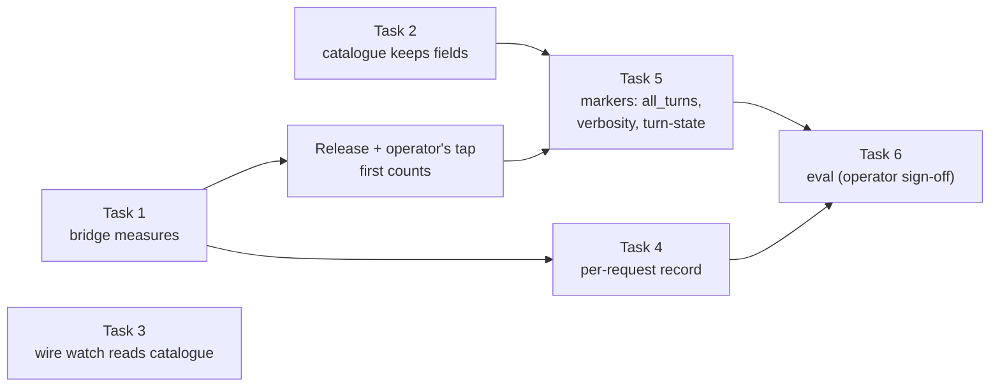

# Codex bridge: GPT-lane parity with native Codex Implementation Plan

> **For agentic workers:** REQUIRED SUB-SKILL: Use superpowers:subagent-driven-development (recommended) or
> superpowers:executing-plans to implement this plan task by task. Steps use checkbox (`- [ ]`) syntax for tracking.

**Goal:** A GPT lane does its work as well as the native Codex CLI does on the same model. First we measure the
difference, then we close it where the bridge's request differs from Codex's, and an eval with a pass bar shows the
result.

**Architecture:** Three phases, each shipped before the next.
- **Measure.** The bridge records what decides parity, with nothing new on the wire.
- **Close the gaps.** Each change to the request goes behind its own lane marker, off by default, and falls back once
  on a 400.
- **Prove it.** An eval runs native Codex and the lane on the same tasks.

The bridge keeps Claude Code's own prompt and tools (D-6420). Parity of the prompt and tools is out of scope.

**Tech Stack:** stdlib Python (`ccd/codexbridge/`, `ccd/ccrc-models-probe`), Node ESM (`shared/models.mjs`,
`.github/ci/codex-wire-watch.mjs`), vitest 5 in fixture HOMEs.

**Spec:** `docs/superpowers/specs/2026-10-15-codex-bridge-design.md`:
- §2.2-§2.5: the backend adapter, the body, the store;
- §2.7: stats;
- §2.9: D1, the wire watch, and D3, names only.

The Stage 4 plan, `docs/superpowers/plans/2026-11-10-codex-bridge-stage-4-litellm-retired.md`, holds the watch this
plan's readings sit beside.

## In short

- On 2026-11-13 the operator asked that GPT lanes "perform as well as they perform on Codex natively".
- A read-only parity study compared the bridge with openai/codex main. Each of its rows was then checked against
  upstream at `826b6e8` and against this tree at `218a5e3a3` (the table below). Most rows hold. Three were corrected,
  and one of those turned out not to be a gap.
- The biggest likely gap is reasoning carry-over. Native Codex asks for `reasoning.context: "all_turns"` on Lite models,
  while the bridge sends only `{effort}`. Codex's own comment says the server default is `current_turn`, so the
  encrypted reasoning the bridge stores and replays is probably dropped at each turn boundary. The backend reports such
  drops in `response.input_transformations`, and nothing reads them today.
- Phase 1 (Tasks 1-3) measures this and the other figures, with nothing new on the wire.
- Phase 2 (Task 5) sends `all_turns`, `text.verbosity` and the turn-state echo, each behind a lane marker.
- Phase 3 (Task 6) is the eval. Running it spends quota, so it waits for the operator's sign-off. Its design and a dry
  run come first.
- Three choices are the operator's, and nothing here changes them before the eval:
  - whose effort rules on GPT lanes;
  - whether lane windows follow Codex's 272k;
  - whether the target is task success or wire parity.

## The gap table, verified

Read on 2026-11-13. "Native" is openai/codex at `826b6e8`, under `codex-rs/`. "Lane" is this tree at `218a5e3a3`.

| Area | Native Codex | GPT lane | Verdict |
|---|---|---|---|
| Reasoning carry-over | `reasoning.context: "all_turns"` when the catalogue's `use_responses_lite` is true (`core/src/client.rs`, 1139-1159). Its comment says the server default is `current_turn` | Sends `{effort}` only, and stores and replays encrypted reasoning (`backend.build_body`; `inbound._Translation._assistant`) | Confirmed |
| Effort | The configured value, else the catalogue's `default_reasoning_level` (low or medium) | Claude Code's `output_config.effort` passed through unchanged. The lane's class effort is high or max. The level sent is recorded nowhere | Confirmed |
| Verbosity | `text.verbosity` from `default_verbosity` when `support_verbosity` is true (`low` on every listed model) | Never sent | Confirmed |
| Base prompt and tools | The catalogue's prompt, the code-mode tool, freeform `apply_patch` | Claude Code's prompt and JSON tools (D-6420) | Confirmed, by design |
| Request shape | Lite models: `parallel_tool_calls: false`, tools as an `additional_tools` item in a `functions` namespace, header `x-openai-internal-codex-responses-lite: true` | Top-level tools with `strict: false`. Parallel calls are on unless Claude Code disables them | Confirmed |
| Tool output | `truncation_policy {"mode":"tokens","limit":10000}`, with a 1.2x allowance in history. The cut keeps head and tail | No cap | Partly: the cap is about 12k tokens, not 10k |
| Window and compaction | 272k, or 500k for 6.1-terra. Auto-compact at 90%. Remote compaction keeps an encrypted item | Runs at the lane window (400k on the reference fleet since D-8564: the measured windows outrank the provider's). Compaction is Claude Code's plaintext summary | Partly: the study's figures predate D-8564 |
| Sticky routing | Captures `x-codex-turn-state` once per turn and echoes it on every request of that turn. Resets at each turn and when the auth owner changes | Counts the header's name and refuses its value (`stats.TOKEN_HEADERS`). Never echoes it | Confirmed |
| Cache affinity | A subagent sends the ROOT's `session-id` and `prompt_cache_key`. Its own id goes in `thread-id`, plus `x-codex-parent-thread-id` and `x-openai-subagent` | `session-id` from Claude Code's session header. `prompt_cache_key` adds the agent id per subagent (`inbound`) | Refuted: the lane already matches |
| Transport | WebSocket with prewarm and `previous_response_id` | HTTP SSE with the full history | Confirmed; latency only |
| Service tier | `priority` for Fast. gpt-6-sol and gpt-6-luna default to it in the catalogue | Dropped. Claude Code never sends one on these lanes | Partly |
| Observability | Counts `response.input_transformations` entries of type `reasoning` and action `removed`, by reason (`codex-api/src/sse/responses.rs`, 377-398) | Never reads them | Confirmed. It is an array on the terminal event's `response`, not an event |
| Smaller items | none | `is_error` dropped; reroutes invisible; PDFs and server tools refused; `defer_loading` tools sent in full | Confirmed |

The removal reasons Codex names are `organization_mismatch`, `end_user_mismatch`, `model_mismatch`, `prefix_mismatch`
and `turn_boundary`. Anything else is its `other`.

## Order of work

*Figure 1. Tasks 1-3 run in parallel. Task 5 waits for the first counts from Task 1 and the catalogue fields from
Task 2. Task 6 waits for Tasks 4 and 5 and for the operator's sign-off.*

## Task 1: the bridge measures what parity hinges on (D-8618)

**Files:** `ccd/codexbridge/{reducer,server,stats}.py`, `README.md` (the stats file's prose), the bridge's tests and
corpus generator.

- [ ] The stats file gains a top-level `parity` section, keyed `<route>/<model>` as `routes` is, with VERSION still 1.
  Each row holds:
  - `responses`, and the sums `inputTokens`, `cachedTokens`, `outputTokens` and `reasoningTokens`
    (`usage.output_tokens_details.reasoning_tokens`);
  - `effort`: the level each upstream body carried, or `none`;
  - `served` (`same`, `other` or `absent`, from `response.model`) and `servedOther`;
  - `inputTransformations`, keyed `<type>:<action>:<reason>`, and `responsesWithTransformations`;
  - `replay`: the store lookups at translation, `text-hit`, `text-empty`, `text-absent`, `call-hit` and `call-absent`;
  - `firstOutputMs` and `totalMs`, as fixed-bucket histograms.
- [ ] Every name is bounded, and every map is capped, then OVERFLOW. A malformed diagnostic field never fails a
  response. Counts are kept on `response.incomplete` and on a response the bridge then answers as an error. A restart
  carries every row.
- [ ] The client's answer, the upstream body and its headers are byte-identical to `main` (a test asserts it).
- [ ] Mutation table: incomplete not counted, cap dropped, token sums swapped, effort taken from the client instead of
  the body, relay stopped on failure, `parity` forgotten at load, a malformed field raising.

## Task 2: the catalogue keeps the request-shape fields (D-8620)

**Files:** `ccd/ccrc-models-probe`, `shared/models.{mjs,ts,d.mts}`, and a synthetic catalogue fixture.

- [ ] The probe's Codex arm keeps `useResponsesLite`, `supportVerbosity`, `defaultVerbosity`,
  `defaultReasoningLevel` and `truncationPolicy`, each optional and omitted when invalid. Scalars only, never a text
  block. `parseCatalogue` passes them through, and the bounds are spelled once.
- [ ] A row without them is deep-equal to today's, and no other arm carries them.
- [ ] `CODEX_CLIENT_VERSION` stays pinned. Whether it tracks the current release is the operator's decision.

## Task 3: the wire watch reads the model catalogue (D-8621)

**Files:** `.github/ci/codex-wire-watch.mjs`, its test, and a synthetic fixture.

- [ ] `CONTRACT_FILES` gains `models-manager/models.json` (ten files), read through a JSON fact family,
  `catalogue field`. Its facts are the slugs, each model's keys, and each scalar value (or small all-scalar
  array or object). Text blocks are never facts.
- [ ] First, the file's presence is measured at the walked tag and at every later stable tag. A file missing at any of
  them would stop the walk for good, so it is a stop-and-report.
- [ ] A file over 1 MB is fetched by the raw media type or the blob API.

## Task 4: a per-request record (deferred)

The eval needs a row per upstream response: the time, the session, the requested and served model, the effort, the
tokens, the first-output and total times, the removals and the replay counts. Task 1's aggregates cannot be split by
task. A new file in the lane directory also needs `laneManifest`'s `bridgeFiles`, the lane removal's file list in
`ccd/ccrc` (`_codex_reap_files`) and their tests. `ccd/ccrc` was claimed by another programme on 2026-11-13, so this
task waits for that claim to be released.

## Task 5: the request gaps, each behind a lane marker

Each change is opt-in, by a marker in the lane directory. As with `bridge-instructions`, no writer of the marker is in
the tree. Each change also falls back: an upstream 400 on a first attempt that carried the new field is retried once
without it, counted, and the retry never reaches the client twice.
- [ ] `bridge-reasoning-all-turns`: `reasoning.context: "all_turns"` on a model whose catalogue row says
  `useResponsesLite`. Whether the backend needs the Lite header for it is not known, and the 400 fallback is what makes
  trying it safe. Done when Task 1's `reasoning:removed:turn_boundary` counts fall to about zero on that lane.
- [ ] `bridge-verbosity`: `text.verbosity` at the row's `defaultVerbosity` when `supportVerbosity` is true. It shares
  one `text` object with `text.format`.
- [ ] `bridge-turn-state`: echo `x-codex-turn-state` within one Claude Code turn. The value is held in memory only,
  never written to the stats file, a log or the status file.
- [ ] Deferred until the eval reads them: the effort policy (the operator's), tool-output truncation, the 272k window
  (the operator's), the Lite tool shape, and folding text beside tool results into the developer item.

## Task 6: the eval

Design and dry run first, with no live run. A live run spends subscription quota and needs the operator's sign-off.
- [ ] The task set is about 25 tasks on pinned snapshots, each with an automatic grader:
  - 10 bug fixes from this repository's history, each with the fix reverted and its own test as the check;
  - 5 multi-file features with spec tests;
  - 5 long tasks past 250k tokens, so compaction happens;
  - 5 read-only questions with known answers.
- [ ] The arms all use the same model id, with 3 runs a task in a randomised order in one time window:
  - native Codex at a pinned version with the catalogue defaults;
  - the lane as it is;
  - the lane with Codex's effort;
  - the lane with each Task 5 marker added in turn.
- [ ] The parity bar:
  - the paired pass-rate difference has a one-sided 95% bound no worse than -5 points;
  - median tokens and wall time are within 1.2x of native;
  - the cache ratio is within 10 points;
  - the tool-error rate is no higher.
  At 75 paired runs the eval detects only gaps of about 10 points.
- [ ] The dry run checks that each bug-fix task's revert makes its test fail and the fix makes it pass, with no model
  call.

## Waiting on the operator

- Whose effort rules on GPT lanes: Claude Code's class effort (high or max today) or the catalogue's default (low or
  medium)?
- Whether lane windows follow Codex's 272k. Decide after the eval.
- Whether the target is task-success parity or wire parity. The prompt and tools differ on purpose, so wire parity
  cannot be complete.
- The eval's live run.

## Deviations found

- **D-8618 (2026-11-13)** — `bridge-parity-measure`: the bridge keeps its parity measurements in a new top-level
  `parity` section of the stats file, keyed `<route>/<model>`. It does not extend the `routes` rows, which are D24's
  calibration and have other readers. It is not a new D3 family either: a reasoning removal or a replay miss is a
  measurement, not drift, so it never warns and never fails the Stage 4 watch's drift criterion. Nothing new goes on
  the wire. The per-request record the eval needs is a separate, later change (Task 4).
- **D-8619 (2026-11-13)** — `bridge-requests-record`: reserved for Task 4's per-request record, a bounded file in the
  lane directory named by `laneManifest`'s `bridgeFiles` and removed with the lane. It is defined when Task 4's pull
  request is written. Until then, no code cites it.
- **D-8620 (2026-11-13)** — `catalogue-request-shape-fields`: the models probe's Codex arm keeps five optional
  per-model keys:
  - `useResponsesLite`;
  - `supportVerbosity`;
  - `defaultVerbosity`;
  - `defaultReasoningLevel`;
  - `truncationPolicy`.
  Each is omitted when the backend's value is absent or malformed, and every catalogue reader passes them through.
  Scalars only: the catalogue's prompt text is never kept. The client version the probe sends stays pinned.
- **D-8621 (2026-11-13)** — `wire-watch-model-catalogue`: the D1 wire watch reads `models-manager/models.json` through
  a JSON fact family of its own, `catalogue field`: the model slugs, each model's keys, and every scalar value or small
  all-scalar array or object. Text blocks are never facts, so a prompt edit upstream is not a finding and no prompt text
  reaches an issue body.

## Where things stand

**Agreed:** the operator's directive (2026-11-13), the order of work above, and the Stage 4 rulings it sits beside.

**Waiting on you:** the four operator questions above.

**Later:** Task 4 (once `ccd/ccrc` is free), Task 5 (once Task 1's first counts and Task 2 are in), and Task 6's live
run.
