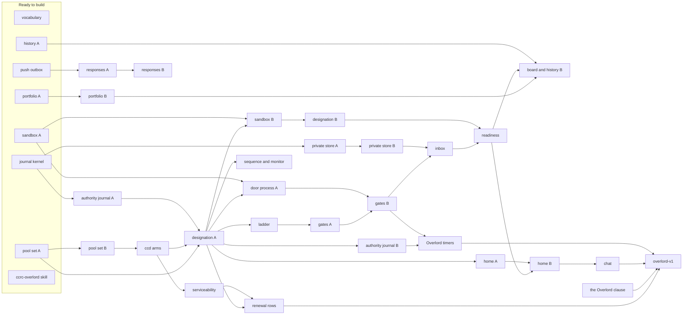

# The Overlord programme: the W1 index, designate and talk

This file is the index of W1, "designate and talk" (spec §14, Table 14's W1 row). It names the pieces, the lanes and
their files, and the order, so that several plan writers can each take one piece at once without colliding. It holds
no piece plan. Each piece's plan will live in `docs/superpowers/plans/2026-11-10-overlord/` as `w1-<piece>.md`, beside
`w1-face.md`, the one W1 piece already planned and built.

The spec is `docs/superpowers/specs/2026-11-09-overlord-design.md`, and the programme's ledger is
`docs/superpowers/programs/overlord.md`. The W1a index, whose shape this file follows, is
`docs/superpowers/plans/2026-11-10-overlord.md`. This file defines no D-numbers: every departure below is a plain slug
until the coordinator mints numbers.

Written against `main` at `416b8f942` (2026-11-14).

## Open questions

Each is a place where the spec is unclear, contradicts itself, or leaves a choice to the plan. Each carries a
recommendation. The piece plans build the recommendation unless the coordinator or the operator rules otherwise, and
each piece plan restates the questions it builds on.

**Gating and order**

1. **Is the D-8126 gate met?** (slug `d8126-built-means-a2-a3`.) Figure 8 gates W1 on "D-8126 merged and built". The
   spec's §1.1 still says D-8126 "has not" merged, which is stale. Measured below, under "Prerequisites": the spec and
   build plan (A1), the goals read (A2) and the call record (A3) are merged and released. A4 to A10 are not on `main`.
   The programme ledger already reads the gate as "D-8126's build, #2606, merged". **Recommendation:** the gate is
   met. W1 reads only A2's box-token goals read and `doneWhen`, and A3's `coordinator_calls`. A4, A6, A7 and A9 gate
   no W1 piece. A5 matters only for clause numbering (question 2). The spec's §1.1 sentence is a fix for the next
   spec-fixes run.
2. **Three new coordinator clauses compete for one number** (slug `coordinator-clauses-by-name`). D-8126's A5 adds
   "clause 21" and hard-codes the number in its roster text and its skill revision word. W1a's recall clause plan says
   it is "numbered 21 at its merge". This spec's clause 22 assumes it comes after clause 21 and the recall clause. On
   `main` the coordinator skill has 20 clauses, and neither 21 has merged. **Recommendation:** plans name the three
   by name (the autonomy clause, the recall clause, the Overlord clause). Each takes the next free number at its
   merge, as §11.4 says. The W1 Overlord clause lands after both of the others, and its piece re-measures the number
   and the contract's room at its merge. §11.4 gives about 2,300 bytes of room, "three or four clauses". If the other
   two clauses and A5's rewrite of clauses 4, 11, 19 and 20 spend it, the clause-22 piece first needs a
   clause-shortening pull request of its own, with wording the operator approves (§11.4). The coordinator should tell
   D-8126's builder that "clause 21" may not be its number.
3. **The journal kernel is "before W1" and also "W1 ships the kernel"** (slug `journal-kernel-is-the-first-w1-piece`).
   §7.6 H27 says both. **Recommendation:** the extraction is W1's first piece in lane C. It is move-only with
   characterization tests, and it is ready to build now.
4. **"W1's first pull request registers" C10, the Operator Model context** (§11.1; slug `c10-registered-by-its-first-file`).
   The spec also says the `pool-set` pull request ships first in W1. Those two firsts cannot both hold.
   **Recommendation:** the private store's first pull request registers C10, its directory, its row in the
   architecture spec's path table and in `CCD_CONTEXTS`, because it is the first pull request with a C10 file in it.
   `pool-set` stays first among the pull requests that change what an agent does.

**Accounts and ccd**

5. **C32's placement policy for the designate door's first account** (slug `designate-uses-the-one-placement-policy`).
   §3.2 says designate picks its first account "through C32's placement policy". C32 says the policy serves "the
   sheet and the start door", and the start door is W5. Table 14 does not list the policy under W1.
   **Recommendation:** move `startProgramPlacement` (`pwa/src/fleet/startProgramPolicy.ts`) to one shared L1 home in
   the designation piece, behind a characterization test, because the designate door is its second reader. A
   W1-only picker would be a second placement mechanism.
6. **The route fields for the set and the ordered account list have no names or grammar** (§3.4, Table 11.1c; slug
   `route-field-names-are-the-pool-set-plans`). **Recommendation:** the pool-set plan names both fields, adds them to
   `ROUTE_FIELDS` and `_route_valid`, and pins them in `ccd-route-fields.test.ts`. The set's value is the side word's
   own spelling, so ccd parses one grammar.
7. **The soft and harder load lines (70% and 85%) are not in Table 11.5b** (C57; slug `load-lines-are-starting-values`).
   **Recommendation:** the serviceability and limits plan confirms both as starting values in one constants module,
   and the next spec-fixes run adds them to Table 11.5b.
8. **`limit_samples` names no cadence, retention or reader** (Table 11.1a; slug `limit-samples-ride-the-limits-read`).
   No symbol in the tree is called "the limits reader". **Recommendation:** the sampler is a `LANE_SCHEDULE` row
   beside today's limits read (`server/src/limits.ts#readLimits`), never a poller of its own. It keeps 30 days as a
   starting value, which covers four weekly resets. The piece plan measures today's read cadence first.
9. **The route hold-down applies to "a long-lived role"** (C45, Table 11.5b; slug `hold-down-covers-coordinators`).
   That changes `_route_restore` for coordinators too, which is a behaviour change outside the Overlord.
   **Recommendation:** follow the spec, because one rule per role column is the design. Put the change in a commit of
   its own, behind a characterization test of today's restore, and say so in the pull request.
10. **W0-24 and the shared Fable test are W1's call** (C46). **Recommendation:** keep the conservative branch. A
    billing fact that is absent reads as usage credits, and Fable billed to credits is unservable for the Overlord.
    W0b measured no Fable use on any account. The serviceability plan revisits the question once `limit_samples`
    has a month of readings.
11. **`auditorModelFor` has no wave** (C45). **Recommendation:** W3, with the audit lane, its only reader. W1 ships
    nothing for it.

**The body and its doors**

12. **`LaunchProfile` cannot hold the Overlord's tool surface** (slug `launch-profile-gains-typed-surface`).
    `LaunchProfile.settings` holds scalars only, and the `overlord` profile needs a tool list, deny rules, declared
    agents, one tool server and pinned setting sources. **Recommendation:** extend the L0 column in
    `shared/fleetRoles.ts` with typed fields. `ccd/lib/launch-profiles.json` stays its projection, held equal by
    `launch-profiles-file.test.ts`, so the profile has one source.
13. **How the door process carries `ccrc-api`** (§3.6; slug `door-process-wraps-the-one-client`). W0 measured a stub
    with three tools. **Recommendation:** an MCP stdio server that calls the existing `ccrc-api` verbs, so the route
    table and the token handling stay in one client. The door-process plan names the tool list and each tool's
    schema. The fallback (a shell that runs only `ccrc-api`, and the act key file) is not built, because W0a kept the
    door process. The plan says so.
14. **The D-6798 no-model arm meets `CLAUDE_CODE_SUBAGENT_MODEL_FORCE=1`** (W0 proposal 1; slug
    `no-model-arm-reads-the-pin`). With the force flag set, an agent call carries no model, so the arm would refuse
    every reader. **Recommendation:** the arm reads the pin from the session's launch profile, which is a fact,
    rather than exempting a role by name.
15. **How the isolation word is measured** (§7.4; slug `isolation-from-reported-uids`). The spec names three words
    but no measurement. **Recommendation:** the server compares its own uid and host identity with those each agent
    reports on connect. Any agent that shares both reads `shared-user`, and an unmeasured answer reads `shared-user`,
    the safe word.
16. **A late or lost witness report** (§11.2; slug `unwitnessed-refuses`). **Recommendation:** the write refuses
    `unwitnessed`, failing closed. The caller retries on its next turn. A third such refusal in a day is Table 7.5a's
    latch.
17. **`CallerIdentity` and the operator's doors** (§7.4; slug `operator-doors-keep-the-account-gate`).
    **Recommendation:** in W1 the port has one adapter, attribution. The operator's doors keep
    `server/src/accounts/gate.ts#createAccountGate` and record its actor through the port as `operator` strength. No
    second cookie reader is written.
18. **The census of what ccd types, for `INJECTED_PROMPTS`** (§3.8; slug `injected-prompts-census-cuts-functions`).
    ccd is bash. **Recommendation:** cut the function bodies out of `ccd/ccd`, as `ccd-limit-no-keys.test.ts` does,
    and match each typed literal against the L0 list in both directions.

**Authority and records**

19. **Which rungs the W1 ladder accepts** (§7.5; slug `w1-rung-door-stops-at-chat`). Table 14 ships "the ladder at
    `chat`", and W2 ships `advise`. **Recommendation:** the vocabulary and `effectiveRung` are total over all four
    rungs from W1. The rung door refuses a rung above `chat` with `capability-missing`, naming `overlord-route-v1`,
    until W2.
20. **Which Table 7.5a causes ship in W1** (slug `w1-ladder-causes-by-their-inputs`). **Recommendation:** each cause
    whose input exists in W1: restore detected, no off-volume witness since boot, the third unwitnessed write in a
    day, an invariant violation, `shared-user`, the launch profile not engaged, probes failed twice, a `degraded`
    generation, off the designated model, and accounts past the 95% line. The rest arrive with their inputs.
21. **The act journal (W2) in W1's boot coherence** (§7.6; slug `w1-coherence-reads-two-journals`).
    **Recommendation:** W1's boot coherence and reconciliation pass read the authority journal and the privacy
    journal only. The witness carries the act journal's head as absent until W2. The only id that W1 keeps unique
    across a restore is the message id.
22. **Invariants over tables W1 lacks** (§10.4, Table 11.7a; slug `monitor-checks-what-exists`). I1, I3, I4, I14,
    I15 and I16 read W2 and W3 tables. **Recommendation:** each predicate names its tables. The monitor runs a
    predicate only once its tables exist, and the monitor's report lists the others as `not-applicable`, never as
    passed. The simulator and monitor share predicates (D-8214), with the sweep-phase bound the ledger carries for
    D-8214 and D-8240.
23. **The refusal list "generated from §11.6"** (slug `refusal-table-checked-both-ways`). `shared/refusal.ts` is
    grouped by door today, and W1a's `timer-not-found` is not in Table 11.6. **Recommendation:** no code generator.
    A test reads Table 11.6 and `shared/refusal.ts` and checks them against each other in both directions. W1a's words
    missing from Table 11.6 go to the spec-fixes run.
24. **`ratifiedBy`'s writers and its default** (Table 11.1a; slug `ratified-by-writers-in-w1`).
    **Recommendation:** a nullable column. Absent reads as not ratified, as the card reads every goal today. In W1,
    a coordinator's pin and modification write `coordinator`. The operator's tick on a goals item that cites the
    version writes `item`. `request` waits for W2's `requestId` on `goals modify`.
25. **The read rate ceilings per door are "set by the plan before W1"** (Table 11.5b; slug
    `read-ceilings-measured-first`). **Recommendation:** the reads plan measures a week of the console's own read
    rates and proposes each ceiling at twice its peak hour. The coordinator approves the values at that plan's review.

**Talk**

26. **Who writes "delivered" and "queued"** (§3.8; slug `delivery-move-is-the-prompt-send`). The spec says "the
    delivery lane", and no lane has that name. **Recommendation:** the prompt route's existing send path
    (`sendPrompt`) answers delivered or queued, and its caller records the move. No new lane.
27. **How the server learns that the Overlord replied** (§4.3, kind "chat reply"; slug `chat-reply-rows-from-the-served-turn`).
    **Recommendation:** the chat piece writes the reply's response row when the server first serves that reply turn
    to the console, from the transcript stream it already reads. Until the chat lands, a reply makes no row.
28. **`pushDue` in W1** (§6.7; slug `push-due-ships-total`). **Recommendation:** the outbox sender ships with `pushDue`
    as a total decider that answers "due now" or "silent". W3 adds rows and adds no decider.
29. **The board's Timers part has no wave** (Table 5.2a). **Recommendation:** W1, in the board's pull request,
    because the Overlord's timers are W1.

## Prerequisites, as measured

Measured on 2026-11-14 with `git fetch origin main`, `gh pr view` and `git merge-base --is-ancestor` against the
commit the fleet box's `ccrc version` names (`3afa9aeb7`, release `v0.0.1201`), and `git grep origin/main` for each
wave's own symbols.

| Prerequisite | State on `main` | How measured |
|---|---|---|
| D-8125 merged | **merged**: #2490 at `b15a0c497`, in `v0.0.1201` | `gh pr view 2490`; ancestor of the fleet box's build |
| D-8126 merged | **merged**: the spec and build plan, #2487 at `d15893d3d` | `gh pr view 2487` |
| D-8126 built, the parts W1 reads | **merged and released**: A2, the goals read for the box token and `doneWhen` (#2549); A3, `coordinator_calls` and its route (#2606). Both are in `v0.0.1201` | `gh pr view`; ancestry; `doneWhen` in `server/src/coord/ledgersStore.ts`, `server/src/coord/coordCallsRoute.ts` present |
| D-8126's other waves | **not on `main`**: A4 (`pwa/src/ledgers/callWords.ts` absent), A5 (`ccd/coordinator-skill/references/decision-procedure.md` absent, the skill still has 20 clauses), A6 (`COORD_BALL_MAIL_MS` absent), A7 (`skill-ensure` absent from `ccd/ccd`), A9, A8 and A10 | `git grep` and `git cat-file -e` on `origin/main` |

What W1 still needs from W1a's open pieces:

| W1a piece | State | What W1 needs from it |
|---|---|---|
| Renewal act (`SessionHost`, the checkpoint, the lane's acts) | not started on `main` | The Overlord renews by fresh start through `renew`. The door process starts with each generation's launch. The designation's `pending` deadline is enforced by the renewal lane. Needed by designation PR B, door process PR A, the Overlord's renewal rows, and readiness |
| Renewal hand-offs (Renew now, `renewing`, the operator's mark) | not started | The prompt route's `renewing` and the mark, which the private store's prompt-route change sits beside. Restart the Overlord (W1) rides the same resume path as Renew now. Needed by private store PR B, designation PR B and readiness |
| Replay quiz | not started | Building waits for nothing. **Using** waits: the Overlord renews only while the `continuity` lane is live, and no W1a lane is armed before the baseline exists (W0-28). So the operator's first designation waits for the baseline and the arming. The ledger tracks that act, not a piece |
| Clause 23, the recall clause | not started | Lands before the W1 Overlord clause (question 2) |
| `continuity-v1` | not started | `overlord-v1` presupposes it, so the `overlord-v1` piece comes after it |
| Anchor (#2803) | in review | The Overlord's start reads its card first. `CARD_OVERLORD_LINE` (`server/src/continuity/card.ts`) waits for `overlord-v1`. Needed before `overlord-v1` |
| Probes PR B (#2802) | in review | The inbox serves probes ahead of everything else, through the probe door. Needed by the inbox piece |

Already on `main` and used as is: the start report, generations, the card and its read records, notes, timers with
`timers-v1`, launch profiles with the `overlord` row (`FLEET_ROLES.overlord`, `timerCap` 50), the Overlord's
`MAIL_PACE` row, `hibernate-fresh`, compaction, context readings, and the face (#2741, #2781).

## W1, designate and talk: the pieces, the lanes and their order

Twenty-six pieces build W1, less the face, which is built. Each is sized for one worker, and a piece marked with two
PRs ships two pull requests from one plan. Every plan names the files it creates or changes. Every new L1 decider joins
`MUTANT_SETS` and `server/test/sim/mutation-floors.json` in the PR that creates it, so "mutation floors for new
deciders" is a rule of each plan, not a piece of its own. Every guard ships with the test that goes red without it,
and every new routes file, table and lane carries its census rows in the same PR.

| Piece | Plan | What it ships | Size | Needs first | Lane |
|---|---|---|---|---|---|
| Vocabulary | `w1-vocabulary.md` | `INJECTED_PROMPTS` with its census of what ccd types; every W1 refusal word in one group of `shared/refusal.ts`, with the test that checks it against Table 11.6 | 1 PR, 3 tasks | nothing: **ready to build** | K |
| Pool set | `w1-pool-set.md` | The pool rule's session side as a set (`poolRule`, `_pool_ok`, one fixture table); Table 3.4d's ccd users; the route fields for the set and the ordered list; `ccd pool-answer` with its whitelist row and argv; the word `pool-set`; R18's minors (review 1862) | 2 PRs, 7 tasks | A: nothing, **ready to build**. B: PR A | A, first |
| ccd's Overlord arms | `w1-ccd-arms.md` | `ccd keep-awake --state on\|off <id>` with its whitelist row, argv and word `keep-awake`; the affinity arm's stand-down for `overlord`; `_route_restore`'s hold-down; the fresh start's three-step pick from the ordered list; `_operator_choice_promote`'s skip for a long-lived role | 1 PR, 5 tasks | pool set B | A |
| Serviceability and limits | `w1-serviceability.md` | `serviceability`'s four more inputs and its bash twin; the roster's billing fact and continuity record per lane; `limit_samples` and its sampler; `poolRunway`; the load lines | 2 PRs, 6 tasks | A: pool set A. B: PR A | A |
| The Overlord's renewal rows | `w1-renewal-rows.md` | Table 3.3.11b's `overlord` rows in `renewalDue`: the account outside its set, the class no longer servable, load past the line while idle, a resume on another class, model drift, the class changed in Settings, the daily backstop with its hour and time-zone Settings | 1 PR, 4 tasks | ccd arms, serviceability B, designation A, W1a renewal act | A, last |
| Journal kernel | `w1-journal-kernel.md` | The chained-journal kernel (codec, verifier, tail heal) moved out of `server/src/coord/delegation-journal.ts`, move-only, characterization first | 1 PR, 3 tasks | nothing: **ready to build** | C, first |
| Authority journal and restore | `w1-authority-journal.md` | The authority journal on the kernel; boot coherence (Table 7.6a, W1's two journals); `authority-rolled-back`; the witness epoch on the agent link and the console; Confirm the restore; the authority-and-restore explorer model, written before the code | 2 PRs, 7 tasks | A: kernel. B: PR A, designation A | C |
| Designation | `w1-designation.md` | `overlord_designation` with `term`, `designatedTerm`, the class and `accountPools`; `coord/overlordRoutes.ts` with designate and retire; the two-account check; `capability-missing` for ccd's words; Start the Overlord composing session-create in the `overlord` project; the route record write; the one placement policy (question 5); then rebind, Restart the Overlord, the Settings model and account-set rows, `decideSleep`'s and the roll lane's `overlord` hold, and the `pending` deadline | 2 PRs, 9 tasks | A: pool set A, ccd arms, authority journal A. B: PR A, sandbox B, W1a renewal act and renewal hand-offs | C |
| Ladder | `w1-ladder.md` | `operatorRung`, latches and conditions, `effectiveRung`, the rung door (step-up up, journalled), Pause, `off`'s one transaction (W1's part), the W1 causes (question 20), `overlord-off` and `rung-below` | 1 PR, 5 tasks | authority journal A, designation A | C |
| Gates and identity | `w1-gates.md` | The `CallerIdentity` port and the attribution adapter; actor columns; the isolation word and its `advise` cap; the gate order of §11.2 as one L1 decider, the fence check (`stale-designation`, `stale-generation`) and `not-the-overlord`; the refusals on other write lanes (`overlord-uses-its-doors`) and at run open (`overlord-not-a-coordinator`) | 2 PRs, 7 tasks | A: ladder, designation A. B: PR A, door process A | C |
| Sequence and monitor | `w1-sequence-monitor.md` | `overlord_sequence` and its one writer; the cursor read with its explicit gap; the invariant monitor's predicates and runner, with one latch and one item per violation; M24 | 2 PRs, 6 tasks | A: designation A. B: PR A, ladder, gates A | C |
| The Overlord's timers | `w1-overlord-timers.md` | Timers set through the door process, stamped with `designatedTerm`; the `retired` cleanup; the operator's read adds the role's timers; mail to `overlord` waits for the card; the "fired again after a restore" line; M36's refusal counts | 1 PR, 4 tasks | designation A, gates B, authority journal B | C, last |
| Launch profile and sandbox check | `w1-sandbox.md` | The `overlord` profile's W1 surface (tool list, deny rules, declared readers, one tool server, setting sources, the hook registered, the bypass acceptance, `ccrc-overlord` alone, the constitution file); the no-model arm's pin read; the start report's profile digest and loaded sets; then the sandbox check, `pending` to `live`, `overlord-sandbox-unmet`, `launch-profile-unmet` | 2 PRs, 7 tasks | A: nothing, **ready to build**. B: PR A, designation A | B, first |
| Door process and readers | `w1-door-process.md` | The door process with `ccrc-api` inside, started by ccd with each generation; the launch nonce and the act key issued once; then the reader types, the reader-scope and reader-model hook arms, the witness report and reader start and stop reports, and the model-switch report | 2 PRs, 7 tasks | A: sandbox A, designation A, W1a renewal act. B: PR A | B |
| Private store and messages | `w1-private-store.md` | C10 registered; `operator-model.db` with migrations, backup entry and deny path; `operator_messages` and the message moves table; the read ledger table; the privacy journal file with the highest message id; then the prompt route's record-then-nudge for the designated session, the settlement mark, and the boot pass's re-derived `settled` (I8) | 2 PRs, 7 tasks | A: kernel. B: PR A, designation A, W1a renewal hand-offs | D, first |
| Inbox and reads | `w1-inbox.md` | `messages`, the inbox with band 1, probes and the coalesced wake (its contract fixed), `acknowledge`, a read-ledger line per read, the read ceilings (question 25) | 1 PR, 5 tasks | private store B, gates B, W1a probes B | D |
| Board and history door | `w1-board-history.md` | A: the history agent op, `decideScope`'s `overlord` scope (no argv or environment yields it) and the agent word `overlord-history`. B: `GET /api/overlord/history` with `history-unreachable`, and the board, composed from existing readers, with its W1 parts (Timers included) | 2 PRs, 6 tasks | A: nothing, **ready to build**. B: PR A, gates B, readiness, portfolio B | D |
| Readiness | `w1-readiness.md` | `overlordReadiness` (Table 6.4a, first match, monotonic), the readiness lane and its `LANE_SCHEDULE` row, readiness rows, and a dead Overlord's one push with Restart | 1 PR, 4 tasks | designation B, sandbox B, ladder, inbox, W1a renewal act | D, last |
| Portfolio and goals | `w1-portfolio.md` | A: `portfolio_rank`, `portfolioFor` (W1's rows), and `ratifiedBy` on goals versions with its W1 writers (question 24). B: the rank door | 2 PRs, 5 tasks | A: nothing, **ready to build**. B: PR A, designation A | P |
| Push outbox | `w1-push-outbox.md` | `reachedOperatorAt`, `pushedAt`, outbox rows in the raising transaction, the one sender with its boot pass, today's push sites behind it (characterization first), `pushDue` total, a random push id on each row, `push-outbox-v1` | 1 PR, 6 tasks | nothing: **ready to build** | E, first |
| Response record | `w1-responses.md` | A: `PushService`'s per-send verdict, the push id in each payload, the service worker's `shown` and `opened`, the receipts door, `operator_responses` written `pending` before each send, `response_receipts`. B: the response lane and its `responses` row, `RESPONSE_OUTCOMES`, `responseOutcome`, `responsesFor`, "I handled this elsewhere", the Waiting on you and digest inserts, retention and its Setting | 2 PRs, 8 tasks | A: push outbox. B: PR A | E |
| Home and Settings | `w1-home.md` | A: `homePlace`, the places list as a function of the designation, the Fleet's own path, every go-fleet door, the wordmark home. B: the Overlord place (readiness word, Pause, Start, Open and Rebind, since you were last here, the portfolio strip and capacity line, the face) and the Settings rows (model class, account set, response retention) | 2 PRs, 7 tasks | A: designation A, ladder. B: PR A, designation B, readiness, portfolio B | F |
| Chat | `w1-chat.md` | The chat with message ticks, the server's own lines while not `ready`, earlier generations through the history reader, the kept draft, chat-reply response rows (question 27), the console's `opened` receipts | 1 PR, 5 tasks | home B, private store B, board and history B, responses A | F, last |
| `ccrc-overlord` skill | `w1-overlord-skill.md` | The skill whole: 22 clauses under `## The contract`, pinned `1..N`; `routing.md`, `answering.md`, `starting.md`, `operator-model.md`; its cap measured at merge; the install, doctor and deploy lists; `ccrc-overlord` in the hook's `ROLE_SKILLS` | 1 PR, 4 tasks | nothing: **ready to build** | G |
| The Overlord clause | `w1-coordinator-clause.md` | Coordinator clause 22 (its working name), acting only under `overlord-v1`, with its pin, its count word and its cap raise | 1 PR, 2 tasks | the recall clause and D-8126's A5 merged, or ruled otherwise (question 2) | G, last |
| `overlord-v1` | `w1-overlord-v1.md` | The word in `SERVER_CAP_MAP`; `ccrc-api`'s Overlord verbs follow it; the card's `CARD_OVERLORD_LINE`; the console offers Start the Overlord only under it | 1 PR, 2 tasks | every other W1 piece, and W1a's `continuity-v1` and anchor | C, last of all |

*Table W1. The pieces and their lanes.*

**Where each Table 14 item went.** Every item of Table 14's W1 row, and every W1 half the spec deferred from W1a, is in
exactly one piece:

| Table 14, W1 | Piece |
|---|---|
| The private store, the operator's messages, the read ledger | Private store |
| The designation, its term and `designatedTerm` | Designation |
| The identity port and the isolation word | Gates and identity |
| The door process and the reader types | Door process |
| The history door and its agent op | Board and history door |
| The sandbox check | Launch profile and sandbox check |
| The fence | Gates and identity (the check), door process (the nonce and the key) |
| ccd's sleep markers' verb and `keep-awake` | ccd's Overlord arms |
| The ladder at `chat`, and Pause | Ladder |
| The readiness word | Readiness |
| The inbox with band 1, probes and the coalesced wake | Inbox and reads |
| The journal kernel | Journal kernel |
| The authority journal, Confirm the restore | Authority journal and restore |
| The privacy journal's file and its highest message id | Private store |
| The push outbox and `push-outbox-v1` | Push outbox |
| The account set on the designation, its Settings row, the two-account check | Designation (UI: home B) |
| The pool rule's set and `pool-set` | Pool set |
| The home, the chat with message ticks | Home and Settings, Chat |
| The board | Board and history door |
| The portfolio rank, `portfolioFor` | Portfolio and goals |
| The limit samples | Serviceability and limits |
| The refusal on other write lanes | Gates and identity |
| The invariant monitor, `overlord_sequence` and its cursor read | Sequence and monitor |
| The Overlord's timers, through its door process, stamped with `designatedTerm` | The Overlord's timers |
| The response record (`operator_responses`, `response_receipts`, the receipts door, the lane, "I handled this elsewhere"), `PushService`'s verdict, the push id, `shown` and `opened` | Response record |
| `overlord-v1` | `overlord-v1` |
| From Tables 11.1a to 11.1e, not named in Table 14: `serviceability`'s four inputs, `poolRunway`, the roster's billing fact and continuity record | Serviceability and limits |
| `ratifiedBy` on each goals version | Portfolio and goals |
| `INJECTED_PROMPTS` and the refusal-word list | Vocabulary |
| `acknowledge` | Inbox and reads |
| Restart the Overlord: the door, and a dead Overlord's one push | Designation (the door), Readiness (the push) |
| The hook's W1 reports: start fields, witness, reader start and stop, model switch | Sandbox check (start fields), Door process (the rest) |
| The `ccrc-overlord` skill; coordinator clause 22 | `ccrc-overlord` skill; the Overlord clause |
| The Overlord's renewal triggers (Table 3.3.11b's `overlord` rows) and the daily backstop's Settings | The Overlord's renewal rows |
| Carried from W1a's timers plan: the restore line on a repeated timer mail, M36's refusal counts | The Overlord's timers |

**First, what is ready.** Eight pieces need nothing from W1 or from W1a's open pieces, and they touch disjoint files:
vocabulary, pool set PR A, journal kernel, launch profile PR A, history PR A (the agent op), portfolio PR A, push outbox,
and the `ccrc-overlord` skill.

**Then eight lanes, one builder each, in parallel.** A lane's pieces run in the order the table lists them.

- **Lane A, ccd and accounts:** pool set (PR A, then PR B) → ccd's Overlord arms → serviceability and limits →
  the Overlord's renewal rows. **Every agent before the server:** `pool-set` ships first, in this lane's own
  pull requests, and reaches every agent before the designate door accepts a designation (C46). The designate door
  enforces that order by refusing `capability-missing`. Its files: `ccd/ccd`'s pool, swap, route and serviceability
  functions (`_pool_ok`, `_project_pool_state`, `_acct_pool_state`, `_swap_target`, `_auto_swap_check`, `cmd_swap`,
  `cmd_start`, `cmd_prefer`, the crossing-marker functions, `_default_pool`, `_undecidable_cause`, `cmd_route` and
  `ROUTE_FIELDS`, `_route_restore`, `_operator_choice_promote`, `_serviceable` and its helpers, and the new
  `cmd_pool_answer` and `cmd_keep_awake`); `shared/poolrule.ts`, `server/src/poolrule.ts`, `server/src/pools.ts`;
  `shared/serviceability.ts`, `shared/roster.ts` and its JSON projection; `server/src/limits.ts` and the new
  sampler and `poolRunway` modules; the pool-answer and keep-awake argv builders in `server/src/ccdargv.ts`; and
  their whitelist rows in `agent/src/whitelist.ts`. The renewal rows piece adds its rows to
  `server/src/continuity/renewalDue.ts` only after W1a's renewal act has merged.
- **Lane B, the body:** launch profile and sandbox check → door process and readers. Its files: the `overlord` row's
  launch-profile column in `shared/fleetRoles.ts`, `ccd/lib/launch-profiles.json`,
  `server/src/continuity/{launchProfile,profileFor}.ts`, the new sandbox-check decider under `server/src/continuity/`,
  the start report's body in `server/src/continuity/routes.ts`, the door process (a new file under `ccd/`, named by its
  plan), ccd's spawn step that starts it and sets the nonce, the act-key columns of `continuity_generations`, and the
  hook's arms in `ccd/session-hook.sh` (the no-model arm's pin read, the reader-scope arm, the witness, the reader and
  model-switch reports).
- **Lane C, the server spine:** journal kernel → authority journal → designation → ladder → gates and identity →
  sequence and monitor → the Overlord's timers → `overlord-v1`. It owns `server/src/coord/overlordRoutes.ts` (the
  designation's PR A creates it, with every census site), the new journal kernel and authority journal under
  `server/src/coord/`, the designation's, ladder's, gate's and sequence's modules (each named by its plan, under
  `server/src/coord/`), `server/src/sleep.ts`'s policy rows, `server/src/stopDone.ts#RUN_DONE_POLICY`,
  `server/src/coord/hibernate.ts#IDLE_HOURS_POLICY`, `server/src/rollLane.ts`'s hold, and the timer lane's setter
  branch in `server/src/continuity/{timers,timerLane}.ts`.
- **Lane D, talk on the server:** private store → inbox and reads → board and history door → readiness. Its files: the
  new C10 directory for the private store (named by its plan), the message moves table in a new `shared/` module, the
  prompt route's body in `server/src/server.ts`, the inbox, `messages`, `acknowledge`, board and history handlers in
  `overlordRoutes.ts`, the history op in `agent/src/` and `shared/agent-protocol.ts`, `ccd/history/lib.mjs#decideScope`
  and its declaration file, and the readiness decider and lane.
- **Lane E, pushes and responses (C6):** push outbox → response record. Its files: `server/src/coord/questions.ts`'s
  stamps, `server/src/notice.ts`, `server/src/push.ts`, `server/src/coord/ledgersRoutes.ts#pushBlocking`, the ask push
  in `server/src/watch.ts`, the new outbox and response modules, `pwa/public/push-sw.js` outside its generated region,
  `pwa/src/lib/push.ts`, and the two response doors in `server/src/server.ts` beside the push routes.
- **Lane F, the console:** home and Settings → chat. Its files: `pwa/src/lib/places.ts`, `pwa/src/lib/routes.ts`, the
  go-fleet doors (`pwa/src/command/door.ts`, `DigestScreen.tsx`, `SessionScreen.tsx`, `RenderBoundary.tsx`), the bars,
  a new `pwa/src/overlord/` directory for the place and the chat, and the Settings rows. The face (`pwa/src/face/`) is
  built and only read.
- **Lane G, the skills:** the `ccrc-overlord` skill at once, and the Overlord clause last. Its files:
  `ccd/overlord-skill/**`, `server/test/overlord-skill.test.ts`, `server/test/skill-size-caps.json`, the skill lists in
  `ccd/ccrc` and `ccd/ccrc-doctor-checks`, `deploy/deploy.sh`'s skill rsync, an installer beside
  `ccd/install-reviewer-skill.sh`, `ROLE_SKILLS` in `ccd/session-hook.sh` (one line), and later
  `ccd/coordinator-skill/SKILL.md` with `server/test/coordinator-skill.test.ts`.
- **Lane K, the vocabulary,** and **lane P, programmes:** vocabulary is one piece in `shared/` (a new injected-prompts
  module and one refusal group) with its two tests. Portfolio and goals owns the new `portfolio_rank` table and
  `portfolioFor` module, `server/src/coord/ledgersStore.ts`'s goals functions, the goals doors in `ledgersRoutes.ts`,
  `server/src/continuity/cardFacts.ts`'s goals read, and the rank door's handler.

**All piece plans can be written at once.** The lanes' files are disjoint, and each piece plan reads the spec and
this index, not another piece's plan. A plan for a piece that needs an unmerged interface takes the interface from the
spec's tables and says so.

*Figure W1. The order. W1a's open pieces join where the table names them: the renewal act before designation B, the
door process, readiness and the renewal rows; renewal hand-offs before private store B and designation B; probes B
before the inbox; the recall clause before the Overlord clause; `continuity-v1` and the anchor before `overlord-v1`.*

**Where lanes meet.** Files are disjoint across lanes except these, and each is shared only as below. The second piece
to land merges `main` once (worker clause 16) and re-measures its slot or count.

- **Append-only registries.** `server/src/coord/schema.ts`'s `MIGRATIONS` (designation, ladder, sequence, limit
  samples, portfolio, `ratifiedBy`, outbox, responses and the act-key columns each take one migration, so each
  re-measures its slot before merge); the door censuses (`server/src/auth/gate.ts`'s `EXEMPT`,
  `server/test/auth-gate.test.ts`'s `scanRoutes` list, `server/test/box-token-census.test.ts`,
  `server/test/rings/fastify-l4.data.ts`, `server/test/secret-mask.test.ts`, `server/test/coord-pause-route.test.ts`,
  the README's auth paragraph and `CLAUDE.md`'s box-token paragraph); `MUTANT_SETS` and `mutation-floors.json`;
  `LANE_SCHEDULE` (the limit sampler, the readiness lane and the response lane each add a row);
  `server/test/single-definition/writers-map.test.ts`'s `TABLES`; `ccd/ccrc-api`'s `ROUTES` with its count word and
  `server/test/ccrc-api.test.ts`'s length and `WORDS`; ccd's capability echo and `KNOWN_CAPABILITY_TOKENS` in
  `server/test/ccd-archive.test.ts` (`pool-set`, `keep-awake`); `agent/src/whitelist.ts` (pool-answer, keep-awake, the
  history op: one row each); `_reg_purge`'s inventory comment in `ccd/ccd`; `server/src/index.ts`'s wiring; and
  `CoordStore`'s one-line delegates.
- **`shared/refusal.ts`.** The vocabulary piece adds every W1 word at once, in one group, so later pieces read it and
  do not edit it. A word a piece plan finds missing goes to the vocabulary piece's owner, or, after it merges, into
  that group by the piece that needs it, with the Table 11.6 test updated in the same pull request.
- **`shared/api.ts`, by region.** Lane C takes `SERVER_CAP_MAP`'s `overlord-v1` row, lane E its `push-outbox-v1` row,
  lane A the roster wire, lane E the response wire, and lane D the message and inbox wire. No piece edits another
  lane's region.
- **`server/src/coord/overlordRoutes.ts`.** Designation PR A creates it, with every census site. Ladder, gates,
  sequence, inbox, board and history, portfolio B, Confirm the restore and the Overlord's timers each add their own
  handlers.
- **`server/src/server.ts`** (growth-checked). The private store edits the prompt route's body; W1a's renewal
  hand-offs edits the same route for `renewing` and the mark, so private store PR B waits for it. Lane E registers the
  two response doors beside the push routes. Each is one registration or one route's body.
- **`ccd/ccd`** (growth-checked). Lane A edits the pool, swap, route and serviceability functions, and lane B edits
  the spawn step that starts the door process. Different functions, each within its pull request's 40 lines.
- **`ccd/session-hook.sh`** (growth-checked). Lane B edits the arms named above, and lane G adds one word to
  `ROLE_SKILLS`. Different functions.
- **`server/src/continuity/routes.ts`.** Lane B extends the start report's body, and lane C's Overlord timers extend
  the timer doors and the operator's timer read. Different handlers.
- **`server/src/continuity/renewalDue.ts`.** W1a's renewal pieces own it. Lane A's renewal rows add rows to its table
  after the renewal act has merged.
- **`server/src/watch.ts`.** Lane E replaces the ask push's direct send with the outbox, and lane D adds the readiness
  lane's call. Different functions.
- **`shared/fleetRoles.ts`.** Lane B fills the `overlord` row's launch-profile column only, touching only that
  column's lines, as W1a's column fills did.
- **The architecture spec's path table and `CCD_CONTEXTS`.** The private store adds C10 and its directory (question
  4). A piece that creates a file in a new directory adds that directory's row in the same pull request.
- **The PWA Settings screen.** Home PR B adds the model-class, account-set and response-retention rows, and the
  renewal rows piece adds the backstop hour and time zone. The second to land places its rows after the first's.

**What a merge arms.** Nothing in W1 changes what a running session sees or does at merge, and no Overlord exists until
the operator taps Start the Overlord, which the console offers only under `overlord-v1`.

- **No Overlord without sign-in.** The designation doors reuse the account gate, which refuses `auth-off` while
  sign-in is dark. A box with sign-in dark has no Overlord.
- **The first designation also waits for the `continuity` lane to be live**, because the Overlord renews only through
  it, and that lane is not armed before the replay baseline exists (W1a's interim rule, W0-28). That is an operator
  act, which the ledger tracks.
- **Pushes are unchanged.** The outbox carries today's pushes behind characterization tests, and the response record
  only records (§14, R20). An older worker sends no receipts, so its pushes read `unmeasured`.
- **Settings and switches change nothing until the Overlord exists.** The ladder, the account set and the model class
  are read only by Overlord doors.
- **Two accident guards on the fleet box are new writes.** `ccd keep-awake` writes `.no-hibernate` and `.no-roll`
  only for the session the designation binds. Its pull request records that it reverses "written by hand, never by
  the tree" for that one body (§3.2).
- **One behaviour change for coordinators:** `_route_restore`'s hold-down (question 9), in its own commit.

**States W2 may read.** The inbox's contract (row shape and order) is fixed in W1, and later waves add bands and
kinds and change nothing a W1 caller reads (Table 11.1e). Each plan that exposes a state names it: the designation's
term and binding, `effectiveRung` and its latches, the readiness word, the message states, `overlord_sequence`'s
cursor, and the response rows.

## Capability words

Each word is added by the pull request that completes what it advertises.

| Word | Kind | Added by | What its absence does |
|---|---|---|---|
| `pool-set` | ccd | Pool set, PR B (the set side, the route fields and `ccd pool-answer` together) | An older ccd refuses the route write that carries a set, so designate and rebind refuse `capability-missing` |
| `keep-awake` | ccd | ccd's Overlord arms | Designate and rebind refuse `capability-missing` |
| `overlord-history` | agent | Board and history door, PR A | The history door answers `history-unreachable`, also when more than one agent advertises it |
| `push-outbox-v1` | server | Push outbox | Today's push path. `ccrc rollback` below it refuses unless forced (Table 11.5) |
| `overlord-v1` | server | `overlord-v1`, last of all | Every Overlord door, `ccrc-api`'s Overlord verbs, the card's Overlord line and the Overlord clause take today's path, and a door refuses `capability-missing` |

W1 also reads three words it does not add: `hibernate-fresh` (W1a, on `main`), `timers-v1` (W1a, on `main`) and
`continuity-v1` (W1a, not yet built).

## Deviations found

Each entry is a departure from the spec's text that this index makes, by slug. The coordinator mints numbers.

- **`d8126-built-means-a2-a3`** — the spec gates W1 on "D-8126 merged and built". This index reads "built" as the
  waves W1 reads (A2 and A3), which are merged and released, and not as every wave of D-8126's plan (question 1). The
  spec's §1.1 sentence that D-8126 "has not" merged is stale.
- **`coordinator-clauses-by-name`** — §11.4's numbers 22 and 23 and D-8126's 21 collide. Plans name the clauses, and
  numbers are taken at merge (question 2).
- **`journal-kernel-is-the-first-w1-piece`** — §7.6 calls the extraction "before W1" and also W1's. It is W1's first
  piece in lane C (question 3).
- **`c10-registered-by-its-first-file`** — "W1's first pull request registers" C10. The private store's first pull
  request does, and `pool-set` still ships first among the agent-facing pull requests (question 4).
- **`designate-uses-the-one-placement-policy`** — C32's policy moves to one shared L1 home in W1, not W5, because the
  designate door reads it (question 5).
- **`w1-rung-door-stops-at-chat`** — the rung vocabulary is total from W1, and the door refuses rungs above `chat`
  until W2 (question 19).
- **`monitor-checks-what-exists`** — the W1 monitor runs only the predicates whose tables exist, and reports the rest
  as `not-applicable` (question 22).
- **`refusal-table-checked-both-ways`** — the refusal list is checked against Table 11.6, not generated from it
  (question 23).

## Where things stand

**Agreed (by the brief):** this index's shape follows W1a's, its pieces are planned in parallel, and no piece plan is
written here.

**Waiting on the coordinator:** the 29 open questions above, of which 1, 2, 5, 9 and 19 change what a piece builds
or when it lands. Each piece plan restates the questions it builds on, with the ruling.

**Waiting on the operator:** nothing yet. The operator acts named here come later: arming the `continuity` lane after
the baseline, before the first designation; naming the Overlord's account pools at the designate door or in Settings
(R18); and, if question 2's budget runs out, approving the wording of a clause-shortening pull request.

**Later:** each piece's plan, written in `docs/superpowers/plans/2026-11-10-overlord/` as `w1-<piece>.md`; the
ledger's W1 rows on a `ledger/overlord` branch; and the spec fixes this index found (§1.1's D-8126 sentence, the load
lines and the W1a refusal words in Table 11.5b and Table 11.6).
