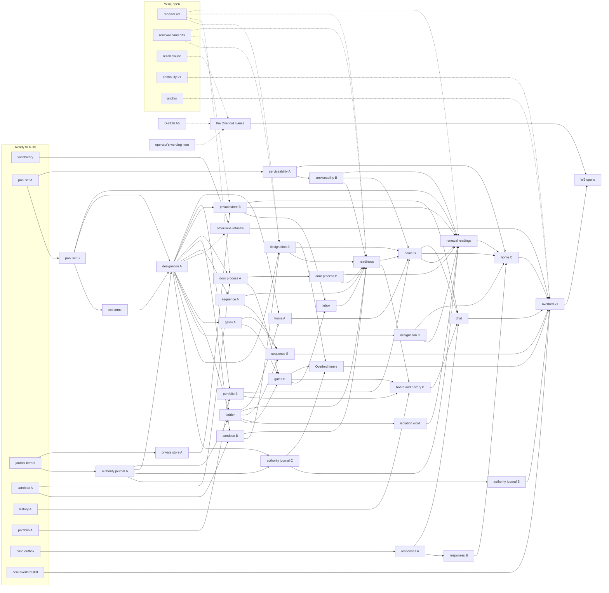

# The Overlord programme: the W1 index, designate and talk

This file is the index of W1, "designate and talk" (spec §14, Table 14's W1 row). It names the pieces, the lanes and
their files, and the order, so that several plan writers can each take one piece at once without colliding. It holds no
piece plan. Each piece's plan lives in `docs/superpowers/plans/2026-11-14-overlord-w1/` as `w1-<piece>.md`. The face,
the one W1 piece planned and built before this index, keeps its plan at
`docs/superpowers/plans/2026-11-10-overlord/w1-face.md`.

The spec is `docs/superpowers/specs/2026-11-09-overlord-design.md`, and the programme's ledger is
`docs/superpowers/programs/overlord.md`. The W1a index, whose shape this file follows, is
`docs/superpowers/plans/2026-11-10-overlord.md`. This file defines no D-numbers: every departure below is a plain slug
until the coordinator mints numbers.

Written against `main` at `416b8f942` (2026-11-14), and revised in fix round 1 (review 2075) against `main` on
2026-11-15. The fix round's rulings are the coordinator's and are marked "(ruled)".

## Open questions

The question numbers are stable: piece plans cite them by number. Each question is now in one of three states:
waiting on the operator, open with a recommendation, or settled. The piece plans build the recommendation of an open
question unless the coordinator or the operator rules otherwise, and each piece plan restates the questions it builds
on.

### Waiting on the operator

The coordinator raises each of these as an item. The pieces they touch are marked "waits on item" in Table W1.

- **Q2.** **The coordinator contract's room for new clauses** (slug `coordinator-clauses-by-name`). **Four** clauses compete
   for number 21:
   - D-8126's A5 adds "clause 21" and hard-codes the number in its roster text and its skill revision word.
   - W1a's recall clause is "numbered 21 at its merge".
   - The Linear hierarchy plan (`docs/superpowers/plans/2026-11-10-linear-hierarchy.md`, its wave 6) adds "contract
     clause 21" and makes the count word "twenty-one".
   - This spec's W1 Overlord clause (§11.4).

   Numbering is settled by §11.4: plans name the clauses (the autonomy clause, the recall clause, the Linear clause and
   the Overlord clause), and each takes the next free number at its merge.

   The room is not settled. Review 2075 measured the room on `main` with `skill-size-ratchet.test.ts`'s own formula: the
   contract ends about 13,660 bytes into its 16,000-byte budget, which leaves about 2,340 bytes. The pending texts
   measure, with their line prefixes:

   | Clause | Bytes |
   |---|---|
   | The autonomy clause | about 1,336 |
   | The Overlord clause | about 885 |
   | The recall clause | about 201 |
   | The Linear clause | about 399 |

   The autonomy and Overlord clauses fit alone (about 2,211). With the recall clause the total is about 2,407, and with
   the Linear clause about 2,801. A5's rewrites of clauses 4, 11, 19 and 20 come on top. So **a shortening pull
   request is certain**, and its wording is the operator's (§11.4; D-8126's clause 21 was approved verbatim).

   The Overlord clause piece waits on that answer (ruled). The coordinator tells D-8126's builder and the Linear plan's
   builder that their "21" may move.
- **Q10.** **The Overlord's replies: recorded at the turn, or re-read from transcripts at checkpoint time** (C37, §3.3.11,
    Table 4.3a). W1's private-store tables hold the operator's words only, and no piece records the Overlord's replies
    or feeds the thread into the checkpoint, though W1a's renewal act says "the Overlord's thread joins in W1". The
    answer fixes the checkpoint's input, the writer of the chat-reply response row and the owner piece. Until it comes,
    the private store's and the chat's rows say "waits on item", and question 27 is held, not decided (ruled).
- **Q24.** **Does a coordinator's own pin count as ratified (`ratifiedBy: coordinator`)?** (Table 11.1a, §5.1.) The goals'
    "versions" are the pin columns on `programs` and the `programme_modifications` rows (`ledgersStore.ts#goalsFor`).
    No table of that name exists. `ratifiedBy` is a nullable column on both, and absent reads as not ratified, as the
    card reads every goal today (`cardFacts.ts`, slug goals-unratified). The writers wait on the answer, so
    `ratifiedBy` rides portfolio PR B, which waits on the item.

### Open, with a recommendation

- **Q3.** **The journal kernel is "before W1" and also "W1 ships the kernel"** (§7.6 H27; slug
   `journal-kernel-is-the-first-w1-piece`). **Recommendation:** it is W1's first piece in lane C: move-only, with
   characterization tests, and ready to build now.
- **Q6.** **The route fields for the set and the ordered account list have no names** (§3.4; the set's spelling is settled at
   §3.4's side word). **Recommendation:** the pool-set plan names both fields, adds them to `ROUTE_FIELDS` and
   `_route_valid`, and pins them in `ccd-route-fields.test.ts`. The set's value is the side word's own spelling.
- **Q7.** **The load lines are not in Table 11.5b** (C57 gives 70% and 85% "by default"; §6.8 gives 95%).
   **Recommendation:** serviceability PR B keeps all three as starting values in one constants module, and the
   spec-fixes run adds them to Table 11.5b.
- **Q8.** **`limit_samples` names no cadence, retention or reader** (Table 11.1a). **Recommendation:** the sampler is a
   `LANE_SCHEDULE` row beside today's limits read (`server/src/limits.ts#readLimits`), never a poller of its own, kept
   30 days as a starting value. The piece plan measures today's read cadence first.
- **Q9.** **The route hold-down applies to "a long-lived role"** (C45, Table 11.5b, R13), so coordinators are covered too.
   The spec decides this. **Recommendation:** build it as written, in a commit of its own, behind a characterization
   test of today's `_route_restore`, and say so in the pull request.
- **Q12.** **`LaunchProfile` cannot hold the Overlord's tool surface** (slug `launch-profile-gains-typed-surface`).
    `LaunchProfile.settings` holds scalars only. **Recommendation:** extend the shared `LaunchProfile` type with typed
    fields (tools, deny rules, declared agents, one tool server, setting sources). The change reaches every row's type,
    not one column. `ccd/lib/launch-profiles.json` stays the projection.
- **Q13.** **How the door process carries `ccrc-api`, and who starts it** (§3.6; slug `door-process-wraps-the-one-client`).
    **Recommendation:** an MCP stdio server that calls the existing `ccrc-api` verbs, so the route table and the token
    handling stay in one client. Its tool names are the `ccrc-api` verbs the `ccrc-overlord` skill names. The plan says
    whether ccd starts it (§3.6: "a fleet-host process ccd starts with each generation") or the session's tool-server
    config does. The fallback (a shell that runs only `ccrc-api`, and the act key file) is not built, because W0a kept
    the door process.
- **Q14.** **The D-6798 no-model arm meets `CLAUDE_CODE_SUBAGENT_MODEL_FORCE=1`** (W0 proposal 1; slug
    `no-model-arm-reads-the-pin`). **Recommendation:** the arm reads the pin from the session's launch profile, a fact,
    rather than exempting a role by name.
- **Q15.** **How the isolation word is measured** (§7.4; slug `isolation-from-reported-uids`). **Recommendation:** each agent
    reports its uid and host identity on connect, an additive agent-wire field. The server compares them with its own.
    Any agent that shares both reads `shared-user`, and an unmeasured answer reads `shared-user`, the safe word.
- **Q17.** **`CallerIdentity` and the operator's doors** (§7.4). **Recommendation:** W1's port has one adapter, attribution.
    The operator's doors keep `server/src/accounts/gate.ts#createAccountGate` and record its actor through the port as
    `operator` strength. No second cookie reader.
- **Q18.** **The census of what ccd types, for `INJECTED_PROMPTS`** (§3.8). **Recommendation:** cut the function bodies out of
    `ccd/ccd`, as `ccd-limit-no-keys.test.ts` does. Each typed literal carries a tag naming its typer, so the match runs
    in both directions.
- **Q19.** **Which rungs the W1 ladder accepts** (§7.5; slug `w1-rung-door-stops-at-chat`). **Recommendation:** the vocabulary
    and `effectiveRung` are total over all four rungs from W1. The rung door refuses `capability-missing` above `chat`:
    `advise` names `overlord-route-v1` (W2) and `full` names `overlord-answer-v1` (W3, step two).
- **Q22.** **Invariants over tables W1 lacks** (§10.4, Table 11.7a; slug `monitor-checks-what-exists`). **Recommendation:**
    each predicate names its tables. The monitor runs a predicate only once its tables exist, and lists the others as
    `not-applicable`, never as passed. That covers I1, I3, I4, I14, I15 and I16, and also I6, I11, I12 and I13's entry
    half. The simulator and the monitor share predicates (D-8214), with the sweep-phase bound the ledger carries for
    D-8214 and D-8240.
- **Q23.** **The refusal list "generated from §11.6"** (slug `refusal-table-checked-both-ways`). Table 11.6 has no wave
    column, and W1a's `timer-not-found` is not in it. **Recommendation:** no code generator. A test reads Table 11.6 and
    `shared/refusal.ts` and checks them against each other in both directions. CI's fast selection does not trace a
    server test that reads a `docs/` file, so a docs-only spec fix could red `main`. The vocabulary plan therefore adds
    the spec file to the test-selection map's untraced inputs for that test. W1a's words missing from Table 11.6 go to
    the spec-fixes run.
- **Q26.** **Who writes "delivered" and "queued"** (§3.8: "the delivery lane"; slug `message-nudge-rides-the-mail-lane`).
    `sendPrompt`'s `SendResult` has no "queued" answer, and the spec says delivery is like mail. **Recommendation:**
    the nudge that names the message id is delivered through the mail lane, whose own delivery states answer delivered
    and queued. The private store's one message writer is called on that transition. No new lane.
- **Q27.** **How the server learns that the Overlord replied.** Held until question 10 is answered (ruled).
- **Q30.** **Is the door process a launcher on `PATH`?** (F13.) **Recommendation:** no. It is started from the shipped tree by
    its absolute path, so `_inst_bins`, `deploy.sh` and `install-census.test.ts` do not change. If the door-process
    plan finds otherwise, it edits those three in the same pull request.
- **Q31.** **`overlord_sequence` and the message moves, which live in two SQLite files** (§10.4, §9.1). One writer stamps a
    sequence row "inside each stamped transaction", and a message move commits in the private store, not in
    `coord.db`. **Recommendation:** a message move's sequence row is written by the `coord.db` transaction that causes
    it (the citing door, the settlement mark, the mail lane's delivery). The private store's state is re-derived at
    boot (I8), so no transaction spans both files.
- **Q32.** **A read past its rate ceiling has no refusal word** (Table 11.5b sets ceilings, Table 11.6 names no word).
    **Recommendation:** the vocabulary piece adds one, `read-ceiling`, to the W1 group, and the spec-fixes run adds it
    to Table 11.6.

### Settled

Settled by the coordinator's rulings in fix round 1 (ruled), or by the spec's own text. Each is now built as stated.

- **Q1.** **The D-8126 gate is met for every code piece** (ruled; slug `d8126-built-means-a2-a3`). W1 reads A2's box-token
   goals read and `doneWhen`, and A3's `coordinator_calls`. A5, D-8126's decision procedure in the coordinator skill,
   gates only the Overlord clause. A4, A6, A8, A9 and A10 gate no W1 piece. A7 edits lane A's files
   (`_ws_least_loaded`, `limits.ts#projectHome`, `agent/src/whitelist.ts`, `ccdargv.ts`), A9 edits
   `session-hook.sh`, and A5 the coordinator `SKILL.md`, so each meets W1 only as a shared file. The spec's §1.1
   sentence that D-8126 "has not" merged is a spec fix.
- **Q4.** **The Operator Model registers as C11** (ruled; slug `operator-model-is-c11`). C10 is the Session host
   (`server/test/ccdContextIds.ts#CCD_CONTEXTS`, `ccd/contexts.tsv`). The private store's first pull request makes the
   four edits: `CCD_CONTEXTS`, the architecture spec's numbered list, a row in its path table, and `ccd/contexts.tsv`'s
   legend. `pool-set` still ships first among the pull requests that change what an agent does. §11.1's "C10" is a
   spec fix.
- **Q5.** **The placement the designate door uses is `server/src/limits.ts#projectHome` and `projectPlacement`** (ruled;
   slug `designate-widens-project-placement`). Both are widened to take the set, and the doors "pass [the set] to
   `poolRule`" (§3.4). `startProgramPlacement` is a PWA display selector, not the policy. C32 is wrong in the spec,
   which is a spec fix.
- **Q11.** **`auditorModelFor` is W3** (Table 11.1b puts it in W3's row). W1 ships nothing for it.
- **Q16.** **A late or lost witness refuses the write `unwitnessed`** (§11.2's gate order, §7.4). The caller retries on its
    next turn, and a third such refusal in a day is Table 7.5a's latch.
- **Q20.** **The ladder ships what has inputs** (ruled, F14; slug `ladder-causes-join-with-their-inputs`). The ladder ships
    the vocabulary, `effectiveRung`, the latch and condition tables, and the `degraded` cause. Each other W1 cause row
    is added by the piece that produces its input:

    | Cause | Added by |
    |---|---|
    | Restore detected; no off-volume witness since boot | Authority journal and restore (PR B, the witness epoch) |
    | The third unwitnessed write in a day; off the designated model | Door process and readers (PR B) |
    | An invariant violation | Sequence and monitor (PR B) |
    | `shared-user` | Isolation word |
    | The launch profile not engaged | Launch profile and sandbox check (PR B) |
    | Accounts past the 95% line | Serviceability and limits (PR B) |
    | Probes failed twice after a renewal | The Overlord's renewal readings, once W1a's renewal act has merged |

    The rung door caps at `chat` in W1, so no cause can lower `effectiveRung` before W2. Deferring a row costs little.
- **Q21.** **W1's boot coherence reads two journals** (Table 11.1a puts the act journal in W2; Table 7.6a). The authority
    journal and the privacy journal are read. The witness carries the act journal's head as absent until W2, and the
    only id W1 keeps unique across a restore is the message id.
- **Q25.** **The read rate ceilings are this wave's plan's to set** (Table 11.5b: "Set by the plan before W1"). The inbox plan
    measures a week of the console's own read rates and proposes each ceiling, and the coordinator approves the values
    at that plan's review. A read past a ceiling refuses with question 32's word.
- **Q28.** **`pushDue` ships in W1** (Table 11.1b: "W3 (`pushDue` W1)"). The outbox sender ships it total, answering "due
    now" or "silent", and W3 adds rows to it, not a second decider.
- **Q29.** **The board's Timers part is W1** (Table 5.2a). It shows the coordinators' timers, which W1a built. The Overlord's
    own timers reach the board through the Overlord's timers piece.
- **Q33.** **Designate and rebind refuse `capability-missing` on ccd's three words and on a missing `continuity-v1`** (ruled,
    F15; slug `designate-refuses-without-continuity-v1`), as the approved `w1a-continuity-v1.md` says. There is no
    separate server-side `overlord-v1` gate: the console hides the Overlord's doors until the `overlord-v1` piece lands.
    The spec names only ccd's words, which is a spec fix.
- **Q34.** **The account facts are set from Settings** (ruled, F16). The roster's billing fact and per-lane continuity record
    have the writer "the operator, from Settings" (Table 11.1a). A hand edit of `accounts.json` is no W1 path.
    Serviceability PR A ships the server door and widens `shared/roster.ts`'s `ACCOUNT_KEYS`. Home PR C ships the PWA
    row.
- **Q35.** **The restore generation is a counter** (ruled, F11; slug `restore-generation-is-a-counter`). It is raised only
    inside Confirm the restore's transaction. Authority journal PR C owns its writer and its accessor. Response rows
    stamp it `unmeasured` until that PR lands, and the timer mail's "fired again after a restore" line reads it.
- **Q36.** **W1 pieces start before W1a closes** (ruled, F17; slug `w1-pieces-start-before-w1a-closes`). Figure 8 draws
    W1a before W1, and the operator asked for this parallel work. The eight ready pieces are vocabulary, pool set PR A,
    journal kernel, launch profile PR A, history PR A, portfolio PR A, push outbox and the `ccrc-overlord` skill. Each
    later piece names the W1a pieces it waits for.
- **Q37.** **C61 to C69 are approved** (operator item 227). Table 13a's "Proposed with R20" is a spec fix.

## Prerequisites, as measured

Measured on 2026-11-14 with `git fetch origin main`, `gh pr view` and `git merge-base --is-ancestor` against the commit
the fleet box's `ccrc version` names (`3afa9aeb7`, release `v0.0.1201`), and `git grep origin/main` for each wave's own
symbols. Probes B was re-measured on 2026-11-15.

| Prerequisite | State on `main` | How measured |
|---|---|---|
| D-8125 merged | **merged**: #2490 at `b15a0c497`, in `v0.0.1201` | `gh pr view 2490`; ancestor of the fleet box's build |
| D-8126 merged | **merged**: the spec and build plan, #2487 at `d15893d3d` | `gh pr view 2487` |
| D-8126 built, the parts W1 reads | **merged and released**: A2, the goals read for the box token and `doneWhen` (#2549); A3, `coordinator_calls` and its route (#2606). Both are in `v0.0.1201` | `gh pr view`; ancestry; `doneWhen` in `server/src/coord/ledgersStore.ts`; `server/src/coord/coordCallsRoute.ts` present |
| D-8126's other waves | **not on `main`**: A4 (`pwa/src/ledgers/callWords.ts` absent), A5 (`ccd/coordinator-skill/references/decision-procedure.md` absent, and the skill still has 20 clauses), A6 (`COORD_BALL_MAIL_MS` absent), A7 (`skill-ensure` absent from `ccd/ccd`), A8, A9 and A10 | `git grep` and `git cat-file -e` on `origin/main` |

What W1 still needs from W1a's open pieces:

| W1a piece | State | What W1 needs from it |
|---|---|---|
| Renewal act (`SessionHost`, the checkpoint, the lane's acts) | not started on `main` | The Overlord renews by fresh start through `renew`, and the door process starts with each generation's launch. The designation's `pending` deadline is enforced by the renewal lane. Needed by designation PR B, door process PR A, readiness and the renewal readings |
| Renewal hand-offs (Renew now, `renewing`, the operator's mark) | not started | The prompt route's `renewing` and the mark, which the private store's prompt-route change sits beside. Restart the Overlord rides the same resume path as Renew now. Needed by private store PR B, designation PR B and readiness |
| Replay quiz | not started | Building waits for nothing. Using it does: the Overlord renews only while the `continuity` lane is live, and no W1a lane is armed before the baseline exists (W0-28). So the operator's first designation waits for the baseline and the arming. The ledger tracks that act, not a piece |
| The recall clause | not started | Lands before the Overlord clause (question 2) |
| `continuity-v1` | not started | Designate and rebind refuse without it (question 33). `overlord-v1` comes after it |
| Anchor (#2803) | open | The Overlord's start reads its card first. `CARD_OVERLORD_LINE` (`server/src/continuity/card.ts`) waits for `overlord-v1`. Needed before `overlord-v1` |
| Probes PR B (#2802) | **merged** (2026-11-15, `24ebf291e`) | The inbox serves probes first, through the probe door. Nothing waits |

Already on `main` and used as is: the start report, generations and `renewalDue`'s `overlord` rows, the card and its
read records, notes, timers, launch profiles with the `overlord` row (`FLEET_ROLES.overlord`, `timerCap` 50), the
Overlord's `MAIL_PACE` row, `hibernate-fresh`, compaction, context readings, probes, and the face (#2741, #2781).
`timers-v1` is on `main` but not in the `v0.0.1201` build, because #2805 merged after it.

## The large-file programme, and where new code goes

The large-file programme (`docs/superpowers/specs/2026-11-13-large-file-programme-design.md`, D-8615) changes where
W1's code may grow.

- **In force on `main` today:** the growth check. A pull request may grow each file `server/test/growthCheck.ts#growthFiles`
  answers by at most 40 net lines. That list is `GROWTH_FILES` and every ccd library under `ccd/lib/`. W1 touches these
  growth-checked files: `ccd/ccd`, `ccd/ccrc`, `ccd/session-hook.sh`, `ccd/ccrc-doctor-checks`,
  `ccd/history/lib.mjs`, `server/src/watch.ts`, `server/src/coord/store.ts`, `server/src/coord/routes.ts`,
  `server/src/server.ts`, `pwa/src/lib/api.ts`, `shared/api.ts`, and any new `ccd/lib/*.sh`. No file has a cap yet.
- **Only proposed:** #2811 (open) adds caps, the first on `shared/api.ts` with about 40 lines of headroom and no
  waivers; #2810 (open) starts the `ccd/ccd` split; and a later spine limit on `ccd/ccd` would make "new code goes in
  a library" a rule.
- **What this index does about it (ruled; slug `wire-types-in-sibling-modules`):**
  - W1's new wire types go in new one-concern `shared/*.ts` siblings: the message moves, the inbox rows, the
    readiness word, the responses, the designation, the ladder and the account facts. `shared/api.ts` takes only the
    two `SERVER_CAP_MAP` rows, `push-outbox-v1` and `overlord-v1`.
  - New ccd verbs are planned for `ccd/lib/*.sh` libraries: `ccd pool-answer`, `ccd keep-awake` and the door process's
    spawn step. Each leaves one dispatch line in `ccd/ccd`.

## W1, designate and talk: the pieces, the lanes and their order

Twenty-eight pieces build W1, in 44 pull requests; the face is built and not counted. Each piece is sized for one
worker, and a piece with two or three pull requests ships them from one plan. Every plan names the files it creates or
changes. Every new L1 decider joins `MUTANT_SETS` (`server/test/sim/mutation-floors.test.ts`) and
`server/test/sim/mutation-floors.json` in the pull request that creates it, so "mutation floors for new deciders" is a
rule of each plan, not a piece of its own. Every guard ships with the test that goes red without it. Every new routes
file, table, lane and time-port user carries its census rows in the same pull request, including
`server/test/single-definition/time-ports.test.ts`'s module list.

**When a pull request starts (ruled).** A pull request starts when its "Needs first" are met. Figure W1 is the order.
A lane's order in Table W1 is only the tie-break for its one builder.

In a Settings row, "server door" is the route and its store, and "PWA row" is the console control.

| Piece | Plan | What it ships | Size | Needs first | Lane |
|---|---|---|---|---|---|
| Vocabulary | `w1-vocabulary.md` | `INJECTED_PROMPTS` with its census of what ccd types; every W1 refusal word in one group of `shared/refusal.ts` (with `read-ceiling`), checked against Table 11.6; the trigger table's refusal-word kinds (Table 11.1b) | 1 PR, 4 tasks | nothing: **ready to build** | K |
| Pool set | `w1-pool-set.md` | The pool rule's session side as a set (`poolRule`, `_pool_ok`, one fixture table); Table 3.4d's ccd users; the route fields for the set and the ordered list; `ccd pool-answer` (planned in a `ccd/lib/` library) with its whitelist row and argv; `pool-set`; the doctor line when a box loses `pool-set`, and `ccrc rollout`/`ccrc rollback` refusing below it unless forced (§11.5); R18's minors (review 1862) | 2 PRs, 8 tasks | A: nothing, **ready to build**. B: PR A | A |
| ccd's Overlord arms | `w1-ccd-arms.md` | `ccd keep-awake --state on\|off <id>` (in a `ccd/lib/` library) with its whitelist row, argv and `keep-awake`; the affinity arm's stand-down for `overlord`; `_route_restore`'s hold-down (question 9); the fresh start's three-step pick from the ordered list; `_operator_choice_promote`'s skip for a long-lived role | 1 PR, 5 tasks | pool set B | A |
| Serviceability and limits | `w1-serviceability.md` | A: `serviceability`'s four more inputs and its bash twin; the roster's billing fact and continuity record per lane, with `ACCOUNT_KEYS` widened and their Settings **server door** (question 34). B: `limit_samples` and its sampler, `poolRunway`, the three load lines, and the ladder's 95% cause row | 2 PRs, 7 tasks | A: pool set A. B: PR A | A |
| The Overlord's renewal readings | `w1-renewal-readings.md` | The last wiring step (ruled, F1; slug `renewal-readings-not-rows`). `RENEWAL_ROWS.overlord` is on `main`. This piece wires into `generationsLane.ts#renewalInputsOf` the readings it answers "later: W1" today, each supplied by its producing piece: `turns` and the soft break's `operatorQuietObservedMs` (private store B), `modelDrift` and `readersRunning` (door process B), `termRaised` (authority journal C), `accountOutsideSet` (pool set B), `classUnservable` and `accountLoadMove` (serviceability B), `classChanged` (designation C), `placeHiddenObservedMs` (home B), `fittedCeilingTokens` (W1a's probes), `notLocal` (isolation word), and `backstopDue`, whose hour and time-zone **server door** this piece ships. It also leaves an account out of the ordered list on `launch-profile-unmet` (§3.6), and adds the probes-failed-twice ladder cause. `entryRetired` (W4) and `evaluationDue` (W3) stay "later" by name | 1 PR, 5 tasks | pool set B, serviceability B, designation C, door process B, private store B, home B, authority journal C, isolation word, W1a renewal act | A, last |
| Journal kernel | `w1-journal-kernel.md` | The chained-journal kernel (codec, verifier, tail heal) moved out of `server/src/coord/delegation-journal.ts`, move-only, characterization first | 1 PR, 3 tasks | nothing: **ready to build** | C, first |
| Authority journal and restore | `w1-authority-journal.md` | A: the authority journal on the kernel; boot coherence (Table 7.6a, two journals: question 21); `authority-rolled-back`; the authority-and-restore explorer model, written before the code. B: the witness epoch on the agent link and the console, and the ladder's restore and witness cause rows. C: Confirm the restore, and the restore generation's counter, writer and accessor (question 35) | 3 PRs, 8 tasks | A: kernel. B: PR A. C: PR A, designation A | C |
| Designation | `w1-designation.md` | A: `overlord_designation` (`term`, `designatedTerm`, class, `accountPools`, past ids, `pending`/`live`); `coord/overlordRoutes.ts` with designate and retire; the two-account check; `capability-missing` for ccd's three words and `continuity-v1` (question 33); Start the Overlord composing session-create in the `overlord` project; the route record write; `projectHome`/`projectPlacement` widened to the set (question 5); the reader into `roleOf` (`designation` on `RoleFactInputs`, its four call sites, a test that a pending row reads `overlord`) and the roll lane's `overlord` hold (ruled, F7). B: rebind, Restart the Overlord, the `pending` deadline, the keep-awake calls, and the rebind's re-target of queued `overlord` mail (ruled, F12). C: `decideSleep`'s `overlord` hold, and the Settings **server doors** for the model class and the account set | 3 PRs, 10 tasks | A: pool set B, ccd arms, authority journal A. B: PR A, sandbox B, W1a renewal act and renewal hand-offs. C: PR A | C |
| Ladder | `w1-ladder.md` | `operatorRung`, the latch and condition tables, `effectiveRung`, the rung door (step-up up, journalled; question 19), Pause, `off`'s one transaction (W1's part), the `degraded` cause (question 20), `overlord-off` and `rung-below`, and the state "a narrowing is taking effect until a witness holds it" (§7.6) | 1 PR, 5 tasks | authority journal A, designation A | C |
| Gates and identity | `w1-gates.md` | A: the `CallerIdentity` port and the attribution adapter; actor columns on the designation and message rows; the verb class of every Overlord route (H3, Table 3.6b). B: the gate order of §11.2 as one L1 decider, the fence check (`stale-designation`, `stale-generation`) and `not-the-overlord` | 2 PRs, 6 tasks | A: designation A. B: PR A, ladder, door process A | C |
| The Overlord's timers | `w1-overlord-timers.md` | Timers set through the door process, stamped with `designatedTerm`; the setter kind `overlord` in the timer lane, with the `retired` cleanup; the operator's read adds the role's timers; resolving `overlord` as a mail recipient, and a fired timer's mail waiting for the card; the measurement of what an older mail lane does with queued `overlord` mail (Table 11.5) (ruled, F12); the "fired again after a restore" line; M36's refusal counts | 1 PR, 5 tasks | designation B, gates B, authority journal C | C |
| `overlord-v1` | `w1-overlord-v1.md` | The word in `SERVER_CAP_MAP`; `ccrc-api`'s Overlord verbs follow it; the card's `CARD_OVERLORD_LINE`; the console shows the Overlord's doors only under it | 1 PR, 2 tasks | every other W1 piece but the Overlord clause, and W1a's `continuity-v1` and anchor | C, last of all |
| Isolation word | `w1-isolation.md` | Each agent's uid and host identity on connect (an additive agent-wire field; question 15); `server-isolation` measured; its `advise` cap as the ladder's `shared-user` condition; the board's isolation fact; the `notLocal` reading | 1 PR, 4 tasks | ladder | H |
| Refusals on other write lanes | `w1-other-lanes.md` | `overlord-uses-its-doors` on peer mail, item raise, claims, the claimant's question door and coordinator intent; `overlord-not-a-coordinator` at run open (§3.5, H10), through the shared attribution check | 1 PR, 4 tasks | designation A, vocabulary | H |
| Sequence and monitor | `w1-sequence-monitor.md` | A: `overlord_sequence` and its one writer, called by every stamped transaction already on `main` (each later piece calls it itself; question 31); the cursor read with its explicit gap. B: the invariant monitor's predicates and runner (question 22), one latch and one item per violation, the ladder's cause row, M24 | 2 PRs, 6 tasks | A: designation A. B: PR A, ladder, gates A | H |
| Launch profile and sandbox check | `w1-sandbox.md` | A: the `overlord` profile's W1 surface (the tool list; deny rules, the cron tools included, W0 proposal 3; the declared reader types; one tool server; setting sources; the hook registered; the bypass acceptance; the constitution file), the typed `LaunchProfile` fields (question 12), and how the Overlord's pinned launch loads `ccrc-overlord` and no other skill; the no-model arm's pin read (question 14); the start report's profile digest and loaded sets. B: the sandbox check, `pending` to `live`, `overlord-sandbox-unmet`, `launch-profile-unmet`, and the ladder's profile cause row | 2 PRs, 7 tasks | A: nothing, **ready to build**. B: PR A, designation A | B |
| Door process and readers | `w1-door-process.md` | A: the door process with `ccrc-api` inside (question 13; its tool names are the `ccrc-api` verbs the skill names), ccd's spawn step that starts it with each generation (in a `ccd/lib/` library), the launch nonce, the act key issued once, and the per-prompt delta cache (C38). B: the readers' one read tool; the reader-scope and reader-model hook arms; the witness report; the reader start and stop reports; the model-switch report; the hook's "picked up" report and its door (ruled, F9); the witness in the probes' closed-book grading; and the ladder's unwitnessed and off-model cause rows | 2 PRs, 8 tasks | A: sandbox A, designation A, W1a renewal act. B: PR A | B |
| Private store and messages | `w1-private-store.md` | A: C11 registered (question 4); `operator-model.db` with its migrations, its backup and restore entries and its deny path; `operator_messages` and the message moves table; the read ledger table; the privacy journal file with the highest message id. B: the prompt route's record-then-nudge for the designated session (question 26), the settlement mark, the boot pass's re-derived `settled` (I8), the `turns` and operator-quiet readings, and `message` as a note key (`w1a-notes.md`). The Overlord's replies: **waits on item** (question 10) | 2 PRs, 8 tasks | A: kernel. B: PR A, designation A, W1a renewal hand-offs | D |
| Inbox and reads | `w1-inbox.md` | `messages`, the inbox with band 1, probes and the coalesced wake (its contract fixed), `acknowledge`, a read-ledger line per read, the read ceilings (question 25) | 1 PR, 5 tasks | private store B, gates B | D |
| Board and history door | `w1-board-history.md` | A: the history agent op in `agent/src/server.ts`, `decideScope`'s `overlord` scope (no argv or environment yields it) and the agent word `overlord-history`. B: `GET /api/overlord/history` with `history-unreachable`, and the board, composed from existing readers, with its W1 parts (Timers included, question 29) | 2 PRs, 6 tasks | A: nothing, **ready to build**. B: PR A, gates B, readiness, portfolio B | D |
| Readiness | `w1-readiness.md` | `overlordReadiness` (Table 6.4a, first match, monotonic); the readiness lane on a new `LANE_SCHEDULE` row, `overlord-readiness`, apart from the existing `readiness` row, which is the programme-start check: a different job with a different input; readiness rows; and a dead Overlord's one push with Restart | 1 PR, 4 tasks | designation B, sandbox B, ladder, inbox, serviceability B (`stranded`), sequence A, door process B (`deaf`), W1a renewal act and renewal hand-offs | D, last |
| Portfolio and goals | `w1-portfolio.md` | A: `portfolio_rank` and `portfolioFor` (W1's rows). B: the rank door, and `ratifiedBy` on the pin and on `programme_modifications` (question 24) | 2 PRs, 5 tasks | A: nothing, **ready to build**. B: PR A, designation A, and the operator's answer to question 24 (**waits on item**) | P |
| Push outbox | `w1-push-outbox.md` | `reachedOperatorAt`, `pushedAt` and outbox rows in the raising transaction; the one sender with its boot pass; today's push sites behind it, characterization first; `pushDue` total (question 28); the random push id, minted and stored on the outbox row (the one owner); `push-outbox-v1`; `ccrc rollback` refusing below it unless forced (§11.5) | 1 PR, 7 tasks | nothing: **ready to build** | E |
| Response record | `w1-responses.md` | A: `PushService`'s per-send verdict, the outbox's push id carried in each payload, the service worker's `shown` and `opened`, the receipts door, `operator_responses` written `pending` before each send with the restore generation `unmeasured` until it exists, and `response_receipts`. B: the response lane on its `responses` row, `RESPONSE_OUTCOMES`, `responseOutcome`, `responsesFor`, the "I handled this elsewhere" door and its control, the Waiting on you and digest inserts with the console's `opened` receipts on that row's detail and the digest page, and retention with its Settings **server door** | 2 PRs, 9 tasks | A: push outbox. B: PR A | E |
| Home and Settings | `w1-home.md` | A: `homePlace`, the places list as a function of the designation, the Fleet's own path, every go-fleet door, the wordmark home. B: the Overlord place (the readiness word, Pause and its "taking effect" line, Start, Open and Rebind, since you were last here, the portfolio strip and capacity line, the face) and the console's "the Overlord place is hidden" report (R19). C: the Settings **PWA rows**: model class, account set, an account's billing fact and continuity record, response retention, the backstop hour and time zone | 3 PRs, 9 tasks | A: designation A, ladder. B: PR A, designation B, readiness, portfolio B, serviceability B. C: PR B, designation C, serviceability A, responses B, renewal readings | F |
| Chat | `w1-chat.md` | The chat with message ticks, the server's own lines while not `ready`, earlier generations through the history reader, the kept draft, the console's `opened` receipts in the place. Chat-reply rows: **waits on item** (question 10) | 1 PR, 5 tasks | home B, private store B, board and history B, responses A | F, last |
| `ccrc-overlord` skill | `w1-overlord-skill.md` | The skill whole: 22 clauses under `## The contract`, pinned `1..N`; `routing.md`, `answering.md`, `starting.md`, `operator-model.md`; its cap measured at merge; its installer and install through every list; `ccrc-overlord` as the fourth name of the hook's role-skill deny, which rests on spec §3.6 | 1 PR, 4 tasks | nothing: **ready to build** | G |
| The Overlord clause | `w1-coordinator-clause.md` | The Overlord clause (§11.4), acting only under `overlord-v1`, with its pin, its count word and its cap raise, after the shortening (question 2) | 1 PR, 2 tasks | the recall clause and D-8126's A5 merged, and the operator's wording (**waits on item**); lands before W2 opens (ruled, F18) | G, last |

*Table W1. The pieces and their lanes.*

**Where each Table 14 item went.** Every item of Table 14's W1 row, and every W1 half the spec deferred from W1a, is in
exactly one piece:

| Table 14, W1 | Piece |
|---|---|
| The private store, the operator's messages, the read ledger | Private store |
| The designation, its term and `designatedTerm` | Designation |
| The identity port | Gates and identity |
| The isolation word | Isolation word |
| The door process and the reader types | Door process (the reader types are declared in the profile by the sandbox piece, PR A, and served by the door process, PR B) |
| The history door and its agent op | Board and history door |
| The sandbox check | Launch profile and sandbox check |
| The fence | Door process (the nonce and the key), gates and identity (the check) |
| ccd's sleep markers' verb and `keep-awake` | ccd's Overlord arms |
| The ladder at `chat`, and Pause | Ladder |
| The readiness word | Readiness |
| The inbox with band 1, probes and the coalesced wake | Inbox and reads |
| The journal kernel | Journal kernel |
| The authority journal, Confirm the restore | Authority journal and restore |
| The privacy journal's file and its highest message id | Private store |
| The push outbox and `push-outbox-v1` | Push outbox |
| The account set on the designation, its Settings row, the two-account check | Designation (the server door), Home C (the PWA row) |
| The pool rule's set and `pool-set` | Pool set |
| The home, the chat with message ticks | Home and Settings, Chat |
| The board | Board and history door |
| The portfolio rank, `portfolioFor` | Portfolio and goals |
| The limit samples | Serviceability and limits |
| The refusal on other write lanes | Refusals on other write lanes |
| The invariant monitor, `overlord_sequence` and its cursor read | Sequence and monitor |
| The Overlord's timers, through its door process, stamped with `designatedTerm` | The Overlord's timers |
| The response record, `PushService`'s verdict, the push id, `shown` and `opened` | Response record (the push id is minted by the push outbox) |
| `overlord-v1` | `overlord-v1` |
| `serviceability`'s inputs, `poolRunway`, the roster's account facts (Tables 11.1a and 11.1b) | Serviceability and limits |
| `ratifiedBy` on goals | Portfolio and goals (waits on item) |
| `INJECTED_PROMPTS`, the refusal-word list, the trigger table's refusal words | Vocabulary |
| `acknowledge` | Inbox and reads |
| Restart the Overlord: the door, and a dead Overlord's one push | Designation B (the door), Readiness (the push) |
| The hook's W1 reports: start fields, witness, reader start and stop, model switch, "picked up" | Sandbox A (start fields), door process B (the rest) |
| The `ccrc-overlord` skill; the Overlord clause | `ccrc-overlord` skill; the Overlord clause |
| The Overlord's renewal readings (Table 3.3.11b's rows are on `main`) and the backstop's Settings | The Overlord's renewal readings (server door), Home C (PWA row) |
| The "Overlord place is hidden" report (R19) | Home B |
| Carried from W1a's timers plan: the restore line on a repeated timer mail, M36's refusal counts | The Overlord's timers |

**Ready to build now** (question 36): vocabulary, pool set PR A, journal kernel, launch profile PR A, history PR A (the
agent op), portfolio PR A, push outbox and the `ccrc-overlord` skill.

**Ten lanes, one builder each.** A lane's builder takes its next pull request whose "Needs first" are met.

- **Lane A, ccd and accounts:** pool set, ccd's Overlord arms, serviceability and limits, then the renewal readings.
  - **Every agent before the server:** `pool-set` ships first among the pull requests that change what an agent does,
    and reaches every agent before the designate door accepts a designation (C46). The designate door enforces that
    order by refusing `capability-missing`.
  - **`ccd/ccd`:** its pool, swap, route and serviceability functions: `_pool_ok`, `_project_pool_state`,
    `_acct_pool_state`, `_swap_target`, `_auto_swap_check`, `cmd_swap`, `cmd_start`, `cmd_prefer`, the
    crossing-marker functions, `_default_pool`, `_undecidable_cause`, `cmd_route` and `ROUTE_FIELDS`,
    `_route_restore`, `_operator_choice_promote`, and `_serviceable` with its helpers. Each new verb's one dispatch
    line also goes here.
  - **New ccd libraries:** for `pool-answer` and `keep-awake`.
  - **Pool and roster files:** `shared/poolrule.ts`, `server/src/poolrule.ts`, `server/src/pools.ts`,
    `shared/serviceability.ts`, and `shared/roster.ts` (with `ACCOUNT_KEYS`) and its JSON projection.
  - **Limits and placement:** `server/src/limits.ts` (the sampler; `projectHome` is shared, below), and the new sampler
    and `poolRunway` modules.
  - **Argv and whitelist:** the argv builders in `server/src/ccdargv.ts` and their rows in `agent/src/whitelist.ts`.
  - **Install and doctor:** the capability-floor arms in `ccd/ccrc` and `ccd/ccrc-doctor-checks`.
  - **The account-facts server door.**
  - **The renewal readings piece:** it edits `server/src/continuity/generationsLane.ts#renewalInputsOf` and
    `server/src/continuity/softRenewal.ts`'s inputs only after W1a's renewal act has merged.
- **Lane B, the body:** launch profile and sandbox check, then door process and readers.
  - **The launch profile:** the shared `LaunchProfile` type and the `overlord` row's launch-profile column in
    `shared/fleetRoles.ts`, `ccd/lib/launch-profiles.json`, and `server/src/continuity/{launchProfile,profileFor}.ts`.
  - **The sandbox check:** the new sandbox-check decider under `server/src/continuity/`, and the start report's body in
    `server/src/continuity/routes.ts`.
  - **The door process:** the process itself (a new file under `ccd/`, named by its plan, question 30), the spawn
    step's ccd library, and the act-key columns of `continuity_generations`.
  - **The hook:** the arms in `ccd/session-hook.sh`: the no-model arm's pin read, the reader-scope arm, the witness, the
    reader and model-switch reports, and "picked up".
  - **The "picked up" door.**
- **Lane C, the server spine:** journal kernel, authority journal, designation, ladder, gates and identity, the
  Overlord's timers, then `overlord-v1`.
  - **Routes:** `server/src/coord/overlordRoutes.ts`, which designation PR A creates with every census site.
  - **Journals:** the journal kernel and the authority journal under `server/src/coord/`.
  - **Designation, ladder and gates:** their modules under `server/src/coord/` (each named by its plan), and their wire
    siblings in `shared/`.
  - **Holds:** `server/src/sleep.ts`'s policy rows, `server/src/stopDone.ts#RUN_DONE_POLICY`,
    `server/src/coord/hibernate.ts#IDLE_HOURS_POLICY`, and `server/src/rollLane.ts`'s hold.
  - **Timers:** the timer lane's setter branch in `server/src/continuity/{timers,timerLane}.ts`.
- **Lane D, talk on the server:** private store, inbox and reads, board and history door, then readiness.
  - **The private store:** the new C11 directory, named by its plan.
  - **Wire siblings in `shared/`:** the message moves table, the inbox rows and the readiness word.
  - **The prompt route:** its body in `server/src/server.ts`.
  - **Handlers:** the inbox, `messages`, `acknowledge`, board and history handlers in `overlordRoutes.ts`.
  - **The history op:** in `agent/src/server.ts` and `shared/agent-protocol.ts`, with
    `ccd/history/lib.mjs#decideScope` and its declaration file.
  - **Readiness:** its decider and lane.
- **Lane E, pushes and responses (C6):** push outbox, then response record.
  - **Push sites:** `server/src/coord/questions.ts`'s stamps, `server/src/notice.ts`, `server/src/push.ts`,
    `server/src/coord/ledgersRoutes.ts#pushBlocking`, and the ask push in `server/src/watch.ts`.
  - **New modules:** the outbox and response modules, and the response wire sibling in `shared/`.
  - **The worker and the client:** `pwa/public/push-sw.js` (outside its generated region) and `pwa/src/lib/push.ts`.
  - **Server routes:** the two response doors in `server/src/server.ts`, beside the push routes.
  - **Rollback:** the rollback arm in `ccd/ccrc`.
  - **The console's response controls:** on the Waiting on you row's detail and the digest page.
- **Lane F, the console:** home and Settings, then chat.
  - **Places and routes:** `pwa/src/lib/places.ts` and `pwa/src/lib/routes.ts`.
  - **The go-fleet doors:** `pwa/src/command/door.ts`, `DigestScreen.tsx`, `SessionScreen.tsx` and
    `RenderBoundary.tsx`.
  - **The bars.**
  - **The place and the chat:** a new `pwa/src/overlord/` directory.
  - **The Settings PWA rows.**
  - **The face:** `pwa/src/face/` is built, and this lane only reads it.
- **Lane G, the skills:** the `ccrc-overlord` skill at once, and the Overlord clause last.
  - **The skill:** `ccd/overlord-skill/**` and `server/test/overlord-skill.test.ts`.
  - **The installer:** `ccd/install-overlord-skill.sh` with `server/test/install-overlord-skill.test.ts`.
  - **The cap and the baseline:** `server/test/skill-size-caps.json` and `server/test/shellcheck-baseline.json`.
  - **Hand-kept skill lists:** the seven in `ccd/ccrc` (`_inst_skills` and its echo, `_acct_provision`,
    `_acct_unprovision`, `_uninst_cc_sessions`), `ccd/ccrc-doctor-checks`'s `_check_skills` and `_fix_skills`, and
    `deploy/deploy.sh`'s agent arm.
  - **Installer and README pins:** `server/test/wrapper-roster-fixture.test.ts` (the installer's required references),
    and `README.md`'s role-skill sentence with `history-skill.test.ts`.
  - **The role-skill deny:** `ROLE_SKILLS` in `ccd/session-hook.sh` (one line) with
    `session-hook-role-skill-deny.test.ts`.
  - **The fixtures and pins that list skill trees:** the skill plan measures them, `agent/test/deploy-verify.test.ts`
    included.
  - **The corpus scans over skill text:** `ccrc-api-closed.test.ts#corpusFiles`, `dead-coordinator-prose.test.ts` and
    `expiry-lane-prose.test.ts`.
  - **The Overlord clause, later:** `ccd/coordinator-skill/SKILL.md` with `server/test/coordinator-skill.test.ts`.
- **Lane H, guards:** isolation word, refusals on other write lanes, sequence and monitor.
  - **The isolation word:** its decider and the agent's report field.
  - **The other-lane refusals:** the shared attribution check, reached from `server/src/coord/routes.ts`.
  - **The sequence:** its module and its monitor.
- **Lane K, the vocabulary:** a new injected-prompts module in `shared/`, one group in `shared/refusal.ts`, the trigger
  table's refusal-word kinds, and the two tests.
- **Lane P, programmes:** the new `portfolio_rank` table and the `portfolioFor` module;
  `server/src/coord/ledgersStore.ts`'s goals functions; the goals doors in `ledgersRoutes.ts`;
  `server/src/continuity/cardFacts.ts`'s goals read; and the rank door's handler.

**All piece plans can be written at once.** Each piece plan reads the spec and this index, not another piece's plan. A
plan for a piece that needs an unmerged interface takes the interface from the spec's tables and says so.

*Figure W1. The order: a pull request starts when every arrow into it is met. Dashed arrows come from work outside
W1's pieces: W1a's open pieces, D-8126's A5 and the operator's item. Probes B has merged and is not drawn. `overlord-v1`
waits for every W1 piece but the Overlord clause, which lands under its own word before W2 opens.*

**Where lanes meet.** Files are disjoint across lanes except the files below, and each is shared only as below. The
second piece to land merges `main` once (worker clause 16) and re-measures its slot or count. Every growth-checked
file keeps each pull request within its 40 lines.

- **Append-only registries:**
  - `server/src/coord/schema.ts`'s `MIGRATIONS`. Each new table or column takes one migration and re-measures its slot
    before merge: the designation, the ladder, the sequence, the limit samples, the portfolio, `ratifiedBy`, the outbox,
    the responses and the act-key columns.
  - The door censuses: `server/src/auth/gate.ts`'s `EXEMPT`, `server/test/auth-gate.test.ts`'s `scanRoutes` list,
    `server/test/box-token-census.test.ts`, `server/test/rings/fastify-l4.data.ts`,
    `server/test/secret-mask.test.ts`, `server/test/coord-pause-route.test.ts`, the README's auth paragraph, and
    `CLAUDE.md`'s box-token paragraph.
  - `MUTANT_SETS` and `mutation-floors.json`.
  - `LANE_SCHEDULE`: the limit sampler, `overlord-readiness` and `responses` each add a row.
  - `server/test/single-definition/writers-map.test.ts`'s `TABLES`, and `time-ports.test.ts`'s module list.
  - `ccd/ccrc-api`'s `ROUTES`, with its count word and `server/test/ccrc-api.test.ts`'s length and `WORDS`.
  - ccd's capability echo and `server/test/ccdCapTokens.ts#CCD_CAPABILITY_TOKENS`, from which
    `KNOWN_CAPABILITY_TOKENS` derives (`pool-set`, `keep-awake`).
  - `agent/src/whitelist.ts`: `pool-answer` and `keep-awake`, one row each.
  - `_reg_purge`'s inventory comment in `ccd/ccd`.
  - `server/src/index.ts`'s wiring.
  - `CoordStore`'s one-line delegates.
- **`shared/refusal.ts`:** the vocabulary piece adds every W1 word at once, in one group. Later pieces read the group,
  and a missing word goes into it from the piece that needs it, with the Table 11.6 test updated in the same pull
  request.
- **`shared/api.ts`** (growth-checked): only the two `SERVER_CAP_MAP` rows, lane E's and lane C's (the large-file
  section above).
- **`server/src/coord/overlordRoutes.ts`:** designation PR A creates it with every census site. Each other piece's
  handlers are added by that piece: the ladder, the gates, the sequence's cursor, the inbox, the board and history,
  portfolio B, Confirm the restore and the Overlord's timers.
- **`server/src/roleOf.ts` and its four callers** (`server/src/continuity/profileLane.ts`, `generationsLane.ts`,
  `cardFacts.ts`, `server/src/watch.ts`): designation PR A adds the designation reader and passes it at every call
  site. No other piece edits that input.
- **`server/src/limits.ts`:**
  - Designation PR A widens `projectHome` and `projectPlacement` to take the set.
  - Serviceability PR B adds the sampler beside `readLimits`.
  - D-8126's A7 also edits `projectHome`.
- **`server/src/coord/ledgersRoutes.ts`:**
  - Lane E: `pushBlocking`.
  - Lane P: the goals doors' `ratifiedBy`.
  - Lane H: the item-raise refusal.
  - Push outbox and portfolio A are both ready now. They touch different functions.
- **`server/src/coord/routes.ts`** (growth-checked): lane H's other-lane refusals reach the mail, runs, claims,
  question-rule and intent doors through the shared attribution check, adding one line a door at most.
- **`shared/agent-protocol.ts` and `agent/src/server.ts`:** lane D's history op, lane C's witness epoch on connect
  (authority journal B), and lane H's uid and host report (isolation word). Each is an additive field or one op case.
- **`server/src/server.ts`** (growth-checked):
  - The private store edits the prompt route's body. W1a's renewal hand-offs edits the same route for `renewing` and
    the mark, so private store PR B waits for it.
  - Lane E registers the two response doors beside the push routes.
- **`ccd/ccd`** (growth-checked): lane A edits the functions listed above, and lane B adds the door-process spawn
  step's dispatch. Each adds one dispatch line a verb, with the body in a library.
- **`ccd/ccrc` and `ccd/ccrc-doctor-checks`** (growth-checked):
  - Lane A: the `pool-set` doctor line, and the rollout and rollback floor.
  - Lane E: the rollback floor for `push-outbox-v1`.
  - Lane G: the skill lists.
  - These are different functions. The two capability floors share one floor check: the push outbox piece adds its
    word to the check that the pool-set piece creates, or creates it if it lands first.
- **`ccd/session-hook.sh`** (growth-checked): lane B edits the arms named above, and lane G adds one word to
  `ROLE_SKILLS`.
- **`server/src/continuity/routes.ts`:** lane B extends the start report's body and adds the "picked up" door, and
  lane C's Overlord timers extend the timer doors and the operator's timer read. Different handlers.
- **`server/src/continuity/generationsLane.ts` and `softRenewal.ts`:** W1a's renewal pieces own them. Lane A's renewal
  readings wire the W1 readings in last.
- **`server/src/continuity/noteKeys.ts`:** private store PR B adds `message` as a note key.
- **`server/src/watch.ts`** (growth-checked):
  - Lane E replaces the ask push's direct send with the outbox.
  - Lane D adds the readiness lane's call.
  - Lane A adds the sampler's call.
  - Each is a different function.
- **`pwa/src/lib/api.ts`** (growth-checked): lane E's receipts and handled calls, and lane F's Overlord place, chat and
  Settings calls.
- **`pwa/src/screens/DigestScreen.tsx`:** lane F's go-fleet door, and lane E's "I handled this elsewhere" control and
  `opened` receipt, on different lines.
- **`ccd/contexts.tsv` and `ccd/contexts-edges.tsv`:** lane D adds C11's legend. Lanes A and B add an edge only where a
  new ccd library crosses a context.
- **`shared/fleetRoles.ts`:** lane B changes the shared `LaunchProfile` type and fills the `overlord` row's
  launch-profile column, touching only those lines.
- **The architecture spec's path table:** the private store adds C11 and its directory. A piece that creates a file in
  a new directory adds that directory's row in the same pull request.
- **The PWA Settings screen:** home PR C adds every W1 Settings PWA row. Each server door is its own piece's.
- **Install lists** (`ccd/ccrc`'s `_inst_bins`, `deploy/deploy.sh`, `install-census.test.ts`): unchanged, unless the
  door process turns out to be a launcher on `PATH` (question 30).

**What a merge arms.** Nothing in W1 changes what a running session sees or does at merge. No Overlord exists until
the operator taps Start the Overlord, and the console offers it only under `overlord-v1` (question 33).

- **No Overlord without sign-in.** The designation doors reuse the account gate, which refuses `auth-off` while sign-in
  is dark.
- **The first designation also waits for the `continuity` lane to be live**, because the Overlord renews only through
  it, and that lane is not armed before the replay baseline exists (W1a's interim rule, W0-28). This is an operator act,
  which the ledger tracks.
- **Pushes are unchanged.** The outbox carries today's pushes behind characterization tests, and the response record
  only records (§14, R20). An older worker sends no receipts, so its pushes read `unmeasured`.
- **Settings and switches change nothing until the Overlord exists.** The ladder, the account set and the model class
  are read only by Overlord doors. The account facts are read by `serviceability`, whose answer changes no placement
  for a session that is not the Overlord.
- **Two accident guards on the fleet box are new writes.** `ccd keep-awake` writes `.no-hibernate` and `.no-roll` only
  for the session the designation binds. Its pull request records that it reverses "written by hand, never by the
  tree" for that one body (§3.2).
- **One behaviour change for coordinators:** `_route_restore`'s hold-down (question 9), in its own commit.
- **The roll lane's `overlord` hold and the `roleOf` reader** land with designation PR A. Before any row exists they
  read `none`, as today.

**States W2 may read.** The inbox's contract (row shape and order) is fixed in W1, and later waves add bands and kinds
and change nothing a W1 caller reads (Table 11.1e). Each plan that exposes a state names it: the designation's term and
binding, `effectiveRung` and its latches, the readiness word, the message states, `overlord_sequence`'s cursor, the
restore generation, and the response rows.

## Capability words

Each word is added by the pull request that completes what it advertises.

| Word | Kind | Added by | What its absence does |
|---|---|---|---|
| `pool-set` | ccd | Pool set, PR B (the set side, the route fields and `ccd pool-answer` together) | An older ccd refuses the route write that carries a set, so designate and rebind refuse `capability-missing`. A box that loses it fails its doctor line, and `ccrc rollout` or `ccrc rollback` below it refuses unless forced |
| `keep-awake` | ccd | ccd's Overlord arms | Designate and rebind refuse `capability-missing` |
| `overlord-history` | agent | Board and history door, PR A | The history door answers `history-unreachable`, also when more than one agent advertises it |
| `push-outbox-v1` | server | Push outbox | Today's push path. `ccrc rollback` below it refuses unless forced (§11.5) |
| `overlord-v1` | server | `overlord-v1`, last of all but the Overlord clause | The console shows no Overlord door, `ccrc-api`'s Overlord verbs refuse `capability-missing`, the card carries no Overlord line, and the Overlord clause does not act |

W1 also reads three words it does not add: `hibernate-fresh` (W1a, on `main`), `timers-v1` (W1a, on `main`) and
`continuity-v1` (W1a, not yet built; designate and rebind refuse without it, question 33).

## Deviations found

Each entry is a departure from the spec's text that this index makes, by slug. The coordinator mints numbers.

- **`d8126-built-means-a2-a3`**: the spec gates W1 on "D-8126 merged and built". This index reads "built" as the waves
  W1's code reads (A2 and A3), which are merged and released. A5 gates only the Overlord clause (question 1).
- **`coordinator-clauses-by-name`**: §11.4's working numbers, D-8126's 21 and the Linear plan's 21 collide. Plans name
  the clauses, and numbers are taken at merge (question 2).
- **`journal-kernel-is-the-first-w1-piece`**: §7.6 calls the extraction "before W1" and also W1's. It is W1's first
  piece in lane C (question 3).
- **`operator-model-is-c11`**: §11.1 names the Operator Model C10, which is the Session host. It is C11 (question 4).
- **`designate-widens-project-placement`**: C32 names a placement policy that the start door and the sheet read. The
  decision is `limits.ts#projectHome`/`projectPlacement`, widened to take the set in W1 (question 5).
- **`renewal-readings-not-rows`**: the Overlord's renewal rows are on `main`. W1 owes the readings, wired last
  (Table W1).
- **`wire-types-in-sibling-modules`**: the spec places W1's wire in `shared/api.ts`'s regions by habit. It goes in
  one-concern siblings, with only the two capability rows in `shared/api.ts` (the large-file section).
- **`w1-rung-door-stops-at-chat`**: the rung vocabulary is total from W1, and the door refuses rungs above `chat`
  until their waves (question 19).
- **`ladder-causes-join-with-their-inputs`**: the ladder ships the causes whose inputs exist. Each later cause row
  ships with its input (question 20).
- **`monitor-checks-what-exists`**: the W1 monitor runs only the predicates whose tables exist, and reports the rest
  as `not-applicable` (question 22).
- **`refusal-table-checked-both-ways`**: the refusal list is checked against Table 11.6, not generated from it
  (question 23).
- **`designate-refuses-without-continuity-v1`**: the spec names only ccd's words for designate and rebind. The
  approved W1a plan adds `continuity-v1` (question 33).
- **`restore-generation-is-a-counter`**: the spec reads "the restore generation" and never defines it. It is a
  counter raised only inside Confirm the restore's transaction (question 35).
- **`w1-pieces-start-before-w1a-closes`**: Figure 8 draws W1a before W1. Eight W1 pieces start now, by the
  operator's request (question 36).

## Where things stand

**Agreed:**
- The index's shape follows W1a's.
- The pieces are planned in parallel.
- No piece plan is written here.
- Fix round 1's rulings are applied, each marked "(ruled)".

**Waiting on the operator** (items the coordinator raises):
- Question 2: the wording of the clause-shortening pull request.
- Question 10: where the Overlord's replies are recorded.
- Question 24: whether a coordinator's own pin counts as ratified.

Later operator acts:
- Arming the `continuity` lane after the baseline, before the first designation.
- Naming the Overlord's account pools at the designate door or in Settings (R18).
- Setting each account's billing fact and continuity record in Settings.

**Waiting on the coordinator:** the open questions with recommendations above (3, 6 to 9, 12 to 15, 17 to 19, 22, 23,
26 and 30 to 32). Each piece plan restates the questions it builds on, with the ruling.

**Spec fixes for the spec-fixes run** (the sentences this index and its review showed wrong):
- §1.1's sentence that D-8126 has not merged.
- §11.1's "C10" for the Operator Model, which should be C11.
- C32's placement policy, which should be `limits.ts#projectHome`/`projectPlacement`, not a policy shared by the sheet.
- Table 11.1e's list of hook reports, which omits "picked up".
- Table 13a's "Proposed with R20" on C61 to C69, which are approved.
- Table 11.5b, which lacks the 70%, 85% and 95% load lines.
- Table 11.6, which:
  - lacks W1a's `timer-not-found` and a wave column;
  - lacks a word for a read past its ceiling.
- The undefined "restore generation", now a counter.
- Designate and rebind refusing on `continuity-v1`.
- Figure 8's W1a-before-W1 edge.
- The Overlord's replies, which have no recorder in C37's thread; that fix waits on question 10.

**Later:**
- Each piece's plan, in `docs/superpowers/plans/2026-11-14-overlord-w1/` as `w1-<piece>.md`.
- The ledger's W1 rows, on a `ledger/overlord` branch.
