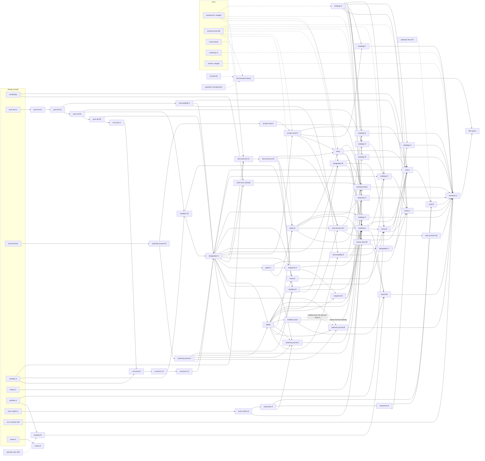

# The Overlord programme: the W1 index, designate and talk

This file is the index of W1, "designate and talk" (spec §14, Table 14's W1 row). It names the pieces, the lanes and
their files, and the order, so that several plan writers can each take one piece at once without colliding. It holds no
piece plan. Each piece's plan lives in `docs/superpowers/plans/2026-11-14-overlord-w1/` as `w1-<piece>.md`. The face,
the one W1 piece planned and built before this index, keeps its plan at
`docs/superpowers/plans/2026-11-10-overlord/w1-face.md`.

The spec is `docs/superpowers/specs/2026-11-09-overlord-design.md`, and the programme's ledger is
`docs/superpowers/programs/overlord.md`. The W1a index, whose shape this file follows, is
`docs/superpowers/plans/2026-11-10-overlord.md`. This file defines no D-numbers: every departure below is a plain slug
until the coordinator mints numbers.

Written against `main` at `416b8f942` (2026-11-14), and revised in fix round 1 (review 2075) and fix round 2 (review
2088) against `main` on 2026-11-15. The fix rounds' rulings are the coordinator's and are marked "(ruled)". Fix round 2
rewrote each row that has a piece plan from that plan's file lists: the skill (#2815) and the journal kernel (#2817),
merged, and the push outbox (#2818) and the pool set (#2816), at their pushed tips.

**The fold (2026-11-16).** Every W1 piece plan is now merged under `docs/superpowers/plans/2026-11-14-overlord-w1/`, and
each one listed what this index should change, under "Index changes" or "What the index should change". This revision
folds every item of those lists into the rows, the lanes, Figure W1, "Where lanes meet" and the capability words, in
each plan's own ruling words, with the coordinator's rulings for the fold marked "(ruled, fold)". Where a plan's list
and a ruling of the fold disagree, the ruling stands. The piece plans add one piece the first index did not have,
delegation marks (lane M). The Overlord clause's row is unchanged: it waits on the operator.

## Open questions

The question numbers are stable: piece plans cite them by number. Each question is now in one of three states:
waiting on the operator, open with a recommendation, or settled. The piece plans build the recommendation of an open
question unless the coordinator or the operator rules otherwise, and each piece plan restates the questions it builds
on.

### Waiting on the operator

The coordinator raises each of these as an item. The pieces they touch are marked "waits on item" in Table W1.

- **Q2.** **The coordinator contract's room for new clauses** (operator item 326; slug `coordinator-clauses-by-name`). **Four** clauses compete
   for number 21:
   - D-8126's A5 adds "clause 21" and hard-codes the number in its roster text and its skill revision word.
   - W1a's recall clause is "numbered 21 at its merge".
   - The Linear hierarchy plan (`docs/superpowers/plans/2026-11-10-linear-hierarchy.md`, its wave 6) adds "contract
     clause 21" and makes the count word "twenty-one".
   - This spec's W1 Overlord clause (§11.4).

   Numbering is settled by §11.4: plans name the clauses (the autonomy clause, the recall clause, the Linear clause and
   the Overlord clause), and each takes the next free number at its merge.

   The room is not settled. Review 2075 measured the room on `main` with `skill-size-ratchet.test.ts`'s own formula: the
   contract ends about 13,660 bytes into its 16,000-byte budget, which leaves about 2,340 bytes. The pending texts
   measure, with their line prefixes:

   | Clause | Bytes |
   |---|---|
   | The autonomy clause | about 1,336 |
   | The Overlord clause | about 885 |
   | The recall clause | about 201 |
   | The Linear clause | about 399 |

   The autonomy and Overlord clauses fit alone (about 2,221). With the recall clause the total is about 2,422, and with
   the Linear clause about 2,821. A5's rewrites of clauses 4, 11, 19 and 20 come on top. So **a shortening pull
   request is certain**, and its wording is the operator's (§11.4; D-8126's clause 21 was approved verbatim).

   The Overlord clause piece waits on that answer (ruled). The coordinator tells D-8126's builder and the Linear plan's
   builder that their "21" may move.
### Open, with a recommendation

- **Q3.** **The journal kernel is "before W1" and also "W1 ships the kernel"** (§7.6 H27; slug
   `journal-kernel-is-the-first-w1-piece`). **Recommendation:** it is W1's first piece in lane C: move-only, with
   characterization tests, and ready to build now.
- **Q7.** **The load lines are not in Table 11.5b** (C57 gives 70% and 85% "by default"; §6.8 gives 95%).
   **Recommendation:** serviceability PR B keeps all three as starting values in one constants module, and the
   spec-fixes run adds them to Table 11.5b. The 95% row's home (the serviceability plan's F3) is one row in
   `shared/overlord-ladder.ts`'s `LADDER_CAUSE_MAP` and one input in `server/src/coord/overlordLadderRead.ts`'s
   `ladderConditionInputs`, mapping `past` to `standing`, `under` and nobody designated to `lifted`, and an unmeasured
   line or an unreadable designation to `unmeasured`. For this row the ladder's rule (an `unmeasured` input caps) wins
   over §6.8's sentence.
- **Q8.** **`limit_samples` names no cadence, retention or reader** (Table 11.1a). **Recommendation:** the sampler is a
   `LANE_SCHEDULE` row beside today's limits read (`server/src/limits.ts#readLimits`), never a poller of its own, kept
   30 days as a starting value. The piece plan measures today's read cadence first.
- **Q9.** **The route hold-down applies to "a long-lived role"** (C45, Table 11.5b, R13), so coordinators are covered too.
   The spec decides this. **Recommendation:** build it as written, in a commit of its own, behind a characterization
   test of today's `_route_restore`, and say so in the pull request.
- **Q12.** **`LaunchProfile` cannot hold the Overlord's tool surface** (slug `launch-profile-gains-typed-surface`).
    `LaunchProfile.settings` holds scalars only. **Recommendation:** extend the shared `LaunchProfile` type with typed
    fields (tools, deny rules, declared agents, one tool server, setting sources). The change reaches every row's type,
    not one column. `ccd/lib/launch-profiles.json` stays the projection. **Settled by the sandbox plan** (its PR A).
- **Q13.** **How the door process carries `ccrc-api`, and who starts it** (§3.6; slug `door-process-wraps-the-one-client`).
    **Recommendation:** an MCP stdio server that calls the existing `ccrc-api` verbs, so the route table and the token
    handling stay in one client. Its tool names are the `ccrc-api` verbs the `ccrc-overlord` skill names. The plan says
    whether ccd starts it (§3.6: "a fleet-host process ccd starts with each generation") or the session's tool-server
    config does. The fallback (a shell that runs only `ccrc-api`, and the act key file) is not built, because W0a kept
    the door process. **As the door-process plan builds it:** `ccd/door-process.mjs`, an MCP stdio server with `ccrc-api`
    inside, one argv builder a tool; ccd's spawn step (door process A2) writes its tool-server config, and Claude Code
    starts it from that config. Its server is named `door` and its readers' tool `mcp__door__read`, as the sandbox
    piece's profile declares.
- **Q14.** **The D-6798 no-model arm meets `CLAUDE_CODE_SUBAGENT_MODEL_FORCE=1`** (W0 proposal 1; slug
    `no-model-arm-reads-the-pin`). **Recommendation:** the arm reads the pin from the session's launch profile, a fact,
    rather than exempting a role by name. **Settled by the sandbox plan**, with its environment departure.
- **Q15.** **How the isolation word is measured** (§7.4; slug `isolation-from-reported-uids`). **Recommendation:** each agent
    reports its uid and host identity on connect, an additive agent-wire field. The server compares them with its own.
    Any agent that shares both reads `shared-user`, and an unmeasured answer reads `shared-user`, the safe word.
    **As the isolation plan builds it:** the report plus the server's own measurement of the link; either side narrows,
    both widen; no kernel is proven in W1, so no `separate-host` (ruled, F1); `separate-user` is narrow (ruled, F2);
    `unmeasured` is reported as itself and acts as `shared-user`. Slugs `widening-needs-both-sides`,
    `separate-host-needs-a-kernel-proof`, `separate-user-needs-the-agents-own-socket` and
    `isolation-unmeasured-reads-unmeasured`.
- **Q17.** **`CallerIdentity` and the operator's doors** (§7.4). **Recommendation:** W1's port has one adapter, attribution.
    The operator's doors keep `server/src/accounts/gate.ts#createAccountGate` and record its actor through the port as
    `operator` strength. No second cookie reader. The other-lane refusals read the designation, not the port (the
    other-lanes plan's question 3).
- **Q18.** **The census of what ccd types, for `INJECTED_PROMPTS`** (§3.8). **Recommendation:** cut the function bodies out of
    `ccd/ccd`, as `ccd-limit-no-keys.test.ts` does. Each typed literal carries a tag naming its typer, so the match runs
    in both directions.
- **Q19.** **Which rungs the W1 ladder accepts** (§7.5; slug `w1-rung-door-stops-at-chat`). **Recommendation:** the vocabulary
    and `effectiveRung` are total over all four rungs from W1. The rung door refuses `capability-missing` above `chat`:
    `advise` names `overlord-route-v1` (W2) and `full` names `overlord-answer-v1` (W3, step two).
- **Q22.** **Invariants over tables W1 lacks** (§10.4, Table 11.7a; slug `monitor-checks-what-exists`). **Recommendation:**
    each predicate names its tables. The monitor runs a predicate only once its tables exist, and lists the others as
    `not-applicable`, never as passed. That covers I1, I3, I4, I14, I15 and I16, and also I6, I11, I12 and I13's entry
    half. The simulator and the monitor share predicates (D-8214), with the sweep-phase bound the ledger carries for
    D-8214 and D-8240. **As the sequence plan builds it:** the predicate shape is `(lines, facts)`; I2's structural arm
    is in W1; I7 is read only while the authority guard is coherent; I11's rung arm comes later, with what it needs.
- **Q23.** **The refusal list "generated from §11.6"** (slug `refusal-table-checked-both-ways`). Table 11.6 has no wave
    column. **Recommendation:** no code generator. A test reads Table 11.6 and `shared/refusal.ts` and checks them
    against each other in both directions. **The mechanism is placement, not a selection-map edit** (ruled, fold): the
    test is `server/test/single-definition/refusal-table.test.ts`, a guard suite that every fast pull request's first
    run and every merge-queue run runs, a docs-only one included; a docs-only follow-up push skips it, so the queue is
    the net there. `.github/ci/select-tests.mjs` is not edited. The same holds for every W1 test that reads the spec:
    readiness's table test is `server/test/single-definition/overlord-readiness-table.test.ts`, and the sequence plan's
    note follows. **The test carries a named, shrink-only exception list and a wave map** (ruled, review 2088 F7): the
    wave map holds the words in Table 11.6 not yet in `shared/*.ts`, each with the wave that adds it, and `codeOnly`
    holds the words in `shared/*.ts` the table lacks. `codeOnly` starts as `read-ceiling` alone, because Table 11.6 on
    `main` already has `timer-not-found`. **`codeOnly` only shrinks** (ruled, fold; review 2125 F1): a later piece that
    needs a refusal word the table lacks adds the word's Table 11.6 row in its own pull request, never an entry on
    `codeOnly`. The spec-fixes run that adds `read-ceiling` to Table 11.6 takes it off `codeOnly` in the same pull
    request, and touches `server/test/single-definition/refusal-table.data.json` as well as the spec.
- **Q26.** **Who writes "delivered" and "queued"** (§3.8: "the delivery lane"; slug `message-nudge-rides-the-mail-lane`).
    `sendPrompt`'s `SendResult` has no "queued" answer, and the spec says delivery is like mail. **Recommendation:**
    the nudge that names the message id is delivered through the mail lane, whose own delivery states answer delivered
    and queued. The private store's one message writer is called on that transition. No new lane. The nudge is acked
    by the mail lane, so the Overlord needs no mail verb (the private-store plan's question 3).
- **Q27.** **How the server learns that the Overlord replied.** Held until question 10 is answered (ruled).
- **Q30.** **Is the door process a launcher on `PATH`?** (Review 2075 F13.) **Recommendation:** no. It is started from the
    shipped tree by its absolute path, so `_inst_bins` and `install-census.test.ts`'s launcher list do not change. If
    the door-process plan finds otherwise, it edits those in the same pull request. A PATH launcher is the only
    exception there: a new ccd library still touches every site a library touches, `deploy/deploy.sh` and `ccd/ccrc`'s
    backup and uninstall names among them ("Where lanes meet", new ccd library sites). The door-process plan confirms
    it: Claude Code starts `ccd/door-process.mjs` from the tool-server config ccd's spawn step writes.
- **Q31.** **`overlord_sequence` and the message moves, which live in two SQLite files** (§10.4, §9.1). One writer stamps a
    sequence row "inside each stamped transaction", and a message move commits in the private store, not in
    `coord.db`. **Recommendation:** a message move's sequence row is written by the `coord.db` transaction that causes
    it (the citing door, the settlement mark, the mail lane's delivery). The private store's state is re-derived at
    boot (I8), so no transaction spans both files. **The one named exception** (the inbox plan's question 19, the
    sequence plan's question 17): `acknowledge` writes its `message` line in a `coord.db` transaction of its own, after
    the private store commits.
- **Q32.** **A read past its rate ceiling has no refusal word** (Table 11.5b sets ceilings, Table 11.6 names no word).
    **Recommendation:** the vocabulary piece adds one, `read-ceiling`, to the W1 group, on question 23's `codeOnly`
    list until the spec-fixes run adds it to Table 11.6.

### Settled

Settled by the coordinator's rulings in fix round 1 (ruled), by the spec's own text, or by the operator's answer to an item. Each is now built as stated.

- **Q1.** **The D-8126 gate is met for every code piece** (ruled; slug `d8126-built-means-a2-a3`). W1 reads A2's box-token
   goals read and `doneWhen`, and A3's `coordinator_calls`. A5, D-8126's decision procedure in the coordinator skill,
   gates only the Overlord clause. A4, A6, A8, A9 and A10 gate no W1 piece. A7 edits lane A's files
   (`_ws_least_loaded`, `limits.ts#projectHome`, `agent/src/whitelist.ts`, `ccdargv.ts`), A9 edits
   `session-hook.sh`, and A5 the coordinator `SKILL.md`, so each meets W1 only as a shared file. The spec's §1.1
   sentence that D-8126 "has not" merged is a spec fix.
- **Q4.** **The Operator Model registers as context C11** (ruled; slug `operator-model-is-c11`). "Context C11" is the
   bounded context, not the spec's claim C11 ("A busy owner keeps its work"). C10 is the Session host
   (`server/test/ccdContextIds.ts#CCD_CONTEXTS`, `ccd/contexts.tsv`). The private store's first pull request makes the
   edits: `CCD_CONTEXTS`, the architecture spec's numbered list, a row in its path table, its "first nine" contexts
   sentence, `CLAUDE.md`'s "C1–C9 or K", and `ccd/contexts.tsv`'s legend. `pool-set` still ships first among the pull requests that change what an agent does. §11.1's "C10" is a
   spec fix.
- **Q5.** **The placement the designate door uses is `server/src/limits.ts#projectHome` and `projectPlacement`** (ruled;
   slug `designate-widens-project-placement`). Both are widened to take the set, and the doors "pass [the set] to
   `poolRule`" (§3.4). `startProgramPlacement` is a PWA display selector, not the policy. C32 is wrong in the spec,
   which is a spec fix.
- **Q6.** **The route fields for the set and the ordered account list are `poolset` and `acctorder`** (§3.4; the set's
   spelling is settled at §3.4's side word). Settled by the pool-set plan (#2816), which is a plan, not yet built: pool
   set PR A1 adds both to `ROUTE_FIELDS`, `_route_valid` and `shared/api.ts#ROUTE_WRITABLE_FIELDS`, pinned in
   `ccd-route-fields.test.ts`. The set's value is the side word's own spelling.
- **Q10.** **The Overlord's replies are recorded at the turn** (operator item 327, answered 2026-11-16: "Record each
    reply in the private store when the turn ends"; C37, §3.3.11, Table 4.3a). Each reply is a row of the private
    store, `operator-model.db`, written by the store's one reply writer when the Overlord's turn ends, as the hook's
    report of that turn's end reaches the server, so §9.4's privacy rules cover it. The checkpoint's thread reads the
    replies from that record, and the chat-reply response row is inserted after the reply's record commits. The chat
    plan's Task 5, its PR B, builds the writer and the rows (the chat plan, question 8). That also answers question 27:
    the server learns that the Overlord replied from the hook's turn-end report.
- **Q11.** **`auditorModelFor` is W3** (Table 11.1b puts it in W3's row). W1 ships nothing for it.
- **Q16.** **A late or lost witness refuses the write `unwitnessed`** (§11.2's gate order, §7.4). The caller retries on its
    next turn, and a third such refusal in a day is Table 7.5a's latch.
- **Q20.** **The ladder ships what has inputs** (ruled, F14; slug `ladder-causes-join-with-their-inputs`). The ladder ships
    the vocabulary, `effectiveRung`, the latch and condition tables, and the `degraded` cause. Each other W1 cause row
    is added by the piece that produces its input, and each of those pull requests needs the ladder first (ruled, review
    2088 F3):

    | Cause | Cause key | Added by |
    |---|---|---|
    | Restore detected | `restore-detected` | Authority journal and restore (PR B, the witness epoch) |
    | No off-volume witness since boot | `no-witness-since-boot` | Authority journal and restore (PR B) |
    | The third unwitnessed write in a day | `unwitnessed-third` | Door process and readers (PR B1) |
    | Off the designated model | `off-model` | Door process and readers (PR B1) |
    | An invariant violation | `invariant-violation` | Sequence and monitor (PR B) |
    | `shared-user` | `shared-user` | Isolation word |
    | The launch profile not engaged | `launch-profile-unengaged` | Launch profile and sandbox check (PR B) |
    | Accounts past the 95% line | `load-past-95` | Serviceability and limits (PR B) |
    | Probes failed twice after a renewal | `probes-failed-twice` | The Overlord's renewal readings (PR C) |

    The keys are the ladder plan's Table 2, so every adding piece spells its cause as that plan does; the ladder's own
    `degraded` cause is `generation-degraded`. `restore-detected` is a row-backed latch that authority journal B raises
    through the ladder's `raiseLatch`, and Confirm does not lift it; the operator clears it once the journal is coherent
    (the ladder plan's F4). The rung door caps at `chat` in W1, so no cause can lower `effectiveRung` before W2.
    Deferring a row costs little.

    **The cross-plan rulings the ladder carries** (recorded beside X3): X3b (F3), under which a narrowing always lands,
    as `row-only` when the journal cannot take it; the `restore-detected` ruling (F4); and Confirm's order, append and
    then stamp, with its `{cause, cap}` latches (F5).
- **Q21.** **W1's boot coherence reads two journals** (Table 11.1a puts the act journal in W2; Table 7.6a). The authority
    journal and the privacy journal are read. The witness carries the act journal's head as absent until W2, and the
    only id W1 keeps unique across a restore is the message id. Private store A reads the privacy journal at boot, and
    its verdict does not feed `authority-rolled-back`; the authority journal reads the privacy head through
    `PrivacyJournalHead`, which private store A supplies.
- **Q24.** **A coordinator's own pin counts as ratified (`ratifiedBy: coordinator`)** (operator item 328, answered
    2026-11-16: "A coordinator's pin counts, shown as ratified by the coordinator"; Table 11.1a, §5.1). The goals'
    "versions" are the pin columns on `programs` and the `programme_modifications` rows (`ledgersStore.ts#goalsFor`).
    No table of that name exists. `ratifiedBy` is a nullable column on both, and absent reads as not ratified, as the
    card reads every goal today (`cardFacts.ts`, slug goals-unratified). A version the programme's own coordinator
    wrote reads ratified and is shown "ratified by the coordinator"; a version any other session wrote still needs the
    operator's ratification. `ratifiedBy` rides portfolio PR B, which builds the yes-path. Portfolio B needs only
    portfolio A; the designation A edge is dropped (ruled, fold).
- **Q25.** **The read rate ceilings are this wave's plan's to set** (Table 11.5b: "Set by the plan before W1"). The inbox plan
    measures a week of the console's own read rates and proposes each ceiling, and the coordinator approves the values
    at that plan's review. A read past a ceiling refuses with question 32's word. The ceilings count fenced reads only
    (the inbox plan's questions 1 and 18), and `READ_CEILINGS` is total over the read ledger's doors, `sequence`
    included.
- **Q28.** **`pushDue` ships in W1** (Table 11.1b: "W3 (`pushDue` W1)"). The outbox sender ships it total, answering "due
    now" or "silent", and W3 adds rows to it, not a second decider.
- **Q29.** **The board's Timers part is W1** (Table 5.2a). It shows the coordinators' timers, which W1a built. The Overlord's
    own timers do not: in W1 they reach the Overlord through its list door, and through its card only once
    `overlord-v1` renders it; not through the board's Timers part, which counts per programme (the timers plan's
    question 8).
- **Q33.** **Designate and rebind refuse `capability-missing` on ccd's words and on a missing `continuity-v1`** (ruled,
    F15; slug `designate-refuses-without-continuity-v1`), as the approved `w1a-continuity-v1.md` says. The designation
    plan's list is ccd's `pool-set`, `keep-awake-v1`, `hibernate-fresh`, `launch-surface-v1` and `project-add`, the
    server's `continuity-v1`, and the create's own words, `ws-title-v1` and `ws-wrapper-v1` (slug
    `designate-asks-the-create-words`). The cap word is `keep-awake-v1`, never bare `keep-awake` (ruled, fold). There is
    no separate server-side `overlord-v1` gate: the console hides every Overlord door until the `overlord-v1` piece
    lands, and this question stands (ruled, fold). The spec names only ccd's words, which is a spec fix.
- **Q34.** **The account facts are set from Settings** (ruled, F16). The roster's billing fact and per-lane continuity record
    have the writer "the operator, from Settings" (Table 11.1a). A hand edit of `accounts.json` is no W1 path.
    Serviceability PR A ships the server door, which is the widened `POST /api/accounts/:id/set` (the serviceability
    plan's question 8), and widens `shared/roster.ts`'s `ACCOUNT_KEYS`. Home PR C ships the PWA row: it reads the facts
    from `RosterWire` and writes them through the widened door.
- **Q35.** **The restore generation is a counter** (ruled, F11; slug `restore-generation-is-a-counter`). It is raised only
    inside Confirm the restore's transaction. Authority journal PR C owns its writer and its accessor. Response rows
    stamp it `unmeasured` until that PR lands, and authority journal PR C switches the response rows' stamp from
    `unmeasured` to the counter in the same pull request, so it needs responses PR A first (ruled, review 2088 F6).
    It also switches the sequence cursor read's `restoreGeneration` from `unmeasured` to the counter (the sequence
    plan's question 7). The generation is carried in the journal and in the witness tuple, and Confirm takes the
    highest of them plus one (the authority-journal plan). The timer mail's "fired again after a restore" line reads
    it: the role's timers wait while the authority guard is not coherent, and the line, which says "may have fired",
    attaches only to timers stamped below the current restore generation (the timers plan's questions 5 and 11).
- **Q36.** **W1 pieces start before W1a closes** (ruled, F17; slug `w1-pieces-start-before-w1a-closes`). Figure 8 draws
    W1a before W1, and the operator asked for this parallel work. The eight ready pieces are vocabulary, pool set PR A1,
    journal kernel, launch profile PR A, history PR A, portfolio PR A, push outbox PR A and the `ccrc-overlord` skill. Each
    later piece names the W1a pieces it waits for. Delegation marks PR A, planned after this list, needs nothing either.
- **Q37.** **C61 to C69 are approved** (the operator's answer to item 227, relayed in the coordinator's fix round 1
    rulings). Table 13a's "Proposed with R20" is a spec fix.

## Prerequisites, as measured

Measured on 2026-11-14 with `git fetch origin main`, `gh pr view` and `git merge-base --is-ancestor` against the commit
the fleet box's `ccrc version` names (`3afa9aeb7`, release `v0.0.1201`), and `git grep origin/main` for each wave's own
symbols. Probes B was re-measured on 2026-11-15.

| Prerequisite | State on `main` | How measured |
|---|---|---|
| D-8125 merged | **merged**: #2490 at `b15a0c497`, in `v0.0.1201` | `gh pr view 2490`; ancestor of the fleet box's build |
| D-8126 merged | **merged**: the spec and build plan, #2487 at `d15893d3d` | `gh pr view 2487` |
| D-8126 built, the parts W1 reads | **merged and released**: A2, the goals read for the box token and `doneWhen` (#2549); A3, `coordinator_calls` and its route (#2606). Both are in `v0.0.1201` | `gh pr view`; ancestry; `doneWhen` in `server/src/coord/ledgersStore.ts`; `server/src/coord/coordCallsRoute.ts` present |
| D-8126's other waves | **not on `main`**: A4 (`pwa/src/ledgers/callWords.ts` absent), A5 (`ccd/coordinator-skill/references/decision-procedure.md` absent, and the skill still has 20 clauses), A6 (`COORD_BALL_MAIL_MS` absent), A7 (`skill-ensure` absent from `ccd/ccd`), A8, A9 and A10 | `git grep` and `git cat-file -e` on `origin/main` |

What W1 still needs from W1a's open pieces (the renewal act, replay quiz and anchor rows re-measured on 2026-11-16 with
`git log origin/main`):

| W1a piece | State | What W1 needs from it |
|---|---|---|
| Renewal act (`SessionHost`, the checkpoint, the lane's acts) | **merged** (#2852, `fb72629d8`), dark until `continuity` is live | The Overlord renews by fresh start through `renew`, and the door process starts with each generation's launch. The designation's `pending` deadline is enforced by the renewal lane: designation B needs its acting side (`renewalActs.ts`), not the shadow lane alone, and acts only when the `continuity` row is live. A renewal of a running body is the renewal act's first prompt, and a new body's is the designation's (its note `first-prompt-by-deliver` is corrected so). Its spot-probe notice to the designated session is typed as a fixed line through `FIXED_LINE_MAIL` (the inbox plan's question 8). Exit 3 `unplaced` from the ccd arms' pick reads `refused` with ccd's line, and the receipt's shape is unchanged. Needed by designation PR B, door process A1, the inbox, readiness and renewal readings PR A |
| Renewal hand-offs (Renew now, `renewing`, the operator's mark) | not started | The prompt route's `renewing` and the mark, which the private store's prompt-route change sits beside. Restart the Overlord rides the same resume path as Renew now. It exports its operator-mark writer function, and `operator_marks` joins `writers-map.test.ts`'s `TABLES` with that one writer (ruled, fold; the home plan's F8). Needed by private store PR B, designation PR B, door process A1, gates B, home B, chat A and readiness |
| Replay quiz | **merged** (#2839, `04dd17659`) | Building waits for nothing. Using it does: the Overlord renews only while the `continuity` lane is live, and no W1a lane is armed before the baseline exists (W0-28). So the operator's first designation waits for the baseline and the arming. The ledger tracks that act, not a piece |
| The recall clause | not started | Lands before the Overlord clause (question 2) |
| `continuity-v1` | not started | Designate and rebind refuse without it (question 33). `overlord-v1` comes after it |
| Anchor (#2803) | **merged** (`2f2177f26`) | The Overlord's start reads its card first. `CARD_OVERLORD_LINE` (`server/src/continuity/card.ts`) waits for `overlord-v1`. Needed before `overlord-v1` |
| Probes PR B (#2802) | **merged** (2026-11-15, `24ebf291e`) | The inbox serves probes first, through the probe door. Nothing waits |

Already on `main` and used as is: the start report, generations and `renewalDue`'s `overlord` rows, the card and its
read records, notes, timers, launch profiles with the `overlord` row (`FLEET_ROLES.overlord`, `timerCap` 50), the
Overlord's `MAIL_PACE` row, `hibernate-fresh`, compaction, context readings, probes, and the face (#2741, #2781).
`timers-v1` is on `main` but not in the `v0.0.1201` build, because #2805 merged after it.

## The large-file programme, and where new code goes

The large-file programme (`docs/superpowers/specs/2026-11-13-large-file-programme-design.md`, D-8615) changes where
W1's code may grow.

- **In force on `main` today:** the growth check. A pull request may grow each file `server/test/growthCheck.ts#growthFiles`
  answers by at most 40 net lines. That list is `GROWTH_FILES` and every ccd library under `ccd/lib/`. W1 touches these
  growth-checked files: `ccd/ccd`, `ccd/ccrc`, `ccd/session-hook.sh`, `ccd/ccrc-doctor-checks`,
  `ccd/history/lib.mjs`, `server/src/watch.ts`, `server/src/coord/store.ts`, `server/src/coord/schema.ts` (one
  migration for each new table or column, each named in its piece's row, across lanes A, B, C, D, E, H, M and P), `server/src/coord/routes.ts`, `server/src/server.ts`,
  `pwa/src/lib/api.ts`, `shared/api.ts`, and any new `ccd/lib/*.sh`. No file has a cap yet.
- **Only proposed:** #2811 (open) adds caps, the first on `shared/api.ts` with about 40 lines of headroom and no
  waivers; #2810 (open) starts the `ccd/ccd` split; and a later spine limit on `ccd/ccd` would make "new code goes in
  a library" a rule.
- **What this index does about it (ruled; slug `wire-types-in-sibling-modules`):**
  - W1's new wire types go in new one-concern `shared/*.ts` siblings: the message moves, the inbox rows, the
    readiness word, the responses, the designation, the ladder and the account facts. `shared/api.ts` takes only the
    two `SERVER_CAP_MAP` rows, `push-outbox-v1` and `overlord-v1`; pool set PR A1's two words on
    `ROUTE_WRITABLE_FIELDS`, `poolset` and `acctorder`, and sandbox PR A's third, `profiledigest` (lane-only by
    derivation); the vocabulary's re-export line, which removes two declarations (about −2 code lines); and in-place
    edits of `ACCOUNT_SECRET_PATHS` and `ACCOUNT_WRITE_DIRS` (private store A, door process, authority journal B).
  - New ccd verbs are planned for `ccd/lib/*.sh` libraries: `ccd pool-answer` (`ccd/lib/pool-set.sh`), `ccd keep-awake`
    (`ccd/lib/long-lived.sh`) and the door process's spawn step (`ccd/lib/door.sh`). Each leaves one dispatch line in
    `ccd/ccd`, and an existing function gains one-line calls into its library; no existing function moves. Every pull
    request stays within the 40-line check with no waiver: pool set splits into PRs A1, A2, A3, B1 and B2, and the ccd
    arms into A, B, C1 and C2, for that (ruled, review 2085).

## W1, designate and talk: the pieces, the lanes and their order

Twenty-nine pieces build W1, in 67 pull requests; the face is built and not counted. Each piece is sized for one
worker, and a piece with several pull requests ships them from one plan. Every plan names the files it creates or
changes. Every new L1 decider joins `MUTANT_SETS` (`server/test/sim/mutation-floors.test.ts`) and
`server/test/sim/mutation-floors.json` in the pull request that creates it, so "mutation floors for new deciders" is a
rule of each plan, not a piece of its own. Every guard ships with the test that goes red without it. Every new routes
file, table, lane and time-port user carries its census rows in the same pull request, including
`server/test/single-definition/time-ports.test.ts`'s module list.

**When a pull request starts (ruled).** A pull request starts when its "Needs first" are met. Figure W1 is the order.
A lane's order in Table W1 is only the tie-break for its one builder.

In a Settings row, "server door" is the route and its store, and "PWA row" is the console control.

| Piece | Plan | What it ships | Size | Needs first | Lane |
|---|---|---|---|---|---|
| Vocabulary | `w1-vocabulary.md` | `INJECTED_PROMPTS` (`shared/injected-prompts.mjs` with its `.d.mts`) with its census of what ccd types; every W1 refusal word in one group of `shared/refusal.ts` (with `read-ceiling`), checked against Table 11.6 in both directions by `server/test/single-definition/refusal-table.test.ts`, with a wave map and a shrink-only `codeOnly` list that holds `read-ceiling` alone (question 23), so it is ready now and waits for no spec fix (ruled, review 2088 F7); the trigger table's refusal-word kinds (Table 11.1b, `shared/practice-triggers.ts`) | 1 PR, 4 tasks | nothing: **ready to build** | K |
| Pool set | `w1-pool-set.md` | A1: the set in L0 (`shared/poolset.ts`, `poolRule`'s set arm, one fixture table) and `ccd/lib/pool-set.sh` with every loader site, and the route fields `poolset` and `acctorder` (`ROUTE_FIELDS`, `_route_valid`, `shared/api.ts#ROUTE_WRITABLE_FIELDS`). A2: `_session_pool_side`, the one reader of a session's side, `_pool_ok`'s set case and the set renderers; `cmd_route` refuses a `poolset` or `acctorder` write, a clear included, from a Claude Code session (`pool-set-operator-only`; slug `a-session-shell-cannot-write-its-own-set`); `CLAUDE.md`'s "Account pools" bullet. A3: Table 3.4d's ccd users, the crossing marker's kind and the undecided words by side, with the fleet-wide `projection` sentence. B1: `ccd pool-answer` with its whitelist row, argv and parser; `pool-set` and `build.json`'s `ccdCaps`; the capability floor as a table, `CAP_FLOOR_ROWS` (fact, word, remedy; slug `cap-floor-is-a-table`), with its first row, `pool-set`, read by `_upd_cap_floor_check` in `ccrc update`, `ccrc rollout` and `ccrc rollback` while a set stands; doctor's `cap-floor` check (slug `doctor-check-named-for-the-table`). B2: `--below-cap <word>` on the three verbs, never `--force` (§11.5), and the server's push when a placing box loses `pool-set` while a set stands (`poolSetLoss`, on the `caps` lane, in `server/src/poolSetLossLane.ts`). R18's minors (review 1862) | 5 PRs, 10 tasks (ruled, fold) | A1: nothing, **ready to build**. A2: A1. A3: A2. B1: A3. B2: B1 | A |
| ccd's Overlord arms | `w1-ccd-arms.md` | A: `ccd keep-awake --state on\|off <id>` in `ccd/lib/long-lived.sh`, with its whitelist row, argv and its own capability token `keep-awake-v1`, read through `capRow`, and `keep-awake-v1`'s row in pool set B1's capability floor table (ruled, fold); the fresh start passes keep-awake's own `.no-roll`. B: long-lived reaches ccd, and `_route_restore`'s hold-down (question 9); the `/model` skip for a long-lived role (`_operator_choice_promote`), the affinity arm's stand-down for `overlord`, and the fresh start's end of a set-side crossing; sandbox A's `launchRowOf` gains `longLived`, so every row's digest changes. C1: the fresh start's pick from the ordered list, its decider, steps 1 and 2 and its refusals. C2: step 3, `stay`, and the pick wired into the fresh start | 4 PRs, 7 tasks | A: pool set B (B1 and B2). B: PR A, sandbox A. C1: PR B, pool set A3. C2: PR C1 | A |
| Serviceability and limits | `w1-serviceability.md` | A: `serviceability`'s three more inputs (question 1) and its bash twin, with the asking session's id threaded into `_serviceable` (the seam the ccd arms' `_class_gate` calls use); the roster's billing fact and continuity record per lane, with `ACCOUNT_KEYS` widened and their Settings **server door**, the widened `POST /api/accounts/:id/set` (question 34). B: `limit_samples` and its sampler, `poolRunway`, the three load lines, the operator's runway read `GET /api/pools/runway` (ruled, fold; the home plan's question 6), and the ladder's `load-past-95` cause row (question 7); `accountLoadMoveReading` reads unmeasured when any counted other is unmeasured and none decides, never "no counted other" | 2 PRs, 7 tasks (A 3, B 4) | A: pool set A3. Its question 10 asked for it before pool set B; B1 merged first (#2877), so the plan's fallback holds: the designation's own count still refuses a set with fewer than two recorded lanes. B: PR A and the ladder (so designation A) | A |
| The Overlord's renewal readings | `w1-renewal-readings.md` | The last wiring step (ruled, F1; slug `renewal-readings-not-rows`), one pull request per producer (slug `readings-in-several-prs`). `RENEWAL_ROWS.overlord` is on `main`. A: the seam (`shared/renewal-readings.ts`, `renewalReadingsWiring.ts`), `fittedCeilingTokens`, and `backstopDue` with its hour and time-zone **server door**. B: `notLocal`, read from the server's transcript resolver, which reads the waking host through its `FleetIO` (fix round 1, F4: the resolver falsifies F9b's premise; no ccd verb), carrying the host identity the isolation word supplies. C: `termRaised`, `classChanged` against `designatedClass` stamped on the generation at its mint, and the ladder's `probes-failed-twice` row. D: `accountOutsideSet` (pool set's `ccd pool-answer`), `classUnservable` and `accountLoadMove`. E: `modelDrift` and the soft `readersRunning`. F: `turns` and the soft `operatorQuietObservedMs`, read from the `@overlord` mark. G: the soft `placeHiddenObservedMs`. H: the hold table `overlord_account_holds` with its operator door, a held account reading as outside the set and left out of the ordered list (`heldOutOfList`), the account-holds read `GET /api/continuity/account-holds` (ruled, fold), and the digest reading folded into the Overlord's `installBehind`. The soft inputs feed the renewal act's soft-renewal assembly, which the renewal act assembles, leaving them `W1`. The operator item for a count below two goes to readiness. `entryRetired` (W4) and `evaluationDue` (W3) stay "later" by name | 8 PRs, 11 tasks | A: the renewal act (merged). B: PR A, the isolation word (and so the ladder and designation A). C: PR A, designation A, the ladder, authority journal A. D: PR A, pool set B1, serviceability B. E: PR A, door process B1. F: PR A, private store B. G: PR A, home B. H: PR A, PR D, sandbox B, designation A, readiness | A, after each producer |
| Journal kernel | `w1-journal-kernel.md` | The chained-journal kernel (codec, verifier, tail heal) moved out of `server/src/coord/delegation-journal.ts` and `delegation-model.ts` into two new K files, `server/src/chainedJournal.ts` and `server/src/canonical.ts` (named apart from `shared/api.ts#canonicalJson`), move-only, characterization first, with the kernel's own tests, its kinds census and its mutant sets. The existing `server/src/journalKernel.ts` (the log-first journals' kernel) and `delegation-checkpoint.ts` stay untouched | 1 PR, 4 tasks | nothing: **ready to build** | C, first |
| Authority journal and restore | `w1-authority-journal.md` | A0: `chainNext`, `server/src/appendOnlyFile.ts` with its cut and `server/src/chainedJournalFile.ts`, behaviour-neutral, with `server/src/coord/landingJournal.ts`'s binding-only move; private store A needs it too. A: the authority-and-restore model, written before the code; the grammar and its census row; the synchronous writer (`OverlordAuthorityJournal.appendInTx`, inside a `DatabaseSync` transaction) and `AuthorityGuardPort`; the head row; boot coherence (Table 7.6a, two journals: question 21); the guard and `authority-rolled-back`. Its file and class are named apart from `landing.log`, and its format is registered in the kernel's kinds census. B: the witness tuple with its per-term counts and restore generation, the epoch, the verdict, the agent's `witness` op and ready field, the console's door, the `authorityWitness` lane, the witness file in the deny set, and the ladder's `restore-detected` (a row, raised through `raiseLatch`) and `no-witness-since-boot` rows, and the ladder's `NarrowingWitness`. C: Confirm the restore (over a `malformed` journal too), its banner `RestoreBanner`, the restore generation's counter, writer and accessor (question 35), `termRaised`, and the switch of the response rows' stamp and the sequence cursor read's `restoreGeneration` from `unmeasured` to the counter (ruled, review 2088 F6) | 4 PRs, 9 tasks | A0: the kernel (merged). A: A0. B: PR A, designation A, ladder. C: PR A, designation A, responses A, ladder | C |
| Designation | `w1-designation.md` | A: `overlord_designation` (`term`, `designatedTerm`, class, `accountPools`, past ids, `pending`/`live`), one migration with every column B and C use, `stopsOwed` among them; `coord/overlordRoutes.ts` with designate, retire and the console's read `GET /api/overlord/designation`; the two-account check, whose `counted` follows renewal readings question 1's candidates reader with `serves === 'yes'` on either class (ruled, fold; the readiness plan's F11); `capability-missing` for ccd's `pool-set`, `keep-awake-v1`, `hibernate-fresh`, `launch-surface-v1` and `project-add`, the server's `continuity-v1` and the create's `ws-title-v1` and `ws-wrapper-v1` (question 33), `launch-profile-unmet` under build skew, and an answer from every placing agent's own `ccd pool-answer`: an older agent's `forbidden` (read `ran: false`) refuses the designation, because an agent that has not restarted advertises `pool-set` from ccd within about a minute (ruled); Start the Overlord composing session-create in the `overlord` project, with `profile` and `profiledigest` written at the create, the door answering `pending` at once and `overlord-sandbox-unmet` as the attempt's outcome; the first prompt of a new body (X4); the route record write, and its clearing at retire (an empty `poolset`, `acctorder` and `profiledigest` value clears them); `projectHome`/`projectPlacement` widened to the set (question 5); the body adapter `server/src/coord/overlordBody.ts` with `keepAwake`, and the keep-awake calls; retire stopping the retired body through the owed-stop drain; the reader into `roleOf` (`designation` on `RoleFactInputs`, its four call sites, a test that a pending row reads `overlord`), `identityOf` at every live-generation lookup, `designationRead()`'s three arms, and the roll lane's and `decideSleep`'s `overlord` holds (ruled, F7, X6); the `CoordStore` writers `goLive` and `failPending`, which sandbox B's settle step calls, `goLive` clearing the last attempt (ruled, fold) and re-stamping; `overlord_designation` in `OVERLORD_AUTHORITY_TABLES`; the swap route's early refusal reading the session's side. B: rebind and its go-live arm, the old body's clear, stop and markers off from the settle door, and the rebind's re-target of queued `overlord` mail (ruled, F12); Restart the Overlord, with `overlordBodyOf` as the one body mapper and `restartable` as the Restart door's one decider, which accepts an asleep body and refuses one that is `restarting`, and which readiness calls (ruled, fold); the `pending` deadline and the settle retry, through the renewal act's acting side; the set and the ordered list written before each `renew` of the Overlord (question 9 of the readings, ruled F9). C: the Settings **server doors** for the model class and the account set | 3 PRs, 10 tasks | A: pool set B1 and B2 (ruled, fold), ccd arms A, B and C2, authority journal A (and A0), sandbox A2 (ruled, fold), serviceability A. B: PR A, sandbox B, W1a renewal act and renewal hand-offs. C: PR A | C |
| Ladder | `w1-ladder.md` | `operatorRung`, the latch and condition tables, `effectiveRung`, the rung door (step-up up, journalled; question 19), Pause, `off`'s one transaction (W1's part), the `generation-degraded` cause (question 20), the condition `rung-word-missing` in `LADDER_CAUSE_MAP`, capping the rung at the highest rung whose `needs` word is in `SERVER_CAPS`, a Table 7.5a row the spec does not have (carried from W2's `overlord-route-v1` plan, ruled, W2 fold), `overlord-off` and `rung-below`, the state "a narrowing is taking effect until a witness holds it" (§7.6), the latch clear door, `GET /api/overlord/ladder`, and the moved live-generation reader. Each call appends through `OverlordAuthorityJournal.appendInTx` inside its own transaction, checks its answer, adds its table to `OVERLORD_AUTHORITY_TABLES`, and exposes the inner writer Confirm uses | 1 PR, 5 tasks | authority journal A (and A0), designation A, whose rewrite of the live-generation reader the characterization pins (F11) | C |
| Gates and identity | `w1-gates.md` | A: the identity vocabulary and the door table `OVERLORD_DOORS` with its census; the `CallerIdentity` port and the attribution adapter; actor columns on the designation row (the message rows' actor is the private store's, ruled); the operator doors' actor routed through the port: designate, retire, the rank door, and whichever of these has landed (each later one calls the port itself): the private store's prompt route, whose `recordMessage` then checks `isRecordedActor` in place of `isMintedActor`; portfolio B's ratify door; the ladder's operator doors (a raise through `identity.operator`, the lowering doors through `identity.console`); Confirm the restore. B: the gate order of §11.2 as one L1 decider, composing the ladder's `offStep`, `rungStep` and `readBy`; the fence check (`stale-designation`, `stale-generation`) with `counterVerdict`; `not-the-overlord` with the incarnation; `card-unread`; the witness's step in door process B's shape (step 7a); the runner that every Overlord door calls, with the guarded counter and the fence-refusal record; W1a's card, notes, handover and probe doors wired for the designated session, the card's recording page fenced; and the census | 2 PRs, 6 tasks | A: designation A. B: PR A, ladder, door process A2, W1a renewal hand-offs (for `renewing`) | C |
| The Overlord's timers | `w1-overlord-timers.md` | Timers set through the door process, stamped with `designatedTerm`; the setter kind `overlord` in the timer lane, with the `retired` cleanup; the operator's read and cancel add the role's timers; `overlord` as the recipient of the timer lane's mail only, through a `FIXED_LINE_MAIL` `timer` row with its `waitsForCard` column, so a fired timer's mail waits for the card; the measurement of what an older mail lane does with queued `overlord` mail (Table 11.5) (ruled, F12); the "fired again after a restore" line, which says "may have fired"; M36's counts of the timer doors' own refusals (`continuity_timer_refusals`); the timer doors' three `OVERLORD_DOORS` rows (word `timers-v1`), moved off the census's not-an-Overlord-door list, refusing on an unmeasured designation only a caller whose launch profile reads `overlord` or cannot be read. No capability word is added. The role's writes go live once door process B lands | 1 PR, 5 tasks | designation B, gates B, authority journal C, the inbox, the other-lane refusals | C |
| `overlord-v1` | `w1-overlord-v1.md` (not yet written) | The word in `SERVER_CAP_MAP`; `ccrc-api`'s Overlord verbs follow it; the card's `CARD_OVERLORD_LINE` and the card's list of unsettled messages, I8's second half (the private-store plan's question 15); the console shows the Overlord's doors only under it; `CLAUDE.md`'s `ccrc-overlord` bullet, added to `overlord-skill.test.ts`'s count-word scan (the skill plan's slug `overlord-skill-prose-in-readme-only`) | 1 PR, 2 tasks | every other W1 piece but the Overlord clause, and W1a's `continuity-v1` and anchor | C, last of all |
| Isolation word | `w1-isolation.md` | Each agent's uid and host identity (two digests keyed by the agent bearer: machine id and boot id) on connect, an additive agent-wire field, with its test seams in the agent and the client; the server's own measurement of the link's peer (locality and the kernel's peer uid) and of every path it holds, from one list derived from `CcrcConfig`; `server-isolation` measured, `unmeasured` acting as `shared-user`, and no `separate-host` in W1 (question 15); the ladder's `shared-user` condition row; the reader the board and W2's act rows read; the per-link relation authority journal B asks, which counts no agent in W1; the host identity that the renewal readings' `notLocal` report carries, in memory only | 1 PR, 4 tasks | ladder | H |
| Refusals on other write lanes | `w1-other-lanes.md` | `OTHER_LANES`, `otherLaneVerdict` and `decideOtherLane` (C5, L1) with their reads (L3) and one sender in `refuse.ts`; `overlord-uses-its-doors` on peer mail (every send by the Overlord's body), item raise, claims (take and release), the claimant's question door (rule and release), coordinator intent (set and clear), the landing writes, the Linear proxy's writes and the six plan doors; `overlord-not-a-coordinator` at run open and at the reclaim and archive hand-over heir (§3.5, H10); the refused set is the bound body, either pending body and an id still owed its stop; an unreadable designation refuses only a caller whose profile reads `overlord` or cannot be read; a census that classifies every write door | 1 PR, 4 tasks | designation A, vocabulary (gates A and B are not needed) | H |
| Sequence and monitor | `w1-sequence-monitor.md` | A: `overlord_sequence` and its one writer, called by every stamped transaction already on `main` (each later piece calls it itself; question 31), the stamp census, the retention lane and the page read with its explicit gap. B: the invariant monitor in shadow (question 22): its predicates, findings and runner, its Shadow lanes row (`invariants`), one latch and one item per violation, the ladder's `invariant-violation` cause row, M24. C: the two read doors, the cursor read and the operator's invariants read | 3 PRs, 7 tasks | A: designation A, gates A. B: PR A, ladder. C: PR B, gates B, private store A | H |
| Launch profile and sandbox check | `w1-sandbox.md` | A: the rig's measurement; the `overlord` profile's W1 surface (the tool list; deny rules, the cron tools included, W0 proposal 3; the declared reader types; one tool server, named `door`, its readers' tool `mcp__door__read`; setting sources; the hook registered; the bypass acceptance; the constitution file `ccd/lib/overlord-constitution.md`), the typed `LaunchProfile` fields (question 12), the route field `profiledigest`, and how the Overlord's pinned launch loads the staged `ccrc-overlord` copy (`~/.cc-sessions/overlord-skill`, which the skill piece stages) and no other skill, because an account-level skill is not listed under pinned setting sources (W0-19); ccd's digest check and rendering; the no-model arm's pin read (question 14); the start report's profile digest and loaded sets, through the loads door `POST /api/sessions/:id/start/loads` and its table `continuity_start_loads`. A2: the workspace entries and the workspace refusal; the digest probe before every pane-ending move; the word `launch-surface-v1` and its row in pool set B1's capability floor table; doctor's `overlord-mods` check. B: the check (`sandboxVerdict`, `profileEngagedOf`; it stores no verdict, every reader computes it), the surface arm, the ladder's `launch-profile-unengaged` row, and the settle step: `pending` to `live` or `overlord-sandbox-unmet`, calling the designation module's writers; `launch-profile-unmet` | 3 PRs, 9 tasks | A: nothing, **ready to build**. A2: PR A, pool set B1 (for the floor row). B: PR A, PR A2, designation A, ladder, door process A | B |
| Door process and readers | `w1-door-process.md` | A1: the claim (`continuity_act_keys`, the claim door `POST /api/sessions/:id/act-key` bound to the session's newest start), `ccrc-api`'s bodies on stdin, the door library's first region and every library site, and the deny path. A2: the spawn step, the door process (`ccd/door-process.mjs`, an MCP stdio server with `ccrc-api` inside, one argv builder a tool; question 13), the first line's text, and the delta cache with the anchor's `delta` form (C38). B1: the report door `POST /api/sessions/:id/report` (witness, readers, turn end, picked up), the read tool, the witness verdict and port binding, the unwitnessed latch, off-model, closed-book from the read ledger, `modelDriftOf` and `readersRunning`, and the ladder's `unwitnessed-third` and `off-model` cause rows. B2: the model events, report-only, and the reader and typed-`/model` arms | 4 PRs, 9 tasks | A1: sandbox A, designation A, W1a renewal act and renewal hand-offs. A2: PR A1. B1: PR A2, ladder, gates B, private store B. B2: PR B1 | B |
| Private store and messages | `w1-private-store.md` | A: C11 registered (question 4); `operator-model.db` with its migrations, its backup and restore entries and its deny path; `operator_messages` and the message moves table; the read ledger table; the privacy journal file with the highest message id, its format registered in the kernel's kinds census, read at boot, supplying `PrivacyJournalHead`, and issuing message ids above `witnessHighestIds().message`. B: the prompt route's record-then-nudge for the designated session (question 26), the settlement mark, the boot pass's re-derived `settled` (I8), the readings `turns` is computed from, and the Overlord's operator mark (`@overlord`), and `message` as a note key (`w1a-notes.md`); the send key and `promptTargetVerdict`. The Overlord's replies: **waits on item** (question 10) | 2 PRs, 7 tasks | A: authority journal A0 (the kernel merged). B: PR A, designation A (`designationRead()`), W1a renewal hand-offs (the `renewing` branch and the mark writer) | D |
| Inbox and reads | `w1-inbox.md` | `messages`, the inbox with band 1, probes and the coalesced wake (its contract fixed; the `inboxWake` lane), `acknowledge`, a read-ledger line per read through `runOverlordRead`, the read ceilings (question 25), `said-not-operator` in `OVERLORD_REFUSALS`, and `FIXED_LINE_MAIL` as a table of three rows | 1 PR, 5 tasks | private store B, gates B, the renewal act (merged), door process A2; door process B1 before the doors are reachable end to end (the witness) | D |
| Board and history door | `w1-board-history.md` | A: the history agent op in `agent/src/server.ts`, `decideScope`'s `overlord` scope (no argv or environment yields it) and the agent word `overlord-history`. B1: the history door, `POST /api/overlord/history`, with `history-unreachable`, and the `ccrc-api` verb `overlord.history`. B2: the board, `GET /api/overlord/board`, composed from existing readers, with its W1 parts (question 3): Identity, Goals, Work, Portfolio, Capacity, Projects, Brakes and the ladder, Itself and Timers (question 29); it composes `portfolioFor` from `portfolioFacts` with the same live-ask port, and shows the act-key row's `claimsRefused` as a fact. W2 adds Requests, Unread reports, Overlaps and Goal conflicts, and W3 adds Engagement and Attention | 3 PRs, 6 tasks (A 4, B1 1, B2 1) | A: nothing, **ready to build**. B1: PR A, gates B, the inbox. B2: B1, readiness, portfolio B, the isolation word | D |
| Readiness | `w1-readiness.md` | `overlordReadiness` (Table 6.4a, first match, monotonic) with its deciders, its store and its read: the two tables `overlord_readiness` and `overlord_readiness_items`; the readiness lane on a new `LANE_SCHEDULE` row, `overlordReadiness`, apart from the existing `readiness` row, which is the programme-start check: a different job with a different input; the read door `GET /api/overlord/readiness` with `readinessRead()` and `servedReadiness` (`boot`, `stale`), the word served as `ReadinessWire` only while this process's lane is fresh (ruled, fold); `readinessChanges`, with `oldest`, for the chat (readiness owns it; ruled, fold), and a prune that keeps the newest row; the readers `restartsSince` and `liveGenerationOfIdentity` in `continuityStore.ts`, and `lastServedReadAt` in the private store; `ledgersStore.ts#settleItemCheckedInTx`; the account-count item (C56): the accounts that "can serve" the Overlord are renewal readings question 1's candidates with `serves === 'yes'`, either class (ruled, fold), and the item is suppressed behind a `stranded` item naming the set; the operator item for an account the renewal readings hold out of the ordered list, through a holds port that renewal readings PR H wires; and a dead Overlord's one push with Restart, carried only when designation B's `restartable` is true, sent through the push outbox's one sender | 1 PR, 4 tasks | designation B, sandbox B, ladder, inbox, serviceability B (`stranded`), sequence A and sequence B (`raiseItemCheckedInTx`) and push outbox B (ruled, fold), door process B (`deaf`), W1a renewal act (merged) and renewal hand-offs | D, last |
| Portfolio and goals | `w1-portfolio.md` | A: the class vocabulary, `portfolio_rank` with its rank door (`POST /api/portfolio/rank`) and the operator's portfolio read, and `portfolioFor` (W1's rows), with the live-ask port. B: `ratifiedBy` on the pin and on `programme_modifications`, the decider, and the operator's ratify door with its Goals-panel control (question 24) | 2 PRs, 5 tasks | A: nothing, **ready to build**. B: PR A (question 24 is answered by item 328: a coordinator's pin counts); designation A comes off it (ruled, fold) | P |
| Push outbox | `w1-push-outbox.md` | A, the record and its rules (Tasks 1 to 3): the characterization suite of today's pushes; the vocabulary and the deciders, `pushDue` total among them (question 28) with the one payload builder; the `push_outbox` table with the push id column, the reach stamps (`reachedOperatorAt`, `pushedAt`) and their writers; `PushService`'s per-send verdict. Nothing reachable: no caller writes a row yet. B, the sender and the move (Tasks 4 to 6): the one sender with its `pushOutbox` lane row and boot pass; every funnel site behind it; the raising transactions for asks and items; the held item's reach; the random push id, minted and stored on the outbox row (the one owner); `push-outbox-v1`. No rollback task: the refusal below `push-outbox-v1` ships with W3's hold arming (§11.5's reason is the hold tier, and W1 arms no holds) (ruled) | 2 PRs, 6 tasks | A: nothing, **ready to build**. B: PR A | E |
| Response record | `w1-responses.md` | A: the outbox's push id carried in each payload, the service worker's `shown` and `opened`, the receipts door, `operator_responses` written `pending` before each send with the restore generation `unmeasured` until authority journal C switches it to the counter, `response_receipts`, the stamp module `server/src/responses/stamp.ts` that authority journal C edits, and `response_boots`, the record of each boot that the seal reads (slug `a-boot-inside-the-window-proves-nothing`). B: the response lane on its `responses` row, `RESPONSE_OUTCOMES`, `responseOutcome`, `responsesFor`, the "I handled this elsewhere" door and its control, the Waiting on you and digest inserts with the console's `opened` receipts on the item page (`ItemView.tsx`) and the digest page, retention with its Settings **server door**, and I18's predicate (slug `i18-predicate-joins-with-the-seal`); B's doors are five routes in `server/src/responses/routes.ts` (slug `response-doors-in-their-own-routes-file`) | 2 PRs, 9 tasks | A: push outbox B (merged). B: PR A | E |
| Home and Settings | `w1-home.md` | A: `homePlace`, the places list as a function of the designation, the Fleet's own path, every go-fleet door, the wordmark home; the `home` route's redirect, `/fleet` and `/overlord`; the console's one reader of the designation, the ladder and the server's capability words; nothing of the Overlord's drawn without `overlord-v1`, so the console hides every Overlord door until it (question 33; ruled, fold); the desk Fleet door only with the Overlord's door (ruled, fold). B: the Overlord place: the readiness word on the place, on Fleet health and on Waiting on you, from `GET /api/overlord/readiness`, reading `ReadinessWire` as shipped (ruled, fold); Pause and its "taking effect" line; the ladder's controls from `GET /api/overlord/ladder` (the operator's rung, Off and Chat, each standing latch with Clear, the live conditions and the effective rung, beside Pause); Start, Open and Rebind; Restart from `restartable`; since you were last here; the portfolio strip and its rank control, which home B owns (ruled, fold), writing through `POST /api/portfolio/rank` with `seen` and `order` and reading a 404 from an older server as "no portfolio yet"; the capacity line; the face; `RestoreBanner`'s mount; the session-stream hook `useOverlordSessionStream`, which chat A reuses (ruled, fold); and the console's "the Overlord place is hidden" report (R19) as the `@overlord-place` mark, refreshed from the session store's visibility frame, at most once a minute, for the bound session only. C: the Settings **PWA rows**: Retire, model class, account set, an account's billing fact and continuity record, response retention, the backstop hour and time zone, and the account-hold Clear on the account rows and on the hold item's detail | 3 PRs, 9 tasks | A: designation A, ladder. B: PR A, designation B, readiness, portfolio A (ruled, fold), serviceability B, W1a renewal hand-offs. C: PR B, designation C, serviceability A, responses B, renewal readings A and H | F |
| Chat | `w1-chat.md` | A: the chat with message ticks, the server's own lines while not `ready` (from readiness's `readinessChanges`), earlier generations through the history reader, the kept draft, the `offRecord` fact, the chat's two operator reads in `overlordRoutes.ts`, and the bound session's stream through home B's `useOverlordSessionStream`, opening no second stream (ruled, fold). B: each reply recorded in the private store when its turn ends, the reply rows and the console's `opened` receipts in the place (question 10, answered by item 327) | 2 PRs, 5 tasks (A: Tasks 1 to 4; B: Task 5) | A: home B, private store B, designation A, gates A, the inbox, board and history B1 (the chat reads the history door's reader, not the board), readiness, the vocabulary, W1a renewal hand-offs. B: PR A, responses A and B, and door process B1 (the report door, which carries the turn's end) | F, last |
| `ccrc-overlord` skill | `w1-overlord-skill.md` | The skill whole: 22 clauses under `## The contract`, pinned `1..N`; `routing.md`, `answering.md`, `starting.md`, `operator-model.md`; its cap measured at merge; shipped in the tree and **not** installed in any account home, but staged once at `~/.cc-sessions/overlord-skill` (on every role but server) by its own installer, `ccd/install-overlord-skill.sh` (the one writer of that path), run from `_inst_skills`, doctor's `_check_skills` and `_fix_skills`, and `deploy/deploy.sh`'s agent arm; the README's skill lines; `ccrc-overlord` as the fourth name of the hook's role-skill deny, which rests on spec §3.6 | 1 PR, 4 tasks | nothing: **ready to build** | G |
| The Overlord clause | `w1-coordinator-clause.md` | The Overlord clause (§11.4), acting only under `overlord-v1`, with its pin, its count word and its cap raise, after the shortening (question 2) | 1 PR, 2 tasks | the recall clause and D-8126's A5 merged, and the operator's wording (**waits on item**); lands before W2 opens (ruled, F18) | G, last |
| Delegation marks | `w1-delegation-marks.md` | A: the answer marks' table (`could-answer` and `unsure`), its one writer, the operator's door and the two boxes on `decide` and `value` item rows, cleared items and the item page (R21, §9.2.1); `not-markable` in `LEDGER_ROUTE_REFUSALS`, with its Table 11.6 row. B: the asks the operator has, in the waiting view and on question rows and cleared asks | 2 PRs, 6 tasks | A: nothing, **ready to build**; it is building now, on migration 80 or 81 (ruled, fold). B: PR A | M |

*Table W1. The pieces and their lanes.*

**Where each Table 14 item went.** Every item of Table 14's W1 row, and every W1 half the spec deferred from W1a, is in
exactly one piece:

| Table 14, W1 | Piece |
|---|---|
| The private store, the operator's messages, the read ledger | Private store |
| The designation, its term and `designatedTerm` | Designation |
| The identity port | Gates and identity |
| The isolation word | Isolation word |
| The door process and the reader types | Door process (the reader types are declared in the profile by the sandbox piece, PR A, and served by the door process, PR B1) |
| The history door and its agent op | Board and history door |
| The sandbox check | Launch profile and sandbox check |
| The fence | Door process (the nonce and the key), gates and identity (the check) |
| ccd's sleep markers' verb and `keep-awake-v1` | ccd's Overlord arms |
| The ladder at `chat`, and Pause | Ladder |
| The readiness word | Readiness |
| The inbox with band 1, probes and the coalesced wake | Inbox and reads |
| The journal kernel | Journal kernel |
| The authority journal, Confirm the restore | Authority journal and restore |
| The privacy journal's file and its highest message id | Private store |
| The push outbox and `push-outbox-v1` | Push outbox |
| The account set on the designation, its Settings row, the two-account check | Designation (the server door), Home C (the PWA row) |
| The pool rule's set and `pool-set` | Pool set |
| The home, the chat with message ticks | Home and Settings, Chat |
| The board | Board and history door |
| The portfolio rank, `portfolioFor` | Portfolio and goals |
| The limit samples | Serviceability and limits |
| The refusal on other write lanes | Refusals on other write lanes |
| The invariant monitor, `overlord_sequence` and its cursor read | Sequence and monitor |
| The Overlord's timers, through its door process, stamped with `designatedTerm` | The Overlord's timers |
| The response record, `PushService`'s verdict, the push id, `shown` and `opened` | Response record (the verdict and the push id are the push outbox's) |
| `overlord-v1` | `overlord-v1` |
| `serviceability`'s inputs, `poolRunway`, the roster's account facts (Tables 11.1a and 11.1b) | Serviceability and limits |
| `ratifiedBy` on goals | Portfolio and goals |
| `INJECTED_PROMPTS`, the refusal-word list, the trigger table's refusal words | Vocabulary |
| `acknowledge` | Inbox and reads |
| Restart the Overlord: the door, and a dead Overlord's one push | Designation B (the door), Readiness (the push) |
| The hook's W1 reports: start fields, witness, reader start and stop, model switch, "picked up" | Sandbox A (start fields), door process B1 and B2 (the rest) |
| The `ccrc-overlord` skill; the Overlord clause | `ccrc-overlord` skill; the Overlord clause |
| The Overlord's renewal readings (Table 3.3.11b's rows are on `main`) and the backstop's Settings | The Overlord's renewal readings (server door, PR A), Home C (PWA row) |
| C56's "a later drop is told": the operator item when fewer than two accounts can serve the Overlord | Readiness (the account-count item; the designation and serviceability plans recommended it, and the readings plan hands it over) |
| The "Overlord place is hidden" report (R19) | Home B |
| Carried from W1a's timers plan: the restore line on a repeated timer mail, M36's refusal counts | The Overlord's timers |
| The operator's two answer marks on Waiting on you (R21) | Delegation marks |

**Ready to build now** (question 36): vocabulary, pool set PR A1, journal kernel, launch profile PR A, history PR A (the
agent op), portfolio PR A, push outbox PR A, the `ccrc-overlord` skill and delegation marks PR A.

**Merged by 2026-11-16** (`git log origin/main`): the vocabulary (#2840), pool set A1 (#2836), A2 (#2846), A3 (#2857)
and B1 (#2877), serviceability A (#2878), the journal kernel (#2848), sandbox A (#2847), history A (#2841), portfolio A (#2842), push outbox A
(#2838) and B (#2859), and the `ccrc-overlord` skill (#2833). Delegation marks A is building now, on migration 80 or
81, and marks B follows A (ruled, fold).

**Eleven lanes, one builder each.** A lane's builder takes its next pull request whose "Needs first" are met.

- **Lane A, ccd and accounts:** pool set, ccd's Overlord arms, serviceability and limits, then the renewal readings,
  each pull request after its producer.
  - **Every agent before the server:** `pool-set` ships first among the pull requests that change what an agent does,
    and reaches every agent before the designate door accepts a designation (C46). The designate door enforces that
    order by refusing `capability-missing`, and by requiring each placing agent's own `ccd pool-answer`: ccd's word
    alone is not enough, because an agent re-reads `ccd caps` about a minute after ccd changes, before it restarts
    with the whitelist that runs `pool-answer`.
  - **`ccd/ccd`:** its pool, swap, route and serviceability functions: `_pool_ok`, `_project_pool_state`,
    `_acct_pool_state`, `_swap_target`, `_auto_swap_check`, `cmd_swap`, `cmd_start`, `cmd_prefer`, the
    crossing-marker functions, `_default_pool`, `_undecidable_cause`, `cmd_route` and `ROUTE_FIELDS`,
    `_route_restore`, `_operator_choice_promote`, and `_serviceable` with its helpers. Each new verb's one dispatch
    line also goes here.
  - **New ccd libraries:** `ccd/lib/pool-set.sh` (`pool-answer` and the set side), and `ccd/lib/long-lived.sh`
    (`keep-awake`, the hold-down and the fresh start's pick).
  - **The set's wire:** `shared/poolset.ts`, and two words on `shared/api.ts#ROUTE_WRITABLE_FIELDS` (pool set PR A1).
  - **The context map:** each new ccd function's row in `ccd/contexts.tsv`, and pool set A3's five new edges and one
    dropped edge in `ccd/contexts-edges.tsv`.
  - **Pool and roster files:** `shared/poolrule.ts`, `server/src/poolrule.ts`, `server/src/pools.ts`,
    `shared/serviceability.ts`, and `shared/roster.ts` (with `ACCOUNT_KEYS`) and its JSON projection
    (`shared/roster-json.d.mts`).
  - **Limits and placement:** `server/src/limits.ts` (the sampler; `projectHome` is shared, below), and the new sampler
    and `poolRunway` modules, with the load lines in one constants module.
  - **Argv and whitelist:** the argv builders in `server/src/ccdargv.ts` and their rows in `agent/src/whitelist.ts`.
  - **Install and doctor:** the capability floor in `ccd/ccrc` (`CAP_FLOOR_ROWS` and `_upd_cap_floor_check`) and
    doctor's `cap-floor` check in `ccd/ccrc-doctor-checks`, and the `ccdCaps` field that `deploy/build-release.sh`
    writes into `build.json`.
  - **The `caps` lane's pass:** pool set B2's `poolSetLoss` call, in the new `server/src/poolSetLossLane.ts` (ruled,
    fold), and `CLAUDE.md`'s "Account pools" bullet (PR A2).
  - **The account-facts server door:** the widened `POST /api/accounts/:id/set`, in `server/src/accounts/routes.ts`
    (with its docblock), with `shared/account-argv.ts`, `deploy/account-op.mjs`, `ccd/ccrc#_acct_set`, the accounts
    spec's step-up bullet, `server/test/account-routes-write.test.ts` and `server/test/ccd-tick-budget.test.ts`.
  - **The runway read:** `GET /api/pools/runway` (serviceability B).
  - **The renewal readings piece:** it edits `server/src/continuity/generationsLane.ts#renewalInputsOf`, adds
    `shared/renewal-readings.ts` and the readings' wiring, the backstop's two operator doors and the hold's clear door
    in `server/src/continuity/routes.ts`, the account-holds read, and `notLocal` through the server's transcript
    resolver. It adds no ccd code.
- **Lane B, the body:** launch profile and sandbox check, then door process and readers.
  - **The launch profile:** the shared `LaunchProfile` type and the `overlord` row's launch-profile column in
    `shared/fleetRoles.ts`, `ccd/lib/launch-profiles.json` (regenerated), and
    `server/src/continuity/{launchProfile,profileFor,profileLane}.ts`, with `shared/overlord-sandbox.ts`.
  - **The staged skill:** how the launch loads the staged copy. Lane G stages it.
  - **The sandbox check:** `server/src/continuity/{startLoads,sandboxCheck}.ts`, the start report's body in
    `server/src/continuity/routes.ts`, the loads door, `ccd/lib/transcript.jq` (one entry),
    `ccd/lib/overlord-constitution.md`, and `ccd/ccrc-doctor-checks`' `overlord-mods` check. Lane B now touches
    `ccd/ccrc` (the constitution's three install lines, and the floor row) and `deploy/deploy.sh` (two lines), beside
    lanes A and G, and `shared/api.ts` (one line edited).
  - **The door process:** `ccd/door-process.mjs`, the spawn step's library `ccd/lib/door.sh`, `continuity_act_keys` and
    `continuity_starts.doorNonceSha256` (ruled, F3; not "the act-key columns of `continuity_generations`"),
    `shared/continuity-door.ts`, `shared/continuity-reports.ts`,
    `server/src/continuity/{actKey,actKeyStore,hookReports,hookReportStore}.ts`, `ccd/ccrc-api`,
    `ccd/ccd-entry-install.py`, `CLAUDE.md` (SAFETY), `shared/continuity-card.ts`, `shared/hook-events.ts` and
    `ccd/install-session-hooks.sh`.
  - **The hook:** the arms in `ccd/session-hook.sh`: the no-model arm's pin read, the loads report, the surface arm,
    the reader-scope arm, the witness, the reader and model-switch reports, and "picked up".
  - **The report door** (`POST /api/sessions/:id/report`), which carries "picked up" among its kinds.
- **Lane C, the server spine:** journal kernel, authority journal, designation, ladder, gates and identity, the
  Overlord's timers, then `overlord-v1`.
  - **Routes:** `server/src/coord/overlordRoutes.ts`, which designation PR A creates with every census site.
  - **Journals:** the journal kernel's two new K files, `server/src/chainedJournal.ts` and `server/src/canonical.ts`,
    with `server/src/coord/delegation-journal.ts` and `delegation-model.ts` shrinking as the code moves out
    (`delegation-checkpoint.ts` needs no edit: `delegation-model.ts` re-exports `isLowerHex64`); authority journal A0's
    K files `server/src/appendOnlyFile.ts` and `server/src/chainedJournalFile.ts`; and the authority journal under
    `server/src/coord/` (the `coord/overlordAuthority*.ts`, `coord/overlordRestore.ts` and
    `coord/overlordRestoreState.ts` modules), which imports the kernel, with `shared/authorityWitness.ts`,
    `agent/src/witness.ts`, `pwa/src/lib/witness.ts` and `pwa/src/overlord/RestoreBanner.tsx`.
  - **Designation:** `shared/overlord-designation.ts`, `server/src/coord/overlordDesignation.ts`,
    `overlordDesignationStore.ts` and `overlordBody.ts`; and, shared with other lanes, `server/src/limits.ts`
    (`projectHome`, `projectPlacement`), `server/src/poolrule.ts` (`poolEligible`, `poolUndecidable`),
    `server/src/coord/rollTarget.ts`, `server/src/continuity/continuityStore.ts`, `server/src/continuity/routes.ts`,
    `server/src/continuity/renewalActs.ts` (B), and the three continuity files that call `roleOf`.
  - **Ladder:** its modules under `server/src/coord/` (`overlordLadderRead.ts` among them) and its wire sibling
    `shared/overlord-ladder.ts`.
  - **Gates:** `shared/overlord-identity.ts`, `server/src/auth/callerIdentity.ts`,
    `server/src/auth/attributionIdentity.ts`, `server/src/coord/overlordDoors.ts`, `overlordGate.ts`,
    `overlordGateRun.ts` and `overlordGateStore.ts`; shared with other lanes, `server/src/continuity/routes.ts` (the
    start doors' runner calls and the card record's gate) and `server/src/coord/ledgersRoutes.ts` (one actor line).
  - **Holds:** `server/src/sleep.ts`'s policy rows, `server/src/sleepLane.ts`,
    `server/src/stopDone.ts#RUN_DONE_POLICY`, `server/src/coord/hibernate.ts#IDLE_HOURS_POLICY`, and
    `server/src/rollLane.ts`'s hold.
  - **Timers:** `shared/continuity-timers.ts`,
    `server/src/continuity/{timers,timerLane,routes,continuityStore,cardFacts}.ts`,
    `server/src/coord/{envelope,rundefsTx,overlordDoors,overlordGate,overlordGateRun}.ts`, check 7 of
    `server/src/coord/routes.ts`, one migration, and `pwa/src/session/{timersWords.ts,TimersSection.tsx}`.
- **Lane D, talk on the server:** private store, inbox and reads, board and history door, then readiness.
  - **The private store:** `server/src/operatorModel/` (C11) and `shared/operatorMessages.ts`.
  - **Wire siblings in `shared/`:** the message moves table, the inbox rows (`shared/overlordInbox.ts`), the history
    and board (`shared/overlordHistory.ts`, `shared/overlordBoard.ts`) and the readiness word.
  - **The prompt route:** its body in `server/src/server.ts`.
  - **The inbox:** `server/src/coord/overlordInbox.ts`, `overlordRead.ts` and `overlordInboxWake.ts`; three readers on
    `server/src/operatorModel/store.ts`; `sequence` in `READ_DOOR_MAP`; `server/src/coord/envelope.ts#FIXED_LINE_MAIL`;
    the `inboxWake` row in `LANE_SCHEDULE`; `openProbeRound` on `WatcherCoordMember`; three rows in `ccd/ccrc-api`'s
    `ROUTES` and three in `ccd/door-process.mjs`'s `DOOR_TOOLS`; `OVERLORD_SRC` in the box-token census.
  - **Handlers:** the inbox, `messages`, `acknowledge`, board, history and readiness handlers in `overlordRoutes.ts`.
  - **The history op:** in `agent/src/server.ts` and `shared/agent-protocol.ts`, with
    `ccd/history/lib.mjs#decideScope` and its declaration file; `ccd/history/read-context.mjs`, `overlord-read.mjs`
    (with its `.d.mts`) and `overlord-worker.mjs`; `ccd/history/cli.mjs` (the move's import lines, the role argument,
    and `pairIndexOf`'s use of `recordedPairsOf`); `ccd/history/recall.mjs`'s `familiesOf`; `agent/src/historyOp.ts`,
    and the op's lines in `agent/CLAUDE.md`.
  - **The history door and the board:** `server/src/coord/overlordHistory.ts`, `overlordBoard.ts` and
    `overlordBoardRead.ts`; one method on `server/src/io.ts#FleetIO` with its remote and local adapters;
    `server/src/server.ts#MASKED_GET_ROUTES` (the board only) and the project-walk cache handed to the Overlord routes.
  - **Readiness:** its deciders, its store, its lane and its read.
- **Lane E, pushes and responses (C6):** push outbox, then response record.
  - **Push sites:** `server/src/coord/questions.ts` (`hold`, `lapseAsks`, the release door and `QuestionRules`),
    `server/src/notice.ts` (`NoticeDeps`), `server/src/push.ts`, `server/src/coord/ledgersRoutes.ts`
    (`LedgerCoordinatorDeps` and `pushBlocking`), and in `server/src/watch.ts` `FleetWatcher.pushOne`, `pushRaised`,
    `pushRelease`, the two `noticeSink(this.deps)` sinks and the hand-built delegation adoption sink; pool set B2's
    `poolSetLoss` notice is a row of the push sites' table (it keeps `notify` and `dedupeKey`, so no collision).
  - **New modules:** `server/src/pushSender.ts`, `server/src/pushOutbox.ts`, `server/src/coord/pushOutboxStore.ts`,
    `shared/push-outbox.ts`, and the response modules: `server/src/responses.ts`, `server/src/responses/**`,
    `server/src/coord/responsesStore.ts`, `shared/responses.ts` and `pwa/src/responses/**`.
  - **The raising transactions:** `server/src/coord/ledgersStore.ts`'s `raiseItemInTx`, `raiseItem`,
    `raiseItemWithMail`, `setBlocking` and the new `heldItemsReached`, and `server/src/coord/store.ts`'s `insertAsk`,
    `releaseAsk` and `declineAsk`, with its one-line delegates; the three `ccrc` raisers' deps (`endRequest.ts`,
    `reviewRelease.ts`, `runCloseRefusals.ts`) and `coord/runCloseLane.ts`'s deps line; `server/src/coord/routes.ts`
    (growth-checked) for the ledger routes' wiring and the end-request handler's deps;
    `server/src/coord/ports.ts#WatcherCoordMember`.
  - **Shared rows:** `pushOutboxStore.ts`'s `armInTx` and `sealAtBoot` beside `reachInTx` and `reachHeldItem`.
  - **The lane and the boot pass:** the `pushOutbox` row in `server/src/laneSchedule.ts#LANE_SCHEDULE`, and the boot
    pass in `server/src/index.ts`.
  - **Censuses:** `server/test/single-definition/writers-map.test.ts`, `time-ports.test.ts` and
    `server/test/run-close-switch.test.ts`.
  - **The architecture spec's C6 row:** the push files and `coord/pushOutbox*.ts`.
  - **The worker and the client:** `pwa/public/push-sw.js` (outside its generated region) and `pwa/src/lib/push.ts`.
  - **Server routes:** one registration line in `server/src/server.ts` for the response doors, beside
    `registerFaceRoutes`.
  - **More push sites:** `server/src/deps.ts`, `server/src/server.ts` (PR B, about two lines), `server/src/diskAlarmLane.ts`
    and `server/src/buildCaptureLane.ts`.
  - **The console's response controls:** on the item page (`ItemView.tsx`) and the digest page.
- **Lane F, the console:** home and Settings, then chat.
  - **Places and routes:** `pwa/src/lib/places.ts` and `pwa/src/lib/routes.ts`.
  - **The go-fleet doors:** `pwa/src/command/door.ts`, `DigestScreen.tsx`, `SessionScreen.tsx` and
    `RenderBoundary.tsx`.
  - **The bars:** the three bars, with `pwa/src/docs/DocsHead.tsx`, `pwa/src/command/commands.ts` and `pwa/src/app.tsx`.
  - **The place and the chat:** `pwa/src/stores/overlord.ts`, `pwa/src/overlord/**` and
    `pwa/src/ledgers/ProgrammeScreen.tsx`.
  - **The words on other screens:** `pwa/src/screens/FleetScreen.tsx`, `pwa/src/ledgers/WaitingScreen.tsx` and
    `pwa/src/ledgers/ItemView.tsx`.
  - **The Settings PWA rows.**
  - **Tests:** `server/test/sim/homeSets.ts`, `ledgers-console.test.ts`, `instrument-shell.test.tsx` and
    `primitives.test.tsx`.
  - **The face:** `pwa/src/face/` is built, and this lane only reads it.
- **Lane G, the skills:** the `ccrc-overlord` skill at once, and the Overlord clause last.
  - **The skill:** `ccd/overlord-skill/**` and `server/test/overlord-skill.test.ts`.
  - **The cap:** `server/test/skill-size-caps.json`.
  - **Staging, doctor and deploy:** the staging installer `ccd/install-overlord-skill.sh` (the one writer of
    `~/.cc-sessions/overlord-skill`); `ccd/ccrc`'s `_inst_skills` and `_uninst_cc_sessions`; `ccd/ccrc-doctor-checks`'
    `_check_skills` and `_fix_skills`; `deploy/deploy.sh`'s agent arm; and their pins (`install-census.test.ts`,
    `ccrc-doctor-fleet-box.test.ts`, `ccrc-uninstall.test.ts`, the agent's `deploy-verify.test.ts`, and the fixtures the
    skill plan names). No account home gets a copy.
  - **README pin:** `README.md`'s skill lines and its role-skill sentence, with `history-skill.test.ts`.
  - **The role-skill deny:** `ROLE_SKILLS` in `ccd/session-hook.sh` (one line) with
    `session-hook-role-skill-deny.test.ts`.
  - **The corpus scans over skill text:** `ccrc-api-closed.test.ts#corpusFiles`, `dead-coordinator-prose.test.ts` and
    `expiry-lane-prose.test.ts`.
  - **The rest:** any other file the skill plan (`w1-overlord-skill.md`) names.
  - **The skill's door table** (`ccd/overlord-skill/references/starting.md`) gains `probe` (the page read) and `note
    handover`, and its refusal table reads a `stale-generation` with detail `nonce-spent` as "the door process
    restarted; reads only until a renewal" (the door-process plan's question 7).
  - **The Overlord clause, later:** `ccd/coordinator-skill/SKILL.md` with `server/test/coordinator-skill.test.ts`.
- **Lane H, guards:** isolation word, refusals on other write lanes, sequence and monitor.
  - **The isolation word:** its decider and the agent's report field; `isolationWord.ts`, `isolationFacts.ts` and
    `isolationLog.ts` in C1's row of the architecture spec's path table.
  - **The other-lane refusals:** `server/src/coord/otherLanes.ts` and `otherLaneReads.ts`; `refuseOtherLane` in
    `server/src/refuse.ts`; `requireAttribution`, `landingWrite`, the mail ingress and the reclaim route in
    `server/src/coord/routes.ts`; `ledgersRoutes.ts`' raise door; `server/src/linear/proxyRoutes.ts`' write verbs and
    `server/src/coord/planRoutes.ts`' `door`, with their reads in `server.ts`; `server/src/coord/openRun.ts`' gate
    table; `server/src/coord/reclaim.ts`' heir rung; `pwa/src/fleet/ResumeSheet.tsx` and `ArchiveSheet.tsx`;
    `server/test/routeRegistrations.ts` (shared with the box-token census).
  - **The sequence:** its module, its writer, its retention lane, its monitor and its two read doors.
- **Lane K, the vocabulary:** `shared/injected-prompts.mjs` and `shared/injected-prompts.d.mts`; one group in
  `shared/refusal.ts`; `shared/practice-triggers.ts`; the server typers' one-line references in
  `server/src/inject/send.ts` and `server/src/coord/envelope.ts`; `server/src/coord/practiceCases.ts`' kind filter;
  and the two guard suites and `refusal-table.data.json` under `server/test/single-definition/`.
- **Lane M, the operator's marks:** `shared/answerMarks.ts`, `server/src/coord/answerMarks.ts` and
  `answerMarkStore.ts`; the door and the marks in `viewOfItem` and `waitingViewOf` in `ledgersRoutes.ts`;
  `pwa/src/ledgers/answerMarkWords.ts`, `AnswerMarkBox.tsx`, and the rows in `WaitingScreen.tsx`, `ItemView.tsx` and
  `ledgerWords.ts`; one call in `pwa/src/lib/api.ts`.
- **Lane P, programmes:** `shared/portfolio.ts`, `server/src/coord/portfolio.ts` and `portfolioStore.ts` (the new
  `portfolio_rank` table and the `portfolioFor` module); `shared/programmes.ts` (the shared wave rule) and
  `shared/ledgers.ts` (the hold rule); `server/src/coord/ports.ts` (`LiveAskRead`) and `FleetWatcher`'s one accessor
  in `server/src/watch.ts`; `server/src/coord/ledgersStore.ts`'s goals functions; the portfolio read, the rank door
  and the ratify door in `ledgersRoutes.ts`' operator registration, not `overlordRoutes.ts`; the goals doors' sources
  in `ledgersRoutes.ts`; `server/src/continuity/cardFacts.ts`'s goals read; `pwa/src/ledgers/GoalsPanel.tsx` and
  `ProgrammeScreen.tsx`, and one call in `pwa/src/lib/api.ts`.

**All piece plans can be written at once.** Each piece plan reads the spec and this index, not another piece's plan. A
plan for a piece that needs an unmerged interface takes the interface from the spec's tables and says so. Every plan
but `overlord-v1`'s and the Overlord clause's is now written and merged, and this index carries each one's index
changes.

*Figure W1. The order: a pull request starts when every arrow into it is met. Dashed arrows come from work outside
W1's pieces: W1a's pieces, D-8126's A5 and the operator's items. The renewal act and the anchor have merged and are
drawn for their edges; probes B has merged and is not drawn. The labelled arrow into readings B is a carrier: the
isolation word supplies the host identity that the readings' own `notLocal` report carries. The labelled dashed arrow
into authority journal B is the relation port: B lands without the isolation word, agents count once it lands, and
the second to land wires the port. Delegation marks B
feeds nothing in W1. `overlord-v1` waits for every other W1 piece but the Overlord clause and the delegation marks,
and the Overlord clause lands under its own word before W2 opens.*

**Where lanes meet.** Files are disjoint across lanes except the files below, and each is shared only as below. The
second piece to land merges `main` once (worker clause 16) and re-measures its slot or count. Every growth-checked
file keeps each pull request within its 40 lines, with no waiver and no stated exception (ruled, review 2085).

- **Append-only registries:**
  - `server/src/coord/schema.ts`'s `MIGRATIONS`. Each new table or column takes one migration and re-measures its slot
    before merge: the designation, the ladder, the sequence (two: PR A and PR B), the limit samples, the portfolio,
    `ratifiedBy`, the outbox, the responses, the act keys, the start loads (sandbox A), the answer marks, the renewal
    readings' three (PRs A, C and H), the Overlord's timers (a column and a table, with `coord-db.test.ts`) and
    readiness's two tables. Each migration also edits `server/test/run-close-switch.test.ts`, which drops every
    migration from 55 by hand and resets `user_version`: its undo step and its count.
  - The door censuses: `server/src/auth/gate.ts`'s `EXEMPT`, `server/test/auth-gate.test.ts`'s `scanRoutes` list,
    `server/test/box-token-census.test.ts`, `server/test/rings/fastify-l4.data.ts`,
    `server/test/secret-mask.test.ts`, `server/test/coord-pause-route.test.ts`, the README's auth paragraph, and
    `CLAUDE.md`'s box-token paragraph. The box-token census's number words are re-derived from
    `word(ALL_LANES.length)` after merging `main` by every piece that adds a box-token door. `overlordRoutes.ts`'s
    operator doors are named in the census's new `OVERLORD_OPERATOR_DOORS` list (copying the ledger operator doors'
    describe) and in `CLAUDE.md`'s box-token bullet, and every later piece that adds an operator door to the file adds
    it there; the Overlord's own box-token doors are counted by the census's lane scan, as every `EXEMPT` door is, and
    the inbox adds `OVERLORD_SRC`, which board and history B and sequence C grow. Lane H moves the census's route
    slicer out into `server/test/routeRegistrations.ts`, and a piece that adds a lane source edits that shared list.
    `POST /api/sessions/:id/prompt` joins `SESSION_ONLY_ALL` and `CLAUDE.md`'s list of session-gated coordination
    writes (private store B). The responses' `server/src/responses/routes.ts` joins the auth gate, fastify-l4 and
    secret-mask's `EXEMPT` (its two `GET`s); the box-token census and `CLAUDE.md`'s box-token paragraph do not change
    for it. Delegation marks adds its door to `LEDGER_OPERATOR_DOORS`, the auth-gate counts and `CLAUDE.md`'s box-token
    bullet. Sandbox A's loads door and door process B1's report door each move the machine-lane counts (eighty-four to
    eighty-five for the first), and the second to land re-counts.
  - `MUTANT_SETS` and `mutation-floors.json` (sandbox adds seven deciders).
  - `LANE_SCHEDULE`: the limit sampler, `overlordReadiness` (not `overlord-readiness`), `pushOutbox`, `responses`,
    `authorityWitness`, `inboxWake`, `sequenceRetention` and `invariants` each add a row. The Shadow lanes card gains the
    `invariants` row.
  - `server/test/single-definition/writers-map.test.ts`'s `TABLES` (among them `continuity_start_loads`,
    `continuity_timer_refusals: [recordTimerRefusal, purgeTimerRefusals]`, `answer_marks` and W1a's `operator_marks`
    with its one exported writer), `time-ports.test.ts`'s module list (`TIME_PORT_FILES`), and `HANDLE_HOLDERS`.
  - `server/test/token-shared.test.ts`'s seven-day census: the outbox's `OUTBOX_KEEP_MS`, the portfolio's `WEEK_MS` and
    the responses' `WAITING_WINDOW_MS` each count as a holder.
  - `server/test/chained-journal-formats.test.ts#FORMATS`: the privacy journal and the authority journal each add a row.
  - `ccd/ccrc-api`'s `ROUTES`, with its count word and `server/test/ccrc-api.test.ts`'s length and `WORDS`: among
    them `sessions.loads`, `overlord.history`, `overlord.board` and the inbox's three. Each moves the count words by
    one, and whichever piece merges second re-derives them after merging `main`.
  - `ccd/door-process.mjs`'s `DOOR_TOOLS`: the inbox and board and history B each add their row beside their
    `ccrc-api` row.
  - `server/src/coord/overlordDoors.ts#OVERLORD_DOORS`: each piece that registers an Overlord route adds its row in the
    same pull request, and the census holds the table to the registrations in both directions, for every file a row
    names: designation B and C, the ladder, portfolio B and Confirm the restore for their operator doors; the inbox, the
    board and history, the sequence's cursor read and the Overlord's timers for the Overlord's own doors. Every later
    Overlord door calls `overlordGateRun` with its row's key and returns on `refused`, and every later operator door
    records its actor through `CallerIdentity`. Gates A adds the census class `overlord-door`, read from
    `OVERLORD_DOORS`, when it creates the table.
  - ccd's capability echo (`cmd_caps`) and `server/test/ccdCapTokens.ts#CCD_CAPABILITY_TOKENS`, from which
    `KNOWN_CAPABILITY_TOKENS` derives (`pool-set`, `keep-awake-v1`, `launch-surface-v1`).
  - The capability floor's table `CAP_FLOOR_ROWS` (pool set B1): its rows and their owners are `pool-set` (pool set
    B1), `launch-surface-v1` (sandbox A2, the fact "any `$REG/*.profiledigest`") and `keep-awake-v1` (ccd arms A)
    (ruled, fold). A later piece adds one data row and no code; no row may key on `pool-sync-installed` or
    `pool-sync-absent` (slug `build-machine-pool-sync-is-not-a-build-fact`).
  - `CCRC_DOCTOR_CHECKS`: `cap-floor` (pool set B1) and `overlord-mods` (sandbox A2).
  - `agent/src/whitelist.ts`: `pool-answer` and `keep-awake`, one row each.
  - `_reg_purge`'s inventory comment in `ccd/ccd`, and ccd's registry: sandbox's `loadpending` (hook-written, removed a
    second time by `_reg_purge`) and the route field's file.
  - `server/src/index.ts`'s wiring: private store A and authority journal B meet at one wiring line, and the isolation
    word and authority journal B at the exchange, its deps and `index.ts` (the relation port), whichever is second;
    `responseStamp`, and `recordResponseBoot` beside `bootPushOutbox`.
  - `CoordStore`'s one-line delegates.
  - The core-vocab scan's holder list (gates B's Task 6): door process A1's claim door file (`stale-generation`) and
    door process B1's `hookReports.ts` (`unwitnessed`) join from whichever of those pieces lands after gates B, or
    gates B lists them if they landed first.
  - `server/test/mail-routes.test.ts`'s coord kebab census: lane H admits `isOverlordRefusal`. Every later piece that
    quotes an Overlord word in `server/src/coord/` relies on it (designation, ladder, gates, sequence, the Overlord's
    timers), so whichever of them lands first adds it, and lane H drops its step.
- **The ladder's cause and condition tables:** the ladder creates them, and seven pieces in lanes A, B, C and H each add
  a cause row (question 20, spelled with the ladder plan's Table 2 keys): authority journal B, door process B1, sandbox
  B, serviceability B, sequence B, the isolation word and renewal readings C. Each of them needs the ladder first, and
  each adds rows only. The ladder's `server/test/overlord-ladder.test.ts` pins each row by presence and value, never by
  a count. Sandbox B adds its `read-by` row and binds nothing in gates B (ruled, F6).
- **New ccd library sites:** a new `ccd/lib/*.sh` library touches every site a library touches: `_ccd_lib_load`'s two
  arrays and a `__CCD_LIB_*_SHA256` pin in `ccd/ccd`; `ccd/ccd-entry-install.py` and `ccd/ccd-entry.py`'s header;
  `ccd/ccrc`'s update backup names (`_upd_backup_copy`) and its uninstall list; `deploy/deploy.sh`;
  `server/test/ccdWsHelpers.ts` (`CCD_LIBS`), `consolidationCensus.ts` (`CCD_LIB_FILES`), `installTreeFixture.ts`,
  `ownership.test.ts`, `session-hook.test.ts`'s `SCANNED`, `single-definition/writers-map.test.ts`,
  `tmux-socket-census.test.ts`, `ccd-docs-helper-redactor`, `install-census` and README's restore recipe; and the
  suites `ccd-lib-load`, `ccd-entry-install`, `ccd-install-stamp`, `build-release`, `ccrc-uninstall`,
  `ccrc-update-flip-backups`, `ccd-ws-add-child`, and the agent's `ccd-entry-exec` and `deploy-verify`. A new-code
  library is not judged as a move (`server/test/ccdSplit.ts#pureMoveVerdict`; slug `new-code-library-is-not-a-move`).
  Three libraries come in W1: pool set PR A1's `ccd/lib/pool-set.sh` (lane A), the ccd arms' `ccd/lib/long-lived.sh`
  (lane A) and door process A1's `ccd/lib/door.sh` (lane B). Figure W1 already orders them, pool set A1 before the ccd
  arms before door process A1, so each adds its name beside the one before it after merging `main`.
- **`shared/refusal.ts`:** the vocabulary piece adds every W1 word at once, in one group, `OVERLORD_REFUSALS`. Every
  later W1 piece that answers a word reads it from that group. A later piece that needs a word the group lacks adds the
  word to the group, and, if Table 11.6 lacks it, adds its Table 11.6 row in its own pull request: `codeOnly` only
  shrinks (ruled, fold; the vocabulary plan's "to the exception list" wording is superseded, review 2125 F1). The
  inbox adds `said-not-operator` to `OVERLORD_REFUSALS`, leaving the wave map; delegation marks adds `not-markable`,
  and the portfolio `rank-changed` and `goals-changed`, to `LEDGER_ROUTE_REFUSALS`. W1a's builders: the renewal
  hand-offs (`renewing`, `renew-pending`, `renew-not-long-lived`) take their words off the wave map in the pull request
  that adds them; a W1a pull request that adds a new `*_REFUSALS` group naming the Overlord also registers it in the
  test's `OVERLORD_GROUPS`, and one that adds a word straight to `REFUSAL_STATUS` needs no group change.
- **`shared/injected-prompts.mjs`:** the vocabulary creates it; designation A owns the Overlord's first-prompt row, and
  door process A2 re-texts it. The history programme reads `INJECTED_PROMPTS` through `injectedPromptOf` for its
  `ccrc-injected` tag, and installs `shared/injected-prompts.mjs` beside `redact.mjs` on the fleet box.
- **`shared/api.ts`** (growth-checked): the two `SERVER_CAP_MAP` rows, lane E's and lane C's; lane A's two words and
  sandbox A's `profiledigest` on `ROUTE_WRITABLE_FIELDS`; lane K's re-export line, which removes two declarations
  (about −2 code lines); and `ACCOUNT_SECRET_PATHS` (private store A, door process) and `ACCOUNT_WRITE_DIRS` (door
  process, and authority journal B's witness file, with `ccd/install-session-hooks.sh`'s second copy), each edited in
  place (the large-file section above).
- **`server/src/coord/overlordRoutes.ts`:** designation PR A creates it with every census site. Each other piece's
  handlers are added by that piece: the ladder, the gates, the sequence's cursor read and the operator's invariants
  read (sequence C), the inbox, the board and history, readiness's read, the chat's two operator reads, Confirm the
  restore and the Overlord's timers. The portfolio's doors are not here: they are operator doors in
  `ledgersRoutes.ts`' operator registration.
- **`server/src/roleOf.ts` and its four callers** (`server/src/continuity/profileLane.ts`, `generationsLane.ts`,
  `cardFacts.ts`, `server/src/watch.ts`): designation PR A adds the designation reader and passes it at every call
  site. No other piece edits that input; lane H adds `designationFactFrom` only if designation A ships no narrowing
  (the other-lanes plan's question 2). `ROLE_FACTS_CHILD_AXIS` (spread by `sessionRoleOf`, which `fleet.ts` and
  `coord/stall.ts` read) keeps `designation: 'none'` and is out of scope: it answers the child axis only, and the
  Overlord's wire role is `coordinator` either way (`shared/fleetRoles.ts`).
- **The designation's reader and list:** `designationRead()` has three arms, and every reader keeps them (the private
  store, the other-lane refusals, the renewal readings). The renewal readings' `classChanged` reads the designation's
  `model` through it against the generation's recorded model. The ordered-list function `overlordAccounts`
  (designation A) gains the holds as an input in renewal readings PR H, through
  `shared/renewal-readings.ts#heldOutOfList`. `continuity_generations`: designation A re-stamps `term` and
  `identity`, and the renewal readings add and stamp `designatedClass` at the mint.
- **`stopCreated`:** created by designation A in `server.ts` and reused by sandbox B, which no longer adds it. Its
  contract: `stopCreated(id)` answers `{ ok: true }`, `{ ok: true, absent: true }` for no registry row, or
  `{ ok: false, detail }`, and never throws. Sandbox B's settle step reads that answer.
- **The authority grammar:** agreed with designation A's writers (ruling X2). Designation A and the ladder each call
  `OverlordAuthorityJournal.appendInTx` inside their own transaction, check its answer, add their table to
  `OVERLORD_AUTHORITY_TABLES`, and expose the inner writer Confirm uses.
- **`server/src/appendOnlyFile.ts`, `server/src/chainedJournalFile.ts` and `chainNext`:** owned by authority journal
  A0, with the contract that plan's question 3 states, and needed by private store A and authority journal A.
  `server/src/coord/landingJournal.ts` is A0's binding-only move.
- **`server/src/sqliteFile.ts` and `server/src/coord/db.ts`:** private store A's one migrating opener for both SQLite
  files.
- **The snapshot and the deny path:** `deploy/coordination-snapshot.mjs` (capped): its restore and marker rules, and
  the absent-member rule; `deploy/backup-coord.mjs`, `ccd/ccrc#_upd_backup` and `deploy/deploy.sh`'s server lane;
  `ccd/install-session-hooks.sh` and the session hook's account arm; the twin of `landing-entry-census`'s
  `landing-journal-left-in-place` for the privacy journal, and the `CLAUDE.md` sentence beside `landing.log`'s (private
  store A).
- **`server/src/limits.ts`:**
  - Designation PR A widens `projectHome` and `projectPlacement` to take the set.
  - Serviceability PR B adds the sampler beside `readLimits`.
  - D-8126's A7 also edits `projectHome`.
- **`server/src/coord/ledgersStore.ts`:** lane E's `raiseItemInTx`, `raiseItem`, `raiseItemWithMail`, `setBlocking`
  and `heldItemsReached` (the outbox rows, with `reach` and `arm` callbacks); lane P's goals functions (`ratifiedBy`);
  and the checked exports, sequence B's `raiseItemCheckedInTx` and readiness's `settleItemCheckedInTx` (ruled, fold).
  Different functions.
- **`server/src/coord/ledgersRoutes.ts`:**
  - Lane E: `LedgerCoordinatorDeps` and `pushBlocking`.
  - Lane P: the portfolio read, the rank door and the ratify door in the operator registration, and the sources
    stamped in the spec and modification doors.
  - Lane H: the item-raise refusal.
  - Lane M: the marks door in the operator registration, and the marks in `viewOfItem` and `waitingViewOf`.
  - Lane C: gates A's one actor line.
  - Different functions.
- **`server/src/coord/portfolioStore.ts`:** lane P's; delegation marks PR B adds one `export` on `NEWEST_ASK`, so the
  ask read shares the newest-ask rule.
- **`server/src/coord/delegation-checkpoint.ts`:** the large-file programme's pilot splits it. The journal kernel makes
  no edit to it, so the two do not conflict.
- **`server/src/coord/routes.ts`** (growth-checked): lane H's other-lane refusals reach the mail, runs, claims,
  question-rule and intent doors through the shared attribution check (`requireAttribution`, `landingWrite`, the mail
  ingress and the reclaim route), about +26 lines, each door changing one argument; lane E's ledger-route wiring and
  the end-request handler's deps; the Overlord's timers' check 7.
- **`server/src/coord/openRun.ts` and `server/src/coord/reclaim.ts`:** lane H adds one gate and one rung. No other W1
  piece edits them.
- **`server/src/coord/envelope.ts#FIXED_LINE_MAIL` and `sweepMail`'s fixed-line branch:** private store B creates the
  branch (its operator-message branch, with `pushNewMail`'s record-only list), the inbox makes it a table of three rows,
  and any later fixed line to the Overlord is a row of it: the Overlord's timers add the `timer` row, its `waitsForCard`
  column and the row's `matches` taking the mail row's `toId`, and the card hold in `sweepMail`. Lane K adds the
  server typers' one-line reference in `envelope.ts`. `server/src/coord/rundefsTx.ts#insertSystemMailTx` gains an
  optional `deliverTo` (the timers).
- **`READ_CEILINGS` and `runOverlordRead`:** the inbox's, shared with board and history B and sequence C, which add no
  ceiling row (the table is total over the ledger's doors, `sequence` and the board's included). Each of their handlers
  calls the gate and then `runOverlordRead`, drops its own ledger and ceiling steps, and fences its read with a fenced
  door process row (`read` included for the readers' tool), or calls the runner with `unfenced: true` and states that a
  forger can spend its ceiling. The chat adds `READ_DOOR_MAP`'s two words, `READ_CEILINGS`' two rows
  (`shared/overlordInbox.ts`), the runner's operator mode (`server/src/coord/overlordRead.ts`) and `servedReadsSince`'s
  caller. Private store A's read ledger carries the `turnState` column.
- **The private store's readers:** its text-free readers, which the inbox, the wake, readiness and the card read;
  readiness's `lastServedReadAt`; door process B1's closed-book reads `readsBetween`, a count beside `recordRead` that
  the private store adds (or B1 adds, in C11's file, if the private store has merged), and which leaves out `inbox`
  lines and lines whose outcome is not `rows`. The chat edits additive spots: the `offRecord` migration,
  `recordMessage`'s field, `OperatorMessageRow`'s field, `messagesPage`, `promptTargetVerdict`'s `offRecord` rule, and
  the nudge line's grammar beside `operatorMessageSubject` (`server/src/operatorModel/`, `shared/operatorMessages.ts`),
  and the census lists of `operator-message-readers.test.ts`.
- **`shared/agent-protocol.ts`, `agent/src/server.ts`, `server/src/remote/client.ts`'s connect and ready handler,
  `server/src/fleetstate.ts` and `server/test/remoteHelpers.ts`:** lane D's history op, lane C's `authorityWitness`
  (authority journal B's witness epoch and ready reader), and lane H's `hostReport` and `peer` (the isolation word).
  Each is an additive field of its own or one op case.
- **`server/src/server.ts`** (growth-checked):
  - The private store edits the prompt route's body. W1a's renewal hand-offs edits the same route for `renewing` and
    the mark, so private store PR B waits for it.
  - Lane E: push outbox PR B's notice-sink edit (about two lines), and the response doors' one registration line,
    beside `registerFaceRoutes`.
  - Lane F: one edit in the session socket's message handler (home B).
  - Lane H: about +5 (one reads instance for the Linear proxy and the plan routes).
  - Lane C: designation A's `stopCreated`, and the gate runner's fact ports, bound one line each: gates B binds every
    one whose producer has landed, and door process B1 binds the witness reader and `recordWitnessCheck` and adds the
    unwitnessed latch where it records.
  - Lane D: `MASKED_GET_ROUTES` (the board only) and the project-walk cache handed to the Overlord routes.
- **`ccd/ccd`** (growth-checked): lane A edits the functions listed above, and lane B adds the door-process spawn
  step's dispatch. Each adds one dispatch line a verb and one-line calls into its library, with the bodies there.
- **`ccd/ccrc`, `ccd/ccrc-doctor-checks` (growth-checked) and `deploy/deploy.sh`:**
  - Lane A: doctor's `cap-floor` check, the one release capability record (`build.json`'s `ccdCaps`, with
    `deploy/release-artifact.sh`'s shape) and the one rollback floor check that reads it, `_upd_cap_floor_check` over
    `CAP_FLOOR_ROWS`, in pool set B1; `--below-cap` in B2; pool set PR A1's library names in `ccd/ccrc`'s backup and
    uninstall lists and in `deploy/deploy.sh`; serviceability A's `_acct_set`.
  - Lane B: the constitution's three install lines and the floor row in `ccd/ccrc`, two lines of `deploy/deploy.sh`, and
    doctor's `overlord-mods` check (sandbox A2).
  - Lane G: `_inst_skills`, `_uninst_cc_sessions`, `_check_skills`, `_fix_skills` and `deploy/deploy.sh`'s agent arm,
    for the staged skill.
  - Pool set PR A1 and the skill are both ready now. They touch different functions and lines; the second to land
    merges `main` once. Lane E does not touch `ccd/ccrc` in W1.
- **`ccd/session-hook.sh`** (growth-checked): lane B edits the arms named above, and lane G adds one word to
  `ROLE_SKILLS`.
- **`server/src/continuity/routes.ts`:** lane B adds the loads door (sandbox A), the claim door (door process A1), the
  report door (B1) and the anchor form check (A2), and extends the start report's body; the second to land re-counts
  the machine lanes and `ROUTES.length`. Lane C's gates B adds the start doors' runner calls and the card record's
  gate, and the Overlord's timers make the three timer doors call `deps.gate`, stamp every set with
  `setRestoreGeneration`, and make the operator's read and cancel read the designation. Designation B clears the old
  body from the settle door. Lane A's renewal readings add the backstop's two operator doors and the hold's clear
  door, beside the timer doors. Different handlers.
- **`server/src/continuity/generationsLane.ts` and `softRenewal.ts`:** W1a's renewal pieces own them. Lane A's renewal
  readings wire the W1 readings in, each pull request after its producer.
- **`server/src/continuity/renewalActs.ts` and `renewalFeed.ts`:** the renewal act's. Door process A adds
  `FIRST_PROMPT_OF_ROLE`; designation B adds the deadline sweep and the write-set step before `renew` (the renewal
  readings plan's question 9).
- **`server/src/continuity/continuityStore.ts`:** designation A's re-stamps, the chat's `generationsOf`, and readiness's
  `restartsSince` and `liveGenerationOfIdentity`, each an addition named in the store's census.
- **`server/src/continuity/cardFacts.ts`:** designation A edits it; the Overlord's timers change only its timers read;
  the portfolio its goals read.
- **Notes:** private store B adds `message` as a note key in `shared/continuity.ts#NoteKey` and `NOTE_KIND_MAP`, and
  in `server/src/continuity/notes.ts` and `noteKeys.ts`, with W1a's `operator_marks` and its mark writer under the
  `@overlord` key.
- **`server/src/deps.ts`:** the private store's `operatorModel` (with its narrowing in `WatcherDeps`), lane E's funnel
  deps and `responseStamp`.
- **`server/src/watch.ts`** (growth-checked):
  - Lane E replaces the ask push's, the release push's and the delegation sink's direct sends with the outbox, and
    pool set B2's `poolSetLoss` call joins the `caps` lane's pass.
  - Lane D: the readiness lane is called after the tick's assemble, beside `sweepStalls`, with the tick's sessions,
    and also when the listing fails, above the tick's early return with `listed: false` (ruled, fold); the operator
    message branch and the fixed-line branch of `sweepMail` (above).
  - Lane C: the Overlord's timers add the card hold in `sweepMail`, and `authority` and `restoreGeneration` to
    `sweepTimers`.
  - Lane A adds the sampler's call, and the renewal readings' wiring and a third asker of `TranscriptResolver`
    (`notLocal`), beside the name sweep and the idle nudge.
  - Lane P adds `FleetWatcher`'s one read-only accessor.
  - Each is a different function, or a row of `sweepMail`'s table.
- **`server/src/coord/store.ts`:** lane E's `claimDigestDay` gains an optional callback, beside the one-line delegates.
- **`pwa/src/lib/api.ts`** (growth-checked): lane E's receipts and handled calls; lane F's Overlord place, chat and
  Settings calls; authority journal B's and C's two calls; lane M's one call; lane P's one call.
- **`pwa/src/screens/DigestScreen.tsx`:** lane F's go-fleet door, and lane E's "I handled this elsewhere" control and
  `opened` receipt, on different lines.
- **`pwa/src/ledgers/ItemView.tsx`,** the item page: lane M's boxes, lane E's control and receipt, and lane F's
  account-hold Clear, on different lines; the second to land merges `main` once.
- **`pwa/src/ledgers/WaitingScreen.tsx`:** lane M's boxes and lane F's readiness word (home B). The delegation-marks plan
  calls the file lane M's alone; home B, planned after it, also draws the word there, so the second to land merges
  `main` once.
- **`pwa/src/session/Composer.tsx`:** lane F and W1a share it; the chat's new props are opt-in.
- **`pwa/src/lib/refusalWords.ts`:** lane F adds its sentences for the designation and ladder doors' words.
- **The Overlord place:** home B mounts authority journal C's `RestoreBanner`.
- **`ccd/contexts.tsv` and `ccd/contexts-edges.tsv`:** lane D adds C11's legend. Lanes A and B add an edge only where a
  new ccd library crosses a context.
- **`shared/fleetRoles.ts`:** lane B changes the shared `LaunchProfile` type and fills the `overlord` row's
  launch-profile column, touching only those lines. The ccd arms' PR B adds `longLived` to sandbox A's `launchRowOf`,
  and door process B2's two events change `ccd/lib/launch-profiles.json`, so each changes every row's digest.
- **`ask-digest.test.ts`:** the ccd arms' PR A changes its D-5242 describe.
- **`server/src/auth/`** (C8): gates A adds the port and its adapter. No other lane edits them.
- **The counter:** door process A's `continuity_act_keys.counter` and `actKeyStore.ts#advanceActCounter`, called only
  through gates B's guarded adapter.
- **The sequence writer:** each piece whose writer changes a stamped kind's state, and merges after sequence A, calls
  `stampSequenceInTx` inside its own transaction, after its authority append, adds its kind's row to
  `SEQUENCE_KIND_MAP` if the kind is new, and names its writers in the stamp census. In W1: the ladder (if it merges
  after sequence A; otherwise sequence B wires it), private store B's message moves through the mail lane and the
  prompt route (question 31), designation B's rebind arms (with `restampOverlordGeneration`'s census row, because the
  rebind makes it end the old body's generation), the readiness word, and the inbox's `acknowledge` (the one named
  exception, question 31).
- **The invariant table:** each piece that creates a table an invariant reads adds that invariant's predicate and its
  gatherer, as a row and a function: private store B (I8, I13's message half) and responses B (I18), unless either
  merged before sequence B.
- **The architecture spec's path table:** the private store adds context C11 and its directory. A piece that creates a
  new `server/src` root file, or a file in a new directory, adds its row in the same pull request: the journal kernel
  (`chainedJournal.ts`, `canonical.ts`), authority journal A0 (`appendOnlyFile.ts`, `chainedJournalFile.ts`), the push
  outbox (`pushSender.ts`, `pushOutbox.ts`; its C6 row with `coord/pushOutbox*.ts`), home A (a directory row for
  `pwa/src/overlord/` and a file row for `pwa/src/stores/overlord.ts`), and the isolation word (C1's row gains
  `isolationWord.ts`, `isolationFacts.ts` and `isolationLog.ts`) among them.
- **The PWA Settings screen:** home PR C adds every W1 Settings PWA row. Each server door is its own piece's.
- **Install lists:** `ccd/ccrc`'s `_inst_bins` and `install-census.test.ts`'s launcher list are unchanged: the door
  process is not a launcher on `PATH` (question 30). `deploy/deploy.sh` and `ccd/ccrc` do change: for each new ccd
  library (above), for the constitution (lane B) and for the staged skill (lane G).

**What a merge arms.** Nothing in W1 changes what a running session sees or does at merge. No Overlord exists until
the operator taps Start the Overlord, and the console offers it only under `overlord-v1` (question 33).

- **No Overlord without sign-in.** The designation doors reuse the account gate, which refuses `auth-off` while sign-in
  is dark. A rung down, Pause and `off` work while sign-in is dark, and only lower (the ladder plan's question 12, once
  ruled).
- **The first designation also waits for the `continuity` lane to be live**, because the Overlord renews only through
  it, and that lane is not armed before the replay baseline exists (W1a's interim rule, W0-28), and for the
  `launch-profile` lane to be live (the designation plan's review M7). These are operator acts, which the ledger
  tracks. The operator runs doctor's `overlord-mods` check before Start the Overlord.
- **Pushes keep their payloads.** The outbox carries today's pushes behind characterization tests, and the response
  record only records (§14, R20). An older worker sends no receipts, so its pushes read `unmeasured`. Two things are
  new with push outbox PR B: a push every subscription refused for a reason that can pass is retried for up to ten
  minutes, and the boot pass sends the rows left unsent when the server last stopped, inside that horizon. Responses A
  adds one field, `pushId`, to every push that has a response row, which an older worker ignores; the worker then posts
  two receipts per push. Nothing a push shows changes. Each server boot writes one `response_boots` row. Responses B
  starts a lane that seals and deletes response rows only; lowering its retention in Settings takes the step-up.
- **One sentence changes fleet-wide:** pool set PR A3's `projection` word gives every session whose account side is
  undecidable the sentence naming `$REG/pool-epoch`, where today it names the project's tag file, in its own commit.
- **Settings and switches change nothing until the Overlord exists.** The ladder, the account set and the model class
  are read only by Overlord doors. The account facts are read by `serviceability`, whose answer changes no placement
  for a session that is not the Overlord. A rung Confirm folds down to `off` runs none of `off`'s effects; §7.6's
  reconciliation pass owns a restored state (the ladder plan's question 9, F6).
- **Two accident guards on the fleet box are new writes.** `ccd keep-awake` writes `.no-hibernate` and `.no-roll` only
  for the session the designation binds. Its pull request records that it reverses "written by hand, never by the
  tree" for that one body (§3.2). The server's sleep and roll lanes list `.no-hibernate` and `.no-roll` with the reason
  "the operator opted it out"; on the Overlord's body their own `overlord` hold is read first, so the reason shown is
  the designation's.
- **One behaviour change for coordinators:** `_route_restore`'s hold-down (question 9), in its own commit.
- **The roll lane's `overlord` hold and the `roleOf` reader** land with designation PR A. Before any row exists they
  read `none`, as today.
- **The agent sends its host report on every ready.** The ladder's `shared-user` condition stands on every single-box
  install, and reads `unmeasured` on every two-box install and behind an older agent; in W1 the rung door stops at
  `chat`, so none of it is visible as a change, and no agent counts as a witness.
- **The other write lanes refuse only the Overlord's bodies, and only once one is designated.** An unreadable
  designation refuses only callers whose launch profile reads `overlord` or cannot be read, and logs one line per
  episode.
- **The answer marks' two boxes appear on Waiting on you with delegation marks PR A.** They write only `answer_marks`,
  which nothing in W1 reads but the waiting view.

**States W2 may read.** The inbox's contract (row shape and order) is fixed in W1, and later waves add bands and kinds
and change nothing a W1 caller reads (Table 11.1e). Each plan that exposes a state names it:

- the designation's term and binding;
- `effectiveRung` and its latches: `LadderRead` and its arms; W2's catalogue takes over `RUNG_CELLS`, and W2 moves
  `overlord-route-v1` from `RUNG_WORDS_NOT_YET_SHIPPED` into `SERVER_CAP_MAP`;
- the readiness word: the newest `overlord_readiness` row, served as `ReadinessWire` only while this process's lane is
  fresh;
- the message states;
- `overlord_sequence`'s cursor: the cursor read's four arms and the line's shape, `known: false` included;
- the restore generation;
- the sealed response rows, read through `responsesFor`;
- the authority guard's state, and `AuthorityGuardPort` as the writer's input; the epoch's base and per-journal terms,
  and the witness tuple, whose `act` field and term W2 widen; `restoreStricter`'s table, to which W2 adds the
  reconciliation pass; the authority grammar, to which later waves add kinds;
- `IsolationRead` and its reader, which W2's act rows and `overlordMayAct` read for `server-not-isolated`.

The authority journal's residual on the witness file stays true with the isolation word wired; a later piece that
makes `other-host` reachable re-argues it first (the isolation plan's questions 4 and 18).

## Capability words

Each word is added by the pull request that completes what it advertises. There is **one** release capability
record and **one** rollback floor check, both owned by the pool set piece: `_upd_cap_floor_check` reads `build.json`'s
`ccdCaps` against the capability floor's table, `CAP_FLOOR_ROWS` (fact, word, remedy), and `--below-cap` names any word
in it. Its rows and their owners are `pool-set` (pool set B1), `launch-surface-v1` (sandbox A2) and `keep-awake-v1`
(ccd arms A) (ruled, fold); the unattended paths' WARN and push read every row. W3's refusal below `push-outbox-v1`
widens that one record and that one check, never a parallel mechanism and never `--force` (ruled, review 2089 F6): a
second `--below-cap` word; a source for server words in the record, because `ccd caps` lists none; its own standing
fact, read where the held rows live; and its own unattended sentence.

| Word | Kind | Added by | What its absence does |
|---|---|---|---|
| `pool-set` | ccd | Pool set, PR B1 (it advertises PR A1's route fields, PR A2 and A3's set side and PR B1's `ccd pool-answer` together) | An older ccd refuses the route write that carries a set, so designate and rebind refuse `capability-missing`. While a set stands, a box that loses it fails doctor's `cap-floor` check and the server pushes the operator (B2), and `ccrc update`, `ccrc rollout` or `ccrc rollback` below it refuses without `--below-cap pool-set` (B2) |
| `keep-awake-v1` | ccd | ccd's Overlord arms, PR A (never bare `keep-awake`; ruled, fold) | Designate and rebind refuse `capability-missing`. A box moved below it while the Overlord's markers stand keeps them, and an older ccd refuses the Overlord's renewal on its `.no-roll` (`opted-out`): fail-closed, and the floor table's row makes such a box visible |
| `launch-surface-v1` | ccd | Launch profile and sandbox check, PR A2 | Designate and rebind refuse `capability-missing`. While any `$REG/*.profiledigest` stands, its floor row refuses a move below it without `--below-cap launch-surface-v1` |
| `overlord-history` | agent | Board and history door, PR A | The history door answers `history-unreachable`, also when more than one agent advertises it, and for its other causes, `unsupported`, `not-started`, `lost` and `timeout`. An outcome the agent answered is never that word |
| `push-outbox-v1` | server | Push outbox, PR B | Today's push path. The rollback refusal below it ships with W3's hold arming, not in W1 |
| `overlord-v1` | server | `overlord-v1`, last of all but the Overlord clause | The console shows no Overlord door, `ccrc-api`'s Overlord verbs refuse `capability-missing`, the card carries no Overlord line, and the Overlord clause does not act |

W1 also reads words it does not add: `hibernate-fresh` (W1a, on `main`), `timers-v1` (W1a, on `main`; the timer doors'
`OVERLORD_DOORS` rows carry it, so the Overlord's timers work wherever it is advertised and the designation exists,
and they add no word), `continuity-v1` (W1a, not yet built; designate and rebind refuse without it, question 33), and
the create's `project-add`, `ws-title-v1` and `ws-wrapper-v1`, which designate also asks.

## Deviations found

Each entry is a departure from the spec's text that this index makes, by slug. The coordinator mints numbers.

- **`d8126-built-means-a2-a3`**: the spec gates W1 on "D-8126 merged and built". This index reads "built" as the waves
  W1's code reads (A2 and A3), which are merged and released. A5 gates only the Overlord clause (question 1).
- **`coordinator-clauses-by-name`**: §11.4's working numbers, D-8126's 21 and the Linear plan's 21 collide. Plans name
  the clauses, and numbers are taken at merge (question 2).
- **`journal-kernel-is-the-first-w1-piece`**: §7.6 calls the extraction "before W1" and also W1's. It is W1's first
  piece in lane C (question 3).
- **`operator-model-is-c11`**: §11.1 names the Operator Model C10, which is the Session host. It is C11 (question 4).
- **`designate-widens-project-placement`**: C32 names a placement policy that the start door and the sheet read. The
  decision is `limits.ts#projectHome`/`projectPlacement`, widened to take the set in W1 (question 5).
- **`renewal-readings-not-rows`**: the Overlord's renewal rows are on `main`. W1 owes the readings, wired as each
  producer lands, in eight pull requests (Table W1).
- **`wire-types-in-sibling-modules`**: the spec places W1's wire in `shared/api.ts`'s regions by habit. It goes in
  one-concern siblings, with only the two capability rows, the three route words and the in-place edits named in the
  large-file section in `shared/api.ts`.
- **`w1-rung-door-stops-at-chat`**: the rung vocabulary is total from W1, and the door refuses rungs above `chat`
  until their waves (question 19).
- **`ladder-causes-join-with-their-inputs`**: the ladder ships the causes whose inputs exist. Each later cause row
  ships with its input (question 20).
- **`monitor-checks-what-exists`**: the W1 monitor runs only the predicates whose tables exist, and reports the rest
  as `not-applicable` (question 22).
- **`refusal-table-checked-both-ways`**: the refusal list is checked against Table 11.6, not generated from it
  (question 23).
- **`designate-refuses-without-continuity-v1`**: the spec names only ccd's words for designate and rebind. The
  approved W1a plan adds `continuity-v1` (question 33).
- **`restore-generation-is-a-counter`**: the spec reads "the restore generation" and never defines it. It is a
  counter raised only inside Confirm the restore's transaction (question 35).
- **`w1-pieces-start-before-w1a-closes`**: Figure 8 draws W1a before W1. Eight W1 pieces start now, by the
  operator's request (question 36).

## Where things stand

**Agreed:**
- The index's shape follows W1a's.
- The pieces are planned in parallel.
- No piece plan is written here.
- Fix rounds 1 and 2's rulings are applied, each marked "(ruled)".
- Every piece plan's index changes are folded, with the coordinator's rulings for the fold marked "(ruled, fold)".
- The piece plans are written and merged, all but `overlord-v1`'s and the Overlord clause's.
- The cross-plan rulings the piece plans carry, each in the plan named:
  - door process A drops `ACT_TERM_HEADER` (gates F2), serialises its calls, one write at a time (F3), and presents its
    key, counter and operation key on the card tool, the one `view` tool that does, because its recording page is
    fenced (F9); the witness header is `x-ccrc-witness-key`, not `x-ccrc-op-key` (F20);
  - gates B ships step 7a and its arms in door process B's `WitnessVerdict` shape and the runner's call to
    `recordWitnessCheck`; door process B1 binds the reader and the recorder, adds the latch, and needs gates B (F5);
  - the designation's view gains `pending.generation: string | null`, and every pending clear (`failPending`,
    `goLive`, retire's cancel and rebind's) nulls the four pending actor columns together (gates F7, F11);
  - "picked up" is the hook's report of the id the nudge's line names (the private-store plan's question 3);
  - door process A2's `door-tools-argv.test.ts` fences the `view` rows whose door row is `write: yes` (`card`,
    `inbox`, `messages`), not exactly one (the inbox plan);
  - the board and history plan's ruling F10 and its turn list take the eight words (the private-store plan's question
    12);
  - under the profile's `CLAUDE_CODE_SUBAGENT_MODEL_FORCE=1`, a reader call cannot name another model (W0-11), so door
    process B2's reader-model arm has nothing to refuse, and its plan may drop it (the sandbox plan);
  - the gates' step 6 reads the ladder's "the launch profile is not engaged" condition, which sandbox B adds; no edge is
    needed, because nothing goes `live` before sandbox B;
  - a digest mismatch is a renewal reading only when the fleet node's build equals the server's; a dead Overlord under
    skew is not renewed until the builds agree; the one skew notice is the sandbox piece's (its Task 9), and the
    renewal readings raise the operator's item at a later start's failure, beside the ordered list's exclusion;
  - §3.6's "and renews", which the serviceability and sandbox rows hand to the renewal readings, is the
    `account-outside-set` hard row, over a held account (the readings plan's F7);
  - the designation's count calls `serviceability` with the asker `set-side`, so the designation plan's sentence "the
    count follows with no edit here" becomes one edit, whichever of designation A and serviceability A lands second;
  - the ccd arms' pick and settle pass the session id to `_class_gate` once serviceability A has merged;
  - the board composes `portfolioFor` from `portfolioFacts` with the same live-ask port, so board and history B2
    passes that port;
  - I18's predicate is responses B's (slug `i18-predicate-joins-with-the-seal`), where the sequence plan named
    responses A.

**Waiting on the operator** (items the coordinator raised):
- Question 2 (item 326): the wording of the clause-shortening pull request.

Later operator acts:
- Arming the `continuity` lane after the baseline, before the first designation.
- Naming the Overlord's account pools at the designate door or in Settings (R18).
- Setting each account's billing fact and continuity record in Settings.
- Arming the `launch-profile` lane, and running doctor's `overlord-mods` check, before Start the Overlord.
- The pay-per-use lane for the Overlord (review F10, ruled): no operator-lists-it fact exists, so W1's list holds no
  pay-per-use or other-provider lane. The piece that adds that fact adds the lane to the list, uncounted.

**Waiting on the coordinator:**
- The open questions with recommendations above (3, 7 to 9, 13, 15, 17 to 19, 22, 23, 26 and 30 to 32); 12 and 14
  are settled by the sandbox plan. Each piece plan restates the questions it builds on, with the ruling.
- After a rebind the new body does not see the old body's notes, because notes are keyed by session id (the gates
  plan's review M9). The designation piece or the private store's "message as a note key" may own keying the
  Overlord's notes by its identity; gates changes nothing there.
- Telling the operator that the witness after the fence weakens the unwitnessed tripwire against a forger without the
  key, and that the fence refusals are recorded for a later cause row (the gates plan's F5).
- The pool set floor's remedy names what exists today, the operator's own `ccd route --session <id> --set poolset=
  --set acctorder=`; the designation piece rewrites it when its Settings doors land (slug
  `floor-remedy-names-what-exists`).

**Spec fixes for the spec-fixes run** (the sentences this index and its review showed wrong):
- §1.1's sentence that D-8126 has not merged.
- §11.1's "C10" for the Operator Model, which should be C11.
- C32's placement policy, which should be `limits.ts#projectHome`/`projectPlacement`, not a policy shared by the sheet.
- Table 11.1e's list of hook reports, which omits "picked up".
- Table 13a's "Proposed with R20" on C61 to C69, which are approved.
- Table 11.5b, which lacks the 70%, 85% and 95% load lines.
- Table 11.6, which:
  - lacks W1a's `timer-not-found` and a wave column;
  - lacks a word for a read past its ceiling.
- The set side's undecidable words, `set-unreadable` and `set-malformed` (the pool-set plan's slug
  `set-side-undecidable-words`).
- The undefined "restore generation", now a counter.
- Designate and rebind refusing on `continuity-v1`.
- Figure 8's W1a-before-W1 edge.
- The Overlord's replies, which have no recorder in C37's thread; that fix waits on question 10.
- `nudge-acked-on-delivery` (the private-store plan).
- Each piece plan's own spec-fixes list, under its "Index changes", which the spec-fixes run reads in the plan:
  authority journal, board and history, designation (its review M1's full list, the `capability-missing` word list in
  all four places among it), door process, gates, home, inbox, isolation, ladder, other lanes, portfolio
  (`rank-changed` and `goals-changed` in Table 11.6, and the rank door's place), renewal readings, responses, and
  sequence and monitor. The door-process plan's "Table 11.6 lacks `unknown-message`" is superseded: its pick-up report
  answers `said-not-operator` (the inbox plan's question 11).
- For the operator: a hard renewal trigger for "a refused claim or lost tools on the live generation" (the
  door-process plan's question 7).

**Later:**
- The two plans not yet written, `w1-overlord-v1.md` and `w1-coordinator-clause.md`, in
  `docs/superpowers/plans/2026-11-14-overlord-w1/`.
- The ledger's W1 rows, on a `ledger/overlord` branch.
- W4's wipe calls `deleteResponsesThroughInTx` inside its own transaction, and its replay does the same with the journal
  record's time (the responses plan, review 2184 F10b).
- The later readers of the answer marks (W3's briefing order and records of agreement, W3's grant proposals, W4's S1
  feed, wipe and export, and showing the marks in home C or W4's About you), each in its own plan, as the
  delegation-marks plan lists them.
