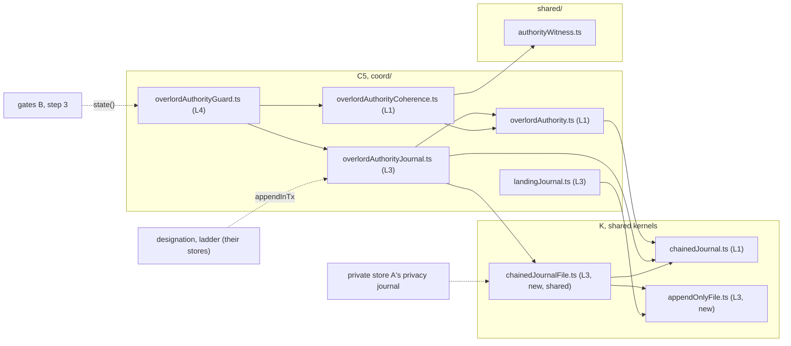
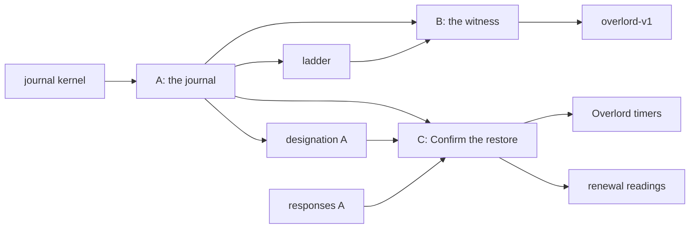
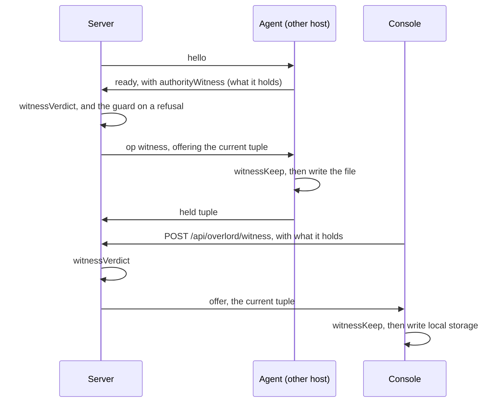

# Overlord W1: the authority journal, the witness and Confirm the restore Implementation Plan

> **For agentic workers:** REQUIRED SUB-SKILL: Use superpowers:subagent-driven-development (recommended) or
> superpowers:executing-plans to implement this plan task-by-task. Steps use checkbox (`- [ ]`) syntax for tracking.

**Goal:** a restored `coord.db`, or a restored volume, can never give the Overlord back authority the operator took
away. Every change that widens or narrows the Overlord's authority is written first to a hash-chained file that no
snapshot carries, the Overlord authority journal, and then to its row, in one `coord.db` transaction. At boot the
server compares the journal with the rows. While the server runs, it compares its journals' heads with what witnesses
off its volume hold: each remote agent and each signed-in console. A disagreement refuses every Overlord door but card,
probe and note with `authority-rolled-back`, latches the ladder at `chat`, and waits for one operator door, Confirm
the restore. Confirm the restore takes the stricter of the rows and the journal for each authority field, raises the
term and the restore generation, sets the epoch above every witness's, and lifts the refusal.

**Why:** H27 (§7.6). A restore would revive an earlier designation, a cleared latch or a higher rung, and the tree has
no record outside `coord.db` that could tell. The collector switch's generation log is the pattern
(`server/src/coord/collectLaneJournal.ts`): a file no snapshot carries, which nothing rebuilds from the row it exists to
distrust.

**Architecture:** context C5, under `server/src/coord/`, on the chained kernel (`server/src/chainedJournal.ts`, K).
- **L1:** the record grammar and its format; the fold of records into the journal's view of authority; boot coherence;
  the epoch; the witness verdict; the stricter-of table Confirm the restore applies.
- **L0:** the witness tuple, its parser and its keep rule, in a new `shared/authorityWitness.ts`, read by the server,
  the agent and the console alike.
- **L3:** the journal's synchronous writer and reader. It binds one shared synchronous chained-journal file adapter,
  `server/src/chainedJournalFile.ts` (K), over one shared byte-level append-only file port,
  `server/src/appendOnlyFile.ts` (K). The privacy journal binds the same adapter (question 3).
- **L4:** the boot step; the guard that holds the refusal; the witness exchange (agent link, console door and resend
  lane); and the Confirm door.

Three pull requests, nine tasks.

**Tech Stack:** TypeScript (ESM), `node:sqlite`, Fastify, vitest, Python 3 (standard library) for the model. No new
dependency.

**Spec:** `docs/superpowers/specs/2026-11-09-overlord-design.md`:

- §7.6 whole: H27, "Three journals on one kernel"; the authority journal's list of changes; boot coherence and Table
  7.6a; "A witness outside the volume", with its three sub-rules; "A detected restore latches the ladder at `chat`";
  Confirm the restore; "No id is used twice across a restore". The reconciliation pass and the act journal are W2's.
- §3.1, "The row binds an incarnation and carries a term": Confirm the restore raises the term, and keeps the body
  unless the journal names another, making a renewal due at once.
- §7.5, Table 7.5a: the rows "a restore detected" (latch, cap `chat`) and "since boot, no witness off the server's
  volume has answered" (condition, cap `advise`). "Only the operator steps up": each move up is a record in the
  authority journal.
- §7.4: "An unwitnessed write is refused and counted". That is the hook's witness of a door call, a different thing
  from this piece's witness of an epoch. The two share a word and nothing else.
- §11.1, Table 11.1a: the rows "The authority journal" (C5, L3, "never" in a snapshot) and "The witness epoch" (C8,
  adapters, "never"). Table 11.1d: "Every switch that changes authority is journalled". The door table's row "Confirm
  the restore" (C5, L4, behind the step-up).
- §11.2: the gate order's step 3, `authority-rolled-back`, which card, probe and note skip; the operator's doors,
  Confirm the restore among them, reuse the account gate with its step-up.
- §11.5: "After a gap … Until one witness off the server's volume has answered, grants read as suspended and the rung
  is capped at `advise`"; "The agent link stays additive".
- §11.6, the row `authority-rolled-back`.
- §11.7, Tables 11.7a and 11.7b: I7, I11, I13's "no id is issued twice", and I17 and I18's restore generation; the
  model "explored exhaustively within bounds and written before the code … then authority and restore" (W1).
- §4.3 and C67: response rows stamp the restore generation at insert, and a change inside a row's window reads
  `unmeasured`. §3.3.12: the timer's "fired again after a restore" line reads it.
- Table 13.1, row H27 (`shape`; W1, W2, W4): the journal and the door ship with the wave that creates them. Table 14,
  row W1: "the authority journal … and the 'Confirm the restore' door".

The index is `docs/superpowers/plans/2026-11-14-overlord-w1.md`: its row "Authority journal and restore" (lane C),
questions 16, 20, 21 and 35, "Where lanes meet", "What a merge arms" and "States W2 may read". The kernel's plan is
`docs/superpowers/plans/2026-11-14-overlord-w1/w1-journal-kernel.md`: its questions 4 and 6 hand this piece the
writer's shape, `chainNext` and the kinds census.

## Open questions

Each one is a place where the spec, the index or the kernel plan leaves this piece a choice. Where the coordinator has
ruled, the ruling is stated, and this plan builds it. Everywhere else the plan builds the recommendation.

1. **The writer's shape** (slug `authority-writer-verifies-then-appends`). The spec appends "inside the store's
   transaction, before the row". `CoordStore` is synchronous (`DatabaseSync`), and an async interface over it is
   rejected. The chained kernel is pure, and the delegation journal's writer is async, through
   `DelegationFilePort`. The tree's synchronous journal writer is `CoordStore.writeLandingAuthority`: inside
   `tx()`, `server/src/journalKernel.ts#appendThenApply` runs decide, append, apply, and a throw rolls the rows back.
   **Recommendation:** the writer is synchronous and called only inside the caller's `tx()`. It refuses outside a
   transaction (`DatabaseSync#isTransaction`, present at the 22.16 floor, measured in Task 3).
   - It runs on `appendThenApply`, unchanged:
     - decide reads the whole file through the port's snapshot and verifies it with the kernel's `verifyChainedBytes`;
     - it checks the file's head against the head row, and refuses unless they agree;
     - it builds the record from the head with `chainNext` (question 4);
     - append writes it and fsyncs it;
     - apply writes the head row.
   - An authority record is rare (designate, a rung change, a latch), so reading the whole file at every write is
     cheap. The writer then never trusts a cached head. That makes coherence a check at every write, not only at boot.
   - The writer appends nothing over an incoherent journal, the Confirm record excepted (question 9).
   - A failed or uncertain append rolls the transaction back. If its bytes reached the disk, the next write and the
     next boot both read Table 7.6a's last row, "one trailing record with no row", and refuse until Confirm the
     restore. That is the spec's own answer to "a crash between a record and its row". This piece adds no second
     fence for it.
2. **Its names** (slug `overlord-authority-names`). `landing.log`'s adapter calls itself "the landing authority
   journal", and `LandingJournalPort` is its port. **Recommendation:** every name of this piece starts with the
   Overlord, so neither a reader nor a grep confuses the two. The file is `~/.ccrc/overlord-authority.jsonl`
   (`OVERLORD_AUTHORITY_BASENAME`). The modules are `coord/overlordAuthority.ts` (L1: grammar, format, fold) and
   `coord/overlordAuthorityJournal.ts` (L3: the writer and reader, class `OverlordAuthorityJournal`). The format is
   `OVERLORD_AUTHORITY_FORMAT`, the refusal class `OverlordAuthorityError`, and the head table
   `overlord_authority_head`. Prose says "the Overlord authority journal".
3. **One synchronous append-only file port** (slug `one-sync-append-port`). `server/src/coord/landingJournal.ts`
   already holds a synchronous, re-proved, append-only file adapter. It retains the parent fd, opens the leaf with
   `O_NOFOLLOW`, snapshots the identity, and appends one line with `O_APPEND`. It continues short writes, fsyncs the
   file and its parent, and re-proves the bytes. It has a fault-injection seam, `LandingJournalFsOps`. A second copy
   for this journal would be the parallel mechanism `CLAUDE.md` forbids.
   - The port differs in two places. It is typed to `LandingJournalRecord`, because `append` stringifies the record.
     And `read` answers text, while the kernel's decoder needs bytes to tell invalid UTF-8 apart.
   - **Recommendation:** Task 2 moves the file mechanics into a byte-level port, `server/src/appendOnlyFile.ts` (K,
     L3), in a move commit with characterization tests first.
     - The port reads bytes and appends one line of bytes.
     - The landing adapter becomes a binding over it: `JSON.stringify` on append and UTF-8 text on read. Its port,
       its failure words and every caller stay as they are.
   - **Agreed with the private store's plan writer** (peer mail, 2026-11-15): one synchronous chained-journal file
     adapter, `server/src/chainedJournalFile.ts` (K, L3), sits on that port and is generic over a
     `ChainedJournalFormat`.
     - It reads and verifies the whole file with the kernel, heals a torn tail by the kernel's plan, and appends the
       next record (`chainNext`, `encodeChainedRecord`, `appendLine`).
     - Both W1 journals bind it, each with its own format, error class and `FORMATS` row.
     - Whichever of this piece's PR A and private store A merges first ships both files, with their characterization
       and their K rows. The other imports them.
     - Each journal's own class decides when it reads and what it checks against its rows, and holds the transaction
       check, because only it knows its database.
4. **The next record from the head** (the kernel plan's question 4; slug `chain-next-in-the-kernel`). The arithmetic
   is `sequence + 1` and `previousDigest = head.digest`, with `null` before the first record. It sits inline in
   `delegation-journal.ts#planDelegationJournalAppend`. **Recommendation:** Task 2 moves it into the kernel as
   `chainNext(head)`, in a behaviour-neutral commit with the kernel's characterization file still green, and the
   delegation planner calls it. This journal calls it too. Nothing copies the arithmetic.
5. **What "the rows" are at boot** (slug `coherence-reads-a-head-row`). Table 7.6a compares "the journal against the
   rows" as equal, behind, ahead, trailing, missing or malformed, and a field-by-field comparison cannot say "behind"
   or "ahead". **Recommendation:** a singleton row, `overlord_authority_head`, holds the sequence, `journalId` and
   digest of the last record whose row committed.
   - The writer's apply step is its only writer, inside the same transaction as the authority row it records.
   - Boot compares the file's head with this row, so each verdict of Table 7.6a is a comparison of two positions.
   - "Missing, beside any Overlord row" reads the head row, plus every Overlord authority table in a list each later
     piece extends (`OVERLORD_AUTHORITY_TABLES`).
   - A file holding a different record at the row's sequence fits no row of the table. It reads `diverged`, which
     refuses like the rest (slug `coherence-diverged-verdict`).
   - An unreadable file or row reads `unmeasured`, which refuses too and is never folded into `missing`.
6. **A detected restore fences the doors, not the boot** (slug `restore-fences-doors-not-boot`). The landing journal's
   failed replay exits the server (`index.ts`, "landing journal recovery refused"). Here the spec answers a failed
   coherence check with a door refusal, and the operator ends it at a door, so the server must start.
   **Recommendation:** the boot step records its verdict in the guard and the server starts. Only what reads the
   guard refuses: the gates' step 3, the writer, and the ladder's latch. That is "legitimately different" from the
   landing journal, whose writes are fleet-wide.
7. **The epoch** (slug `epoch-derived-from-heads`). §7.6 says the epoch "rises with every authority record, every settle
   record of the act journal and every record of the privacy journal". It is "set above the highest any witness
   holds" at Confirm. It names no store, and a store inside `coord.db` would come back with a snapshot.
   **Recommendation:** derive the epoch from the journals, which no snapshot carries.
   - Each Confirm record carries `epochAtConfirm` and the privacy journal's sequence at that moment.
   - The epoch is the last Confirm's `epochAtConfirm` plus the authority records and privacy records after it. With
     no Confirm record, it is the two sequences added.
   - W2 adds the act journal's settle records as a third term.
   - The epoch needs no writer, rises with every record, falls with a restored file, and is read at boot from the
     files alone.
8. **Which witness answers count** (slug `witness-counts-from-an-earlier-boot`). "Until one witness off the server's
   volume has answered" lifts the `advise` cap. A console that holds nothing, such as a new device or cleared storage,
   proves nothing about a restore. **Recommendation:** each tuple the server sends carries its boot nonce. The
   condition lifts on a witness off the volume that presents a tuple sent under an earlier boot, and the verdict
   reads it consistent. A witness that holds nothing, or only this boot's tuple, takes the current tuple and lifts
   nothing. The boot nonce is the one `index.ts` already mints (`CollectLaneDeps.bootNonce`), not a second.
9. **What may be appended while the journal is incoherent** (slug `no-append-until-confirm`). **Recommendation:**
   nothing but the Confirm record. A narrowing (Pause, a lower rung) appended over a trailing record would move the
   head row level with the file and make the journal read coherent without the operator. In W1 the `chat` latch and
   the step-3 refusal already hold the Overlord at its narrowest, so a refused narrowing narrows nothing more. W3,
   which brings holds, revisits this.
10. **An agent on the server's own host** (slug `agent-witness-waits-for-host-report`). An agent on the server's host is
    no witness, and only the isolation word measures each agent's host identity (index question 15). **Recommendation:**
    the witness verdict takes the agent's host relation as `other-host`, `same-host` or `unmeasured`, and counts only
    `other-host`. Until the isolation word lands, every agent reads `unmeasured`: its tuple is still compared, so a
    higher epoch still refuses, but its answer lifts no condition and holds no narrowing. A signed-in console counts,
    as §7.6 says ("on one box that is the first signed-in console"). This piece does not wait for the isolation word.
11. **The privacy journal's head** (index question 21; slug `privacy-head-wired-by-the-second`). The witness carries the
    privacy journal's head and the highest message id, and the privacy journal is private store A's. **Recommendation:**
    PR B declares a consumer port, `PrivacyJournalHead`, that answers `absent`, `{sequence, digest, highestMessageId}`
    or `unmeasured`. PR B or private store A, whichever lands second, wires it in `index.ts`, in one line. Until then
    the tuple carries the privacy head as `absent`, as it carries the act journal's head until W2. An `unmeasured`
    privacy head makes the epoch `unmeasured`, and the verdict refuses. It is never read as `absent`.
12. **Which switches are journalled in W1** (slug `account-set-and-class-are-journalled`). §7.6 lists designate, rebind
    and retire, and changes of the ladder. Table 11.1d says "every switch that changes authority is journalled", and
    §11.2 gives a step-up to widening the account set and to selecting `fable`, which marks both as authority.
    **Recommendation:** the W1 grammar also has `authority-account-set` and `authority-model-class`. The stricter of a
    set is the intersection, and the stricter class is `opus`. Designation C writes them.
13. **The restore generation's store** (index question 35, ruled: "a counter raised only inside Confirm the restore's
    transaction", whose writer and accessor are this piece's; slug `restore-generation-from-the-journal`).
    **Recommendation:** the counter is the number of `authority-restore-confirmed` records in the journal, and each
    record also carries its own value. Its only writer is the Confirm transaction's append. A copy in `coord.db` would
    come back lower after a restore, and the generation exists to see restores. The accessor answers
    `{kind: 'measured', n}` or `{kind: 'unmeasured', why}` and never a default number.
14. **The console's Confirm control** (slug `confirm-control-ships-with-its-door`). The index gives Confirm the restore
    to PR C, and no console piece names its control. **Recommendation:** PR C ships the door, its `pwa/src/lib/api.ts`
    call and a self-contained banner component, `pwa/src/overlord/RestoreBanner.tsx`, which shows
    `authority-rolled-back`, the step-up and the result. Home B mounts it with one line, or C mounts it on the Overlord
    place if home B has landed first.
15. **The model** (the index: "the authority-and-restore explorer model, written before the code"; slug
    `model-extends-w0-behind-a-switch`). W0's model already has authority and restore
    (`server/test/model/overlord/model.py`'s `A` tuple, `auth_events`, `boot_coherence`; the scenario `restore`; the
    mutation `no_restore_detection`). Its abstraction is W0's: one epoch, one witness, and stricter-of applied at boot.
    **Recommendation:** Task 1 extends that model behind one switch, `AUTH_W1`. Then this piece adds no second explorer
    and the W0 scenarios keep their results. The new scenarios model this plan's choices: heads, the derived epoch, a
    console and agents on either host, the boot nonce, Confirm the restore as an operator event, and the restore
    generation.
16. **Confirm's later rows** (slug `confirm-rows-join-with-their-tables`). Confirm's spec list also has grants latched
    (W3), the reconciliation pass and ids above the act journal (W2), classes computed again (W3), and the
    privacy journal's replay (W4). **Recommendation:** Confirm is table-driven. Its stricter-of table has one row per
    authority field, and each later wave adds its row with its table, as the ladder's causes join with their inputs
    (index question 20).

## What exists today

Measured on `main` at `49a34f76e` (2026-11-15). The kernel was read at `7e60d59d0`, the tip of
`origin/ws/overlord-build-journal`, and merged as #2848 at `2b082b91f` while this plan was written. The builder
re-reads each symbol at build time.

- **No Overlord authority code.** No `server/src` or `shared` symbol is named for authority, a witness, an authority
  epoch or a restore generation (searched for `authority`, `witness`, `restoreGeneration`, `restore_generation`). The
  one hit is the unrelated `server/src/continuity/card.ts#CARD_AUTHORITY_LINE`, and the word "witness" appears once,
  in a comment in `coord/store.ts`. `overlord_designation`, the ladder's tables and `operator_responses` do not exist,
  and no plan defines their columns yet (designation, ladder and responses are unplanned). This plan takes their
  interfaces from the spec's tables and says so where it does.
- **The refusal word is on `main`.** `shared/refusal.ts#OVERLORD_REFUSALS` holds `'authority-rolled-back': 503`, and
  `server/test/single-definition/refusal-table.test.ts` pins it. `step-up-required` and `auth-off` are the account
  gate's words. This piece adds no refusal word.
- **The chained kernel** (`server/src/chainedJournal.ts` and `server/src/canonical.ts`, #2848, K, L1). It provides
  `ChainedJournalFormat<E, X>` (`kinds`, `entry`, `fail`, `jsonError`), `buildChainedRecord`, `encodeChainedRecord`,
  `decodeChainedLine`, `ChainVerifier`, `verifyChainedBytes`, `parseChainedBytes`, `chainedTornTailError`,
  `chainedTailHealPlan`, `ChainedPosition`, and the field checks (`chainedExactKeys`, `chainedHex64`,
  `chainedAssertInstant`, `isRecord`).
  - The kinds census is `server/test/chained-journal-formats.test.ts#FORMATS`. A row holds a format, its binding and a
    sample entry. The census discovers every binding annotated `ChainedJournalFormat` or `satisfies` it, and also
    finds a format passed to a kernel export unannotated.
  - The "next record from the head" arithmetic is still inline in `delegation-journal.ts#planDelegationJournalAppend`.
- **The landing journal.**
  - `server/src/coord/landingJournal.ts#createLandingJournal(ccrcDir, ops)` answers a `LandingJournalPort`
    (`server/src/coord/landingJournalPort.ts`: `read`, `confirmDurable`, `append`), over `LandingJournalFsOps`.
  - `CoordStore.writeLandingAuthority` runs `appendThenApply` inside `tx()`. A failure sets the landing fence.
  - At boot, `index.ts` calls `coord.replayLandingJournal()` before the HTTP server, and exits the process when it
    refuses.
  - `landing.log` is in no backup set, restore pair or snapshot capture:
    `server/test/landing-entry-census.test.ts`, the case "landing-journal-left-in-place".
- **The collector switch's journal**, the pattern §7.6 cites.
  - `server/src/collectLane.ts#collectLaneControl` compares the journal's maximum with the row's generation, lazily at
    the switch, and answers `coherent`, `mismatch` or `unmeasurable`, with its reasons in
    `COLLECT_LANE_UNMEASURABLE_TABLE`.
  - The server starts either way.
  - `server/test/coordination-snapshot.test.ts`, the describe "8C (#384)", pins that the log is never part of a
    coordination snapshot.
  - `ccd/ccrc#_upd_backup_pairs` copies only `~/.ccrc/memory` from `~/.ccrc`. `coord.db` goes through
    `backup-coord.mjs`.
- **The agent link.**
  - The server dials the agent. `server/src/remote/client.ts#FleetClient` sends `AgentHello` (`{t: 'hello', token}`),
    and the agent answers `AgentReady` (`shared/agent-protocol.ts`). `FleetClient.onReady` is the one reader of each
    ready field into `FleetState` (`server/src/fleetstate.ts`). Every ready resets them, and an absent field reads
    "no evidence" (`rosterFp`'s comment).
  - `observedEpoch` on the ready frame is the pool projection's epoch (`POOL_EPOCH_FILE_NAME`), so this piece's field
    takes another name.
  - Ops are request and answer pairs listed in `ready.ops` (`readReadyOps`), for example `TOKEN_SYNC_OP` and
    `OVERLORD_HISTORY_OP`.
  - The agent's state directory is `CCRC_DIR_NAME` (`~/.ccrc`). `NODE_FILES` is the admission set for the server's
    reads of it.
  - `FLEET_PROTO` stays.
  - In `local` mode (`CcrcConfig.fleetMode`) there is no agent link.
  - No code compares an agent's host with the server's. `server/src/fleetidentity.ts` keys an agent by its node-id
    uuid only.
- **The console.**
  - `pwa/src/lib/storage.ts` (`readKey`, `writeKey`, `UNREADABLE`, `pageStorage`) is the one localStorage seam, and
    every access is wrapped.
  - The session gate is global (`server/src/auth/gate.ts#installGate`, `sessionVerdict`, cookie `ccrc_session`).
  - The account gate is `server/src/accounts/gate.ts#createAccountGate`. A door calls `deps.gate(req, reply, { cap:
    null, stepUp: true })`, which refuses `auth-off` while sign-in is dark and `step-up-required` without an assertion
    from the last five minutes. `PUT /api/items/:id/secret` (`coord/ledgersRoutes.ts`) is the pattern.
- **Census sites a new door, table, lane or module touches** (each re-measured in its task):
  - `server/test/auth-gate.test.ts`'s `scanRoutes` list and its per-file count;
  - `server/test/box-token-census.test.ts`: a `*_SESSION_DOORS` list for a routes file, spread into `SESSION_ONLY_ALL`,
    with its both-directions case;
  - `server/test/rings/fastify-l4.data.ts#FASTIFY_L4_ALLOWLIST`;
  - `server/test/secret-mask.test.ts`. A POST is answer-masked by default, so it needs no row;
  - `CLAUDE.md`'s box-token paragraph;
  - `server/test/single-definition/writers-map.test.ts#TABLES`;
  - `server/test/single-definition/time-ports.test.ts`. Its `TIME_PORT_FAMILIES` already scopes every file whose name
    holds `overlord`, so this piece's `server/src` modules are in scope by name;
  - `server/test/run-close-switch.test.ts` (each migration's undo and the count) and `server/test/coord-db.test.ts`
    (`COORD_SCHEMA_VERSION` and `MIGRATIONS.length`, 75 today);
  - `server/src/laneSchedule.ts#LANE_SCHEDULE` with `server/test/lane-schedule.test.ts`;
  - `MUTANT_SETS` and `server/test/sim/mutation-floors.json`, on the shape of `server/test/sim/probeDoorSets.ts`.
  - `coord/**` is one row of the architecture spec's path table, so a new `coord/` file needs no row. A new K file at
    the root of `server/src` does (`server/test/rings/totality.test.ts`).
- **The model.**
  - `server/test/model/overlord/model.py` and `check.py`, run by `server/test/overlord-model.test.ts` through
    `pythonOrSkip()`, with `python3 -I -B`. The `restore` scenario (`RESTORES=1, AUTH_CHANGES=1`) is in its fast list.
  - It has no property-test library. The simulator (`server/test/sim/`) has crash injection and no restore injection.
- **Growth.** `server/test/growthCheck.ts#GROWTH_FILES` lists, among others, `server/src/coord/schema.ts`,
  `server/src/coord/store.ts`, `server/src/watch.ts`, `server/src/server.ts`, `pwa/src/lib/api.ts` and `shared/api.ts`.
  `shared/agent-protocol.ts`, `agent/src/server.ts`, `server/src/index.ts`, `landingJournal.ts` and the new modules
  are not listed.



*Figure 1. The modules after PR A and B. Solid edges are this piece's imports. Dotted edges are other pieces that call
it: the privacy journal binds the same file adapter, the designation and ladder stores append through the writer, and
the gates read the guard.*

## Global Constraints

- **Decide in L1, act in L4 (`CLAUDE.md`).**
  - L1 modules: `authorityFold`, `authorityCoherence`, `authorityEpoch`, `witnessVerdict`, `offVolumeHeld` and
    `restoreStricter`. Each takes facts and answers a word, with no fs, no clock and no randomness.
  - L4 modules: the boot step, the guard, the exchange and the door. They gather the facts, ask the deciders and write
    what the deciders answer.
- **One writer per fact.**
  - The journal file: `OverlordAuthorityJournal.appendInTx`. The torn-tail heal is the only cut.
  - `overlord_authority_head`: the same call's apply step. `writers-map.test.ts#TABLES` names it.
  - The guard's state: `OverlordAuthorityGuard`. Its three inputs are the boot verdict, a witness verdict and a
    confirmed restore. Nothing else sets or clears `authority-rolled-back`.
  - An agent's held tuple: the agent's `witness` op. A console's: `pwa/src/lib/witness.ts`.
  - The restore generation: the Confirm record (question 13).
- **Fail closed, and never fold "unmeasured".**
  - An unreadable journal, head row or privacy head reads `unmeasured`, and `unmeasured` refuses as
    `authority-rolled-back` does. It keeps its own cause word in the guard and on the console.
  - An absent witness field from an older agent is "no evidence": it neither refuses nor counts.
  - No reader answers `null` for two different conditions.
- **The agent link stays additive** (§11.5). One optional ready field, `authorityWitness`, with one reader in
  `FleetClient.onReady`, and one op, `witness`, listed in `ready.ops`. `FLEET_PROTO` does not change. The server sends
  the op only to an agent that lists it.
- **Time and chance through ports.** The new server modules read `Clock` from `Deps.time`. The boot nonce comes from
  the composition root. SQL never reads the clock. Each new module name holds `overlord` or `authority`.
  `time-ports.test.ts`'s families cover `overlord`, and a module named only `authority` joins `TIME_PORT_FILES` in the
  task that creates it.
- **Never in a snapshot.** The journal file is in no backup set, restore pair or snapshot capture, and a test pins it
  in the shape of the landing journal's and the collector log's pins.
- **Wire types in a sibling** (the index's `wire-types-in-sibling-modules`). The witness tuple lives in
  `shared/authorityWitness.ts`, which imports nothing. `shared/api.ts` is not touched.
- **Migrations are numbered at build time.** PR A adds one migration (`overlord_authority_head`) at the slot it
  measures, with `run-close-switch.test.ts`'s undo and count and `coord-db.test.ts`'s pins.
- **Mutation floors.** Every new L1 decider joins `MUTANT_SETS` through `server/test/sim/overlordAuthoritySets.ts` and
  `mutation-floors.json`, in the pull request that creates it.
- **Tests.**
  - Run from `server/` with `ccrc test -- ./node_modules/.bin/vitest run test/<file>.test.ts`, and from `agent/` and
    `pwa/` the same way.
  - Each task's last run adds both `tsc` runs (`ccrc test -- npx tsc --noEmit -p tsconfig.json` and
    `-p test/tsconfig.tests.json`) and `test/typecheck-tests.test.ts`.
  - When `shared/` changed, it also adds `agent`'s and `pwa`'s `tsc`.
  - Source pins over a new file read it through `server/test/scan/symbols.ts`' `parsedFile`, never through
    `readFileSync` and a string method (the ARCH-06 ratchet).
- **SAFETY.** No ccd verb, no live `~/.ccrc`, no live agent. Every test uses fixture directories under the per-run temp
  root. The agent's suite uses its own fixture home.
- **Growth check** (40 net lines a growth-checked file a pull request). The PR split states each estimate, and the
  builder measures it before pushing. No waiver.
- **Public repository.** Fixtures use `lane-a-project-a` and `project-a`. Cite by symbol or `@anchor`. No D-number is
  invented: this plan's departures are slugs, and the builder's go in a new note,
  `docs/superpowers/plans/2026-11-14-overlord-w1/w1-authority-journal/departures.md`.

## Review Focus

1. **Before the row, inside the transaction.** No authority row commits without its record durable on disk first, and
   no record is appended outside a `tx()`. A throw at any step leaves the rows as they were. A record whose row did not
   commit is read as Table 7.6a's trailing record, never silently adopted.
2. **Nothing widens without the operator** (I11). The writer appends nothing over an incoherent journal but the Confirm
   record. A trailing record that widens is never applied: Confirm takes the stricter value field by field, so it
   drops a widening record and keeps a narrowing one. The witness can make the server refuse, and it can never make it
   permit.
3. **The witness is off the volume.** Only a console and an agent measured `other-host` count. A same-host or
   unmeasured agent's tuple can refuse and can never lift a condition or hold a narrowing. A tuple from this boot lifts
   nothing.
4. **Unmeasured stays unmeasured.** Every read that can fail has a word of its own, and it refuses rather than reads as
   absent or coherent.
5. **The model came first.** Task 1's scenarios and planted mutations are on the branch before Task 3's code. Each
   later decision in this plan has a scenario or a mutation that would catch its opposite.

## The PR split

| PR | Tasks | What it ships | Needs first | Growth-checked files, estimate |
|---|---|---|---|---|
| A, the journal | 1 to 4 | The model; `chainNext` and the shared append-only port, behaviour-neutral; the shared chained-journal file adapter (unless private store A shipped it first); the grammar, its format and census row, the fold, the writer and `overlord_authority_head`; boot coherence, the torn-tail heal, the guard and the snapshot pins | the journal kernel (#2848, merged) | `server/src/coord/schema.ts` about +14; `server/src/coord/store.ts` 0 to +4 (only if the writer needs a `CoordStore` delegate; the plan expects none) |
| B, the witness | 5 to 7 | The witness tuple, the epoch and the verdict; the agent's op, its ready field and its file; the server's exchange on connect, after each record and on its lane; the console's door and its client; the ladder's two cause rows and the "held off the volume" reader | PR A; the ladder | `pwa/src/lib/api.ts` about +5; `server/src/watch.ts` about +4 if `LANE_SCHEDULE` rows are wired there (measured in Task 6); `server/src/server.ts` 0 |
| C, Confirm the restore | 8 and 9 | `restoreStricter` and the Confirm door, behind the step-up, in one transaction; the restore generation's accessor; the response rows' stamp switched from `unmeasured` to the counter; `termRaised`; the banner | PR A; designation A; responses A | `pwa/src/lib/api.ts` about +5; `server/src/coord/store.ts` 0 to +2 (only if responses A's insert sits there) |

**Order.** PR A once the kernel has merged. PR B once PR A and the ladder have merged (index question 20, ruled: the
ladder is in B's Needs-first). PR C once PR A, designation A and responses A have merged (index question 35, ruled,
review 2088 F6). B and C do not need each other. The second of them to land merges `main` once (worker clause 16).

**States the next pieces read.**
- Designation A and the ladder: `OverlordAuthorityJournal.appendInTx` and the W1 kinds (PR A), and
  `OVERLORD_AUTHORITY_TABLES`, to which each adds its table.
- Gates B: `OverlordAuthorityGuard.state()` for step 3 (PR A).
- The ladder's "taking effect until a witness holds it": `offVolumeHeld(epoch)` (PR B). Until PR B lands, the ladder
  reads it as `unmeasured`, so a narrowing shows as taking effect.
- Private store A: the `PrivacyJournalHead` port (PR B), and the witnesses' highest message id
  (`witnessHighestIds()`), above which "no id is used twice" makes it issue.
- Responses B and the Overlord's timers: `restoreGeneration()` (PR C).
- The renewal readings: `termRaised` (PR C).



*Figure 2. The order. Designation A and the ladder need PR A, and PR B and C need them in turn, so lane C runs A, then
designation A and the ladder, then B and C.*

---

### Task 1: The authority-and-restore model, before the code (PR A)

**Files:**
- Modify: `server/test/model/overlord/model.py` (the `AUTH_W1` switch, its state fields and events, and the boot and
  Confirm transitions)
- Modify: `server/test/model/overlord/check.py` (the new invariants in `STATE_CHECKS` and `ALL_NAMES`, the new
  scenarios in `SCEN`, the new rows in `MUTATIONS`)
- Modify: `server/test/overlord-model.test.ts` (`FAST` gains `restore-w1` and `witness`, and the mutation run gains the
  new rows)
- Create: `docs/superpowers/plans/2026-11-14-overlord-w1/w1-authority-journal/model-results.md` (the run's numbers)

With `AUTH_W1=False` every existing scenario runs as today, and its committed result is unchanged. With `AUTH_W1=True`
the `A` tuple gains these fields:
- the authority and privacy journals' heads, each a sequence and a fork id (a restore followed by an append makes a
  new fork, which is how the model tells two histories of equal length apart);
- the head row's position;
- the last Confirm's `epochAtConfirm`, and the privacy sequence at that Confirm;
- the restore generation;
- the boot nonce;
- three witnesses, each holding a tuple or nothing: a console, an agent on the server's host, and an agent on another
  host;
- the guard's state;
- the set of narrowings the operator was told took effect.

**Events** (each one transaction or one environment event, as W0's model reads them):
- an authority record appended, then its row committed: two transitions, joined by the continuation, which a crash
  clears. The narrowing and widening kinds are rung down and rung up, and latch raised and cleared;
- a privacy record appended;
- a witness exchange with each witness, separately and in any order;
- a crash; a boot, which runs coherence;
- a snapshot; a restore of `coord.db` alone; a restore of the whole volume. The same-host agent's tuple comes back
  with the volume, and the console and the other-host agent keep theirs;
- the operator's Confirm the restore.

**New invariants** (in `STATE_CHECKS`):
- **I7w.** After any restore, no authority field the server acts on is wider than every narrowing the operator was
  told took effect. This is I7, reading B, made exact.
- **I11a.** A field widens only in a transition labelled as an operator's door, or as Confirm the restore taking the
  stricter of two values, which never widens.
- **RG.** The restore generation never decreases, and two server states on either side of a confirmed restore never
  hold the same value.
- **WH.** A narrowing is reported done only when the console or the other-host agent holds an epoch at or above its
  record's.

**Liveness** (in `liveness`): from `rolled-back`, a Confirm reaches `coherent` with no further restore, and stays there
while no further restore happens.

**Scenarios:**
- `restore-w1`: `RESTORES=1`, two authority changes, a crash;
- `witness`: one change, every exchange order;
- `confirm`: a restore, then Confirm, then a change. `confirm` is in the full list only, unless it runs under a few
  seconds.

**Planted mutations**, each with the invariant that must catch it:

| Mutation | Caught by |
|---|---|
| `same_host_agent_counts`: the same-host agent's answer lifts the condition and holds a narrowing | WH, and I7w after a whole-volume restore |
| `epoch_in_db`: the epoch is stored in the database, so a restore lowers it with no fall in the heads | I7w |
| `heads_not_checked`: the verdict compares epochs only | I7w (a restore then enough appends to catch up) |
| `confirm_no_epoch_raise`: Confirm leaves the epoch below a witness's | liveness |
| `trailing_widening_applied`: Confirm takes the trailing record's value whatever it is | I11a |
| `append_over_incoherent`: the writer appends a narrowing over a trailing record | I11a, then a later widening |
| `restore_generation_in_db`: the counter kept in the database | RG |
| `this_boot_witness_counts`: a tuple from this boot lifts the condition | none expected: it weakens a mitigation, not an invariant. It is listed as W0's "none expected" rows are |

- [ ] **Step 1: Write** the switch, the fields, the events and the transitions. Every rule cites its section of the
  spec or its question in this plan.
- [ ] **Step 2: Run** `python3 -I -B server/test/model/overlord/check.py --json restore-w1` and `--json witness`. Every
  invariant holds. Record the state counts.
- [ ] **Step 3: Run the mutations.** Each is caught by the invariant its row names, and the "none expected" row is
  left uncaught.
- [ ] **Step 4: Run** `test/overlord-model.test.ts`. The W0 scenarios' results are unchanged, and the new rows are
  green.
- [ ] **Step 5: Write** `model-results.md`: the counts, the timings, and any rule of this plan the model changed. A
  rule the model changes is a change to this plan's text, made in the same pull request and said in its body.
- [ ] **Step 6: Commit.** `test(model): the authority journal, the witness and Confirm the restore, explored before the code (Overlord W1)`

### Task 2: `chainNext` and one synchronous append-only port, behaviour-neutral (PR A)

**Files:**
- Modify: `server/src/chainedJournal.ts` (adds `chainNext`)
- Modify: `server/src/coord/delegation-journal.ts` (`planDelegationJournalAppend` calls it)
- Create: `server/src/appendOnlyFile.ts` (K, L3: the byte-level port, moved out of `landingJournal.ts`)
- Modify: `server/src/coord/landingJournal.ts` (becomes a binding over it, with the same `LandingJournalPort` and the
  same failure words)
- Modify: `docs/superpowers/specs/2026-08-10-architecture-ddd-clean-solid.md` (the K row gains `appendOnlyFile.ts`)
- Test: `server/test/append-only-file-characterization.test.ts` (new, written first, green on `main`)
- Test: `server/test/chained-journal-characterization.test.ts`, unchanged and green
- Test: the landing journal's suites, unchanged and green

**Interfaces:**

```ts
// server/src/chainedJournal.ts
/** The next record's position from a head: sequence 1 and no previous digest before the first record. */
export function chainNext(head: ChainedPosition | null): { sequence: number; previousDigest: string | null };

// server/src/appendOnlyFile.ts (K, L3)
export interface AppendOnlySnapshot { release(): void }
export type AppendOnlyRead =
  | { ok: true; kind: 'absent'; snapshot: AppendOnlySnapshot }
  | { ok: true; kind: 'present'; bytes: Uint8Array; snapshot: AppendOnlySnapshot }
  | { ok: false; error: 'unreadable' };
export interface AppendOnlyFile {
  read(): AppendOnlyRead;
  confirmDurable(s: AppendOnlySnapshot): { ok: true } | { ok: false; error: 'unreadable' | 'changed' | 'durability' };
  /** One line, LF included, appended after re-proving the snapshot: never truncates, never retries. */
  appendLine(s: AppendOnlySnapshot, line: Uint8Array):
    { ok: true } | { ok: false; error: 'unreadable' | 'changed' | 'unwritable' | 'durability'; mayApply: true };
}
export function appendOnlyFileAt(dir: string, basename: string, ops?: AppendOnlyFsOps): AppendOnlyFile;
```

`AppendOnlyFsOps` is `LandingJournalFsOps`, renamed and re-exported under its old name from `landingJournal.ts`.
The flags, the fsync order, the short-write loop, the zero-byte refusal and the re-proof move as they are.

- [ ] **Step 1: Characterize** the landing adapter's file behaviour on `main`, through `LandingJournalFsOps`
  doubles:
  - the open flags of each mode;
  - the order of the calls (open the parent, open the leaf, `fstat`, write, `fsync` the file, `fsync` the parent);
  - a short write that continues, and a zero-byte write that fails;
  - each failure word and `mayApply`;
  - a leaf replaced between `read` and `append` (`changed`);
  - a symlinked leaf (`unreadable`);
  - the exact bytes appended for a record.
  
  The file is green on `main`.
- [ ] **Step 2: Move** the mechanics into `appendOnlyFile.ts`, and bind the landing adapter over it. Run Step 1's
  file, every `test/landing-*.test.ts`, `test/single-definition/*.test.ts` and `test/rings/*.test.ts`. All green, with
  no test edited but import lines.
- [ ] **Step 3: Add `chainNext`**, and re-point `planDelegationJournalAppend`'s two seeds to it. Run the kernel's
  characterization file and every `test/delegation-*.test.ts`. All green.
- [ ] **Step 4: Commit** each move as its own commit:
  - `refactor(journal): the landing journal's synchronous append-only file mechanics move to a byte-level K port, which landing binds (Overlord W1)`
  - `refactor(journal): chainNext, the next record from the head, moves into the chained kernel (Overlord W1)`

### Task 3: The grammar, the fold, the writer and the head row (PR A)

**Files:**
- Create: `server/src/coord/overlordAuthority.ts` (C5, L1: the entry grammar, `OVERLORD_AUTHORITY_FORMAT`,
  `OverlordAuthorityError`, `authorityFold`)
- Create: `server/src/chainedJournalFile.ts` (K, L3), unless private store A has already shipped it, in which case
  import it (question 3). With it come its own test, `server/test/chained-journal-file.test.ts` (it reads, verifies,
  heals and appends with the kernel's fixture format), and the architecture spec's K row.
- Create: `server/src/coord/overlordAuthorityJournal.ts` (C5, L3: `OverlordAuthorityJournal`, which binds
  `chainedJournalFile.ts` with `OVERLORD_AUTHORITY_FORMAT`)
- Modify: `server/src/coord/schema.ts` (one migration: `overlord_authority_head`)
- Modify: `server/test/chained-journal-formats.test.ts` (`FORMATS` gains `overlordAuthority`, with its binding and a
  sample)
- Modify: `server/test/single-definition/writers-map.test.ts` (`TABLES` gains `overlord_authority_head`, writer
  `appendInTx`)
- Modify: `server/test/run-close-switch.test.ts` and `server/test/coord-db.test.ts` (the migration)
- Modify: `server/test/mail-routes.test.ts`'s table list, if its scan of `server/src/coord` meets the grammar's kebab
  words (measured; add an `isOverlordAuthorityKebab` beside `isDelegationJournalKebab` if it does)
- Test: `server/test/overlord-authority.test.ts` (new), `server/test/overlord-authority-journal.test.ts` (new)
- Create: `server/test/sim/overlordAuthoritySets.ts`; Modify: `mutation-floors.test.ts`'s `MUTANT_SETS` and
  `mutation-floors.json`

**The grammar** (closed, exact keys, every value checked, in the delegation grammar's shape):

| Kind | Fields besides `kind` and `opKey` | Narrows or widens |
|---|---|---|
| `authority-designate` | `term`, `sessionId`, `generation` | widens (a binding) |
| `authority-rebind` | `term`, `sessionId`, `generation`, `previousSessionId` | neither; it moves the binding |
| `authority-retire` | `term`, `previousSessionId` | narrows |
| `authority-rung` | `from`, `to` (each a rung word) | by the two rungs |
| `authority-latch-raise` | `cause`, `cap` | narrows |
| `authority-latch-clear` | `cause` | widens |
| `authority-account-set` | `pools` (sorted, unique), `untagged` | by the two sets |
| `authority-model-class` | `class` | `fable` widens |
| `authority-restore-confirmed` | `term`, `epochAtConfirm`, `privacySequenceAtConfirm` (null when the privacy journal is absent), `restoreGeneration`, `binding` (`kept` or `cleared`) | neither |

- `opKey` is the door call's operation key, minted by the door through `Entropy` (`entropy.hex(16)`) unless the door
  has a natural key of its own.
- A record holds no operator words and no secret. The actor's kind is not in the record: every W1 kind is an operator
  door's, and the latches are the server's. The rows keep actors (§7.4).
- The rung words, the latch causes and the pool names are checked against their L0 owners (`shared/` rung vocabulary,
  the ladder's cause keys, `POOL_NAME_RE`). Where the owner has not merged, the grammar reads the spec's words, and
  the owner's piece re-points the check in its own pull request.

**Interfaces:**

```ts
// server/src/chainedJournalFile.ts (K, L3), generic over a format; shared with the privacy journal (question 3)
export type ChainedFileRead<E> =
  | { kind: 'absent'; snapshot: AppendOnlySnapshot }
  | { kind: 'records'; records: readonly ChainedJournalRecord<E>[]; tail: ChainedTail | null; snapshot: AppendOnlySnapshot }
  | { kind: 'malformed'; code: string; detail: string }
  | { kind: 'unmeasured'; why: 'unreadable' };
export interface ChainedJournalFile<E> {
  read(): ChainedFileRead<E>;
  /** `chainNext` from the verified head of THIS snapshot, `encodeChainedRecord`, then `appendLine`. */
  appendNext(s: AppendOnlySnapshot, entry: E, acceptedAt: string):
    { ok: true; record: ChainedJournalRecord<E> } | { ok: false; error: 'unreadable' | 'changed' | 'unwritable' | 'durability'; mayApply: true };
  /** The one cut: keeps the tail's bytes under the plan's name in `quarantineDir`, then truncates to `plan.offset`. */
  healTail(s: AppendOnlySnapshot, plan: ChainedTailHealPlan, quarantineDir: string): { ok: true } | { ok: false; error: 'unreadable' | 'changed' | 'unwritable' | 'durability' };
}
export function chainedJournalFileAt<E, X extends ChainedRefusal>(fmt: ChainedJournalFormat<E, X>, dir: string, basename: string,
  ops?: AppendOnlyFsOps): ChainedJournalFile<E>;

// server/src/coord/overlordAuthority.ts (L1)
export const OVERLORD_AUTHORITY_BASENAME = 'overlord-authority.jsonl';
export const OVERLORD_AUTHORITY_KINDS = { 'authority-designate': true, /* … each kind above */ } as const;
export type OverlordAuthorityEntry = /* the union of the table's rows */;
export class OverlordAuthorityError extends Error { readonly code: string }
export const OVERLORD_AUTHORITY_FORMAT: ChainedJournalFormat<OverlordAuthorityEntry, OverlordAuthorityError>;

/** The journal's view of authority: what the records, folded in order, say each field is, and the last Confirm. */
export interface AuthorityView {
  designation: { term: number; sessionId: string | null; generation: number | null } | null;
  operatorRung: RungWord | null; latches: ReadonlySet<string>;
  accountSet: { pools: readonly string[]; untagged: boolean } | null; modelClass: 'opus' | 'fable' | null;
  lastConfirm: { sequence: number; epochAtConfirm: number; privacySequenceAtConfirm: number | null; restoreGeneration: number } | null;
}
export function authorityFold(records: readonly ChainedJournalRecord<OverlordAuthorityEntry>[]): AuthorityView;

// server/src/coord/overlordAuthorityJournal.ts (L3)
export type AuthorityAppend =
  | { ok: true; record: ChainedJournalRecord<OverlordAuthorityEntry> }
  | { ok: false; error: 'not-in-transaction' | 'authority-rolled-back' | 'journal-unreadable' | 'journal-append'; detail: string };
export class OverlordAuthorityJournal {
  constructor(file: ChainedJournalFile<OverlordAuthorityEntry>, time: { clock: Clock });
  /** Inside the caller's tx(), never outside: verify the file, check its head against the head row, append the next
   *  record, write the head row. Refuses `authority-rolled-back` unless the two agree, except for the Confirm record,
   *  which `appendConfirmInTx` writes. */
  appendInTx(db: DatabaseSync, entry: OverlordAuthorityEntry): AuthorityAppend;
  /** The whole file, verified, for boot coherence and Confirm. */
  readVerified(): AuthorityFileRead;
}
export type AuthorityFileRead =
  | { kind: 'absent' }
  | { kind: 'records'; records: readonly ChainedJournalRecord<OverlordAuthorityEntry>[]; tail: ChainedTail | null }
  | { kind: 'malformed'; code: string; detail: string }
  | { kind: 'unmeasured'; why: 'unreadable' };
```

The class's error words are its own answers to its callers. None is an HTTP refusal: a caller that is a door maps
`authority-rolled-back` to the word of the same name, and maps every other error to `journal-unreadable` (503),
which the vocabulary already holds.

**Schema** (one migration):

```sql
CREATE TABLE overlord_authority_head (
  id         INTEGER PRIMARY KEY CHECK (id = 1),
  sequence   INTEGER NOT NULL,
  journalId  TEXT NOT NULL,
  digest     TEXT NOT NULL,
  at         INTEGER NOT NULL      -- the record's acceptedAt, as epoch milliseconds
);
```

- [ ] **Step 1: Measure** `DatabaseSync#isTransaction` on CI's `node-floor` leg (22.16.0) with a one-line test in
  `overlord-authority-journal.test.ts`. If it is absent there, the writer takes an `InTx` brand that only `tx()`'s
  callback can hold, and this plan's text is corrected in the same commit.
- [ ] **Step 2: Failing tests** (`overlord-authority.test.ts`):
  - a sample of each kind round-trips through the kernel;
  - each kind refuses a missing key, an unknown key and a wrong word, each with `OverlordAuthorityError`;
  - the census row is green: every other format's kinds are refused, and this format's kinds are refused by the
    delegation format;
  - `authorityFold`: designate, then rebind, then retire leaves no binding and the last term. A latch raised then
    cleared leaves none. A Confirm sets `lastConfirm`. An empty journal folds to every field `null`.

  Failing tests (`overlord-authority-journal.test.ts`, on a fixture `DatabaseSync` and a fixture directory):
  - an append outside `tx()` refuses `not-in-transaction` and writes nothing;
  - an append inside `tx()` writes one line and the head row. A throw after the append leaves the line, rolls the head
    row back, and the next append refuses `authority-rolled-back` (the trailing record);
  - a file whose head is behind, ahead or diverged from the head row refuses;
  - an absent file with no head row appends sequence 1;
  - an `AppendOnlyFsOps` double that fails at each step answers `journal-append` and leaves the head row unwritten;
  - two records in two transactions chain.
- [ ] **Step 3: Run.** Red.
- [ ] **Step 4: Implement**, and add the migration with its pins.
- [ ] **Step 5: Mutation.** The sets are `authorityFold` and the grammar's `entry`, through `overlordAuthoritySets.ts`.
  Also check, by hand, that each of these reds a case, then revert it:
  - drop the transaction check;
  - write the head row before the append;
  - let `appendInTx` append over a head mismatch.
  
  Record the floors.
- [ ] **Step 6: Run** these suites, `test/chained-journal-formats.test.ts`, `test/coord-db.test.ts`,
  `test/run-close-switch.test.ts`, `test/single-definition/*.test.ts`, `test/rings/*.test.ts`,
  `test/sim/mutation-floors.test.ts` and both `tsc` runs. Green.
- [ ] **Step 7: Commit.** `feat(coord): the Overlord authority journal, its grammar on the chained kernel, its synchronous writer and its head row (Overlord W1, H27)`

### Task 4: Boot coherence, the heal, the guard and the snapshot pins (PR A)

**Files:**
- Create: `server/src/coord/overlordAuthorityCoherence.ts` (L1: `authorityCoherence`)
- Create: `server/src/coord/overlordAuthorityGuard.ts` (L4: `OverlordAuthorityGuard`, the one holder of the refusal)
- Modify: `server/src/index.ts` (builds the journal and the guard, and runs the boot step before the HTTP server)
- Modify: `server/src/deps.ts` (the guard and the journal on `Deps`, for the doors and the writers)
- Test: `server/test/overlord-authority-coherence.test.ts` (new), `server/test/overlord-authority-guard.test.ts` (new)
- Test: `server/test/overlord-authority-snapshot.test.ts` (new): the file is in no backup set, restore pair or snapshot
  capture, with the 8C case's and `landing-entry-census`'s checks over `ccd/ccrc`, `backup-coord.mjs` and the snapshot
  manifest
- Modify: `server/test/sim/overlordAuthoritySets.ts` (the decider's set) and `mutation-floors.json`

**`authorityCoherence`'s table** (first match; an input outside its domain is a type error, not a row):

| # | The file | The head row and the Overlord rows | Verdict |
|---|---|---|---|
| 1 | `unmeasured` | any | `unmeasured` (the file) |
| 2 | any | the head row unreadable | `unmeasured` (the rows) |
| 3 | `malformed`, or a tail the heal does not take | any | `malformed` |
| 4 | `absent` | no head row, and no Overlord row | `coherent` (a fresh box) |
| 5 | `absent` | a head row or any Overlord row | `missing` |
| 6 | records | the head row equals the file's head | `coherent` |
| 7 | records | the record at the row's sequence has another digest | `diverged` |
| 8 | records | the file's head is the row's sequence + 1 (or 1 with no head row) | `trailing` |
| 9 | records | the file's head is past that | `ahead` |
| 10 | records | the file's head is below the row's sequence | `behind` |

Every verdict but `coherent` refuses. Tests check that the table is total over the domain. The monotonicity property
holds: replacing any input with `unmeasured`, `malformed` or `absent` never turns a refusal into `coherent`, except
the fresh box, which needs both sides absent.

**The heal.** Before the decider runs, a tail is healed only by the kernel's rule,
`chainedTailHealPlan(tail, prefixSound)`. `prefixSound` here means the complete records verify and the head row
equals the last complete record. The heal keeps the tail's bytes under the plan's name in
`~/.ccrc/overlord-authority-torn/` and then cuts, through `chainedJournalFile.ts#healTail`. It is the only cut. Any other tail is `malformed`.

**The guard.**

```ts
export type AuthorityState =
  | { kind: 'coherent' }
  | { kind: 'rolled-back'; cause: 'missing' | 'behind' | 'ahead' | 'trailing' | 'malformed' | 'diverged' | 'witness-epoch' | 'witness-heads' }
  | { kind: 'unmeasured'; why: 'journal' | 'rows' | 'privacy-head' };
export class OverlordAuthorityGuard {
  state(): AuthorityState;          // gates B's step 3; the writer reads it too
  bootVerdict(v: CoherenceVerdict): void;        // the boot step, once
  witnessRefused(cause: 'witness-epoch' | 'witness-heads'): void; // PR B
  confirmed(): void;                // PR C, after the Confirm transaction commits
  remeasure(): void;                // re-runs coherence when the state is `unmeasured`, never when `rolled-back`
}
```

- A `rolled-back` state leaves only by `confirmed()`.
- An `unmeasured` state is re-measured, at most once a call, by the door that reads it. A boot that met a transient
  read error can therefore recover without a restart, and a rolled-back one cannot.
- The server starts whatever the verdict (question 6), and logs one `console.warn('ccrc-server: …')` line naming it.

- [ ] **Step 1: Failing tests.**
  - Every row of the table, with a fixture for each.
  - The totality and monotonicity properties, over a generated domain: `server/test/sim/mulberry32`, a fixed seed and
    1,000 cases.
  - The heal: it takes a torn tail behind a sound prefix with an equal head row; it refuses a tail when the head row
    differs, and a tail after a broken chain.
  - The guard: a `rolled-back` state stays through `remeasure()` and a later `bootVerdict`, and leaves only by
    `confirmed()`. An `unmeasured` one re-measures to `coherent` when the file becomes readable.
  - The boot step: a server built over each verdict starts, and the guard reads the verdict.
  - The snapshot pins.
- [ ] **Step 2: Run.** Red. **Step 3: Implement.**
- [ ] **Step 4: Mutation.** The decider's set in `overlordAuthoritySets.ts`. Also check, by hand, that each of these
  reds a case:
  - make row 8 answer `coherent`;
  - let `remeasure()` clear a `rolled-back` state;
  - heal a tail when the head row differs.
- [ ] **Step 5: Run** these suites, `test/coordination-snapshot.test.ts`, `test/landing-entry-census.test.ts`,
  `test/single-definition/*.test.ts`, `test/rings/*.test.ts`, `test/sim/mutation-floors.test.ts` and both `tsc` runs.
  Green.
- [ ] **Step 6: Commit.** `feat(coord): boot coherence of the Overlord authority journal, its torn-tail heal and the guard that holds authority-rolled-back (Overlord W1, Table 7.6a)`

**PR A ends here.** Its body lists the writer's argument (question 1), the names (question 2), the moved port and why
it is not a copy (question 3), Task 1's results, and each floor.

### Task 5: The witness tuple, the epoch and the verdict (PR B, L0 and L1)

**Files:**
- Create: `shared/authorityWitness.ts` (L0, imports nothing)
- Create: `server/src/coord/overlordAuthorityWitness.ts` (L1: `authorityEpoch`, `witnessVerdict` and `offVolumeHeld`)
- Create: `server/src/coord/privacyJournalHead.ts` (L2: the port, declared by its consumer, question 11)
- Test: `server/test/overlord-authority-witness.test.ts` (new), `pwa/test/authority-witness.test.ts` (new, for the
  shared keep rule as the console uses it)
- Modify: `server/test/sim/overlordAuthoritySets.ts` and `mutation-floors.json`

**Interfaces:**

```ts
// shared/authorityWitness.ts (L0)
export interface WitnessHead { sequence: number; digest: string }
export interface WitnessTuple {
  v: 1;
  epoch: number;
  boot: string;                       // the server's boot nonce when it sent this tuple
  authority: WitnessHead | null;      // null: no record yet
  privacy: WitnessHead | 'absent';    // 'absent' until the privacy journal is wired (question 11)
  act: 'absent';                      // W2 widens it
  highestIds: { message?: number };   // W2 and W4 add kinds
}
/** Strict: an unknown key, a wrong type or v != 1 answers `malformed`, never a partial tuple. */
export function parseWitnessTuple(raw: unknown): { ok: true; tuple: WitnessTuple } | { ok: false; why: 'malformed' };
/** What a witness keeps when offered a tuple: the higher epoch; on equal epochs, what it already holds. */
export function witnessKeep(held: WitnessTuple | null, offered: WitnessTuple): WitnessTuple;

// server/src/coord/overlordAuthorityWitness.ts (L1)
export function authorityEpoch(view: AuthorityView, authoritySequence: number, privacy: PrivacyHeadRead): number | 'unmeasured';
export type HostRelation = 'other-host' | 'same-host' | 'unmeasured' | 'console';
export type WitnessVerdict =
  | { kind: 'consistent'; counts: boolean }     // counts: off the volume, and from an earlier boot (question 8)
  | { kind: 'stale' }                           // epoch below the last Confirm's: offered the current tuple
  | { kind: 'rolled-back'; cause: 'witness-epoch' | 'witness-heads' }
  | { kind: 'no-witness' }                      // holds nothing, or an older agent
  | { kind: 'unmeasured'; why: 'malformed' | 'privacy-head' | 'journal' };
export function witnessVerdict(server: ServerWitnessFacts, held: WitnessHeld, host: HostRelation): WitnessVerdict;
/** Whether a narrowing at `epoch` is held off the volume: some counting witness holds an epoch at or above it. */
export function offVolumeHeld(epoch: number, holders: readonly HeldByWitness[]): 'held' | 'not-yet' | 'unmeasured';
```

**`witnessVerdict`'s table** (first match):
1. The tuple is malformed: `unmeasured: malformed`. It neither refuses nor counts.
2. It holds nothing: `no-witness`.
3. The server's facts are unmeasured (the journal or the privacy head): `unmeasured`.
4. Its epoch is below the last Confirm's `epochAtConfirm`: `stale`.
5. Its epoch is above the server's: `rolled-back: witness-epoch`.
6. A head it holds is not held at that sequence with that digest: `rolled-back: witness-heads`. That applies to the
   authority head, and to the privacy head unless one side is `absent`.
7. Otherwise `consistent`, and it counts only when the host is `other-host` or `console` and its boot differs from
   this boot.

Tests prove the table total and monotonic: a missing or unmeasured input never turns a refusal into a consistent
answer, and never makes a non-counting answer count.

- [ ] **Step 1: Failing tests**:
  - each row of each table;
  - the epoch formula with no Confirm, after a Confirm, and with the privacy head `absent` and `unmeasured`;
  - `witnessKeep`: a lower offer never replaces, and equal epochs keep what is held;
  - `parseWitnessTuple`'s refusals;
  - `offVolumeHeld` with a same-host holder only (`not-yet`), an unmeasured one (`not-yet`) and a console (`held`);
  - totality and monotonicity over the generated domain.
- [ ] **Step 2: Run.** Red. **Step 3: Implement.** **Step 4: Mutation**:
  - sets for `authorityEpoch`, `witnessVerdict`, `offVolumeHeld` and `witnessKeep`;
  - by hand, count a same-host holder, swap rows 5 and 4, and let `witnessKeep` take a lower epoch.
- [ ] **Step 5: Run** these suites, the agent's and pwa's `tsc` (a `shared/` change), `test/rings/*.test.ts`, and
  `test/single-definition/*.test.ts`. Green.
- [ ] **Step 6: Commit.** `feat(coord): the witness tuple, the authority epoch derived from the journals' heads, and the witness verdict (Overlord W1, §7.6)`

### Task 6: The exchange: the agent, the server and the console (PR B, L3 and L4)

**Files:**
- Modify: `shared/agent-protocol.ts`:
  - `WITNESS_OP = 'witness'`, with its request and answer shapes;
  - `AgentReady.authorityWitness?` (additive), with its one reader `readReadyWitness`, which answers a tuple,
    `absent` or `malformed`;
  - `AUTHORITY_WITNESS_FILE_NAME = 'authority-witness.json'`, beside `POOL_EPOCH_FILE_NAME`.
- Create: `agent/src/witness.ts`. It reads, keeps and writes the agent's held tuple: a temporary file, `fsync`, then a
  rename. An unreadable or malformed file is never overwritten, and the agent answers `unmeasured` until a person
  removes it.
- Modify: `agent/src/server.ts`. The op case lists `witness` in `ready.ops` and sends `authorityWitness` on ready.
- Modify: `server/src/remote/client.ts#FleetClient.onReady`, which stores the held tuple in `FleetState`
  (`authorityWitness`), and `server/src/fleetstate.ts`.
- Create: `server/src/coord/overlordAuthorityExchange.ts` (L4). It gathers the server's facts, asks `witnessVerdict`,
  tells the guard on a refusal, offers the current tuple, and keeps each witness's last answer for `offVolumeHeld` and
  for the ladder's condition. It runs on each ready, after each committed record (a post-commit nudge from the
  writer's caller, coalesced, at most one in flight per agent), and on its lane. Its read for private store A is
  `witnessHighestIds(): { message: number | null } | 'unmeasured'`, the highest message id any witness answered with
  since boot.
- Modify: `server/src/laneSchedule.ts#LANE_SCHEDULE`, which gains `authority-witness` at 60 s on the `mono` clock,
  with `server/test/lane-schedule.test.ts` and the watcher-quiet census (measured).
- Modify: `server/src/coord/overlordRoutes.ts`, which gains `POST /api/overlord/witness`, session-gated with the
  account gate, `{ cap: null }` and no step-up. Its body is `{ held: WitnessTuple | null }`, and it answers
  `{ offer: WitnessTuple }`.
- Create: `pwa/src/lib/witness.ts`. Under the key `ccrc:authority-witness:v1` it reads, keeps and writes through
  `storage.ts`. It exchanges at start once signed in, every 60 s while visible, and when another piece calls it after
  a narrowing door. Unreadable storage sends `held: null`.
- Modify: `pwa/src/lib/api.ts` (`overlordWitness`), and the app shell's one call at start (the file measured at build
  time).
- Modify: the door censuses for `POST /api/overlord/witness`:
  - `auth-gate.test.ts`'s count for `overlordRoutes.ts`;
  - `box-token-census.test.ts`'s Overlord session-door list, which designation A creates;
  - `CLAUDE.md`'s sentence for the Overlord's session-gated doors, which designation A adds.
- Modify: `index.ts`, which wires the privacy head port: `absent` until private store A, or its reader if private
  store A has landed (question 11).
- Test: `agent/test/witness-op.test.ts` (new), `server/test/overlord-authority-exchange.test.ts` (new),
  `server/test/remote-client-ready.test.ts` (the existing ready suite, measured; one case for the new field),
  `pwa/test/witness-client.test.ts` (new)



*Figure 3. One exchange with each kind of witness. An older agent lists no `witness` op and sends no field, so it
is never offered a tuple and never counted.*

**Failure contracts:**

| Case | What it reads as |
|---|---|
| An older agent: no field, no op | `no-witness`. It never refuses and never counts |
| A malformed field | `unmeasured: malformed`. It never refuses and never counts, and one warn line is logged per change |
| The agent's file unreadable | The agent answers `unmeasured` and does not write. The server reads it as `unmeasured` |
| The op fails or times out | The last answer stands. The lane retries |
| `local` fleet mode | No agent witness |
| Sign-in dark | The door refuses `auth-off`, so there is no console witness. That is "no Overlord without sign-in" |
| Console storage unavailable | `held: null`, which is `no-witness`. It takes the offer if it can write |
| The privacy port not wired | The privacy head is `absent` on both sides |
| The privacy head unreadable | `unmeasured: privacy-head`. The guard reads `unmeasured`, never `absent` |

- [ ] **Step 1: Failing tests:**
  - the agent: keeps the higher epoch; never writes over an unreadable file; answers `bad-request` to a malformed
    offer; lists the op in `ready.ops`;
  - the server: an agent whose ready tuple holds a higher epoch puts the guard in `rolled-back: witness-epoch`;
  - a same-host or unmeasured agent never lifts the condition;
  - a console tuple from an earlier boot lifts it, and one from this boot does not;
  - an older agent (no field) changes nothing;
  - the door refuses `auth-off` with sign-in dark;
  - the console client keeps the higher epoch and survives a throwing storage.
- [ ] **Step 2: Run.** Red. **Step 3: Implement.**
- [ ] **Step 4: Run** these suites, the agent's suite (`ccrc test -- ./node_modules/.bin/vitest run` from `agent/`, its
  ready and op tests), pwa's suite for the two files, `test/auth-gate.test.ts`, `test/box-token-census.test.ts`,
  `test/secret-mask.test.ts`, `test/lane-schedule.test.ts`, the watcher-quiet census, `test/rings/*.test.ts`, every
  `tsc` and the growth check. Green.
- [ ] **Step 5: Commit.** `feat(coord): the authority witness on the agent link and the console, with its resend lane (Overlord W1, §7.6)`

### Task 7: The ladder's two cause rows (PR B)

**Files:**
- Modify: the ladder's cause and condition tables (their module named by the ladder's plan). Two rows are added, and
  nothing else changes.
- Modify: the ladder's latch-clear rule. The `restore-detected` latch is clearable only while the guard reads
  `coherent` (the latch "the operator clears once the restore is confirmed").
- Modify: `overlordAuthorityExchange.ts` and the guard, which raise the latch through the ladder's latch writer when
  the guard enters `rolled-back`. The latch is raised once per entry, in the ladder's own transaction.
- Test: the ladder's suite (its file named by its plan), with the cases below.

| Cause key | Kind | Effect | Input |
|---|---|---|---|
| `restore-detected` | latch | cap `chat` | the guard entering `rolled-back`, from the boot step or the exchange |
| `no-witness-since-boot` | condition | cap `advise` | no counting `consistent` answer since this boot (question 8). It lifts at the first one and comes back at the next boot |

The ladder's "taking effect until a witness holds it" reads `offVolumeHeld(recordEpoch)`. While nothing has answered,
it reads `not-yet`, and the console shows "taking effect".

- [ ] **Step 1: Failing tests:**
  - a boot over a `trailing` journal raises the latch once, and `effectiveRung` reads `chat`;
  - clearing the latch is refused while the guard reads `rolled-back`, and allowed once it reads `coherent`;
  - a fresh boot reads the condition, and `effectiveRung` is capped at `advise`;
  - a counting console answer lifts it;
  - a same-host agent's answer does not;
  - the ladder's monotonicity property still holds with the two rows.
- [ ] **Step 2: Run.** Red. **Step 3: Implement.** **Step 4: Run** the ladder's suites, these, the mutation floors and
  every `tsc`. Green.
- [ ] **Step 5: Commit.** `feat(ladder): the restore-detected latch and the no-witness-since-boot condition (Overlord W1, Table 7.5a)`

**PR B ends here.**

### Task 8: Confirm the restore (PR C)

**Files:**
- Create: `server/src/coord/overlordRestore.ts`. It holds `restoreStricter` (L1, one row per authority field) and
  `confirmRestorePlan` (L1: from the rows, the fold and the witnesses' highest epoch, what the transaction writes).
- Modify: `server/src/coord/overlordRoutes.ts`, which gains `POST /api/overlord/restore/confirm`. The door is
  session-gated, uses the account gate with `{ cap: null, stepUp: true }`, and runs one `tx()`.
- Modify: `server/src/coord/overlordAuthorityJournal.ts` (`appendConfirmInTx`: the one append allowed over an
  incoherent journal, and only of `authority-restore-confirmed`)
- Modify: the designation's store (designation A's module), adding its writer for the Confirm's binding and term,
  called only from this transaction. Its row's writers list in Table 11.1a already names Confirm the restore.
- Modify: the door censuses for `POST /api/overlord/restore/confirm`, as in Task 6, and `CLAUDE.md`'s sentence.
- Create: `pwa/src/overlord/RestoreBanner.tsx`, with `pwa/src/lib/api.ts`'s `confirmRestore` (question 14)
- Test: `server/test/overlord-restore.test.ts` (new), `server/test/overlord-restore-route.test.ts` (new),
  `pwa/test/restore-banner.test.tsx` (new)
- Modify: `server/test/sim/overlordAuthoritySets.ts` and `mutation-floors.json`

**`restoreStricter`'s rows (W1).** Each row takes the database's value and the journal's, and answers the stricter.

| Field | The stricter | Note |
|---|---|---|
| The designation's binding | The row's binding if the journal's last designate, rebind or retire names the same session. Otherwise no binding, both ids join the past ids, and `binding: 'cleared'` | §7.6 |
| `term` | The higher of the two, plus one | §3.1. Not `designatedTerm`, which Confirm never raises |
| `operatorRung` | The lower rung | §7.5 |
| Latches | The union | A latch either side holds stands |
| The account set | The intersection, and `untagged` only when both hold it | Question 12 |
| The model class | `opus` unless both read `fable` | Question 12 |

A trailing record is folded into the journal's side, so a narrowing one is applied and a widening one is not (Table
7.6a's last row). No special case is needed. Later waves add rows: grants (W3, every grant latched suspended), the
reconciliation pass and the act ids (W2), classes (W3), the privacy journal's replay (W4) (question 16).

**The transaction**, in order, inside one `tx()`:
1. `confirmRestorePlan` reads the guard, the rows, `readVerified()`'s fold and the witnesses' highest epoch.
2. Each table writes its stricter value through its own writer.
3. `appendConfirmInTx` appends `authority-restore-confirmed`:
   - `epochAtConfirm` is the higher of the server's epoch and the witnesses' highest, plus one;
   - `restoreGeneration` is the last one plus one;
   - the record also carries the privacy sequence and the binding.

   The head row moves to it.
4. After the commit: `guard.confirmed()`, then the exchange offers the new tuple at once.
5. The `chat` latch stays. The operator clears it as any latch (§7.6).

**When nothing waits:** a coherent guard answers `{ ok: true, changed: false }` and writes nothing. No new refusal
word is needed.

**`termRaised`** (the renewal readings' input): it reads `raised` when the designation's `term` is above the term the
bound generation was launched under, `not-raised` when they are equal, and `unmeasured` when either read fails or the
generation carries no term stamp yet. The fence pieces own that stamp. The function lives in `overlordRestore.ts`. The
renewal readings piece wires it.

- [ ] **Step 1: Failing tests:**
  - every `restoreStricter` row, both ways, and with a trailing narrowing and a trailing widening;
  - the door without step-up refuses `step-up-required`, and with sign-in dark `auth-off`;
  - a coherent guard answers `changed: false`;
  - after a restore of `coord.db` alone, Confirm keeps the journal's later retire;
  - after a whole-volume restore, with a console holding a higher epoch, Confirm sets the epoch above it, and the
    console's next exchange is `consistent` and counts;
  - a failure inside the transaction leaves the guard `rolled-back` and the file without the record;
  - a second Confirm right after the first is `changed: false`;
  - the banner shows the refusal and the step-up, and hides when the guard reads coherent.
- [ ] **Step 2: Run.** Red. **Step 3: Implement.** **Step 4: Mutation**: sets for `restoreStricter` and
  `confirmRestorePlan`; by hand, take the journal's rung when it is higher, and leave the epoch at the server's own.
- [ ] **Step 5: Run** these suites, the door censuses, `test/rings/*.test.ts`, `test/single-definition/*.test.ts`,
  pwa's two files, every `tsc` and the growth check. Green.
- [ ] **Step 6: Commit.** `feat(coord): Confirm the restore, one transaction behind the step-up (Overlord W1, §7.6)`

### Task 9: The restore generation, and the response rows' stamp (PR C)

**Files:**
- Modify: `server/src/coord/overlordRestore.ts` (`restoreGeneration()`, the accessor, over the guard's last
  `readVerified()` fold, refreshed after each append)
- Modify: the response rows' insert (responses A's module). Its restore-generation stamp changes from the constant
  `unmeasured` to `restoreGeneration()` in this commit and nowhere else (index question 35, ruled, review 2088 F6).
- Test: `server/test/overlord-restore-generation.test.ts` (new), and responses A's insert suite (one case changes from
  `unmeasured` to the measured value, and one case is added for the unreadable journal)

```ts
export type RestoreGenerationRead = { kind: 'measured'; n: number } | { kind: 'unmeasured'; why: 'journal' };
export function restoreGeneration(): RestoreGenerationRead;
```

- A journal with no Confirm record reads `{ measured, 0 }`.
- An unreadable or incoherent journal reads `unmeasured`, never `0`. A response row stamped `unmeasured` stays
  unmeasured, as responses A's rule says.
- The Overlord's timers piece reads the same accessor for its "fired again after a restore" line.

- [ ] **Step 1: Failing tests:**
  - 0 on a fresh journal;
  - 1 after a Confirm, and 2 after a second restore and Confirm;
  - `unmeasured` on an unreadable file;
  - a response row inserted before a Confirm and sealed after it reads `unmeasured` in responses B's rule (if responses
    B has merged; otherwise the stamp's value is asserted);
  - responses A's insert now stamps the measured value.
- [ ] **Step 2: Run.** Red. **Step 3: Implement.** **Step 4: Run** these suites, responses A's suites, every `tsc` and
  the growth check. Green.
- [ ] **Step 5: Commit.** `feat(coord): the restore generation, counted from the journal, stamps the response rows (Overlord W1, question 35)`

**PR C ends here.** Its body lists the stricter-of table, the later rows each wave adds, and the floors.

## Deviations found

These are the departures from the spec's or the index's text that this plan makes, by slug. The coordinator mints the
numbers.

- **`authority-writer-verifies-then-appends`**: the writer re-reads and verifies the whole file at every append, and
  refuses over a head mismatch, so coherence is checked at every write, not only at boot (question 1).
- **`overlord-authority-names`**: the spec's "authority journal" is `overlord-authority.jsonl` and the
  `OverlordAuthority*` names, named apart from `landing.log` (question 2).
- **`one-sync-append-port`**: the landing journal's synchronous file mechanics move to a byte-level K port. One
  synchronous chained-journal file adapter over it, `chainedJournalFile.ts`, serves both W1 chained journals. It is
  agreed with the private store's plan writer, and whichever piece merges first ships it (question 3).
- **`chain-next-in-the-kernel`**: the "next record from the head" moves into the kernel (question 4).
- **`coherence-reads-a-head-row`**: "the rows" of Table 7.6a are a head row written with each authority row (question 5).
- **`coherence-diverged-verdict`**: a seventh verdict, `diverged`, for a file holding another record at the row's
  sequence. It refuses like the rest (question 5).
- **`restore-fences-doors-not-boot`**: a failed coherence check starts the server and refuses at the doors, unlike the
  landing journal's exit (question 6).
- **`epoch-derived-from-heads`**: the epoch is derived from the journals' sequences and the last Confirm, and has no
  store of its own (question 7).
- **`witness-counts-from-an-earlier-boot`**: a witness answer lifts the `advise` condition only with a tuple sent
  under an earlier boot (question 8).
- **`no-append-until-confirm`**: nothing but the Confirm record is appended over an incoherent journal, narrowings
  included (question 9).
- **`agent-witness-waits-for-host-report`**: an agent counts as off the volume only once the isolation word reports
  it on another host (question 10).
- **`privacy-head-wired-by-the-second`**: the privacy head is a port, wired by this piece or private store A,
  whichever lands second (question 11).
- **`account-set-and-class-are-journalled`**: the account set and the model class are W1 authority records
  (question 12).
- **`restore-generation-from-the-journal`**: the counter of question 35 is counted from the journal's Confirm records,
  not stored in `coord.db` (question 13).
- **`confirm-control-ships-with-its-door`**: PR C ships the console's Confirm banner, and home B mounts it (question 14).
- **`model-extends-w0-behind-a-switch`**: the explorer model extends W0's behind `AUTH_W1` (question 15).
- **`confirm-rows-join-with-their-tables`**: Confirm's later steps (grants, reconciliation, classes, privacy replay)
  join as rows of its table with their waves (question 16).
- **`authority-split-nine-tasks`**: the index sizes this piece at eight tasks. It is nine, because the witness splits
  into its rules (Task 5), its exchange (Task 6) and the ladder's rows (Task 7).

## Where things stand

**Agreed** (from the brief and the index):
- Three pull requests in lane C.
  - A is the journal on the kernel, with the model first.
  - B is the witness and the ladder's restore and witness rows, with the ladder in its Needs-first (ruled, F3).
  - C is Confirm the restore, the restore generation's counter, writer and accessor, and the response rows' stamp
    switch, with responses A in its Needs-first (ruled, F6; index question 35).
- The writer is synchronous inside a `DatabaseSync` transaction. Its file and class are named apart from `landing.log`,
  and its format is in the kinds census.
- Boot coherence reads two journals in W1 (index question 21).

**Waiting on the coordinator:** questions 1 to 16 stand as recommendations, each built as written unless ruled
otherwise. The ones most worth a ruling:
- 3, the move of the landing journal's file port;
- 7, the derived epoch;
- 8, the earlier-boot rule;
- 9, no narrowing over an incoherent journal;
- 13, the restore generation's store.

**Waiting on the operator:** nothing.

**Needs before it starts:** A, the journal kernel (#2848, merged). B, PR A and the ladder. C, PR A, designation A and
responses A.

**What depends on it:**
- Designation A and the ladder need PR A.
- Gates B reads the guard.
- The renewal readings read `termRaised`.
- The Overlord's timers and responses B read the restore generation.
- `overlord-v1` waits for every piece.

**What the index should change:**
- The row "Authority journal and restore": 3 PRs and **9** tasks.
  - A ships the model, `chainNext`, the shared append-only port, the grammar and its census row, the writer, the head
    row, boot coherence and the guard.
  - B ships the witness tuple, the epoch, the verdict, the agent's `witness` op and ready field, the console's door,
    the `authority-witness` lane, and the ladder's `restore-detected` and `no-witness-since-boot` rows.
  - C ships Confirm the restore, its banner, the restore generation and `termRaised`.
- Lane C's file list:
  - `server/src/appendOnlyFile.ts` and `server/src/chainedJournalFile.ts` (K, shared with lane D's private store
    A: whichever merges first ships them), and the `coord/overlordAuthority*.ts` and `coord/overlordRestore.ts`
    modules;
  - `shared/authorityWitness.ts`;
  - `agent/src/witness.ts`;
  - `pwa/src/lib/witness.ts` and `pwa/src/overlord/RestoreBanner.tsx`.
- "Where lanes meet":
  - `server/src/coord/landingJournal.ts` (lane C, PR A, a binding-only move);
  - `server/src/chainedJournalFile.ts` and `server/src/appendOnlyFile.ts` (lanes C and D: the first of authority
    journal A and private store A ships them, and the second imports them);
  - `server/src/remote/client.ts`'s ready reader (lane C's witness beside lane H's host report);
  - `LANE_SCHEDULE`'s `authority-witness` row;
  - `pwa/src/lib/api.ts`'s two calls (PR B and C);
  - the Overlord place mounting the banner (home B).
- Figure W1:
  - the isolation word feeds authority journal B as a carrier: B lands without it, and agents count once it lands;
  - private store A meets authority journal B at `index.ts`'s one wiring line, whichever is second.
- "States W2 may read" gains:
  - the guard's state;
  - the epoch and the witness tuple, whose `act` field W2 widens;
  - `restoreStricter`'s table, to which W2 adds the reconciliation pass;
  - the authority grammar, to which later waves add kinds.
- Designation A's and the ladder's rows: each calls `OverlordAuthorityJournal.appendInTx` inside its own transaction,
  and adds its table to `OVERLORD_AUTHORITY_TABLES`.
- Private store A's row: it supplies the `PrivacyJournalHead` port, and issues message ids above
  `witnessHighestIds().message`.
- Home B's row mounts `RestoreBanner`.

**Later:**
- A doctor check that verifies the journal's chain and names a malformed agent witness file.
- The act journal's settle records in the epoch, its head in the tuple, and the reconciliation pass (W2).
- Grants latched suspended by Confirm, and arming and engagement records (W3).
- The privacy journal's replay through Confirm (W4).
- Whether a narrowing may be appended over an incoherent journal once holds exist (W3, question 9).
