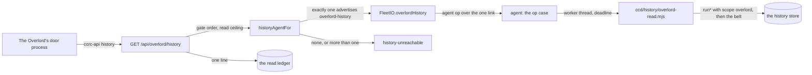

# Overlord W1: the board and the history door Implementation Plan

> **For agentic workers:** REQUIRED SUB-SKILL: Use superpowers:subagent-driven-development (recommended) or
> superpowers:executing-plans to implement this plan task-by-task. Steps use checkbox (`- [ ]`) syntax for tracking.

**Goal:** the designated Overlord can read every project's history and one composed board, and nothing else can.

- **History.** A new read-only agent op runs `ccrc history`'s three read verbs (search, describe and expand) in the
  agent's process, over every project, with a scope word `overlord` that no argv or environment can produce. The agent
  advertises it with the capability word `overlord-history`. The server's `GET /api/overlord/history` sends the op to the
  one connected agent that advertises the word. With none, or more than one, it answers `history-unreachable`, which
  is not an empty result.
- **The board.** `GET /api/overlord/board` composes what existing readers already measure into one answer: the W1
  parts of Table 5.2a, Timers among them. It stores nothing and decides nothing. A part whose reader fails reads
  `unmeasured` with its reason, never empty.

Both doors are the Overlord's reads (Table 11.1e). Each takes the gate order (§11.2), writes one read-ledger line and
sits under a read ceiling.

**Why:** C47 ("It reads everything", R10), H3 (the op goes to an agent chosen by its word, never to "the fleet box"),
H9 (text a session wrote is data, and the history belt masks what leaves the store), H10 (every read leaves a ledger
line) and C10, the board. The Overlord routes from the board (§5.2), and it reads history through readers (§3.3.10).
Without the board it would read a dozen console doors and compose them in its own context. Without the agent op it
could read only its own project's history.

**Architecture:** two pull requests.

- **PR A, the agent op (ready to build now).** All of it is on the fleet side and in L0:
  - a new history module `ccd/history/overlord-read.mjs`, which builds the `overlord` scope and calls the read
    verbs' existing `run*` functions;
  - the agent's op case, which runs that module in a worker thread under a deadline, so the agent's link never waits
    on a synchronous SQLite read;
  - the op's wire in `shared/agent-protocol.ts` and one L0 sibling, `shared/overlordHistory.ts`;
  - the agent-own word `overlord-history` in the `ready` frame's `ops`.

  Nothing on the server sends the op yet, so PR A changes no behaviour.
- **PR B, the doors (after gates B, readiness and portfolio B).**
  - The server's agent choice, `historyAgentFor`, an L1 decider.
  - A `FleetIO` method.
  - The two handlers in `server/src/coord/overlordRoutes.ts`.
  - The board's L1 composer, `composeBoard`, its L3 gatherer, and its wire sibling `shared/overlordBoard.ts`.
  - Two `ccrc-api` verbs, `board` and `history`.

*Figure 1. The history read, from the door to the store. The CLI never reaches `overlord-read.mjs`.*

**Tech Stack:** TypeScript (ESM), Node ESM modules under `ccd/history/`, `node:worker_threads`, vitest. No new dependency.

**Spec:** `docs/superpowers/specs/2026-11-09-overlord-design.md`:

- §3.2, C47: "Every project's history", "How the server routes that read", "Which agent answers", "Everyone else stays
  in their project", "Reads are not acts" and "Every read leaves a ledger line (H10)". "Credential stores stay closed".
- §5.2, C10 and Table 5.2a: the board's parts. Parts and the waves they ship in are question 3.
- §3.3.10, C53: the history store is the episodic memory, read through readers. C44: board reads are ids and
  one-liners.
- Table 11.1c, row "The history door's agent op (scope `overlord`, read-only)"; Table 11.1d, row "The agent's capability
  word `overlord-history`"; Table 11.1e, row "The Overlord's reads".
- §11.2: the Overlord's doors' group, credential and gate order (a read takes no `unwitnessed` step, and no `stale-*`
  step, which bind write doors).
- Table 11.6, `history-unreachable`. Table 11.5b, "The read rate ceilings per door".
- Table 13.1: H3 and H9 are `shape` calls for W1, so their parts ship with this piece: the op chosen by its word (H3)
  and the board's untrusted-text marking (H9). H10 and H28 are `tightening`.

The index is `docs/superpowers/plans/2026-11-14-overlord-w1.md` (#2814, in the merge queue; read from
`origin/ws/overlord-plan-w1` until it lands): its row "Board and history door" (lane D, two PRs, about six tasks), its
questions 20, 22, 25, 29 and 32, lane D's files, "Where lanes meet" (`shared/agent-protocol.ts` and
`agent/src/server.ts`; `overlordRoutes.ts`) and the capability-word table's `overlord-history` row.

## Open questions

Each is a place where the spec is silent or does not match the tree. The plan builds the recommendation unless the
coordinator rules otherwise.

1. **`decideScope` "gains one scope" but must never return it** (slug `overlord-scope-outside-decide-scope`). §3.2 says
   `decideScope` gains `overlord`, and also that the CLI can never produce it. `decideScope`'s inputs are things any
   session of the same user can set.
   **Recommendation:** the read-scope vocabulary gains the word, and `decideScope` does not:
   - `ccd/history/lib.mjs` adds `READ_SCOPE_KINDS`, which is `SCOPE_KINDS` plus `overlord`;
   - `lib.d.mts` adds `ReadScopeKind = ScopeKind | 'overlord'`;
   - `decideScope`'s declared return keeps `ScopeKind`, so the guarantee is a type as well as a test;
   - the scope is built only in `overlord-read.mjs`, which `cli.mjs` never imports.
2. **The read runs in a worker thread, not on the agent's event loop** (slug `history-op-runs-off-the-link-thread`).
   The spec says "in-process". The history store is read through `node:sqlite`'s synchronous `DatabaseSync`, and a
   search over every project can take seconds. On the agent's main thread that would stall every frame on the one link
   to the server, heartbeats and pane tails included.
   **Recommendation:**
   - The op runs `overlord-read.mjs` in a `node:worker_threads` worker inside the agent's process. That is still
     in-process: no shell and no CLI.
   - A deadline terminates the worker and answers `timeout`.
   - At most one read runs at a time. A second answers `busy`.
   - History already runs its regex search in a worker (`ccd/history/regex-worker.mjs`), so this follows a precedent.
3. **Which board parts are W1's** (slug `board-parts-by-wave`). Table 5.2a marks only Engagement as W3, but several
   parts read tables that later waves create.
   **Recommendation:** W1 ships the parts whose inputs exist when PR B lands:
   - Identity, Goals, Work, Portfolio, Capacity, Projects, Brakes and the ladder, Itself, and Timers (index question
     29).
   - W2 adds four parts, because their inputs are W2's: Requests (`overlord_requests`), Unread reports (requests'
     reports, §5.4), Overlaps (H23's composer and `programme_pairs`) and Goal conflicts (`programme_pairs`).
   - W3 adds Engagement and Attention (`response_classes`).
   - Inside a W1 part, a field whose input is a later wave's is absent until that wave: Capacity's
     `portfolioFocus` and `overlordLiveProgrammes` (W5), and the brakes part's armed kinds of answer (W3).

   The wire is additive (question 4), so a later part is a new key and changes nothing a W1 caller reads, as the inbox's
   contract is fixed (Table 11.1e).
4. **What an absent part means** (no overloaded null). Two conditions must not read alike: a part this build does not
   carry, and a part whose reader failed.
   **Recommendation:**
   - Each W1 part is `{ state: 'measured', … }` or `{ state: 'unmeasured', reason }`.
   - A later wave's part is an absent key, read as "not in this build".
   - The board never fails whole because one part's reader failed.
   - It fails whole only on its gates, or when no part at all could be read: then it refuses with the store's
     failure.
5. **The history answer's cause** (no overloaded null). Table 11.6 gives `history-unreachable` one meaning: "no
   connected agent, or more than one, serves the history store". The tree adds three more ways not to get an answer: a
   link that drops mid-read, a deadline, and an agent whose store refuses (absent, unreadable, not yet indexed, the
   server's own box).
   **Recommendation:**
   - **Unreachable.** The door answers `history-unreachable` for the first two of Table 11.6, with a `cause`:
     `no-agent` or `many-agents`. A link that dropped, or a deadline, also reads `history-unreachable`, with
     `link-down` or `timeout`.
   - **The store refused.** That answer is the store's own word, carried as `store-refused` with the history CLI's
     reason. It is not `history-unreachable`: the agent was reached.
   - **The verb refused.** A refusal of the read itself (a bad id, a bad argument, nothing indexed for the target)
     carries history's own refusal word, as the CLI's JSON does.

   The Overlord's skill reads the word. Only `history-unreachable` is a refusal word in Table 11.6, so no word is
   added (the vocabulary piece's group is unchanged).
6. **What the op may read** (slug `overlord-read-targets`). §3.2 says "over every project and every provenance".
   An unscoped search over every family can be large.
   **Recommendation:** the request names one target:
   - `all`;
   - `project:<name>`;
   - `session:<id>` (that id's family, every generation).

   Two flags ride with it: `agents` (subagent transcripts), as the CLI's `--agents` has it, and the verb's own
   arguments. The answer carries the CLI's existing caps on rows and bytes, plus a byte cap on the whole answer
   (Task 2 measures the link's frame limit and sets the cap under it).
7. **`recall-off` and the Overlord's read** (slug `recall-off-is-the-sessions-own`). `cli.mjs`'s
   `readContextIn` refuses a session's own read while `recall-off/<id>` names its generation (W2-D29). That switch
   governs a session's own recall.
   **Recommendation:** the Overlord's read does not consult it, because the read is not that session's recall. The
   coordinator may rule otherwise. Honouring it would be one more check in `overlord-read.mjs` against the target's
   id, and a `session:<id>` read would then refuse the way the CLI does.
8. **Who sets the two read ceilings** (index question 25). The inbox plan measures the console's read rates and
   proposes each ceiling. The board and history doors do not exist yet, so nothing measures them.
   **Recommendation:** this plan adds one row each to the inbox piece's ceiling table, refused with `read-ceiling`
   (index question 32), at starting values the coordinator approves at this plan's review:
   - the board, 120 an hour, because it is the Overlord's routing read and a turn may read it twice;
   - history, 240 an hour, because a reader may run several searches for one question.

   If the inbox piece's table carries values for these doors by then, those govern.
9. **The isolation fact on the board** (index change 2). The index gives "the board's isolation fact" to the isolation
   word piece. Figure W1 does not order that piece before board and history PR B, and the board does not exist
   before PR B.
   **Recommendation:**
   - PR B also needs the isolation word.
   - The board composes `server-isolation` from that piece's reader.
   - The isolation piece's "board's isolation fact" reads as supplying the reader.
10. **Local mode** (slug `local-mode-has-no-history-agent`). Under `CCRC_FLEET=local` (dev) there is no agent link.
    **Recommendation:** local mode's `FleetIO` answers the method `unsupported`, so the door answers
    `history-unreachable`, cause `no-agent`. A later piece may add a local adapter that runs the module in the server's
    process. W1 does not, because the live server runs `remote`.
11. **Who gates the `ccrc-api` verbs on `overlord-v1`.** The index gives "`ccrc-api`'s Overlord verbs follow it" to
    the `overlord-v1` piece.
    **Recommendation:** PR B adds the `board` and `history` rows to `ccd/ccrc-api`'s `ROUTES` with no word check. The
    `overlord-v1` piece adds the check to every Overlord verb at once. Until then the server refuses every caller but
    the designated session (`not-the-overlord`), so a verb without the check reaches nothing.

## What exists today

Measured on `main` at `2d5d4d4ef` (2026-11-15).

**History.**

- `ccd/history/lib.mjs#decideScope` is pure. It takes a data object: `source` (one of
  `lib.mjs#SCOPE_SOURCES`, `tmux` or `env`), the id, the generation, the flags (`project`, `workspace`, `session`,
  `agents`) and the registry presences.
  - **Kinds.** It returns one of `lib.mjs#SCOPE_KINDS`: `family`, `project` or `workspace`.
  - **Refusals.** It refuses `no-identity`, `bad-id`, `bad-args`, `cross-project`, `project-unreadable` and
    `workspace-unreadable`.
  - **The cross-project rule.** `--session <id>` refuses `cross-project` unless the other id's registry project
    equals its own.
  - **Types.** `ccd/history/lib.d.mts` declares `ScopeKind` as those three words, and declares `ScopeVerdict` and
    `decideScope`.
  - **Callers.** Its only callers are `cli.mjs`'s `readContextIn` and `readContextEnv`.
  - **Pins.** `server/test/history-lib.test.ts` (its `decideScope` describe) and `server/test/history-cli.test.ts`
    (the `decideEnvProject` seam and the C50 case) pin it.
- **The read verbs** live in `ccd/history/recall.mjs` as pairs:
  - `runGrep` with `grepVerb` (search);
  - `runDescribe` with `describeVerb`;
  - `runExpand` with `expandVerb`.

  Each `run*` takes a read context `rc`, whose `rc.scope` holds `kind`, `id`, `generation`, `project`, `workdir`,
  `sessionPks`, `transcriptPks`, `families` and `agents`. None takes a scope argument.
- **How `cli.mjs#readContextIn` builds `rc`:**
  1. It refuses on macOS, and where `readRole` answers `server`.
  2. It measures the store with `measureReach` and `lib.mjs#decideCliStore`.
  3. It opens the store with `store.mjs#openReader`.
  4. It checks the journal mode with `lib.mjs#decideStatusRead`.
  5. It decides the scope.
  6. It resolves families with `recall.mjs#familiesOf` and transcripts with `recall.mjs#transcriptsOf`.

  `familiesOf` has a branch for `project` and one for `workspace`, and everything else falls to `ownFamily`. So an
  unknown kind reads one family, not none. Task 1 adds an explicit `overlord` branch before that fall-through.
- **The output belt is applied in `cli.mjs`, not in `run*`.**
  - `cli.mjs#emitResult` applies `lib.mjs#redactFinalJson` (or `redactFinalText`) with the pair index from
    `cli.mjs#pairIndexOf`.
  - `emitRefusal` redacts refusal lines.
  - An in-process caller must apply the belt itself.
- **Exports.** `cli.mjs`'s entry guard keys on `process.argv[1]`, so importing it runs nothing. `measureReach`,
  `readRole` and `pairIndexOf` are exported. `cliFactsOf` and `emitResult` are not.
- `lib.mjs#WRITING_FORMS` lists the writing forms. The op calls none of them.
- **Size.** `ccd/history/lib.mjs` is growth-checked (`server/test/growthCheck.ts#GROWTH_FILES`), at 11,615 lines.
  `recall.mjs` and `cli.mjs` are not growth-checked.
- `recall.mjs` already spawns `regex-worker.mjs` as a worker thread. `server/test/spawnGroupAllowlist.ts` lists it.

**The agent.**

- `agent/src/server.ts#handleReq` switches on `req.op`, and `validateReq` turns raw JSON into a typed `AgentReq`.
  - **Ops today:** `caps`, `exec`, `read`, `readFrom`, `readB64`, `readdir`, `stat`, `lstat`, `writeB64`, `tailOpen`,
    `tailClose`, `ptyOpen`, `update`, `disk`, `pressure`, `backup`, `testbox`, `testbox-tools-sync`, `token-sync`,
    `account` and `testbox-admin`.
  - **No history.** The agent imports nothing from `ccd/history/`.
- **The two capability lists in the `ready` frame:**
  - `ccdVerbs`: the cached `ccd caps`.
  - `ops`: the agent-own words, ten today, built in `handleConnection` from the op constants in
    `shared/agent-protocol.ts`: `UPDATE_OP`, `TOKEN_SYNC_OP`, `ACCOUNT_OP`, `DISK_OP`, `PRESSURE_OP`, `TESTBOX_OP`,
    `TESTBOX_TOOLS_SYNC_OP`, `TESTBOX_ADMIN_OP`, `BACKUP_OP` and `READDIR_MTIMES_OP`.

  Each word must match `shared/api.ts#CAP_WORD`, and the list stays at or under `MAX_CAP_WORDS` (32).
- **Pins of the `ops` list:**
  - `agent/test/testbox-op.test.ts` pins its length (ten; its title says nine, which is stale);
  - `account-op.test.ts`, `token-sync-op.test.ts` and `update-op.test.ts` pin the exact list;
  - `readdir-times.test.ts` pins its last element.
- `agent/tsconfig.json` has `rootDir: ".."`, `allowJs`, and `include` of `src/**/*.ts` and `../shared/**`. It does not
  include `../ccd/**`.
- **The release.** `deploy/build-release.sh` archives `ccd` whole and copies `agent/dist` beside it. So
  `ccd/history/*.mjs` ships in the release tree beside the agent's build.
- **Size.** Neither `agent/src/server.ts` (1,532 lines) nor `shared/agent-protocol.ts` (1,169) is growth-checked.

**The wire and the server's link.**

- `shared/agent-protocol.ts` types each request as an interface (`{t:'req', id, op, …}`) in the `AgentReq` union, and
  each answer as `ResOk` or `ResErr`. `ReadFailure` lives there and is pinned single-definition
  (`server/test/single-definition/vocabularies.test.ts`).
- `FLEET_PROTO` and `FLEET_PROTO_MIN` (both 1) are in `shared/api.ts`. An additive op bumps neither.
- `server/src/remote/client.ts#FleetClient` owns **exactly one** link.
  - `readReadyOps` is the one validator of `ready.ops`, and the answer lands in `FleetState.agentOps`.
  - `ops` is re-read on each `ready`, so on each reconnect.
- **The port.** `server/src/io.ts#FleetIO` is the fleet port. `server/src/remote/io.ts#createIo` is its remote
  adapter, and each op method gates on `agentOps.includes(<op>)` and answers `unsupported` otherwise. So the server
  never sends an op the agent did not name, and an older agent never sees the new one.

**The board's readers.**

| Board part | The existing reader | Ring |
|---|---|---|
| Identity, Work (runs by state) | `server/src/coord/programmesRead.ts#readProgrammes` through `CoordStore.readProgrammes`, whose `ProgrammeRow.waves` counts runs by state; `shared/api.ts#ACTIVE_RUN_STATES` for the active count | L3 |
| Identity (the coordinator's live word) | the watcher's listing, `FleetWatcher.currentFleetListing` (`server/src/watch.ts`), whose sessions carry `shared/api.ts#SessionStatus` (`busy`, `idle`, `dead`); `shell` is the mail gate's reading, `server/src/turnidle.ts#mailTurnIdle` | L4 listing, L1 reading |
| Goals | `server/src/coord/ledgersStore.ts#goalsFor` through `CoordStore.goalsFor` (no clock); `ratifiedBy` arrives with portfolio PR B | L3 |
| Work (open items) | `ledgersStore.ts#itemsFor` through `CoordStore.itemsFor` (takes `now`) | L3 |
| Work (stalls) | `CoordStore.stallObservationsSince`; the stall verdict is `server/src/coord/stall.ts` (L1) | L3 |
| Portfolio | `portfolioFor` (portfolio PR A, not on `main`) | L1 |
| Capacity | `CoordStore.caps`, `CoordStore.capsUsage` (`{running}`, no clock) | L3 |
| Projects | `server/src/lifecycle.ts#listProjects` | L3 |
| Brakes and the ladder | `shared/switches.ts#readSwitches` over the listing (the marker rows); the settings rows through their store reads; the ladder's state through the ladder piece's reader (not on `main`) | L0, L3 |
| Itself | the readiness word (readiness piece), the sandbox check's facts (sandbox PR B), `server-isolation` (isolation word piece); none on `main` | L3 |
| Timers | `CoordStore.pendingTimers`, which delegates to `server/src/continuity/continuityStore.ts#pendingTimers` (`{ok, rows}` or `{ok:false, detail}`, no clock); no count or next-due reader exists | L3 |

*Table 1. Each W1 part's reader. Where a reader lives only inside a route handler (`stallWatchView` in
`coord/routes.ts`, the projects composition in `server.ts`), the board reads the store method under it, not the handler.*

- **Not on `main`:** `server/src/coord/overlordRoutes.ts`, any `/api/overlord` route and the read ledger. Designation
  PR A creates the routes file with every census site; private store PR A creates the read ledger.
- **The censuses a new door in that file meets:**
  - `server/src/auth/gate.ts#EXEMPT` (a `'METHOD /path'` key and one reason);
  - `server/test/auth-gate.test.ts`'s `ROUTES` list (`scanRoutes('coord/overlordRoutes.ts')`, added by designation
    PR A);
  - `server/test/box-token-census.test.ts` (the file's lane source, added by designation PR A);
  - `server/test/secret-mask.test.ts` (it walks every route file; each path is masked or listed in `INLINE`);
  - `server/test/rings/fastify-l4.data.ts` (the file's entry, added by designation PR A);
  - `CLAUDE.md`'s box-token paragraph and the README's auth paragraph.
- **`ccrc-api`.** `ccd/ccrc-api`'s `ROUTES` has 83 rows ("eighty-three rows"), pinned by `server/test/ccrc-api.test.ts`
  (`toHaveLength(83)` and `WORDS`). `ccd/ccrc-api` is not growth-checked.
- **Sizes.** `server/src/server.ts` (4,426 lines), `server/src/coord/routes.ts` (4,930) and `shared/api.ts` (14,566)
  are growth-checked. This piece edits none of them.

## Global Constraints

- **SAFETY (`CLAUDE.md`).**
  - **Read only.** The op reads, and it calls no form in `lib.mjs#WRITING_FORMS`. It opens the store with
    `store.mjs#openReader` only.
  - **No ccd verb and no fleet act.**
  - **Fixture homes only.** Every test runs against a fixture HOME with a fixture store under the per-run temp root,
    never the live `~/.ccrc/history`.
- **The scope cannot be produced from outside.**
  - `overlord` is never an output of `decideScope`, by type (`ScopeKind` unchanged) and by test (Task 1).
  - `cli.mjs` never imports `overlord-read.mjs`, which a source pin holds.
  - No argv parser table or environment name spells `overlord`.
  - The op is the module's only caller.
- **Everyone else stays in their project.** No existing refusal changes. `history-lib.test.ts` and
  `history-cli.test.ts` stay green untouched, `cross-project` included.
- **The belt.** Every answer the op sends, rows and refusals alike, has passed `lib.mjs#redactFinalJson` with the
  store's pair index, as `cli.mjs#emitResult` does. The server adds no second masker of its own, but its route stays
  in the masker's census (`secret-mask.test.ts`).
- **Credential stores stay closed.** The module reads only the history store's paths (`lib.mjs#historyPaths`). It reads
  nothing under `~/.cc-secrets`, `~/.ccrc/auth-scratch`, `~/.ccrc/operator-secrets` or the box token.
- **Wire discipline.**
  - Additive only, with no `FLEET_PROTO` bump.
  - One reader per field: the agent's `validateReq` arm and the server's answer reader each call
    `shared/overlordHistory.ts`'s one validator.
  - An older agent never advertises the word, so the server never sends it the op.
  - An older server never sends the op. A newer agent's extra word is one more `CAP_WORD` in the list, under the cap.
- **Rings.**
  - `shared/overlordHistory.ts` and `shared/overlordBoard.ts` import nothing (L0).
  - `historyAgentFor` and `composeBoard` are L1 and import no store, no `fs` and no fastify.
  - The board's gatherer is L3, with its store, io and clock injected.
  - The handlers are L4 and decide nothing.
  - L1 never imports L4.
  - Every exported literal union gets its sibling map, which `server/test/rings/wire-totality.test.ts` checks.
- **One writer each.** The board writes nothing. History writes nothing. The read-ledger line is written by the private
  store's one read-ledger writer, which each door calls with its door name, scope, count and generation. The ceiling is
  the inbox piece's.
- **Growth.** Each pull request keeps each growth-checked file within the 40-line check on `main`, with no waiver
  (The PR split, below). PR A grows `ccd/history/lib.mjs` by about six lines. PR B touches no growth-checked file.
- **Mutation floors.** `historyAgentFor`, the request validator, `composeBoard` and `timersByProgramme` each join
  `MUTANT_SETS` (`server/test/sim/mutation-floors.test.ts`) and `server/test/sim/mutation-floors.json` in the pull
  request that creates them (Tasks 2, 4, 5).
- **Tests.**
  - Server tests run from `server/`, agent tests from `agent/`, as
    `ccrc test -- ./node_modules/.bin/vitest run test/<file>.test.ts`.
  - Each task's last run adds the `tsc` runs of every package it touched (`server`, `agent`, and `pwa` whenever a
    `shared/` file changes, because the PWA bundles `shared/`).
- **Source pins** over new files read them through `server/test/scan/symbols.ts`' `parsedFile`, never `readFileSync`
  and a string method (the ARCH-06 ratchet).
- **Public repository.**
  - No private names: fixtures use `project-a`, `project-b` and `lane-a-project-a`.
  - Cite by symbol or `@anchor`.
  - No D-number is invented: the slugs are under "Deviations found", and the coordinator mints numbers.

## Review Focus

1. **`overlord` is unreachable from the CLI.**
   - Read Task 1's tests: the enumeration over `decideScope`'s inputs and the import pin over `cli.mjs`.
   - Check that `ScopeKind` is unchanged in `lib.d.mts` and that `READ_SCOPE_KINDS` is not passed to `decideScope`.
2. **The op only reads, and only through the belt.**
   - Every return path in `overlord-read.mjs` passes `redactFinalJson`.
   - The store is opened with `openReader`.
   - No writing form is imported.
3. **The link never waits on a read.** The worker thread, its deadline, its single slot and its cleanup on the link's
   close (Task 2).
4. **The agent choice is a decider.**
   - `historyAgentFor` answers `no-agent` for zero advertisers and `many-agents` for two or more.
   - The handler never picks.
   - An older agent, which does not advertise, reads as absent.
5. **The board decides nothing.**
   - `composeBoard` maps reader answers to parts.
   - It ranks nothing, filters nothing beyond the programme grouping, and computes no verdict that a reader did not
     already compute.
   - Untrusted text is marked (H9).
   - A failed reader yields `unmeasured`, never an empty part.
6. **Every census moved with its door.** The two routes in `EXEMPT`, the masker's census, the box-token census, the
   read ceiling table, `CLAUDE.md`'s box-token paragraph, `ccrc-api`'s count and every `ops` pin.

## The PR split

| PR | Tasks | What it ships | Needs first | Growth-checked files, estimate |
|---|---|---|---|---|
| A | 1, 2, 3 | The `overlord` read scope and `overlord-read.mjs`; the op's wire, the agent's op case in a worker thread; the word `overlord-history` in `ready.ops`. Nothing sends the op | nothing: **ready to build** | `ccd/history/lib.mjs` +6 |
| B | 4, 5, 6 | `historyAgentFor`, `FleetIO.overlordHistory`, `GET /api/overlord/history`; `composeBoard`, its gatherer, `GET /api/overlord/board`; the `board` and `history` verbs of `ccrc-api` | PR A; gates B; readiness; portfolio B; the isolation word (question 9). Transitively designation A (the routes file), private store A (the read ledger) and the inbox (the ceiling table) | none |

For scale, the files that are not growth-checked change by about:

| File | PR | Change |
|---|---|---|
| `ccd/history/overlord-read.mjs` | A | +220, new |
| `ccd/history/overlord-read.d.mts` | A | +30, new |
| `ccd/history/recall.mjs` | A | +12 (`familiesOf`'s `overlord` branch) |
| `ccd/history/cli.mjs` | A | +1 (export `cliFactsOf`) |
| `shared/overlordHistory.ts` | A | +110, new |
| `shared/agent-protocol.ts` | A | +25 |
| `agent/src/historyOp.ts`, `agent/src/historyWorker.ts` | A | +140, new |
| `agent/src/server.ts` | A | +20 |
| `server/src/coord/overlordHistory.ts` | B | +60, new |
| `server/src/io.ts`, `server/src/remote/io.ts` | B | +25 |
| `shared/overlordBoard.ts` | B | +160, new |
| `server/src/coord/overlordBoard.ts` | B | +180, new |
| `server/src/coord/overlordBoardRead.ts` | B | +140, new |
| `server/src/coord/overlordRoutes.ts` | B | +90 |
| `ccd/ccrc-api` | B | +3 |

The board and the history door share PR B because both are the Overlord's reads in one routes file with one set of
census edits. If PR B grows past one review, the board (Task 5) splits into PR B2, after Task 4's PR B1. No
growth-checked file forces the split.

## Index changes

The index (#2814) should carry these:

1. The "Board and history door" row's PR B also needs the **isolation word**, and Figure W1 gains the edge
   `ISO --> HB` (question 9). The isolation row's "the board's isolation fact" reads as supplying the reader that board
   PR B composes.
2. The row names the board's W1 parts (question 3): Identity, Goals, Work, Portfolio, Capacity, Projects, Brakes and the
   ladder, Itself and Timers. W2 adds Requests, Unread reports, Overlaps and Goal conflicts, and W3 adds Engagement and
   Attention.
3. Lane D's file list adds `ccd/history/overlord-read.mjs` (with its `.d.mts`), `ccd/history/recall.mjs`'s `familiesOf`,
   `agent/src/historyOp.ts` and `agent/src/historyWorker.ts`, `shared/overlordHistory.ts`, `shared/overlordBoard.ts`,
   `server/src/coord/overlordHistory.ts`, `overlordBoard.ts` and `overlordBoardRead.ts`, and one method on
   `server/src/io.ts#FleetIO` with its remote and local adapters.
4. "Where lanes meet" adds `ccd/ccrc-api`'s `ROUTES` (two rows, `board` and `history`), and the inbox piece's read-ceiling
   table (two rows, question 8).
5. The capability-word table's `overlord-history` row adds: "a link that drops, or a deadline, also answers
   `history-unreachable`, with its `cause`" (question 5).

---

### Task 1: The `overlord` read scope, unreachable from the CLI

**Files:**
- Modify: `ccd/history/lib.mjs`: `READ_SCOPE_KINDS` beside `SCOPE_KINDS`. `headerLine`'s check reads
  `READ_SCOPE_KINDS`, so a JSON header can name `overlord`. `decideScope` is untouched.
- Modify: `ccd/history/lib.d.mts`: `ReadScopeKind`. The `rc.scope` kind and the header kind take `ReadScopeKind`.
  `ScopeVerdict` and `decideScope` keep `ScopeKind`.
- Modify: `ccd/history/recall.mjs`: `familiesOf` gains an explicit `overlord` branch, before the fall-through to
  `ownFamily`. It takes the target (question 6): `all` reads every family; `project:<name>` reads that project's
  families with the existing `PROJECT_FAMILIES_SQL`; `session:<id>` reads that id's families, every generation.
- Test: `server/test/history-overlord-scope.test.ts` (new).

Cases, written first and red:

- **Unreachable, by enumeration.** `decideScope` over the product of every `SCOPE_SOURCES` word plus an unknown
  source, every flag combination (`project`, `workspace`, `agents` on and off; `session` absent, own id, another id,
  a malformed id) and every registry presence state for `project`, `workdir` and `sessionProject` (`value`, `absent`,
  `unreadable`, `malformed`, and a value naming `overlord` itself). For every input, the verdict's `kind` is never
  `overlord`, and it is a member of `SCOPE_KINDS`.
- **Unreachable, by the environment and argv.**
  - `cli.mjs`'s argument table has no option that names `overlord` or a scope.
  - Run with fixture HOME and every recall variable (`CCRC_RECALL_SESSION`, `CCRC_RECALL_ARM`, `CCRC_RECALL_ASOF`),
    each set to `overlord`, and with `--session overlord`, the CLI never answers a header with kind `overlord`. It
    refuses as today.
- **The import pin.** Through `parsedFile`, `cli.mjs`'s imports and every module they reach inside `ccd/history/` do not
  include `overlord-read.mjs`. Only `agent/src/historyWorker.ts` names it.
- **`familiesOf`'s `overlord` branch.** A fixture store holds families in `project-a` and `project-b`:
  - `all` returns both projects' families;
  - `project:project-b` returns only `project-b`'s;
  - `session:lane-a-project-a` returns that id's families across generations.

  A `family` selection still returns `ownFamily`'s answer, unchanged.
- **The unknown kind stays narrow.** A selection with an unknown kind still falls to `ownFamily`, as today. This
  characterizes the fall-through, which Task 1 does not change.

- [ ] **Step 1: Write** the cases. Run them: the enumeration passes (the guarantee already holds on `main`), and the
  `familiesOf` and header cases are red.
- [ ] **Step 2: Bite check** on the enumeration, with the coordinator skill's `references/mutation-run.py`. A mutant
  that makes `decideScope` return `overlord` for `source: 'env'` with `--session` set must red the enumeration. Record
  the table for the pull request body.
- [ ] **Step 3: Implement** the three edits.
- [ ] **Step 4: Run** the new file, `history-lib.test.ts`, `history-cli.test.ts`, `history-recall.test.ts` and
  `growth-check.test.ts`. All green, the old suites untouched.
- [ ] **Step 5: Commit.** `feat(history): the overlord read scope, outside decideScope and unreachable from the CLI (Overlord W1)`

### Task 2: The read module and the agent's op

**Files:**
- Create: `shared/overlordHistory.ts` (K, L0, imports nothing):
  - `HISTORY_VERB_MAP` and `HISTORY_VERBS` (`search`, `describe`, `expand`);
  - the target grammar (question 6);
  - the request type and the answer type, `OverlordHistoryAnswer`, which is the rows, a store refusal or a verb
    refusal (question 5);
  - one validator, `readOverlordHistoryRequest(raw)`, that answers the typed request or the reason it refused;
  - `OVERLORD_HISTORY_ANSWER_MAX_BYTES`.
- Create: `ccd/history/overlord-read.mjs` and `ccd/history/overlord-read.d.mts`. Its one export,
  `overlordRead(home, request, nowMs)`, measures the store as `readContextIn` does:
  1. `readRole`, `measureReach`, `cliFactsOf` and `decideCliStore`;
  2. `openReader`;
  3. `decideStatusRead`;
  4. the `overlord` scope from the target, with `familiesOf` and `transcriptsOf`;
  5. the verb's `run*` function (`runGrep`, `runDescribe` or `runExpand`) with that read context.

  It applies `redactFinalJson` with `pairIndexOf` to every answer, refusals included. It closes the store on every
  path. It imports nothing from `WRITING_FORMS`'s writers.
- Modify: `ccd/history/cli.mjs`: export `cliFactsOf` (one word; no move).
- Modify: `shared/agent-protocol.ts`:
  - `OVERLORD_HISTORY_OP = 'overlord-history'`;
  - `OverlordHistoryReq` in the `AgentReq` union.
- Create: `agent/src/historyOp.ts`:
  - **The resolver.** It finds the module's path in the shipped tree from the agent's own location. The resolver is
    injected in tests.
  - **The slot.** It holds one slot.
  - **The worker.** It launches `historyWorker.ts`'s compiled file in a worker, and terminates it at the deadline. It
    also terminates it when the link closes.
  - **The answer.** It answers the module's result, or `timeout`, `busy` or `store-refused` with the reason.
  - **The cap.** An answer over `OVERLORD_HISTORY_ANSWER_MAX_BYTES` answers `too-large`, with its measured size.
- Create: `agent/src/historyWorker.ts`, the worker's entry. It imports the module by the path it is given, calls
  `overlordRead`, and posts the answer.
- Modify: `agent/src/server.ts`:
  - `validateReq`'s arm calls `readOverlordHistoryRequest`;
  - `handleReq`'s case calls `historyOp`.
- Test: `agent/test/overlord-history-op.test.ts` (new); `server/test/overlord-read.test.ts` (new).

Cases, written first and red:

- **The validator.**
  - Each verb with valid arguments is accepted.
  - Each of these is refused, with its reason: a verb off the list, a target off the grammar, an empty project, a
    malformed session id, an argument of the wrong type, an unknown key and an oversize argument.
  - The validator is the one reader: the agent and the server import it, and no second parser exists (a
    single-definition scan in `server/test/single-definition/`).
- **The module, on a fixture store** (`server/test/overlord-read.test.ts`):
  - **Across projects.** A search finds text in `project-a` and in `project-b` with target `all`. The same search from
    the CLI inside `project-a` finds only `project-a`'s.
  - **Describe and expand.** `describe` and `expand` of a node in `project-b` answer as the CLI's JSON does for its
    own project.
  - **The belt.** A fixture transcript holds a secret-shaped token (built in the test from fragments, so the tree
    holds no literal). The answer carries the belt's mask, never the token, in rows and in a refusal's text.
  - **Store refusals.** A store that is absent, one that is unreadable, a server-role home and an unindexed target
    each answer their own word, distinct from one another.
  - **Nothing written.** The store's bytes and mtime are unchanged after every case.
- **The op** (`agent/test/overlord-history-op.test.ts`, with the resolver and the module stubbed where named):
  - **A good read.** It answers the module's rows.
  - **Not on the main thread.** A module that blocks for longer than the deadline answers `timeout`. The agent answers
    a `caps` request while it runs, which proves the main thread is free. The worker is gone afterwards.
  - **One slot.** A second request while one runs answers `busy`.
  - **The link closes.** Closing the link mid-read terminates the worker.
  - **Too large.** An answer over the cap answers `too-large`, with its size.
  - **A malformed request.** It is refused by `validateReq`, as `agent/test/malformed.test.ts` refuses others. That
    file gains the op's rows.

- [ ] **Step 1: Measure.**
  - Where the agent's compiled file sits relative to `ccd/history/` in the release tree (`deploy/build-release.sh`, and
    `ccd/ccrc`'s install). The resolver encodes that one relation, and a test over the release layout
    (`build-release.test.ts`) pins it.
  - The link's frame limit, if any (`server/src/remote/client.ts`, the agent's socket options). Set
    `OVERLORD_HISTORY_ANSWER_MAX_BYTES` under it, and say the measured figure in the pull request.
  - The read deadline: measure a search over the largest fixture store this suite builds. Set the deadline as a
    constant in `historyOp.ts`, a starting value, 20 s. The server's request timeout (Task 4) is above it.
  - Whether `server/test/spawnGroupAllowlist.ts` covers `agent/src`. If it does, the new worker spawn gets its row.
- [ ] **Step 2: Write** the cases. Run them: red.
- [ ] **Step 3: Implement** the validator, the module, the wire, the op and its worker.
- [ ] **Step 4: Mutation floors.** `readOverlordHistoryRequest` joins `MUTANT_SETS` with its floor. The set has at least
  three mutants: drop the verb check, accept an unknown key, and swap the target grammar's `project` and `session`
  arms. If `MUTANT_SETS` takes only `server/src` paths, measure that first and record the `mutation-run.py` table in
  the pull request body instead, and say so.
- [ ] **Step 5: Run** both new files, `malformed.test.ts`, `history-*.test.ts`, and both packages' `tsc`; then
  `pwa`'s `tsc`, because `shared/` changed.
- [ ] **Step 6: Commit.** `feat(agent): the overlord-history op, history's read verbs over every project in a worker thread (Overlord W1)`

### Task 3: The word `overlord-history`

**Files:**
- Modify: `agent/src/server.ts`: `handleConnection`'s `ready` frame appends `OVERLORD_HISTORY_OP` to `ops`, but only
  when the resolver of Task 2 finds the module in the tree at boot. An agent that cannot load it does not advertise.
- Modify: `agent/test/testbox-op.test.ts` (length 11, and its stale title), `account-op.test.ts`,
  `token-sync-op.test.ts`, `update-op.test.ts` (the exact list) and `readdir-times.test.ts` (the word goes last, so
  that pin moves to the eleventh place).
- Modify: `server/test/remote-connect.test.ts`, only if it pins the agent's list.
- Test: `agent/test/overlord-history-op.test.ts` (extended).

Cases, written first and red:

- **Advertised.** With the module present, `ready.ops` carries `overlord-history`, which passes `CAP_WORD`.
- **Not advertised.** With the resolver answering absent, the word is not in `ready.ops`, and the other ten are
  unchanged.
- **The server reads it.** `readReadyOps` keeps the word, so `FleetState.agentOps` includes it. A server built from
  `main` reads the eleven-word list unchanged, which proves the change is additive.

- [ ] **Step 1: Write** the cases. Run them: red.
- [ ] **Step 2: Implement.** Update the five pins.
- [ ] **Step 3: Run** the agent suite's op files and `remote-connect.test.ts`; both `tsc`.
- [ ] **Step 4: Commit.** `feat(agent): advertise overlord-history when the history read module ships (Overlord W1)`

PR A ends here. Its body says that nothing sends the op yet, and that the word's absence is harmless to an older
server.

### Task 4: The history door

**Files:**
- Create: `server/src/coord/overlordHistory.ts` (C5, L1):
  - `historyAgentFor(links)` takes the list of connected links with their `agentOps`. It answers the one link that
    advertises `overlord-history`, or `no-agent`, or `many-agents`.
  - Today the list has at most one link (`FleetClient`). The decider is total over the list, so a multi-agent server
    (#275) changes its caller, not its rule.
  - It also holds the answer's mapping from the port's outcome to the door's answer (question 5).
- Modify: `server/src/io.ts#FleetIO`: one method, `overlordHistory(req)`. Its failure contract is
  `unsupported` (the agent did not advertise), `link-down`, `timeout`, or the agent's typed answer.
  - `server/src/remote/io.ts#createIo` gates on `agentOps.includes(OVERLORD_HISTORY_OP)`.
  - The local adapter answers `unsupported` (question 10).
  - Every test fake of `FleetIO` gains the method; `tsc` names each one.
- Modify: `server/src/coord/overlordRoutes.ts`: `GET /api/overlord/history`.
  - **Gates.** Gates B's decider runs §11.2's gate order for a read: steps 1 to 4, 6, 8 and 9. A read takes no
    `unwitnessed`, `stale-designation` or `stale-generation` step, which bind write doors. It has no act kind, so step
    10's rung by act kind and step 11's `overlordMayAct` do not apply ("Reads are not acts", §3.2). Step 2 names
    `overlord-v1`, so both doors refuse `capability-missing` until the `overlord-v1` piece lands; the tests write the
    word into a fixture capability file. Then the read ceiling.
  - **The read.** It reads the query through `readOverlordHistoryRequest`, then the agent's answer through the same
    validator's answer reader.
  - **The ledger.** It calls the read ledger's writer with door `history`, the target as its scope, the row count and
    the generation, on every read that passed the gates, whatever the agent answered. A read refused at the gates
    reads nothing and writes no line from this door.
  - **Deciding nothing.** The handler picks no agent and maps no outcome itself.
- Modify (censuses):
  - `server/src/auth/gate.ts#EXEMPT`: `GET /api/overlord/history`, with its reason ("the Overlord's read; the box token
    and attribution, then the gate order").
  - `server/test/box-token-census.test.ts`: the door is in the routes file's lanes.
  - `server/test/secret-mask.test.ts`: the path is listed as answered through the history belt, in `INLINE` with that
    reason.
  - The inbox piece's read-ceiling table: one row (question 8).
  - `CLAUDE.md`'s box-token paragraph and the README's auth paragraph name the door.
  - `server/test/sim/mutation-floors.test.ts` and `mutation-floors.json`.
- Test: `server/test/overlord-history-door.test.ts` (new).

Cases, written first and red:

- **`historyAgentFor`.** Zero links gives `no-agent`. One link without the word gives `no-agent`. One with it gives that
  link. Two with it give `many-agents`. Two where one has it give that one.
- **The door, through a fake `FleetIO`:**
  - **Rows.** A good answer passes through.
  - **Unreachable.** `unsupported` gives `history-unreachable` with cause `no-agent`; `link-down` and `timeout` give
    `history-unreachable` with their cause.
  - **The store refused.** The answer carries `store-refused` and its reason, and is not `history-unreachable`.
  - **The verb refused.** The answer carries history's word.
- **The gates.**
  - A caller that is not the designated session gets `not-the-overlord`, before any agent is asked: the fake records no
    call.
  - `card-unread`, `renewing` and `overlord-off` each refuse before the agent is asked.
  - A read past the ceiling gets `read-ceiling`.
- **The ledger.** Each read past the gates writes one ledger line, with door, scope, count and generation, whatever
  the agent answered. A read refused at the gates writes none.
- **Additive.** A server whose agent is built from `main` (no word) answers `history-unreachable`, cause `no-agent`,
  and sends no op.

- [ ] **Step 1: Write** the cases. Run them: red.
- [ ] **Step 2: Implement** the decider, the port method and its adapters, and the handler.
- [ ] **Step 3: Mutation floors.** `historyAgentFor` joins `MUTANT_SETS` with at least three mutants: answer the first
  advertiser when there are two, treat a link without the word as an advertiser, and map `timeout` to rows.
- [ ] **Step 4: Run** the new file, `auth-gate.test.ts`, `box-token-census.test.ts`, `secret-mask.test.ts`,
  `mutation-floors.test.ts`, the rings suites (`server/test/rings/`), and `tsc` for `server` and `pwa`.
- [ ] **Step 5: Commit.** `feat(overlord): GET /api/overlord/history, one advertising agent or history-unreachable (Overlord W1)`

### Task 5: The board

**Files:**
- Create: `shared/overlordBoard.ts` (K, L0, imports nothing):
  - `BOARD_PART_MAP` and `BOARD_PARTS`, the W1 parts (question 3);
  - each part's type, as measured or unmeasured (question 4);
  - `UntrustedText`, a branded record that carries text a session wrote, with its source.
- Create: `server/src/coord/overlordBoard.ts` (C5, L1). It imports `shared/` only.
  - **`composeBoard(inputs)`** maps each reader's answer to its part. It groups per programme by the programme slug
    the readers already carry. It marks as `UntrustedText` every goal text whose version has no `ratifiedBy`, every
    programme title, every session name and every branch name (H9). A reader's failure becomes that part's
    `unmeasured`, with the reader's own reason.
  - **`timersByProgramme(rows, coordinators)`** counts each coordinator's pending timers and finds the earliest
    `dueAt`, per programme. It reads no note: the part carries counts and times only (§3.3.12).
- Create: `server/src/coord/overlordBoardRead.ts` (C5, L3), the gatherer. It calls Table 1's readers through an
  injected `CoordStore` subset, the watcher's listing, `FleetIO` (for `listProjects`), and the readiness, sandbox,
  ladder, isolation and portfolio readers, with an injected clock. Each reader is called once, inside its own
  try. A throw becomes that input's failure, never the board's.
- Modify: `server/src/coord/overlordRoutes.ts`: `GET /api/overlord/board`. It runs the same gates and ceiling as Task 4,
  calls the gatherer, then `composeBoard`, and writes one ledger line (door `board`, scope `fleet`, the count of
  programmes, the generation).
- Modify: `server/src/coord/ports.ts`, only if the gatherer's store subset is declared there; name the members.
- Modify (censuses), as in Task 4, for `GET /api/overlord/board`:
  - `EXEMPT`;
  - the box-token census;
  - `secret-mask.test.ts`: the board answers through the server's masker (`answerMasked`), because it carries
    session text;
  - the ceiling row;
  - `CLAUDE.md` and the README;
  - `MUTANT_SETS` and the floors.
- Test: `server/test/overlord-board.test.ts` (new), `server/test/overlord-board-door.test.ts` (new).

Cases, written first and red:

- **`composeBoard`, from literal reader answers:**
  - **Every part.** Each W1 part is present and measured. No later wave's part is present.
  - **Grouping.** Two programmes' runs, items, stalls and timers land under their own slugs.
  - **The active count.** It counts exactly the runs in `ACTIVE_RUN_STATES`.
  - **Untrusted text (H9).** A goal version without `ratifiedBy` is marked untrusted. A ratified version is not. A
    programme title, a session name and a branch name are always marked.
  - **A failed reader.** It gives that part `unmeasured` with the reader's reason, and every other part is measured.
  - **No verdicts.** The composer adds no field that is not in its inputs. A test lists each part's fields against its
    reader's fields.
- **`timersByProgramme`:**
  - Three timers of one coordinator give a count of three and the earliest due time.
  - A timer whose setter is no programme's coordinator is in no programme.
  - A timer's note is never in the output.
- **The gatherer:**
  - A store method that throws gives that input's failure, and the board still answers.
  - Each reader is called once per board read.
- **The door:**
  - The gates, as in Task 4.
  - One ledger line per read past the gates.
  - `read-ceiling` past the ceiling.
  - The answer passes the masker: a session name holding a secret-shaped fragment is masked.
- **Ids and one-liners (C44).** No part carries a mail body, a note, a goal's full text past "In short" and
  `doneWhen`, or a transcript line. A test bounds the answer's size for a fixture of 50 programmes.

- [ ] **Step 1: Measure.**
  - The live word: which reader answers `idle`, `busy`, `shell` and `dead` for one session. If no one reader answers
    all four, the board carries `SessionStatus` and the mail gate's `shell` reading side by side, and composes no new
    word. Say which in the pull request.
  - The readers that portfolio B, readiness, sandbox B, the ladder and the isolation word export, by their merged
    names.
- [ ] **Step 2: Write** the cases. Run them: red.
- [ ] **Step 3: Implement** the wire, the composer, the gatherer and the handler.
- [ ] **Step 4: Mutation floors.** `composeBoard` joins `MUTANT_SETS` with at least four mutants: drop the untrusted mark
  on an unratified goal, read a failed reader as an empty part, count `awaiting-review` as active, and put a timer's
  note in the part. `timersByProgramme` gets at least two: take the latest due time, and count another coordinator's
  timer.
- [ ] **Step 5: Run** both new files, the census suites, `mutation-floors.test.ts`, the rings suites, and `tsc` for
  `server` and `pwa`.
- [ ] **Step 6: Commit.** `feat(overlord): GET /api/overlord/board, composed from existing readers, deciding nothing (Overlord W1)`

### Task 6: The `ccrc-api` verbs

**Files:**
- Modify: `ccd/ccrc-api`:
  - `ROUTES` gains two rows, `board` (`GET|/api/overlord/board|yes|`) and `history`
    (`GET|/api/overlord/history|yes|verb,target,agents,…`), with the query keys the validator accepts;
  - the count word becomes "eighty-five rows".
- Modify: `server/test/ccrc-api.test.ts`: `toHaveLength(85)` and `WORDS`' 84 and 85.
- Test: `server/test/ccrc-api.test.ts` (extended).

Cases, written first and red:

- Each verb sends its route with attribution, through a fixture server.
- `history` refuses a query key the validator does not accept, locally, before it sends.
- No other route changes.

- [ ] **Step 1: Write** the cases. Run them: red.
- [ ] **Step 2: Implement.**
- [ ] **Step 3: Run** `ccrc-api.test.ts` and `ccrc-api-closed.test.ts`.
- [ ] **Step 4: Commit.** `feat(ccrc-api): the board and history verbs (Overlord W1)`

The door process (lane B) serves each verb as one tool, named by the skill's rule. The `overlord-v1` piece gates both
verbs with the others (question 11).

## Deviations found

Each entry is a departure from the spec's text that this plan makes, by slug. The coordinator mints numbers.

- **`overlord-scope-outside-decide-scope`**: §3.2 says `decideScope` gains the `overlord` scope. The read-scope
  vocabulary gains it, and `decideScope`'s return type does not, so the CLI cannot produce it by type as well as by
  test (question 1).
- **`history-op-runs-off-the-link-thread`**: §3.2 says the op calls history's read functions "in-process". It does,
  but in a worker thread of the agent's process, under a deadline and one slot, because the store's reads are
  synchronous and the agent has one link (question 2).
- **`board-parts-by-wave`**: Table 5.2a marks only Engagement as later. Requests, Unread reports, Overlaps and Goal
  conflicts are W2's, and Attention is W3's, because their inputs are (question 3).
- **`history-unreachable-carries-a-cause`**: Table 11.6 gives `history-unreachable` two causes. The door adds
  `link-down` and `timeout` as causes of the same word. A store's or a verb's refusal is not that word (question 5).
- **`overlord-read-targets`**: §3.2 says "every project". The request names `all`, one project or one session's
  family (question 6).
- **`recall-off-is-the-sessions-own`**: the spec is silent. The Overlord's read does not consult a session's
  `recall-off` marker (question 7).
- **`local-mode-has-no-history-agent`**: the spec is silent on local mode. It answers `history-unreachable`
  (question 10).

## Where things stand

**Agreed:**
- Two pull requests: PR A, the agent op, ready to build now; PR B, the doors, after gates B, readiness, portfolio B and
  the isolation word.
- Six tasks. No growth-checked file grows past its check: PR A adds about six lines to `ccd/history/lib.mjs`, and PR B
  touches none.
- The door reads and never writes. No writing form of `ccrc history` is reachable from it.

**Waiting on the coordinator:**
- Questions 1 to 11, each with a recommendation the plan builds.
- The starting read ceilings for the two doors (question 8).
- The index changes above, for the index's next revision.

**Later:**
- W2 adds the board's Requests, Unread reports, Overlaps and Goal conflicts parts. W3 adds Engagement and Attention.
- A multi-agent server (#275) passes every link to `historyAgentFor`, with no rule change.
- A local adapter for `FleetIO.overlordHistory`, if a dev box ever needs the Overlord's history (question 10).
