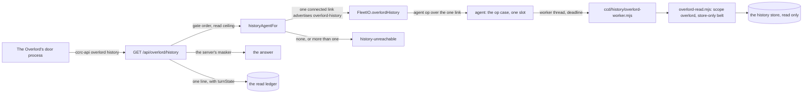

# Overlord W1: the board and the history door Implementation Plan

> **For agentic workers:** REQUIRED SUB-SKILL: Use superpowers:subagent-driven-development (recommended) or
> superpowers:executing-plans to implement this plan task-by-task. Steps use checkbox (`- [ ]`) syntax for tracking.

**Goal:** the designated Overlord can read every project's history and one composed board, through its doors.

- **History.** A new read-only agent op runs `ccrc history`'s three read verbs (search, describe and expand) in the
  agent's process, over every project, with a scope word `overlord` that no argv or environment can produce. The agent
  advertises it with the capability word `overlord-history`. The server's `GET /api/overlord/history` sends the op to the
  one connected agent that advertises the word. With none, or more than one, it answers `history-unreachable`, which
  is not an empty result.
- **The board.** `GET /api/overlord/board` composes what existing readers already measure into one answer: the W1
  parts of Table 5.2a, Timers among them. It stores nothing and decides nothing. A part whose reader fails reads
  `unmeasured` with its reason, never empty.

Both doors are the Overlord's reads (Table 11.1e). Each takes the gate order (§11.2), writes one read-ledger line and
sits under a read ceiling.

**What this does not stop (the residual, ruled F24).** Identity on the fleet is attribution, not authentication. A
process of the same UNIX user can open the history store read-only, or import the read module with `node`, without
any door. The CLI cannot produce the `overlord` scope, and the server's doors refuse every caller but the designated
session. Neither is an OS wall, and no hook speed bump is added (the coordinator's ruling).

**Why:**
- **C47** ("It reads everything", R10).
- **H3:** the op goes to an agent chosen by its word, never to "the fleet box".
- **H9:** text a session wrote is data, and two maskers stand between the store and the Overlord.
- **H10:** every read leaves a ledger line.
- **C10:** the board.

The Overlord routes from the board (§5.2), and it reads history through readers (§3.3.10). Without the board it would
read a dozen console doors and compose them in its own context. Without the agent op it could read only its own
project's history.

**Architecture:** three pull requests.

- **PR A, the agent op (ready to build now).** All of it is on the fleet side and in L0:
  - a move: the store-measuring helpers leave `ccd/history/cli.mjs` for a new module with no side effects,
    `ccd/history/read-context.mjs`, which `cli.mjs` re-imports;
  - a new read module `ccd/history/overlord-read.mjs`, which builds the `overlord` scope, calls the read verbs'
    existing `run*` functions and masks with a store-only belt;
  - a plain-JavaScript worker entry `ccd/history/overlord-worker.mjs`, which the agent runs as a worker thread, so the
    agent's link never waits on a synchronous SQLite read;
  - the op's wire in `shared/agent-protocol.ts` and one L0 sibling, `shared/overlordHistory.ts`;
  - the agent-own word `overlord-history` in the `ready` frame's `ops`.

  Nothing on the server sends the op yet, so PR A changes no behaviour.
- **PR B1, the history door (after PR A, gates B and the inbox).**
  - `historyAgentFor`, an L1 decider.
  - A `FleetIO` method.
  - The handler in `server/src/coord/overlordRoutes.ts`.
  - The `ccrc-api` verb `overlord.history`.
- **PR B2, the board (after B1, readiness, portfolio B and the isolation word).**
  - The board's L1 composer, `composeBoard`.
  - Its L3 gatherer.
  - Its wire sibling `shared/overlordBoard.ts`.
  - Its handler.
  - The `ccrc-api` verb `overlord.board`.

*Figure 1. The history read, from the door to the store. The CLI never reaches `overlord-read.mjs`.*

**Tech Stack:** TypeScript (ESM), Node ESM modules under `ccd/history/`, `node:worker_threads`, vitest. No new dependency.

**Spec:** `docs/superpowers/specs/2026-11-09-overlord-design.md`:

- §3.2, C47:
  - "Every project's history";
  - "How the server routes that read";
  - "Which agent answers";
  - "Everyone else stays in their project";
  - "Reads are not acts";
  - "Every read leaves a ledger line (H10)";
  - "Why reads leave a trace";
  - "Credential stores stay closed".
- §5.2, C10 and Table 5.2a: the board's parts. Which parts ship in which wave is question 3.
- §3.3.10, C53: the history store is the episodic memory, read through readers. C44: board reads are ids and
  one-liners.
- Table 11.1c, row "The history door's agent op (scope `overlord`, read-only)"; Table 11.1d, row "The agent's capability
  word `overlord-history`"; Table 11.1e, row "The Overlord's reads".
- §11.2: the Overlord's doors' group, credential and gate order. A read takes no `unwitnessed` step and no `stale-*`
  step, which bind write doors.
- Table 11.6, `history-unreachable`. Table 11.5b, "The read rate ceilings per door".
- Table 13.1: H3 and H9 are `shape` calls for W1, so their parts ship with this piece: the op chosen by its word (H3)
  and the board's untrusted-text marking (H9). H10 and H28 are `tightening`.

The index is `docs/superpowers/plans/2026-11-14-overlord-w1.md`, on `main` (#2814). This plan reads:
- its row "Board and history door" (lane D, about six tasks);
- its questions 20, 22, 25, 29 and 32;
- lane D's files;
- "Where lanes meet" (`shared/agent-protocol.ts` and `agent/src/server.ts`; `overlordRoutes.ts`);
- the capability-word table's `overlord-history` row.

Revised in fix round 1 (review 2100). The coordinator's rulings of that round are marked "(ruled, F<n>)".

## Open questions

Each is a place where the spec is silent or does not match the tree. The plan builds the ruling where there is one,
and the recommendation everywhere else.

1. **`decideScope` "gains one scope" but must never return it** (slug `overlord-scope-outside-decide-scope`). §3.2 says
   `decideScope` gains `overlord`, and also that the CLI can never produce it. `decideScope`'s inputs are things any
   session of the same user can set.
   **Recommendation:** the read-scope vocabulary gains the word, and `decideScope` does not:
   - `ccd/history/lib.mjs` adds `READ_SCOPE_KINDS`, which is `SCOPE_KINDS` plus `overlord`;
   - `lib.d.mts` adds `ReadScopeKind = ScopeKind | 'overlord'`, and the `rc.scope` typedef in `recall.mjs` takes it;
   - `decideScope`'s declared return keeps `ScopeKind`, so the guarantee is a type as well as a test;
   - the scope is built only in `overlord-read.mjs`, which `cli.mjs` never imports.
2. **The read runs in a worker thread, and the slot frees only when the worker exits** (ruled, F2; slug
   `history-op-runs-off-the-link-thread`).
   - **Why a worker.** The spec says "in-process". The history store is read through `node:sqlite`'s synchronous
     `DatabaseSync`, and a search over every project can take seconds. On the agent's main thread that would stall
     every frame on the one link to the server, heartbeats and pane tails included.
   - **What a deadline cannot do.** A worker inside one long native statement cannot be interrupted. `terminate()`
     takes effect only when the statement returns, and `node:sqlite` has no interrupt or progress handler (review 2100
     measured a terminated read resolving about 13 s after its deadline).
   - **So:**
     - The op runs `ccd/history/overlord-worker.mjs` in a `node:worker_threads` worker inside the agent's process.
       That is still in-process: no shell, no CLI and no new spawn class.
     - At the deadline the op answers `deadline` and calls `terminate()`.
     - The one slot frees only on the worker's `exit` event. Until then a second request answers `busy`.
     - The reader's SQLite busy timeout is set below the deadline, so a locked store refuses before the deadline
       rather than at `lib.mjs#BUSY_TIMEOUT_MS` (30 s).
3. **Which board parts are W1's** (slug `board-parts-by-wave`). Table 5.2a marks only Engagement as W3, but several
   parts read tables that later waves create.
   **Recommendation:** W1 ships the parts whose inputs exist when PR B2 lands:
   - Identity, Goals, Work, Portfolio, Capacity, Projects, Brakes and the ladder, Itself, and Timers (index question
     29).
   - W2 adds four parts, because their inputs are W2's: Requests (`overlord_requests`), Unread reports (requests'
     reports, §5.4), Overlaps (H23's composer and `programme_pairs`) and Goal conflicts (`programme_pairs`).
   - W3 adds Engagement and Attention (`response_classes`).
   - Inside a W1 part, a field whose input is a later wave's is absent until that wave: Capacity's `portfolioFocus`
     and `overlordLiveProgrammes` (W5), and the brakes part's armed kinds of answer (W3).

   The wire is additive (question 4), so a later part is a new key. It changes nothing a W1 caller reads, as the
   inbox's contract is fixed (Table 11.1e).
4. **What an absent part means** (no overloaded null). Two conditions must not read alike: a part this build does not
   carry, and a part whose reader failed.
   **Recommendation:**
   - Each W1 part is `{ state: 'measured', … }` or `{ state: 'unmeasured', reason }`.
   - A later wave's part is an absent key, read as "not in this build".
   - The board never fails whole because a reader failed. Every part can read `unmeasured`, so the board has no
     whole-board failure word; it refuses only at its gates and its ceiling.
5. **Every outcome of a history read has one home** (ruled, F7; slug `history-unreachable-carries-a-cause`). Table
   11.6 gives `history-unreachable` one meaning: "no connected agent, or more than one, serves the history store". The
   tree adds more ways not to get an answer. D-6034's rule governs them: a call that never ran, or may not have run, is
   unmeasured, never a refusal and never an empty result.
   **The rule, as Table 2 states it:**
   - **The agent was not reached, or may not have answered.** The door answers `history-unreachable` (503) with a
     `cause`.
     - The causes `no-agent` and `many-agents` come from `historyAgentFor`.
     - The causes `unsupported`, `not-started`, `lost` and `timeout` follow the sibling op's mapping in
       `server/src/remote/io.ts`. An older agent's `bad-request` reads `unsupported`, and `LinkNotSentError` reads
       `not-started`. The client's own `Error('timeout')` reads `timeout`, told apart from the agent's word by
       `instanceof AgentOpError` (`server/src/remote/errors.ts`). An abort, a dropped link, or any other failure
       after the send reads `lost`.
   - **The agent answered.** Every agent outcome rides `ResOk` as one discriminated answer, read by
     `shared/overlordHistory.ts#readOverlordHistoryAnswer`, because `ResErr.detail` is cut to 200 characters. The door
     answers 200 with the outcome:
     - `rows`;
     - `verb-refused`, with history's closed word;
     - `store-refused`, with a closed word;
     - `busy`;
     - `too-large`, with the measured size;
     - `deadline`;
     - `failed`, with the closed word `internal`.
   - **An off-shape reply** is `lost`. The agent answered something no reader knows, so the door cannot say what was
     read.

   Only `history-unreachable` is a refusal word in Table 11.6, so no word is added. Table 11.6's sentence for
   `history-unreachable` lists two causes; the door's other four are a spec fix.
6. **What the op may read** (slug `overlord-read-targets`). §3.2 says "over every project and every provenance".
   An unscoped search over every family can be large.
   **Recommendation:** the request names one target:
   - `all`;
   - `project`, with a project name;
   - `session`, with a session id: that id's family, every generation.

   Two flags ride with it: `agents` (subagent transcripts), as the CLI's `--agents` has it, and the verb's own
   arguments. The answer keeps the verbs' existing `lib.mjs#OUTPUT_CAP`, and `OVERLORD_HISTORY_ANSWER_MAX_BYTES` is a
   backstop over the whole answer. The link has no frame limit of its own (no `maxPayload` is set, so the `ws` default
   applies). W1 offers no paging: the answer carries no `next` line and no cursor (question 13).
7. **`recall-off` and the Overlord's read** (slug `recall-off-is-the-sessions-own`). `cli.mjs`'s `readContextIn`
   refuses a session's own read while `recall-off/<id>` names its generation (W2-D29). That switch is the history
   programme's A/B control-arm switch, an operator verb, not a privacy switch.
   **Recommendation:** the Overlord's read does not consult it, because the read is not that session's recall.
8. **The read ceilings** (ruled, F11; index questions 25 and 32).
   - **The values.** Board 120 an hour and history 60 an hour are the starting values. History's is lower, because it
     bounds how much verbatim cross-project text a forgeable door yields in an hour.
   - **The counter.** The inbox piece owns it. It counts the served lines of that door over a rolling hour.
   - **A refused read.** It is logged with its outcome and is not counted, so a retrying reader cannot lock itself out.
   - **The refusal.** `read-ceiling` (429) carries `retryAfterS`.
   - **This plan's part.** It adds one row a door to the inbox piece's table.
9. **The isolation fact on the board.** The index gives "the board's isolation fact" to the isolation word piece.
   Figure W1 does not order that piece before the board.
   **Recommendation:** PR B2 needs the isolation word. The board composes `server-isolation` from that piece's reader,
   and the isolation row's "board's isolation fact" reads as supplying that reader.
10. **A single-box install has no Overlord history in W1** (ruled, F18; slug `local-mode-has-no-history-agent`).
    - Under `CCRC_FLEET=local` there is no agent link. That is not only a dev box: `ccrc install` writes
      `CCRC_FLEET=local` on a fresh box, so every single-box install, the open-source default, is local.
    - Local mode's `FleetIO` answers the method `unsupported`, so the door answers `history-unreachable`, cause
      `unsupported`.
    - A local adapter that runs the module in the server's process is later work, not W1's.
11. **The capability word at the doors** (slug `read-doors-check-overlord-v1`). §11.2 step 2 and Table 11.6 put
    `overlord-v1` at the Overlord's read doors. The index's question 33 and its `overlord-v1` row word it as
    client-side only.
    - **What this plan follows:** the spec.
    - **How step 2 knows the words.** Gates B's decider takes the advertised server words as an injected parameter.
      Production passes `shared/api.ts#SERVER_CAPS`. That list lacks `overlord-v1` until the `overlord-v1` piece adds
      it to `SERVER_CAP_MAP`, so both doors answer `capability-missing` until then.
    - **No capability file.** No server door reads its own capability file: `update/serverCaps.ts#writeServerCaps`
      writes it out, and nothing reads it back.
    - **The client.** The `overlord-v1` piece adds `ccrc-api`'s client-side check to every Overlord verb at once. That
      check is a convenience, not a security control, because attribution can be forged. Step 2 is what blocks every
      caller before `overlord-v1`.
12. **The belt is store-only** (ruled, F4; slug `store-only-belt`). The CLI's `cli.mjs#pairIndexOf` reads the secret
    files of `lib.mjs#SECRET_SOURCES` through `sweep.mjs#loadSecrets`: `.cc-secrets/*`, the box token, the exposure
    file and the agent's environment among them. Inside the agent, that would be a second read path to credential
    stores.
    - **The ruling.** The op builds its belt from the store's `redact_hashes` alone, through `lib.mjs#makePairIndex`,
      as `cli.mjs`'s `NO_PAIRS` pattern does with none.
    - **What it reads.** The op reads no credential file, ever.
    - **The weaker layer.** The store-only belt's fourth layer is weaker. It masks a value the sweep recorded, but not
      one glued into other text, and not one added to a secret file since the store last recorded pairs.
    - **The second layer.** The server's masker (question 14) knows the lane secrets by exact bytes, which the history
      belt cannot.
13. **The op's answer is not the CLI's envelope** (slug `op-answer-is-not-the-cli-envelope`). `cli.mjs`'s
    `emitResult` and `emitRefusal` write the CLI's envelope through `lib.mjs#readEnvelope`, `recall.mjs#scopeJsonOf`,
    the header and the `next` line.
    - **No second writer.** The op does not become a second writer of that envelope. Its answer is
      `OverlordHistoryAnswer`: the verb's result object as `run*` returns it, minus `next`, with a scope record whose
      `kind` is `overlord` and whose `id` is the canonical target string.
    - **No `next` line.** An `overlord` read context has no session id, generation or scope arguments, so a passed-on
      `next` would print a `ccrc history … --session <id>` command the CLI refuses cross-project.
    - **The header.** The op never calls `scopeHeader`, so `lib.mjs#headerLine` is left untouched.
14. **The server masks too** (ruled, F8). Both doors join `server/src/server.ts#MASKED_GET_ROUTES`.
    - **Two maskers.** The agent's belt stays: it is idempotent and independent. The server's masker
      (`server/src/mask.ts`, D-5513 and D-5995: every egress of session text passes it) is the second layer.
    - **The budget.** That masker fails closed past a per-frame budget of 8,192 candidate runs. A ceiling-sized page
      is tested against it.
15. **The no-turn fact** (ruled, F10). The spec counts "a read with no turn behind it" in four places (§3.2, Table
    7.4a, M32).
    - **The owner.** The fact is owned by private store A's read ledger, as a nullable `turnState` column.
    - **Who fills it.** The door fills it from the session's turn marker (`server/src/turnmark.ts#readTurnMarkMeasured`).
      A marker it cannot measure leaves the column null.
    - **This plan's part.** It fills the column and implements nothing more than the line and the ceiling.
    - **No act key.** History reads take no act key in W1. The spec's design stands: attribution, plus the line, plus
      the ceiling.
16. **No `--regex` in W1** (ruled, F3; slug `no-regex-from-the-wire`). `lib.mjs`'s `parseGrepArgs` accepts `--regex`,
    and `recall.mjs` runs a regex search as a child process (`recall.mjs#WORKER_PATH`, `regex-worker.mjs`, through
    `spawnSync`). From the wire that would be a new spawn class, outside the agent's scans, inheriting the agent's
    environment.
    - The request grammar refuses `regex` and any argument spelling `--regex`.
    - A test goes red if either is accepted.
17. **Untrusted text on the board** (ruled, F13). Text counts as untrusted unless the operator ratified it, whatever
    operator item 328 rules about `ratifiedBy: coordinator`. Untrusted:
    - goal and goal-modification text whose `ratifiedBy` is not the operator;
    - item titles, reasons and steps (session-written);
    - programme titles, session names and branch names, always.
18. **The work counts have no per-programme active-run reader** (slug `board-work-reads-the-wave-buckets`).
    `ProgrammeRow.waves` counts work waves, not runs by state: `working`, `waiting`, `queued`, `done` and `failed`,
    through `WAVE_BUCKET`, with review runs skipped. `ACTIVE_RUN_STATES` cannot be recovered from it: `working`
    includes `merging` and `closing`, and `awaiting-review` reads `waiting`.
    **Recommendation:**
    - The Work part carries `waves` as the reader answers it.
    - The fleet-wide active count is Capacity's, from `CoordStore.capsUsage`.
    - The board adds no store read (it composes existing readers), so a per-programme active count is absent in W1.
    - Task 6 Step 1 measures again on `main` and uses a reader if one exists by then.

## What exists today

Measured on `main` at `2d5d4d4ef` (2026-11-15), and corrected in fix round 1 from review 2100's measurements.

**History.**

- `ccd/history/lib.mjs#decideScope` is pure. It takes a data object: `source` (one of
  `lib.mjs#SCOPE_SOURCES`, `tmux` or `env`), the id, the generation, the flags (`project`, `workspace`, `session`,
  `agents`) and the registry presences.
  - **Kinds.** It returns one of `lib.mjs#SCOPE_KINDS`: `family`, `project` or `workspace`.
  - **Refusals.** It refuses `no-identity`, `bad-id`, `bad-args`, `cross-project`, `project-unreadable` and
    `workspace-unreadable`.
  - **The cross-project rule.** `--session <id>` refuses `cross-project` unless the other id's registry project
    equals its own.
  - **Types.** `ccd/history/lib.d.mts` declares `ScopeKind`, `ScopeVerdict` and `decideScope`. The `rc.scope` kind is
    a JSDoc typedef in `recall.mjs`.
  - **Callers.** Its only callers are `cli.mjs`'s `readContextIn` and `readContextEnv`.
  - **Pins.** `server/test/history-lib.test.ts` (its `decideScope` describe) and `server/test/history-cli.test.ts`
    (the `decideEnvProject` seam and the C50 case) pin it.
- **The read verbs** live in `ccd/history/recall.mjs` as pairs:
  - `runGrep` with `grepVerb` (search);
  - `runDescribe` with `describeVerb`;
  - `runExpand` with `expandVerb`.

  Each `run*` takes a read context `rc`, whose `rc.scope` holds `kind`, `id`, `generation`, `project`, `workdir`,
  `sessionPks`, `transcriptPks`, `families` and `agents`. None takes a scope argument.
- **How `cli.mjs#readContextIn` builds `rc`:**
  1. It refuses on macOS, and where the file-local `readRole` answers `server`.
  2. It measures the store with `measureReach` and decides with `cliFactsOf` and `lib.mjs#decideCliStore`.
  3. It opens the store with `store.mjs#openReader`, which is read-only with `query_only`.
  4. It checks the journal mode with `lib.mjs#decideStatusRead`.
  5. It decides the scope.
  6. It resolves families with `recall.mjs#familiesOf` and transcripts with `recall.mjs#transcriptsOf`.

  `familiesOf` has a branch for `project` and one for `workspace`, and everything else falls to `ownFamily`.
- **`cli.mjs` cannot load in a worker.** It calls `process.umask(0o077)` unconditionally at module load, and Node
  refuses that in a worker (`ERR_WORKER_UNSUPPORTED_OPERATION`; measured by review 2100). `sweep.mjs`, `recall.mjs`,
  `store.mjs` and `lib.mjs` load in a worker. `history-cli.test.ts` already runs `cli.mjs` in a child process, never
  in-process.
- **What `cli.mjs` exports.** `measureReach` and `pairIndexOf` are exported. `readRole`, `cliFactsOf`,
  `refusalStoreId`, `readFailure`, `errLine`, `emitResult` and `emitRefusal` are file-local. `sweep.mjs` exports a
  `readRole` of its own.
- **The belt.**
  - `cli.mjs#pairIndexOf` reads the store's `redact_hashes`, then the secret files through `sweep.mjs#loadSecrets` over
    `lib.mjs#SECRET_SOURCES`, and builds `lib.mjs#makePairIndex` with a belt.
  - `cli.mjs`'s `NO_PAIRS` is `makePairIndex([])`.
  - `emitResult` applies `lib.mjs#redactFinalJson` or `redactFinalText`; `errLine` masks a thrown message, because a
    SQLite message can quote a value (H-32); `readFailure` maps a damaged table to exit 5 and `store-read-failed`.
- **The regex search** is a child process: `recall.mjs#WORKER_PATH` names `regex-worker.mjs`, run through `spawnSync`
  with a 5 s kill budget.
- `lib.mjs#WRITING_FORMS` lists the writing forms. The op calls none of them.
- **Growth.**
  - `ccd/history/lib.mjs` is in `server/test/growthCheck.ts#GROWTH_FILES` (6,981 lines by the check's own count).
  - `ccd/history/recall.mjs` has a cap file, `server/test/growth-caps/ccd-history-recall-mjs.json` (cap 1,692, D-8635;
    about 40 lines of shared headroom).
  - `cli.mjs` has no cap.
- **Census pins over the history tree:**
  - `history-lib.test.ts`'s `RINGS` needs a row for every `ccd/history/*.mjs`, and its `otherDoors` check refuses a
    dynamic `import(`.
  - `server/test/ci-pipeline.test.ts` requires the node-floor job in `.github/workflows/ci.yml` to list every
    `history-*.test.ts`.
  - `single-definition/switches-history.test.ts`'s `VOCABS` lists the history vocabularies.

**The agent.**

- `agent/src/server.ts#handleReq` switches on `req.op`, and `validateReq` turns raw JSON into a typed `AgentReq`.
  - **Ops today:** `caps`, `exec`, `read`, `readFrom`, `readB64`, `readdir`, `stat`, `lstat`, `writeB64`, `tailOpen`,
    `tailClose`, `ptyOpen`, `update`, `disk`, `pressure`, `backup`, `testbox`, `testbox-tools-sync`, `token-sync`,
    `account` and `testbox-admin`.
  - **No history.** The agent imports nothing from `ccd/history/`.
  - **A thrown error leaks its message.** `handleReq(…).catch` sends `fail(req.id, e.message)` verbatim, with no masker.
- **The two capability lists in the `ready` frame:**
  - `ccdVerbs`: the cached `ccd caps`.
  - `ops`: the agent-own words, ten today, built in `handleConnection` from the op constants in
    `shared/agent-protocol.ts`: `UPDATE_OP`, `TOKEN_SYNC_OP`, `ACCOUNT_OP`, `DISK_OP`, `PRESSURE_OP`, `TESTBOX_OP`,
    `TESTBOX_TOOLS_SYNC_OP`, `TESTBOX_ADMIN_OP`, `BACKUP_OP` and `READDIR_MTIMES_OP`.

  Each word must match `shared/api.ts#CAP_WORD`, and the list stays at or under `MAX_CAP_WORDS` (32).
- **Pins of the `ops` list:**
  - `agent/test/testbox-op.test.ts` pins its length (ten; its title says nine, which is stale);
  - `account-op.test.ts`, `token-sync-op.test.ts` and `update-op.test.ts` pin the exact list;
  - `readdir-times.test.ts` pins its last element;
  - on the server, `server/test/remote-connect.test.ts` pins the exact list, and `update-inventory.test.ts` pins it
    twice.
- **The agent's build.**
  - `agent/tsconfig.json` compiles `.ts` only (`rootDir: ".."`, `outDir: dist`), with `include` of `src/**/*.ts`,
    `../shared/**/*.ts` and `../shared/**/*.mjs`, but not `../ccd/**`.
  - Node 22, the agent's floor, cannot load a `.ts` file as a worker.
  - `agent/test/testbox-imports.test.ts` pins the agent's entry points to `index.ts`, `testbox/client.ts` and
    `testbox/main.ts`.
- **The release layout.**
  - `deploy/build-release.sh` archives `ccd` whole and copies `agent/dist` beside it.
  - The release agent runs `agent/dist/agent/src/index.js` (`deploy/ccrc-agent.service`), so `ccd/history/` is four
    directories up from the compiled agent and two up from `agent/src` in source.
  - A static import of `ccd/history` from `agent/src` would fail `module-format.test.ts`.
- **Size.** Neither `agent/src/server.ts` nor `shared/agent-protocol.ts` is growth-checked.

**The wire and the server's link.**

- `shared/agent-protocol.ts` types each request as an interface (`{t:'req', id, op, …}`) in the `AgentReq` union, and
  each answer as `ResOk` or `ResErr`. `ResErr.detail` is cut to 200 characters. `ReadFailure` lives there and is pinned
  single-definition (`server/test/single-definition/vocabularies.test.ts`).
- `FLEET_PROTO` and `FLEET_PROTO_MIN` (both 1) are in `shared/api.ts`. An additive op bumps neither.
- `server/src/remote/client.ts#FleetClient` owns **exactly one** link.
  - `readReadyOps` is the one validator of `ready.ops`, and the answer lands in `FleetState.agentOps`.
  - `ops` is re-read on each `ready`, so on each reconnect.
  - `onClose` does not reset `agentOps`, so a dropped link still lists its words. `FleetState.connected` says whether the
    link is up.
- **The port.** `server/src/io.ts#FleetIO` is the fleet port, with the local adapter `localIO` beside it.
  `server/src/remote/io.ts#createIo` is its remote adapter.
  - **The gate.** Each op method gates on `agentOps.includes(<op>)` and answers `unsupported` otherwise.
  - **The sibling's mapping.** It maps `AgentOpError` `bad-request` to `unsupported`, `LinkNotSentError` to
    `not-started`, and any other failure to `lost`.
  - **Answer readers.** Every op answer is read through a total shape reader, such as `readBackupRead` in
    `shared/backup.ts`.
  - **Two timeouts.** `server/src/remote/errors.ts` warns that the agent's word `timeout` and the client's
    `Error('timeout')` are told apart only by `instanceof`.
- `server/src/unmeasured.ts#NotRanReason` (`transport`, `spawn`, `timeout`; D-6034) states the rule for runner
  results: a call that never ran, or may not have, is unmeasured.

**The board's readers.**

| Board part | The existing reader and its arguments | Ring |
|---|---|---|
| Identity, Work (the wave buckets) | `server/src/coord/programmesRead.ts#readProgrammes` through `CoordStore.readProgrammes({since, now}, verdicts)`. `since` is clamped to 48 h. `verdicts` is the watcher's `RunVerdicts` (`watcher?.runVerdicts`, as `GET /api/programmes` passes it); without it `stuck`, `pendingClose` and `coordinatorGone` read empty. `ProgrammeRow` carries `slug`, `title` and `waves`, but no home project | L3 |
| Identity (the coordinator's live word) | the watcher's listing, `FleetWatcher.currentFleetListing` (`server/src/watch.ts`), whose sessions carry `shared/api.ts#SessionStatus` (`busy`, `idle`, `dead`); `shell` is the mail gate's reading, `server/src/turnidle.ts#mailTurnIdle` | L4 listing, L1 reading |
| Goals | `server/src/coord/ledgersStore.ts#goalsFor` through `CoordStore.goalsFor(program)`, one call a programme, no clock; `ratifiedBy` arrives with portfolio PR B | L3 |
| Work (open items) | `ledgersStore.ts#itemsFor` through `CoordStore.itemsFor(program, now)` | L3 |
| Work (stalls) | `CoordStore.stallObservationsSince(since)`, with the stall watch's own window; the stall verdict is `server/src/coord/stall.ts` (L1) | L3 |
| Portfolio | `portfolioFor` (portfolio PR A, not on `main`) | L1 |
| Capacity | `CoordStore.caps`, `CoordStore.capsUsage` (`{running}`, no clock) | L3 |
| Projects | `server/src/lifecycle.ts#listProjects(io, cfg, rows, cache)`. It needs `cfg` and the server's project-walk cache, which is local to `server.ts`'s projects route; without the cache each board read would walk the projects root over the agent link | L3 |
| Brakes and the ladder | `shared/switches.ts#readSwitches` over the listing (the marker rows); the settings rows through their store reads; the ladder's state through the ladder piece's reader (not on `main`) | L0, L3 |
| Itself | the readiness word (readiness piece), the sandbox check's facts (sandbox PR B), `server-isolation` (isolation word piece); none on `main` | L3 |
| Timers | `CoordStore.pendingTimers`, which delegates to `server/src/continuity/continuityStore.ts#pendingTimers` (`{ok, rows}` or `{ok:false, detail}`, no clock); no count or next-due reader exists | L3 |

*Table 1. Each W1 part's reader. Where a reader lives only inside a route handler (`stallWatchView` in
`coord/routes.ts`, the projects composition in `server.ts`), the board reads the store method under it, not the handler.*

- **Not on `main`:** `server/src/coord/overlordRoutes.ts`, any `/api/overlord` route and the read ledger. Designation
  PR A creates the routes file with every census site; private store A creates the read ledger.
- **The censuses a new door in that file meets:**
  - `server/src/auth/gate.ts#EXEMPT` (a `'METHOD /path'` key and one reason);
  - `server/test/auth-gate.test.ts`'s `ROUTES` list (`scanRoutes('coord/overlordRoutes.ts')`, added by designation
    PR A);
  - `server/test/box-token-census.test.ts`: the routes file's lane source, its `WORDS` (ending at `eighty-four`) and
    the `ALL_LANES` sum;
  - the box-token lane counts in prose: the README's auth paragraph, `gate.ts`'s second reason and its CSRF note, and
    `auth-gate.test.ts`'s title;
  - `server/test/secret-mask.test.ts`: every route file is walked. Each path is either masked by
    `server/src/server.ts#MASKED_GET_ROUTES` (a growth-checked file), or listed in `INLINE` with a regex of the masking
    call inside its handler;
  - `server/test/rings/fastify-l4.data.ts` (the file's entry, added by designation PR A);
  - `CLAUDE.md`'s box-token paragraph.
- **`ccrc-api`.**
  - `ccd/ccrc-api`'s `ROUTES` has 83 rows, and the count word "eighty-three rows" is at two anchored sites. Both are
    pinned by `server/test/ccrc-api.test.ts` (`toHaveLength(83)` and `WORDS`).
  - **Row keys.** A row's key is `group.verb`: `main` builds `key="$group.$verb"`, and only `whoami`, `card` and
    `probe` are handled before it.
  - **Row fields.** A row's third field says whether the verb takes a positional id (every no-id `GET` row says
    `no`), and its fourth field's empty sentinel is `-`.
  - **Query values.** Every query value must match `SAFE_RE` (`^[A-Za-z0-9_-]+$`), or the client refuses `bad-query`.
  - **Identity.** It is added per key, by a block after `derive_identity`. `timer.list`'s block sets
    `query="byId=$DERIVED_ID&byUuid=$DERIVED_UUID"`.
  - `ccd/ccrc-api` is not growth-checked.
- **Sizes.** `server/src/server.ts` (4,426 lines), `server/src/coord/routes.ts` (4,930) and `shared/api.ts` (14,566)
  are growth-checked. This piece edits only `server.ts`, in PRs B1 and B2 (The PR split).

## Global Constraints

- **SAFETY (`CLAUDE.md`).**
  - **Read only.** The op reads, and it calls no form in `lib.mjs#WRITING_FORMS`. It opens the store with
    `store.mjs#openReader` only. A pin over `overlord-read.mjs` checks its calls, not only its imports.
  - **No ccd verb and no fleet act.**
  - **Fixture homes only.** Every test runs against a fixture HOME with a fixture store under the per-run temp root,
    never the live `~/.ccrc/history`.
- **The scope cannot be produced from the CLI.**
  - `overlord` is never an output of `decideScope`, by type (`ScopeKind` unchanged) and by test (Task 2).
  - `cli.mjs` never imports `overlord-read.mjs`, which a source pin holds.
  - No argv parser table or environment name spells `overlord`.
  - The residual is stated in the Goal: the store and the module are open to any same-user process.
- **Everyone else stays in their project.** No existing refusal changes. `history-lib.test.ts` and
  `history-cli.test.ts` stay green, and their assertions are untouched. Task 1's move changes only import lines, and
  only in `cli.mjs`.
- **Two maskers.** Every answer the op sends, rows and refusals alike, has passed `lib.mjs#redactFinalJson` with the
  store-only belt (question 12). The server's masker masks both doors' answers again (question 14).
- **No throw leaves the op with its text.** Every throw inside the module, the worker or the op case becomes the
  closed word `internal`. The worker's stderr is captured and discarded, never piped to the agent's journal.
  `store-refused` and `verb-refused` carry closed words only, never a message (F5).
- **Credential stores stay closed.** The module reads only the history store's paths (`lib.mjs#historyPaths`). It reads
  nothing under `~/.cc-secrets`, `~/.ccrc/auth-scratch` or `~/.ccrc/operator-secrets`, and not the box token. A test
  holds that `overlord-read.mjs` and `read-context.mjs`'s overlord path never reach `loadSecrets` or `SECRET_SOURCES`.
- **No spawn from the wire.** The op spawns no process: `--regex` is refused (question 16), and the worker thread is
  not a process.
- **Wire discipline.**
  - Additive only, with no `FLEET_PROTO` bump.
  - One reader per field:
    - `readOverlordHistoryRequest`, called by the agent's `validateReq` arm, the server's door and `ccrc-api`'s
      encoder test;
    - `readOverlordHistoryAnswer`, called by the server's adapter.
  - The request reader ignores keys it does not know, so a newer server's extra key does not make an older agent answer
    `bad-request` (absence permits).
  - An older agent never advertises the word, so the server never sends it the op.
  - An older server never sends the op. A newer agent's extra word is one more `CAP_WORD` in the list, under the cap.
- **Rings.**
  - `shared/overlordHistory.ts` and `shared/overlordBoard.ts` import nothing (L0).
  - `historyAgentFor` and `composeBoard` are L1 and import no store, no `fs` and no fastify.
  - The board's gatherer is L3, with its store, io and clock injected.
  - The handlers are L4 and decide nothing. They read the clock through their injected `deps.now()`, never `Date.now()`
    (`time-ports.test.ts` scopes every `server/src/**/overlord*.ts` and `shared/overlord*.ts`).
  - L1 never imports L4.
  - Every exported literal union gets its sibling map, which `server/test/rings/wire-totality.test.ts` checks.
  - `history-lib.test.ts`'s `RINGS` gains a row for each new `ccd/history/*.mjs`.
- **One writer each.**
  - The board writes nothing, and neither does history.
  - The read-ledger line is written by the private store's one read-ledger writer. Each door calls it with its door
    name, scope, count, outcome word, generation and `turnState`.
  - The ceiling's counter is the inbox piece's.
- **Growth.** Each pull request keeps each growth-checked file within the 40-line check on `main`, with no waiver (The
  PR split, below).
- **Mutation floors.** These join `MUTANT_SETS` (`server/test/sim/mutation-floors.test.ts`) and
  `server/test/sim/mutation-floors.json` in the pull request that creates them (Tasks 3, 5 and 6):
  - `shared/overlordHistory.ts#readOverlordHistoryRequest` and `#readOverlordHistoryAnswer` (the floors already hold
    paths outside `server/src`);
  - `historyAgentFor`;
  - `composeBoard`;
  - `timersByProgramme`.
- **Tests.**
  - Server tests run from `server/`, agent tests from `agent/`, as
    `ccrc test -- ./node_modules/.bin/vitest run test/<file>.test.ts`.
  - Every test that loads a `ccd/history/*.mjs` module runs it in a child process or a worker, as
    `history-cli.test.ts` does, never in the test's own process.
  - Each task's last run adds the `tsc` runs of every package it touched (`server`, `agent`, and `pwa` whenever a
    `shared/` file changes, because the PWA bundles `shared/`).
  - New test files are named `overlord-*.test.ts`, not `history-*.test.ts`. The node-floor job lists the
    `history-*.test.ts` files, and adding one would edit `.github/workflows/ci.yml`, an infrastructure change that runs
    the full suite. The existing history suites keep running at the floor.
- **Source pins** over new files read them through `server/test/scan/symbols.ts`' `parsedFile`, never `readFileSync`
  and a string method (the ARCH-06 ratchet).
- **Public repository.**
  - No private names: fixtures use `project-a`, `project-b` and `lane-a-project-a`.
  - Cite by symbol or `@anchor`.
  - No D-number is invented: the slugs are under "Deviations found", and the coordinator mints numbers.

## Review Focus

1. **The move is a move.** Task 1's characterization runs green before and after, and its move commit changes only
   import lines. `read-context.mjs` loads in a worker.
2. **`overlord` is unreachable from the CLI.**
   - Read Task 2's tests: the enumeration over `decideScope`'s inputs and the import pin over `cli.mjs`.
   - Check that `ScopeKind` is unchanged in `lib.d.mts` and that `READ_SCOPE_KINDS` is never passed to `decideScope`.
3. **The op only reads, masks every path and leaks no throw.**
   - The belt is store-only.
   - No credential file is read.
   - `--regex` is refused.
   - A secret-bearing throw reaches the wire as `internal`.
4. **The slot is honest.** It frees on the worker's `exit`, not at `terminate()`. A real slow native statement, not a
   JS loop, holds it past the deadline in the test.
5. **Every outcome has one home.** Table 2 is total. The answer reader turns an off-shape reply into `lost`. The two
   `timeout`s are told apart.
6. **The agent choice is a decider.**
   - `historyAgentFor` reads `connected` as well as `agentOps`.
   - It answers `no-agent` for zero advertisers and `many-agents` for two or more.
   - The handler never picks.
7. **The board decides nothing.**
   - `composeBoard` maps reader answers to parts.
   - It ranks nothing, filters nothing beyond the programme grouping, and computes no verdict that a reader did not
     already compute.
   - Untrusted text is marked (question 17).
   - A failed reader yields `unmeasured`, never an empty part.
8. **Every census moved with its door.** `EXEMPT`, `MASKED_GET_ROUTES`, the box-token census and its number words in
   prose, the read ceiling table, `CLAUDE.md`'s box-token paragraph, `ccrc-api`'s count words and every `ops` pin.

## The PR split

| PR | Tasks | What it ships | Needs first | Growth-checked files, estimate |
|---|---|---|---|---|
| A | 1, 2, 3, 4 | The move into `read-context.mjs`; the `overlord` read scope; `overlord-read.mjs` and `overlord-worker.mjs`; the op's wire and the agent's op case; the word `overlord-history` in `ready.ops`. Nothing sends the op | nothing: **ready to build** | `ccd/history/lib.mjs` +4; `ccd/history/recall.mjs` +12 (inside its cap's headroom, measured before the push) |
| B1 | 5 | `historyAgentFor`, `FleetIO.overlordHistory`, `GET /api/overlord/history`, the `ccrc-api` verb `overlord.history` | PR A; gates B; the inbox (its ceiling table). Private store A (the read ledger) and designation A (the routes file) come through those | `server/src/server.ts` +2 (`MASKED_GET_ROUTES`) |
| B2 | 6 | `composeBoard`, `timersByProgramme`, the gatherer, `GET /api/overlord/board`, the `ccrc-api` verb `overlord.board` | B1; readiness; portfolio B; the isolation word | `server/src/server.ts` +8 (`MASKED_GET_ROUTES`, and the project-walk cache passed to the routes' deps) |

The split is the coordinator's ruling (F9): the history door uses none of readiness, portfolio or the isolation word,
so it does not wait for them, and chat's edge points at B1.

For scale, the files that are not growth-checked change by about:

| File | PR | Change |
|---|---|---|
| `ccd/history/read-context.mjs` | A | +170, new (moved from `cli.mjs`, plus the store-only pair index) |
| `ccd/history/cli.mjs` | A | −150 (moved out; its import lines grow) |
| `ccd/history/overlord-read.mjs` | A | +200, new |
| `ccd/history/overlord-worker.mjs` | A | +40, new |
| `ccd/history/overlord-read.d.mts` | A | +40, new |
| `shared/overlordHistory.ts` | A | +170, new |
| `shared/agent-protocol.ts` | A | +25 |
| `agent/src/historyOp.ts` | A | +120, new |
| `agent/src/server.ts` | A | +20 |
| `server/src/coord/overlordHistory.ts` | B1 | +70, new |
| `server/src/io.ts`, `server/src/remote/io.ts` | B1 | +40 |
| `server/src/coord/overlordRoutes.ts` | B1, B2 | +60, +50 |
| `ccd/ccrc-api` | B1, B2 | +8, +5 |
| `shared/overlordBoard.ts` | B2 | +160, new |
| `server/src/coord/overlordBoard.ts` | B2 | +180, new |
| `server/src/coord/overlordBoardRead.ts` | B2 | +150, new |

## Index changes

The index (#2814, on `main`) should carry these:

1. **Split the row.** The "Board and history door" row becomes three pull requests (F9):
   - PR A, ready now;
   - B1, the history door, which needs PR A, gates B and the inbox;
   - B2, the board, which needs B1, readiness, portfolio B and the isolation word.

   Figure W1's edges follow: `HA --> HB1`, `GB --> HB1`, `IN --> HB1`, `HB1 --> HB2`, `RD --> HB2`, `PFB --> HB2` and
   `ISO --> HB2`. Chat's edge comes from B1, not the board. The isolation row's "the board's isolation fact" reads as
   supplying the reader that B2 composes.
2. **The board's parts.** The row names the board's W1 parts (question 3): Identity, Goals, Work, Portfolio, Capacity,
   Projects, Brakes and the ladder, Itself and Timers. W2 adds Requests, Unread reports, Overlaps and Goal conflicts, and
   W3 adds Engagement and Attention.
3. **Lane D's files.** The list adds:
   - `ccd/history/read-context.mjs`, `overlord-read.mjs` (with its `.d.mts`) and `overlord-worker.mjs`;
   - `ccd/history/recall.mjs`'s `familiesOf`;
   - `agent/src/historyOp.ts`;
   - `shared/overlordHistory.ts` and `shared/overlordBoard.ts`;
   - `server/src/coord/overlordHistory.ts`, `overlordBoard.ts` and `overlordBoardRead.ts`;
   - one method on `server/src/io.ts#FleetIO` with its remote and local adapters;
   - `server/src/server.ts#MASKED_GET_ROUTES` and the project-walk cache handed to the Overlord routes.
4. **"Where lanes meet" adds:**
   - `ccd/ccrc-api`'s `ROUTES` (two rows, `overlord.history` and `overlord.board`, with their count words);
   - the inbox piece's read-ceiling table (two rows, question 8);
   - private store A's `turnState` column on the read ledger (question 15);
   - `MASKED_GET_ROUTES`;
   - the box-token census's number words, which every piece that adds a box-token door re-derives from
     `word(ALL_LANES.length)` after merging `main`.
5. **The `overlord-history` row.** The capability-word table's row adds the door's other causes of
   `history-unreachable` (`unsupported`, `not-started`, `lost`, `timeout`), and says that an outcome the agent answered
   is never that word (question 5).

**Spec fixes for the spec-fixes run:**
- Table 11.6's `history-unreachable` sentence, which names two causes of the six (question 5).
- §3.2's "`decideScope` gains one scope", which the vocabulary gains instead (question 1).
- "Credential stores stay closed" says nothing about how the belt gets its values. The op's belt is store-only
  (question 12).

---

### Task 1: The store-measuring helpers move out of `cli.mjs`

The ruling is "move, not guard" (F1). A worker cannot load `cli.mjs`, because of its module-level `process.umask`. So the
helpers the op needs move into a module with no side effects, and `cli.mjs` imports them back.

**Files:**
- Create: `ccd/history/read-context.mjs` (L3: it measures the store). It holds, moved verbatim from `cli.mjs`:
  - `measureReach`;
  - `cliFactsOf`;
  - `cli.mjs`'s `readRole`;
  - `refusalStoreId`;
  - `readFailure`, the failure mapping;
  - the `redact_hashes` read inside `pairIndexOf`, as `recordedPairsOf(db)`.

  It runs nothing at load: no umask, no environment read, no `process.exit`.
- Modify: `ccd/history/cli.mjs`: its import lines only. `pairIndexOf` stays in `cli.mjs`, because it reads the secret
  files, and builds its pairs as `recordedPairsOf(db)` plus the loaded ones.
- Modify: `server/test/history-lib.test.ts`: a `RINGS` row for `read-context.mjs`.
- Test: `server/test/overlord-read-context.test.ts` (new).

Cases:

- **Characterization, green on `main` before the move,** through the CLI in a child process, with every expected value
  a literal measured on `main`:
  - an absent store;
  - an unreadable store;
  - a server-role home;
  - a damaged table, which answers exit 5 and `store-read-failed`;
  - a good read's store id.

  Each pins the exit code, the reason word and the store id the CLI prints.
- **The worker loads it.** Importing `read-context.mjs` inside a `node:worker_threads` worker succeeds. The same import
  of `cli.mjs` fails with `ERR_WORKER_UNSUPPORTED_OPERATION`. This case is red on `main`, where the module does not
  exist.
- **No side effects.** Through `parsedFile`, `read-context.mjs` has no top-level statement but declarations and imports,
  reads no `process.env` and calls no `process.umask`.

- [ ] **Step 1: Write** the characterization cases. Run them on `main`: green.
- [ ] **Step 2: Move commit.** Move the six pieces. The commit changes `cli.mjs`'s import lines, the moved code's home and
  the `RINGS` row, and nothing else. Read it with `git diff --color-moved=dimmed-zebra`.
- [ ] **Step 3: Run** the characterization, `history-cli.test.ts`, `history-lib.test.ts` and `history-recall.test.ts`.
  All green, their assertions untouched.
- [ ] **Step 4: Commit** the worker and side-effect cases.
  `refactor(history): the store-measuring helpers move to read-context.mjs, which a worker can load (Overlord W1)`

### Task 2: The `overlord` read scope, unreachable from the CLI

**Files:**
- Modify: `ccd/history/lib.mjs`: `READ_SCOPE_KINDS` beside `SCOPE_KINDS`. `decideScope` and `headerLine` are untouched
  (question 13).
- Modify: `ccd/history/lib.d.mts`: `ReadScopeKind`. `ScopeVerdict` and `decideScope` keep `ScopeKind`.
- Modify: `ccd/history/recall.mjs`:
  - the `rc.scope` typedef takes `ReadScopeKind`;
  - `familiesOf` gains an explicit `overlord` branch, before the fall-through to `ownFamily`. It takes the target
    (question 6): `all` reads every family; a project target reads that project's families with the existing
    `PROJECT_FAMILIES_SQL`; a session target reads that id's families, every generation.
- Modify: `server/test/single-definition/switches-history.test.ts`: `READ_SCOPE_KINDS` joins `VOCABS`.
- Test: `server/test/overlord-read-scope.test.ts` (new). Its history cases run in a child process.

Cases, written first and red:

- **Unreachable, by enumeration.** `decideScope` over the product of:
  - every `SCOPE_SOURCES` word, plus an unknown source;
  - every flag combination: `project`, `workspace` and `agents` on and off; `session` absent, own id, another id, a
    malformed id;
  - every registry presence state for `project`, `workdir` and `sessionProject`: `value`, `absent`, `unreadable`,
    `malformed`, and a value naming `overlord` itself.

  For every input, the verdict's `kind` is never `overlord`, and it is a member of `SCOPE_KINDS`.
- **Unreachable, by the environment and argv.**
  - `cli.mjs`'s argument table has no option that names `overlord` or a scope.
  - Run with fixture HOME and every recall variable (`CCRC_RECALL_SESSION`, `CCRC_RECALL_ARM`, `CCRC_RECALL_ASOF`)
    set to `overlord`, and with `--session overlord`, the CLI never answers a scope of kind `overlord`. It refuses as
    today.
- **The import pin.** Through `parsedFile`, `cli.mjs`'s imports, and every module they reach inside `ccd/history/`, do
  not include `overlord-read.mjs` or `overlord-worker.mjs`.
- **`familiesOf`'s `overlord` branch.** A fixture store holds families in `project-a` and `project-b`:
  - `all` returns both projects' families;
  - a `project-b` target returns only `project-b`'s;
  - a `lane-a-project-a` session target returns that id's families across generations.

  A `family` selection still returns `ownFamily`'s answer, unchanged.

- [ ] **Step 1: Measure** `recall.mjs`'s code lines by the growth check's own count against its cap of 1,692. The
  branch must fit in the headroom. If it does not, keep the family query in `overlord-read.mjs` and leave `recall.mjs`
  untouched.
- [ ] **Step 2: Write** the cases. Run them: the enumeration passes, because the guarantee already holds on `main`. The
  `familiesOf` cases are red.
- [ ] **Step 3: Bite check** on the enumeration, with the coordinator skill's `references/mutation-run.py`. A mutant
  that makes `decideScope` return `overlord` for `source: 'env'` with `--session` set must red the enumeration. Record
  the table for the pull request body.
- [ ] **Step 4: Implement** the edits.
- [ ] **Step 5: Run** the new file, `history-lib.test.ts`, `history-cli.test.ts`, `history-recall.test.ts`,
  `switches-history.test.ts` and `growth-check.test.ts`. All green.
- [ ] **Step 6: Commit.** `feat(history): the overlord read scope, outside decideScope and unreachable from the CLI (Overlord W1)`

### Task 3: The read module, the worker and the agent's op

**Files:**
- Create: `shared/overlordHistory.ts` (K, L0, imports nothing):
  - `HISTORY_VERB_MAP` and `HISTORY_VERBS` (`search`, `describe`, `expand`);
  - the target grammar (question 6);
  - the request type; `regex` and any argument spelling `--regex` are refused (question 16);
  - `readOverlordHistoryRequest(raw)`, which answers the typed request or the reason it refused, and ignores keys it
    does not know;
  - `encodeOverlordHistoryRequest` and its inverse, which carry the request as one base64url value, for `ccrc-api`
    (Task 5);
  - `OverlordHistoryAnswer`, the discriminated outcome of Table 2's agent half, with each closed word list as a
    sibling map;
  - `readOverlordHistoryAnswer(raw)`, a total shape reader that answers the typed outcome or `off-shape`;
  - `OVERLORD_HISTORY_ANSWER_MAX_BYTES`.
- Create: `ccd/history/overlord-read.mjs` and `ccd/history/overlord-read.d.mts`. Its one export,
  `overlordRead(home, request, nowMs)`:
  1. measures the store through `read-context.mjs` (`readRole`, `measureReach`, `cliFactsOf`, `decideCliStore`);
  2. opens it with `openReader`, with a busy timeout below the op's deadline;
  3. checks it with `decideStatusRead`;
  4. builds the `overlord` scope from the target, with `familiesOf` and `transcriptsOf`;
  5. calls the verb's `run*` function (`runGrep`, `runDescribe` or `runExpand`) with that read context;
  6. builds `OverlordHistoryAnswer` from the result, minus `next` (question 13).

  It masks every answer with `redactFinalJson` and the store-only belt, `makePairIndex(recordedPairsOf(db))`
  (question 12). It catches every throw and maps it through `readFailure` to a closed word, or to `internal`. It closes
  the store on every path. It imports nothing from `WRITING_FORMS`' writers and never reaches `loadSecrets`.
- Create: `ccd/history/overlord-worker.mjs`, plain JavaScript beside `regex-worker.mjs`. It is the worker's entry: it
  imports `overlord-read.mjs` statically (no dynamic `import(`), calls `overlordRead` with the data it is given, and
  posts the answer.
- Modify: `server/test/history-lib.test.ts`: `RINGS` rows for `overlord-read.mjs` and `overlord-worker.mjs`.
- Modify: `shared/agent-protocol.ts`:
  - `OVERLORD_HISTORY_OP = 'overlord-history'`;
  - `OverlordHistoryReq` in the `AgentReq` union.
- Create: `agent/src/historyOp.ts`:
  - **The resolver.** It finds `ccd/history/overlord-worker.mjs` from the agent's own location, in both layouts: four
    directories up from the compiled agent in a release, and two up from `agent/src` in source. The resolver is
    injected in tests.
  - **The slot.** It holds one slot, freed only on the worker's `exit` event.
  - **The worker.** It is created with `stderr: true`, and its stream is drained and discarded.
  - **The deadline.** A constant, 20 s to start with. At the deadline the op answers `deadline` and calls
    `terminate()`.
  - **The link closes.** Closing the link calls `terminate()`; the slot still frees only on `exit`.
  - **The answer.** It answers the worker's posted answer, `busy`, `deadline`, `too-large` (with its measured size)
    or `failed` (`internal`), always on `ResOk`.
  - **Throws.** Every throw in the op becomes `failed` (`internal`); `handleReq`'s generic `catch` never sees one from
    this op.
- Modify: `agent/src/server.ts`:
  - `validateReq`'s arm calls `readOverlordHistoryRequest`;
  - `handleReq`'s case calls `historyOp`.
- Test:
  - `agent/test/overlord-history-op.test.ts` (new);
  - `server/test/overlord-read.test.ts` (new), which runs the module in a worker, never in-process;
  - `agent/test/malformed.test.ts`, which gains the op's rows.

The worker's entry lives in `ccd/history/`, not in `agent/src`, so `testbox-imports.test.ts`' entry-point list does not
change (`new Worker(path)` is no import). `deploy/deploy.sh`, the fallback, pushes the working tree, `ccd/` included, so
both files reach the box by that path too.

Cases, written first and red:

- **The request reader.**
  - Each verb with valid arguments is accepted.
  - An unknown key is ignored, not refused.
  - Each of these is refused, with its reason: a verb off the list, a target off the grammar, an empty project, a
    malformed session id, an argument of the wrong type, an oversize argument, `regex`, and an argument spelling
    `--regex`. A mutant that accepts `--regex` must red.
  - The encoder and its inverse round-trip every accepted request, and every encoded value matches `SAFE_RE`'s
    alphabet.
- **The answer reader.**
  - Every outcome reads back typed.
  - These read `off-shape`: a missing discriminant, an unknown outcome, a word off a closed list, a `rows` whose
    result is not an object, and an oversize field.
- **The module, on a fixture store** (`server/test/overlord-read.test.ts`):
  - **Across projects.** A search finds text in `project-a` and in `project-b` with target `all`. The same search from
    the CLI inside `project-a` finds only `project-a`'s.
  - **Describe and expand.** `describe` and `expand` of a node in `project-b` answer the result the CLI's JSON carries
    for its own project, minus `next`. The scope record names `overlord` and the canonical target.
  - **The belt.** The fixture store records a pair for a secret-shaped token (built in the test from fragments, so the
    tree holds no literal). The answer carries the belt's mask, never the token.
  - **No credential file.** A fixture HOME holds a `.cc-secrets` file and a box-token file with sentinel contents. The
    module never opens them (an `fs` spy in the worker), and its answer never carries their pairs.
  - **No throw text.** A fixture whose read throws an error carrying a secret-shaped value answers `failed`
    (`internal`), with no message. Nothing reaches stderr.
  - **Store refusals.** An absent store, an unreadable store and a server-role home each answer `store-refused` with
    their own closed word. A damaged table answers `store-read-failed`.
  - **Verb refusals.** An unindexed target answers `verb-refused` with `not-indexed`. A bad id answers history's word.
  - **Nothing written.** The bytes of the store's `db` file and its `-wal` file are unchanged after every case. The
    `-shm` file is not compared, because a WAL reader records its read position there.
- **The op** (`agent/test/overlord-history-op.test.ts`):
  - **A good read.** It answers the worker's rows.
  - **The main thread stays free.** A fixture store holds a statement that runs past the deadline: a real native query,
    such as a recursive common table expression over many rows, not a JS loop.
    - The op answers `deadline` at the deadline.
    - The agent answers a `caps` request while the statement runs.
  - **The slot.**
    - A second request after the deadline, while the statement still runs, answers `busy`.
    - After the worker's `exit` event, a request is served.
  - **The link closes.** Closing the link mid-read terminates the worker, and the slot frees on `exit`.
  - **Too large.** An answer over the cap answers `too-large`, with its size.
  - **A throw.** A worker that throws a secret-bearing message answers `failed` (`internal`). The message is not on the
    wire, and not on the agent's stderr.
  - **A malformed request.** It is refused by `validateReq`, as `malformed.test.ts` refuses others.

- [ ] **Step 1: Measure** the deadline. Run a search over the largest fixture store this suite builds, then confirm
  20 s as the starting value and set the busy timeout below it. Measure, too, whether the agent's `fs` reads can be
  spied inside a worker. If they cannot, run the credential case as a child process with a sealed HOME.
- [ ] **Step 2: Write** the cases. Run them: red.
- [ ] **Step 3: Implement** the shared module, the read module, the worker, the wire and the op.
- [ ] **Step 4: Mutation floors.** `readOverlordHistoryRequest` joins `MUTANT_SETS` with at least four mutants:
  - drop the verb check;
  - refuse an unknown key;
  - accept `--regex`;
  - swap the target grammar's project and session arms.

  `readOverlordHistoryAnswer` gets at least three:
  - accept an unknown outcome;
  - accept a word off a closed list;
  - read a missing discriminant as `rows`.
- [ ] **Step 5: Run** the new files, `malformed.test.ts`, `history-*.test.ts`, and both packages' `tsc`; then `pwa`'s
  `tsc`, because `shared/` changed.
- [ ] **Step 6: Commit.** `feat(agent): the overlord-history op, history's read verbs over every project in a worker thread (Overlord W1)`

### Task 4: The word `overlord-history`

**Files:**
- Modify: `agent/src/server.ts`: `handleConnection`'s `ready` frame appends `OVERLORD_HISTORY_OP` to `ops` only when the
  agent can serve the store (F20). All three must hold at boot:
  - the resolver of Task 3 finds the worker's entry;
  - the platform is not macOS;
  - `read-context.mjs`'s `readRole` does not answer `server`.

  Otherwise a future multi-agent server would read `many-agents` falsely. The store's own state, absent or unreadable,
  is the op's answer, not a reason to withhold the word.
- Modify the five agent pins:
  - `agent/test/testbox-op.test.ts`: length 11, and its stale title;
  - `account-op.test.ts`, `token-sync-op.test.ts` and `update-op.test.ts`: the exact list;
  - `readdir-times.test.ts`: the word goes last, so that pin moves to the eleventh place.
- Modify the server pins: `server/test/remote-connect.test.ts` (the exact list) and `update-inventory.test.ts` (both
  sites).
- Test: `agent/test/overlord-history-op.test.ts` (extended).

Cases, written first and red:

- **Advertised.** With the entry present on a fleet-role Linux home, `ready.ops` carries `overlord-history`, which
  passes `CAP_WORD`.
- **Not advertised.** Each of these leaves the word out of `ready.ops`, with the other ten unchanged:
  - the resolver answering absent;
  - a server-role home;
  - the platform reading `darwin`.
- **The server reads it.** `readReadyOps` keeps the word, so `FleetState.agentOps` includes it.

- [ ] **Step 1: Write** the cases. Run them: red.
- [ ] **Step 2: Implement.** Update the seven pins.
- [ ] **Step 3: Run** the agent suite's op files, `remote-connect.test.ts` and `update-inventory.test.ts`; both `tsc`.
- [ ] **Step 4: Commit.** `feat(agent): advertise overlord-history only where the history store can be served (Overlord W1)`

PR A ends here. Its body says that nothing sends the op yet, that the word's absence is harmless to an older server, and
what the residual is (the Goal's paragraph).

### Task 5: The history door

**Files:**
- Create: `server/src/coord/overlordHistory.ts` (C5, L1):
  - **`historyAgentFor(links)`** takes the list of links, each with `connected` and `agentOps`. It answers the one
    connected link that advertises `overlord-history`, or `no-agent`, or `many-agents`.
    - It reads `connected` because `FleetClient` keeps `agentOps` after a drop.
    - Today the list has at most one link. The decider is total over the list, so a multi-agent server (#275) changes
      its caller, not its rule.
  - **`historyDoorAnswer(outcome)`** maps the port's outcome to the door's answer and HTTP status, total over Table 2.
- Modify: `server/src/io.ts#FleetIO`: one method, `overlordHistory(req, signal)`. Its contract is the port half of
  Table 2: `unsupported`, `not-started`, `lost`, `timeout`, or the agent's answer.
  - `server/src/remote/io.ts#createIo` gates on `agentOps.includes(OVERLORD_HISTORY_OP)`. That is a stated re-check at
    the send, legitimately different from `historyAgentFor`'s choice, because the link can change between the two.
  - It reads the reply through `readOverlordHistoryAnswer`; an off-shape reply is `lost`.
  - It maps errors as the sibling does: `AgentOpError` `bad-request` to `unsupported`, `LinkNotSentError` to
    `not-started`, the client's `Error('timeout')` to `timeout` (by `instanceof`, never by message), and anything else to
    `lost`.
  - Its request timeout sits above the agent's deadline.
  - `localIO` answers `unsupported` (question 10).
  - Every test fake of `FleetIO` gains the method; `tsc` names each one.
- Modify: `server/src/coord/overlordRoutes.ts`: `GET /api/overlord/history`.
  - **Gates.** Gates B's decider runs §11.2's gate order for a read: steps 1 to 4, 6, 8 and 9.
    - A read takes no `unwitnessed`, `stale-designation` or `stale-generation` step, which bind write doors.
    - It has no act kind, so step 10's rung by act kind and step 11's `overlordMayAct` do not apply ("Reads are not
      acts", §3.2).
    - Step 2 reads the injected advertised words (question 11), so the door answers `capability-missing` until the
      `overlord-v1` piece lands.
    - Then the read ceiling.
  - **The read.** It decodes the `req` query value and reads it through `readOverlordHistoryRequest`. It picks the link
    with `historyAgentFor`, calls the port, and answers through `historyDoorAnswer`.
  - **The ledger.** On every read past the gates and the ceiling, whatever the agent answered, it calls the read
    ledger's writer with:
    - door `history`;
    - the canonical target as its scope;
    - the row count;
    - the outcome word;
    - the generation;
    - `turnState`, from `readTurnMarkMeasured`, null when unmeasured (question 15).

    A read refused at the gates reads nothing and writes no line. A ceiling refusal is logged by the inbox piece's
    counter, not counted (question 8).
  - **The clock.** It reads time only through its injected `deps.now()`.
  - **Deciding nothing.** The handler picks no agent and maps no outcome itself.
- Modify: `server/src/server.ts#MASKED_GET_ROUTES`: `'/api/overlord/history'` (question 14).
- Modify (censuses):
  - `server/src/auth/gate.ts#EXEMPT`: `GET /api/overlord/history`, with its reason ("the Overlord's read: the box token
    and attribution, then the gate order").
  - `server/test/box-token-census.test.ts`: the door is among the routes file's lanes, the `ALL_LANES` sum moves by one,
    and `WORDS` gains the next number word.
  - The box-token lane counts in prose, each re-derived from `word(ALL_LANES.length)` after merging `main`: the README's
    auth paragraph, `gate.ts`'s second reason and its CSRF note, and `auth-gate.test.ts`'s title.
  - `server/test/secret-mask.test.ts`: the path is in `MASKED_GET_ROUTES`.
  - The inbox piece's read-ceiling table: one row, history, 60 an hour (question 8).
  - `CLAUDE.md`'s box-token paragraph names the door with its verb.
  - `server/test/sim/mutation-floors.test.ts` and `mutation-floors.json`.
- Modify: `ccd/ccrc-api`:
  - `ROUTES` gains `[overlord.history]='GET|/api/overlord/history|no|req'`.
  - Its identity block, beside `timer.list`'s, sets `query="byId=$DERIVED_ID&byUuid=$DERIVED_UUID&req=<encoded>"`.
  - The verb's parser builds the request from its flags (`--verb`, `--project`, `--session`, `--all`, `--agents` and
    the verb's own arguments), encodes it as one base64url value, and refuses locally what
    `readOverlordHistoryRequest` would refuse.
  - The count word becomes "eighty-four rows" at both anchored sites.
- Modify: `server/test/ccrc-api.test.ts`: `toHaveLength(84)` and `WORDS`' 84.
- Test: `server/test/overlord-history-door.test.ts` (new); `server/test/ccrc-api.test.ts` (extended).

| Outcome | Door answer | Status |
|---|---|---|
| no link connected and advertising | `history-unreachable`, cause `no-agent` | 503 |
| two or more | `history-unreachable`, cause `many-agents` | 503 |
| `unsupported` (an older agent's `bad-request`, or local mode) | `history-unreachable`, cause `unsupported` | 503 |
| `not-started` (`LinkNotSentError`) | `history-unreachable`, cause `not-started` | 503 |
| `lost` (dropped, aborted, any other failure after the send, or an off-shape reply) | `history-unreachable`, cause `lost` | 503 |
| `timeout` (the client's own) | `history-unreachable`, cause `timeout` | 503 |
| agent `rows` | the rows | 200 |
| agent `verb-refused` | outcome and history's closed word | 200 |
| agent `store-refused` | outcome and its closed word | 200 |
| agent `busy` | outcome `busy` | 200 |
| agent `deadline` | outcome `deadline` | 200 |
| agent `too-large` | outcome and the measured size | 200 |
| agent `failed` | outcome and `internal` | 200 |

*Table 2. Every outcome of a history read, and its one home (ruled, F7).*

Cases, written first and red:

- **`historyAgentFor`.**
  - Zero links give `no-agent`.
  - One connected link without the word gives `no-agent`.
  - One connected link with it gives that link.
  - A disconnected link with the word gives `no-agent`.
  - Two connected links with it give `many-agents`.
  - Two connected links where one has it give that one.
- **`historyDoorAnswer`.** Every row of Table 2, from a literal outcome to a literal answer and status.
- **The adapter, through a fake `FleetClient`:**
  - `bad-request` reads `unsupported`.
  - `LinkNotSentError` reads `not-started`.
  - The client's `Error('timeout')` reads `timeout`.
  - An `AgentOpError` whose code is `timeout` does not read `timeout`: it reads `lost`, told apart by `instanceof`.
  - An abort reads `lost`.
  - An off-shape reply reads `lost`.
- **The door, through a fake `FleetIO`.**
  - Each port outcome gives its Table 2 answer.
  - A refused request (`regex` included) answers the request reader's refusal before any agent is asked.
- **The gates.**
  - A caller that is not the designated session gets `not-the-overlord` before any agent is asked: the fake records
    no call.
  - `capability-missing` (the injected words lack `overlord-v1`), `card-unread`, `renewing` and `overlord-off` each
    refuse before the agent is asked.
  - A read past the ceiling gets `read-ceiling`, with `retryAfterS`.
- **The ledger.**
  - Each read past the gates writes one line, with door, scope, count, outcome word, generation and `turnState`,
    whatever the agent answered.
  - An unmeasurable turn marker leaves `turnState` null.
  - A read refused at the gates writes none.
- **The masker.**
  - Rows holding a secret-shaped fragment that the store's belt did not record are masked by the server's masker.
  - A ceiling-sized page, `OUTPUT_CAP` of dense candidate runs, stays within the masker's per-frame budget, or fails
    closed as the masker states. The test pins which.
- **Additive.** A server whose agent is built from `main`, with no word, answers `history-unreachable`, cause
  `no-agent`, and sends no op.
- **`ccrc-api`.**
  - `overlord history --all search <text>` sends the route with the derived pair and one SAFE-clean `req`, and the
    server's reader decodes it to the same request.
  - A project name holding a dot travels inside `req`.
  - A request the reader refuses is refused locally, before any send.
  - No other route changes.

- [ ] **Step 1: Measure.**
  - The read-ledger writer's merged name and signature (private store A).
  - The ceiling table's (the inbox).
  - Gates B's decider and how it takes the advertised words.
- [ ] **Step 2: Write** the cases. Run them: red.
- [ ] **Step 3: Implement** the deciders, the port method and its adapters, the handler and the verb.
- [ ] **Step 4: Mutation floors.** `historyAgentFor` joins `MUTANT_SETS` with at least four mutants:
  - answer the first advertiser when there are two;
  - treat a link without the word as an advertiser;
  - ignore `connected`;
  - map `timeout` to rows.

  `historyDoorAnswer` gets at least two:
  - map an agent outcome to `history-unreachable`;
  - map `lost` to 200.
- [ ] **Step 5: Run** the new file, `ccrc-api.test.ts`, `ccrc-api-closed.test.ts`, `auth-gate.test.ts`,
  `box-token-census.test.ts`, `secret-mask.test.ts`, `mutation-floors.test.ts`, `time-ports.test.ts`, the rings suites
  (`server/test/rings/`), `growth-check.test.ts`, and `tsc` for `server` and `pwa`.
- [ ] **Step 6: Commit.** `feat(overlord): GET /api/overlord/history, one connected advertising agent or history-unreachable (Overlord W1)`

PR B1 ends here.

### Task 6: The board

**Files:**
- Create: `shared/overlordBoard.ts` (K, L0, imports nothing):
  - `BOARD_PART_MAP` and `BOARD_PARTS`, the W1 parts (question 3);
  - each part's type, as measured or unmeasured (question 4);
  - `UntrustedText`, a branded record that carries text a session wrote, with its source.
- Create: `server/src/coord/overlordBoard.ts` (C5, L1). It imports `shared/` only.
  - **`composeBoard(inputs)`** maps each reader's answer to its part.
    - It groups per programme, by the programme slug the readers already carry.
    - It marks as `UntrustedText` the text question 17 lists.
    - A reader's failure becomes that part's `unmeasured`, with the reader's own reason.
  - **`timersByProgramme(rows, coordinators)`** counts each coordinator's pending timers and finds the earliest `dueAt`,
    per programme. It reads no note: the part carries counts and times only (§3.3.12).
- Create: `server/src/coord/overlordBoardRead.ts` (C5, L3), the gatherer. It calls Table 1's readers with their exact
  arguments, through injected parts:
  - a `CoordStore` subset;
  - the watcher's listing and its `RunVerdicts`;
  - `FleetIO` and `cfg`, with the server's project-walk cache, for `listProjects`;
  - the readiness, sandbox, ladder, isolation and portfolio readers;
  - an injected clock, for `since`, `now` and the stall window.

  Each reader is called once per board read, and `goalsFor` and `itemsFor` once per programme. Each call is inside its
  own try, so a throw becomes that input's failure, never the board's.
- Modify: `server/src/coord/overlordRoutes.ts`: `GET /api/overlord/board`.
  - It runs the same gates and ceiling as Task 5, calls the gatherer, then `composeBoard`.
  - It writes one ledger line: door `board`, scope `fleet`, the count of programmes, the outcome word, the generation
    and `turnState`.
  - It reads time only through `deps.now()`.
- Modify: `server/src/server.ts`:
  - `MASKED_GET_ROUTES` gains `'/api/overlord/board'`;
  - the project-walk cache is passed to the Overlord routes' deps, so the board does not walk the projects root on every
    read.
- Modify: `server/src/coord/ports.ts`, only if the gatherer's store subset is declared there; name the members.
- Modify (censuses), as in Task 5, for `GET /api/overlord/board`:
  - `EXEMPT`;
  - the box-token census, its sum and `WORDS`, and the prose number words;
  - `secret-mask.test.ts`;
  - the ceiling row, board, 120 an hour;
  - `CLAUDE.md`;
  - `MUTANT_SETS` and the floors.
- Modify: `ccd/ccrc-api`:
  - `ROUTES` gains `[overlord.board]='GET|/api/overlord/board|no|-'`;
  - an identity block like `timer.list`'s;
  - "eighty-five rows" at both anchored sites.
- Modify: `server/test/ccrc-api.test.ts`: `toHaveLength(85)` and `WORDS`' 85.
- Test: `server/test/overlord-board.test.ts` (new), `server/test/overlord-board-door.test.ts` (new).

Cases, written first and red:

- **`composeBoard`, from literal reader answers:**
  - **Every part.** Each W1 part is present and measured. No later wave's part is present.
  - **Grouping.** Two programmes' wave buckets, items, stalls and timers land under their own slugs.
  - **Work.** It carries `waves` as the reader answers it, and adds no active count (question 18).
  - **Untrusted text (question 17).**
    - A goal version whose `ratifiedBy` is absent is marked untrusted, and so is one whose `ratifiedBy` is a
      coordinator.
    - A version the operator ratified is not marked.
    - Item titles, reasons and steps are always marked, and so are programme titles, session names and branch names.
  - **A failed reader.** It gives that part `unmeasured` with the reader's reason, and every other part is measured.
  - **No verdicts.** The composer adds no field that is not in its inputs. A test lists each part's fields against its
    reader's fields.
- **`timersByProgramme`:**
  - Three timers of one coordinator give a count of three and the earliest due time.
  - A timer whose setter is no programme's coordinator is in no programme.
  - A timer's note is never in the output.
- **The gatherer:**
  - A store method that throws gives that input's failure, and the board still answers.
  - `readProgrammes` receives the watcher's verdicts and an injected `since` and `now`.
  - `listProjects` receives the cache, and a second board read does not walk again.
- **The door:**
  - The gates, as in Task 5.
  - One ledger line per read past the gates.
  - `read-ceiling` past the ceiling, with `retryAfterS`.
  - The answer passes the server's masker: a session name holding a secret-shaped fragment is masked.
- **Ids and one-liners (C44).** No part carries a mail body, a note, a goal's full text past "In short" and `doneWhen`,
  or a transcript line. A test bounds the answer's size for a fixture of 50 programmes.
- **`ccrc-api`.** `overlord board` sends the route with the derived pair.

- [ ] **Step 1: Measure.**
  - The live word: which reader answers `idle`, `busy`, `shell` and `dead` for one session. If no one reader answers
    all four, the board carries `SessionStatus` and the mail gate's `shell` reading side by side, and composes no new
    word.
  - A programme's home project. If no reader carries it, Identity carries it as `unmeasured`, with the reason
    `no-reader`, and the plan's note says so.
  - A per-programme active-run reader (question 18).
  - The stall watch's window constant.
  - The readers that portfolio B, readiness, sandbox B, the ladder and the isolation word export, by their merged names.

  Say each answer in the pull request.
- [ ] **Step 2: Write** the cases. Run them: red.
- [ ] **Step 3: Implement** the wire, the composer, the gatherer, the handler, the `server.ts` lines and the verb.
- [ ] **Step 4: Mutation floors.** `composeBoard` joins `MUTANT_SETS` with at least four mutants:
  - drop the untrusted mark on an unratified goal;
  - trust a goal that a coordinator ratified;
  - read a failed reader as an empty part;
  - put a timer's note in the part.

  `timersByProgramme` gets at least two:
  - take the latest due time;
  - count another coordinator's timer.
- [ ] **Step 5: Run** both new files, the census suites, `ccrc-api.test.ts`, `mutation-floors.test.ts`,
  `time-ports.test.ts`, the rings suites, `growth-check.test.ts`, and `tsc` for `server` and `pwa`.
- [ ] **Step 6: Commit.** `feat(overlord): GET /api/overlord/board, composed from existing readers, deciding nothing (Overlord W1)`

The door process (lane B) serves each verb as one tool, named by the skill's rule. The `overlord-v1` piece adds the
client-side word check to both verbs with the others (question 11).

## Deviations found

Each entry is a departure from the spec's text that this plan makes, by slug. The coordinator mints numbers.

- **`overlord-scope-outside-decide-scope`**: §3.2 says `decideScope` gains the `overlord` scope. The read-scope
  vocabulary gains it, and `decideScope`'s return type does not, so the CLI cannot produce it, by type as well as by
  test (question 1).
- **`history-op-runs-off-the-link-thread`**: §3.2 says the op calls history's read functions "in-process". It does, but
  in a worker thread of the agent's process, with one slot freed on the worker's exit (question 2).
- **`board-parts-by-wave`**: Table 5.2a marks only Engagement as later. Requests, Unread reports, Overlaps and Goal
  conflicts are W2's, and Attention is W3's, because their inputs are (question 3).
- **`history-unreachable-carries-a-cause`**: Table 11.6 gives `history-unreachable` two causes. The door adds four
  causes of the same word. An outcome the agent answered is never that word (question 5).
- **`overlord-read-targets`**: §3.2 says "every project". The request names all, one project or one session's family
  (question 6).
- **`recall-off-is-the-sessions-own`**: the spec is silent. The Overlord's read does not consult a session's
  `recall-off` marker (question 7).
- **`local-mode-has-no-history-agent`**: the spec is silent on local mode. A single-box install has no Overlord
  history in W1 (question 10).
- **`read-doors-check-overlord-v1`**: the index words `overlord-v1` as client-side for these doors; the plan follows the
  spec's step 2, through injected words (question 11).
- **`store-only-belt`**: the spec relies on the history belt without saying where its values come from. The op's belt is
  the store's recorded pairs alone, and its fourth layer is weaker (question 12).
- **`op-answer-is-not-the-cli-envelope`**: the op's answer is its own record, with no `next` line (question 13).
- **`no-regex-from-the-wire`**: the history CLI's `--regex` is refused at the op in W1 (question 16).
- **`board-work-reads-the-wave-buckets`**: Table 5.2a's Work part counts active runs per programme; no reader does, so
  W1 carries the wave buckets (question 18).

## Where things stand

**Agreed:**
- Three pull requests:
  - PR A, the agent op, ready to build now;
  - B1, the history door, after gates B and the inbox;
  - B2, the board, after B1, readiness, portfolio B and the isolation word.
- Six tasks, with no waiver on any growth-checked file:
  - PR A adds about four lines to `ccd/history/lib.mjs` and twelve to `ccd/history/recall.mjs`, inside its cap;
  - B1 adds two lines to `server/src/server.ts`;
  - B2 adds about eight more.
- The door reads and never writes. No writing form of `ccrc history` is reachable from it, and it reads no credential
  file.
- Fix round 1's rulings (review 2100) are applied, each marked "(ruled, F<n>)": F1, F2, F3, F4, F5, F7, F8, F9, F10,
  F11, F13, F18 and F24.

**Waiting on the coordinator:**
- Questions 1, 3, 4, 6, 7, 9, 11, 13 and 18, each with a recommendation the plan builds. The others are ruled.
- The index changes and spec fixes above.

**Later:**
- W2 adds the board's Requests, Unread reports, Overlaps and Goal conflicts parts. W3 adds Engagement and Attention.
- A multi-agent server (#275) passes every link to `historyAgentFor`, with no rule change.
- A local adapter for `FleetIO.overlordHistory`, so a single-box install has Overlord history (question 10).
- Paging for history reads, with an `overlord` form of the cursor (question 13).
