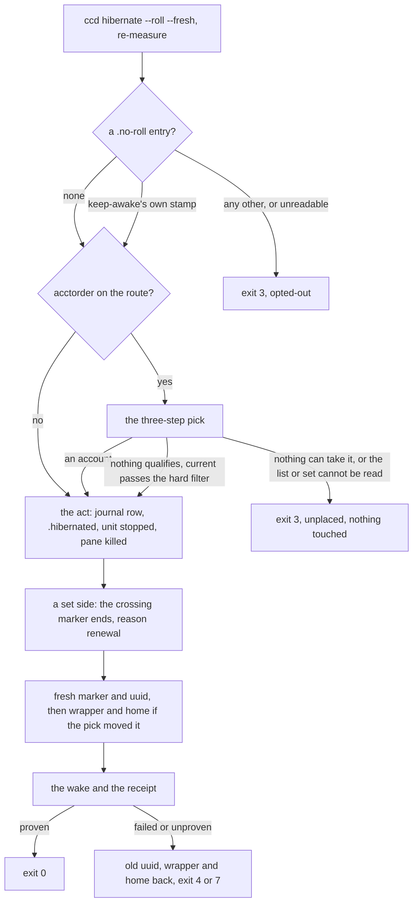
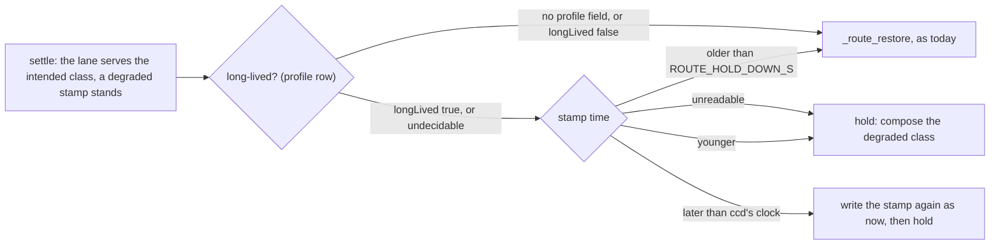

# Overlord W1: ccd's Overlord arms (`keep-awake`, the hold-down, the stand-downs and the fresh start's pick) Implementation Plan

> **For agentic workers:** REQUIRED SUB-SKILL: Use superpowers:subagent-driven-development (recommended) or
> superpowers:executing-plans to implement this plan task-by-task. Steps use checkbox (`- [ ]`) syntax for tracking.

**Goal:** ccd gains the arms the Overlord needs on the fleet box, and nothing else:

- a server-composed verb, `ccd keep-awake`, that sets and clears the two sleep markers `.no-hibernate` and `.no-roll`
  on one session, advertised by its own name in `ccd caps`;
- for a long-lived role, a hold-down before the settle restores the designated class (the index's question 9);
- for a long-lived role, a skip in `_operator_choice_promote`, so a `/model` typed into the pane is never adopted;
- for a session whose route record carries an ordered account list, a stand-down of the tick's affinity arm;
- at the renewal's fresh start, the end of a set-side crossing marker and the three-step pick from the ordered list
  (`acctorder`).

**Why:** spec §3.2 (C4) needs two box-side accident guards on the designated body, and §3.4 (C45, C56, C57) moves every
planned move of the Overlord to the renewal: ccd picks its account at the fresh start, its tick stops relocating it
between renewals, a fallback class returns only after a hold-down, and a typed `/model` is never adopted. These arms
are ccd's because ccd is the authority at placement and the one writer of the degraded stamp (H16).

**Architecture:** ccd is the anti-corruption layer, and every arm stays inside it. The new code goes into one new
library, `ccd/lib/long-lived.sh`, in three regions (`keepawake`, `holddown`, `freshpick`), each a new-code region under
the split pin's new-code arm (slug `new-code-library-is-not-a-move`). `ccd/ccd`'s own functions gain one-line calls
into it, and no function moves. Long-lived is not a new fact: it is `shared/fleetRoles.ts#FLEET_ROLES`'s `longLived`
column, projected into `ccd/lib/launch-profiles.json` beside the other launch columns and read by ccd through the
route field `profile` the server already writes. The affinity stand-down and the pick key on the route field
`acctorder`, whose only writer is the designation (pool set Q9 and Q10). The server gains one argv builder,
`CCD_ARGV.keepAwake`, and no caller: the designation piece calls it.

**Tech Stack:** bash (`ccd/ccd`, the new `ccd/lib/long-lived.sh`, `ccd/ccrc`, `ccd/session-hook.sh`), Python
(`ccd/ccd-entry-install.py`, `ccd/ccd-entry.py`), TypeScript (ESM: the argv builder, the whitelist row, the launch-row
projection, the forbidden-verb lists), vitest. No new dependency.

**Spec:** `docs/superpowers/specs/2026-11-09-overlord-design.md`:
- §3.2, C4: "Two box-side accident guards", "Why a new verb is allowed" and "The markers are guards, not carriers".
- Table 3.6a's `.no-hibernate`, `.no-roll` row.
- §3.3.8's "Swaps" and "ccd's tick".
- §3.4: H16's "The return waits, and ccd owns the hold-down" and "A change of model inside a generation is drift" (the
  `_operator_choice_promote` skip).
- §3.4, C46: "A deliberate crossing holds until the next renewal" ("Every renewal clears the crossing marker").
- §3.4, C56: "An ordered list, drawn only from the set, picked by ccd", with Table 3.4a.
- §3.4, C57: "The renewal is the moment to move" (the soft line, 70%) and "ccd's tick stands down for it".
- Table 3.4d's `_auto_swap_check` and `cmd_prefer` rows (the parts this piece owns; pool set PR A3 owns the rest).
- Table 11.1c's ccd row for the `overlord` role; Table 11.1d's `keep-awake` row.
- Table 11.5b's hold-down row: one hour, and always longer than a generation's least age, by ccd's clock.
- Table 11.6's `capability-missing`, which the designation answers when ccd lacks `keep-awake`.
- §14's W1 row: "ccd's sleep markers' verb and its capability word `keep-awake`".
- Table 13.1: H16 is `tightening` in W1. No `shape` call is this piece's.

The W1 index is `docs/superpowers/plans/2026-11-14-overlord-w1.md` (row "ccd's Overlord arms", lane A). This plan
builds the index's question 9 as recommended. The pool set plan (`w1-pool-set.md`) hands this piece its open question
6 (the crossing marker at the fresh start, slug `fresh-start-clears-crossing-in-ccd-arms`) and its question 9 (the
pick skips an id `_is_valid_wrapper` does not know). The W1a fresh-start plan
(`docs/superpowers/plans/2026-11-10-overlord/w1a-fresh-start.md`) and the W1a renewal-act plan (`w1a-renewal-act.md`)
are the verb this piece's pick sits inside and the adapter that reads its answers.

Measured against `origin/main` at `49a34f76e` (2026-11-15), with pool set A1 and A2 merged (#2836, #2846) and pool set
A3, B1 and B2 not yet built. Every task's builder re-measures what it cites on the `main` it starts from.

## Open questions

Each carries a recommendation, and the plan builds it unless the coordinator rules otherwise.

1. **`.no-roll` would refuse the Overlord's own renewal** (slug `fresh-start-passes-keep-awake-no-roll`). §3.2 has
   designate and rebind set `.no-roll` on the Overlord's body. But the renewal's act is `ccd hibernate --roll --fresh`,
   and `cmd_hibernate` refuses every `--roll` on `.no-roll` (`opted-out`). W1a's fresh-start plan pins that refusal
   for `--fresh` too ("refused exactly as `--roll` is refused"). As written, the guard would stop every renewal of the
   body it guards. **Recommendation:** `keep-awake` writes a stamp into the marker, `keep-awake v1`. `--roll --fresh`
   passes a `.no-roll` whose bytes are exactly that stamp, and every other `.no-roll` still refuses it: a hand-touched
   one, an empty one, a link, or one that cannot be read. A plain `--roll` (the roll lane's act) still refuses every
   `.no-roll`. So the operator's own opt-out keeps its meaning for every session, the roll lane still cannot roll the
   Overlord, and only the renewal's fresh start passes the guard written for it. Built in Task 2, in a commit of its
   own.
2. **What the affinity stand-down keys on** (slug `affinity-stands-down-on-the-ordered-list`). C57 says "for the
   `overlord` role", and the pool set plan says "keyed on the role". ccd has no role on its tick, and a role read there
   costs a `jq` call per session every five seconds (`ccd-tick-budget.test.ts` counts them). **Recommendation:** the
   arm stands down for a row whose route record has an entry at `acctorder`. That is the Overlord and only the
   Overlord: the designation is the field's only writer (`_route_argv_check` refuses it on every `--route`, pool set
   Q10). The test is two builtins, and it names the reason C57 gives: the renewal's pick from the ordered list makes
   every planned move. An entry that cannot be read still stands the arm down (no move on a doubtful read). The
   hard-block rescue is above the arm and is unaffected.
3. **Who owns the hold-down: ccd's settle, or the serviceability answer** (slug
   `hold-down-is-ccds-settle-not-serviceability`). H16 says both: "four more inputs" to the serviceability answer
   include "the hold-down", and "this design adds one rule to `_route_restore`". Two mechanisms would decide one fact.
   Serviceability answers "may this lane run this class now", and the hold-down answers "may a degraded session go back
   up yet", which reads ccd's own stamp and clock, facts the server does not hold. **Recommendation:** the hold-down is
   ccd's alone: one constant and one decider in `ccd/lib/long-lived.sh`, asked at the two places a return to the
   designated class can happen (the settle's restore and the pick's first step). Serviceability A takes three new
   inputs, not four, and its TypeScript twin carries no hold-down. If the coordinator rules the other way, this piece's
   Task 4 shrinks to the characterization test and the settle reads serviceability's answer.
4. **Where the hold-down sits** (slug `hold-down-at-the-settle-not-in-restore`). H16 says "one rule to
   `_route_restore`". `_route_restore` has two callers: the settle's servable arm, a return to the designated class,
   and `_route_stale_degrade_clear`, which clears a stamp after the intended class changed. Holding the second would
   compose a stale class for up to an hour after the operator chose another one. **Recommendation:** the rule sits at
   the settle's servable arm (`ccd/ccd#_spawn_start`) and the pick's first step, never inside `_route_restore`. The
   function keeps its one meaning: clear the stamp and say so.
5. **How a long-lived role reaches ccd** (slug `long-lived-is-projected`). ccd has no role vocabulary. A literal list
   of role names in ccd would be a second definition of `FLEET_ROLES.longLived`. **Recommendation:** the launch row
   gains `longLived`, projected from `FLEET_ROLES`, and ccd reads the row the route's `profile` names. A row with no
   `profile` field reads "not long-lived", which is today's behaviour. So a coordinator gets the hold-down and the
   `/model` skip only once the launch-profile lane writes its `profile` (that lane is the field's one writer, and in
   shadow it writes nothing). The Overlord has `profile` from its creation (designation A's create, sandbox plan
   G1). A `profile` that is present but cannot be read, or names no row, is undecidable and reads as long-lived: the
   hold-down then costs at most one hour on the fallback class, and a skipped `/model` costs one keystroke. Neither
   moves the session.
6. **What the fresh start does when it cannot place** (slug `fresh-pick-refuses-before-the-act`). C56 says the pick
   "leaves readiness at `stranded` only when no account can serve it", and C57 says an unmeasured answer never moves
   the Overlord. **Recommendation:** the pick runs in `cmd_hibernate`'s re-measure, before the act, so a fresh start
   that cannot place stops nothing. When no listed account qualifies and the current account still passes the hard
   filter (below), the fresh start stays on it, logged `stay`. Otherwise it refuses, exit 3, `ccd: session-busy:
   unplaced — <cause>`. The renewal act's adapter already maps exit 3 to `refused` with ccd's reason line
   (`w1a-renewal-act.md`, Task 2). So no new exit code, and nothing for that plan to change. The cause names the
   remedy: the route record's list unreadable or malformed (the server writes it again at its next sweep), the set
   undecidable (`_pool_undecidable_why`'s set sentence), or every listed account unable to serve.
7. **`keep-awake`'s argument form** (slug `keep-awake-takes-session-flag`). §3.2 writes `ccd keep-awake --state on|off
   <id>`. A `['keep-awake', '--state']` grant would admit any positional tail, and `isExecAllowed` is prefix-matching.
   **Recommendation:** `ccd keep-awake --session <id> --state on|off`, with `keep-awake` in `REQUIRED_VERB_FLAG` bound
   to `--session`, as `win-size` and pool set B1's `pool-answer` are.
8. **`keep-awake off` and a marker it did not write** (slug `keep-awake-removes-only-its-own`). A `.no-hibernate` or
   `.no-roll` touched by hand is the operator's opt-out. **Recommendation:** `off` removes only a marker whose bytes are
   its own stamp. It keeps any other marker and says so (`kept <marker>: not keep-awake's`), exit 0. A marker it cannot
   read is kept, and the verb exits 1. `on` writes its stamp over an absent marker, leaves its own stamp alone, and
   keeps a foreign marker as it is, exit 0 with the same `kept` line. A foreign `.no-roll` still refuses the fresh start
   (question 1), which is the operator's choice on that body. A new designated body never has one.

## What exists today

Measured on `origin/main` at `49a34f76e`.

- **The two markers have no writer in the tree.** `cmd_hibernate` (`ccd/ccd#cmd_hibernate`) reads them in its
  re-measure: a plain hibernate refuses `opted-out` on `$REG/<id>.no-hibernate`, and `--roll` (and so `--roll --fresh`)
  refuses `opted-out` on `$REG/<id>.no-roll` and ignores `.no-hibernate` (D-7458). Each is tested with `-e`, so an
  unreadable marker still refuses. The server lists them, never reads their bytes:
  - `server/src/coord/hibernate.ts#NO_HIBERNATE_SUFFIX`, whose header says nothing in the tree writes them;
  - `server/src/coord/rollTarget.ts#NO_ROLL_SUFFIX`, "Written by hand, never by the tree";
  - `server/src/stopDone.ts` and `server/src/depsShed.ts`, each with an `opted-out` reason ("the operator opted it
    out").
  
  `server/test/single-definition/ask-digest.test.ts`'s D-5242 describe pins it for `no-hibernate`: "no line of shell
  writes it" scans every bash file under `ccd/` and `deploy/` (`helpers.ts#BASH`, `ccd/lib/*.sh` included) with a
  write pattern that includes `_reg_set`, and expects `[]`. No such pin exists for `no-roll`. `_reg_purge` removes
  every `$REG/<id>.*` field by glob, so both markers go with the row. Its inventory comment counts 59 named fields, and
  neither marker is among them.
- **The precedent verb.** `ccd/ccd#cmd_coord_pause`: `--state on|off`, checked on both arms, an echoed word nobody
  parses. It is granted `['coord-pause', '--state']`, enrolled in `agent/src/whitelist.ts#REQUIRED_VERB_FLAG`, and built
  by `server/src/ccdargv.ts`'s `coordPause`. `win-size` is the `--session`-first precedent:
  `['win-size', '--session']`, `CCD_ARGV.winSize(id, mode)`, `'id'` in `server/test/id-argv-census.test.ts`'s builder
  table, and a sample in `server/test/ccdArgvSamples.ts`. A verb is advertised by its own name in `cmd_caps`'s
  heredoc. `server/test/ccdCapTokens.ts#CCD_CAPABILITY_TOKENS` holds only the tokens that are not verbs.
  `server/test/ccd-verb-sets.test.ts` holds the dispatcher arms, `cmd_caps` less those tokens, the usage line and
  `CCD_ARGV`'s verbs equal.
- **The server-only verbs' guards.** The pattern is `delegation-adopt` (#2452). It sits in
  `server/src/coord/approvalguard.ts#FORBIDDEN_CCD_VERBS` and in `shared/api.ts`'s child deny string beside it. It also
  sits in `ccd/session-hook.sh`'s two jq verb lists, in `ccd/install-session-hooks.sh`'s deny loop, and in
  `ccd/ccd-entry.py`'s protected tuple (the verbs that start under `bash -p` through the installed direct entry). Tests
  pin each: `server/test/ccd-ws-lease-mark-reach.test.ts` (the direct entry and the case-folded spellings),
  `server/test/ccd-account-auth.test.ts`, `server/test/coordinator-skill.test.ts` (the skill never names it) and
  `agent/test/ccd-entry-exec.test.ts`. The agent's gated-verb bypass fixtures run to `g28` in
  `agent/test/types/bypasses/`, and pool set B1's `pool-answer` takes the next number.
- **The fresh start.** `cmd_hibernate --roll --fresh` (W1a, word `hibernate-fresh`) runs the re-measure (holds,
  `.no-roll`, a recent swap, the turn marker, the pane, an attached terminal), then the act (journal row, the
  `.hibernated` marker, the unit stopped, the pane killed). Then, before the wake, it writes `$REG/<id>.fresh` and the
  new uuid, and proves the start by the consuming spawn's receipt. Exits: 3 refused with nothing touched
  (`_hib_refuse`, `ccd: session-busy: <reason> — <detail>`); 4 the wake failed and the row is asleep again, its old
  uuid back; 5 not restored; 6 the kill failed; 7 the start was not proven, its old uuid back. The wake keeps the row's
  `wrapper`: today a fresh start never changes account.
- **The degraded stamp.** `ccd/ccd#_route_degrade` and `#_route_restore` are its only writers. A comment says so; no
  scan pins it. `_route_degrade` writes `$REG/<id>.degraded` through `_reg_set` (a temp file and a rename, so the
  file's mtime is the write's time), and writes nothing when the stamp already stands. `_route_restore` has two
  callers:
  - `_spawn_start`'s settle, arm `0)`: the lane serves the intended class, so the stamp is cleared at the very next
    settle;
  - `_route_stale_degrade_clear`: the intended class moved.
  
  `server/test/ccd-route-degrade.test.ts` pins the settle, including "a standing degraded=opus on a lane that can serve
  fable again: --model fable, the stamp cleared, a restore row". ccd's clock is `_now_s_to` (K) and a file's time is
  `_plat_mtime` (K). `shared/continuity.ts#LEAST_AGE_MS` is 1,800,000 (Table 11.5b's least age).
- **The operator's `/model`.** `ccd/ccd#_operator_choice_promote` reads the newest acknowledged `/model` and `/effort`
  in the transcript and writes them to the route (`class`, `effort`) through `cmd_route --actor operator-session`. It
  skips a non-Anthropic lane's `/model` (the `cx` arm) and is called by `_operator_choice_keep` (before a stop a
  spawn follows) and by `_sync_uuid` (before a live rotation). `server/test/ccd-operator-choice.test.ts` pins it.
- **The tick's affinity arm.** `ccd/ccd#_auto_swap_check`: after the hard-block rescue path (which returns), the
  manual-swap pin check (`_swap_pinned`, logging `pin-hold`) stands the arm down. Then come the `.hold` file, the
  `.woke` cooldown, the idle gate and the stagger, and then the move (`auto-home` or `auto-pool`). `_standdown_note
  <id> <why>` floors one line per episode. The home re-seed above the arm is pool set A3's to stand down for a set side.
- **The launch row.** `ccd/lib/launch-profiles.json` is the projection of `FLEET_ROLES`'s launch columns (`env`,
  `settings`, `autoMemory`, `compactionSettings`, `compactText`), held equal by
  `server/test/launch-profiles-file.test.ts`, which pins each row's key set. `ccd/ccd#_profile_spawn_compose` reads the
  row the route field `profile` names (`^[a-z]{1,16}$`), with jq, and checks only the keys it uses. The
  launch-profile lane (`server/src/continuity/profileLane.ts`) is the one writer of `profile`, and only while its row
  is live. Sandbox A (#2847, open) makes `server/src/continuity/launchProfile.ts#launchRowOf` the one projection and
  adds `launchDigestOf`, the row's sha256, as the route field `profiledigest`.
- **The pool set on `main`.** `ccd/lib/pool-set.sh`: `_poolset_parse`, `_acctorder_valid` (shape only: account ids,
  comma-joined, no repeats, at most `ROUTE_LIST_MAX_BYTES`) and `_session_pool_side` (`set <spelling>`,
  `set-unreadable`, `set-malformed`, or the project's four words). `_pool_ok` has its set arm. The crossing marker is
  `$REG/<id>.crosspool` (`<ts> <pool> <account>`, written by `_crosspool_mark`). `_crosspool_tick` ends it with
  `crosspool-ended <id>: <reason>` in `swap.log`. Pool set A3 (not built) gives the marker's field its `set:` kind and
  teaches the tick to end a set-side marker.
- **The placement helpers the pick reuses.** `_is_valid_wrapper`, `_account_ok`, `_authdead`, `_avail` (no known
  window at `SWAP_CEILING`), `_pool_ok`, `_class_gate` (rc 0 servable, 1 unservable, 2 unmeasured), `_class_below`,
  and `_limit_score` (the larger of the five-hour and seven-day percentages, empty unless both are measured). Each is
  C1 in `ccd/contexts.tsv`. `_ws_least_loaded` ranks by `_limit_score` alone and knows no list or soft line.
- **The library sites.** Pool set A1 (#2836) is the measured list of what a new library touches:
  - `ccd/ccd`: the pin variable and `_ccd_lib_load`'s two arrays and its stamp test;
  - `ccd/ccd-entry-install.py` (source and destination, publish order, refusal text, backup name) and
    `ccd/ccd-entry.py`'s header;
  - `ccd/ccrc`: `_upd_backup_set`'s `_upd_backup_copy` line, and the uninstall list and its sentence;
  - `deploy/deploy.sh`'s backup line;
  - `ccd/contexts.tsv`'s header and rows;
  - `README.md`'s library list;
  - the test helpers `server/test/ccdWsHelpers.ts`, `consolidationCensus.ts` and `installTreeFixture.ts`;
  - the suites `ccd-lib-load`, `ccd-entry-install`, `ccd-install-stamp`, `build-release`, `ccrc-uninstall`,
    `ccd-docs-helper-redactor` (the loader's hash count), `install-census`, `ownership`, `session-hook` (`SCANNED`) and
    `tmux-socket-census`;
  - the agent's `ccd-entry-exec` and `deploy-verify`.
  
  `server/test/single-definition/writers-map.test.ts`'s tombstone describe lists every library but pool-set by
  name, and does not need the new one: the new library names no tombstone. The split pin
  (`server/test/ccdSplit.ts#pureMoveVerdict`) passes a new pointer whose region defines no function and assigns no
  top-level variable that the base program defines or assigns.
- **Growth.** `server/test/growthCheck.ts`: `ccd/ccd` and every `ccd/lib/*.sh` are held at `GROWTH_LIMIT` (40 net
  code lines a PR), and the `ccd (program)` row sums `ccd/ccd` and every non-`ccrc-*` library at 40 a PR. A new
  library counts in full on both rows. No freeze or cap names `ccd/ccd`. Code lines on `main` (non-blank, non-comment):
  `ccd/ccd` about 20,984, `ccd/lib/pool-set.sh` 55.

## Global Constraints

- **Architecture (`CLAUDE.md`).** ccd keeps every decision of this piece (decide before acting), and the server
  composes one argv and decides nothing here. One owner per fact:
  - the markers: `cmd_keep_awake` is their one writer in the tree;
  - the degraded stamp: still `_route_degrade` and `_route_restore`, plus the hold-down's re-stamp of the same value
    (Task 4, recorded as legitimately different: it moves only the stamp's time, never its class);
  - long-lived: `FLEET_ROLES.longLived`, projected;
  - the ordered list: the designation, through `ccd route`;
  - the soft line: `FRESH_PICK_SOFT_PCT`, ccd's constant, whose TypeScript twin, if serviceability B adds one, is
    pinned equal by harvest as `SWAP_CEILING` is.
  
  No overloaded null at a seam: every new reader keeps absent, unreadable and malformed apart, and none folds
  unmeasured into a value. No existing function moves, and every new function is new code in its region.
- **Behaviour for every session without these fields is unchanged.** Without `acctorder` there is no stand-down and no
  pick. Without a set side there is no crossing clear. Without `profile` naming a long-lived row there is no hold-down
  and no `/model` skip. A `.no-roll` without keep-awake's stamp refuses exactly as today. The one live change is
  question 5's: a coordinator whose route carries `profile=coordinator` gets the hold-down and the `/model` skip. It is
  said in PR B's body and made in its own commits.
- **SAFETY (`CLAUDE.md`).** `keep-awake` is a server-composed verb, never a session's: it joins `FORBIDDEN_CCD_VERBS`,
  the child deny string, the hook's two verb lists, the installer's deny loop and the direct entry's protected tuple.
  It acts on a sleep marker, not on coordination state, so it is not a coordination mutation. It writes one or two
  per-session registry files and removes only its own. It can only stop a hibernate or a roll, never cause one, and it
  widens nothing that deletes. Every test runs in a fixture HOME (`makeCcdHarness`), never the live `$HOME`. No test
  touches tmux, a live `~/.cc-sessions` or a supervisor, and no test runs a destructive verb.
- **Bash discipline.** Every new function that parses carries `local LC_ALL=C IFS=' '` (`_role_long_lived`,
  `_keep_awake_ours`, `_fresh_pick_to`, `_route_holddown_holds`). Comparisons quote the right side. Side words match
  `"set "*` with its space, or exactly. Constants are plain assignments (the loader evaluates the library inside a
  function, so a top-level `declare` would be lost). Every caller passes a validated session id: the verb validates
  with `_reg_id_ok`, and the internal helpers take ids only from callers that did.
- **Ownership of other pieces' facts.** This piece never writes `acctorder`, `poolset`, `profile` or `class`: it reads
  them. It never calls `keep-awake`: designation A or B does.
- **Push once per round** (worker clause 20), and each PR's body says what its merge arms (below).

## Review Focus

1. **The `.no-roll` exemption is exact** (question 1). Only the stamp's exact bytes pass, only for `--fresh`, and only
   from a regular, readable file that is not a link. An unreadable or foreign marker still refuses.
2. **Fail closed on every doubtful read.** An unreadable `profile` reads long-lived. An unreadable `acctorder` stands the
   affinity arm down and refuses the pick. An unreadable stamp time holds. An unmeasured load never qualifies a
   candidate and never moves the session.
3. **The pick changes accounts only where the old conversation cannot be lost.** It writes `wrapper` and `home` after
   the act and before the wake, and every arm that puts the old uuid back (exits 4 and 7) puts the old `wrapper` and
   `home` back too.
4. **The hold-down never holds the stale-intent clear** (question 4), and a clock that steps back adds one hold-down at
   most.
5. **The growth rows.** `ccd/ccd`, the new library and `ccd (program)` each stay at 40 or under in every PR, measured
   with `growthCheck.ts`'s own counting.
6. **Every census a new verb and a new library touch is in the PR that adds them** (the lists in Tasks 1 and 3).

## The three arms in one picture


*Figure 1. Where this piece's two fresh-start arms sit in `cmd_hibernate --roll --fresh`. Every refusal comes before
the act, and every put-back restores the account with the uuid.*


*Figure 2. The hold-down at the settle's servable arm. `_route_stale_degrade_clear` never asks it.*

## Task 1: The library, its loader sites, and `ccd keep-awake` (PR A)

**Files:**
- Create: `ccd/lib/long-lived.sh`, with its header (the pool-set library's shape: not executable, loaded at ccd's
  foot, new code only, the trust chain, plain assignments). Region `keepawake`: `KEEP_AWAKE_STAMP='keep-awake v1'`,
  `cmd_keep_awake`, `_keep_awake_ours`.
- Modify `ccd/ccd`:
  - one `# @ccd-lib:keepawake` pointer line above `cmd_coord_pause`, its precedent;
  - the pin `__CCD_LIB_LONGLIVED_SHA256=stamp-at-install`, after `__CCD_LIB_POOLSET_SHA256`;
  - `_ccd_lib_load`'s two arrays (`__ccd_lib_files`, `__ccd_lib_pins`), its stamp test and its header comment, the
    fifth library after the fourth;
  - the dispatcher arm `keep-awake) shift; cmd_keep_awake "$@" ;;` and `keep-awake` in the usage line;
  - `keep-awake` in `cmd_caps`'s heredoc, in sorted place;
  - `_reg_purge`'s inventory comment: `no-hibernate` and `no-roll`, 61 (comment only).
- Modify: `ccd/ccd-entry-install.py` (`LONGLIVED_LIB_SOURCE`, `LONGLIVED_LIB_DEST`, published after the fourth and
  before the body, its refusal text, its backup name `ccd-lib-long-lived.sh`) and `ccd/ccd-entry.py`'s header.
- Modify: `ccd/ccrc` (`_upd_backup_set`'s `_upd_backup_copy` line after the pool-set one, the uninstall list and its
  sentence), `deploy/deploy.sh`'s backup line, and `README.md`'s library list.
- Modify: `ccd/contexts.tsv` (header, and rows `cmd_keep_awake C4`, `_keep_awake_ours C4`) and
  `ccd/contexts-edges.tsv` (`cmd_keep_awake -> _reg_id_ok`, `-> _reg_set`, `-> _reg_read`, and any other edge the
  suite computes, each said in the PR).
- Modify the test helpers and suites in "The library sites" above: `server/test/ccdWsHelpers.ts`,
  `consolidationCensus.ts`, `installTreeFixture.ts`; `ccd-lib-load`, `ccd-entry-install` (a fifth library, published,
  pinned and refused as the fourth), `ccd-install-stamp`, `build-release`, `ccrc-uninstall`,
  `ccd-docs-helper-redactor` (the loader's hash count, 4 to 5), `install-census`, `ownership`, `session-hook`
  (`SCANNED`) and `tmux-socket-census`; the agent's `ccd-entry-exec` and `deploy-verify`.
- Test: `server/test/ccd-keep-awake.test.ts` (new), `server/test/ccd-verb-sets.test.ts` (unchanged; it must pass with
  the new verb on all four sides once Task 3 adds the builder).

**The verb:**

```bash
cmd_keep_awake() {   # --session <id> --state on|off — set or clear the sleep markers on one session (spec §3.2, C4)
  # 1. argv exactly `--session <id> --state on|off`, else die with the usage; _reg_id_ok "$id", else `bad session id`
  # 2. on: $REG/<id>.uuid must be a file (`no such session`); off: an absent row is success (its markers went with it)
  # 3. for each of no-hibernate and no-roll, in that order:
  #    on:  absent (-e and -L false)       -> _reg_set "$id" no-hibernate "$KEEP_AWAKE_STAMP" (one spelled line per
  #                                           marker, so the D-5242 scan sees each write; Task 2)
  #         _keep_awake_ours                -> nothing
  #         any other entry                 -> keep it; print `kept <marker>: not keep-awake's`
  #    off: _keep_awake_ours                -> rm -f -- "$REG/$id.<marker>"
  #         absent                          -> nothing
  #         foreign and readable            -> keep it; print the kept line
  #         unreadable (link, not a file, not readable) -> keep it; remember to exit 1
  # 4. a write or unlink that failed dies naming the marker (checked on both arms, `cmd_coord_pause`'s reason)
  # 5. print `awake <id>` or `released <id>`; nothing parses it
}
_keep_awake_ours() {   # id marker -> rc 0 iff $REG/<id>.<marker> is a regular, readable file, not a link, whose bytes
  # are exactly $KEEP_AWAKE_STAMP (a bounded read, as _session_pool_side reads: at most 64 bytes, a NUL or the cap is
  # not ours); rc 1 otherwise. Never rc 2: every caller treats "not provably ours" the same way.
}
```

- [ ] **Step 1: Characterize.** On `main`, in a fixture HOME: `ccd keep-awake` is an unknown verb (the usage line, exit
  1). `cmd_caps` does not list it. `ccd hibernate` refuses `opted-out` on a hand-touched `.no-hibernate`, and `ccd
  hibernate --roll` on a hand-touched `.no-roll`. Green.
- [ ] **Step 2: Failing tests** (`ccd-keep-awake.test.ts`):
  - `on` writes both markers with the stamp's exact bytes, and a second `on` changes nothing (mtimes equal);
  - `off` removes both;
  - `off` on a row with no markers is exit 0;
  - `off` on a purged row is exit 0;
  - `on` on a missing row is exit 1 and writes nothing;
  - a hand-touched (empty) `.no-roll` survives `on` and `off`, each printing the kept line;
  - a `.no-roll` holding other bytes survives too;
  - a `.no-roll` that is a dangling link, a directory, a FIFO or mode 000 survives `off`, and `off` exits 1;
  - the argv shapes `--state on --session x`, `--session`, `--session x --state maybe`, `--session -x --state on`,
    `--session 'a b' --state on` and a trailing extra word are each refused with nothing written;
  - an unwritable `$REG` makes `on` exit 1 naming the marker, with no `awake` line;
  - `cmd_caps` lists `keep-awake`;
  - `ccd caps`, the dispatcher and the usage line agree (`ccd-verb-sets`, once Task 3's builder lands);
  - the same bytes give the same verdict under `LC_ALL=C` and `en_US.UTF-8`.
  
  The library sites: every suite named in Files, red for the fifth library before the wiring.
- [ ] **Step 3: Run.** Red. **Step 4: Implement.** **Step 5: Run.** Green, with `ccd-split-pin`'s real row reading the
  new pointer as `NEW_CODE_NOT_JUDGED`.
- [ ] **Step 6: Mutation** (`../ccrc-coordinator/references/mutation-run.py`, in memory). Each mutant must turn a case
  red:

  | Mutant | The case that reds |
  |---|---|
  | Drop the `_keep_awake_ours` test on `off` (remove any marker) | the hand-marker case |
  | Drop `_reg_id_ok` | the `-x` case |
  | Drop the unreadable arm's exit 1 | the FIFO case |
  | Write `on` without checking `_reg_set`'s rc | the unwritable-`$REG` case |
  
  Restore from the saved copy.
- [ ] **Step 7: Commit.** `feat(ccd): ccd keep-awake, the sleep markers' one writer, in ccd/lib/long-lived.sh (Overlord W1)`

## Task 2: The fresh start passes keep-awake's own `.no-roll`, and the markers' writer pins (PR A)

**Files:**
- Modify: `ccd/ccd#cmd_hibernate`. The `--roll` arm's `.no-roll` line becomes
  `[[ -e "$REG/$id.no-roll" || -L "$REG/$id.no-roll" ]] && ! { (( lc_fresh )) && _keep_awake_ours "$id" no-roll; } &&
  _hib_refuse opted-out "…"`. That is one line, and `-L` is added so a dangling link refuses as today's `-e` intends.
  The header paragraph on `--fresh` says it.
- Modify: `server/test/single-definition/ask-digest.test.ts`. D-5242's "no line of shell writes it" for `no-hibernate`
  becomes "exactly one line of shell writes it, in `ccd/lib/long-lived.sh`'s `cmd_keep_awake`", an exact `toEqual`
  on that one line. A new describe beside it pins the same for `no-roll`: one shell writer, and the TS half's definer
  `server/src/coord/rollTarget.ts`, which reaches no write.
- Modify: `server/src/coord/rollTarget.ts` (`NO_ROLL_SUFFIX`'s doc: "Written by hand, and by `ccd keep-awake` on the
  Overlord's body (spec §3.2); the server lists it, never reads its bytes") and `server/src/coord/hibernate.ts` (the
  switches header's `<id>.no-hibernate` line, the same sentence). Comments only.
- Modify: `README.md`'s roll paragraph (`.no-roll`) and hibernation paragraph (`.no-hibernate`): the tree's one writer,
  and the fresh start's exemption.
- Test: `server/test/ccd-hibernate-roll.test.ts`, `server/test/ccd-hibernate.test.ts`.

- [ ] **Step 1: Characterize** (its own commit, green on `main`). `--roll --fresh` with a hand-touched `.no-roll`
  refuses `opted-out` with the uuid unchanged and no `.fresh` written (W1a's pinned case, kept). `--roll` with the same
  marker refuses the same way. A plain hibernate ignores `.no-roll`.
- [ ] **Step 2: Failing tests.**
  - `--roll --fresh` with `.no-roll` written by `ccd keep-awake on` proceeds (in the harness's fakes, the act and the
    wake are recorded);
  - `--roll` (no `--fresh`) with the same marker still refuses `opted-out`;
  - `--roll --fresh` with an empty, a foreign-bytes, a linked or a mode-000 `.no-roll` refuses `opted-out` with nothing
    touched;
  - a plain hibernate with keep-awake's `.no-hibernate` refuses `opted-out`;
  - the D-5242 pin and the new `no-roll` pin red on a second planted writer line (a CONTROL row plants one in a
    temporary copy of the corpus, never in the tree).
- [ ] **Step 3: Run.** Red. **Step 4: Implement.** **Step 5: Run.** Green.
- [ ] **Step 6: Mutation.** Each mutant must turn a case red:

  | Mutant | The case that reds |
  |---|---|
  | Drop `(( lc_fresh )) &&` | the plain `--roll` case |
  | Drop the `_keep_awake_ours` call (pass every `.no-roll` on `--fresh`) | the foreign-bytes case |
  | Drop `-L` | the dangling-link case |
  
  Restore.
- [ ] **Step 7: Commit.** `fix(ccd): the renewal's fresh start passes keep-awake's own .no-roll, and nothing else
  (Overlord W1)`

## Task 3: The argv, the whitelist row, and the verb's SAFETY status (PR A)

**Files:**
- Modify: `server/src/ccdargv.ts`:
  `keepAwake: (id: string, state: 'on' | 'off') => argv(['keep-awake', '--session', id, '--state', state])`, with a doc
  comment: `coordPause`'s and `winSize`'s shape; no caller in this piece; a caller passes a registry-validated id and
  adds its own `id-argv-census` row.
- Modify: `server/test/ccdArgvSamples.ts` (`keepAwake: [PROBE_ID, 'on']`) and `server/test/id-argv-census.test.ts`
  (the builder table: `keepAwake: 'id'`, and its sample).
- Modify: `agent/src/whitelist.ts`: `'keep-awake': '--session'` in `REQUIRED_VERB_FLAG`, and the grant
  `['keep-awake', '--session']` with a comment on `coord-pause`'s argument ("a registry-file write and unlink,
  non-destructive; the server may write only `~/.cc-clips` there, so the markers are raised through this verb or not
  at all").
- Create: `agent/test/types/bypasses/g<next>-keep-awake-without-session.ts` (the next number after pool set B1's).
- Modify: `agent/test/types/ok/legit-whitelist.ts` and `agent/test/whitelist-structural.test.ts`.
- Modify: `server/src/coord/approvalguard.ts#FORBIDDEN_CCD_VERBS` and `shared/api.ts`'s child deny string beside it
  (`keep-awake` after `delegation-adopt`; `shared/api.ts` +0, the word on the existing line).
- Modify: `ccd/session-hook.sh`'s two jq verb lists (+0) and `ccd/install-session-hooks.sh`'s deny loop.
- Modify: `ccd/ccd-entry.py`: the protected tuple and its header lines, so `keep-awake` starts under `bash -p` through
  the installed direct entry, as `delegation-adopt` does.
- Modify the tests: `server/test/ccd-ws-lease-mark-reach.test.ts` (the protected shapes, the case-folded spellings, and
  a real-body describe: `on` and `off` work through the launcher, and `KEEP-AWAKE` under `nocasematch` writes nothing);
  `server/test/ccd-account-auth.test.ts` (the verb list); `server/test/coordinator-skill.test.ts` and
  `server/test/worker-skill.test.ts` ("never names `keep-awake`"); and `agent/test/ccd-entry-exec.test.ts`.
- Modify: `CLAUDE.md`:
  - a SAFETY bullet: "`keep-awake` is forbidden to every session too: the server's act on one session's two sleep
    markers, composed by the designation's doors, behind the installed direct entry. It never deletes and never stops
    anything; never a session's verb, and never run against the live host from a shell or a test";
  - the "Zero new ccd verbs for coordination mutation" bullet: `keep-awake` acts on sleep markers, not coordination
    state, so the rule does not cover it.
- Modify: `agent/CLAUDE.md`'s gated-verb list and `README.md`'s gated-verb sentences and verb table.

- [ ] **Step 1: Failing tests.**
  - `isExecAllowed('ccd', [...CCD_ARGV.keepAwake('x', 'on')])` is true, and `['keep-awake']` alone and
    `['keep-awake', '--state', 'on', 'x']` are false;
  - the bypass fixture fails to compile and the legit one compiles (`whitelist-structural`);
  - `ccd-verb-sets` holds four equal sides;
  - the approval classifier marks `ccd keep-awake --session x --state on` forbidden, and the hook's deny arm denies it
    for a child;
  - the direct entry starts it under `-p`.
- [ ] **Step 2: Run.** Red. **Step 3: Implement.** **Step 4: Run.** Green.
- [ ] **Step 5: Mutation.** Each mutant must turn a case red:

  | Mutant | The case that reds |
  |---|---|
  | Remove the `REQUIRED_VERB_FLAG` row | the bypass fixture compiles, and the boot audit refuses |
  | Drop `keep-awake` from `FORBIDDEN_CCD_VERBS` | the classifier case |
  | Drop it from one jq list | the hook case |
  
  Restore.
- [ ] **Step 6: Commit.** `feat(agent,server): keep-awake's argv and whitelist row, forbidden to every session
  (Overlord W1)`

**PR A ends here.** Nothing calls `keep-awake`, so no marker is written. Its body says so, and says that the verb
reverses "written by hand, never by the tree" for the Overlord's body alone (§3.2), and that the `.no-roll` change
passes only a marker no box has yet.

## Task 4: Long-lived reaches ccd, and the hold-down (PR B)

**Files:**
- Modify: the launch row's projection, adding `longLived` from `FLEET_ROLES`. That is
  `server/src/continuity/launchProfile.ts#launchRowOf` once sandbox A has merged (expected); otherwise the projection
  in `server/test/launch-profiles-file.test.ts`. Regenerate `ccd/lib/launch-profiles.json`.
- Modify: `server/test/launch-profiles-file.test.ts`, whose key set gains `longLived`, and sandbox A's digest fixtures,
  if they pin a digest: every row's digest changes, the same on both sides.
- Modify: `ccd/lib/long-lived.sh`, region `holddown`:
  - `ROUTE_HOLD_DOWN_S=3600`;
  - `_role_long_lived` (below);
  - `_route_holddown_holds`.
- Modify: `ccd/ccd`:
  - one `# @ccd-lib:holddown` pointer above `_route_degrade`;
  - `_spawn_start`'s settle arm `0)`: restore unless `_route_holddown_holds "$id" "$rdeg"` holds, and when it holds keep
    `rdeg` so the degraded class is composed (one line rewritten, +1 at most);
  - the "ONLY WRITERS OF `degraded`" comment above `_route_degrade` names the re-stamp.
- Modify: `ccd/contexts.tsv` (`_role_long_lived C3`, `_route_holddown_holds C1`) and `ccd/contexts-edges.tsv`.
- Test: `server/test/ccd-route-degrade.test.ts`, `server/test/ccd-route-holddown.test.ts` (new),
  `server/test/ccd-long-lived.test.ts` (new).

```bash
_role_long_lived() {   # id -> rc 0 long-lived | 1 not (no profile field, or longLived false) | 2 undecidable
  # no entry at $REG/<id>.profile (-e and -L both false): rc 1, today's behaviour
  # a profile that cannot be read, or a word outside ^[a-z]{1,16}$: rc 2
  # jq on $LAUNCH_PROFILES_JSON: .[$r].longLived must be a boolean, else rc 2 (an absent row, an unreadable file, an
  #   older file without the key all answer 2, never 1)
}
_route_holddown_holds() {   # id degraded-class -> rc 0 hold (compose the degraded class) | rc 1 the return may land
  # _role_long_lived rc 1: rc 1 (today). rc 0 or 2: read the stamp's time with _plat_mtime.
  # a time that is not a number: rc 0 (unmeasured holds)
  # a time later than _now_s_to: _reg_set "$id" degraded "$2" (the same value, written again as now), one swap.log
  #   line `holddown-restamp <id>: …`, rc 0
  # now - time < ROUTE_HOLD_DOWN_S: rc 0; else rc 1
}
```

- [ ] **Step 1: Characterize** (its own commit, green on `main`). A session with `profile=coordinator` and a standing
  `degraded=opus` stamp one second old, settling on a lane that serves `fable`, composes `--model fable`, clears the
  stamp and writes one restore row. That is today's `_route_restore`, the index's question 9. The same with no
  `profile`, and with `profile=plain`. `_route_stale_degrade_clear`'s case (a new intended class) restores at once.
- [ ] **Step 2: Failing tests.**
  - `_role_long_lived`: `overlord` and `coordinator` answer 0; `plain`, `worker`, `reviewer`, `auditor` and `replay`
    answer 1; no field answers 1;
  - `_role_long_lived` answers 2 for a field that is a FIFO, a word with a capital, `nosuchrole`, a profiles file
    without the key, one with `"longLived": "yes"`, and an unreadable file;
  - the hold-down: the characterization case flips for `coordinator` and `overlord` (composes `--model opus`, the stamp
    stays, no row) and stays as it was for `plain` and no profile;
  - a stamp 3,601 s old restores; 3,599 s holds (the stamp's mtime set with `touch -d`, ccd's clock a fixture seam);
  - a stamp an hour in the future is written again as now, holds, and logs one `holddown-restamp` line, and a second
    settle a second later holds without a second line;
  - an unreadable mtime holds;
  - `_route_stale_degrade_clear` is never held (a new intended class, long-lived, a one-second stamp: restored);
  - `ROUTE_HOLD_DOWN_S * 1000 > LEAST_AGE_MS`, harvested from the library's text (Table 11.5b);
  - the same bytes give the same verdict under `LC_ALL=C` and `en_US.UTF-8`.
- [ ] **Step 3: Run.** Red. **Step 4: Implement**, the hold-down in its own commit after the projection's. **Step 5:
  Run.** Green.
- [ ] **Step 6: Mutation.** Each mutant must turn a case red:

  | Mutant | The case that reds |
  |---|---|
  | `_role_long_lived`'s rc 2 to rc 1 | the FIFO and `nosuchrole` cases |
  | `<` to `<=` on the age | the boundary cases |
  | Drop the future-time arm | the restamp case |
  | Call the hold-down from `_route_restore` itself | the stale-intent case |
  
  Restore.
- [ ] **Step 7: Commits.** `test(ccd): pin today's restore at the settle for every profile (Overlord W1, question 9)`;
  `feat(continuity): the launch row carries longLived for ccd (Overlord W1)`; `feat(ccd): the hold-down before a
  long-lived role's class returns (Overlord W1, question 9)`.

## Task 5: The `/model` skip, the affinity stand-down, and the renewal's end of a set-side crossing (PR B)

**Files:**
- Modify: `ccd/ccd#_operator_choice_promote`. Its `model|drift-model)` arm skips for a long-lived role as it skips for
  a Codex lane (`[[ -n "$cx" || -n "$ll" ]] && continue`). `ll` is set once, lazily, from `_role_long_lived` (rc 0 or 2)
  the first time a model line is seen, and one `_operator_choice_say` line says `/model <x> is not adopted for a
  long-lived role; its class is the designation's` (+1 to +2). `/effort` is promoted as today.
- Modify: `ccd/ccd#_auto_swap_check`, right after the `_swap_pinned` block:
  `[[ -e "$REG/$id.acctorder" || -L "$REG/$id.acctorder" ]] && { _standdown_note "$id" ordered-list; return 0; }`
  (+1).
- Modify: `ccd/lib/long-lived.sh`, region `freshpick` opened here with `_fresh_crossing_end` (below), and
  `ccd/ccd#cmd_hibernate`'s fresh branch, which calls it after the act and before the fresh marker's write (+1). A
  `# @ccd-lib:freshpick` pointer sits above `cmd_hibernate`.
- Modify: `ccd/contexts.tsv` (`_fresh_crossing_end C1`) and `ccd/contexts-edges.tsv`.
- Test: `server/test/ccd-operator-choice.test.ts`, `server/test/ccd-auto-swap-hold.test.ts`,
  `server/test/ccd-tick-budget.test.ts` (unchanged count), and `server/test/ccd-hibernate-roll.test.ts`.

```bash
_fresh_crossing_end() {   # id — the renewal clears a set-side crossing (spec §3.4 C46). Always 0.
  # no entry at $REG/<id>.crosspool (-e and -L false): return
  # the side (_session_pool_side) is "set "*, set-unreadable or set-malformed: rm -f -- "$REG/$id.crosspool", and one
  #   swap.log line `crosspool-ended <id>: renewal`, the tick's own format
  # any other side: nothing (a project-side crossing is the tick's, as today)
}
```

- [ ] **Step 1: Characterize** (green on `main`).
  - A coordinator's typed `/model opus` (`profile=coordinator`) is promoted to `class=opus` at the keep;
  - a row with an `acctorder` field and a home with room is moved home by the affinity arm at a clean boundary (the
    harness's fakes);
  - `--roll --fresh` on a row with a crossing marker leaves the marker.
- [ ] **Step 2: Failing tests.**
  - The skip: `profile=overlord` and `profile=coordinator` are not promoted, with one say line, and their `/effort high`
    still is; `plain` and no profile promote as today; an undecidable profile skips; the rotation path (`_sync_uuid`
    with an incoming transcript) skips too;
  - the stand-down: an `acctorder` row stands down with one `stand-down <id>: ordered-list` line per episode; a row
    without one moves as today; an unreadable `acctorder` (FIFO, link) stands down; a hard-blocked `acctorder` row is
    still rescued (the rescue is above the arm); `ccd-tick-budget`'s subprocess count is unchanged;
  - the crossing: a `set pool-a,pool-b` side ends the marker with `renewal`; `set-unreadable` ends it too; a `named`
    side and an untagged side keep it; no marker is no line; a refused fresh start (exit 3) keeps it.
- [ ] **Step 3: Run.** Red. **Step 4: Implement.** **Step 5: Run.** Green.
- [ ] **Step 6: Mutation.** Each mutant must turn a case red:

  | Mutant | The case that reds |
  |---|---|
  | Drop `-n "$ll"` | the coordinator skip |
  | Key the stand-down on `-f` | the FIFO case |
  | Move the stand-down above the rescue | the hard-block case |
  | Drop the side test in `_fresh_crossing_end` | the `named` case |
  | Call it before the re-measure | the refused case |
  
  Restore.
- [ ] **Step 7: Commits.** `feat(ccd): a long-lived role's typed /model is never adopted (Overlord W1)`; `feat(ccd):
  the affinity arm stands down for a row with an ordered account list (Overlord W1)`; `feat(ccd): the renewal's fresh
  start ends a set-side crossing (Overlord W1)`.

**PR B ends here.** Its body says that the hold-down and the `/model` skip reach a coordinator only once the
launch-profile lane writes its `profile`, and that nothing has `acctorder` or a set side yet.

## Task 6: The fresh start's three-step pick from the ordered list (PR C)

**Files:**
- Modify: `ccd/lib/long-lived.sh`, region `freshpick`: `FRESH_PICK_SOFT_PCT=70`, `_fresh_pick_ok`, `_fresh_pick_to`.
- Modify: `ccd/ccd#cmd_hibernate`:
  - in the re-measure, after the `.no-roll` line: `(( lc_fresh )) && { _fresh_pick_to lc_pick "$id" "$cur" ||
    _hib_refuse unplaced "$FRESH_PICK_WHY"; }` (+1). `cur` is the measured `wrapper`; an unmeasured one refuses
    `unplaced`;
  - after the fresh marker and uuid writes: when `lc_pick` differs from `cur`, `_reg_set` `wrapper` and `home`, and
    one `fresh-pick <id>: <cur> -> <pick> step=<n>` line (+1);
  - on the exit 4 and exit 7 arms, beside the uuid's put-back, the old `wrapper` and `home` put back (+2).
- Modify: `ccd/contexts.tsv` (`_fresh_pick_ok C1`, `_fresh_pick_to C1`) and `ccd/contexts-edges.tsv` (`cmd_hibernate
  -> _fresh_pick_to`, C4 to C1, and the others the suite computes).
- Test: `server/test/ccd-fresh-pick.test.ts` (new), `server/test/ccd-hibernate-roll.test.ts`.

```bash
_fresh_pick_ok() {   # account side -> rc 0 the account may take this session at all
  # _is_valid_wrapper (skips an id the roster does not know: pool set Q9), _account_ok, not _authdead, _avail,
  # and _pool_ok "$1" "$2" rc 0 (a crossing does not count: the renewal ends it)
}
_fresh_pick_to() {   # var id cur -> rc 0, var = the account to start on (may be cur), FRESH_PICK_STEP = 1|2|3|stay|none
                     #   rc 1, var empty, FRESH_PICK_WHY = the cause (`unplaced`)
  # no entry at $REG/<id>.acctorder: var=cur, step none, rc 0 (no list: today's behaviour)
  # the list by _reg_read; rc 2, or a value _acctorder_valid refuses: rc 1, "the ordered account list on
  #   $REG/<id>.acctorder cannot be read; the server writes it again at its next sweep"
  # side=_session_pool_side; set-unreadable or set-malformed: rc 1, _pool_undecidable_why's set sentence
  # cls=the route's class (default reads none); fb=_class_below cls; hold=a degraded stamp stands and
  #   _route_holddown_holds says hold
  # step 1 (unless hold, and only with a class): the first listed account that passes _fresh_pick_ok, whose
  #   _limit_score is a number under FRESH_PICK_SOFT_PCT, and whose _class_gate on cls is rc 0
  # step 2 (with a fallback class): the first listed account as in step 1, but _class_gate on fb rc 0
  # step 3: of the listed accounts that pass _fresh_pick_ok with a measured _limit_score, the least loaded whose
  #   _class_gate on cls is rc 0 (unless hold), else the least loaded whose _class_gate on fb is rc 0; ties go to
  #   the earlier listed
  # stay: no step picked and cur passes _fresh_pick_ok: var=cur, step stay, rc 0 (unmeasured loads never move it)
  # otherwise rc 1, "no account on the ordered list can take it: <one clause per account, its first failed check>"
  # A class of `default` or none skips the class gates and the hold (steps 1 and 3 on load alone; no step 2).
}
```

- [ ] **Step 1: Characterize** (green on `main`). `--roll --fresh` on a row with an `acctorder` field wakes on its
  current `wrapper`, unchanged.
- [ ] **Step 2: Failing tests** (`ccd-fresh-pick.test.ts`; fixture roster `claude-a` to `claude-d`, fixture limits,
  pools `pool-a` and `pool-b`, the class `fable` with `opus` below).
  - Step 1 picks the first listed account under 70% that serves `fable`, skipping one at 75% and one where `fable` is
    unservable;
  - with every account's `fable` unservable, step 2 picks the first under 70% on `opus`;
  - with every account at or over 70%, step 3 picks the least loaded that serves `fable`, else the least loaded on
    `opus`, and a tie goes to the earlier listed;
  - with a degraded stamp younger than the hold-down, step 1 is skipped even where `fable` is servable; with one older,
    step 1 runs;
  - an account outside the set (`_pool_ok` rc 1) is never picked, though listed and empty;
  - an id the roster does not know is skipped;
  - an authdead, a disabled and an at-ceiling account are skipped;
  - every load unmeasured: the session stays on its current account (step `stay`), or refuses `unplaced` when that
    account fails the hard filter;
  - the list as a FIFO or a link, `claude-a,claude-a`, and a 1,025-byte list each refuse `unplaced` with the list's
    sentence;
  - a `set-unreadable` side refuses with the set sentence;
  - no account can take it: exit 3, `ccd: session-busy: unplaced — …`, and nothing touched: no journal row, no
    `.hibernated`, the unit and pane untouched, the uuid unchanged;
  - a pick that moves writes `wrapper` and `home`, and the wake spawns under the new account's config directory;
  - a wake that fails (exit 4) or is unproven (exit 7) puts back the old `wrapper`, `home` and uuid;
  - the same bytes give the same verdict under `LC_ALL=C` and `en_US.UTF-8`.
- [ ] **Step 3: Run.** Red. **Step 4: Implement.** **Step 5: Run.** Green, with W1a's fresh-start suite unchanged.
- [ ] **Step 6: Mutation.** Each mutant must turn a case red:

  | Mutant | The case that reds |
  |---|---|
  | `<` to `<=` against `FRESH_PICK_SOFT_PCT` | the 70% boundary case |
  | Drop `_pool_ok` from `_fresh_pick_ok` | the outside-the-set case |
  | Drop the hold in step 1 | the young-stamp case |
  | Read an empty `_limit_score` as 0 | the unmeasured case |
  | Drop the exit 4 put-back of `wrapper` | the wake-failed case |
  | Move the pick after the act | the refusal's nothing-touched case |
  
  Restore.
- [ ] **Step 7: Commit.** `feat(ccd): the fresh start picks the account from the ordered list, in three steps
  (Overlord W1)`

**PR C ends here.** Nothing has `acctorder` until the designation writes it, so no fresh start changes. Its body says
that, and that the refusal is exit 3 `unplaced`, which the renewal act's adapter already maps to `refused`.

## The PR split

| PR | Tasks | Needs first | Growth (net code lines, estimated the way `growthCheck.ts` counts; each re-measured against `origin/main`'s stages before it opens) |
|---|---|---|---|
| A | 1, 2, 3 | Pool set B (B1 and B2), as the index rules: `keep-awake` changes what an agent runs, and `pool-set` ships first among such PRs. In code it needs only `main`. It adds its library after pool set A1's, so door process A's comes after it | `ccd/lib/long-lived.sh` about +22 to +26, new, in full (the stamp 1, `cmd_keep_awake` 16 to 19, `_keep_awake_ours` 4 to 5); `ccd/ccd` about +3 (the dispatch arm, the caps line, the pin; the loader's arrays, stamp test and usage are edits on existing lines, and the `.no-roll` line +0); **`ccd (program)` about +25 to +29**; `ccd/ccrc` about +1 to +2; `ccd/session-hook.sh` +0; `shared/api.ts` +0 |
| B | 4, 5 | PR A (the library). Sandbox A merged, for `launchRowOf` | `ccd/lib/long-lived.sh` about +20 to +24 (`ROUTE_HOLD_DOWN_S` 1, `_role_long_lived` 6 to 7, `_route_holddown_holds` 8 to 9, `_fresh_crossing_end` 4 to 5); `ccd/ccd` about +4 to +6 (the settle arm, the promote skip, the stand-down, the crossing call); **`ccd (program)` about +24 to +30** |
| C | 6 | PR B, and pool set A3 (the set side's users and the marker's kind) | `ccd/lib/long-lived.sh` about +30 to +35 (`FRESH_PICK_SOFT_PCT` 1, `_fresh_pick_ok` 3, `_fresh_pick_to` 26 to 31); `ccd/ccd` about +4 (the pick call, the writes, two put-backs); **`ccd (program)` about +34 to +39** |

*Table 1. The three pull requests.* Every growth-checked file and the program row stay at 40 or under in every PR,
with no waiver. PR C is the tight one. If its program row measures over 40 before it opens, PR C splits: C1 takes steps
1 and 2, the refusal and the put-backs, and C2 takes step 3 and the `stay` rule. Each is under 40, and C1 alone never
moves a session it could not move before C2 (with no step 3, a session past the soft line everywhere refuses
`unplaced`, and nothing has `acctorder` yet). If a stage freezes or caps `ccd/ccd` or `ccd/lib/` before a PR opens, the
worker asks the coordinator first.

## What a merge arms

- **PR A:** nothing visible. No caller sends `keep-awake`, so no marker exists, and the `.no-roll` change passes only
  keep-awake's own stamp. The verb is advertised (`ccd caps`), so the designation's `capability-missing` check can read
  it.
- **PR B:** one behaviour change for coordinators, in its own commits: a coordinator whose route carries
  `profile=coordinator` keeps its fallback class for an hour after its intended class is servable again, and its typed
  `/model` is no longer written to its route. While the launch-profile lane is shadow, no coordinator carries `profile`,
  and nothing changes. Nothing has `acctorder` or a set side, so the stand-down and the crossing end act on no row.
- **PR C:** nothing until the designation writes `acctorder`.
- **Rollback.** A box moved below PR A loses `keep-awake`, and the designation refuses `capability-missing`. A box
  moved below PR A while the Overlord's markers stand keeps them, and an older ccd refuses the Overlord's renewal on
  its `.no-roll`, as it refuses every `.no-roll` (`opted-out`). The renewal lane then records `refused`, and the
  renewal waits. That is fail-closed and recoverable by the update back, or by the operator removing the marker. Below
  PR B or C a box forgets the hold-down, the stand-down or the pick, and no session is harmed: the Overlord renews on
  its current account, and its tick may relocate it at a clean boundary as for a coordinator.

## Deviations found

Decisions this plan takes, by slug (the coordinator mints numbers):

- **`fresh-start-passes-keep-awake-no-roll`** — §3.2 sets `.no-roll` on the body whose renewal is `hibernate --roll
  --fresh`, which refuses every `.no-roll`, and W1a's fresh-start plan pins that. The fresh start passes keep-awake's
  own stamped marker only (question 1).
- **`keep-awake-takes-session-flag`** — `ccd keep-awake --session <id> --state on|off`, not the positional `<id>`
  §3.2 writes (question 7).
- **`keep-awake-removes-only-its-own`** — `off` removes only a marker holding its stamp, and `on` keeps a foreign one
  (question 8).
- **`affinity-stands-down-on-the-ordered-list`** — C57's "for the `overlord` role" is keyed on the `acctorder` field,
  the Overlord's alone, not on a role read on the tick (question 2).
- **`hold-down-is-ccds-settle-not-serviceability`** — H16 lists the hold-down as a serviceability input and as a rule
  of ccd's. It is ccd's alone (question 3).
- **`hold-down-at-the-settle-not-in-restore`** — the rule sits at the settle's servable arm and the pick's first step,
  never in `_route_restore`, so the stale-intent clear is never held (question 4).
- **`holddown-restamp-writes-the-same-value`** — the hold-down writes the degraded stamp again, its value unchanged,
  when its time reads later than ccd's clock (Table 11.5b). It is a third writer of the stamp's time, recorded as
  legitimately different, and never of its class.
- **`long-lived-is-projected`** — ccd learns long-lived from `longLived` in the launch row the route's `profile` names,
  so a coordinator gets the hold-down and the skip once the launch-profile lane writes its `profile` (question 5).
- **`fresh-pick-refuses-before-the-act`** — a fresh start that cannot place refuses exit 3 `unplaced` before the act,
  and one with nothing measured stays on its current account (question 6).
- **`keep-awake-is-a-verb-not-a-token`** — the index lists `keep-awake` beside `CCD_CAPABILITY_TOKENS`, but it is a
  verb: it is advertised by its own name and held by `ccd-verb-sets`, not by the tokens list.
- **`ccd-arms-is-three-prs`** — the index sizes this piece at one PR and five tasks. The program row (40 a PR, a new
  library counted in full) makes it three PRs and six tasks, with no waiver.
- **`one-library-three-regions`** — the index names "one [library] for `keep-awake`". The hold-down and the pick are
  new code too, so they join it as two more regions of `ccd/lib/long-lived.sh`, and no second library is added.

## Where things stand

**Agreed:**
- The piece's scope is the index row's, with question 9 built as recommended.
- New code goes to `ccd/lib/long-lived.sh`, and `ccd/ccd` takes one-line calls.

**Waiting on the coordinator:** questions 1 to 8 above, with their recommendations. Questions 1 (the `.no-roll`
contradiction) and 3 (the hold-down's owner) change other pieces' text, so they want a ruling before PR A opens.

**Needs before it starts:** PR A waits for pool set B1 and B2 (the index's order), PR B for PR A and sandbox A, and PR
C for PR B and pool set A3.

**What depends on it:** designation A (the `capability-missing` check on `keep-awake`; Start the Overlord's create
writes `acctorder` and `profile`), designation B (the `keep-awake` calls on rebind and retire), the renewal readings
(the pick is what a renewal lands on), and readiness (`unplaced` is one of `stranded`'s causes on the fleet box).

**What the index should change:**
- The ccd arms row: 3 PRs and 6 tasks (A: Tasks 1 to 3; B: 4 and 5; C: 6), each PR's needs as above, and the library
  named `ccd/lib/long-lived.sh`.
- "Where lanes meet":
  - `keep-awake` is a verb in `cmd_caps`'s list and `ccd-verb-sets`, not a token beside `CCD_CAPABILITY_TOKENS`;
  - the new library's sites include `ccd-docs-helper-redactor` and `install-census`, which pool set A1 measured;
  - sandbox A's `launchRowOf` gains `longLived` in this piece's PR B, so every row's digest changes;
  - `ask-digest.test.ts`'s D-5242 describe changes in PR A.
- The serviceability row: three new inputs, not four, if question 3 is ruled as recommended. The hold-down is ccd's.
- The designation row: §3.2 says designate sets the markers, but Table W1 puts "the keep-awake calls" in PR B. Either
  designation A's create calls `keepAwake('on')`, or the index says the Overlord sleeps unguarded by the markers
  between designation A and B (the server's holds still stand, as Table 3.6a says).
- Designation A and C: the server's sleep and roll lanes list `.no-hibernate` and `.no-roll` with the reason "the
  operator opted it out". On the Overlord's body their own `overlord` hold should be read first, so the reason shown is
  the designation's.
- The renewal act (W1a): nothing to change. Exit 3 `unplaced` reads `refused` with ccd's line.

**Spec fixes for the spec-fixes run:**
- §3.2's verb spelling (`--session <id>`), and its `.no-roll` on a body that renews by `--roll --fresh` (question 1).
- H16's "four more inputs", which lists the hold-down, and "one rule to `_route_restore`" (questions 3 and 4).
- C57's stand-down "for the `overlord` role", keyed on the ordered list (question 2).

**Later:**
- The designation's calls of `keep-awake` and its `capability-missing` check.
- Serviceability B's TypeScript twin of the 70% soft line, if it adds one, pinned equal to `FRESH_PICK_SOFT_PCT` by
  harvest.
