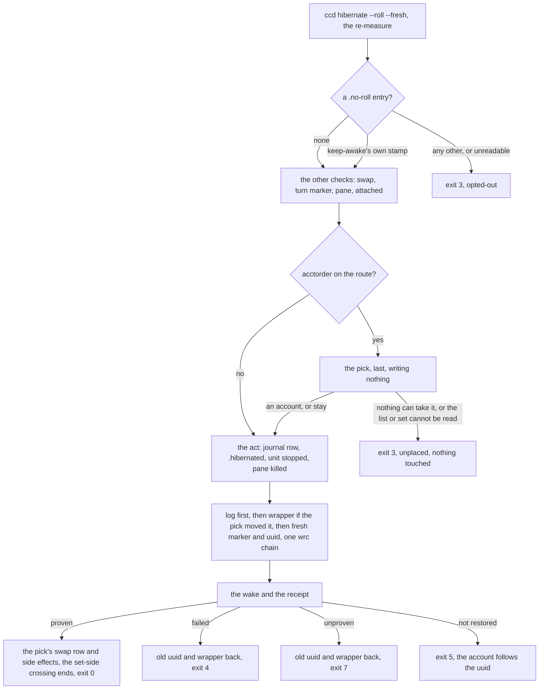

# Overlord W1: ccd's Overlord arms (`keep-awake`, the hold-down, the stand-downs and the fresh start's pick) Implementation Plan

> **For agentic workers:** REQUIRED SUB-SKILL: Use superpowers:subagent-driven-development (recommended) or
> superpowers:executing-plans to implement this plan task-by-task. Steps use checkbox (`- [ ]`) syntax for tracking.

**Goal:** ccd gains the arms the Overlord needs on the fleet box, and nothing else:

- a server-composed verb, `ccd keep-awake`, that sets and clears the two sleep markers `.no-hibernate` and `.no-roll`
  on one session, advertised in `ccd caps` by its name and by its capability token `keep-awake-v1` (cross-plan
  ruling X8);
- for a long-lived role, a hold-down before the settle restores the designated class (the index's question 9);
- for a long-lived role, a skip in `_operator_choice_promote`, so a `/model` typed into the pane is never adopted;
- for a session whose route record carries an ordered account list, a stand-down of the tick's affinity arm;
- at the renewal's fresh start, the end of a set-side crossing marker and the three-step pick from the ordered list
  (`acctorder`).

**Why:** spec §3.2 (C4) needs two box-side accident guards on the designated body, and §3.4 (C45, C56, C57) moves every
planned move of the Overlord to the renewal: ccd picks its account at the fresh start, its tick stops relocating it
between renewals, a fallback class returns only after a hold-down, and a typed `/model` is never adopted. These arms
are ccd's because ccd is the authority at placement and the one writer of the degraded stamp (H16).

**Architecture:** ccd is the anti-corruption layer, and every arm stays inside it. The new code goes into one new
library, `ccd/lib/long-lived.sh`, in three regions (`keepawake`, `holddown`, `freshpick`), each a new-code region under
the split pin's new-code arm (slug `new-code-library-is-not-a-move`). `ccd/ccd`'s own functions gain one-line calls
into it, and no function moves. Long-lived is not a new fact: it is `shared/fleetRoles.ts#FLEET_ROLES`'s `longLived`
column, projected into `ccd/lib/launch-profiles.json` beside the other launch columns and read by ccd through the
route field `profile` the server already writes. The affinity stand-down and the pick key on the route field
`acctorder`. Its writers are the designation's doors and the renewal lane, both for the Overlord's row only
(`shared/api.ts#ROUTE_WRITABLE_FIELDS`'s note; pool set Q9 and Q10). The server gains one argv builder,
`CCD_ARGV.keepAwake`, with its `CCD_CAN` row `capRow(KEEP_AWAKE_CAP)`, and no caller: designation A calls it (X6).

**Tech Stack:** bash (`ccd/ccd`, the new `ccd/lib/long-lived.sh`, `ccd/ccrc`, `ccd/session-hook.sh`), Python
(`ccd/ccd-entry-install.py`, `ccd/ccd-entry.py`), TypeScript (ESM: the argv builder, the whitelist row, the launch-row
projection, the forbidden-verb lists), vitest. No new dependency.

**Spec:** `docs/superpowers/specs/2026-11-09-overlord-design.md`:
- §3.2, C4: "Two box-side accident guards", "Why a new verb is allowed" and "The markers are guards, not carriers".
- Table 3.6a's `.no-hibernate`, `.no-roll` row.
- §3.3.8's "Swaps" and "ccd's tick".
- §3.4: H16's "The return waits, and ccd owns the hold-down" and "A change of model inside a generation is drift" (the
  `_operator_choice_promote` skip).
- §3.4, C46: "A deliberate crossing holds until the next renewal" ("Every renewal clears the crossing marker").
- §3.4, C56: "An ordered list, drawn only from the set, picked by ccd", with Table 3.4a.
- §3.4, C57: "The renewal is the moment to move" (the soft line, 70%) and "ccd's tick stands down for it".
- Table 3.4d's `_auto_swap_check` and `cmd_prefer` rows (the parts this piece owns; pool set PR A3 owns the rest).
- Table 11.1c's ccd row for the `overlord` role; Table 11.1d's `keep-awake` row.
- Table 11.5b's hold-down row: one hour, and always longer than a generation's least age, by ccd's clock.
- Table 11.6's `capability-missing`, which the designation answers when ccd lacks `keep-awake`.
- §14's W1 row: "ccd's sleep markers' verb and its capability word `keep-awake`".
- Table 13.1: H16 is `tightening` in W1. No `shape` call is this piece's.

The W1 index is `docs/superpowers/plans/2026-11-14-overlord-w1.md` (row "ccd's Overlord arms", lane A). This plan
builds the index's question 9 as recommended. The pool set plan (`w1-pool-set.md`) hands this piece its open question
6 (the crossing marker at the fresh start, slug `fresh-start-clears-crossing-in-ccd-arms`) and its question 9 (the
pick skips an id `_is_valid_wrapper` does not know). The W1a fresh-start plan
(`docs/superpowers/plans/2026-11-10-overlord/w1a-fresh-start.md`) and the W1a renewal-act plan (`w1a-renewal-act.md`)
are the verb this piece's pick sits inside and the adapter that reads its answers.

Measured against `origin/main` at `49a34f76e` (2026-11-15), with pool set A1 and A2 merged (#2836, #2846) and pool set
A3, B1 and B2 not yet built. Fix round 1 (review 2148) re-measured at `2b082b91f`: `ccd/`, `agent/src/whitelist.ts` and
`server/src/ccdargv.ts` are unchanged between the two, and sandbox A (#2847) is still open. Every task's builder
re-measures what it cites on the `main` it starts from.

## Open questions

Each question carries its recommendation and, since fix round 1, the coordinator's ruling. The plan builds what is
ruled.

1. **`.no-roll` would refuse the Overlord's own renewal** (slug `fresh-start-passes-keep-awake-no-roll`). §3.2 has
   designate and rebind set `.no-roll` on the Overlord's body. But the renewal's act is `ccd hibernate --roll --fresh`,
   and `cmd_hibernate` refuses every `--roll` on `.no-roll` (`opted-out`). W1a's fresh-start plan pins that refusal
   for `--fresh` too ("refused exactly as `--roll` is refused"). As written, the guard would stop every renewal of the
   body it guards. **Recommendation:** `keep-awake` writes a stamp into the marker, `keep-awake v1`. `--roll --fresh`
   passes a `.no-roll` whose bytes are exactly that stamp, and every other `.no-roll` still refuses it: a hand-touched
   one, an empty one, a link, or one that cannot be read. A plain `--roll` (the roll lane's act) still refuses every
   `.no-roll`. So the operator's own opt-out keeps its meaning for every session, the roll lane still cannot roll the
   Overlord, and only the renewal's fresh start passes the guard written for it. Built in Task 2, in a commit of its
   own. **Ruled: as recommended.** The spec fix goes to the spec-fixes run.
2. **What the affinity stand-down keys on** (slug `affinity-stands-down-on-the-ordered-list`). C57 says "for the
   `overlord` role", and the pool set plan says "keyed on the role". **Recommendation:** the arm stands down for a row
   whose route record has an entry at `acctorder`. The field is written for the Overlord's row only: its writers are
   the designation's doors and the renewal lane (`shared/api.ts#ROUTE_WRITABLE_FIELDS`'s note), and ccd refuses it on
   every `--route` at the mint (`_route_argv_check`; its `CLAUDECODE` refusal is a speed bump, not a wall). Keying on
   `profile` instead would cost no `jq` (`$REG/<id>.profile` is a flat file read with builtins), but it would not
   stand the arm down while the launch-profile lane is shadow, because that lane is `profile`'s one writer and writes
   nothing in shadow. `acctorder` names the reason C57 gives: the renewal's pick from the ordered list makes every
   planned move. An entry that cannot be read still stands the arm down (no move on a doubtful read). The hard-block
   rescue is above the arm and is unaffected. **Ruled: as recommended** (review 2148 F14 corrected the reason).
3. **Who owns the hold-down: ccd's settle, or the serviceability answer** (slug
   `hold-down-is-ccds-settle-not-serviceability`). H16 says both: "four more inputs" to the serviceability answer
   include "the hold-down", and "this design adds one rule to `_route_restore`". Table 11.1a and Appendix B count the
   hold-down among the four inputs too, while §11.5 says the server observes no timer for it. Two mechanisms would
   decide one fact. Serviceability answers "may this lane run this class now", and the hold-down answers "may a
   degraded session go back up yet", which reads ccd's own stamp and clock, facts the server does not hold.
   **Recommendation:** the hold-down is ccd's alone: one constant and one decider in `ccd/lib/long-lived.sh`, asked at
   the two places a return to the designated class can happen (the settle's restore and the pick's first step).
   Serviceability A takes three new inputs, not four, and its TypeScript twin carries no hold-down. One consequence is
   stated, not hidden: for up to an hour the server's forecast can name the designated class while ccd's settle
   composes the fallback, though C45 says both read the same answer. **Ruled: taken as recommended for PR B now.** The
   coordinator sends the H16 and Appendix B fix to the operator through the spec-fixes run. The ruling blocks PR B
   only, not PR A.
4. **Where the hold-down sits** (slug `hold-down-at-the-settle-not-in-restore`). H16 says "one rule to
   `_route_restore`". `_route_restore` has two callers: the settle's servable arm, a return to the designated class,
   and `_route_stale_degrade_clear`, which clears a stamp after the intended class changed. Holding the second would
   compose a stale class for up to an hour after the operator chose another one. **Recommendation:** the rule sits at
   the settle's servable arm (`ccd/ccd#_spawn_start`) and the pick's first step, never inside `_route_restore`. The
   function keeps its one meaning: clear the stamp and say so. **Ruled: as recommended** (the review confirmed both
   callers and both writers).
5. **How a long-lived role reaches ccd** (slug `long-lived-is-projected`). ccd has no role vocabulary. A literal list
   of role names in ccd would be a second definition of `FLEET_ROLES.longLived`. **Recommendation:** the launch row
   gains `longLived`, projected from `FLEET_ROLES`, and ccd reads the row the route's `profile` names. A row with no
   `profile` field reads "not long-lived", which is today's behaviour. So a coordinator gets the hold-down and the
   `/model` skip only once the launch-profile lane writes its `profile` (that lane is the field's one writer, and in
   shadow it writes nothing). The Overlord has `profile` from its creation (designation A's create, sandbox ruling
   G2). A `profile` that is present but cannot be read, or names no row, is undecidable and reads as long-lived.
   `profile` has no session refusal (`_route_valid` checks its shape only), so a session, or a server whose
   `FLEET_ROLES` is newer than the box's `launch-profiles.json`, can make a row read undecidable. The cost is bounded
   and fails safe: the hold-down then costs at most one hour on the fallback class, and a skipped `/model` costs one
   keystroke. Neither moves the session. **Ruled: as recommended.**
6. **What the fresh start does when it cannot place** (slug `fresh-pick-refuses-before-the-act`). C56 says the pick
   "leaves readiness at `stranded` only when no account can serve it", and C46 says an unmeasured answer never moves
   the Overlord. **Recommendation:** the pick runs last in `cmd_hibernate`'s re-measure, before the act, so a fresh
   start that cannot place stops nothing. When no listed account qualifies, the current account still passes the hard
   filter, and its class gate does not read unservable for both the designated and the fallback class, the fresh start
   stays on it, logged `stay`. Otherwise it refuses, exit 3, `ccd: session-busy: unplaced — <cause>`. The renewal
   act's adapter already maps exit 3 to `refused` with ccd's reason line (`w1a-renewal-act.md`, Task 2). So no new exit
   code, and nothing for that plan to change. The cause names the remedy: the route record's list unreadable or
   malformed (the server writes it again at its next sweep), the set undecidable (`_pool_undecidable_why`'s set
   sentence), or every listed account unable to serve. **Ruled: as recommended**, with review 2148 F5's class gate on
   `stay` and F8's place in the re-measure.
7. **`keep-awake`'s argument form** (slug `keep-awake-takes-session-flag`). §3.2 writes `ccd keep-awake --state on|off
   <id>`. A `['keep-awake', '--state']` grant would admit any positional tail, and `isExecAllowed` is prefix-matching.
   **Recommendation:** `ccd keep-awake --session <id> --state on|off`, with `keep-awake` in `REQUIRED_VERB_FLAG` bound
   to `--session`, as `win-size` and pool set B1's `pool-answer` are. **Ruled: as recommended.**
8. **`keep-awake off` and a marker it did not write** (slug `keep-awake-removes-only-its-own`). A `.no-hibernate` or
   `.no-roll` touched by hand is the operator's opt-out. **Recommendation:** `off` removes only a marker whose bytes are
   its own stamp. It keeps any other marker and says so (`kept <marker>: not keep-awake's`), exit 0. A marker it cannot
   read is kept, and the verb exits 1. `on` creates its stamp over an absent marker with a no-clobber create, so a hand
   marker made in the window between its check and its write is never overwritten. It leaves its own stamp alone, and
   keeps a foreign marker as it is, exit 0 with the same `kept` line. A foreign `.no-roll` still refuses the fresh start
   (question 1), which is the operator's choice on that body. A new designated body never has one. **Ruled: as
   recommended**, with review 2148 F9's no-clobber create and bounded read.

## Cross-plan rulings (fix round 1)

The coordinator sent the same rulings to the four W1 plan writers (authority journal, private store, ccd arms,
designation). The parts that touch this piece, in the coordinator's words:

- **X6, the Overlord is never without its holds.** Designation A's create calls `keepAwake('on')`, its retire calls
  `keepAwake('off')`, and `decideSleep`'s `overlord` hold moves from designation C into designation A. Designation A
  needs ccd arms A, B and C (C2 if C splits), so no designated Overlord runs before `longLived` reaches the launch row
  or before the fresh pick exists. Figure W1 gains sandbox A → ccd arms B.
- **X8, `keep-awake` is advertised by a capability token** (`capRow`, refusing on no evidence), the cap word
  `keep-awake`, as Table 11.6's `capability-missing` needs, with the token in `ccdCapTokens.ts`, `cmd_caps`,
  `KNOWN_CAPABILITY_TOKENS`, `ccd-can` and `verb-gate`. It also joins pool set B1's capability floor table (I carry
  that into B1's brief).
- **X9, D-numbers.** Plan decisions stay plain-words slugs, as every other W1 piece's do. No D-number is minted for
  them.
- **X10, the index.** I make every index change the four reviews list in my own index edit; do not edit the index
  plan.

How this plan applies them:

- **X6.** C splits from the start (C1 and C2, below), so designation A needs PR A, PR B and PR C2. The keep-awake
  calls and the sleep hold are designation A's, not this piece's.
- **X8, and the token's spelling.** `verb-gate.test.ts` holds "a refusing row is answered by a capability token, never
  by its bare verb name", so a `capRow` whose token is `keep-awake`, the verb's own name, reds it on `main`. The token is
  therefore `keep-awake-v1`, `win-size-v1`'s shape for the `win-size` verb (`server/src/ccdargv.ts#WIN_SIZE_CAP`,
  `CCD_CAN.winSize: capRow(WIN_SIZE_CAP)`), and the spec's "capability word `keep-awake`" (§14) names its family
  (slug `keep-awake-token-is-keep-awake-v1`). If the bare word is wanted, that rule of `verb-gate.test.ts` must change
  first, which is not this piece's to decide.
- **X1 to X5 and X7** touch other pieces: the journal-file adapters and authority records (the authority journal
  plan), the first prompt of a new body, the identity and term, and the designation reader's contract (the designation
  plan), and the private store's prompt route (the private store plan). Nothing in this plan changes for them.

## What exists today

Measured on `origin/main` at `49a34f76e`.

- **The two markers have no writer in the tree.** `cmd_hibernate` (`ccd/ccd#cmd_hibernate`) reads them in its
  re-measure: a plain hibernate refuses `opted-out` on `$REG/<id>.no-hibernate`, and `--roll` (and so `--roll --fresh`)
  refuses `opted-out` on `$REG/<id>.no-roll` and ignores `.no-hibernate` (D-7458). Each is tested with `-e`, so an
  unreadable marker still refuses. The server lists them, never reads their bytes:
  - `server/src/coord/hibernate.ts#NO_HIBERNATE_SUFFIX`, whose header says nothing in the tree writes them;
  - `server/src/coord/rollTarget.ts#NO_ROLL_SUFFIX`, "Written by hand, never by the tree";
  - `server/src/stopDone.ts` and `server/src/depsShed.ts`, each with an `opted-out` reason ("the operator opted it
    out");
  - the lanes that list them by name: `server/src/sleepLane.ts` (two sites, `.no-hibernate`),
    `server/src/rollLane.ts` (both markers) and `server/src/depsShedPass.ts` (`.no-hibernate`).
  
  `server/test/single-definition/ask-digest.test.ts`'s D-5242 describe pins it for `no-hibernate`: "no line of shell
  writes it" scans every bash file under `ccd/` and `deploy/` (`helpers.ts#BASH`, `ccd/lib/*.sh` included) with a
  write pattern that includes `_reg_set`, and expects `[]`. No such pin exists for `no-roll`. `_reg_purge` removes
  every `$REG/<id>.*` field by glob, so both markers go with the row. Its inventory comment counts 59 named fields, and
  neither marker is among them.
- **The precedent verb.** `ccd/ccd#cmd_coord_pause`: `--state on|off`, checked on both arms, an echoed word nobody
  parses. It is granted `['coord-pause', '--state']`, enrolled in `agent/src/whitelist.ts#REQUIRED_VERB_FLAG`, and built
  by `server/src/ccdargv.ts`'s `coordPause`. `win-size` is the `--session`-first precedent:
  `['win-size', '--session']`, `CCD_ARGV.winSize(id, mode)`, `'id'` in `server/test/id-argv-census.test.ts`'s builder
  table, and a sample in `server/test/ccdArgvSamples.ts`. A verb is advertised by its own name in `cmd_caps`'s
  heredoc. `server/test/ccdCapTokens.ts#CCD_CAPABILITY_TOKENS` holds only the tokens that are not verbs.
  `server/test/ccd-verb-sets.test.ts` holds the dispatcher arms, `cmd_caps` less those tokens, the usage line and
  `CCD_ARGV`'s verbs equal.
- **The capability rows.** `server/src/ccdargv.ts#CCD_CAN` is typed `satisfies Record<keyof typeof CCD_ARGV, CanRow>`,
  so every builder needs a row. `verbRow(verb)` permits on no evidence, and `capRow(token)` refuses on no evidence.
  `win-size` is the precedent for a verb gated by a token of its own: `WIN_SIZE_CAP = 'win-size-v1'`, spelled once in
  `server/src`, `echo win-size-v1` in `cmd_caps`, `KNOWN_CAPABILITY_TOKENS` in `server/test/ccd-archive.test.ts`, and
  `server/test/capsupported.test.ts`'s once-spelled and refuse-on-no-evidence cases. `server/test/verb-gate.test.ts`
  holds `CCD_CAN` to its vocabulary: a `CAP_GATED_VERBS` verb's rows refuse by default, and "a refusing row is answered
  by a capability token, never by its bare verb name". Pool set B1 adds `POOL_SET_CAP` and the capability floor table.
- **The server-only verbs' guards.** The pattern is `delegation-adopt` (#2452). It sits in
  `server/src/coord/approvalguard.ts#FORBIDDEN_CCD_VERBS` and in `shared/api.ts`'s child deny string beside it. It also
  sits in `ccd/session-hook.sh`'s two jq verb lists, in `ccd/install-session-hooks.sh`'s deny loop, and in
  `ccd/ccd-entry.py`'s protected tuple (the verbs that start under `bash -p` through the installed direct entry). Tests
  pin each: `server/test/ccd-ws-lease-mark-reach.test.ts` (the direct entry and the case-folded spellings),
  `server/test/ccd-account-auth.test.ts`, `server/test/coordinator-skill.test.ts` (the skill never names it) and
  `agent/test/ccd-entry-exec.test.ts`. The head of `ccd/ccd` lists the verbs that refuse `entry-unprivileged` unless
  started under `bash -p` (`ws-reclaim`, `ws-expire`, `ws-collect`, `ws-orphan`, `scratch-rescue`, `ws-shed-deps`,
  `ws-lease-mark`, `ws-lease-audit`, `delegation-adopt`), so a bare `bash ccd/ccd <verb>` is refused. The agent's
  gated-verb bypass fixtures run to `g28` in `agent/test/types/bypasses/`. Pool set B1's `pool-answer` takes `g29`, and
  this piece takes `g30`.
- **The fresh start.** `cmd_hibernate --roll --fresh` (W1a, word `hibernate-fresh`) runs the re-measure (holds,
  `.no-roll`, a recent swap, the turn marker, the pane, an attached terminal), then the act (journal row, the
  `.hibernated` marker, the unit stopped, the pane killed). The re-measure runs "cheapest first", and `_hib_refuse`'s
  reasons are a closed set (busy, draft, marker, background, scheduled, held, opted-out, recent-swap, attached). Then,
  before the wake, it logs `fresh start, uuid <u1> -> <u2>` first (so a kill keeps the old uuid named), writes
  `$REG/<id>.fresh` and the new uuid in one chain whose rc is `wrc` (`{ _reg_set fresh && _reg_set uuid; } || wrc=$?`),
  and proves the start by the consuming spawn's receipt (`used <u2>`). Exits: 3 refused with nothing touched
  (`ccd: session-busy: <reason> — <detail>`); 4 the wake failed and the row is asleep again, its old uuid back; 5 not
  restored, and the new uuid kept, because a pane may still run the new conversation (plan review 1896 m-B6); 6 the
  kill failed; 7 the start was not proven, its old uuid back. The exit-7 comment already names "a concurrent wake" as a
  case the receipt cannot tell apart. Nothing serialises a wake between the act and the receipt. The wake keeps the
  row's `wrapper`: today a fresh start never changes account. `ccd/ccd#cmd_swap` is the verb that moves a session
  between accounts. Its account change writes `wrapper`, `lastswap` and the swap pin, journals `_lc_done swap`, clears
  `swapblocked`, runs `_strand_clear`, `_rescuewait_close` and `_limitwait_close`, and calls `_typed_note <id> moved`
  on a move between an Anthropic and a non-Anthropic lane (`_is_anthropic_backend`). The automatic path
  (`CCD_SWAP_AUTO=1`) clears a standing pin rather than minting one. `_wake_ceiling_move` (D-8123) is a mover on a wake:
  a session woken onto an account at `SWAP_CEILING` is moved by the waking verb.
- **The degraded stamp.** `ccd/ccd#_route_degrade` and `#_route_restore` are its only writers. A comment says so; no
  scan pins it. `_route_degrade` writes `$REG/<id>.degraded` through `_reg_set` (a temp file and a rename, so the
  file's mtime is the write's time), and writes nothing when the stamp already stands. `_route_restore` has two
  callers:
  - `_spawn_start`'s settle, arm `0)`: the lane serves the intended class, so the stamp is cleared at the very next
    settle;
  - `_route_stale_degrade_clear`: the intended class moved.
  
  `server/test/ccd-route-degrade.test.ts` pins the settle, including "a standing degraded=opus on a lane that can serve
  fable again: --model fable, the stamp cleared, a restore row". ccd's clock is `_now_s_to` (K) and a file's time is
  `_plat_mtime` (K). `shared/continuity.ts#LEAST_AGE_MS` is 1,800,000 (Table 11.5b's least age).
- **The operator's `/model`.** `ccd/ccd#_operator_choice_promote` reads the newest acknowledged `/model` and `/effort`
  in the transcript and writes them to the route (`class`, `effort`) through `cmd_route --actor operator-session`. It
  skips a non-Anthropic lane's `/model` (the `cx` arm) and is called by `_operator_choice_keep` (before a stop a
  spawn follows) and by `_sync_uuid` (before a live rotation). `server/test/ccd-operator-choice.test.ts` pins it.
- **The tick's affinity arm.** `ccd/ccd#_auto_swap_check`: after the hard-block rescue path (which returns), the
  manual-swap pin check (`_swap_pinned`, logging `pin-hold`) stands the arm down. Then come the `.hold` file, the
  `.woke` cooldown, the idle gate and the stagger, and then the move (`auto-home` or `auto-pool`). `_standdown_note
  <id> <why>` floors one line per episode. The home re-seed above the arm is pool set A3's to stand down for a set side.
- **The launch row.** `ccd/lib/launch-profiles.json` is the projection of `FLEET_ROLES`'s launch columns (`env`,
  `settings`, `autoMemory`, `compactionSettings`, `compactText`), held equal by
  `server/test/launch-profiles-file.test.ts`, which pins each row's key set. `ccd/ccd#_profile_spawn_compose` reads the
  row the route field `profile` names (`^[a-z]{1,16}$`), with jq, and checks only the keys it uses. The
  launch-profile lane (`server/src/continuity/profileLane.ts`) is the one writer of `profile`, and only while its row
  is live. Sandbox A (#2847, open) makes `server/src/continuity/launchProfile.ts#launchRowOf` the one projection and
  adds `launchDigestOf`, the row's sha256, as the route field `profiledigest`.
- **The pool set on `main`.** `ccd/lib/pool-set.sh`: `_poolset_parse`, `_acctorder_valid` (shape only: account ids,
  comma-joined, no repeats, at most `ROUTE_LIST_MAX_BYTES`) and `_session_pool_side` (`set <spelling>`,
  `set-unreadable`, `set-malformed`, or the project's four words). `_pool_ok` has its set arm. The crossing marker is
  `$REG/<id>.crosspool` (`<ts> <pool> <account>`, written by `_crosspool_mark`). `_crosspool_tick` ends it with
  `crosspool-ended <id>: <reason>` in `swap.log`. Pool set A3 (not built) gives the marker's field its `set:` kind and
  teaches the tick to end a set-side marker.
- **The placement helpers the pick reuses.** `_is_valid_wrapper`, `_account_ok`, `_authdead`, `_avail` (no known
  window at `SWAP_CEILING`), `_pool_ok`, `_class_gate` (rc 0 servable, 1 unservable, 2 unmeasured),
  `_is_anthropic_backend`, and `_limit_score` (the larger of the five-hour and seven-day percentages, empty unless both
  are measured). Each is C1 in `ccd/contexts.tsv`. `_ws_least_loaded` ranks by `_limit_score` alone and knows no list or soft line.
- **The library sites.** Pool set A1 (#2836) is the measured list of what a new library touches:
  - `ccd/ccd`: the pin variable and `_ccd_lib_load`'s two arrays and its stamp test;
  - `ccd/ccd-entry-install.py` (source and destination, publish order, refusal text, backup name) and
    `ccd/ccd-entry.py`'s header;
  - `ccd/ccrc`: `_upd_backup_set`'s `_upd_backup_copy` line, and the uninstall list and its sentence;
  - `deploy/deploy.sh`'s backup line;
  - `ccd/contexts.tsv`'s header and rows;
  - `README.md`'s two library lists and its restore recipe, one line per library;
  - the test helpers `server/test/ccdWsHelpers.ts`, `consolidationCensus.ts` and `installTreeFixture.ts`;
  - the suites `ccd-lib-load`, `ccd-entry-install`, `ccd-install-stamp`, `build-release`, `ccrc-uninstall`,
    `ccd-docs-helper-redactor` (the loader's hash count), `install-census`, `ownership`, `session-hook` (`SCANNED`) and
    `tmux-socket-census`;
  - the agent's `ccd-entry-exec` and `deploy-verify`.
  
  `server/test/single-definition/writers-map.test.ts`'s tombstone describe lists every library but pool-set by
  name, and does not need the new one: the new library names no tombstone. The split pin
  (`server/test/ccdSplit.ts#pureMoveVerdict`) passes a new pointer whose region defines no function and assigns no
  top-level variable that the base program defines or assigns.
- **Growth.** `server/test/growthCheck.ts`: `ccd/ccd` and every `ccd/lib/*.sh` are held at `GROWTH_LIMIT` (40 net
  code lines a PR), and the `ccd (program)` row sums `ccd/ccd` and every non-`ccrc-*` library at 40 a PR. A new
  library counts in full on both rows, and a heredoc line counts (so a `cmd_caps` line is +1). No freeze or cap names
  `ccd/ccd`. Code lines on `main` by `growthCheck.codeLines`: `ccd/ccd` 21,833 (17,024 code and 4,809 heredoc),
  `ccd/lib/pool-set.sh` 55. The shellcheck ratchet (`server/test/shellcheck-ratchet.test.ts`) pins `ccd/ccd` and
  `ccd/lib`, so a new library joins it and any new finding reds it.
- **The placement readers' age.** `_limit_score` reads through `_limit_field_to … 0`, which has no age limit: a value
  retracts when its own reset time passes, or after 18,000 s (five-hour) and 604,800 s (seven-day) without one. So a
  five-hour reading just under five hours old still counts. `_ws_least_loaded`, `_swap_target` and `_avail` read the
  same way, and `SWAP_FRESH=1800` gates only the pre-emptive trigger at the ceiling.
- **The fallback class.** Table 3.4a names Opus as "the fallback class" for the Overlord: the designated class first
  (Fable when the operator selected it), then the same accounts on Opus. `_class_below` steps one rung down
  (`fable` to `opus` to `sonnet`), so it would give Sonnet for an Opus-designated Overlord, which the table never
  names.

## Global Constraints

- **Architecture (`CLAUDE.md`).** ccd keeps every decision of this piece (decide before acting), and the server
  composes one argv and decides nothing here. One owner per fact:
  - the markers: `cmd_keep_awake` is their one writer in the tree;
  - the degraded stamp: still `_route_degrade` and `_route_restore`, plus the settle's re-stamp of the same value
    (Task 4, recorded as legitimately different: it moves only the stamp's time, never its class). The hold-down's
    decider writes nothing, so the pick's read of it writes nothing either;
  - a session's account (`wrapper`): `cmd_swap`, plus the fresh start's pick (Task 7), recorded as legitimately
    different (slug `fresh-pick-is-a-swap-row`). The pick moves a session that the fresh start has already stopped and
    starts a new conversation, so there is no transcript to carry, and its own put-backs restore the old account. It
    repeats the side effects of `cmd_swap` that apply to an automatic move: a `swap` lifecycle row with its own
    reason, `swapblocked` cleared, `_strand_clear`, `_rescuewait_close` and `_limitwait_close`, a standing swap pin
    cleared (the automatic path's rule), and `_typed_note <id> moved` on a move between an Anthropic and a
    non-Anthropic lane. It writes no `lastswap` and no pin, and it never writes `home` (Table 3.4d: the Overlord's home
    moves nothing, and an operator `prefer` stands). It needs no `_wrapper_rostered_now` re-check: that guards a carry
    that can take minutes, and the pick reads the roster at the re-measure, seconds before the write;
  - long-lived: `FLEET_ROLES.longLived`, projected;
  - the ordered list: the designation's doors and the renewal lane, through `ccd route`;
  - the soft line: `FRESH_PICK_SOFT_PCT`, ccd's constant, whose TypeScript twin, if serviceability B adds one, is
    pinned equal by harvest as `SWAP_CEILING` is;
  - the fallback class: `FRESH_PICK_FALLBACK_CLASS=opus`, Table 3.4a's, never `_class_below`.
  
  No overloaded null at a seam: every new reader keeps absent, unreadable and malformed apart, and none folds
  unmeasured into a value. No existing function moves, and every new function is new code in its region.
- **Behaviour for every session without these fields is unchanged.** Without `acctorder` there is no stand-down and no
  pick. Without a set side there is no crossing end. Without `profile` naming a long-lived row there is no hold-down
  and no `/model` skip. A `.no-roll` without keep-awake's stamp refuses as today, with one stated tightening: the line
  adds `-L`, so a plain `--roll` now refuses a dangling `.no-roll` link, which passes today (`-e` follows the link). The
  `.no-hibernate` line is not changed. The one live change is question 5's: a coordinator whose route carries
  `profile=coordinator` gets the hold-down and the `/model` skip. It is said in PR B's body and made in its own
  commits.
- **SAFETY (`CLAUDE.md`).** `keep-awake` is a server-composed verb, never a session's: it joins `FORBIDDEN_CCD_VERBS`,
  the child deny string, the hook's two verb lists, the installer's deny loop, the direct entry's protected tuple and
  the `entry-unprivileged` list at the head of `ccd/ccd`. The child hook and the child deny file stop a child. A
  ccd-spawned top-level session runs with permissions bypassed, so for it the rule is a convention, as it is for
  `ws-lease-mark` and `delegation-adopt`, and the plan says so rather than claiming a wall. It acts on a sleep marker,
  not on coordination state, so it is not a coordination mutation. It writes one or two per-session registry files
  and removes only markers holding its own stamp. It stops no session: a marker can only make a hibernate or a roll
  refuse, never cause one, and it widens nothing that deletes. Every test runs in a fixture HOME (`makeCcdHarness`),
  never the live `$HOME`. No test touches tmux, a live `~/.cc-sessions` or a supervisor, and no test runs a
  destructive verb.
- **Bash discipline.** Every new function that parses carries `local LC_ALL=C IFS=' '` (`_role_long_lived`,
  `_keep_awake_ours`, `_fresh_pick_to`, `_route_holddown_holds`). Comparisons quote the right side. Side words match
  `"set "*` with its space, or exactly. Constants are plain assignments (the loader evaluates the library inside a
  function, so a top-level `declare` would be lost). Every caller passes a validated session id: the verb validates
  with `_reg_id_ok`, and the internal helpers take ids only from callers that did. A read of a file that a session or
  an operator could replace with a FIFO is bounded in time (`_plat_timeout`), since the `-f` test and the open are two
  steps.
- **Ownership of other pieces' facts.** This piece never writes `acctorder`, `poolset`, `profile`, `class` or
  `home`: it reads them. It never calls `keep-awake`: designation A does (X6). The asking session's id reaches
  `_serviceable` through serviceability A, which threads it there (the seam is named in Task 6); this piece calls
  `_class_gate` with the signature `main` has when each PR opens.
- **Tests run through the fleet's runner.** From `server/`: `ccrc test -- ./node_modules/.bin/vitest run test/<file>`,
  one file at a time; from `agent/`, the same shape. A mutation restores from its saved copy, never `git checkout`.
- **Push once per round** (worker clause 20), and each PR's body says what its merge arms (below).

## Review Focus

1. **The `.no-roll` exemption is exact** (question 1). Only the stamp's exact bytes pass, only for `--fresh`, and only
   from a regular, readable file that is not a link. An unreadable or foreign marker still refuses.
2. **Fail closed on every doubtful read.** An unreadable `profile` reads long-lived. An unreadable `acctorder` stands the
   affinity arm down and refuses the pick. An unreadable stamp time holds. An unreadable or malformed set side keeps
   the crossing marker. An absent or expired load never qualifies a candidate and never moves the session. A load
   reading that has not expired counts at any age, as in every placement reader today (above).
3. **The pick changes accounts only where the old conversation cannot be lost.** It writes `wrapper` after the act and
   before the fresh marker, in the same `wrc` chain, so a wake that comes before the marker resumes the old uuid,
   writes no receipt, and is caught by exit 7 with the uuid and the account put back. Exit 4 puts both back. Exit 5
   keeps the new account only while the uuid reads the new one. The pick's journal row and side effects are written
   only after the receipt proves the start.
4. **Nothing is touched by a refusal.** The pick runs last in the re-measure, and its read of the hold-down writes
   nothing.
5. **The hold-down never holds the stale-intent clear** (question 4), and a clock that steps back adds one hold-down at
   most.
6. **The growth rows.** `ccd/ccd`, the new library and `ccd (program)` each stay at 40 or under in every PR, measured
   with `growthCheck.ts`'s own counting.
7. **Every census a new verb, a new token and a new library touch is in the PR that adds them** (the lists in Tasks 1
   and 3).

## The three arms in one picture


*Figure 1. Where this piece's fresh-start arms sit in `cmd_hibernate --roll --fresh`. Every refusal comes before the
act, every put-back restores the account with the uuid, and nothing is recorded as moved or ended until the receipt
proves the start.*


*Figure 2. The hold-down at the settle's servable arm. `_route_stale_degrade_clear` never asks it, and the pick asks
only the decider, which writes nothing.*

## Task 1: The library, its loader sites, and `ccd keep-awake` (PR A)

**Files:**
- Create: `ccd/lib/long-lived.sh`, with its header (the pool-set library's shape: not executable, loaded at ccd's
  foot, new code only, the trust chain, plain assignments). Region `keepawake`: `KEEP_AWAKE_STAMP='keep-awake v1'`,
  `cmd_keep_awake`, `_keep_awake_ours`.
- Modify `ccd/ccd`:
  - one `# @ccd-lib:keepawake` pointer line above `cmd_coord_pause`, its precedent;
  - the pin `__CCD_LIB_LONGLIVED_SHA256=stamp-at-install`, after `__CCD_LIB_POOLSET_SHA256`;
  - `_ccd_lib_load`'s two arrays (`__ccd_lib_files`, `__ccd_lib_pins`), its stamp test and its header comment, the
    fifth library after the fourth;
  - the dispatcher arm `keep-awake) shift; cmd_keep_awake "$@" ;;` and `keep-awake` in the usage line;
  - `keep-awake` in `cmd_caps`'s heredoc, in sorted place (Task 3 adds the token's line);
  - `keep-awake` in the `entry-unprivileged` list at the file's head, beside `delegation-adopt` (+0, a word on the
    existing line);
  - `_reg_purge`'s inventory comment: `no-hibernate` and `no-roll`, 61 (comment only).
- Modify: `ccd/ccd-entry-install.py` (`LONGLIVED_LIB_SOURCE`, `LONGLIVED_LIB_DEST`, published after the fourth and
  before the body, its refusal text, its backup name `ccd-lib-long-lived.sh`) and `ccd/ccd-entry.py`'s header.
- Modify: `ccd/ccrc` (`_upd_backup_set`'s `_upd_backup_copy` line after the pool-set one, the uninstall list and its
  sentence), `deploy/deploy.sh`'s backup line, and `README.md`'s two library lists and its restore recipe (a line
  for `ccd-lib-long-lived.sh` after the pool-set one).
- Modify: `ccd/contexts.tsv` (header, and rows `cmd_keep_awake C4`, `_keep_awake_ours C4`) and
  `ccd/contexts-edges.tsv` (`cmd_keep_awake -> _reg_id_ok`, `-> _keep_awake_ours`, `_keep_awake_ours ->
  _plat_timeout`, and any other edge the suite computes, each said in the PR).
- Modify the test helpers and suites in "The library sites" above: `server/test/ccdWsHelpers.ts`,
  `consolidationCensus.ts`, `installTreeFixture.ts`; `ccd-lib-load`, `ccd-entry-install` (a fifth library, published,
  pinned and refused as the fourth), `ccd-install-stamp`, `build-release`, `ccrc-uninstall`,
  `ccd-docs-helper-redactor` (the loader's hash count, 4 to 5), `install-census`, `ownership`, `session-hook`
  (`SCANNED`) and `tmux-socket-census`; the agent's `ccd-entry-exec` and `deploy-verify`. The shellcheck ratchet takes
  the new library with no edit and must stay green.
- Test: `server/test/ccd-keep-awake.test.ts` (new), `server/test/ccd-verb-sets.test.ts` (unchanged; it must pass with
  the new verb on all four sides once Task 3 adds the builder).

**The verb:**

```bash
cmd_keep_awake() {   # --session <id> --state on|off — set or clear the sleep markers on one session (spec §3.2, C4)
  # 1. argv exactly `--session <id> --state on|off`, else die with the usage; _reg_id_ok "$id", else `bad session id`
  # 2. on: $REG/<id>.uuid must be a file (`no such session`); off: an absent row is success (its markers went with it)
  # 3. for each of no-hibernate and no-roll, in that order:
  #    on:  absent (-e and -L false)       -> a no-clobber create, one spelled line per marker so the D-5242 scan
  #                                           sees each write (Task 2):
  #                                           ( set -C; printf '%s' "$KEEP_AWAKE_STAMP" > "$REG/$id.no-hibernate" )
  #                                           (`set -C` opens with O_EXCL, `ccd/ccd#_dispatch_swap`'s claim file is the
  #                                           precedent), so a hand marker made after the check is never overwritten:
  #                                           the create fails, and the verb re-reads the entry and reports it kept
  #         _keep_awake_ours                -> nothing
  #         any other entry                 -> keep it; print the kept line
  #    off: _keep_awake_ours                -> rm -f -- "$REG/$id.$m" (the marker name through a variable)
  #         absent                          -> nothing
  #         foreign and readable            -> keep it; print the kept line
  #         unreadable (link, not a file, not readable, or the bounded read timed out) -> keep it; exit 1 at the end
  # 4. the kept line is printed to stdout through a variable, printf 'kept %s: not keep-awake'"'"'s\n' "$m", so no
  #    line that spells a marker name carries a `>` (the D-5242 pin counts any such line, `>&2` included)
  # 5. a create or unlink that failed for any reason other than a standing entry dies naming the marker (checked on
  #    both arms, `cmd_coord_pause`'s reason)
  # 6. print `awake <id>` or `released <id>`; nothing parses it
}
_keep_awake_ours() {   # id marker -> rc 0 iff $REG/<id>.<marker> is a regular, readable file, not a link, whose bytes
  # are exactly $KEEP_AWAKE_STAMP. The read is bounded twice: in size (at most 64 bytes, as _session_pool_side reads;
  # a NUL or the cap is not ours) and in time (_plat_timeout 2 around the read, so a FIFO swapped in between the -f
  # test and the open cannot block). A timeout is not ours. rc 1 otherwise. Never rc 2: every caller treats "not
  # provably ours" the same way. keep-awake and the fresh start are not on the tick, so the subprocess costs nothing
  # there.
}
```

Stated residuals, not closed here (review 2148 F9):
- **An operator's `touch` keeps keep-awake's bytes.** `touch` on keep-awake's marker leaves its stamp, so the marker
  stays keep-awake's: the fresh start still passes it, and a later `off` removes it. An operator who wants the
  Overlord's body opted out writes other bytes into the marker, or retires the designation. README's roll paragraph
  says so (Task 2).
- **The create is not atomic in its bytes.** A reader that opens the marker between the create and the write sees it
  empty, which is not keep-awake's, so the fresh start refuses `opted-out` for that instant. That is fail-closed, and
  the next renewal passes.

- [ ] **Step 1: Characterize.** On `main`, in a fixture HOME: `ccd keep-awake` is an unknown verb (the usage line, exit
  1). `cmd_caps` does not list it. `ccd hibernate` refuses `opted-out` on a hand-touched `.no-hibernate`, and `ccd
  hibernate --roll` on a hand-touched `.no-roll`. Green.
- [ ] **Step 2: Failing tests** (`ccd-keep-awake.test.ts`):
  - `on` writes both markers with the stamp's exact bytes, and a second `on` changes nothing (mtimes equal);
  - `off` removes both;
  - `off` on a row with no markers is exit 0;
  - `off` on a purged row is exit 0;
  - `on` on a missing row is exit 1 and writes nothing;
  - a hand-touched (empty) `.no-roll` survives `on` and `off`, each printing the kept line on stdout;
  - a `.no-roll` holding other bytes survives too;
  - a hand marker created inside the window survives `on` (a test seam between the check and the create plants it):
    the create fails, the marker keeps its bytes, and the kept line is printed;
  - a `.no-roll` that is a dangling link, a directory, a FIFO or mode 000 survives `off`, and `off` exits 1; the FIFO
    case returns within the bound;
  - the argv shapes `--state on --session x`, `--session`, `--session x --state maybe`, `--session -x --state on`,
    `--session 'a b' --state on` and a trailing extra word are each refused with nothing written;
  - an unwritable `$REG` makes `on` exit 1 naming the marker, with no `awake` line;
  - a bare `bash ccd/ccd keep-awake …` (not under `-p`) is refused `entry-unprivileged`, exit 125, nothing written;
  - `cmd_caps` lists `keep-awake`;
  - `ccd caps`, the dispatcher and the usage line agree (`ccd-verb-sets`, once Task 3's builder lands);
  - the same bytes give the same verdict under `LC_ALL=C` and `en_US.UTF-8`.
  
  The library sites: every suite named in Files, red for the fifth library before the wiring.
- [ ] **Step 3: Run.** Red. **Step 4: Implement.** **Step 5: Run.** Green, with `ccd-split-pin`'s real row reading the
  new pointer as `NEW_CODE_NOT_JUDGED`, and the shellcheck ratchet green.
- [ ] **Step 6: Mutation** (`../ccrc-coordinator/references/mutation-run.py`, in memory). Each mutant must turn a case
  red:

  | Mutant | The case that reds |
  |---|---|
  | Drop the `_keep_awake_ours` test on `off` (remove any marker) | the hand-marker case |
  | `on` writes with `_reg_set` (a replacing rename) instead of the no-clobber create | the inside-the-window case |
  | Drop `_reg_id_ok` | the `-x` case |
  | Drop the unreadable arm's exit 1 | the FIFO case |
  | Drop the `_plat_timeout` bound on the read | the FIFO case, which then blocks past its timeout |
  | Create without checking the create's rc | the unwritable-`$REG` case |
  | Drop `keep-awake` from the `entry-unprivileged` list | the bare-`bash` case |
  
  Restore from the saved copy.
- [ ] **Step 7: Commit.** `feat(ccd): ccd keep-awake, the sleep markers' one writer, in ccd/lib/long-lived.sh (Overlord W1)`

## Task 2: The fresh start passes keep-awake's own `.no-roll`, and the markers' writer pins (PR A)

**Files:**
- Modify: `ccd/ccd#cmd_hibernate`. The `--roll` arm's `.no-roll` line becomes
  `[[ -e "$REG/$id.no-roll" || -L "$REG/$id.no-roll" ]] && ! { (( lc_fresh )) && _keep_awake_ours "$id" no-roll; } &&
  _hib_refuse opted-out "…"`. That is one line, and `-L` is added so a dangling link refuses as today's `-e` intends
  (the tightening Global Constraints names). The header paragraph on `--fresh` says it.
- Modify: `server/test/single-definition/ask-digest.test.ts`. D-5242's "no line of shell writes it" for `no-hibernate`
  becomes "exactly one line of shell writes it, in `ccd/lib/long-lived.sh`'s `cmd_keep_awake`", an exact `toEqual`
  on that one line. A new describe beside it pins the same for `no-roll`: one shell writer, and the TS half's definer
  `server/src/coord/rollTarget.ts`, which reaches no write. The describe's comment names its blind spots: the shell
  half reads bash files only (not `ccd/*.py` or `.mjs`), and the TS half's spelled check does not see a template such
  as `` `${id}.no-roll` ``.
- Modify: `server/src/coord/rollTarget.ts` (`NO_ROLL_SUFFIX`'s doc: "Written by hand, and by `ccd keep-awake` on the
  Overlord's body (spec §3.2); the server lists it, never reads its bytes") and `server/src/coord/hibernate.ts` (the
  switches header's `<id>.no-hibernate` line, the same sentence). Comments only.
- Modify: `README.md`'s roll paragraph (`.no-roll`) and hibernation paragraph (`.no-hibernate`): the tree's one writer,
  the fresh start's exemption, and that an operator opts the Overlord's body out by writing other bytes, since `touch`
  keeps the stamp.
- Test: `server/test/ccd-hibernate-roll.test.ts`, `server/test/ccd-hibernate.test.ts`.

- [ ] **Step 1: Characterize** (its own commit, green on `main`). `--roll --fresh` with a hand-touched `.no-roll`
  refuses `opted-out` with the uuid unchanged and no `.fresh` written (W1a's pinned case, kept). `--roll` with the same
  marker refuses the same way. A plain hibernate ignores `.no-roll`. A plain `--roll` with a dangling `.no-roll` link
  proceeds today (the case the tightening flips, pinned so the flip is seen).
- [ ] **Step 2: Failing tests.**
  - `--roll --fresh` with `.no-roll` written by `ccd keep-awake on` proceeds (in the harness's fakes, the act and the
    wake are recorded);
  - `--roll` (no `--fresh`) with the same marker still refuses `opted-out`;
  - `--roll --fresh` with an empty, a foreign-bytes, a linked or a mode-000 `.no-roll` refuses `opted-out` with nothing
    touched;
  - a plain `--roll` with a dangling `.no-roll` link refuses `opted-out` (the tightening);
  - a plain hibernate with keep-awake's `.no-hibernate` refuses `opted-out`;
  - the D-5242 pin and the new `no-roll` pin red on a second planted writer line (a CONTROL row plants one in a
    temporary copy of the corpus, never in the tree).
- [ ] **Step 3: Run.** Red. **Step 4: Implement.** **Step 5: Run.** Green.
- [ ] **Step 6: Mutation.** Each mutant must turn a case red:

  | Mutant | The case that reds |
  |---|---|
  | Drop `(( lc_fresh )) &&` | the plain `--roll` case |
  | Drop the `_keep_awake_ours` call (pass every `.no-roll` on `--fresh`) | the foreign-bytes case |
  | Drop `-L` | the dangling-link cases |
  
  Restore from the saved copy.
- [ ] **Step 7: Commit.** `fix(ccd): the renewal's fresh start passes keep-awake's own .no-roll, and nothing else
  (Overlord W1)`

## Task 3: The argv, the capability token, the whitelist row, and the verb's SAFETY status (PR A)

**Files:**
- Modify: `server/src/ccdargv.ts`:
  - `keepAwake: (id: string, state: 'on' | 'off') => argv(['keep-awake', '--session', id, '--state', state])`, with a
    doc comment: `coordPause`'s and `winSize`'s shape; no caller in this piece; a caller passes a registry-validated id
    and adds its own `id-argv-census` row;
  - `KEEP_AWAKE_CAP = 'keep-awake-v1'`, spelled once in `server/src`, beside `WIN_SIZE_CAP`, with a doc comment: read
    it with `capSupported`, never `verbSupported`, so a box whose ccd lacks the verb answers `capability-missing`
    (Table 11.6);
  - `CCD_CAN.keepAwake: capRow(KEEP_AWAKE_CAP)` (cross-plan ruling X8; the token's spelling is X8's application,
    above).
- Modify `ccd/ccd`: `echo keep-awake-v1` in `cmd_caps`, beside `echo win-size-v1`, with its comment (`capSupported`,
  never `verbSupported`) (+1).
- Modify: `server/test/ccdCapTokens.ts` (`keep-awake-v1` in `CCD_CAPABILITY_TOKENS`, in sorted place),
  `server/test/ccd-archive.test.ts` (`KNOWN_CAPABILITY_TOKENS` and its import), `server/test/capsupported.test.ts`
  (spelled once, refuses on no evidence, refuses on the bare verb `keep-awake`, permits on the token),
  `server/test/ccd-can.test.ts` (the row) and `server/test/verb-gate.test.ts` (`keep-awake` in `CAP_GATED_VERBS`,
  so its row must refuse by default and its token must not be the bare verb).
- Modify: `server/test/ccdArgvSamples.ts` (`keepAwake: [PROBE_ID, 'on']`) and `server/test/id-argv-census.test.ts`
  (the builder table: `keepAwake: 'id'`, and its sample).
- Modify: `agent/src/whitelist.ts`: `'keep-awake': '--session'` in `REQUIRED_VERB_FLAG`, and the grant
  `['keep-awake', '--session']` with a comment on `coord-pause`'s argument ("a registry-file write and unlink,
  non-destructive; the server may write only `~/.cc-clips` there, so the markers are raised through this verb or not
  at all").
- Create: `agent/test/types/bypasses/g30-keep-awake-without-session.ts` (pool set B1 takes `g29`; if B1 has not
  merged when PR A opens, the builder takes the next free number and says so).
- Modify: `agent/test/types/ok/legit-whitelist.ts` and `agent/test/whitelist-structural.test.ts`.
- Modify: `server/src/coord/approvalguard.ts#FORBIDDEN_CCD_VERBS` and `shared/api.ts`'s child deny string beside it
  (`keep-awake` after `delegation-adopt`; `shared/api.ts` +0, the word on the existing line).
- Modify: `ccd/session-hook.sh`'s two jq verb lists (+0) and `ccd/install-session-hooks.sh`'s deny loop.
- Modify: `ccd/ccd-entry.py`: the protected tuple and its header lines, so `keep-awake` starts under `bash -p` through
  the installed direct entry, as `delegation-adopt` does.
- Modify the tests: `server/test/ccd-ws-lease-mark-reach.test.ts` (the protected shapes, the case-folded spellings, and
  a real-body describe: `on` and `off` work through the launcher, and `KEEP-AWAKE` under `nocasematch` writes nothing);
  `server/test/ccd-account-auth.test.ts` (the verb list); `server/test/coordinator-skill.test.ts` and
  `server/test/worker-skill.test.ts` ("never names `keep-awake`"); and `agent/test/ccd-entry-exec.test.ts`.
- Modify: `CLAUDE.md`:
  - a SAFETY bullet: "`keep-awake` is forbidden to every session too: the server's act on one session's two sleep
    markers (`ccd keep-awake --session <id> --state on|off`), composed by the designation's doors, behind the
    installed direct entry. It removes only markers holding its own stamp; it stops no session. Never a session's
    verb, and never run against the live host from a shell or a test. The child hook and the child deny file stop a
    child; for a top-level session it is a convention";
  - the "Zero new ccd verbs for coordination mutation" bullet: `keep-awake` acts on sleep markers, not coordination
    state, so the rule does not cover it.
- Modify: `agent/CLAUDE.md`'s gated-verb list and `README.md`'s gated-verb sentences and verb table.
- Pool set B1's capability floor table gains `keep-awake-v1` (X8). The coordinator carries that into B1's brief. If
  B1 has merged when PR A opens, PR A adds the row itself and says so.

- [ ] **Step 1: Failing tests.**
  - `isExecAllowed('ccd', [...CCD_ARGV.keepAwake('x', 'on')])` is true, and `['keep-awake']` alone and
    `['keep-awake', '--state', 'on', 'x']` are false;
  - the bypass fixture fails to compile and the legit one compiles (`whitelist-structural`);
  - `ccd-verb-sets` holds four equal sides, with `keep-awake-v1` among the tokens, not the verbs;
  - `ccdCan` answers refuse for `keepAwake` on no evidence and on a caps list holding only `keep-awake`, and permit
    on one holding `keep-awake-v1`;
  - `verb-gate`'s rows hold: the row refuses by default, and its token is not the bare verb;
  - the approval classifier marks `ccd keep-awake --session x --state on` forbidden, and the hook's deny arm denies it
    for a child;
  - the direct entry starts it under `-p`.
- [ ] **Step 2: Run.** Red. **Step 3: Implement.** **Step 4: Run.** Green.
- [ ] **Step 5: Mutation.** Each mutant must turn a case red:

  | Mutant | The case that reds |
  |---|---|
  | Remove the `REQUIRED_VERB_FLAG` row | the bypass fixture compiles, and the boot audit refuses |
  | `CCD_CAN.keepAwake: verbRow('keep-awake')` | the `verb-gate` refuse-by-default row and the no-evidence case |
  | `KEEP_AWAKE_CAP = 'keep-awake'` | the bare-verb rule and the `ccd-verb-sets` token side |
  | Drop `echo keep-awake-v1` from `cmd_caps` | `KNOWN_CAPABILITY_TOKENS` and the permit case |
  | Drop `keep-awake` from `FORBIDDEN_CCD_VERBS` | the classifier case |
  | Drop it from one jq list | the hook case |
  
  Restore from the saved copy.
- [ ] **Step 6: Commit.** `feat(agent,server): keep-awake's argv, capability token and whitelist row, forbidden to
  every session (Overlord W1)`

**PR A ends here.** Nothing calls `keep-awake`, so no marker is written. Its body says so, and says that the verb
reverses "written by hand, never by the tree" for the Overlord's body alone (§3.2), that the `.no-roll` change passes
only a marker no box has yet, and that a plain `--roll` now refuses a dangling `.no-roll` link (the tightening).

## Task 4: Long-lived reaches ccd, and the hold-down (PR B)

**Files:**
- Modify: `server/src/continuity/launchProfile.ts#launchRowOf`, sandbox A's one projection, adding `longLived` from
  `FLEET_ROLES`. Regenerate `ccd/lib/launch-profiles.json`. PR B needs sandbox A merged; it does not open before.
- Modify: `server/test/launch-profiles-file.test.ts`, whose key set gains `longLived`, and sandbox A's digest fixtures,
  if they pin a digest: every row's digest changes, the same on both sides.
- Modify: `ccd/lib/long-lived.sh`, region `holddown`:
  - `ROUTE_HOLD_DOWN_S=3600`;
  - `_role_long_lived` (below);
  - `_route_holddown_holds`, the decider, which writes nothing;
  - `_route_holddown_settle`, the settle's act on the decider's answer.
- Modify: `ccd/ccd`:
  - one `# @ccd-lib:holddown` pointer above `_route_degrade`;
  - `_spawn_start`'s settle arm `0)`: restore unless `_route_holddown_settle "$id" "$rdeg"` holds, and when it holds
    keep `rdeg` so the degraded class is composed (one line rewritten, +1 at most);
  - the "ONLY WRITERS OF `degraded`" comment above `_route_degrade` names the settle's re-stamp.
- Modify: `ccd/contexts.tsv` (`_role_long_lived C3`, `_route_holddown_holds C1`, `_route_holddown_settle C1`) and
  `ccd/contexts-edges.tsv`.
- Test: `server/test/ccd-route-degrade.test.ts`, `server/test/ccd-route-holddown.test.ts` (new),
  `server/test/ccd-long-lived.test.ts` (new).

```bash
_role_long_lived() {   # id -> rc 0 long-lived | 1 not (no profile field, or longLived false) | 2 undecidable
  # no entry at $REG/<id>.profile (-e and -L both false): rc 1, today's behaviour
  # a profile that cannot be read, or a word outside ^[a-z]{1,16}$: rc 2
  # jq on $LAUNCH_PROFILES_JSON: .[$r].longLived must be a boolean, else rc 2 (an absent row, an unreadable file, an
  #   older file without the key all answer 2, never 1)
}
_route_holddown_holds() {   # id -> rc 0 hold | 1 the return may land | 3 hold, and the stamp's time is later than
  #   ccd's clock. Writes nothing, so the pick's read of it touches nothing (review 2148 F8).
  # _role_long_lived rc 1: rc 1 (today). rc 0 or 2: read the stamp's time with _plat_mtime.
  # a time that is not a number: rc 0 (unmeasured holds)
  # a time later than _now_s_to: rc 3
  # now - time < ROUTE_HOLD_DOWN_S: rc 0; else rc 1
}
_route_holddown_settle() {   # id degraded-class -> rc 0 hold (compose the degraded class) | rc 1 restore
  # _route_holddown_holds rc 1: rc 1. rc 0: rc 0.
  # rc 3: _reg_set "$id" degraded "$2" (the same value, written again as now), one swap.log line
  #   `holddown-restamp <id>: …`, rc 0
}
```

- [ ] **Step 1: Characterize** (its own commit, green on `main`). A session with `profile=coordinator` and a standing
  `degraded=opus` stamp one second old, settling on a lane that serves `fable`, composes `--model fable`, clears the
  stamp and writes one restore row. That is today's `_route_restore`, the index's question 9. The same with no
  `profile`, and with `profile=plain`. `_route_stale_degrade_clear`'s case (a new intended class) restores at once.
- [ ] **Step 2: Failing tests.**
  - `_role_long_lived`: `overlord` and `coordinator` answer 0; `plain`, `worker`, `reviewer`, `auditor` and `replay`
    answer 1; no field answers 1;
  - `_role_long_lived` answers 2 for a field that is a FIFO, a word with a capital, `nosuchrole`, a profiles file
    without the key, one with `"longLived": "yes"`, and an unreadable file;
  - the hold-down: the characterization case flips for `coordinator` and `overlord` (composes `--model opus`, the stamp
    stays, no row) and stays as it was for `plain` and no profile;
  - a stamp 3,601 s old restores; 3,599 s holds (the stamp's mtime set with `touch -d`, ccd's clock a fixture seam);
  - a stamp an hour in the future: the decider answers 3 and leaves the stamp's mtime as it was; the settle writes it
    again as now, holds, and logs one `holddown-restamp` line, and a second settle a second later holds without a
    second line;
  - an unreadable mtime holds;
  - `_route_stale_degrade_clear` is never held (a new intended class, long-lived, a one-second stamp: restored);
  - `ROUTE_HOLD_DOWN_S * 1000 > LEAST_AGE_MS`, harvested from the library's text (Table 11.5b);
  - the same bytes give the same verdict under `LC_ALL=C` and `en_US.UTF-8`.
- [ ] **Step 3: Run.** Red. **Step 4: Implement**, the hold-down in its own commit after the projection's. **Step 5:
  Run.** Green.
- [ ] **Step 6: Mutation.** Each mutant must turn a case red:

  | Mutant | The case that reds |
  |---|---|
  | `_role_long_lived`'s rc 2 to rc 1 | the FIFO and `nosuchrole` cases |
  | `<` to `<=` on the age | the boundary cases |
  | Drop the settle's rc 3 arm | the restamp case |
  | Move the restamp into the decider | the decider's untouched-mtime case |
  | Call the hold-down from `_route_restore` itself | the stale-intent case |
  
  Restore from the saved copy.
- [ ] **Step 7: Commits.** `test(ccd): pin today's restore at the settle for every profile (Overlord W1, question 9)`;
  `feat(continuity): the launch row carries longLived for ccd (Overlord W1)`; `feat(ccd): the hold-down before a
  long-lived role's class returns (Overlord W1, question 9)`.

## Task 5: The `/model` skip, the affinity stand-down, and the renewal's end of a set-side crossing (PR B)

**Files:**
- Modify: `ccd/ccd#_operator_choice_promote`. `ll` joins the function's `local` line (+0) with three states: empty
  (not yet read), `1` (long-lived or undecidable, `_role_long_lived` rc 0 or 2) and `0` (rc 1). It is read once,
  lazily, the first time a model line is seen. The `model|drift-model)` arm skips for `ll=1` as it skips for a Codex
  lane (`[[ -n "$cx" || "$ll" == 1 ]] && continue`), and one `_operator_choice_say` line says `/model <x> is not
  adopted for a long-lived role; its class is the designation's` (+1 to +2). `/effort` is promoted as today.
- Modify: `ccd/ccd#_auto_swap_check`, right after the `_swap_pinned` block:
  `[[ -e "$REG/$id.acctorder" || -L "$REG/$id.acctorder" ]] && { _standdown_note "$id" ordered-list; return 0; }`
  (+1).
- Modify: `ccd/lib/long-lived.sh`, region `freshpick` opened here with `_fresh_crossing_end` (below), and
  `ccd/ccd#cmd_hibernate`, which calls it at the proven tail: after the receipt check passes and before `rolled`,
  `(( lc_fresh )) && _fresh_crossing_end "$id"` (+1). A `# @ccd-lib:freshpick` pointer sits above `cmd_hibernate`.
- Modify: `ccd/contexts.tsv` (`_fresh_crossing_end C1`) and `ccd/contexts-edges.tsv`.
- Test: `server/test/ccd-operator-choice.test.ts`, `server/test/ccd-auto-swap-hold.test.ts`,
  `server/test/ccd-tick-budget.test.ts` (unchanged count), and `server/test/ccd-hibernate-roll.test.ts`.

```bash
_fresh_crossing_end() {   # id — a proven renewal ends a set-side crossing (spec §3.4 C46). Always 0.
  # Called only after the consuming spawn's receipt proved the start (review 2148 F4): a renewal that failed (exit 4),
  #   was not restored (5), was not killed (6) or was not proven (7) keeps the operator's crossing, which C46 says
  #   holds until the next renewal.
  # no entry at $REG/<id>.crosspool (-e and -L false): return
  # the side (_session_pool_side) is "set "*: rm -f -- "$REG/$id.crosspool", and one swap.log line
  #   `crosspool-ended <id>: renewal`, the tick's own format
  # set-unreadable or set-malformed: keep it (the tick's "an unreadable pin is not deleted" lesson); the tick ends it
  #   once the side reads again (pool set A3)
  # any other side: nothing (a project-side crossing is the tick's, as today)
}
```

- [ ] **Step 1: Characterize** (green on `main`).
  - A coordinator's typed `/model opus` (`profile=coordinator`) is promoted to `class=opus` at the keep;
  - a row with an `acctorder` field and a home with room is moved home by the affinity arm at a clean boundary (the
    harness's fakes);
  - `--roll --fresh` on a row with a crossing marker leaves the marker.
- [ ] **Step 2: Failing tests.**
  - The skip: `profile=overlord` and `profile=coordinator` are not promoted, with one say line, and their `/effort high`
    still is; `plain` and no profile promote as today; an undecidable profile skips; the rotation path (`_sync_uuid`
    with an incoming transcript) skips too; `_role_long_lived` is asked at most once per call (two model lines, one
    read);
  - the stand-down: an `acctorder` row stands down with one `stand-down <id>: ordered-list` line per episode; a row
    without one moves as today; an unreadable `acctorder` (FIFO, link) stands down; a hard-blocked `acctorder` row is
    still rescued (the rescue is above the arm); `ccd-tick-budget`'s subprocess count is unchanged;
  - the crossing, one case per exit: a proven start (exit 0) with a `set pool-a,pool-b` side ends the marker with
    `renewal`; exits 3, 4, 5, 6 and 7 each keep it; a proven start with a `set-unreadable` or a `set-malformed` side
    keeps it; a `named` side and an untagged side keep it; no marker is no line.
- [ ] **Step 3: Run.** Red. **Step 4: Implement.** **Step 5: Run.** Green.
- [ ] **Step 6: Mutation.** Each mutant must turn a case red:

  | Mutant | The case that reds |
  |---|---|
  | Drop `"$ll" == 1` | the coordinator skip |
  | Key the stand-down on `-f` | the FIFO case |
  | Move the stand-down above the rescue | the hard-block case |
  | Drop the side test in `_fresh_crossing_end` | the `named` case |
  | End the crossing on `set-unreadable` | the unreadable-side case |
  | Call it before the wake | the exit 4 and exit 7 cases |
  
  Restore from the saved copy.
- [ ] **Step 7: Commits.** `feat(ccd): a long-lived role's typed /model is never adopted (Overlord W1)`; `feat(ccd):
  the affinity arm stands down for a row with an ordered account list (Overlord W1)`; `feat(ccd): a proven fresh
  start ends a set-side crossing (Overlord W1)`.

**PR B ends here.** Its body says that the hold-down and the `/model` skip reach a coordinator only once the
launch-profile lane writes its `profile`, and that nothing has `acctorder` or a set side yet.

## Task 6: The pick's decider, steps 1 and 2 and its refusals (PR C1)

The pick is planned as two PRs from the start (review 2148 F10): C1 is the decider, called by nothing but its tests,
and C2 completes it and wires it into the fresh start.

**Files:**
- Modify: `ccd/lib/long-lived.sh`, region `freshpick`: `FRESH_PICK_SOFT_PCT=70`, `FRESH_PICK_FALLBACK_CLASS=opus`,
  `_fresh_pick_ok`, and `_fresh_pick_to` with its list, set and class reads, steps 1 and 2, and its refusals.
- Modify: `ccd/contexts.tsv` (`_fresh_pick_ok C1`, `_fresh_pick_to C1`) and `ccd/contexts-edges.tsv` (the edges the
  suite computes).
- Test: `server/test/ccd-fresh-pick.test.ts` (new), calling the functions through the harness's sourced ccd.

```bash
_fresh_pick_ok() {   # account side -> rc 0 the account may take this session at all
  # _is_valid_wrapper (skips an id the roster does not know: pool set Q9), _account_ok, not _authdead, _avail,
  # _pool_ok "$1" "$2" rc 0 (a crossing does not count: a proven renewal ends it), and _is_anthropic_backend "$1".
  # The last is W1's: C56 admits another provider's lane or a pay-per-use lane only if the operator lists it for the
  # Overlord, and nothing records that yet, so a later piece that adds the operator's listing widens the server's
  # list and this check together.
}
_fresh_pick_to() {   # var id cur -> rc 0, var = the account to start on, FRESH_PICK_STEP = 1|2|none
                     #   rc 1, var empty, FRESH_PICK_WHY = the cause (`unplaced`)
  # no entry at $REG/<id>.acctorder: var=cur, step none, rc 0 (no list: today's behaviour)
  # the list by _reg_read; rc 2, or a value _acctorder_valid refuses: rc 1, "the ordered account list on
  #   $REG/<id>.acctorder cannot be read; the server writes it again at its next sweep"
  # side=_session_pool_side; set-unreadable or set-malformed: rc 1, _pool_undecidable_why's set sentence
  # cls=the route's class (default reads none)
  # fb (Table 3.4a, review 2148 F18): FRESH_PICK_FALLBACK_CLASS when cls is fable; none when cls is opus (step 2 would
  #   repeat step 1); none for any other class (the designation records Fable or Opus only). Never _class_below:
  #   an Opus-designated Overlord never falls back to Sonnet.
  # hold: a degraded stamp stands and _route_holddown_holds answers 0 or 3 (the decider: it writes nothing)
  # step 1 (unless hold, and only with a class): the first listed account that passes _fresh_pick_ok, whose
  #   _limit_score is a number under FRESH_PICK_SOFT_PCT, and whose _class_gate on cls is rc 0
  # step 2 (with a fallback class): the first listed account as in step 1, but _class_gate on fb rc 0
  # otherwise rc 1, "no account on the ordered list can take it: <one clause per account, its first failed check>",
  #   the clauses joined by `; ` and each at most one word of cause (`unknown`, `disabled`, `authdead`, `at-ceiling`,
  #   `pool`, `backend`, `load`, `class`), so the sentence stays short
  # A class of `default` or none skips the class gates and the hold (step 1 on load alone; no step 2).
}
```

**The seam serviceability A owns.** `_class_gate` and `_serviceable` take `wrapper class` today. Serviceability A
threads the asking session's id into `_serviceable`, which the pick's and the settle's `_class_gate` calls then pass.
This plan calls `_class_gate` with the signature `main` has when each PR opens, and the index names the seam.

**What the decider reads, and how old.** `_limit_score` counts a reading until it expires, at any age (What exists
today), as `_ws_least_loaded`, `_swap_target` and `_avail` do. So a five-hour reading just under five hours old can
qualify an account for step 1. That is not a defect relative to existing placement, and this plan passes no maximum
age. An absent or expired reading never qualifies.

- [ ] **Step 1: Failing tests** (`ccd-fresh-pick.test.ts`; fixture roster `claude-a` to `claude-d`, fixture limits,
  pools `pool-a` and `pool-b`, the class `fable`).
  - Step 1 picks the first listed account under 70% that serves `fable`, skipping one at 75% and one where `fable` is
    unservable;
  - with every account's `fable` unservable, step 2 picks the first under 70% on `opus`;
  - with the class `opus`, there is no step 2: an account where `opus` is unservable is never picked on `sonnet`;
  - with a degraded stamp younger than the hold-down, step 1 is skipped even where `fable` is servable; with one older,
    step 1 runs; with one in the future, step 1 is skipped and the stamp's mtime is unchanged;
  - an account outside the set (`_pool_ok` rc 1) is never picked, though listed and empty;
  - an id the roster does not know is skipped, and so is a listed non-Anthropic account;
  - an authdead, a disabled and an at-ceiling account are skipped;
  - an account whose load is unmeasured (an empty `_limit_score`) is never picked by step 1 or 2;
  - the list as a FIFO or a link, `claude-a,claude-a`, and a 1,025-byte list each refuse `unplaced` with the list's
    sentence;
  - a `set-unreadable` side refuses with the set sentence;
  - no account under the soft line: rc 1, with one clause per account;
  - the same bytes give the same verdict under `LC_ALL=C` and `en_US.UTF-8`.
- [ ] **Step 2: Run.** Red. **Step 3: Implement.** **Step 4: Run.** Green.
- [ ] **Step 5: Mutation.** Each mutant must turn a case red:

  | Mutant | The case that reds |
  |---|---|
  | `<` to `<=` against `FRESH_PICK_SOFT_PCT` | the 70% boundary case |
  | Drop `_pool_ok` from `_fresh_pick_ok` | the outside-the-set case |
  | Drop `_is_anthropic_backend` from `_fresh_pick_ok` | the non-Anthropic case |
  | `fb=$(_class_below "$cls")` | the `opus`-has-no-step-2 case |
  | Drop the hold in step 1 | the young-stamp case |
  | Read an empty `_limit_score` as 0 | the unmeasured-load case |
  
  Restore from the saved copy.
- [ ] **Step 6: Commit.** `feat(ccd): the fresh pick's decider, steps 1 and 2 and its refusals, called by nothing yet
  (Overlord W1)`

**PR C1 ends here.** Nothing calls the decider, so nothing changes. Its body says so, and that C2 completes and wires
it.

## Task 7: Step 3, `stay`, and the pick wired into the fresh start (PR C2)

**Files:**
- Modify: `ccd/lib/long-lived.sh`, region `freshpick`: `_fresh_pick_to` gains step 3 and `stay` (FRESH_PICK_STEP
  then reads `1|2|3|stay|none`), and `_fresh_pick_settle` (below).
- Modify: `ccd/ccd#cmd_hibernate`:
  - the pick runs LAST in the re-measure, after the attached check and before the idle age, so every cheaper refusal
    (a hold, a marker, a recent swap, the turn marker, a busy pane, a draft, an attached terminal) answers first
    (review 2148 F8): `(( lc_fresh )) && { _fresh_pick_to lc_pick "$id" "$cur" || _hib_refuse unplaced
    "$FRESH_PICK_WHY"; }` (+1). `cur` is the measured `wrapper`; an unmeasured one refuses `unplaced`;
  - `_hib_refuse`'s header comment adds `unplaced` to its closed reason set (comment only);
  - the fresh branch, in this order (review 2148 F2, as ruled): the existing log line first, naming the account move
    too (`fresh start, uuid <u1> -> <u2>, account <cur> -> <pick>`, a line edited, +0); then one `wrc` chain that
    writes `wrapper` before the fresh marker, `{ { [[ "$lc_pick" == "$cur" ]] || _reg_set "$id" wrapper "$lc_pick"; }
    && _reg_set "$id" fresh "$lc_u2" && _reg_set "$id" uuid "$lc_u2"; } || wrc=$?` (a line edited, +0);
  - exit 7 puts the old `wrapper` back beside the old uuid (+1);
  - exit 4 (and a write chain that failed before the wake, which takes the same put-back) puts the old `wrapper` back
    on the uuid's put-back line (+0 to +1);
  - exit 5: the account follows the uuid. When the uuid still reads the old one, the old `wrapper` is written back,
    one attempt with `|| true` as the `.woke` put-back is, so the registry never names the old conversation under the
    new account. When it reads the new one, the new account stays with it, as the new uuid does (plan review 1896
    m-B6) (+1);
  - the proven tail calls `_fresh_pick_settle` beside `_fresh_crossing_end` (+0 to +1).
- Modify: `ccd/contexts.tsv` (`_fresh_pick_settle C1`) and `ccd/contexts-edges.tsv` (`cmd_hibernate ->
  _fresh_pick_to` and `-> _fresh_pick_settle`, C4 to C1, and the others the suite computes).
- Modify: `README.md`'s fresh-start sentence: the pick, its refusal `unplaced`, and the swap row.
- Test: `server/test/ccd-fresh-pick.test.ts`, `server/test/ccd-hibernate-roll.test.ts`.

```bash
# _fresh_pick_to, continued:
  # step 3: of the listed accounts that pass _fresh_pick_ok with a measured _limit_score, the least loaded whose
  #   _class_gate on cls is rc 0 (unless hold), else the least loaded whose _class_gate on fb is rc 0; ties go to
  #   the earlier listed
  # stay (review 2148 F5): no step picked, cur passes _fresh_pick_ok, and cur's _class_gate on cls or on fb is rc 0
  #   or rc 2 (an unmeasured answer never moves the Overlord, C46): var=cur, step stay, rc 0. A cur whose gate is
  #   rc 1 on both refuses `unplaced`, because C56 leaves readiness at `stranded` only when no account can serve it.
  #   With no class, the gate is skipped.
_fresh_pick_settle() {   # id cur pick u2 step — after the receipt proved the start, record a move. Always 0.
  # pick equals cur: nothing (a stay, or step 1 on the current account, is no move)
  # _lc_done swap "$id" "" meas.from "$cur" meas.wrapper "$pick" meas.uuid "$u2" dec.reason fresh-pick
  # rm -f "$REG/$id.swapblocked"; _strand_clear "$id"; _rescuewait_close "$id" swap; _limitwait_close "$id" swap
  # a standing swap pin is cleared, the automatic path's rule (swappin, swappinnote, swappinexp)
  # _is_anthropic_backend on cur and on pick differ: _typed_note "$id" moved
  # one swap.log line `fresh-pick <id>: <cur> -> <pick> step=<n>`
  # never home, never lastswap, never a pin
}
```

**The wake's own mover.** `_wake_ceiling_move` (D-8123) moves a session woken onto an account at `SWAP_CEILING`. The
pick's `_avail` keeps an at-ceiling account out, so it can fire only when the picked account's load rose in the
seconds between the re-measure and the wake. Step 1 measures whether it can fire on a fresh start's wake at all. If
it can, the consuming spawn writes no receipt, the verb answers exit 7 and puts the uuid and the account back, and the
dispatched swap is the hard-limit rescue C57 keeps. The PR body records what Step 1 measured.

- [ ] **Step 1: Characterize** (green on `main`). `--roll --fresh` on a row with an `acctorder` field wakes on its
  current `wrapper`, unchanged. Whether `_wake_ceiling_move` can fire on a fresh start's wake, measured and recorded.
- [ ] **Step 2: Failing tests.**
  - with every account at or over 70%, step 3 picks the least loaded that serves `fable`, else the least loaded on
    `opus`, and a tie goes to the earlier listed;
  - every load unmeasured: the session stays on its current account (step `stay`);
  - every listed account, the current one included, unservable on both `fable` and `opus` (`_class_gate` rc 1):
    refuses `unplaced`, never `stay`;
  - the current account unmeasured (`_class_gate` rc 2) with no step picking: `stay`;
  - the current account failing the hard filter with nothing picked: refuses `unplaced`;
  - a busy pane with a list nobody can take refuses `busy`, not `unplaced` (the pick is last);
  - a refusal leaves everything untouched: no journal row, no `.hibernated`, the unit and pane untouched, the uuid,
    the `wrapper` and the degraded stamp's mtime unchanged, and the swap log holds no new line;
  - a pick that moves writes `wrapper` before `.fresh`, the wake spawns under the new account's config directory, and
    after the receipt one `swap` lifecycle row with `dec.reason fresh-pick`, `swapblocked` gone, an open rescue wait
    and limit wait closed, a standing pin cleared, and `home` unchanged;
  - a move between an Anthropic current account and the picked one writes no `moved` note; a non-Anthropic current
    account writes one;
  - a concurrent wake planted between the `wrapper` write and `.fresh` (a test seam) resumes the old uuid, leaves no
    receipt, and the verb exits 7 with the old uuid and `wrapper` back and no swap row;
  - a `wrapper` write that fails: no wake, exit 4, the old `wrapper` and uuid back;
  - a wake that fails (exit 4) or is unproven (exit 7) puts back the old `wrapper` and uuid, with no swap row;
  - exit 5 with the uuid reading the new one keeps the new `wrapper`; exit 5 with the uuid reading the old one writes
    the old `wrapper` back;
  - the same bytes give the same verdict under `LC_ALL=C` and `en_US.UTF-8`.
- [ ] **Step 3: Run.** Red. **Step 4: Implement.** **Step 5: Run.** Green, with W1a's fresh-start suite unchanged.
- [ ] **Step 6: Mutation.** Each mutant must turn a case red:

  | Mutant | The case that reds |
  |---|---|
  | Drop the class gate from `stay` | the all-unservable case |
  | Read an empty `_limit_score` as 0 | the every-load-unmeasured case |
  | Write `wrapper` after `.fresh` and the uuid | the concurrent-wake case |
  | Drop the exit 7 put-back of `wrapper` | the concurrent-wake case |
  | Drop the exit 4 put-back of `wrapper` | the wake-failed case |
  | Settle the pick before the receipt | the exit 4 and exit 7 no-swap-row cases |
  | Move the pick before the turn-marker check | the busy-pane case |
  | Write `home` in the settle | the `home` unchanged case |
  
  Restore from the saved copy.
- [ ] **Step 7: Commit.** `feat(ccd): the fresh start picks the account from the ordered list, in three steps
  (Overlord W1)`

**PR C2 ends here.** Nothing has `acctorder` until the designation writes it, so no fresh start changes. Its body
says that, that the refusal is exit 3 `unplaced`, which the renewal act's adapter already maps to `refused`, and that
the receipt's shape (`used <uuid>`) is W1a's, unchanged.

## The PR split

| PR | Tasks | Needs first | Growth (net code lines, estimated the way `growthCheck.ts` counts; each re-measured against `origin/main`'s stages before it opens) |
|---|---|---|---|
| A | 1, 2, 3 | Pool set B (B1 and B2), as the index rules: `keep-awake` changes what an agent runs, and `pool-set` ships first among such PRs. In code it needs only `main`. It adds its library after pool set A1's, so door process A's comes after it | `ccd/lib/long-lived.sh` about +23 to +28, new, in full (the stamp 1, `cmd_keep_awake` 17 to 21, `_keep_awake_ours` 5 to 6); `ccd/ccd` about +4 (the dispatch arm, the caps verb line, the token line, the pin; the loader's arrays, stamp test, usage and `entry-unprivileged` list are edits on existing lines, and the `.no-roll` line +0); **`ccd (program)` about +27 to +32**; `ccd/ccrc` about +1 to +2; `ccd/session-hook.sh` +0; `shared/api.ts` +0 |
| B | 4, 5 | PR A (the library), sandbox A merged (for `launchRowOf`), and question 3's ruling (given) | `ccd/lib/long-lived.sh` about +23 to +27 (`ROUTE_HOLD_DOWN_S` 1, `_role_long_lived` 6 to 7, `_route_holddown_holds` 7 to 8, `_route_holddown_settle` 4 to 5, `_fresh_crossing_end` 5 to 6); `ccd/ccd` about +4 to +5 (the settle arm, the `ll` read and say line, the stand-down, the crossing call); **`ccd (program)` about +27 to +32** |
| C1 | 6 | PR B, and pool set A3 (the set side's users and the marker's kind) | `ccd/lib/long-lived.sh` about +25 to +30 (the two constants 2, `_fresh_pick_ok` 4 to 5, `_fresh_pick_to`'s reads, steps 1 and 2 and refusals 19 to 23); `ccd/ccd` +0; **`ccd (program)` about +25 to +30** |
| C2 | 7 | PR C1 | `ccd/lib/long-lived.sh` about +19 to +24 (step 3 6 to 8, `stay` 3 to 4, `_fresh_pick_settle` 10 to 12); `ccd/ccd` about +4 to +6 (the pick call, the exit 7 and exit 5 put-backs, the exit 4 put-back if it takes its own line, the settle call); **`ccd (program)` about +23 to +30** |

*Table 1. The four pull requests.* Every growth-checked file and the program row stay at 40 or under in every PR,
with no waiver, and the widest estimate leaves 8 lines of room. If a stage freezes or caps `ccd/ccd` or `ccd/lib/`
before a PR opens, or a PR measures over 40, the worker asks the coordinator first.

## What a merge arms

- **PR A:** nothing visible but one tightening. No caller sends `keep-awake`, so no marker exists, and the `.no-roll`
  change passes only keep-awake's own stamp. A plain `--roll` now refuses a dangling `.no-roll` link. The verb and its
  token `keep-awake-v1` are advertised (`ccd caps`), so the designation's `capability-missing` check can read them.
- **PR B:** one behaviour change for coordinators, in its own commits: a coordinator whose route carries
  `profile=coordinator` keeps its fallback class for an hour after its intended class is servable again, and its typed
  `/model` is no longer written to its route. While the launch-profile lane is shadow, no coordinator carries `profile`,
  and nothing changes. Nothing has `acctorder` or a set side, so the stand-down and the crossing end act on no row.
- **PR C1:** nothing. The decider is called by nothing.
- **PR C2:** nothing until the designation writes `acctorder`.
- **Rollback.** A box moved below PR A loses `keep-awake` and its token, and the designation refuses
  `capability-missing`. A box moved below PR A while the Overlord's markers stand keeps them, and an older ccd refuses
  the Overlord's renewal on its `.no-roll`, as it refuses every `.no-roll` (`opted-out`). The renewal lane then records
  `refused`, and the renewal waits. That is fail-closed and recoverable by the update back, or by the operator removing
  the marker. Pool set B1's capability floor table, which gains `keep-awake-v1` (X8), makes such a box visible. Below
  PR B, C1 or C2 a box forgets the hold-down, the stand-down or the pick, and no session is harmed: the Overlord renews
  on its current account, and its tick may relocate it at a clean boundary as for a coordinator.

## Deviations found

Decisions this plan takes, by slug (cross-plan ruling X9: plain slugs, no D-numbers):

- **`fresh-start-passes-keep-awake-no-roll`** — §3.2 sets `.no-roll` on the body whose renewal is `hibernate --roll
  --fresh`, which refuses every `.no-roll`, and W1a's fresh-start plan pins that. The fresh start passes keep-awake's
  own stamped marker only (question 1, ruled).
- **`no-roll-line-refuses-a-dangling-link`** — the `.no-roll` line adds `-L`, so a plain `--roll` refuses a dangling
  link it passes today. A stated tightening.
- **`keep-awake-takes-session-flag`** — `ccd keep-awake --session <id> --state on|off`, not the positional `<id>`
  §3.2 writes (question 7).
- **`keep-awake-removes-only-its-own`** — `off` removes only a marker holding its stamp, and `on` keeps a foreign one,
  creating its own with a no-clobber create (question 8).
- **`keep-awake-has-a-capability-token`** — `keep-awake` is advertised by a capability token through `capRow`,
  refusing on no evidence, as Table 11.6's `capability-missing` needs (X8). It replaces the first draft's
  `keep-awake-is-a-verb-not-a-token`.
- **`keep-awake-token-is-keep-awake-v1`** — the token is `keep-awake-v1`, not the bare `keep-awake` X8 and §14 name,
  because `verb-gate.test.ts` refuses a refusing row answered by its bare verb name (`win-size-v1`'s precedent).
- **`affinity-stands-down-on-the-ordered-list`** — C57's "for the `overlord` role" is keyed on the `acctorder` field,
  written for the Overlord's row only, not on a role or on `profile` (question 2).
- **`hold-down-is-ccds-settle-not-serviceability`** — H16, Table 11.1a and Appendix B list the hold-down as a
  serviceability input and as a rule of ccd's. It is ccd's alone (question 3, ruled for PR B).
- **`hold-down-at-the-settle-not-in-restore`** — the rule sits at the settle's servable arm and the pick's first step,
  never in `_route_restore`, so the stale-intent clear is never held (question 4).
- **`holddown-restamp-writes-the-same-value`** — the settle writes the degraded stamp again, its value unchanged, when
  its time reads later than ccd's clock (Table 11.5b). It is a third writer of the stamp's time, recorded as
  legitimately different, and never of its class. The decider writes nothing.
- **`long-lived-is-projected`** — ccd learns long-lived from `longLived` in the launch row the route's `profile` names,
  so a coordinator gets the hold-down and the skip once the launch-profile lane writes its `profile` (question 5).
- **`fresh-pick-refuses-before-the-act`** — a fresh start that cannot place refuses exit 3 `unplaced`, last in the
  re-measure, and one with nothing measured stays on its current account unless its class reads unservable on both
  classes (question 6).
- **`fresh-pick-is-a-swap-row`** — the pick is a second writer of `wrapper` beside `cmd_swap`, recorded as legitimately
  different. It journals a `swap` row with its own reason and repeats the side effects of `cmd_swap` that apply, after
  the receipt, and never writes `home`.
- **`fresh-pick-writes-the-account-before-the-marker`** — `wrapper` is written before `.fresh` in one `wrc` chain, so a
  wake before the marker is caught by exit 7 with everything put back. W1a's receipt shape is unchanged.
- **`fresh-pick-fallback-is-opus`** — the fallback class is Table 3.4a's Opus, never `_class_below`, so an
  Opus-designated Overlord has no step 2 and never falls back to Sonnet.
- **`fresh-pick-anthropic-only-in-w1`** — `_fresh_pick_ok` requires an Anthropic backend until a later piece records
  the operator's listing of another lane for the Overlord (C56).
- **`crossing-ends-after-the-receipt`** — the renewal ends a set-side crossing only after the receipt proves the start,
  and an unreadable or malformed side keeps the marker (C46).
- **`ccd-arms-is-four-prs`** — the index sizes this piece at one PR and five tasks. The program row (40 a PR, a new
  library counted in full) makes it four PRs (A, B, C1, C2) and seven tasks, with no waiver. It replaces the first
  draft's `ccd-arms-is-three-prs`.
- **`one-library-three-regions`** — the index names "one [library] for `keep-awake`". The hold-down and the pick are
  new code too, so they join it as two more regions of `ccd/lib/long-lived.sh`, and no second library is added.

## Where things stand

**Agreed (fix round 1's rulings):**
- Questions 1 to 8 as recommended, with review 2148's corrections built in. Question 3 is taken for PR B, and its
  H16 and Appendix B fix goes to the operator through the spec-fixes run.
- New code goes to `ccd/lib/long-lived.sh`, and `ccd/ccd` takes one-line calls.
- `keep-awake` carries a capability token through `capRow` (X8), spelled `keep-awake-v1`; the keep-awake calls and the
  sleep hold are designation A's (X6).

**Waiting on the coordinator:** one application of a ruling to confirm. X8 names the cap word `keep-awake`, and
`verb-gate.test.ts` refuses that spelling for a refusing row, so the plan uses `keep-awake-v1` (slug
`keep-awake-token-is-keep-awake-v1`). The bare word would need that test's rule changed first.

**Needs before it starts:** PR A waits for pool set B1 and B2 (the index's order). PR B waits for PR A and sandbox
A. PR C1 waits for PR B and pool set A3, and PR C2 for PR C1.

**What depends on it:** designation A needs PR A, PR B and PR C2 (X6): its create calls `keepAwake('on')` and its
retire `keepAwake('off')`, its `capability-missing` check reads `keep-awake-v1`, and Start the Overlord's create
writes `acctorder` and `profile`. The renewal readings depend on it (the pick is what a renewal lands on), and so does
readiness (`unplaced` is one of `stranded`'s causes on the fleet box).

**What the index should change** (the coordinator's own index edit, X10):
- The ccd arms row: 4 PRs and 7 tasks (A: Tasks 1 to 3; B: 4 and 5; C1: 6; C2: 7), each PR's needs as above, and the
  library named `ccd/lib/long-lived.sh`.
- Designation A needs ccd arms A, B and C2, and Figure W1 gains the edges sandbox A → ccd arms B and ccd arms C2 →
  designation A (X6).
- "Where lanes meet":
  - `keep-awake` is a verb with its own capability token `keep-awake-v1`, read through `capRow`;
  - the new library's sites include `ccd-docs-helper-redactor`, `install-census` and README's restore recipe;
  - sandbox A's `launchRowOf` gains `longLived` in this piece's PR B, so every row's digest changes;
  - `ask-digest.test.ts`'s D-5242 describe changes in PR A;
  - pool set B1's capability floor table gains `keep-awake-v1`.
- The serviceability row: three new inputs, not four (question 3). The hold-down is ccd's. Serviceability A also
  threads the asking session's id into `_serviceable`, the seam this piece's `_class_gate` calls use.
- The designation rows: the keep-awake calls and `decideSleep`'s `overlord` hold are in designation A (X6). The
  server's sleep and roll lanes list `.no-hibernate` and `.no-roll` with the reason "the operator opted it out". On
  the Overlord's body their own `overlord` hold should be read first, so the reason shown is the designation's.
- The renewal act (W1a): nothing to change. Exit 3 `unplaced` reads `refused` with ccd's line, and the receipt's shape
  is unchanged.

**Spec fixes for the spec-fixes run:**
- §3.2's verb spelling (`--session <id>`), and its `.no-roll` on a body that renews by `--roll --fresh` (question 1).
- H16's "four more inputs", Table 11.1a's and Appendix B's count, and "one rule to `_route_restore`" (questions 3 and
  4; the operator's, through the coordinator).
- C57's stand-down "for the `overlord` role", keyed on the ordered list (question 2).
- §14's capability word `keep-awake`, if `keep-awake-v1` is confirmed.

**Later:**
- Serviceability B's TypeScript twin of the 70% soft line, if it adds one, pinned equal to `FRESH_PICK_SOFT_PCT` by
  harvest.
- The operator's listing of another provider's lane or a pay-per-use lane for the Overlord (C56), which widens the
  server's list and `_fresh_pick_ok` together.
- A maximum age on the placement readers' load figures, if one is wanted, for every reader at once.
