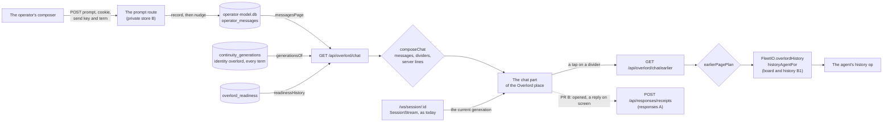
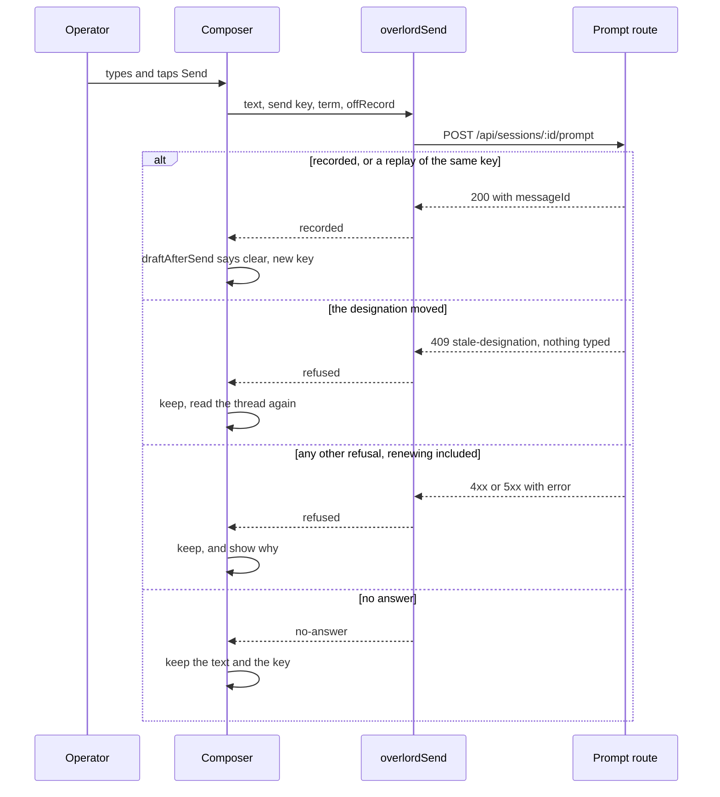

# Overlord W1: the chat Implementation Plan

> **For agentic workers:** REQUIRED SUB-SKILL: Use superpowers:subagent-driven-development (recommended) or
> superpowers:executing-plans to implement this plan task-by-task. Steps use checkbox (`- [ ]`) syntax for tracking.

**Goal:** the Overlord place's seventh part, the chat (Table 4a), shows the operator one long conversation with the
Overlord across its generations:

- **The operator's messages come from the record**, each with its ticks: recorded, delivered or queued, picked up,
  settled. So the chat shows them while the session is asleep, renewing or on another host.
- **The server speaks when the Overlord cannot.** Under a message recorded while the readiness word was not `ready`,
  the chat draws one line of the server's own, such as "Recorded. The Overlord is renewing."
- **The current generation streams from its transcript, as today**, through the session stream the console already
  reads. Nothing typed in the pane is drawn as the operator's words.
- **Earlier generations are read through the history reader**, with a quiet "generation n" divider drawn from the
  generation rows at each renewal.
- **The composer records, and never types.** It sends through the console's prompt route, which records the message
  and then nudges the pane (H7). Each send names the session and term it was composed for, and carries a send key, so a
  retry never records twice and a send to a moved designation is refused, not typed. A refused send keeps the draft,
  `renewing` included. The composer carries the off-the-record toggle (§9.4 rule 9).
- **The console's `opened` receipts in the place.** When the place shows a reply of the Overlord, the console posts
  an `opened` receipt for it through the responses piece's receipts door (C67). This part, with the reply rows it
  names, **waits on operator item 327** (index question 10).

**Why:** R4 puts the operator's surface inside the console, and R9 makes the Overlord place the console's home. H7
makes the operator's words server rows, so the chat must show those rows, never pane text, as the operator's words.
R19 asks that a renewal not be felt: the composer keeps working, and the chat shows a divider, not a banner.

**Architecture:** one bounded context per fact. The chat owns one column and computes everything else at each read.

- **L0, a new `shared/overlordChat.ts`** (C11, the Operator Model): the thread's wire (`ChatEntry`, `ChatThread`), the
  tick stage of each message state (`MESSAGE_TICK_MAP`, a `Record` keyed by the private store's `MessageState`, so the
  message moves table stays the ticks' single source), `chatTicksOf`, the server's line for each readiness word
  (`CHAT_SERVER_LINE_MAP`, total over `shared/overlord-readiness.ts#ReadinessWord`), the earlier-generation request and
  its reader, and the prompt route's answer reader for the chat.
- **L1, `server/src/coord/overlordChat.ts`** (C5, beside the board's composer): `composeChat`, which merges the message
  page, the generation dividers and the server lines into one ordered thread and never folds an unreadable part into an
  empty one; `readinessAt`, the word in force at a time; and `earlierPagePlan`, the history request for one page of an
  earlier generation.
- **L1, the PWA's `pwa/src/overlord/chatWords.ts`:** `draftAfterSend`, `mergeLive` (the record's messages placed in the
  live transcript), `turnOrigin` (what a transcript user turn is: a nudge, a prompt ccrc typed, or text typed in the
  pane), `historyItemsToChat` (an earlier page's items as chat rows) and the tick and divider words.
- **L3, readers and one column.** The private store gains `messagesPage(beforeId, limit)` (a words reader, called by
  the chat's handler alone) and the `offRecord` column, written only by its one insert. The continuity store gains
  `generationsOf(identity)`, a text-free reader of one identity's generations across terms, each with its start's
  conversation id. Readiness is read through the readiness piece's own `readinessHistory`. The earlier-generation read
  reuses board and history B1's port and decider unchanged: `historyAgentFor`, `FleetIO.overlordHistory`,
  `readOverlordHistoryAnswer` and `historyDoorAnswer`.
- **L4, two operator doors** in `server/src/coord/overlordRoutes.ts`: `GET /api/overlord/chat` (the thread) and `GET
  /api/overlord/chat/earlier` (one page of an earlier generation). Each calls the account gate first, as every operator
  door does, then the inbox's one read runner in its operator mode, which counts the console's reads against the
  console's own ceilings and writes one read-ledger line with caller `operator`.
- **The console, `pwa/src/overlord/`** (the directory home B creates): `chatWords.ts` (L1), `useOverlordChat.ts` (L4:
  the reads, the coalesced refresh, the send key) and `OverlordChat.tsx` with its parts (L4). The composer is today's
  `pwa/src/session/Composer.tsx`, gaining opt-in props that leave the Session screen's behaviour unchanged.

Two pull requests (open question 7). PR A ships Tasks 1 to 4, everything but the reply rows. PR B ships Task 5 once the
operator has answered item 327. The send key and the term check are the private store's (its open questions 17 and 18,
added by this plan's fix round 1, in the same pull request as this plan).

**Tech Stack:** TypeScript (ESM), `node:sqlite`, React (the PWA), vitest and vitest's browser mode.

**Spec:** `docs/superpowers/specs/2026-11-09-overlord-design.md`:

- §4: Table 4a's row 7 (Chat, W1), and the bullets under "The chat is one long conversation" (sending is recording;
  operator messages from the record with their ticks; the server speaks when the Overlord cannot; the current generation
  streams from its transcript; earlier generations paged through the history reader with a "generation n" divider; the
  Overlord narrates and never originates; the off-the-record toggle; "Before the record exists", the console keeps the
  draft).
- §3.8, H7: "A message has four states, drawn from server rows ... The chat draws the states as ticks"; "Nothing typed
  in a pane is ever the operator's words ... so can any process of the fleet user"; "The chat shows what each message
  bound" (W2, below).
- §3.1 (the identity `overlord` and its term); §3.3.6, "Earlier generations in the chat"; §3.3.10 (history and
  readers); §3.3.11, "Before the message record exists".
- §6.4, Table 6.4a: the readiness word, "every change of word is a row and an event".
- §4.3, C66 and C67: Table 4.3a's row "A chat reply of the Overlord", and "The console posts an `opened` receipt when it
  opens ... the Overlord place"; C69, "I handled this elsewhere" on the reply.
- §9.4, rule 3 (the operator's signed-in console is one of the store's five callers, and every read leaves a ledger
  line) and rule 9 (off the record); §9.2, "What is never a source".
- §11.1: the rows `operator_messages` and the message moves table (Tables 11.1a and 11.1b); §11.2 (the operator doors);
  §11.5 (older builds); §11.6 (`auth-off` applies to every operator door).
- Table 13.1: H7 is `shape` and ships with the private store, which creates its table. The chat creates no table and no
  door with a `shape` call of its own; its one column rides the private store's file (open question 4).

The W1 index is `docs/superpowers/plans/2026-11-14-overlord-w1.md`, row "Chat", lane F, last. This plan builds on the
index's questions 10 (the Overlord's replies, waiting on item 327), 17 (the operator's doors keep the account gate), 25
and 32 (the read ceilings and `read-ceiling`), 26 (the nudge rides the mail lane) and 33 (the console hides the
Overlord's doors until `overlord-v1`). It reads these piece plans, all on `main` under
`docs/superpowers/plans/2026-11-14-overlord-w1/`: private store (`w1-private-store.md`), board and history
(`w1-board-history.md`), inbox (`w1-inbox.md`), responses (`w1-responses.md`), gates (`w1-gates.md`), designation
(`w1-designation.md`) and ladder (`w1-ladder.md`). The readiness plan (`w1-readiness.md`) is in review beside this one,
and this plan cites its interfaces as written there: `shared/overlord-readiness.ts` (`ReadinessWord`) and
`server/src/coord/overlordReadinessStore.ts#readinessHistory`. Home (`w1-home.md`) is being written; this plan takes the
place's interface from the spec and the index.



*Figure 1. Where each line of the chat comes from. Every source is an existing owner's row or reader. The chat writes
one column, `offRecord`, through the private store's one insert, and one read-ledger line per read. Both doors pass the
account gate first. The dashed arrow is PR B, which waits on item 327.*

## Open questions

Each is a place where the spec is unclear, does not match the tree, or leaves a choice to the plan. The plan builds the
recommendation unless the coordinator or the operator rules otherwise. Fix round 1 (review 2193) added the rulings
marked "(ruled)".

1. **How the console reads earlier generations** (slug `chat-reads-through-operator-doors`). The brief rules that
   earlier generations are read through the board and history door's reader, never a second reader. That door, `POST
   /api/overlord/history`, is the Overlord's: box token and attribution, then the gate order, and "the server's doors
   refuse every caller but the designated session" (`w1-board-history.md`, Goal). The console holds a cookie and no
   box token. **Recommendation:** an operator door, `GET /api/overlord/chat/earlier`, in the same routes file, that
   calls the same reader: it picks the agent with `historyAgentFor`, sends through `FleetIO.overlordHistory`, reads the
   reply through `readOverlordHistoryAnswer` and maps it through `historyDoorAnswer`, with the target chosen by the
   server from the generation row (question 12). One op, one port, one decider and one mapping, so no second reader. Two
   rejected alternatives:
   - **A cookie arm on the Overlord's door.** It would put the operator's credential into a box-token door's gate
     order, whose steps (designation, fence, rung, `not-the-overlord`) have no meaning for the operator, and would make
     the door dual-credential in the auth gate's census.
   - **A console read of the history store.** That is the second reader the ruling forbids, and the server has no path
     to the fleet box's history store.
2. **How one earlier generation is paged** (slug `earlier-generations-page-without-a-cursor`). W1's history door
   carries no cursor and no `next` line (`w1-board-history.md`, question 13), so a page cannot be resumed by cursor.
   The `expand` verb takes a window of its own, `expand --around <uuid> --before N --after N`
   (`ccd/history/recall.mjs#runExpand`, its `EXPAND_TARGET_HINT`), which needs no cursor. **Recommendation:**
   - a generation's first page is the newest entries of its own conversation, named by the conversation id of its
     start (`continuity_starts.uuid`, reached through the generation's `startId`, which is `NOT NULL`);
   - each older page is `expand --around <the oldest entry shown> --before 40 --after 0`.

   `runDescribe` takes a node id, and whether `expand` resolves a conversation id or a per-conversation root node is
   unmeasured, so this arm is likely to end `not-pageable`. Task 3's first step measures it on a fixture store. If no
   verb names a conversation's newest entry, every earlier generation's divider says "Read generation n in `ccrc
   history`" with the command, the door refuses a first page `bad-request` (detail `not-pageable`), and paging joins
   when the history door gains its cursor (the board and history plan's Later list). The task states which arm it
   built.
3. **Where the server's line comes from** (slug `server-line-derived-not-stored`; **ruled, F8**). §4: "When the
   readiness word is not `ready`, the server adds one line of its own at once." The line is derived at each read, never
   stored, because every change of word is already a row written by the readiness lane alone (§6.4), and a stored line
   would be a second writer of the same fact. **The ruling:** the chat reads the readiness rows through the readiness
   piece's own reader, `overlordReadinessStore.ts#readinessHistory(db, sinceMs)`, and adds no reader of its own.
   - It reads with `sinceMs = 0`: every kept row, so the row in force at each message's time is in the answer. The
     readiness lane prunes at 90 days (`w1-readiness.md`, question 13), so the read is bounded by that retention and by
     how rarely the word changes.
   - `readinessAt(rows, at)` answers the word of the newest row at or before `at`. A message older than the oldest kept
     row reads `unmeasured`, because the word in force then is no longer on record.
   - The rows cannot be read: one line under every message, "Recorded. The Overlord's state at the time could not be
     read.", never no line, which would read as `ready`.
   - **One condition on the readiness piece** (the index change below): its prune keeps the newest row, so a word in
     force for more than 90 days is still the row in force. If it does not, a message sent after 90 days of steady
     `ready` reads `unmeasured`, which is honest but wrong.
   - The handler reaches the reader through `registerOverlordRoutes`' deps, bound once in the composition of
     `server/src/server.ts` over the coordination database, with no `CoordStore` delegate.
4. **The off-the-record toggle needs a fact** (slug `off-the-record-is-a-message-column`). §9.4 rule 9: "A message sent
   under it is still recorded and answered, but no feed learns from it." The private store's table has no such column,
   and its feeds are W4's (§9.2). A W1 message sent off the record must still be skipped when W4's feeds start, so the
   fact must be recorded from the first message the toggle covers. **Recommendation:**
   - the private store's next migration (2 if private store A ships one, measured at build) adds `offRecord INTEGER NOT
     NULL DEFAULT 0 CHECK (offRecord IN (0, 1))` to `operator_messages`; a row written before it reads `0`, which is
     right, because no toggle existed;
   - its one writer is the private store's one insert, `recordMessage`, which takes `offRecord` from the prompt route's
     act. A column census pins that (Task 2);
   - the prompt route reads one more body field, `offRecord`, a boolean, and only `true` counts. The private store's
     `promptTargetVerdict` (its open question 18) gains the rule: `offRecord: true` on a prompt that is not a record of
     the designated session refuses `bad-request` (400) before anything is typed, because the toggle names a fact only
     the record can hold. The rule is in that L1 decider, not inline in `server.ts`;
   - `OperatorMessageRow` gains `offRecord`, so the chat draws the mark and W4's feeds read it;
   - the route's answer echoes it, `{ ok: true, messageId, cut, state, replay, offRecord }`. A server below this pull
     request records the message and drops a field it does not read, so a toggled send whose answer carries no
     `offRecord: true` is drawn with "recorded on the record: this server does not know the toggle", never silently.
5. **The kept draft** (slug `kept-draft-on-every-refusal`; the brief's ruling, with F2 and F3 **ruled**).
   - **The chat's composer opts in.** `Composer` gains an opt-in prop, `onRecord: (text) => Promise<ChatSendAnswer>`.
     With it, the composer keeps the text until the answer and asks `draftAfterSend(answer)`, which answers `clear`
     only for `recorded` (a `replay` included) and `keep` for every other answer: each refusal word, `off-shape` and a
     transport failure. Without it, the composer is today's: the Session screen's `onSend` clears at hand-off, its
     failed send lives on as a `PendingSend`, and W1a's `renewing` rule (built by W1a's renewal hand-offs, Task 2, in
     the Session screen's own reading of `ApiError` through `failureOf`) stays where W1a puts it. A characterization
     test pins the Session screen's behaviour before the prop lands and after.
   - **`renewing` included.** The private store records the designated session's message during a renewal and never
     answers it `renewing` (`w1-private-store.md`, question 7). The decider still keeps the draft on it, because a
     server below private store B answers it, and the brief rules the case in.
   - **A lost answer never duplicates** (ruled, F2). The chat makes a send key for each message it composes (a random
     128-bit value, base64url, from `crypto.getRandomValues`) and keeps it with the draft. A retry of the same draft
     carries the same key, and the private store answers the first record with `replay: true` and queues no second
     nudge (its open question 17). The key is replaced only when the draft is cleared or edited.
   - **The send names its target** (ruled, F10). Each send carries `overlordTerm`, the term of the thread it was
     composed in, to the session id of that thread. If the designation moved, the route refuses `stale-designation`
     (409) and types nothing (the private store's open question 18). The chat keeps the draft, reads the thread again,
     and says "The Overlord changed. Your message was not sent; send it again."
   - The Overlord chat shows no `PendingSend` bubble: the record is the bubble, so a recorded message appears with its
     first tick on the next read.
6. **What a transcript user turn is** (slug `pane-text-is-never-the-operators-words`; **ruled, F9**). The current
   generation streams through `/ws/session/:id` (`server/src/sessionws.ts#SessionStream`) and is built into rows by
   `pwa/src/session/chatItems.ts#buildChatItems`, which draws every user turn as a `msg-user` bubble with no origin.
   Any process of the fleet user, the terminal and Remote Control can type into the Overlord's pane (§3.8). **The
   ruling:** `turnOrigin(text)` sorts every user turn, live or from an earlier page, into one of three:
   - **a nudge line** (`operatorMessageNudgeIdOf` answers an id): not drawn; the record's message takes its place
     (question 13);
   - **a prompt ccrc typed** (an exact match of the vocabulary piece's `INJECTED_PROMPTS`): drawn as a quiet system
     line naming it ("ccrc: mail nudge");
   - **anything else:** drawn as "Typed in the Overlord's pane, not from the console", in a style no operator bubble
     uses, with the text as data. Never as the operator's words.

   The recogniser `operatorMessageNudgeIdOf(line)` lives in L0 beside the private store's `operatorMessageSubject`, and
   the envelope's renderer is pinned against it by a round-trip test, so the line has one grammar.
7. **One pull request, or two** (slug `chat-ships-in-two-prs`). The index sizes the chat at "1 PR, 5 tasks". The reply
   rows, the reply's `opened` receipt and its "I handled this elsewhere" control all depend on the answer to item 327
   (question 8). **Recommendation:** PR A ships Tasks 1 to 4 when their needs are met. PR B ships Task 5 after the
   operator's answer.
8. **The Overlord's replies** (the index's question 10, operator item 327; **waits on the item**). W1's tables hold the
   operator's words only. **What waits:** Task 5 alone. What changes with the answer:
   - **(a) recorded at the turn:** a reply is a row in the private store with an integer id, written by the piece the
     answer names. The chat then reads replies from the record as it reads messages. The reply's response row
     (`ResponseRef` `{ kind: 'reply', id }`, responses A) lives in `coord.db`, so it cannot share the reply's
     transaction: it is inserted after the reply's record commits, and the boot pass inserts the row for any recorded
     reply that has none, as I8 re-derives across the two files.
   - **(b) re-read from transcripts at checkpoint time:** a reply has no record id, so `ResponseRef`'s reply arm, typed
     `id: number`, cannot name one. Task 5 then states the reply's key (the transcript entry's uuid) and the responses
     piece's ref changes shape in the same pull request.

   Tasks 1 to 4 build nothing either answer changes.
9. **What every console read writes and counts** (slug `chat-read-ledger-doors`; **ruled, F4**). §9.4 rule 3: the
   operator's signed-in console is one of the store's five callers, and "every read leaves a ledger line".
   - Two door words join the private store's `READ_DOOR_MAP`: `chat` (the thread) and `chat-history` (an earlier
     generation's page), each with a row in the inbox's `READ_CEILINGS` (`shared/overlordInbox.ts`): `chat` 720 an
     hour and `chat-history` 240 an hour, starting values.
   - **The counter counts by caller** (ruled). `servedReadsSince(door, sinceMs, caller)` takes the caller kind: for
     `operator` it counts the operator's lines of that door, and for the Overlord's doors it counts every line but the
     operator's, as today. So the console never spends the Overlord's ceilings, the Overlord never spends the
     console's, and the chat's ceiling test can go red.
   - **One runner, an operator mode** (ruled). `runOverlordRead` takes either the Overlord's pass and door row, as
     today, or `{ caller: 'operator', actor }` from the account gate. In the operator mode it skips the fence-row check,
     reads no turn state, and records caller `operator`, a null `generation`, `generationRead: 'not-a-session'` and a
     null `turnState`, which the private store's `CHECK`s require. Both edits are in inbox-owned files
     (`server/src/coord/overlordRead.ts`, `server/src/operatorModel/store.ts#servedReadsSince`), with tests, in Task 2.
     No second runner.
   - A read past a ceiling answers `read-ceiling` with `retryAfterS`; the chat keeps what is on screen, says "Paused
     updating for a moment", and reads again after `retryAfterS`.
10. **How the chat learns that a tick moved** (slug `chat-ticks-refresh-on-the-session-stream`; **ruled, F5**). Ticks
    move on the server: the mail lane writes `delivered`, the hook `picked up`, `acknowledge` `settled`. No push lane
    carries them to the console. The session stream sends a `beat` every 10 s and transcript `events` at least every
    1.5 s while a turn writes. **The ruling:**
    - **An allow-list of triggers.** The chat re-reads the thread on a transcript `events` frame that holds a user turn
      (the nudge's typing, which is the delivery) or ends a turn (an idle state after `working`, when a pick-up or a
      settlement may have landed), on its own send's answer, and on a timer while any shown message is below
      `picked-up`. Never on `beat`, and never on an assistant text frame.
    - **One coalescer.** All triggers share one coalescer that allows at most one read every 10 seconds. So one open
      place reads at most 360 times an hour, half the `chat` ceiling, and a place where nothing moves reads nothing (the
      timer runs only while a message waits for its pick-up).
    - Two places open at once (a phone and a desk) can reach 720 an hour; the ceiling then answers `read-ceiling`, and
      each keeps its thread (question 9). A hidden tab reads nothing.
11. **What W1 leaves out of §4's chat bullets** (slug `chat-w1-scope`). The spec's text belongs to later waves in three
    places, and W1 draws none of them:
    - the request ids bound to a message, and the project or programme names matched in it (§3.8, §5.3): W2's requests;
    - "I command" opening the open proposals (H8): W3's proposals. In W1 the private store's settlement mark settles a
      message that is exactly "I command" or `/icommand`, and the chat draws its settled tick;
    - the Overlord's summaries citing request ids drawn as live state: W2.

    The Overlord narrates and never originates in W1 too: the chat draws no control from transcript text, and its only
    controls are the composer, the toggle and the divider's "Show generation n".
12. **How a generation is named** (slug `generations-keyed-by-identity-and-term`; **ruled, F6**). The Overlord's
    generations are keyed by the identity `overlord` (§3.1), through designation A's `identityOf(sessionId,
    designation)`, never by session id. `n` restarts with each term (`UNIQUE (identity, term, n)` on
    `continuity_generations`), and each row keeps the session id of the body that ran it. **The ruling:**
    - `generationsOf(db, identity)` reads every generation of `identityOf(...)`'s answer, across terms, in
      `(term, n)` order, each with its `term`, `n`, `sessionId`, `startReportedAt`, whether it is live, and its start's
      `uuid`;
    - a divider and an earlier-page request name a generation by `(term, n)`; a divider reads "generation n", and the
      first divider of a new term reads "term t, generation n", so a rebind is visible;
    - the history target is the generation row's own session id, `{ kind: 'session', session: row.sessionId }`, chosen
      by the server, so a generation from before a rebind is read in its own body's family. It is still the Overlord's
      family, because the row is the identity's.
13. **How the record and the live transcript merge** (slug `merge-record-and-live-by-id`). The thread door answers the
    record's messages; the session stream answers the live transcript. **Recommendation:** one PWA L1 decider,
    `mergeLive(thread, liveItems)`, total:
    - a record message whose nudge line is in the live transcript is drawn at that turn's position, once;
    - a record message with no nudge in the live transcript (queued, not yet typed) is drawn after the newest live item
      whose time is at or before its `at`, or at the end;
    - a message id appears once, whatever both sources say; a nudge naming an id the thread page does not hold draws
      "Operator message n" as a link that reads the page holding it.
14. **Divider times** (slug `dividers-at-the-start-report`; **ruled, F7**). `enteredAt` is the time the walk's column
    last changed state, not the generation's start. A divider uses `startReportedAt`, set once at the mint from the
    start report. That is the hook's clock, while a message's `at` is the server's; the two boxes' clocks may differ by
    seconds, so a message recorded within a few seconds of a renewal may sit on either side of its divider. The plan
    accepts that, and a test pins the order rule (by time, a divider before a message at the same millisecond).

## What exists today

Measured on `main` at `d440a7f41` (2026-11-16).

- **The prompt route.** `POST /api/sessions/:id/prompt`, an inline handler in `server/src/server.ts`. It reads `text`,
  `replaceDraft`, `attachments` and `resume`, and only `true` counts for the two flags. It answers 404 `unknown-session`
  (through `knownId`), 400 `bad-attachment` and `bad-request`, and otherwise passes `server/src/inject/send.ts#sendPrompt`'s
  result through: 200 `{ ok: true, … }` (with an optional `draftRestore`), or 409 with `not-alive`, `dialog-open`,
  `draft-present` (carrying `draft` and `submittable`), `draft-clear-failed`, `verify-failed` or `enter-ignored`. It
  records nothing, and `renewing` is not on `main` yet (W1a's renewal hand-offs add it).
- **The client.** `pwa/src/lib/api.ts` (1,189 lines, growth-checked): `createApi(...).prompt(id, text, opts)` posts and
  answers `Promise<void>`; any non-2xx throws `ApiError` with the parsed body, which `pwa/src/stores/session.ts#failureOf`
  unpacks into `{ error, code, draft, submittable }`. `pwa/src/lib/refusalWords.ts#apiErrorText` renders a refusal's
  words for the operator.
- **The composer.** `pwa/src/session/Composer.tsx#Composer`, props `onSend`, `pending`, `id`, `disabled`,
  `placeholder`, `onResolve`, `busy`, `onInterrupt` and `askUp`, mounted by `pwa/src/screens/SessionScreen.tsx`, whose
  `onSend` is the session store's `send`, a `Promise<void>` that carries no answer. With `id` set it offers attachments
  and slash completion. Its draft is component state; `send()` clears it as soon as it hands the text to `onSend`. A
  failed send lives on as a failed `PendingSend` with retry and resolve (`pwa/src/stores/session.ts`); `draft-present`
  opens `DraftConflict`.
- **The conversation view.** The store opens `/ws/session/:id` (`pwa/src/stores/session.ts`, reduced by
  `applySessionMsg`; a `beat` returns the same snapshot), fed by `server/src/sessionws.ts#SessionStream` (a `beat` every
  10 s) and the transcript tail in `server/src/io.ts` (events at least every 1.5 s while a turn writes). Rows are built
  by `pwa/src/session/chatItems.ts#buildChatItems` (`ChatItem`, kinds including `divider` and `message`; every user turn
  a `msg-user` bubble) and drawn by `pwa/src/session/ChatList.tsx`, `MessageBubble.tsx`, `PendingBubble.tsx` and the
  skin's `TranscriptRow`.
- **Places.** `pwa/src/lib/places.ts#PLACES` holds `fleet`, `waiting`, `inbox`, `runs`, `accounts` and `docs`, with
  `FLEET_PLACE` and `DESK_PLACES`. `pwa/src/overlord/` does not exist; home A and B create it. `pwa/src/face/` is built
  and is read only.
- **Generations.** `continuity_generations` (created in `server/src/coord/schema.ts`): `identity` (a coordinator's
  session id, `overlord` from W1), `term`, `n` with `UNIQUE (identity, term, n)`, `sessionId`, `state`, `outcome`,
  `enteredAt` (the walk's last change), `startReportedAt` (the start's report time, the hook's clock) and `startId`
  (`NOT NULL`, unique, into `continuity_starts`, whose `uuid` is the conversation's id). Read by
  `server/src/continuity/continuityStore.ts#liveGenerations` (every non-ended row); no reader lists one identity's
  generations. `GenRow` is server-only.
- **History.** Board and history PR A is on `main`: `shared/overlordHistory.ts` (the target grammar `all`, `project` or
  `session`, the last one id's family, every generation; `readOverlordHistoryRequest`; `readOverlordHistoryAnswer`, whose
  items are untrusted records) and `ccd/history/overlord-read.mjs` with its worker. `ccd/history/recall.mjs#runExpand`
  windows by `--around <uuid> --before N --after N`, refuses an `around` outside the target's scope, or resumes by its
  own `--cursor`, which the Overlord's answer drops in W1; `#runDescribe` takes a node id.
- **Browser tests.** `pwa/browser/*.browser.test.ts(x)` in vitest's browser mode (`pwa/vitest.browser.config.ts`), each
  file declaring its widths, typically `const WIDTHS = [360, 390, 1280, 1920]` crossed with `SKINS` and `THEMES`
  (`account-knob.browser.test.ts`, `compaction-fold.browser.test.ts`); `chat-width.browser.test.ts` checks the session
  chat at desk width.
- **Growth-checked files** (`server/test/growthCheck.ts#GROWTH_FILES`): this plan touches `pwa/src/lib/api.ts` and
  `server/src/server.ts`. It does not touch `shared/api.ts`, `server/src/watch.ts`, `server/src/sessionws.ts`,
  `server/src/coord/schema.ts`, `server/src/coord/store.ts` or `server/src/coord/routes.ts`.
- **Masked reads.** `server/src/server.ts#MASKED_GET_ROUTES` (`'/api/fleet'`, `'/api/sessions/:id/pr'`, …).
- **PWA rings.** `server/test/rings/pwa-rings.test.ts` holds `server/test/rings/pwa-rings.data.ts#PWA_L1_EXEMPTIONS`
  empty: an L1 module (a `*Words.ts` file) imports no `.tsx`, store or `lib/api.ts`. A new directory's context row comes
  from the architecture spec's path table (`server/test/rings/ringContextMap.ts`).
- **Mutation sets.** `MUTANT_SETS` already reaches `pwa/src` (`server/test/sim/faceSets.ts`).

Not on `main`, taken from the piece plans named above: the private store and its prompt route record (private store A
and B), `overlordRoutes.ts`, `designationRead()` and `identityOf` (designation A), `OVERLORD_DOORS` (gates A),
`runOverlordRead`, `servedReadsSince`, `READ_CEILINGS` and `operator-message-readers.test.ts` (inbox), the history door's
port and decider (board and history B1), the receipts door (responses A), the readiness word and `readinessHistory`
(readiness), `INJECTED_PROMPTS` (vocabulary), and the Overlord place (home A and B).

## Global Constraints

- **Architecture (`CLAUDE.md`).**
  - `shared/overlordChat.ts` is L0: it imports only types and maps from `./operatorMessages.js`,
    `./overlord-readiness.js` and `./overlordHistory.js`. Each literal union carries its `Record<X, …>` map
    (`rings/wire-totality.test.ts`).
  - `server/src/coord/overlordChat.ts` is L1: pure, no `fs`, no store, no clock; `now` is an argument. It imports
    `shared/` only.
  - The readers are L3 and keep every distinction they read: `generationsOf` answers rows or `unmeasured`, and
    `messagesPage` answers rows (possibly none, with `more: false`) or `unmeasured`. No overloaded null at a seam.
  - The two handlers are L4 and decide nothing: the gate is the account gate's, the thread `composeChat`'s, the page
    plan `earlierPagePlan`'s, the agent `historyAgentFor`'s and the answer `historyDoorAnswer`'s.
  - `pwa/src/overlord/chatWords.ts` is L1 (no `.tsx`, store or `lib/api.ts` import); `useOverlordChat.ts` and the
    components are L4.
- **One writer for each fact.**
  - `operator_messages.offRecord` and `operator_messages.sendKey`: the private store's `recordMessage`, at the insert.
    A column census pins both (Task 2).
  - The read-ledger lines of the two doors: the private store's `recordRead`, called by the runner.
  - The chat stores nothing else. The server's line, the ticks and the dividers are computed at each read.
- **Consolidate, don't duplicate.**
  - The ticks derive from the private store's `MessageState` through one `Record`, never a second list of states.
  - The earlier generation's read is the history door's reader (question 1); readiness is `readinessHistory`
    (question 3); the ceiling count is the inbox's counter and runner, widened (question 9).
  - The conversation view reuses `SessionStream`, `buildChatItems` and the transcript rows; the composer is `Composer`;
    refusal words are `apiErrorText`'s.
- **Fail closed.**
  - Sign-in off: both doors refuse `auth-off` before any read, as every operator door does (Table 11.6, ruled F1).
  - An unreadable designation answers 502 `unmeasured` and draws no thread.
  - An unreadable message page draws "Messages could not be read", never an empty conversation; an unreadable
    generation list draws no divider and says so once; an unreadable readiness history draws the `unmeasured` line
    under every message (question 3).
  - An answer with no `messageId` keeps the draft (question 5).
- **Phone first.** The chat is designed at 360 px wide first. Every new component is tested in the browser suite at
  360, 390, 1280 and 1920 px, in every skin and theme, with no horizontal overflow and the composer above the phone
  bar.
- **Public repository.** Fixtures use neutral stand-ins (`lane-a`, `project-a`, `the fleet box`), and no fixture text
  looks like a secret.
- **Mutation floors.** Every new L1 decider joins `server/test/sim/mutation-floors.test.ts`'s `MUTANT_SETS` and
  `server/test/sim/mutation-floors.json` in the commit that creates it: `chatTicksOf`, `readinessAt`, `composeChat`,
  `earlierPagePlan`, `operatorMessageNudgeIdOf`, `readChatThread`, `readChatSendAnswer`, `readChatEarlierQuery`, and
  the PWA's `draftAfterSend`, `mergeLive`, `turnOrigin` and `historyItemsToChat` (as `faceSets.ts` registers PWA
  deciders).
- **Censuses with every door.** Each new door moves every census it touches in the same commit (Task 2 and Task 3
  list them).

## Review Focus

- **The record is the only source of the operator's words.** No path draws a transcript user turn, live or earlier, as
  an operator message (question 6).
- **Both doors are closed while sign-in is off**, before any store read or ledger line (F1).
- **No second reader.** The earlier-generation door calls the history door's port, decider and mapping; readiness is
  read through `readinessHistory`; nothing in `pwa/src` or `server/src` opens the history store or spawns `ccrc
  history`.
- **The console's reads count against the console's ceilings**, and a test reds when the counter forgets the caller.
- **A send records once and only where it was meant.** A retry with the same key replays; a moved designation refuses
  `stale-designation` and types nothing.
- **The Session screen does not change.** The composer's new behaviour is opt-in, pinned by a characterization test.
- **Generations by identity and term.** A rebind's earlier generations are found and read in their own body's family.
- **"Unmeasured" is never "nothing".** No unreadable part renders as an empty thread, no divider list as a single
  generation, and no readiness history as `ready`.
- **Growth.** `pwa/src/lib/api.ts` and `server/src/server.ts` stay within their 40-line check (the PR split).

## The PR split

| PR | Tasks | What it ships | Needs first | Growth-checked files, estimate |
|---|---|---|---|---|
| A, the chat | 1 to 4 | The chat's vocabulary and deciders; the `offRecord` fact; the inbox runner's operator mode and the counter by caller; the thread door and the earlier-generation door with every census; the chat part of the Overlord place, with ticks, server lines, dividers, the live generation with every pane turn's origin, earlier pages, the opt-in composer with the kept draft, the send key, the term and the toggle; the browser suite at every width | home B (`pwa/src/overlord/`, the place and its slot for part 7); private store B (the record, the send key, `promptTargetVerdict`, the answer); designation A (`overlordRoutes.ts`, `designationRead()`, `identityOf`); gates A (`OVERLORD_DOORS`); the inbox (`runOverlordRead`, `servedReadsSince`, `READ_CEILINGS`, `operator-message-readers.test.ts`); board and history B1 (the port and the decider); readiness (`ReadinessWord`, `readinessHistory`, and a prune that keeps the newest row); the vocabulary (`INJECTED_PROMPTS`); W1a renewal hand-offs (the Session screen's `renewing` rule, which the characterization test pins) | `pwa/src/lib/api.ts` about +18 (three calls, the answer type, imports); `server/src/server.ts` about +8 (two `MASKED_GET_ROUTES` entries, the `offRecord` field, the readers' wiring into the routes' deps) |
| B, the replies | 5 | The reply rows' insert where the answer to item 327 puts it; the place's `opened` receipt for each reply shown; the reply's "I handled this elsewhere" control | PR A; responses A (the receipts door) and responses B (the handled door); the operator's answer to item 327 (**waits on item**) | `pwa/src/lib/api.ts` about +4 (if the responses piece's receipt call does not already serve the console); others 0 |

**Order:** PR A when every "needs first" above has merged. It is the last pull request of lane F in W1, and
`overlord-v1` needs it. PR B after PR A, the responses pieces and the operator's answer. `overlord-v1` does not wait for
PR B (open question 7): the chat works without reply rows, which only measure.

**What later pieces read** (the states this piece exposes):
- W4's feeds (§9.2): `operator_messages.offRecord`, which they skip.
- W2's requests: the thread's message entry is the place where the bound request ids and matched names are drawn; W2
  adds a field to `ChatEntry`'s message arm and changes no W1 field.
- W3's proposals: the composer's "I command" path opens the proposals list in front of the settlement mark.
- `overlord-v1`: the place's chat is complete, so the console may show the Overlord's doors.

---

### Task 1: The chat's vocabulary and deciders

**Files:**
- Create: `shared/overlordChat.ts` (C11, L0)
- Create: `server/src/coord/overlordChat.ts` (C5, L1: `composeChat`, `readinessAt`, `earlierPagePlan`)
- Create: `pwa/src/overlord/chatWords.ts` (L1: `draftAfterSend`, `mergeLive`, `turnOrigin`, `historyItemsToChat`, the
  tick, divider and origin words)
- Modify: `shared/operatorMessages.ts` (`operatorMessageNudgeIdOf` and the nudge line's grammar, beside
  `operatorMessageSubject`; `READ_DOOR_MAP` gains `chat` and `chat-history`)
- Modify: `shared/overlordInbox.ts` (`READ_CEILINGS` gains `chat: { perHour: 720 }` and `'chat-history': { perHour: 240
  }`; question 9)
- Modify: `server/src/coord/envelope.ts` (`renderOperatorMessageNudge` renders from the L0 grammar)
- Modify: `server/test/sim/mutation-floors.test.ts`, `server/test/sim/mutation-floors.json` and
  `server/test/sim/faceSets.ts` (or its sibling for `pwa/src/overlord/`, as the builder measures)
- Test: `server/test/overlord-chat-vocab.test.ts`, `server/test/overlord-chat-compose.test.ts`,
  `pwa/test/overlord-chat-words.test.ts` (new)

**Interfaces:**

```ts
// shared/overlordChat.ts
import type { MessageState, OperatorMessageRow } from './operatorMessages.js';
import type { ReadinessWord } from './overlord-readiness.js';
import type { OverlordHistoryAnswer } from './overlordHistory.js';

/** The four ticks of H7, in order. `delivery` reads "queued" or "delivered" by the row's stamps. */
const TICK_STAGE_MAP = { recorded: 'recorded', delivery: 'delivered or queued', 'picked-up': 'picked up',
  settled: 'settled' } as const;
export type TickStage = keyof typeof TICK_STAGE_MAP;
export const TICK_STAGES = Object.keys(TICK_STAGE_MAP) as TickStage[];
/** The furthest tick each message state reaches. Keyed by the private store's own type, so a new state is a compile
 *  error here until it is placed (the message moves table is the single source). `spent` reaches `settled`. */
export const MESSAGE_TICK_MAP: Readonly<Record<MessageState, TickStage>>;
export interface ChatTicks {
  /** Each tick lit by its own stamp, or by the row's state reaching it. A gap is drawn as a gap: a message settled by
   *  the mark before any delivery lights `recorded` and `settled` only. */
  readonly lit: Readonly<Record<TickStage, boolean>>;
  readonly delivery: 'queued' | 'delivered' | null;
  readonly settledBy: OperatorMessageRow['settledBy'];
  readonly unknown: boolean;                    // a state word this build cannot read: `recorded` only
}
export function chatTicksOf(row: OperatorMessageRow): ChatTicks;

/** The server's line under a message recorded while the word was not `ready`. `ready` draws none. */
export const CHAT_SERVER_LINE_MAP: Readonly<Record<ReadinessWord, string | null>>;
export const CHAT_SERVER_LINE_UNMEASURED = "Recorded. The Overlord's state at the time could not be read.";

/** A generation by its key (question 12). */
export interface GenerationKey { readonly term: number; readonly n: number }
export type ChatEntry =
  | { readonly kind: 'message'; readonly row: OperatorMessageRow; readonly ticks: ChatTicks }
  | { readonly kind: 'server-line'; readonly messageId: number; readonly text: string;
      readonly word: ReadinessWord | 'unmeasured' }
  | { readonly kind: 'divider'; readonly gen: GenerationKey; readonly at: number; readonly current: boolean;
      readonly newTerm: boolean; readonly earlier: 'readable' | 'not-pageable' };
export type ChatPart<T> = { readonly kind: 'read'; readonly value: T } | { readonly kind: 'unmeasured'; readonly why: string };
export interface ChatThread {
  readonly v: 1;
  readonly designation: 'designated' | 'none';
  readonly sessionId: string | null;             // null only with `designation: 'none'`
  readonly term: number | null;                  // the term a send from this thread carries (question 5)
  readonly entries: readonly ChatEntry[];         // oldest first
  readonly messages: ChatPart<{ readonly more: boolean }>;
  readonly generations: ChatPart<{ readonly count: number }>;
  readonly readiness: ChatPart<{ readonly oldest: number | null }>;
}
/** Reads a thread; an entry of a kind this build does not know is skipped and counted, never a refusal (additive). */
export function readChatThread(raw: unknown):
  { ok: true; thread: ChatThread; skipped: number } | { ok: false; detail: string };

/** One page of an earlier generation. */
export interface ChatEarlierRequest { readonly gen: GenerationKey; readonly around: string | null }
export function readChatEarlierQuery(q: unknown): { ok: true; req: ChatEarlierRequest } | { ok: false; detail: string };
export type ChatEarlierAnswer =
  | { readonly ok: true; readonly gen: GenerationKey; readonly page: OverlordHistoryAnswer }
  | { readonly ok: false; readonly error: string; readonly cause?: string };

/** The prompt route's answer as the chat reads it (private store B's additive shape). */
export type ChatSendAnswer =
  | { readonly kind: 'recorded'; readonly messageId: number; readonly cut: boolean; readonly replay: boolean;
      readonly offRecord: boolean }
  | { readonly kind: 'refused'; readonly error: string; readonly retryAfterS?: number }
  | { readonly kind: 'off-shape' }
  | { readonly kind: 'no-answer' };                // a transport failure: the request may or may not have landed
export function readChatSendAnswer(status: number, body: unknown): ChatSendAnswer;
```

```ts
// server/src/coord/overlordChat.ts
export interface GenerationFact extends GenerationKey {
  readonly sessionId: string;                    // the body that ran it (question 12)
  readonly startReportedAt: number;              // the hook's clock (question 14)
  readonly live: boolean;
  readonly conversation: string;                 // the start's uuid
}
export interface ReadinessChange { readonly at: number; readonly word: ReadinessWord }
export interface ChatFacts {
  readonly designation: { kind: 'designated'; sessionId: string; term: number } | { kind: 'none' };
  readonly messages: { kind: 'rows'; rows: readonly OperatorMessageRow[]; more: boolean } | { kind: 'unmeasured'; why: string };
  readonly generations: { kind: 'rows'; rows: readonly GenerationFact[] } | { kind: 'unmeasured'; why: string };
  readonly readiness: { kind: 'rows'; rows: readonly ReadinessChange[] } | { kind: 'unmeasured'; why: string };
  readonly pageable: boolean;                    // Task 3's measured arm (question 2)
}
/** The word in force at `at`: the newest change at or before it; `unmeasured` when `at` is before every kept row. */
export function readinessAt(changes: readonly ReadinessChange[], at: number): ReadinessWord | 'unmeasured';
/** One ordered thread: each message, its server line when its word was not `ready`, and a divider before the first
 *  entry of each generation by `startReportedAt` (a divider first on a tie). Total; an unreadable part is reported in
 *  its own field. */
export function composeChat(f: ChatFacts): ChatThread;
/** The history request for one page of a generation, or why none can be made. The target is the row's own session. */
export function earlierPagePlan(gen: GenerationFact | null, around: string | null, pageable: boolean):
  { kind: 'request'; request: OverlordHistoryRequest }
  | { kind: 'refuse'; why: 'no-generation' | 'current' | 'not-pageable' };
```

```ts
// pwa/src/overlord/chatWords.ts
export function draftAfterSend(a: ChatSendAnswer): 'clear' | 'keep';     // clear only for `recorded`
export type TurnOrigin = { kind: 'nudge'; id: number } | { kind: 'ccrc'; name: string } | { kind: 'pane' };
export function turnOrigin(text: string): TurnOrigin;                     // question 6
export function mergeLive(thread: readonly ChatEntry[], live: readonly TranscriptItem[]): readonly ChatRow[];  // question 13
export function historyItemsToChat(items: readonly Record<string, unknown>[]): readonly ChatRow[];
```

`historyItemsToChat` maps each history item by its role field to an assistant row or a user turn, which then goes
through `turnOrigin` like a live one; an item with no readable role or text is drawn as one untrusted text block, never
dropped and never as the operator's words. The fields it reads are measured on the fixture store in Task 3 and pinned
there.

**The server's lines** (`CHAT_SERVER_LINE_MAP`, starting wording, total over the readiness plan's `READINESS_WORDS`):

| Word | Line |
|---|---|
| `ready` | none |
| `absent` | Recorded. No Overlord is bound. |
| `off` | Recorded. The Overlord is off. |
| `unmeasured` | Recorded. The Overlord's state could not be read. |
| `dead` | Recorded. The Overlord is down. |
| `restarting` | Recorded. The Overlord is restarting. |
| `renewing` | Recorded. The Overlord is renewing. |
| `degraded` | Recorded. The Overlord is degraded: chat only. |
| `stranded` | Recorded. No account can serve the Overlord now. |
| `dialog-open` | Recorded. A dialog is open in the Overlord's pane. |
| `wedged` | Recorded. The Overlord's turn is stuck. |
| `deaf` | Recorded. The Overlord has not been picking up messages. |
| `saturated` | Recorded. The Overlord's inbox is behind. |
| `unproved` | Recorded. The Overlord has not yet shown it is ready. |

*Table 1. The server's line for each readiness word. A history that cannot be read, or a message older than every kept
row, draws `CHAT_SERVER_LINE_UNMEASURED` (question 3). If the readiness plan adds a word, this `Record` is a compile
error until its line is written.*

- [ ] **Step 1: Failing tests.**
  - `overlord-chat-vocab.test.ts`:
    - each map's keys equal its list, and each list is written out in the test;
    - `MESSAGE_TICK_MAP` has a row for every `MESSAGE_STATES` word, written out; `spent` reaches `settled`;
    - `chatTicksOf` lights each tick by its stamp or the state: `queued` lights `recorded` and `delivery` (`queued`);
      a `picked-up` row with no `deliveredAt` (the hook beat the lane) lights `recorded` and `picked-up`, `delivery`
      `null`; a row settled by the mark before any delivery lights `recorded` and `settled` only, `settledBy: 'mark'`;
      a row whose state is `unknown` lights `recorded` only and sets `unknown`;
    - `CHAT_SERVER_LINE_MAP` answers `null` for `ready` alone, and a line for every other word;
    - `operatorMessageNudgeIdOf` answers the id for `renderOperatorMessageNudge(12)`'s line, for ids 1 and
      2^53 - 1, and `null` for the mail nudge, the inbox wake line, the line with a trailing word, a leading space,
      id 0, a signed id and a decimal;
    - `readChatThread` reads a composed thread back; skips and counts an entry of an unknown kind; refuses a missing
      `v` and a part whose kind is neither `read` nor `unmeasured`; ignores an unknown key;
    - `readChatSendAnswer`: 200 with `messageId` reads `recorded`, carrying `replay` and the `offRecord` echo; 200 with
      no `messageId` (an older server, or the route's typing path) reads `off-shape`; each refusal status with an
      `error` reads `refused`, with `retryAfterS` on `read-ceiling`; a body that is not an object reads `off-shape`;
    - `readChatEarlierQuery`: `term` and `n` positive safe integers; `around` absent or a uuid; anything else refused.
  - `overlord-chat-compose.test.ts`:
    - `readinessAt`: before the oldest row reads `unmeasured`; at a change reads that change's word; between two
      changes reads the earlier; with no rows reads `unmeasured`;
    - `composeChat`: messages oldest first; a server line right after each message whose word was not `ready`, and none
      after a `ready` one; a divider before the first message of each generation by `startReportedAt`, a divider first
      on a tie, marked `current` for the live one; the first divider of a new term sets `newTerm`; a generation with no
      message still draws its divider; every divider is `not-pageable` when `pageable` is false;
    - each unreadable part: messages `unmeasured` gives no message entries and `messages.kind = 'unmeasured'` (never an
      empty `read`); generations `unmeasured` gives no dividers; readiness `unmeasured` gives
      `CHAT_SERVER_LINE_UNMEASURED` under every message; no designation gives `designation: 'none'` and no entries;
    - `earlierPagePlan`: the live generation refuses `current`; no row refuses `no-generation`; `pageable` false refuses
      `not-pageable`; a first page names the conversation by Task 3's arm; an older page is `expand --around <uuid>
      --before 40 --after 0`; the target is always `{ kind: 'session', session: gen.sessionId }`, and a generation run
      by a rebound body's old session names that old session; every request passes `readOverlordHistoryRequest`;
    - the envelope round trip: `operatorMessageNudgeIdOf(renderOperatorMessageNudge(n)) === n` for a spread of `n`.
  - `overlord-chat-words.test.ts` (pwa):
    - `draftAfterSend`: `clear` for `recorded` with and without `replay` and `cut`; `keep` for `renewing`,
      `stale-designation`, `unmeasured`, `auth-off`, `unauthenticated`, `insecure-origin`, `bad-request`,
      `journal-unreadable`, `journal-unwritable`, `write-failed`, `read-ceiling`, `off-shape` and `no-answer`;
    - `turnOrigin`: a nudge line answers `nudge` with its id; each `INJECTED_PROMPTS` string answers `ccrc` with its
      name; any other text, a near-miss of a nudge line included, answers `pane`;
    - `mergeLive`: a message whose nudge is live sits at the nudge's position; a queued message with no live nudge sits
      by time; no id is drawn twice; a nudge for an id outside the page draws the link row;
    - `historyItemsToChat`: an assistant item, a user item that is a nudge (replaced), a user item that is pane text
      (drawn as pane text), and an item with no role (one untrusted block).
- [ ] **Step 2: Run.** `ccrc test -- ./node_modules/.bin/vitest run test/overlord-chat-vocab.test.ts
  test/overlord-chat-compose.test.ts` from `server/`, and `ccrc test -- ./node_modules/.bin/vitest run
  test/overlord-chat-words.test.ts` from `pwa/`. Red.
- [ ] **Step 3: Implement.**
- [ ] **Step 4: Run** these, `rings/*.test.ts` (`wire-totality` and `pwa-rings` among them), the inbox's
  `READ_CEILINGS` totality test, the private store's vocabulary test (`READ_DOOR_MAP` keys), both server `tsc` runs and
  pwa's `tsc`. Green.
- [ ] **Step 5: Mutation.** Register the twelve deciders of Global Constraints in `MUTANT_SETS`, with measured floors.
  By hand: let `ready` draw a line (red); fold `unmeasured` readiness into `ready` (red); let `chatTicksOf` light
  `delivery` on a mark-settled row with no delivery stamp (red); let the recogniser accept a trailing word (red); let
  `earlierPagePlan` target the designated session instead of the row's (the rebind case reds); let `turnOrigin` answer
  `nudge` for pane text (red); let `readChatThread` refuse an unknown entry kind (red). Revert each.
- [ ] **Step 6: Commit.** `feat(overlord): the chat's vocabulary, its ticks from the message moves, and its composers (Overlord W1)`

### Task 2: The thread door, the operator mode of the read runner, and the `offRecord` fact

**Files:**
- Modify: `server/src/operatorModel/schema.ts` (the next migration: `offRecord`; question 4)
- Modify: `server/src/operatorModel/store.ts` (`recordMessage` takes `offRecord`; every reader returns it;
  `messagesPage(beforeId, limit)`, a words reader: the newest `limit` rows below `beforeId`, oldest first, with `more`,
  or `unmeasured`; `servedReadsSince(door, sinceMs, caller)`, question 9)
- Modify: `shared/operatorMessages.ts` (`OperatorMessageRow` gains `offRecord: boolean`)
- Modify: `server/src/operatorModel/messages.ts` (`promptTargetVerdict` gains the `offRecord` rule; question 4)
- Modify: `server/src/operatorModel/promptRecord.ts` (passes `offRecord`; the answer echoes it)
- Modify: `server/src/coord/overlordRead.ts` (the runner's operator mode; question 9)
- Modify: `server/src/server.ts` (the prompt route reads `offRecord`; `MASKED_GET_ROUTES` gains `'/api/overlord/chat'`
  and `'/api/overlord/chat/earlier'`; the readers `messagesPage`, `generationsOf` and `readinessHistory` reach
  `registerOverlordRoutes`' deps)
- Modify: `server/src/continuity/continuityStore.ts` (`generationsOf(db, identity)`: every generation of one identity,
  across terms, in `(term, n)` order, with `sessionId`, `startReportedAt`, whether it is live, and its start's `uuid`
  joined through `startId`; or `unmeasured`; text-free)
- Modify: `server/src/coord/overlordRoutes.ts` (`GET /api/overlord/chat`, the handler)
- Modify: `server/src/coord/overlordDoors.ts` (`OVERLORD_DOORS` gains `chat`: `GET /api/overlord/chat`,
  `coord/overlordRoutes.ts`, group `operator`, verb class `view`)
- Modify (censuses):
  - `server/test/auth-gate.test.ts` (the routes file's count, its sentences and the total route count);
  - `server/test/box-token-census.test.ts` (`OVERLORD_OPERATOR_DOORS` gains `/api/overlord/chat`);
  - `CLAUDE.md` (the box-token paragraph's sentence naming `overlordRoutes.ts`' operator doors gains the chat's two
    reads, "the operator's reads of the chat, behind the account gate");
  - `server/test/secret-mask.test.ts` (the two masked reads);
  - `server/test/operator-message-readers.test.ts` (ruled, M6): `messagesPage` joins the scanned words readers; the
    chat's path joins `OPERATOR_MESSAGE_DOORS`; `chat` joins `TEXT_READING_DOORS`;
  - `server/test/single-definition/writers-map.test.ts`: a column check for `operator_messages.offRecord` and
    `sendKey`, each written only in `recordMessage`'s insert (the private store's describe is per table, so the
    column needs its own check);
  - `server/test/single-definition/time-ports.test.ts` and `server/test/rings/fastify-l4.data.ts` (`overlordRoutes.ts`
    is already listed by designation A; measured at build).
- Test: `server/test/overlord-chat-door.test.ts` (new), `server/test/operator-model-store.test.ts` (the migration,
  `messagesPage`, `servedReadsSince` by caller), `server/test/overlord-read-runner.test.ts` (the inbox's runner suite,
  extended), `server/test/overlord-prompt-record.test.ts` (the flag), `server/test/continuity-generations-of.test.ts`
  (new)

**The door.** `GET /api/overlord/chat?before=<id>`, session-gated when sign-in is armed (not in `auth/gate.ts`'s
`EXEMPT`), and refused while sign-in is off (ruled, F1):
1. The account gate, `createAccountGate` with `cap: null`, as every operator door (index question 17). A refusal
   answers as the gate answers (`auth-off`, `insecure-origin`, `unauthenticated`), with no store read and no ledger
   line.
2. `designationRead()` (designation A's three arms): `unmeasured` answers 502 `unmeasured`; `not-designated` answers
   200 with `designation: 'none'` and no entries, a measured absence and not a refusal; `designated` carries the session
   id and term.
3. The read runner in its operator mode (question 9), door `chat`, with the gate's actor: the ceiling first, then the
   read.
4. The facts, each read once: `messagesPage(before, 100)`, `generationsOf(identityOf(sessionId, designation))` and
   `readinessHistory(0)`.
5. `composeChat(facts)`, answered 200 as `ChatThread`. A part that could not be read is in the thread as `unmeasured`,
   so a partial read is still 200, and the chat says which part is missing.
6. The read-ledger line, written by the runner: door `chat`, caller `operator`, scope `session:<id>`, the message
   count, the outcome (`rows`, or the first unmeasured part's word), `generationRead: 'not-a-session'` and a null
   `turnState`.

- [ ] **Step 1: Failing tests.**
  - `operator-model-store.test.ts`: the migration on a file at the previous version adds the column, and a row written
    before it reads `offRecord: false`; a file at a higher version is read and never migrated (the shared opener's
    rule), and its readers still answer; `recordMessage` with `offRecord: true` reads back `true`; `messagesPage` on an
    empty store, below the first id, at a page boundary (`more` true, then false), and on a closed store
    (`unmeasured`); `servedReadsSince(door, since, 'operator')` counts only the operator's `rows` lines of that door,
    and `servedReadsSince(door, since, 'overlord')` counts every other caller's, as today.
  - `overlord-read-runner.test.ts`: the operator mode skips the fence-row check and the turn read, writes caller
    `operator`, a null `generation`, `not-a-session` and a null `turnState`; the Overlord mode is unchanged (the inbox's
    existing cases green); an operator's reads never refuse an Overlord read past its ceiling, and the reverse.
  - `overlord-prompt-record.test.ts`: a prompt to the designated session with `offRecord: true` records `true` and the
    answer echoes it; with `offRecord: 'yes'` or absent records `false`; a prompt to another session with `offRecord:
    true` answers 400 `bad-request`, types nothing and records nothing; without it, types as today.
  - `continuity-generations-of.test.ts`: the identity `overlord`'s generations across two terms in `(term, n)` order,
    each with its own body's `sessionId` (a rebind fixture: term 1 run by `lane-a-overlord`, term 2 by
    `lane-b-overlord`), the live one marked, the start's `uuid` joined; another identity's rows absent; a closed
    database reads `unmeasured`.
  - `overlord-chat-door.test.ts` (through `buildServer` with a fixture designation, store, generations and readiness
    rows):
    - a designated Overlord with three messages across two generations answers both dividers, the three messages in
      order with their ticks, and one server line under the message recorded while `renewing`;
    - after a rebind, the dividers of both terms are answered, the first of term 2 with `newTerm`;
    - `before` pages back, and `more` is right at both ends;
    - an unreadable store answers 200 with `messages.kind = 'unmeasured'` and no message entry; an unreadable
      readiness history draws the `unmeasured` line under each message; an unreadable generation list draws no divider
      and reports `generations.kind = 'unmeasured'`;
    - `designationRead()` `unmeasured` answers 502; no designation answers 200 with `designation: 'none'` and no entry;
    - **sign-in off answers `auth-off`, with no store read and no ledger line** (F1); a plain-HTTP origin answers
      `insecure-origin`; sign-in armed with no cookie answers 401; each writes no line;
    - past the `chat` ceiling, `read-ceiling` with `retryAfterS` and no read; the count includes only operator lines
      (a fixture of Overlord `messages` lines does not move it);
    - each served read writes one read-ledger line with caller `operator`, door `chat` and a null `turnState`;
    - the answer passes the GET mask, and holds no text the store did not hold (neutral fixture text only).
  - The census suites: `auth-gate`, `box-token-census` (both directions, with `CLAUDE.md`'s sentence),
    `secret-mask`, `operator-message-readers` (a planted `messagesPage` call in a lane function is red; the chat
    handler's is allowed), `writers-map` (the column check), and the gates piece's `overlord-doors-census`.
- [ ] **Step 2: Run.** Red.
- [ ] **Step 3: Implement.**
- [ ] **Step 4: Run** these, the private store's suites, the inbox's suites, the continuity store's suites,
  `growth-check.test.ts` armed for `server/src/server.ts`, `rings/*.test.ts`, both server `tsc` runs. Green.
- [ ] **Step 5: Mutation.** Skip the account gate (the sign-in-off case reds); let the door read the readiness history
  as `ready` when it fails (red); let `messagesPage` answer an empty page for a closed store (red); drop the `offRecord`
  rule from `promptTargetVerdict` (red); write `offRecord` in a second statement (the column check reds); let
  `servedReadsSince` ignore the caller (the ceiling case reds); write the ledger line before the ceiling (red); call
  `messagesPage` from a lane function (the census reds). Revert each.
- [ ] **Step 6: Commit.** `feat(overlord): the chat's thread door behind the account gate, the console's own read ceilings, and off the record as a fact (Overlord W1)`

### Task 3: The earlier-generation door, through the history reader

**Files:**
- Modify: `server/src/coord/overlordRoutes.ts` (`GET /api/overlord/chat/earlier`, the handler)
- Modify: `server/src/coord/overlordDoors.ts` (`OVERLORD_DOORS` gains `chat-earlier`, group `operator`, verb class
  `view`)
- Modify (censuses): `server/test/auth-gate.test.ts`, `server/test/box-token-census.test.ts`'s
  `OVERLORD_OPERATOR_DOORS`, `CLAUDE.md`'s box-token paragraph (Task 2's sentence names both reads), and
  `server/test/secret-mask.test.ts`
- Create: `server/test/fixtures/overlord-chat-history/` (a fixture history store of two generations of one family and
  one of a second family, neutral text only)
- Test: `server/test/overlord-chat-earlier.test.ts` (new)

**Step 1 measures before any code** (question 2): on the fixture store, through `ccd/history/overlord-read.mjs`'s
`overlordRead`, which of `describe <conversation uuid>` and `expand <conversation uuid or its root node>` answers the
conversation's newest entries with their uuids; that `expand --around <uuid> --before 40 --after 0` answers the 40
entries before it; which item fields carry the role, the text and the conversation id (for `historyItemsToChat` and the
check below). The result is a characterization test, `overlord-chat-earlier.test.ts`'s first case, and the commit
message records the arm built: `paged`, or `not-pageable`.

**The door.** `GET /api/overlord/chat/earlier?term=<t>&n=<n>&around=<uuid>`, session-gated when armed:
1. The account gate, as Task 2's step 1 (F1).
2. `readChatEarlierQuery`; a refusal answers 400 `bad-request` before any read.
3. `designationRead()`, as Task 2.
4. The read runner's operator mode, door `chat-history`: the ceiling, then the read.
5. `generationsOf(identityOf(...))`, the row for `(term, n)`, then `earlierPagePlan(row, around, pageable)`. A refusal
   answers 400 `bad-request` with its `why`.
6. `historyAgentFor(links)`, then `FleetIO.overlordHistory(request, signal)`, then `historyDoorAnswer(outcome)`, all
   board and history B1's, unchanged. Its Table 2 is this door's table too: `history-unreachable` with its cause (503),
   or 200 with the page.
7. **The page stays in its generation** (M4). When Step 1 measured that items carry their conversation id, the door
   answers only the items of the requested generation's conversation and counts those; when they do not, the ledger
   scope names the `around` uuid, so it never claims more than it read.
8. The read-ledger line, on every read past the ceiling, whatever the outcome: door `chat-history`, caller `operator`,
   scope `session:<row's id>:term:<t>:gen:<n>` (with `:around:<uuid>` under step 7's second arm), the item count, the
   outcome word, `not-a-session`, a null `turnState`.

- [ ] **Step 1: The measurement above**, then failing tests:
  - a first page of generation (1, 1) answers its newest entries, each item still `trust: 'untrusted'`; an older page
    by `around` answers the 40 before it; the live generation refuses `current`; an unknown `(term, n)` refuses
    `no-generation`; under the `not-pageable` arm a first page refuses `not-pageable`;
  - a generation of term 1, run by the rebound body's old session, is read in that session's family (the port receives
    `{ kind: 'session', session: 'lane-a-overlord' }`), and a query cannot name any target, because it has no target
    field;
  - `around` naming an entry of another family is refused by `expandResolve` and answered `bad-request`; `around`
    naming an entry of another generation of the same family answers only that generation's items, or a scope that
    names the `around`, by Step 1's arm;
  - no agent advertising `overlord-history` answers 503 `history-unreachable`, cause `no-agent`; two answer
    `many-agents`; an older agent answers `unsupported`; a timeout answers `timeout` (each through a `FleetIO` fake);
  - sign-in off answers `auth-off` with no read and no line; armed with no cookie, 401 and no line; past the
    `chat-history` ceiling, `read-ceiling`; a `history-unreachable` read still writes its line;
  - the answer passes the GET mask through `MASKED_GET_ROUTES`;
  - a census case: no file under `server/src` but board and history's own sends the history op, and nothing in
    `pwa/src` or `server/src` opens the history store or names `ccrc history` as a command it runs.
- [ ] **Step 2: Run.** Red. **Step 3: Implement.**
- [ ] **Step 4: Run** these, board and history's door suite (unchanged, green), the census suites, both server `tsc`
  runs. Green.
- [ ] **Step 5: Mutation.** Take the target from the designated session instead of the row (the rebind case reds); skip
  the account gate (red); skip the ledger line on a 503 (red); map `many-agents` to a page (red); drop step 7's filter
  (the same-family case reds). Revert each.
- [ ] **Step 6: Commit.** `feat(overlord): earlier generations in the chat, by identity and term, read through the history door's reader (Overlord W1)`

### Task 4: The chat part of the Overlord place

**Files:**
- Create: `pwa/src/overlord/useOverlordChat.ts` (L4: the thread read, the coalesced refresh of question 10, the earlier
  pages, the send key and term of question 5)
- Create: `pwa/src/overlord/OverlordChat.tsx` (L4: the part), `pwa/src/overlord/ChatTicks.tsx`,
  `pwa/src/overlord/ChatDivider.tsx`, `pwa/src/overlord/ChatServerLine.tsx`, `pwa/src/overlord/PaneTurn.tsx`, and
  their CSS beside them
- Modify: the Overlord place home B creates (mounts `OverlordChat` as part 7, Table 4a; one line)
- Modify: `pwa/src/session/Composer.tsx` (opt-in props, each defaulting to today's behaviour: `onRecord`, which keeps
  the text until the answer and asks `draftAfterSend`; `leading`, a node drawn before the send control; and whatever
  the builder measures turns off attachments and slash completion: the chat passes no attachments, because the route
  refuses them for the designated session, `w1-private-store.md` question 6)
- Modify: `pwa/src/lib/api.ts` (`overlordChat(before?)`, `overlordChatEarlier(gen, around?)`, and `overlordSend(id,
  text, { offRecord, sendKey, overlordTerm })`, which posts to the same prompt route and answers `readChatSendAnswer`'s
  value, `no-answer` on a transport failure, never throwing on a refusal)
- Test: `pwa/test/overlord-chat.test.tsx` (new), the Session screen's composer suite (characterization, with
  `pwa/test/replace-token.test.tsx` and `ask-shortcuts.test.tsx` beside it), `pwa/browser/overlord-chat.browser.test.ts`
  (new)

**What the part draws, top to bottom** (oldest first, scrolled to the newest):
- earlier generations: each a divider, "generation n" (or "term t, generation n" at a new term), with "Show generation
  n" when its divider is `readable`. A tap reads the first page and draws its items through `historyItemsToChat`, with
  "Show earlier" for the next page. A `history-unreachable` answer draws one quiet line, "Earlier history is not
  reachable now", with its cause;
- the record's messages, each as an operator bubble with its ticks and, when `cut`, "cut to fit"; when `offRecord`,
  the mark "off the record";
- the server line under a message, in the server's voice (not a bubble);
- the current generation's divider, then its transcript rows from the session stream, merged with the record by
  `mergeLive`; every user turn drawn by its `turnOrigin`: a nudge replaced by its message, a ccrc prompt as a quiet
  system line, and anything else as "Typed in the Overlord's pane, not from the console";
- an `unmeasured` part: one line naming it ("Messages could not be read"), never an empty conversation;
- on `read-ceiling`: "Paused updating for a moment", the thread kept;
- the composer, pinned above the phone bar, with the off-the-record toggle in its `leading` slot.



*Figure 2. The kept draft. The composer clears only on a recorded answer. Every other answer keeps the text, and a retry
after no answer carries the same key, so the private store answers the first record instead of recording twice.*

- [ ] **Step 1: Failing tests.**
  - The Session screen's composer suite (characterization, green on `main` with W1a's hand-offs merged, before the
    props land): today's clear at hand-off, the failed `PendingSend`, `DraftConflict` and W1a's `renewing` keep; it
    stays green after.
  - `overlord-chat.test.tsx` (jsdom, a fake `api`):
    - a thread draws its dividers, messages with their ticks, the server line, the cut and off-the-record marks, in
      order; a new term's divider names the term;
    - a nudge turn in the live transcript is replaced by its record message, once; an `INJECTED_PROMPTS` turn draws
      its quiet system line; any other user turn draws as pane text and never as an operator bubble;
    - a send that answers `recorded` clears the box and makes a new key; a send that answers `renewing`,
      `stale-designation`, `unmeasured` or `read-ceiling` keeps the text and shows the refusal's words through
      `apiErrorText`; `stale-designation` also reads the thread again;
    - a send with no answer keeps the text, and its retry carries the same key and term; a `replay` answer clears;
    - the toggle sends `offRecord: true` and resets after a recorded send; a toggled send whose answer carries no echo
      draws "recorded on the record";
    - an `unmeasured` part draws its line, never an empty thread;
    - "Show generation 1" reads its page with `(term, n)`; `history-unreachable` draws its quiet line;
    - the refresh: a `beat` frame reads nothing; an assistant text frame reads nothing; a frame with a user turn reads
      once; ten trigger frames within 10 s read once (fake timers); the timer reads only while a shown message is below
      `picked-up` and the document is visible; `read-ceiling` waits `retryAfterS`;
    - the composer in the chat offers no attachment and no slash completion.
  - `overlord-chat.browser.test.ts`: `WIDTHS = [360, 390, 1280, 1920]` crossed with `SKINS` and `THEMES`, as
    `account-knob.browser.test.ts` builds its views: no horizontal overflow at any width; the composer and the toggle
    are visible above the phone bar at 360 and 390; the ticks and the server line do not wrap past their bubble; a pane
    turn is visibly not an operator bubble; a refused send leaves the text in the box; a long earlier page scrolls
    inside the part, not the page.
- [ ] **Step 2: Run.** `ccrc test -- ./node_modules/.bin/vitest run test/overlord-chat.test.tsx` from `pwa/`, and
  `ccrc test -- ./node_modules/.bin/vitest run --config vitest.browser.config.ts browser/overlord-chat.browser.test.ts`
  from `pwa/`. Red.
- [ ] **Step 3: Implement.**
- [ ] **Step 4: Run** pwa's whole suite and its `tsc`, `ui`'s `tsc`, the browser suite **in full** (`ccrc test --
  ./node_modules/.bin/vitest run --config vitest.browser.config.ts` from `pwa/`; a new part of the home can overflow a
  bar in ways only the whole suite sees, §4), `server/test/rings/pwa-rings.test.ts`, `pwa-one-owner.test.ts`, and
  `growth-check.test.ts` armed for `pwa/src/lib/api.ts`. Green.
- [ ] **Step 5: Mutation.** Let `draftAfterSend` clear on `no-answer` (red); clear the box before the answer under
  `onRecord` (red); make a new key on a retry (the double-send case reds); draw pane text as an operator bubble (red);
  refresh on `beat` (red); poll while hidden (red); let `Composer` clear late without `onRecord` (the characterization
  reds). Revert each.
- [ ] **Step 6: Commit.** `feat(console): the Overlord's chat, with ticks, the server's lines, generations, pane turns marked and the kept draft (Overlord W1)`

### Task 5: Reply rows and the place's `opened` receipts (**waits on item 327**)

This task is planned in its common part now and completed when the operator answers item 327 (question 8). It is PR B.

**Files (common to both answers):**
- Modify: `pwa/src/overlord/OverlordChat.tsx` (a reply on screen, at least half visible for one second while the
  document is visible, posts one `opened` receipt for it, once per reply per page load)
- Modify: `pwa/src/overlord/useOverlordChat.ts` (the receipt batch, posted through the responses piece's client call,
  at most one request a second)
- Modify: the reply bubble (the "I handled this elsewhere" control, through responses B's handled door, drawn only on
  a reply that has a response row)
- Test: `pwa/test/overlord-chat-receipts.test.tsx`, `pwa/browser/overlord-chat.browser.test.ts` (the control at every
  width), and the responses piece's receipts door suite (a console `opened` for a reply is kept)

**Files that depend on the answer:**
- **(a) recorded at the turn:** the reply rows' writer (in the piece the answer names) records the reply in the
  private store; the reply's `operator_responses` row in `coord.db` is inserted after that commit, and the boot pass
  inserts it for a recorded reply that has none (question 8); `ChatEntry` gains a `reply` arm read from the record; the
  receipt names `{ kind: 'reply', id }`.
- **(b) re-read at checkpoint time:** the reply's key is its transcript entry's uuid; `ResponseRef`'s reply arm takes
  that key, in a change to `shared/responses.ts` and its reader in the same pull request; the row's insert is made
  where the answer puts the checkpoint's read.

- [ ] **Step 1: Failing tests** (common): a reply scrolled into view posts one `opened`; a reply scrolled past in
  under a second posts none; a hidden document posts none; the same reply twice posts one; a failed post changes
  nothing on screen; the handled control appears only on a reply with a row and calls the handled door once.
- [ ] **Step 2 to Step 4:** Red, implement, green, as Task 4, with the responses suites.
- [ ] **Step 5: Mutation.** Post on render instead of on view (red); post twice for one reply (red). Revert each.
- [ ] **Step 6: Commit.** `feat(console): the place's opened receipts and the handled control for the Overlord's replies (Overlord W1)`

## Rollback and older builds

- **An older server** (a rollback below private store B): the prompt route types into the pane and answers without
  `messageId`. `readChatSendAnswer` reads `off-shape`, the composer keeps the draft, and the chat says "This server did
  not record the message; it may have been typed into the pane." The chat's doors answer 404, and the place says the
  chat is not available on this build.
- **A lost answer from a current server:** `no-answer` keeps the draft and the key; the retry replays the first record
  (question 5), so nothing is recorded twice.
- **A rollback below PR A only:** the store's file stays at the `offRecord` migration. The shared opener reads a higher
  `user_version` and never migrates it (`w1-private-store.md`, question 2), and the older build's statements name their
  columns, so it reads and inserts as before; a row it inserts takes the column's default, `0`. A newer PWA's toggled
  send then answers without the `offRecord` echo, and the chat says the message was recorded on the record (question
  4). The pull request's rollback note says so.
- **An older agent** with no `overlord-history`: earlier pages answer `history-unreachable`, cause `no-agent` or
  `unsupported`, and the chat draws its quiet line. The thread and the composer are unaffected.
- **An older PWA** against a newer server: it never sends `offRecord`, `sendKey` or `overlordTerm`, so every message
  reads `offRecord: false`, no send replays, and the route takes its record-or-type path as private store B builds it.

## Deviations found

Each entry is a departure from the spec's text, or from the index, that this plan makes, by slug. The coordinator mints
numbers.

- **`chat-reads-through-operator-doors`**: the spec says earlier generations are paged "through the history reader".
  The console reads them through an operator door of its own that calls the history door's reader, because the history
  door serves only the designated session (question 1).
- **`earlier-generations-page-without-a-cursor`**: W1's history door carries no cursor, so a page of an earlier
  generation is read by `expand --around`, or not paged until the cursor ships (question 2).
- **`server-line-derived-not-stored`**: "the server adds one line of its own at once" is read as a line derived at each
  read from the readiness rows, not a stored row (question 3).
- **`off-the-record-is-a-message-column`**: §9.4 rule 9 names no store for the toggle. It is a column of
  `operator_messages`, written by its one insert (question 4). Table 9.1a and Table 11.1a gain it in the spec-fixes
  run.
- **`kept-draft-on-every-refusal`**: the spec keeps the draft on `renewing` (§3.3.11, §4). The brief's ruling keeps it
  on every refusal in the chat, through one opt-in decider, with a send key against duplicates (question 5).
- **`pane-text-is-never-the-operators-words`**: the chat draws every transcript user turn by its origin, and never as
  the operator's words (question 6).
- **`chat-ships-in-two-prs`**: the index sizes the chat at one pull request. The reply part is a second, after item 327
  (question 7).
- **`chat-read-ledger-doors`**: two read-ledger door words, two ceiling rows and a counter by caller, so the console
  and the Overlord never spend each other's ceilings (question 9).
- **`generations-keyed-by-identity-and-term`**: a generation is named by `(term, n)` of the identity `overlord`, and
  read in its own body's family (question 12).
- **`dividers-at-the-start-report`**: dividers sit at `startReportedAt`, the hook's clock (question 14).

## Where things stand

**Agreed** (the brief's rulings for this piece, and fix round 1's):
- The operator's words go through the private store's prompt route, recorded then nudged, never typed into the pane by
  the PWA.
- The message moves table's states are the ticks' single source.
- The composer carries the off-the-record toggle (§9.4), and a refused prompt keeps the draft, `renewing` included
  (question 5, the brief's ruling).
- Earlier generations are read through the board and history door's reader, never a second reader.
- `opened` receipts come from the responses plan's receipts door.
- The PWA keeps its rings, phone first at 360 px, with browser tests at every width.
- Fix round 1 (review 2193): both doors behind the account gate (F1); a client send key, recorded by the private store
  (F2, its open question 17, edited in this pull request); the composer's opt-in prop, the Session screen unchanged
  (F3); the counter by caller and the runner's operator mode (F4); the refresh's allow-list and coalescer (F5);
  generations by identity and term (F6); dividers at `startReportedAt` (F7); readiness through `readinessHistory` (F8);
  pane turns drawn by their origin (F9); a send that names its term, refused `stale-designation` when the designation
  moved (F10, the private store's open question 18); and the minors and nits as the report gave them.

**Waiting on the operator:**
- Question 8 (index question 10, item 327): where the Overlord's replies are recorded. It blocks Task 5 (PR B) only.

**Waiting on the coordinator** (open questions with recommendations): 1, 2, 4, 7, 11 and 13.

**What the index should change:**
- Table W1, the chat's row: "2 PRs, 5 tasks: A (Tasks 1 to 4) and B (Task 5, the replies, **waits on item**)". Needs
  first, PR A: home B, private store B, designation A, gates A, the inbox, board and history **B1** (not B2: the chat
  reads the history door's reader, not the board), readiness, the vocabulary, and W1a's renewal hand-offs. PR B: PR A,
  responses A and B, and item 327. Figure W1: the chat's edge from board and history comes from B1, and edges join from
  gates A, the inbox, readiness and the vocabulary; responses A's edge moves to PR B.
- The private store's row: PR B also ships the send key and `promptTargetVerdict` (its open questions 17 and 18).
- The readiness row: its prune keeps the newest row (question 3).
- "Where lanes meet": lane F edits other lanes' files in additive spots:
  - lane D's private store: the `offRecord` migration, `recordMessage`'s field, `OperatorMessageRow`'s field,
    `messagesPage`, `promptTargetVerdict`'s `offRecord` rule, and the nudge line's grammar beside
    `operatorMessageSubject` (`server/src/operatorModel/`, `shared/operatorMessages.ts`);
  - lane D's inbox: `READ_DOOR_MAP`'s two words, `READ_CEILINGS`' two rows (`shared/overlordInbox.ts`), the runner's
    operator mode (`server/src/coord/overlordRead.ts`), `servedReadsSince`'s caller, and the census lists of
    `operator-message-readers.test.ts`;
  - lane C's continuity store: `generationsOf` (`server/src/continuity/continuityStore.ts`);
  - lane F and W1a share `pwa/src/session/Composer.tsx`, whose new props are opt-in.
- `overlordRoutes.ts`' handler list gains the chat's two operator reads.
- Index question 10's text: the only chat task it holds is Task 5.

**Spec fixes for the spec-fixes run:**
- Table 9.1a and Table 11.1a: `operator_messages` gains `offRecord` and `sendKey`, written by the prompt route's insert.
- §4: the console reads earlier generations through an operator door that calls the history reader; the server's line
  is derived from the readiness rows; the composer keeps the draft on every refusal and sends with a key and a term;
  pane text is drawn as pane text.
- Table 11.6: no new word. The chat's doors answer `auth-off`, `insecure-origin`, `unauthenticated`, `bad-request`,
  `unmeasured`, `read-ceiling` and `history-unreachable`, and a chat send `stale-designation`, each already a word; a
  missing designation is a 200 answer, not a refusal.

**Later:**
- W2: the request ids bound to a message and the names matched in it, under each message; the Overlord's summaries
  citing request ids as live state.
- W3: "I command" opening the open proposals.
- Paging earlier generations by the history door's cursor, once it ships.
- The reply rows, the place's `opened` receipts and the reply's control (Task 5), after item 327.
