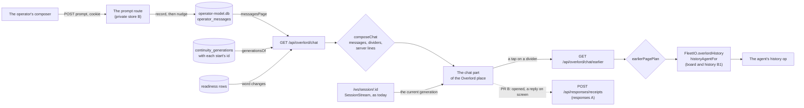
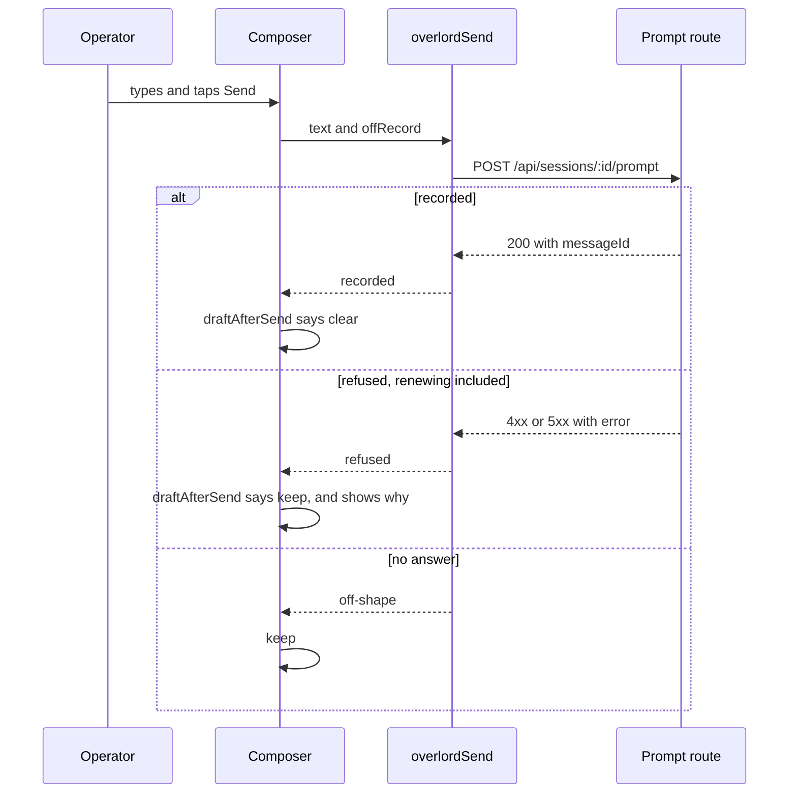

# Overlord W1: the chat Implementation Plan

> **For agentic workers:** REQUIRED SUB-SKILL: Use superpowers:subagent-driven-development (recommended) or
> superpowers:executing-plans to implement this plan task-by-task. Steps use checkbox (`- [ ]`) syntax for tracking.

**Goal:** the Overlord place's seventh part, the chat (Table 4a), shows the operator one long conversation with the
Overlord across its generations:

- **The operator's messages come from the record**, each with its ticks: recorded, delivered or queued, picked up,
  settled. So the chat shows them while the session is asleep, renewing or on another host.
- **The server speaks when the Overlord cannot.** Under a message recorded while the readiness word was not `ready`,
  the chat draws one line of the server's own, such as "Recorded. The Overlord is renewing."
- **The current generation streams from its transcript, as today**, through the session stream the console already
  reads.
- **Earlier generations are read through the history reader**, with a quiet "generation n" divider drawn from the
  generation rows at each renewal.
- **The composer records, and never types.** It sends through the console's prompt route, which records the message
  and then nudges the pane (H7). A refused send keeps the draft, `renewing` included. The composer carries the
  off-the-record toggle (§9.4 rule 9).
- **The console's `opened` receipts in the place.** When the place shows a reply of the Overlord, the console posts
  an `opened` receipt for it through the responses piece's receipts door (C67). This part, with the reply rows it
  names, **waits on operator item 327** (index question 10).

**Why:** R4 puts the operator's surface inside the console, and R9 makes the Overlord place the console's home. H7
makes the operator's words server rows, so the chat must show those rows, never pane text, as the operator's words.
R19 asks that a renewal not be felt: the composer keeps working, and the chat shows a divider, not a banner.

**Architecture:** one bounded context per fact, and the chat owns no fact of its own but one column.

- **L0, a new `shared/overlordChat.ts`** (C11, the Operator Model): the thread's wire (`ChatEntry`, `ChatThread`), the
  tick stage of each message state (`MESSAGE_TICK_MAP`, a `Record` keyed by the private store's `MessageState`, so the
  message moves table stays the ticks' single source), `chatTicksOf`, the server's line for each readiness word
  (`CHAT_SERVER_LINE_MAP`, total over the readiness word), the earlier-generation request and its reader, the prompt
  route's answer reader for the chat, and the nudge line's recogniser.
- **L1, `server/src/coord/overlordChat.ts`** (C5, beside the board's composer): `composeChat`, which merges the message
  page, the generation dividers and the server lines into one ordered thread and never folds an unreadable part into an
  empty one; `readinessAt`, the word in force at a time; and `earlierPagePlan`, the history request for one page of an
  earlier generation.
- **L3, readers only.** The private store gains `messagesPage(beforeId, limit)` (a words reader, called by the chat's
  handler alone) and the `offRecord` column, written only by its one insert. The continuity store gains
  `generationsOf(identity)`, a text-free reader of one session's generations, each with its start's conversation id.
  The earlier-generation read reuses board and history B1's port and decider unchanged: `historyAgentFor`,
  `FleetIO.overlordHistory`, `readOverlordHistoryAnswer` and `historyDoorAnswer`.
- **L4, two operator doors** in `server/src/coord/overlordRoutes.ts`: `GET /api/overlord/chat` (the thread) and `GET
  /api/overlord/chat/earlier` (one page of an earlier generation). Each reads facts, asks a decider, writes one
  read-ledger line with caller `operator`, and answers.
- **The console, `pwa/src/overlord/`** (the directory home B creates): `chatWords.ts` (L1: `draftAfterSend` and the
  tick and divider words), `useOverlordChat.ts` (L4: the reads and the refresh), and `OverlordChat.tsx` with its
  parts (L4). The composer is today's `pwa/src/session/Composer.tsx`, gaining one optional slot for the toggle.

Two pull requests (open question 7). PR A ships Tasks 1 to 4, everything but the reply rows. PR B ships Task 5 once the
operator has answered item 327.

**Tech Stack:** TypeScript (ESM), `node:sqlite`, React (the PWA), vitest and vitest's browser mode.

**Spec:** `docs/superpowers/specs/2026-11-09-overlord-design.md`:

- §4: Table 4a's row 7 (Chat, W1), and the bullets under "The chat is one long conversation" (sending is recording;
  operator messages from the record with their ticks; the server speaks when the Overlord cannot; the current generation
  streams from its transcript; earlier generations paged through the history reader with a "generation n" divider; the
  Overlord narrates and never originates; the off-the-record toggle; "Before the record exists", the console keeps the
  draft).
- §3.8, H7: "A message has four states, drawn from server rows ... The chat draws the states as ticks"; "Nothing typed
  in a pane is ever the operator's words"; "The chat shows what each message bound" (W2, below).
- §3.3.6, "Earlier generations in the chat"; §3.3.10 (history and readers); §3.3.11, "Before the message record
  exists".
- §6.4, Table 6.4a: the readiness word, "every change of word is a row and an event".
- §4.3, C66 and C67: Table 4.3a's row "A chat reply of the Overlord", and "The console posts an `opened` receipt when it
  opens ... the Overlord place"; C69, "I handled this elsewhere" on the reply.
- §9.4, rule 3 (the operator's signed-in console is one of the store's five callers, and every read leaves a ledger
  line) and rule 9 (off the record); §9.2, "What is never a source".
- §11.1: the rows `operator_messages` and the message moves table (Tables 11.1a and 11.1b); §11.2 (the operator doors);
  §11.5 (older builds).
- Table 13.1: H7 is `shape` and ships with the private store, which creates its table. The chat creates no table and no
  door with a `shape` call of its own; its one column rides the private store's file (open question 4).

The W1 index is `docs/superpowers/plans/2026-11-14-overlord-w1.md`, row "Chat", lane F, last. This plan builds on the
index's questions 10 (the Overlord's replies, waiting on item 327), 25 and 32 (the read ceilings and `read-ceiling`), 26
(the nudge rides the mail lane) and 33 (the console hides the Overlord's doors until `overlord-v1`). It reads these piece
plans, all on `main` under `docs/superpowers/plans/2026-11-14-overlord-w1/`: private store (`w1-private-store.md`),
board and history (`w1-board-history.md`), inbox (`w1-inbox.md`), responses (`w1-responses.md`), gates
(`w1-gates.md`), designation (`w1-designation.md`) and ladder (`w1-ladder.md`). Home (`w1-home.md`) and readiness
(`w1-readiness.md`) are being written beside this plan; where this plan needs their interfaces it takes them from the
spec and says so.



*Figure 1. Where each line of the chat comes from. Every source is an existing owner's row or reader. The chat writes
one column, `offRecord`, through the private store's one insert, and one read-ledger line per read. The dashed arrow is
PR B, which waits on item 327.*

## Open questions

Each is a place where the spec is unclear, does not match the tree, or leaves a choice to the plan. The plan builds the
recommendation unless the coordinator or the operator rules otherwise.

1. **How the console reads earlier generations** (slug `chat-reads-through-operator-doors`). The brief rules that
   earlier generations are read through the board and history door's reader, never a second reader. That door, `POST
   /api/overlord/history`, is the Overlord's: box token and attribution, then the gate order, and "the server's doors
   refuse every caller but the designated session" (`w1-board-history.md`, Goal). The console holds a cookie and no
   box token. **Recommendation:** an operator door, `GET /api/overlord/chat/earlier`, in the same routes file, that
   calls the same reader: it picks the agent with `historyAgentFor`, sends through `FleetIO.overlordHistory`, reads the
   reply through `readOverlordHistoryAnswer` and maps it through `historyDoorAnswer`, with the target fixed by the
   server to the designated session's family. One op, one port, one decider and one mapping, so no second reader. Two
   rejected alternatives:
   - **A cookie arm on the Overlord's door.** It would put the operator's credential into a box-token door's gate
     order, whose steps (designation, fence, rung, `not-the-overlord`) have no meaning for the operator, and would make
     the door dual-credential in the auth gate's census.
   - **A console read of the history store.** That is the second reader the ruling forbids, and the server has no path
     to the fleet box's history store.
2. **How one earlier generation is paged** (slug `earlier-generations-page-without-a-cursor`). W1's history door
   carries no cursor and no `next` line (`w1-board-history.md`, question 13), so a page cannot be resumed by cursor.
   The `expand` verb takes a window of its own, `expand --around <uuid> --before N --after N`
   (`ccd/history/recall.mjs#runExpand`, its `EXPAND_TARGET_HINT`), which needs no cursor. **Recommendation:**
   - a generation's first page is the newest entries of its own conversation, named by the conversation id of its
     start (`continuity_starts.uuid`, reached through the generation's `startId`);
   - each older page is `expand --around <the oldest entry shown> --before 40 --after 0`;
   - the target is `{ kind: 'session', session: <the designated id> }`, fixed by the server.

   Task 3's first step measures, on a fixture store, which verb and argument name a conversation's newest entry from
   its conversation id (`runDescribe` of the id, or `expand` of the conversation's root node). If neither does, the
   divider of an earlier generation says "Read generation n in `ccrc history`" with the command, the door answers
   `bad-request` for a first page, and the generation's paging joins when the history door gains its cursor (the board
   and history plan's Later list). The task states which arm it built.
3. **Where the server's line comes from** (slug `server-line-derived-not-stored`). §4: "When the readiness word is not
   `ready`, the server adds one line of its own at once." **Recommendation:** the line is derived at each read, never
   stored. `composeChat` asks `readinessAt(changes, message.at)` for the word in force when the message was recorded,
   and draws `CHAT_SERVER_LINE_MAP[word]` under it; `ready` draws none. Every change of word is already a row (§6.4),
   written by the readiness lane alone, so a stored line would be a second writer of the same fact. What each read
   answers:
   - the change rows read, and a word in force: that word's line;
   - the rows cannot be read: one line, "Recorded. The Overlord's state at the time could not be read.", never no
     line, which would read as `ready`;
   - the message is older than the oldest kept row: the same `unmeasured` line.

   This needs a text-free reader of the readiness rows over a window, `readinessChanges(sinceMs, untilMs)`, answering
   the rows or `unmeasured`. The readiness plan is being written beside this one. If it ships such a reader, Task 2 uses
   it; if it does not, Task 2 adds it to the readiness store, in that module, and the index records the edit.
4. **The off-the-record toggle needs a fact** (slug `off-the-record-is-a-message-column`). §9.4 rule 9: "A message sent
   under it is still recorded and answered, but no feed learns from it." The private store's table has no such column
   (`w1-private-store.md`, Task 2's schema), and its feeds are W4's (§9.2). A W1 message sent off the record must still
   be skipped when W4's feeds start, so the fact must be recorded from the first message the toggle covers.
   **Recommendation:**
   - migration 2 of the private store's file adds `offRecord INTEGER NOT NULL DEFAULT 0 CHECK (offRecord IN (0, 1))` to
     `operator_messages`; a row written before it reads `0`, which is right, because no toggle existed;
   - its one writer is the private store's one insert, `recordMessage`, which takes `offRecord` from the prompt route's
     act;
   - the prompt route reads one more body field, `offRecord`, a boolean. Only `true` counts, as `replaceDraft` and
     `resume` do today. On a prompt to any session but the designated one, `offRecord: true` refuses `bad-request`
     (400) before anything is typed, because the toggle names a fact only the record can hold;
   - `OperatorMessageRow` gains `offRecord`, so the chat draws the mark and W4's feeds read it;
   - the route's answer echoes it, `{ ok: true, messageId, cut, state, offRecord }`. A server below this pull request
     records the message and drops a field it does not read, so a toggled send whose answer carries no `offRecord:
     true` is drawn with "recorded on the record: this server does not know the toggle", never silently.
5. **The kept draft has one owner** (slug `kept-draft-on-every-refusal`; the brief's ruling). W1a's renewal hand-offs
   make the composer keep the text on a `409 renewing` (`docs/superpowers/plans/2026-11-10-overlord/w1a-renewal-handoffs.md`,
   Task 2: "measure the composer and its draft store"). Today `pwa/src/session/Composer.tsx#Composer` clears its box
   as soon as it hands the text off (`setValue('')` right after `onSend`), before the server answers, and a failed send
   survives only as a failed `PendingSend` bubble (`pwa/src/stores/session.ts`). **Recommendation:** one L1 decider,
   `draftAfterSend(answer)` in `pwa/src/overlord/chatWords.ts`, answers `clear` only for `{ ok: true }`, and `keep` for
   every refusal, every transport failure and every off-shape answer: `renewing`, `unmeasured`, `auth-off`,
   `unauthenticated`, `insecure-origin`, `bad-request`, `bad-attachment`, `journal-unreadable`, `journal-unwritable`,
   `write-failed` and `read-ceiling` among them. W1a's `renewing` arm becomes one of its rows, not a second
   mechanism: Task 4 measures what W1a built and moves its rule into the decider, behind a characterization test of
   today's Session screen. The Overlord chat shows no `PendingSend` bubble, because the record is the bubble: a
   recorded message appears with its first tick on the next read.
6. **The current generation, and the nudge in its transcript** (slug `chat-renders-the-nudge-turn-as-its-record`). The
   current generation streams through `/ws/session/:id` (`server/src/sessionws.ts#SessionStream`) and is built into
   rows by `pwa/src/session/chatItems.ts#buildChatItems`, as the Session screen does today. That transcript also holds
   each nudge the mail lane typed (`renderOperatorMessageNudge`, private store Task 5) as a user turn, which is not the
   operator's words. **Recommendation:** the chat drops a user turn that is exactly an operator-message nudge line and
   draws the record's message in its place. The recogniser, `operatorMessageNudgeIdOf(line)`, lives in L0 beside the
   private store's `operatorMessageSubject`, and the envelope's renderer is pinned against it by a round-trip test, so
   the line has one grammar. Every other injected prompt (the mail nudge, the inbox wake) is drawn as the Session
   screen draws it today.
7. **One pull request, or two** (slug `chat-ships-in-two-prs`). The index sizes the chat at "1 PR, 5 tasks". The reply
   rows, the reply's `opened` receipt and its "I handled this elsewhere" control all depend on the answer to item 327
   (question 8). **Recommendation:** PR A ships Tasks 1 to 4 when their needs are met. PR B ships Task 5 after the
   operator's answer. Holding the whole chat for the item would hold the home's main conversation surface for a
   question about replies.
8. **The Overlord's replies** (the index's question 10, operator item 327; **waits on the item**). W1's tables hold the
   operator's words only. **What waits:** Task 5 alone. What changes with the answer:
   - **(a) recorded at the turn:** a reply is a row in the private store with an integer id, written by the piece the
     answer names. The chat then reads replies from the record as it reads messages, so a reply shows while the
     session sleeps or runs on another host, and the transcript stream is only the live view of the current turn. The
     reply's response row (`ResponseRef` `{ kind: 'reply', id }`, responses A) names that id.
   - **(b) re-read from transcripts at checkpoint time:** a reply has no record id, so `ResponseRef`'s reply arm, typed
     `id: number`, cannot name one. Task 5 then states the reply's key (the transcript entry's uuid) and the responses
     piece's ref changes shape in the same pull request.

   Tasks 1 to 4 build nothing either answer changes: they draw the operator's words from the record and the Overlord's
   from its transcript, as today.
9. **What every console read writes** (slug `chat-read-ledger-doors`). §9.4 rule 3: the operator's signed-in console is
   one of the store's five callers, and "every read leaves a ledger line". **Recommendation:**
   - two door words join the private store's `READ_DOOR_MAP`: `chat` (the thread) and `chat-history` (an earlier
     generation's page), each with a row in the inbox's `READ_CEILINGS` (`shared/overlordInbox.ts`), so the console's
     reading never spends the Overlord's `messages` or `history` ceiling;
   - starting values: `chat` 720 an hour (one read every five seconds, a backstop against a runaway client loop) and
     `chat-history` 240 an hour; a read past either answers `read-ceiling` (index question 32), and the chat keeps what
     is on screen;
   - each line carries caller `operator` and a null `turnState`, which the private store's `CHECK` allows only for the
     operator (`w1-private-store.md`, question 12);
   - the handlers run through the inbox's one read runner, `server/src/coord/overlordRead.ts#runOverlordRead`, with the
     operator's pass, if its pass type admits gates A's operator strength. Task 2's first step measures that; if it does
     not, the runner's pass type widens in the same commit, and no second runner is written.
10. **How the chat learns that a tick moved** (slug `chat-ticks-refresh-on-the-session-stream`). Ticks move on the
    server: the mail lane writes `delivered`, the hook `picked up`, `acknowledge` `settled`. No push lane carries them to
    the console. **Recommendation:** the chat re-reads the thread on each frame of the session stream it already holds
    for the current generation, debounced to one read a second, and every 10 seconds while the place is visible and any
    shown message is below `picked-up`. No new websocket, no server push and no lane. A hidden tab reads nothing.
11. **What W1 leaves out of §4's chat bullets** (slug `chat-w1-scope`). The spec's text belongs to later waves in three
    places, and W1 draws none of them:
    - the request ids bound to a message, and the project or programme names matched in it (§3.8, §5.3): W2's requests;
    - "I command" opening the open proposals (H8): W3's proposals. In W1 the private store's settlement mark settles a
      message that is exactly "I command" or `/icommand`, and the chat draws its settled tick;
    - the Overlord's summaries citing request ids drawn as live state: W2.

    The Overlord narrates and never originates in W1 too: the chat draws no control from transcript text, and its only
    controls are the composer, the toggle and the divider's "Show generation n".

## What exists today

Measured on `main` at `d440a7f41` (2026-11-16).

- **The prompt route.** `POST /api/sessions/:id/prompt`, an inline handler in `server/src/server.ts`. It reads `text`,
  `replaceDraft`, `attachments` and `resume`, and only `true` counts for the two flags. It answers 404 `unknown-session`
  (through `knownId`), 400 `bad-attachment` and `bad-request`, and otherwise passes `server/src/inject/send.ts#sendPrompt`'s
  result through: 200 `{ ok: true, … }` (with an optional `draftRestore`), or 409 with `not-alive`, `dialog-open`,
  `draft-present` (carrying `draft` and `submittable`), `draft-clear-failed`, `verify-failed` or `enter-ignored`. It
  records nothing, and `renewing` is not on `main` yet (W1a's renewal hand-offs add it).
- **The client.** `pwa/src/lib/api.ts` (1,189 lines, growth-checked): `createApi(...).prompt(id, text, opts)` posts and
  answers `Promise<void>`; any non-2xx throws `ApiError` with the parsed body, which `pwa/src/stores/session.ts#failureOf`
  unpacks into `{ error, code, draft, submittable }`.
- **The composer.** `pwa/src/session/Composer.tsx#Composer` (props `onSend`, `pending`, `id`, `disabled`,
  `placeholder`), mounted by `pwa/src/screens/SessionScreen.tsx`. Its draft is component state; `send()` clears it as
  soon as it hands the text to `onSend`. A failed send lives on as a failed `PendingSend` with retry and resolve
  (`pwa/src/stores/session.ts`); `draft-present` opens `DraftConflict`. No helper or test keeps the box on a refusal.
- **The conversation view.** The store opens `/ws/session/:id` (`pwa/src/stores/session.ts`, reduced by
  `applySessionMsg`), fed by `server/src/sessionws.ts#SessionStream`. Rows are built by
  `pwa/src/session/chatItems.ts#buildChatItems` (`ChatItem`, kinds including `divider` and `message`) and drawn by
  `pwa/src/session/ChatList.tsx`, `MessageBubble.tsx`, `PendingBubble.tsx` and the skin's `TranscriptRow`.
- **Places.** `pwa/src/lib/places.ts#PLACES` holds `fleet`, `waiting`, `inbox`, `runs`, `accounts` and `docs`, with
  `FLEET_PLACE` and `DESK_PLACES`. `pwa/src/overlord/` does not exist; home A and B create it. `pwa/src/face/` is built
  and is read only.
- **Generations.** `continuity_generations` (created in `server/src/coord/schema.ts`), read by
  `server/src/continuity/continuityStore.ts#liveGenerations` (every non-ended row, not per session). No reader lists one
  session's generations. `GenRow` is server-only: `id`, `identity`, `sessionId`, `term`, `n`, `state`, `outcome`,
  `enteredAt`, `deadlineAt`, `startId` and more; a generation ends at `state = 'ended'` with its `outcome`, with no
  `endedAt` column. `continuity_starts` holds each start's `uuid`, the conversation's id (`continuityStore.ts#startsOf`).
- **History.** Board and history PR A is on `main`: `shared/overlordHistory.ts` (the target grammar `all`, `project` or
  `session`, `readOverlordHistoryRequest`, `readOverlordHistoryAnswer`) and `ccd/history/overlord-read.mjs` with its
  worker. `ccd/history/recall.mjs#runExpand` windows by `--around <uuid> --before N --after N` or resumes by its own
  `--cursor`; the Overlord's answer drops the cursor (W1).
- **Browser tests.** `pwa/browser/*.browser.test.ts(x)` in vitest's browser mode (`pwa/vitest.browser.config.ts`), each
  file declaring its widths, typically `const WIDTHS = [360, 390, 1280, 1920]` crossed with `SKINS` and `THEMES`
  (`account-knob.browser.test.ts`, `compaction-fold.browser.test.ts`); `chat-width.browser.test.ts` checks the session
  chat at desk width.
- **Growth-checked files** (`server/test/growthCheck.ts#GROWTH_FILES`): this plan touches `pwa/src/lib/api.ts` and
  `server/src/server.ts`. It does not touch `shared/api.ts`, `server/src/watch.ts`, `server/src/sessionws.ts`,
  `server/src/coord/schema.ts`, `server/src/coord/store.ts` or `server/src/coord/routes.ts`.
- **Masked reads.** `server/src/server.ts#MASKED_GET_ROUTES` (`'/api/fleet'`, `'/api/sessions/:id/pr'`, …).
- **PWA rings.** `server/test/rings/pwa-rings.test.ts` holds `PWA_L1_EXEMPTIONS` empty: an L1 module (a `*Words.ts`
  file) imports no `.tsx`, store or `lib/api.ts`. A new directory's context row comes from the architecture spec's path
  table (`server/test/rings/ringContextMap.ts`).

Not on `main`, taken from the piece plans named above: the private store and its prompt route record (private store A
and B), `overlordRoutes.ts` and `designationRead()` (designation A), `OVERLORD_DOORS` (gates A), `runOverlordRead`,
`READ_CEILINGS` and `operator-message-readers.test.ts` (inbox), the history door's port and decider (board and history
B1), the receipts door (responses A), the readiness word and its rows (readiness), and the Overlord place (home A and
B).

## Global Constraints

- **Architecture (`CLAUDE.md`).**
  - `shared/overlordChat.ts` is L0: it imports only types and maps from `./operatorMessages.js`, the readiness word's
    sibling and `./overlordHistory.js`, and nothing else. Each literal union carries its `Record<X, …>` map
    (`rings/wire-totality.test.ts`).
  - `server/src/coord/overlordChat.ts` is L1: pure, no `fs`, no store, no clock; `now` is an argument. It imports
    `shared/` only.
  - The readers are L3 and keep every distinction they read: `generationsOf` answers rows or `unmeasured`, and
    `messagesPage` answers rows, `empty` or `unmeasured`. No overloaded null at a seam.
  - The two handlers are L4 and decide nothing: the thread is `composeChat`'s, the page plan `earlierPagePlan`'s, the
    agent `historyAgentFor`'s and the answer `historyDoorAnswer`'s.
  - `pwa/src/overlord/chatWords.ts` is L1 (no `.tsx`, store or `lib/api.ts` import); `useOverlordChat.ts` and the
    components are L4.
- **One writer for each fact.**
  - `operator_messages.offRecord`: the private store's `recordMessage`, at the insert, from the prompt route's act.
    The private store's writer census names it.
  - The read-ledger lines of the two doors: the private store's `recordRead`, called by the runner.
  - The chat stores nothing else. The server's line, the ticks and the dividers are computed at each read.
- **Consolidate, don't duplicate.**
  - The ticks derive from the private store's `MessageState` through one `Record`, never a second list of states.
  - The earlier generation's read is the history door's reader (question 1).
  - The kept draft is one decider that W1a's `renewing` rule joins (question 5).
  - The conversation view reuses `SessionStream`, `buildChatItems` and the transcript rows; the composer is `Composer`.
- **Fail closed.** An unreadable designation answers 502 `unmeasured` and draws no thread. An unreadable message page
  draws "unmeasured" in the chat, never an empty conversation. An unreadable generation list draws no divider and says
  so once. An unreadable readiness history draws the `unmeasured` line under every message it would have judged
  (question 3). An older server that answers the prompt without `messageId` keeps the draft (question 5).
- **Phone first.** The chat is designed at 360 px wide first. Every new component is tested in the browser suite at
  360, 390, 1280 and 1920 px, in every skin and theme, with no horizontal overflow and the composer above the phone
  bar.
- **Public repository.** Fixtures use neutral stand-ins (`lane-a`, `project-a`, `the fleet box`). No message text in a
  fixture looks like a secret: the egress mask would cut it and confuse the test.
- **Mutation floors.** Every new L1 decider joins `server/test/sim/mutation-floors.test.ts`'s `MUTANT_SETS` and
  `server/test/sim/mutation-floors.json` in the commit that creates it: `chatTicksOf`, `readinessAt`, `composeChat`,
  `earlierPagePlan`, `operatorMessageNudgeIdOf` and `readChatThread`. The PWA's `draftAfterSend` is proven by hand
  mutants, unless the builder measures that `MUTANT_SETS` reaches `pwa/src`, in which case it joins too.
- **Censuses with every door.** Each new door moves every census it touches in the same commit (Task 2 and Task 3
  list them).

## Review Focus

- **The record is the only source of the operator's words.** No path draws a transcript user turn as an operator
  message; the nudge turn is replaced, never shown (question 6).
- **No second reader.** The earlier-generation door calls the history door's port, decider and mapping, and nothing in
  `pwa/src` or `server/src` opens the history store or spawns `ccrc history` (question 1).
- **The ticks have one source.** A new message state is a compile error in `MESSAGE_TICK_MAP` until it is placed.
- **The draft survives every refusal.** `draftAfterSend` is `keep` for everything but `{ ok: true }`, and the
  composer clears only after the answer.
- **"Unmeasured" is never "nothing".** No unreadable part renders as an empty thread, no divider list as a single
  generation, and no readiness history as `ready`.
- **The toggle's fact is recorded once.** `offRecord` has one writer, and a prompt to another session cannot carry it.
- **Growth.** `pwa/src/lib/api.ts` and `server/src/server.ts` stay within their 40-line check (the PR split).

## The PR split

| PR | Tasks | What it ships | Needs first | Growth-checked files, estimate |
|---|---|---|---|---|
| A, the chat | 1 to 4 | The chat's vocabulary and deciders; the `offRecord` column and its body field; the thread door and the earlier-generation door with every census; the chat part of the Overlord place, with ticks, server lines, dividers, the live generation, earlier pages, the composer with the kept draft and the toggle; the browser suite at every width | home B (`pwa/src/overlord/`, the place and its slot for part 7); private store B (the record, the prompt route's answer, `READ_DOOR_MAP`); designation A (`overlordRoutes.ts`, `designationRead()`); gates A (`OVERLORD_DOORS`); inbox (`runOverlordRead`, `READ_CEILINGS`, `operator-message-readers.test.ts`); board and history B1 (the port and the decider); readiness (the word and its change rows); W1a renewal hand-offs (the composer's `renewing` rule) | `pwa/src/lib/api.ts` about +16 (three calls, the answer type, imports); `server/src/server.ts` about +4 (two `MASKED_GET_ROUTES` entries, the `offRecord` field) |
| B, the replies | 5 | The reply rows' insert where the answer to item 327 puts it; the place's `opened` receipt for each reply shown; the reply's "I handled this elsewhere" control | PR A; responses A (the receipts door) and responses B (the handled door); the operator's answer to item 327 (**waits on item**) | `pwa/src/lib/api.ts` about +4 (if the responses piece's receipt call does not already serve the console); others 0 |

**Order:** PR A when every "needs first" above has merged. It is the last pull request of lane F in W1, and
`overlord-v1` needs it. PR B after PR A, the responses pieces and the operator's answer. `overlord-v1` does not wait for
PR B (open question 7): the chat works without reply rows, which only measure.

**What later pieces read** (the states this piece exposes):
- W4's feeds (§9.2): `operator_messages.offRecord`, which they skip.
- W2's requests: the thread's message entry is the place where the bound request ids and matched names are drawn; W2
  adds a field to `ChatEntry`'s message arm and changes no W1 field.
- W3's proposals: the composer's "I command" path opens the proposals list in front of the settlement mark.
- `overlord-v1`: the place's chat is complete, so the console may show the Overlord's doors.

---

### Task 1: The chat's vocabulary and deciders

**Files:**
- Create: `shared/overlordChat.ts` (C11, L0)
- Create: `server/src/coord/overlordChat.ts` (C5, L1: `composeChat`, `readinessAt`, `earlierPagePlan`)
- Modify: `shared/operatorMessages.ts` (`operatorMessageNudgeIdOf` and the nudge line's grammar, beside
  `operatorMessageSubject`; `READ_DOOR_MAP` gains `chat` and `chat-history`)
- Modify: `shared/overlordInbox.ts` (`READ_CEILINGS` gains `chat: { perHour: 720 }` and `chat-history: { perHour: 240
  }`; question 9)
- Modify: `server/src/coord/envelope.ts` (`renderOperatorMessageNudge` renders from the L0 grammar)
- Modify: `server/test/sim/mutation-floors.test.ts` and `server/test/sim/mutation-floors.json`
- Test: `server/test/overlord-chat-vocab.test.ts`, `server/test/overlord-chat-compose.test.ts` (new)

**Interfaces:**

```ts
// shared/overlordChat.ts
import type { MessageState, OperatorMessageRow } from './operatorMessages.js';
import type { ReadinessWord } from './<the readiness sibling>.js';   // named by the readiness plan
import type { OverlordHistoryAnswer } from './overlordHistory.js';

/** The four ticks of H7, in order. `delivery` reads "queued" or "delivered" by the row's stamps. */
const TICK_STAGE_MAP = { recorded: 'recorded', delivery: 'delivered or queued', 'picked-up': 'picked up',
  settled: 'settled' } as const;
export type TickStage = keyof typeof TICK_STAGE_MAP;
export const TICK_STAGES = Object.keys(TICK_STAGE_MAP) as TickStage[];
/** The furthest tick each message state lights. Keyed by the private store's own type, so a new state is a compile
 *  error here until it is placed (the message moves table is the single source). `spent` lights `settled`. */
export const MESSAGE_TICK_MAP: Readonly<Record<MessageState, TickStage>>;
export interface ChatTicks {
  readonly lit: readonly TickStage[];          // a prefix of TICK_STAGES, never a gap
  readonly delivery: 'queued' | 'delivered' | null;
  readonly settledBy: OperatorMessageRow['settledBy'];
  readonly unknown: boolean;                    // a state word this build cannot read: no tick past `recorded`
}
export function chatTicksOf(row: OperatorMessageRow): ChatTicks;

/** The server's line under a message recorded while the word was not `ready`. `ready` draws none. */
export const CHAT_SERVER_LINE_MAP: Readonly<Record<ReadinessWord, string | null>>;
export const CHAT_SERVER_LINE_UNMEASURED = "Recorded. The Overlord's state at the time could not be read.";

export type ChatEntry =
  | { readonly kind: 'message'; readonly row: OperatorMessageRow; readonly ticks: ChatTicks }
  | { readonly kind: 'server-line'; readonly messageId: number; readonly text: string;
      readonly word: ReadinessWord | 'unmeasured' }
  | { readonly kind: 'divider'; readonly n: number; readonly at: number; readonly current: boolean;
      readonly earlier: 'readable' | 'not-pageable' };
export type ChatPart<T> = { readonly kind: 'read'; readonly value: T } | { readonly kind: 'unmeasured'; readonly why: string };
export interface ChatThread {
  readonly v: 1;
  readonly designation: 'designated' | 'none';
  readonly sessionId: string | null;             // null only with `designation: 'none'`
  readonly entries: readonly ChatEntry[];         // oldest first
  readonly messages: ChatPart<{ readonly more: boolean }>;
  readonly generations: ChatPart<{ readonly count: number }>;
  readonly readiness: ChatPart<{ readonly since: number }>;
}
export function readChatThread(raw: unknown): { ok: true; thread: ChatThread } | { ok: false; detail: string };

/** One page of an earlier generation. */
export interface ChatEarlierRequest { readonly n: number; readonly around: string | null }
export function readChatEarlierQuery(q: unknown): { ok: true; req: ChatEarlierRequest } | { ok: false; detail: string };
export type ChatEarlierAnswer =
  | { readonly ok: true; readonly n: number; readonly page: OverlordHistoryAnswer }
  | { readonly ok: false; readonly error: string; readonly cause?: string };

/** The prompt route's answer as the chat reads it (private store B's additive shape). */
export type ChatSendAnswer =
  | { readonly kind: 'recorded'; readonly messageId: number; readonly cut: boolean; readonly offRecord: boolean }
  | { readonly kind: 'refused'; readonly error: string }
  | { readonly kind: 'off-shape' };
export function readChatSendAnswer(status: number, body: unknown): ChatSendAnswer;

/** The message id an operator-message nudge line names, or null for any other line. */
export function operatorMessageNudgeIdOf(line: string): number | null;   // re-exported from operatorMessages.ts
```

```ts
// server/src/coord/overlordChat.ts
export interface GenerationFact { readonly n: number; readonly enteredAt: number; readonly live: boolean;
  readonly conversation: string | null }        // the start's uuid, or null for a generation with no start row
export interface ReadinessChange { readonly at: number; readonly word: ReadinessWord }
export interface ChatFacts {
  readonly sessionId: string;
  readonly messages: { kind: 'rows'; rows: readonly OperatorMessageRow[]; more: boolean } | { kind: 'unmeasured'; why: string };
  readonly generations: { kind: 'rows'; rows: readonly GenerationFact[] } | { kind: 'unmeasured'; why: string };
  readonly readiness: { kind: 'rows'; rows: readonly ReadinessChange[]; oldest: number | null }
    | { kind: 'unmeasured'; why: string };
}
/** The word in force at `at`: the newest change at or before it, `unmeasured` when no kept row covers `at`. */
export function readinessAt(changes: readonly ReadinessChange[], oldest: number | null, at: number):
  ReadinessWord | 'unmeasured';
/** One ordered thread: each message, its server line when its word was not `ready`, and a divider before the first
 *  entry of each generation, by `enteredAt`. Total; an unreadable part is reported in its own field. */
export function composeChat(f: ChatFacts): ChatThread;
/** The history request for one page of generation `n`, or why none can be made. */
export function earlierPagePlan(sessionId: string, gen: GenerationFact | null, around: string | null):
  { kind: 'request'; request: OverlordHistoryRequest } | { kind: 'refuse'; why: 'no-generation' | 'current' | 'no-conversation' };
```

**The server's lines** (`CHAT_SERVER_LINE_MAP`, starting wording, total over Table 6.4a):

| Word | Line |
|---|---|
| `ready` | none |
| `absent` | Recorded. No Overlord is bound. |
| `off` | Recorded. The Overlord is off. |
| `unmeasured` | Recorded. The Overlord's state could not be read. |
| `dead` | Recorded. The Overlord is down. |
| `restarting` | Recorded. The Overlord is restarting. |
| `renewing` | Recorded. The Overlord is renewing. |
| `degraded` | Recorded. The Overlord is degraded: chat only. |
| `stranded` | Recorded. No account can serve the Overlord now. |
| `dialog-open` | Recorded. A dialog is open in the Overlord's pane. |
| `wedged` | Recorded. The Overlord's turn is stuck. |
| `deaf` | Recorded. The Overlord has not been picking up messages. |
| `saturated` | Recorded. The Overlord's inbox is behind. |
| `unproved` | Recorded. The Overlord has not yet shown it is ready. |

*Table 1. The server's line for each readiness word. A history that cannot be read draws
`CHAT_SERVER_LINE_UNMEASURED` (question 3). The words are the readiness plan's; if it adds one, this `Record` is a
compile error until the line is written.*

- [ ] **Step 1: Failing tests.**
  - `overlord-chat-vocab.test.ts`:
    - each map's keys equal its list, and each list is written out in the test;
    - `MESSAGE_TICK_MAP` has a row for every `MESSAGE_STATES` word, written out; `recorded` lights one tick, `queued`
      and `delivered` two (with `delivery` read from the stamps), `picked-up` three, `settled` and `spent` four;
    - `chatTicksOf` never answers a gap: a `picked-up` row with no `deliveredAt` (the hook beat the lane, which the
      moves table allows) lights `recorded`, `delivery` and `picked-up`, with `delivery` `null`; a `settled` row
      settled by `mark` lights four with `settledBy: 'mark'`; a row whose state is `unknown` lights `recorded` only and
      sets `unknown`;
    - `CHAT_SERVER_LINE_MAP` answers `null` for `ready` alone, and a line for every other word;
    - `operatorMessageNudgeIdOf` answers the id for `renderOperatorMessageNudge(12)`'s line, for ids 1 and
      2^53 - 1, and `null` for the mail nudge, the inbox wake line, the line with a trailing word, a leading space,
      id 0, a signed id and a decimal;
    - `readChatThread` reads a composed thread back, refuses a missing `v`, an unknown entry kind and a part whose kind
      is neither `read` nor `unmeasured`, and ignores an unknown key;
    - `readChatSendAnswer`: 200 with `messageId` reads `recorded`, carrying the `offRecord` echo when present; 200 with no `messageId` (an older server, or the
      route's typing path) reads `off-shape`; each refusal status with an `error` reads `refused`; a body that is not an
      object reads `off-shape`;
    - `readChatEarlierQuery`: `n` a positive safe integer; `around` absent or a uuid; anything else refused.
  - `overlord-chat-compose.test.ts`:
    - `readinessAt`: before the oldest kept row reads `unmeasured`; at a change reads that change's word; between two
      changes reads the earlier; with no rows and `oldest` null reads `unmeasured`;
    - `composeChat`: messages oldest first; a server line right after each message whose word was not `ready`, and none
      after a `ready` one; a divider before the first message of each generation by `enteredAt`, marked `current` for
      the live one; a generation with no message still draws its divider; a generation with no start row draws a
      divider marked `not-pageable`;
    - each unreadable part: messages `unmeasured` gives no message entries and `messages.kind = 'unmeasured'` (never an
      empty `read`); generations `unmeasured` gives no dividers and `generations.kind = 'unmeasured'`; readiness
      `unmeasured` gives `CHAT_SERVER_LINE_UNMEASURED` under every message;
    - `earlierPagePlan`: the live generation refuses `current`; no row refuses `no-generation`; a null conversation
      refuses `no-conversation`; a first page names the conversation (by the arm Task 3 measures) and an older page is
      `expand --around <uuid> --before 40 --after 0`; the target is always `{ kind: 'session', session }` with the
      server's id, and every request passes `readOverlordHistoryRequest`;
    - the envelope round trip: `operatorMessageNudgeIdOf(renderOperatorMessageNudge(n)) === n` for a spread of `n`.
- [ ] **Step 2: Run.** `ccrc test -- ./node_modules/.bin/vitest run test/overlord-chat-vocab.test.ts
  test/overlord-chat-compose.test.ts` from `server/`. Red.
- [ ] **Step 3: Implement.**
- [ ] **Step 4: Run** these, `rings/*.test.ts` (`wire-totality` among them), the inbox's `READ_CEILINGS` totality test,
  the private store's vocabulary test (`READ_DOOR_MAP` keys), both server `tsc` runs and pwa's `tsc`. Green.
- [ ] **Step 5: Mutation.** Register `chatTicksOf`, `readinessAt`, `composeChat`, `earlierPagePlan`,
  `operatorMessageNudgeIdOf` and `readChatThread` in `MUTANT_SETS`, with measured floors. By hand: let `ready` draw a
  line (red); fold `unmeasured` readiness into `ready` (red); let `chatTicksOf` skip `delivery` when `deliveredAt` is
  null on a `picked-up` row (the no-gap case reds); let the recogniser accept a trailing word (red); let
  `earlierPagePlan` take the target's session from the request (red). Revert each.
- [ ] **Step 6: Commit.** `feat(overlord): the chat's vocabulary, its ticks from the message moves, and its composer (Overlord W1)`

### Task 2: The thread door, and the `offRecord` fact

**Files:**
- Modify: `server/src/operatorModel/schema.ts` (migration 2: `offRecord`; question 4)
- Modify: `server/src/operatorModel/store.ts` (`recordMessage` takes `offRecord`; every reader returns it;
  `messagesPage(beforeId, limit)`, a words reader: the newest `limit` rows below `beforeId`, oldest first, with `more`,
  or `unmeasured`)
- Modify: `shared/operatorMessages.ts` (`OperatorMessageRow` gains `offRecord: boolean`)
- Modify: `server/src/operatorModel/promptRecord.ts` (passes `offRecord` to `recordMessage`)
- Modify: `server/src/server.ts` (the prompt route reads `offRecord`; `true` on a prompt to another session refuses
  `bad-request` before any typing; `MASKED_GET_ROUTES` gains `'/api/overlord/chat'` and `'/api/overlord/chat/earlier'`)
- Modify: `server/src/continuity/continuityStore.ts` (`generationsOf(db, identity)`: every generation of one identity,
  `n` ascending, each with `enteredAt`, whether it is live, and its start's `uuid` through `startId`, or
  `unmeasured`; text-free)
- Modify: the readiness store (`readinessChanges(sinceMs, untilMs)` if the readiness piece did not ship it; question 3)
- Modify: `server/src/coord/overlordRoutes.ts` (`GET /api/overlord/chat`, the handler)
- Modify: `server/src/coord/overlordDoors.ts` (`OVERLORD_DOORS` gains `chat`: `GET /api/overlord/chat`,
  `coord/overlordRoutes.ts`, group `operator`, verb class `view`)
- Modify (censuses):
  - `server/test/auth-gate.test.ts` (the routes file's count, its sentences and the total route count);
  - `server/test/box-token-census.test.ts` (`OVERLORD_OPERATOR_DOORS` gains `/api/overlord/chat`);
  - `CLAUDE.md` (the box-token paragraph's sentence naming `overlordRoutes.ts`' operator doors gains the chat's two
    reads, "the operator's reads of the chat");
  - `server/test/secret-mask.test.ts` (the two masked reads);
  - `server/test/operator-message-readers.test.ts` (its operator list gains the chat handler's `messagesPage` call;
    inbox question 20);
  - `server/test/single-definition/writers-map.test.ts` (`operator_messages.offRecord`'s one writer, if the private
    store's census lists columns; measured at build);
  - `server/test/single-definition/time-ports.test.ts` (`overlordRoutes.ts` is already listed by designation A;
    measured at build);
  - `server/test/rings/fastify-l4.data.ts` (no change: the routes file is already listed).
- Test: `server/test/overlord-chat-door.test.ts` (new), `server/test/operator-model-store.test.ts` (migration 2 and
  `messagesPage`), `server/test/overlord-prompt-record.test.ts` (the flag), `server/test/continuity-generations-of.test.ts`
  (new)

**The door.** `GET /api/overlord/chat?before=<id>`, session-gated when sign-in is armed (not in `auth/gate.ts`'s
`EXEMPT`), open dark as every operator door is (index question 33: the console hides it until `overlord-v1`).
1. `designationRead()` (designation A's three arms): `unmeasured` answers 502 `unmeasured`; `not-designated` answers
   200 with `designation: 'none'` and no entries, a measured absence and not a refusal (the place is drawn without a
   designation only while a failed first start stands, §4); `designated` carries the session id.
2. The read runner (question 9), door `chat`, caller `operator`: the ceiling first, then the read.
3. The facts, each read once: `messagesPage(before, 100)`, `generationsOf(sessionId)`, and
   `readinessChanges(oldest message's at, now)`.
4. `composeChat(facts)`, answered 200 as `ChatThread`. A part that could not be read is in the thread as `unmeasured`,
   so a partial read is still 200, and the chat says which part is missing.
5. The read-ledger line: door `chat`, scope `session:<id>`, the message count, the outcome (`rows`, or the first
   unmeasured part's word), `generationRead: 'not-a-session'` and a null `turnState`.

- [ ] **Step 1: Failing tests.**
  - `operator-model-store.test.ts`: migration 2 on a file at version 1 adds the column, and a row written before it
    reads `offRecord: false`; a file at version 3 is read and never migrated (the shared opener's rule), and its
    readers still answer;
    `recordMessage` with `offRecord: true` reads back `true`; `messagesPage` on an empty store, below the first id, at
    a page boundary (`more` true, then false), and on a closed store (`unmeasured`).
  - `overlord-prompt-record.test.ts`: a prompt to the designated session with `offRecord: true` records `true`; with
    `offRecord: 'yes'` or absent records `false`; a prompt to another session with `offRecord: true` answers 400
    `bad-request`, types nothing and records nothing; without it, types as today.
  - `continuity-generations-of.test.ts`: one identity's generations in `n` order, the live one marked, the start's
    `uuid` joined; another identity's rows absent; a generation whose start row is missing reads `conversation: null`;
    a closed database reads `unmeasured`.
  - `overlord-chat-door.test.ts` (through `buildServer` with a fixture designation, store, generations and readiness
    rows):
    - a designated Overlord with three messages across two generations answers both dividers, the three messages in
      order with their ticks, and one server line under the message recorded while `renewing`;
    - `before` pages back, and `more` is right at both ends;
    - an unreadable store answers 200 with `messages.kind = 'unmeasured'` and no message entry; an unreadable
      readiness history draws the `unmeasured` line under each message; an unreadable generation list draws no divider
      and reports `generations.kind = 'unmeasured'`;
    - `designationRead()` `unmeasured` answers 502; no designation answers 200 with `designation: 'none'` and no
      entry;
    - with sign-in armed and no cookie, 401 and no ledger line; past the `chat` ceiling, `read-ceiling` and no read;
    - each served read writes one read-ledger line with caller `operator`, door `chat` and a null `turnState`;
    - the answer passes the GET mask (a secret-shaped string in a fixture message's stored text comes back masked as
      stored; the door adds nothing unmasked).
  - The census suites: `auth-gate`, `box-token-census` (both directions, with `CLAUDE.md`'s sentence),
    `secret-mask`, `operator-message-readers` (a planted `messagesPage` call in a lane function is red; the chat
    handler's is allowed), the gates piece's `overlord-doors-census`.
- [ ] **Step 2: Run.** Red.
- [ ] **Step 3: Implement.**
- [ ] **Step 4: Run** these, the private store's suites, the continuity store's suites, `growth-check.test.ts` armed for
  `server/src/server.ts`, `rings/*.test.ts`, both server `tsc` runs. Green.
- [ ] **Step 5: Mutation.** Let the door read the readiness history as `ready` when it fails (red); let `messagesPage`
  answer an empty page for a closed store (red); drop the `offRecord` refusal for another session (red); write the
  ledger line before the ceiling (the ceiling case reds); call `messagesPage` from a lane function (the census reds).
  Revert each.
- [ ] **Step 6: Commit.** `feat(overlord): the chat's thread door, and off the record as a fact of each message (Overlord W1)`

### Task 3: The earlier-generation door, through the history reader

**Files:**
- Modify: `server/src/coord/overlordRoutes.ts` (`GET /api/overlord/chat/earlier`, the handler)
- Modify: `server/src/coord/overlordDoors.ts` (`OVERLORD_DOORS` gains `chat-earlier`, group `operator`, verb class
  `view`)
- Modify (censuses): `server/test/auth-gate.test.ts`, `server/test/box-token-census.test.ts`'s
  `OVERLORD_OPERATOR_DOORS`, `CLAUDE.md`'s box-token paragraph (Task 2's sentence names both reads), and
  `server/test/secret-mask.test.ts`
- Create: `server/test/fixtures/overlord-chat-history/` (a fixture history store of two generations of one session
  family, neutral text only)
- Test: `server/test/overlord-chat-earlier.test.ts` (new); `ccd`'s history read suite for the measured verb (Step 1)

**Step 1 measures before any code** (question 2): on the fixture store, through `ccd/history/overlord-read.mjs`'s
`overlordRead`, which of `describe <conversation uuid>` and `expand <conversation root node>` answers the
conversation's newest entries with their uuids, and that `expand --around <uuid> --before 40 --after 0` answers the 40
entries before it. The result is a characterization test, `overlord-chat-earlier.test.ts`'s first case, and the task
records in its commit message which arm it built: `paged` (the first page by the measured verb, older pages by
`--around`), or `not-pageable` (every earlier generation's divider says "Read generation n in `ccrc history`" and the
door refuses a first page `bad-request`).

**The door.** `GET /api/overlord/chat/earlier?n=<n>&around=<uuid>`, session-gated when armed:
1. `readChatEarlierQuery`; a refusal answers 400 `bad-request` before any read.
2. `designationRead()`, as Task 2.
3. The read runner, door `chat-history`, caller `operator`: the ceiling, then the read.
4. `generationsOf(sessionId)`, then `earlierPagePlan(sessionId, the row for n, around)`. A refusal answers 400
   `bad-request` with its `why`.
5. `historyAgentFor(links)`, then `FleetIO.overlordHistory(request, signal)`, then `historyDoorAnswer(outcome)`, all
   board and history B1's, unchanged. Its Table 2 is this door's table too: `history-unreachable` with its cause (503),
   or 200 with the page.
6. The read-ledger line, on every read past the ceiling, whatever the outcome: door `chat-history`, scope
   `session:<id>:gen:<n>`, the item count, the outcome word, `generationRead: 'not-a-session'`, a null `turnState`.

- [ ] **Step 1: The measurement above**, then failing tests:
  - a first page of generation 1 answers its newest entries, each item still `trust: 'untrusted'`; an older page by
    `around` answers the 40 before it; the live generation refuses `current`; an unknown `n` refuses `no-generation`;
  - no agent advertising `overlord-history` answers 503 `history-unreachable`, cause `no-agent`; two answer
    `many-agents`; an older agent answers `unsupported`; a timeout answers `timeout` (each through a `FleetIO` fake);
  - the request the port receives names the designated session's family whatever the query says (a query cannot name
    another target, because it has no target field);
  - with sign-in armed and no cookie, 401 and no ledger line; past the `chat-history` ceiling, `read-ceiling`; a
    `history-unreachable` read still writes its line;
  - the answer passes the write-answer mask as a GET through `MASKED_GET_ROUTES`;
  - a census case: no file under `server/src` but board and history's own sends the history op, and nothing in
    `pwa/src` or `server/src` opens the history store or names `ccrc history` as a command it runs.
- [ ] **Step 2: Run.** Red. **Step 3: Implement.**
- [ ] **Step 4: Run** these, board and history's door suite (unchanged, green), the census suites, both server `tsc`
  runs. Green.
- [ ] **Step 5: Mutation.** Take the target's session from the query (red); skip the ledger line on a 503 (red); map
  `many-agents` to a page (red). Revert each.
- [ ] **Step 6: Commit.** `feat(overlord): earlier generations in the chat, read through the history door's reader (Overlord W1)`

### Task 4: The chat part of the Overlord place

**Files:**
- Create: `pwa/src/overlord/chatWords.ts` (L1: `draftAfterSend`; the tick words; the divider words, "generation n"
  and "Show generation n"; the off-the-record mark's words)
- Create: `pwa/src/overlord/useOverlordChat.ts` (L4: the thread read, the refresh of question 10, the earlier pages)
- Create: `pwa/src/overlord/OverlordChat.tsx` (L4: the part), `pwa/src/overlord/ChatTicks.tsx`,
  `pwa/src/overlord/ChatDivider.tsx`, `pwa/src/overlord/ChatServerLine.tsx`, and their CSS beside them
- Modify: the Overlord place home B creates (mounts `OverlordChat` as part 7, Table 4a; one line)
- Modify: `pwa/src/session/Composer.tsx` (one optional prop, `leading`, a node drawn before the send control; and the
  clear moves after the send's answer when `onSend` returns a promise: `draftAfterSend` decides)
- Modify: the W1a hand-offs' `renewing` rule, wherever Task 2 of `w1a-renewal-handoffs.md` placed it (its rule moves
  into `draftAfterSend`, behind a characterization test of the Session screen's behaviour; question 5)
- Modify: `pwa/src/lib/api.ts` (`overlordChat(before?)`, `overlordChatEarlier(n, around?)`, and `overlordSend(id, text,
  { offRecord })`, which posts to the same prompt route and answers `readChatSendAnswer`'s value, never throwing on a
  refusal)
- Test: `pwa/test/overlord-chat-words.test.ts`, `pwa/test/overlord-chat.test.tsx` (new),
  `pwa/browser/overlord-chat.browser.test.ts` (new), the Session screen's composer suite (characterization)

**What the part draws, top to bottom** (oldest first, scrolled to the newest):
- earlier generations: each a divider, "generation n", with "Show generation n" when its divider is `readable`. A tap
  reads the first page and draws its entries through `buildChatItems`'s rows, with "Show earlier" for the next page.
  A `history-unreachable` answer draws one quiet line, "Earlier history is not reachable now", with its cause;
- the record's messages, each as an operator bubble with its ticks and, when `cut`, "cut to fit"; when `offRecord`,
  the mark "off the record";
- the server line under a message, in the server's voice (not a bubble);
- the current generation's divider, then its transcript rows from the session stream, with the nudge turns replaced
  by the record's messages (question 6);
- an `unmeasured` part: one line naming it ("Messages could not be read"), never an empty conversation;
- the composer, pinned above the phone bar, with the off-the-record toggle in its `leading` slot.



*Figure 2. The kept draft. The composer clears only on a recorded answer. Every other answer, a transport failure
included, keeps the text in the box.*

- [ ] **Step 1: Failing tests.**
  - `overlord-chat-words.test.ts`: `draftAfterSend` answers `clear` for `recorded` (cut or not) and `keep` for every
    refusal word in the list of question 5, for `off-shape` and for a transport failure; the tick words for each lit
    prefix; the divider words.
  - The Session screen's composer suite (characterization, green on `main` with W1a's hand-offs merged): today's
    clear and keep behaviour, `renewing` included, before the rule moves; it stays green after.
  - `overlord-chat.test.tsx` (jsdom, a fake `api`):
    - a thread draws its dividers, messages with their ticks, the server line, the cut and off-the-record marks, in
      order;
    - a nudge turn in the live transcript is not drawn, and the record's message is; another injected prompt is drawn
      as the Session screen draws it;
    - a send that answers `recorded` clears the box and the message appears with one tick on the next read; a send
      that answers `renewing`, `unmeasured`, `read-ceiling` or fails in transport keeps the text and shows the refusal's
      words through the console's one renderer, `pwa/src/lib/refusalWords.ts#apiErrorText`;
    - a toggled send whose answer carries no `offRecord` echo draws the "recorded on the record" line;
    - the toggle sends `offRecord: true` and resets after a recorded send;
    - an `unmeasured` part draws its line, never an empty thread;
    - "Show generation 1" reads its page; `history-unreachable` draws its quiet line;
    - the refresh reads again on a session-stream frame (debounced) and on the 10-second timer only while a shown
      message is below `picked-up` and the document is visible (fake timers, a fake visibility).
  - `overlord-chat.browser.test.ts`: `WIDTHS = [360, 390, 1280, 1920]` crossed with `SKINS` and `THEMES`, as
    `account-knob.browser.test.ts` builds its views: no horizontal overflow at any width; the composer and the toggle
    are visible above the phone bar at 360 and 390; the ticks and the server line do not wrap past their bubble; a
    refused send leaves the text in the box; a long earlier page scrolls inside the part, not the page.
- [ ] **Step 2: Run.** `ccrc test -- ./node_modules/.bin/vitest run test/overlord-chat-words.test.ts
  test/overlord-chat.test.tsx` from `pwa/`, and the browser file through `ccrc test` with the browser config. Red.
- [ ] **Step 3: Implement.**
- [ ] **Step 4: Run** pwa's whole suite and its `tsc`, `ui`'s `tsc`, the browser suite **in full** (a new part of the
  home can overflow a bar in ways only the whole suite sees, §4), `server/test/rings/pwa-rings.test.ts`,
  `pwa-one-owner.test.ts`, and `growth-check.test.ts` armed for `pwa/src/lib/api.ts`. Green.
- [ ] **Step 5: Mutation.** Let `draftAfterSend` clear on `renewing` (red); clear the box before the answer (the
  transport-failure case reds); draw nudge turns (red); poll while hidden (red); send `offRecord` from the Session
  screen's composer (its suite reds). Revert each.
- [ ] **Step 6: Commit.** `feat(console): the Overlord's chat, with ticks, the server's lines, generations and the kept draft (Overlord W1)`

### Task 5: Reply rows and the place's `opened` receipts (**waits on item 327**)

This task is planned in its common part now and completed when the operator answers item 327 (question 8). It is PR B.

**Files (common to both answers):**
- Modify: `pwa/src/overlord/OverlordChat.tsx` (a reply on screen, at least half visible for one second while the
  document is visible, posts one `opened` receipt for it, once per reply per page load)
- Modify: `pwa/src/overlord/useOverlordChat.ts` (the receipt batch, posted through the responses piece's client call,
  at most one request a second)
- Modify: the reply bubble (the "I handled this elsewhere" control, through responses B's handled door, drawn only on
  a reply that has a response row)
- Test: `pwa/test/overlord-chat-receipts.test.tsx`, `pwa/browser/overlord-chat.browser.test.ts` (the control at every
  width), and the responses piece's receipts door suite (a console `opened` for a reply is kept)

**Files that depend on the answer:**
- **(a) recorded at the turn:** the reply rows' writer (in the piece the answer names) inserts the reply's
  `operator_responses` row in the transaction that records the reply, which is the one writer Table 4.3a names ("It is
  recorded in the thread"); `ChatEntry` gains a `reply` arm read from the record; the receipt names `{ kind: 'reply',
  id }`.
- **(b) re-read at checkpoint time:** the reply's key is its transcript entry's uuid; `ResponseRef`'s reply arm takes
  that key, in a change to `shared/responses.ts` and its reader in the same pull request; the row's insert is made
  where the answer puts the checkpoint's read.

- [ ] **Step 1: Failing tests** (common): a reply scrolled into view posts one `opened`; a reply scrolled past in
  under a second posts none; a hidden document posts none; the same reply twice posts one; a failed post changes
  nothing on screen; the handled control appears only on a reply with a row and calls the handled door once.
- [ ] **Step 2 to Step 4:** Red, implement, green, as Task 4, with the responses suites.
- [ ] **Step 5: Mutation.** Post on render instead of on view (red); post twice for one reply (red). Revert each.
- [ ] **Step 6: Commit.** `feat(console): the place's opened receipts and the handled control for the Overlord's replies (Overlord W1)`

## Rollback and older builds

- **An older server** (a rollback below private store B): the prompt route types into the pane and answers without
  `messageId`. `readChatSendAnswer` reads `off-shape`, so the composer keeps the draft and says the message was not
  recorded. The chat's doors answer 404, and the place says the chat is not available on this build. No text is lost.
- **A rollback below PR A only:** the store's file stays at migration 2. The shared opener reads a higher
  `user_version` and never migrates it (`w1-private-store.md`, question 2), and the older build's statements name their
  columns, so it reads and inserts as before; a row it inserts takes the column's default, `0`. A newer PWA's toggled
  send then answers without the `offRecord` echo, and the chat says the message was recorded on the record (question
  4). The pull request's rollback note says so.
- **An older agent** with no `overlord-history`: earlier pages answer `history-unreachable`, cause `no-agent` or
  `unsupported`, and the chat draws its quiet line. The thread and the composer are unaffected.
- **An older PWA** against a newer server: it never sends `offRecord`, so every message reads `false`; it never reads
  the chat's doors.

## Deviations found

Each entry is a departure from the spec's text, or from the index, that this plan makes, by slug. The coordinator mints
numbers.

- **`chat-reads-through-operator-doors`**: the spec says earlier generations are paged "through the history reader".
  The console reads them through an operator door of its own that calls the history door's reader, because the history
  door serves only the designated session (question 1).
- **`earlier-generations-page-without-a-cursor`**: W1's history door carries no cursor, so a page of an earlier
  generation is read by `expand --around`, or not paged until the cursor ships (question 2).
- **`server-line-derived-not-stored`**: "the server adds one line of its own at once" is read as a line derived at each
  read from the readiness rows, not a stored row (question 3).
- **`off-the-record-is-a-message-column`**: §9.4 rule 9 names no store for the toggle. It is a column of
  `operator_messages`, written by its one insert (question 4). Table 9.1a and Table 11.1a gain it in the spec-fixes
  run.
- **`kept-draft-on-every-refusal`**: the spec keeps the draft on `renewing` (§3.3.11, §4). The brief's ruling keeps it
  on every refusal, through one decider W1a's rule joins (question 5).
- **`chat-renders-the-nudge-turn-as-its-record`**: the nudge the mail lane types is drawn as the record's message, not
  as a user turn (question 6).
- **`chat-ships-in-two-prs`**: the index sizes the chat at one pull request. The reply part is a second, after item 327
  (question 7).
- **`chat-read-ledger-doors`**: two read-ledger door words and two ceiling rows for the console's reads, so the console
  never spends the Overlord's ceilings (question 9).

## Where things stand

**Agreed** (the brief's rulings for this piece):
- The operator's words go through the private store's prompt route, recorded then nudged, never typed into the pane by
  the PWA.
- The message moves table's states are the ticks' single source.
- The composer carries the off-the-record toggle (§9.4), and a refused prompt keeps the draft, `renewing` included.
- Earlier generations are read through the board and history door's reader, never a second reader.
- `opened` receipts come from the responses plan's receipts door.
- The PWA keeps its rings, phone first at 360 px, with browser tests at every width.

**Waiting on the operator:**
- Question 8 (index question 10, item 327): where the Overlord's replies are recorded. It blocks Task 5 (PR B) only.

**Waiting on the coordinator** (open questions with recommendations): 1, 2, 3, 4, 5, 6, 7, 9, 10 and 11.

**What the index should change:**
- Table W1, the chat's row: "2 PRs, 5 tasks: A (Tasks 1 to 4) and B (Task 5, the replies, **waits on item**)". Needs
  first, PR A: home B, private store B, designation A, gates A, the inbox, board and history **B1** (not B2: the chat
  reads the history door's reader, not the board), readiness, and W1a's renewal hand-offs. PR B: PR A, responses A and
  B, and item 327. Figure W1: the chat's edge from board and history comes from B1, and edges join from gates A, the
  inbox and readiness; responses A's edge moves to PR B.
- "Where lanes meet": lane F edits lane D's files in three places, each additive: the private store's migration 2,
  `recordMessage`'s `offRecord`, `OperatorMessageRow`'s field and `messagesPage` (`server/src/operatorModel/`,
  `shared/operatorMessages.ts`), with the nudge line's grammar beside `operatorMessageSubject`; `READ_DOOR_MAP`'s two
  words and `READ_CEILINGS`' two rows (`shared/overlordInbox.ts`); and `server/src/continuity/continuityStore.ts`'s
  `generationsOf`. `pwa/src/session/Composer.tsx` is shared with W1a's renewal hand-offs. The readiness store gains
  `readinessChanges` here if the readiness piece does not ship it.
- `overlordRoutes.ts`' handler list gains the chat's two operator reads.
- Index question 10's text: the chat's tasks it holds are Task 5 alone.

**Spec fixes for the spec-fixes run:**
- Table 9.1a and Table 11.1a: `operator_messages` gains `offRecord`, written by the prompt route's insert.
- §4: the console reads earlier generations through an operator door that calls the history reader; the server's line
  is derived from the readiness rows; the composer keeps the draft on every refusal.
- Table 11.6: no new word. The chat's doors answer `bad-request`, `unmeasured`, `unauthenticated`, `read-ceiling` and
  `history-unreachable`, each already a word, and a missing designation is a 200 answer, not a refusal.

**Later:**
- W2: the request ids bound to a message and the names matched in it, under each message; the Overlord's summaries
  citing request ids as live state.
- W3: "I command" opening the open proposals.
- Paging earlier generations by the history door's cursor, once it ships.
- The reply rows, the place's `opened` receipts and the reply's control (Task 5), after item 327.
