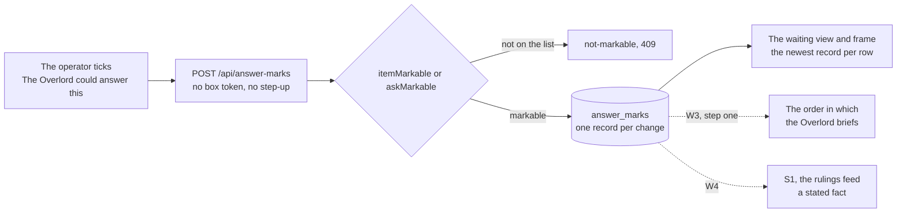

# Overlord W1: delegation marks, the operator's "the Overlord could answer this" on Waiting on you Implementation Plan

> **For agentic workers:** REQUIRED SUB-SKILL: Use superpowers:subagent-driven-development (recommended) or
> superpowers:executing-plans to implement this plan task-by-task. Steps use checkbox (`- [ ]`) syntax for tracking.

**Goal:** every row of Waiting on you that the operator was shown carries one box, "The Overlord could answer this".
The operator ticks it for a question they would hand over. Each change is kept, with its time and actor, so that the
Overlord later learns which kinds of question to answer for them.

- `answer_marks` holds every change, append-only. The newest record for a row stands.
- One session-gated operator door, `POST /api/answer-marks`, is its one writer. It confers nothing, so it needs no step-up
  and works while sign-in is dark.
- The waiting view carries each row's mark. The console draws the box on item rows, on cleared item rows and on an item's
  own page (PR A), then on question rows that name an ask and on cleared asks (PR B), with an optimistic tick that rolls
  back on a refusal.

**Why:** R21, the operator's ruling of 2026-11-15: "The point of overlord is to make many routine decisions for the
operator. I'd like you to add a checkbox to 'waiting on you' that I can tick in order to help train what kinds of
questions overlord should answer on my behalf." The spec delta that records it is §9.2.1 and C70, in this plan's own pull
request. The label is worth most when it is gathered early. W3's first step decides which kinds the Overlord briefs
first, and W4's operator model reads the marks as stated facts. So the marks start being recorded now, before any
Overlord exists, and no other W1 piece has to land first.

**Architecture:** two pull requests in a new lane, M, both in the programme ledgers' own files.

- **PR A, the mark and items (Tasks 1 to 4), ready to build.**
  - `shared/answerMarks.ts` (L0) holds the kinds, the wire view and the body parser.
  - `server/src/coord/answerMarks.ts` (C5, L1) holds `itemMarkable` and `markViewOf`, pure.
  - `server/src/coord/answerMarkStore.ts` (C5, L3) holds the table's one writer and its read.
  - The door joins `registerLedgerOperatorRoutes` in `server/src/coord/ledgersRoutes.ts`. `viewOfItem`, the one builder
    of an `ItemView`, attaches each item's mark.
  - The console: `pwa/src/ledgers/answerMarkWords.ts` (L1) and `pwa/src/ledgers/AnswerMarkBox.tsx` (L4), drawn by
    `WaitingScreen.tsx`'s item and cleared rows and by `ItemView.tsx`.
- **PR B, asks (Tasks 5 and 6), after PR A.**
  - `askMarkable` joins the L1 file. The store gains the read of the asks the operator has, and the waiting view gains
    two optional lists of them.
  - The door's `ask` arm. The question row draws the box when its session's ask is listed, and Recently cleared gains
    the asks the operator answered.

**Tech Stack:** TypeScript (ESM), `node:sqlite`, Fastify, React, vitest. No new dependency.

**Spec:** `docs/superpowers/specs/2026-11-09-overlord-design.md`, as this plan's pull request revises it:

- §9.2.1 and C70 (Table 13a): what a mark is, which rows carry one, that it grants nothing and is never an answer, where
  it lives and its one writer;
- §2's R21 row, §4's "Waiting on you stays where it is", §6.5's "routine answers of class none come first", §7.2's
  proposal bullet, §9.2's S1 feed and Figure 7, Table 9.2a's `stated` row, and §9.5's blind-sample bullets;
- Table 11.1a's row `answer_marks`, Table 11.1e's row "The operator's answer mark", and Table 14's W1 row;
- "Where things stand": R21 under Agreed, C70 waiting on the operator, and three Later rows;
- Appendix B, Table B6.

The index is `docs/superpowers/plans/2026-11-14-overlord-w1.md` (#2814, on `main`). It has no row for this piece: the
ruling came after it. "Index changes" below says what the index should gain. This plan builds on its rules for every
piece: "Where lanes meet" (the append-only registries, `ledgersRoutes.ts`, `ledgersStore.ts`), the large-file section's
growth check, and question 17 (the operator's doors).

The programme ledgers design is `docs/superpowers/specs/2026-10-31-programme-ledgers-design.md`: §2 (what the operator
sees), §3.3 (states, and "Done items leave the list and appear in Recently cleared", 48 hours since D-8194) and §7
(architecture).

## Open questions

The coordinator's brief gave defaults. Each is built below unless the code proved one wrong, and each question says
which. The plan builds every recommendation unless the coordinator or the operator rules otherwise.

1. **What is it called?** (Slug `mark-is-an-answer-mark`.) The ticket and the brief say "delegation mark". In
   `server/src/coord/` the word "delegation" already names the delegation broker's leases, journals and adoption
   (`delegation-*.ts`, `delegationLeaseDoor.ts`, `delegationAdoptStep.ts`), in the same context, C5. One context keeps
   one word for one thing.
   **Recommendation, built here:** "answer mark" in code, in the spec and in this plan. The console's label is the
   operator's words, "The Overlord could answer this". This file keeps the name the brief gave it, so that the index
   finds it. If the coordinator rules "delegation mark", the rename touches names only: the table, the door's path, two
   modules, the wire type, the component and the spec's §9.2.1.
2. **Which rows carry a box** (slug `marks-on-rows-the-operator-was-shown`). The default is "items and asks, open and
   recently cleared, and on an item's own sheet". Three findings from the code:
   - **Asks are not rows of `/api/waiting`.** The question rows come from fleet sessions in the attention bucket
     (`pwa/src/ledgers/ledgerWords.ts#questionRows`, `pwa/src/fleet/rollup.ts#operatorAsk`), one per session, keyed by
     its id. An `asks` row exists only for a child that a parent holds a question for (`server/src/coord/questions.ts`,
     the `hold` function). A root session's own ask and a permission prompt have no `asks` row.
   - **Recently cleared lists items only** (`WaitingScreen.tsx#ClearedTrail`). No cleared question row exists.
   - **An item has a page, not a sheet** (`pwa/src/ledgers/ItemView.tsx`, routed).

   **Recommendation, built here:**
   - PR A: an item the operator was shown, while it is open or in Recently cleared, on its row, its cleared row and its
     page.
   - PR B: an ask that reached the operator. That is the newest ask of its child whose state is `released` or `declined`,
     on the question row of that child; or an ask answered by the operator (`answeredBy` is `ASK_OPERATOR_PRINCIPAL`)
     inside the window, on a new cleared row.
   - No box on a root session's own ask or on a permission prompt: there is no row a mark could name. Spec Table 6.1a
     leaves both out of the Overlord's tier too (a root ask "should be rare"; approvals are unchanged). The spec's Later
     list carries it.
3. **A mark on a cleared row?** (The brief's question.) **Yes**, inside the Recently cleared window, `CLEARED_WINDOW_MS`
   (48 hours, `shared/ledgers.ts`). The operator often sees a question's kind best once it is answered. Past the window,
   and on a withdrawn or dismissed item, the door refuses `not-markable`, because the row is on no list. `GET
   /api/items/:id` still opens an older item read-only, with no box.
4. **A one-line "why"?** (The brief's question.) **Not in the first pull request.** It is free text that a later reader
   must mask and bound, and the operator asked for a box. The spec's Later list carries it, with a trigger.
5. **How the Week page or About you shows the marks** (the brief's question). **Later.** The operator model's About you
   (W4) and the Week page's owner, home C, show them. The spec's Later list carries it. W1 ships no reader beyond the
   waiting view.
6. **One table, append-only** (slug `marks-append-only`). The default is "every change is kept with its time and the
   operator's actor", and "the latest value stands".
   **Recommendation:** one table of changes, with no second table of current values. The newest record for a row is the
   current value, read through an index. One table holds each fact once. A pair of tables would give the current value a
   second writer.
7. **The mark copies no fact from its row** (slug `marks-reference-their-rows`). The default says the mark carries "the
   facts a later reader needs to group by kind": the item's kind and class, the ask's kind, the programme and the
   coordinator.
   **Measured:** no writer under `server/src` deletes an `operator_items` or `asks` row. The one ask pruner,
   `CoordStore#pruneAskQuestions`, blanks the question text only. So every grouping fact stays readable from the row the
   mark names:
   - an item's `kind`, `program` and `raisedBy`;
   - an ask's `runId` (and through `runs`, its programme and claimant), `parentId`, `state` and `releaseReason`;
   - from W3, the classes on both (spec Table 11.1a, "`operatorClass`, `effect` and the urgency on asks and items").

   **Recommendation, built here:** the record stores only the row's kind and id. Copying the facts would give each of
   them a second writer, which `CLAUDE.md` forbids. The default is met by a join, which Task 2 pins with a test.
   The items have no class column today, so a copied class could only be empty anyway.
8. **The door's credential** (slug `answer-mark-door-works-dark`). The default is "session-gated operator door with no
   box token, no step-up".
   **Recommendation:** as the rank door (`POST /api/portfolio/rank`, the portfolio plan's question 4). It calls no
   account gate, works while sign-in is dark, and records the session's device actor
   (`server/src/ccdargv.ts#deviceActor`) when armed and `flag-off` when dark. Armed, it sits behind the auth gate. A
   mark confers nothing, so a refusal while dark would only lose labels. The spec's §9.2.1 says what a dark mark is
   worth: kept and shown, and `inferred` at most in the operator model, because no cookie says who made it.
9. **No session can write a mark** (the brief's default; slug `no-session-path-to-marks`). Three facts, measured:
   - `ccd/ccrc-api`'s closed table has no row for the door. Its header says that operator doors "are operator doors,
     reached from the PWA", never rows, and `ccrc-api-closed.test.ts` pins the table. This plan adds no row.
   - Armed, the auth gate answers 401 `unauthenticated` to any route that is not in `EXEMPT`
     (`server/src/auth/gate.ts#installGate`), and the box token is never consulted there. The door joins no `EXEMPT`
     entry and calls neither `requireMailToken` nor `checkMailToken`, which `box-token-census.test.ts` pins.
   - Dark, nothing stops a process on the box that calls the route directly, exactly as for the tick door. The mark then
     records `flag-off`, so every mark written dark is told apart, and §9.2.1 gives it the weaker basis.
10. **The refusal word** (slug `not-markable-word`). The door needs one word that today's ledger words lack: the row
    exists and is not on the operator's list. `not-open` would read as "already marked done" in the console
    (`LEDGER_REFUSAL_TEXT`), which is wrong for a cleared row that is markable.
    **Recommendation:** `not-markable` (409) in `shared/refusal.ts#LEDGER_ROUTE_REFUSALS`. Its `detail` says why:
    `not-shown`, `past-window` or `not-listed`. An absent item is the existing `unknown-item` (404), and an absent ask the
    existing `unknown-ask` (404). Per the brief, PR A adds `not-markable`'s row to spec Table 11.6. The refusal-table
    guard (`server/test/single-definition/refusal-table.test.ts`) accepts a table word that is a route refusal, and reads
    only the Overlord's groups from code to table. So the row needs no exception-list entry, as the portfolio's build
    notes measured for `rank-changed`.
11. **An absent field must not read as "never marked"** (slug `answer-mark-absent-is-unsupported`). An older server
    sends no `answerMark` on an item, and a newer one sends it on every markable row.
    **Recommendation:** absent means "this server cannot mark this row", and the console draws no box. A newer server
    sends `{ state: 'never' }` for a markable row with no record. A mark read that failed sends `{ state: 'unmeasured' }`,
    drawn as a disabled box with a short reason. That is three answers with three meanings, and none of them is null.
12. **Live from its first pull request** (the brief's default). **Yes.** Nothing is armed. No other piece is needed
    first, and the door is a write the operator makes. No running session sees or does anything new at merge.

## What exists today

Measured on `main` at `dbf90dbfc` (2026-11-15).

- **No mark.** `git grep -i -e 'answer.mark' -e 'could answer'` under `server/src`, `shared`, `pwa/src` and `ccd`
  finds three comments that use the words in passing (in `ccd/ccd`, `ccd/ccrc` and `server/src/coord/questions.ts`),
  and no such concept. The word "mark" in `pwa/src/ledgers` is the tick's "Mark done" button, and `CoordStore#markCallSeen` and
  `markApprovalOperator` are unrelated. A new store function avoids both names.
- **The waiting view** (`server/src/coord/ledgersRoutes.ts`):
  - `waitingViewOf(coord, now, presenceOf, secretOf)` builds `shared/ledgers.ts#WaitingView`, `{ items, cleared, goals,
    calls?, callsCleared? }`. It reads `coord.itemsFor(null, now)`, `callsForOperator`, `pinnedProgrammes` and `goalsFor`.
  - `viewOfItem` is the one builder of an `ItemView`, through `itemViewOf(row, events, stale, secret)`.
  - `GET /api/waiting` answers it. So does the `waiting` frame on `/ws/fleet` (`shared/api.ts`, `{ type: 'waiting';
    waiting: WaitingView }`), which `server/src/server.ts` builds through `maskedFrame` and `maskDeep`. A
    `deps.bus.emit('waiting')` after a write sends it again.
  - `GET /api/waiting` and `GET /api/items/:id` are in `server/src/server.ts#MASKED_GET_ROUTES`. A POST's answer is
    masked by default.
- **The lists** (`server/src/coord/ledgersStore.ts#itemsFor`):
  - open: state in `OPEN_ITEM_STATES` (`open`, `checking`), with `heldUntil` NULL or past;
  - cleared: `done` with `closedAt >= now - CLEARED_WINDOW_MS`, and not settled inside its hold.

  Withdrawn and dismissed items are on neither list. The hold rule has one L0 home, `shared/ledgers.ts#operatorShownAt`,
  which `ledgersStore.ts#operatorWasShown` derives from. `itemsFor` spells the same rule in SQL. `CLEARED_WINDOW_MS` is
  48 hours (`shared/ledgers.ts`).
- **Items** (`operator_items`, migration 37 and later `ALTER`s): `id`, `program`, `runId`, `raisedBy`, `kind` (one of
  `ITEM_KINDS`: `decide`, `do`, `value`, `secret`), `title`, `state`, `raisedAt`, `tickedAt`, `closedAt`, `heldUntil`,
  `reachedOperatorAt` and others. There is no class column. `ItemRow`, `ITEM_COLS` and `itemById` are in
  `ledgersStore.ts`. Its writers are `moveItemInTx`, `raiseItemInTx` and `setBlocking`, plus the outbox's reach stamp
  (`single-definition/writers-map.test.ts`).
- **Asks** (`asks`; `CoordStore`, `server/src/coord/store.ts`; `shared/api.ts#AskState`):
  - A child's ask is minted `held` by the question lane's `hold`, only for a child with a parent. It moves to
    `released` by `releaseAsk` (the window lapsed) or to `declined` by `declineAsk` (the parent handed it over). Both set
    `releasedAt`. A mint may write `released` at once, with a `releaseReason` (`AskMintReleaseReason`).
  - The operator's answer path (`questions.ts`, through `takeAskForAnswer`, which takes `held` or `released`) settles it
    `answered` with `answeredBy` = `ASK_OPERATOR_PRINCIPAL` (`settleAsk`). A parent's answer records the parent's id.
  - No writer deletes an ask row. `pruneAskQuestions` blanks `question` and `options` after the retention.
  - `GET /api/asks` (in `server/src/coord/routes.ts`) takes a session or the box token, and is masked.
- **The operator doors** (`registerLedgerOperatorRoutes`, deps `LedgerOperatorDeps`):
  - Every door is session-gated by the auth gate when it is armed, and none is in `EXEMPT`.
  - The tick, act, decline and dismiss doors write the actor `operator`. The rank door writes
    `deps.authEnabled ? deviceActor(deps.sessionAuth(req).device) : 'flag-off'`.
  - Only the two credential doors take a step-up (`deps.gate(req, reply, { cap: null, stepUp: true })`).
- **The censuses a new door in this file touches** (portfolio PR A, #2842, is the precedent):
  - `server/test/box-token-census.test.ts#LEDGER_OPERATOR_DOORS`, checked against the file in both directions and,
    through `SESSION_ONLY_ALL`, against `CLAUDE.md`'s box-token bullet;
  - `server/test/auth-gate.test.ts`: `scanRoutes('coord/ledgersRoutes.ts')` is 22, `ROUTES.length` is 241, plus the
    sweep's prose counts and the "scanned + static wildcard" comment;
  - `server/src/auth/gate.ts`' header: "all 238 routes".
- **The store.** `server/src/coord/schema.ts#MIGRATIONS` holds 77 entries (the replay quiz's `continuity_quiz_runs` is
  77). `server/test/coord-db.test.ts` pins `COORD_SCHEMA_VERSION` and `MIGRATIONS.length` at 77 in two cases, and finds
  each recent table's slot by its DDL. `server/test/run-close-switch.test.ts` drops every table from migration 55 by hand.
  Its comment names each migration, and its count word reads "twenty-three" (a build re-measures it, since the replay
  quiz's migration 77 left the word as it was).
- **Other sites a new coord file touches:** `server/test/single-definition/core-vocab.test.ts#HANDLE_HOLDERS` (a file
  that holds the `coord.db` handle), `server/test/single-definition/time-ports.test.ts#TIME_PORT_FILES`, and
  `writers-map.test.ts`' `TABLES`.
- **Refusal words.** `shared/refusal.ts#LEDGER_ROUTE_REFUSALS` and `REFUSAL_STATUS`. The console's sentences are
  `pwa/src/lib/refusalWords.ts#LEDGER_REFUSAL_TEXT`, a `Record` over the words it renders. `unknown-item` and
  `unknown-ask` are both 404.
- **The console.**
  - The list lives on the fleet store (`pwa/src/stores/fleet.ts`, `waiting`, `setWaiting`, `waitingSaved`), filled by
    the frame or by `api.waiting`. `pwa/src/ledgers/waitingStore.ts#refetchWaiting` keeps one read on the wire.
  - `pwa/src/ledgers/waitingView.ts` (L1) exports `isWaitingView` and `isGoalsFor`.
  - `WaitingScreen.tsx` draws `ItemRow` (open), `QuestionButton` (questions) and `ClearedTrail` with `ClearedRow`. A
    row's open control is a button, and `RowActs` adds the row's own controls.
  - **No optimistic action exists.** `WaitingRoutes.tsx#ItemRoute`'s tick and dismiss await the call and then
    `refetchWaiting`. A refusal rejects with an `ApiError`, which `ItemView.tsx`'s `run` wrapper shows through
    `refusalText`.
  - `pwa/src/lib/api.ts` (growth-checked) holds `tickItem` and `dismissItem`.
- **Contexts.** `server/src/coord/**` is C5, and so is `pwa/src/ledgers/**` (the 08-10 spec's context table). A
  `pwa/src/ledgers/*Words.ts` file is L1. A component is L4.

## Global Constraints

- **Architecture (`CLAUDE.md`).**
  - `shared/answerMarks.ts` is L0 and imports nothing but types from `./ledgers.js` if it needs them (PR B). Each
    literal union carries its `Record<X, true>` map (`rings/wire-totality.test.ts`).
  - `server/src/coord/answerMarks.ts` is L1: pure, with no `fs`, no store and no clock, and `now` as an argument. It
    imports `shared/` only.
  - `server/src/coord/answerMarkStore.ts` is L3: synchronous SQL over the store's database, keeping every distinction
    it reads. No repository and no async wrapper over `CoordStore`, which gains one-line delegates only.
  - The door is L4 and decides nothing. Whether a row is markable is `itemMarkable`'s or `askMarkable`'s, and the view
    is `markViewOf`'s.
  - The console: `answerMarkWords.ts` (L1) holds the words, the field's one reader and `shownMark`. `AnswerMarkBox.tsx`
    (L4) acts.
- **One writer.** `answer_marks` is written only by `answerMarkStore.ts#recordAnswerMark`, which only the door calls.
  `writers-map.test.ts` pins the table and the call census, with a planted control each.
- **One rule for "on the list".** `itemMarkable` and `itemsFor` must agree on which items are listed. A test runs both
  over one fixture set: every item `itemsFor` lists is markable, and every other item is not (Task 1). PR B pins the same
  agreement between `askMarkable` and the view's ask lists.
- **Consolidate, don't duplicate.**
  - `itemMarkable` reads `operatorShownAt`, `OPEN_ITEM_STATES` and `CLEARED_WINDOW_MS` (`shared/ledgers.ts`), never a
    copy of them.
  - The door's actor rule is the rank door's expression. It is not wrapped in a helper of its own, because it is two
    uses of one existing function.
  - The console's refusal sentence joins `LEDGER_REFUSAL_TEXT`.
- **Failure contracts. Nothing unmeasured reads as a value.**
  - A mark read that throws makes `answerMarksOf` answer `{ ok: false, detail }`. The waiting view then gives each
    markable item `{ state: 'unmeasured' }` and still answers the list: a mark never blocks Waiting on you.
  - A record whose `kind` is not an `AnswerMarkKind` (a newer build's) is skipped by every reader and counted in the
    store's answer as `unreadable`, never folded into a kind.
  - A `marked` value other than 0 or 1 cannot be stored (a `CHECK`).
  - The door's read or write that throws answers 500 through Fastify's default, as the tick does. The console rolls the
    box back.
  - An older server sends no `answerMark`, so the console draws no box (question 11). An older console ignores the
    field.
- **Wire: additive.** `ItemView` gains an optional `answerMark`, and PR B gives `WaitingView` two optional lists.
  `FLEET_PROTO` is not bumped.
- **What a merge arms.** Nothing a running session sees or does changes. PR A: the box appears on Waiting on you, and no
  record exists until the operator ticks one. No reader beyond the waiting view reads a mark in W1. PR B: the same, for
  asks.
- **SAFETY (`CLAUDE.md`).** No ccd verb, no fleet act and no live `~/.ccrc`. Tests build `coord.db` in memory or in a
  fixture directory under the per-run temp root.
- **Tests.** Run every test through `ccrc test --`, from `server/` as `ccrc test -- ./node_modules/.bin/vitest run
  test/<file>.test.ts` and from `pwa/` the same way. Each task's last run adds both server `tsc` runs (`ccrc test -- npx
  tsc --noEmit -p tsconfig.json` and `-p test/tsconfig.tests.json`) and pwa's `tsc`, because `shared/` changes.
- **Growth check.** Every growth-checked file stays within 40 net lines in each pull request, with no waiver (the PR
  split below has the estimates).
- **Mutation floors.** `itemMarkable`, `markViewOf` and `parseAnswerMarkWrite` (PR A), and `askMarkable` (PR B), each
  join `MUTANT_SETS` (`server/test/sim/mutation-floors.test.ts`) through a new `server/test/sim/answerMarkSets.ts`, and
  `server/test/sim/mutation-floors.json`, in the pull request that creates them.
- **Censuses** are named in each task. Every guard ships with the test that goes red without it.
- **Public repository.** No private names. Fixtures use `prog-a`, `prog-b`, `lane-a-project-a` and the actor label
  `op-a`. Cite by symbol or `@anchor`. No D-number is invented: departures are slugs under "Deviations found", and the
  coordinator mints numbers.


*Figure 1. One door writes, and in W1 only the waiting view reads. The dashed readers come with their waves (§9.2.1).*

## Review Focus

1. **A mark confers nothing, and only the operator writes one.** One writer, reached only by the door. No box-token
   route, no `ccrc-api` verb and no session path, as the censuses prove in both directions. No decider of authority
   reads the table.
2. **The box and the list agree.** A row the console shows carries a box exactly when the door accepts a mark on it.
   One rule each for items and asks, pinned against the lists.
3. **Nothing unmeasured reads as a value.** "Never marked", "withdrawn", "unmeasured" and "this server cannot mark" are
   four answers, and none is null. A failed mark read never blocks the list.
4. **The optimistic box never lies.** It shows the operator's tap at once, rolls back on any refusal or failure with
   the server's reason, and takes the server's value as soon as it arrives.

## The PR split

| PR | Tasks | What it ships | Needs first | Growth-checked files, estimate (net lines) |
|---|---|---|---|---|
| A | 1 to 4 | The vocabulary and the parser; `itemMarkable` and `markViewOf`; `answer_marks` with its writer and read; the door with its item arm; `ItemView.answerMark`; the box on item rows, cleared item rows and the item page; `not-markable` with its Table 11.6 row | nothing: **ready to build** | `schema.ts` +22 (one migration with its comment); `store.ts` +3 (two delegates, one import); `pwa/src/lib/api.ts` +6 (one call); `server.ts` 0; `shared/api.ts` 0 |
| B | 5 and 6 | `askMarkable`; the read of the asks the operator has; `WaitingView.asks` and `asksCleared`; the door's ask arm; the box on question rows and on cleared asks | PR A | `store.ts` +1 (one delegate); `schema.ts` 0; `pwa/src/lib/api.ts` 0; `shared/api.ts` 0 |

Each pull request merges `main` once before merge and re-measures its migration slot (the index's "Where lanes meet").
Migration numbers are taken at build time, never here.

For scale, the files that are not growth-checked change by about this much:

| File | PR A | PR B |
|---|---|---|
| `shared/answerMarks.ts` | +70, new | +35 |
| `server/src/coord/answerMarks.ts` | +55, new | +30 |
| `server/src/coord/answerMarkStore.ts` | +75, new | +50 |
| `server/src/coord/ledgersRoutes.ts` | +50 | +30 |
| `shared/ledgers.ts` | +3 | +4 |
| `shared/refusal.ts` | +3 | |
| `pwa/src/lib/refusalWords.ts` | +3 | |
| `pwa/src/ledgers/answerMarkWords.ts` | +50, new | +10 |
| `pwa/src/ledgers/AnswerMarkBox.tsx` | +80, new | |
| `pwa/src/ledgers/WaitingScreen.tsx` | +12 | +35 |
| `pwa/src/ledgers/ItemView.tsx` | +6 | |
| `pwa/src/ledgers/ledgerWords.ts` | | +25 |
| `CLAUDE.md` | +2 | |

## Index changes

The index (#2814) should carry these. The coordinator passes them to the index's own fix round.

- **A new row in Table W1, "Delegation marks"**, plan `w1-delegation-marks.md`: "A: the answer mark's table, its one
  writer, the operator's door and the box on item rows, cleared items and the item page (R21, §9.2.1). B: the asks the
  operator has, in the waiting view and on question rows and cleared asks". Size: 2 PRs, 6 tasks. Needs first: "A:
  nothing, **ready to build**. B: PR A". Lane: M.
- **"Where each Table 14 item went"** gains the row "The operator's answer marks on Waiting on you (R21) | Delegation
  marks".
- **"Ready to build now"** gains delegation marks PR A.
- **Lane M, the operator's marks:** `shared/answerMarks.ts`, `server/src/coord/answerMarks.ts` and `answerMarkStore.ts`;
  the door and `viewOfItem`'s mark in `ledgersRoutes.ts`; `pwa/src/ledgers/answerMarkWords.ts`, `AnswerMarkBox.tsx`, and
  the rows in `WaitingScreen.tsx`, `ItemView.tsx` and `ledgerWords.ts`; one call in `pwa/src/lib/api.ts`.
- **Figure W1** gains `MA["marks A"] --> MB["marks B"]`, in the "Ready to build" group for A. No other piece needs it in
  W1.
- **"Where lanes meet":**
  - the append-only registries gain this piece's one migration, its census rows (`LEDGER_OPERATOR_DOORS`, the
    auth-gate counts, `CLAUDE.md`'s box-token bullet), `TABLES`, `TIME_PORT_FILES`, `HANDLE_HOLDERS` and `MUTANT_SETS`;
  - `ledgersRoutes.ts` gains lane M: the door in the operator registration, and the mark in `viewOfItem` and
    `waitingViewOf`. Lane E's `pushBlocking`, lane P's goals doors and lane H's item-raise refusal are other functions;
  - `shared/refusal.ts` gains lane M's `not-markable` in `LEDGER_ROUTE_REFUSALS`;
  - `pwa/src/lib/api.ts` gains lane M's one call;
  - `pwa/src/ledgers/WaitingScreen.tsx` is lane M's alone in W1. Lane E's response controls sit on the row's detail
    page and the digest (the index's lane E list), so the second to land merges `main` once.
- **"What a merge arms"** gains: "The answer marks' box appears on Waiting on you with delegation marks PR A. It writes
  only `answer_marks`, which nothing in W1 reads but the waiting view."
- **The spec-fixes list** gains nothing: the spec delta is in this plan's own pull request, and `not-markable`'s Table
  11.6 row lands with PR A.
- **Later pieces that read the marks** (each piece's own plan, not W1): W3's first step orders its briefs by the marks
  and shows them on the arming item; W3's second step shows them on a grant proposal; W4's S1 feed reads them, and W4's
  wipe and export cover them (§9.2.1); home C or W4's About you shows them (question 5).

---

### Task 1: The vocabulary, the parser and the two deciders (L0, L1)

**Files:**
- Create: `shared/answerMarks.ts`
- Create: `server/src/coord/answerMarks.ts`
- Modify: `shared/ledgers.ts` (`ItemView` gains `answerMark?: AnswerMarkView`, with a comment naming question 11)
- Create: `server/test/answer-marks.test.ts`, `server/test/sim/answerMarkSets.ts`
- Modify: `server/test/sim/mutation-floors.test.ts` and `server/test/sim/mutation-floors.json`
- Modify: `server/test/single-definition/time-ports.test.ts` (`TIME_PORT_FILES` gains `shared/answerMarks.ts` and
  `server/src/coord/answerMarks.ts`)
- Test: `server/test/rings/*.test.ts`

**The vocabulary** (`shared/answerMarks.ts`):
- `AnswerMarkKind = 'item' | 'ask'`, with `ANSWER_MARK_KIND_MAP: Record<AnswerMarkKind, true>`, `ANSWER_MARK_KINDS`
  derived from it, and `isAnswerMarkKind`.
- `AnswerMarkView`, the wire:
  - `{ state: 'never' }`: markable, no record;
  - `{ state: 'marked' | 'withdrawn'; at: number; signedIn: boolean }`: the newest record, ticked or unticked, its time,
    and whether its actor was a signed-in session (`flag-off` reads `false`);
  - `{ state: 'unmeasured'; detail: string }`: the mark read failed.
- `ANSWER_MARK_STATE_MAP` over the four states.
- `parseAnswerMarkWrite(body: unknown)` answers `{ ok: true, write: { kind, id, marked } }` or `{ ok: false }`. `kind`
  must be an `AnswerMarkKind`, `id` a positive safe integer, `marked` a boolean, and no other key may be present. In PR
  A the parser accepts `ask` too: the door refuses it until PR B (Task 3).

**The deciders** (`server/src/coord/answerMarks.ts`):
- `itemMarkable(row: Pick<ItemRow, 'state' | 'raisedAt' | 'heldUntil' | 'closedAt'>, now)` answers `markable`, or
  `not-markable` with one of three reasons:
  - `not-shown`: `operatorShownAt(row)` is null or after `now` (held, or settled inside its hold);
  - `past-window`: `done` with `closedAt < now - CLEARED_WINDOW_MS`;
  - `not-listed`: any other state (`withdrawn`, `dismissed`, or a state this build does not know).

  An `open` or `checking` row that was shown is markable. So is a `done` row that was shown, inside the window.
- `markViewOf(newest: AnswerMarkRecord | null | 'unmeasured', detail?)` answers the `AnswerMarkView`. `null` is
  `never`, and a record's `actor` of `flag-off` gives `signedIn: false`. The record type lives in the store's file and is
  passed as a plain row.

- [ ] **Step 1: Failing tests** (`test/answer-marks.test.ts`):
  - the parser accepts `{ kind: 'item', id: 3, marked: true }` and refuses each of: a missing key, an extra key, `kind:
    'approval'`, `id` of 0, `-1`, `1.5` or `"3"`, and `marked` of `1` or `"true"`;
  - `itemMarkable` over each state and the window's two edges, `closedAt` exactly at `now - CLEARED_WINDOW_MS`
    (markable) and one millisecond before it (`past-window`);
  - a held item (`heldUntil` after `now`) is `not-shown`, and one closed before its `heldUntil` is `not-shown`;
  - **the agreement:** over one fixture set of items in every state, held and not, inside and outside the window, an
    in-memory `coord.db` holding them, `itemsFor(null, now)`'s `open` and `cleared` hold exactly the items
    `itemMarkable` calls markable;
  - `markViewOf` gives each of the four states, and `flag-off` reads `signedIn: false`.
- [ ] **Step 2: Run.** Red.
- [ ] **Step 3: Implement** both files and the `ItemView` field.
- [ ] **Step 4: Mutation sets.** `answerMarkSets.ts` holds the sets for `itemMarkable`, `markViewOf` and
  `parseAnswerMarkWrite`. Each joins `MUTANT_SETS`, and its measured floor joins `mutation-floors.json`.
- [ ] **Step 5: Run** this suite, `test/single-definition/time-ports.test.ts`, `test/rings/*.test.ts`,
  `test/sim/mutation-floors.test.ts` and the three `tsc` runs. Green.
- [ ] **Step 6: Red check.** Each change below reds a case. Restore each from a saved copy.
  - Make `itemMarkable` ignore `heldUntil`: the agreement case reds.
  - Use `>` for `>=` at the window's edge: the edge case reds.
  - Read a `flag-off` actor as signed in: the view case reds.
- [ ] **Step 7: Commit.** `feat(marks): the answer mark's vocabulary, its parser and itemMarkable, pure (Overlord W1, R21)`

### Task 2: `answer_marks`, its one writer and its read (L3)

**Files:**
- Modify: `server/src/coord/schema.ts` (one migration: `answer_marks` and its index)
- Create: `server/src/coord/answerMarkStore.ts` (`recordAnswerMark`, `answerMarksOf`)
- Modify: `server/src/coord/store.ts` (one-line delegates `recordAnswerMark` and `answerMarksOf`, and one import)
- Modify: `server/test/coord-db.test.ts` (both version pins move by one; a new `describe` finds the slot by its DDL, as
  the replay quiz's does: one new table, nothing on an existing table, and the migration reaches a database at the
  version before it with every row as it was)
- Modify: `server/test/run-close-switch.test.ts` (its undo step drops `answer_marks`; its comment names the migration,
  and its count word moves by one)
- Modify: `server/test/single-definition/writers-map.test.ts`:
  - `TABLES` gains `answer_marks`, written only by `answerMarkStore.ts#recordAnswerMark`;
  - a new case pins that `recordAnswerMark(` is called under `server/src` only by `CoordStore`'s delegate and the
    door's handler in `ledgersRoutes.ts`, with a planted second call that reds it.
- Modify: `server/test/single-definition/core-vocab.test.ts` (`HANDLE_HOLDERS` gains `answerMarkStore.ts`, with a
  comment line in the file's idiom)
- Modify: `server/test/single-definition/time-ports.test.ts` (`TIME_PORT_FILES` gains `answerMarkStore.ts`)
- Create: `server/test/answer-mark-store.test.ts`

**Schema:**

```sql
CREATE TABLE answer_marks (
  id     INTEGER PRIMARY KEY AUTOINCREMENT,
  kind   TEXT NOT NULL,                            -- AnswerMarkKind; read through isAnswerMarkKind, never a cast
  rowId  INTEGER NOT NULL,                         -- operator_items.id or asks.id, by kind; no copy of either row
  marked INTEGER NOT NULL CHECK (marked IN (0, 1)),
  at     INTEGER NOT NULL,                         -- wall ms of the change
  actor  TEXT NOT NULL                             -- the session's device actor, or flag-off
);
CREATE INDEX answer_marks_row ON answer_marks (kind, rowId, id);
```

`kind` carries no `CHECK`, on purpose: a later build may name another kind of row (the spec's Later row), and an
older build must still open the database. Every reader takes `kind` through `isAnswerMarkKind`. The migration's comment
states the slot to re-measure, as every migration does. It adds a new table and changes nothing on an existing one, so
an older build ignores it (Table 11.1a: "Ignores it").

**The writer.** `recordAnswerMark(db, write: { kind, id, marked }, actor, now)` runs in one transaction:
1. It reads the newest record for `(kind, id)`.
2. If that record's `marked` equals `write.marked`, it writes nothing and answers `{ changed: false, newest }`.
3. Otherwise it inserts one record and answers `{ changed: true, newest }`. With no record yet, `marked: false` is a
   withdrawal of nothing: it writes nothing and answers `{ changed: false, newest: null }`.

It does not check that the row exists or is markable: the door has done that before it calls (Task 3), with no `await`
between, so the transaction is the whole guard.

**The read.** `answerMarksOf(db, kind, ids: readonly number[])` answers `{ ok: true, newest: Map<number, AnswerMarkRecord>,
unreadable: number }` or `{ ok: false, detail }`. It reads the newest record of each id in one statement, and skips and
counts any record whose `kind` its build does not know. A throw becomes `{ ok: false, detail }` with the error's message.

- [ ] **Step 1: Failing tests** (`test/answer-mark-store.test.ts`, an in-memory `coord.db`):
  - a fresh database has the table and no record;
  - a tick writes one record with the given `at` and `actor`, and a second tick on the same row writes nothing;
  - tick, untick, tick writes three records, and the read answers the newest, ticked;
  - an untick on a row never marked writes nothing;
  - marks on `item:3` and `ask:3` are separate rows;
  - a record written by hand with `kind: 'approval'` (standing in for a newer build) is skipped and counted `unreadable`;
  - a read on a closed database answers `{ ok: false }`, never an empty map;
  - **the join** (question 7): a marked item's `kind`, `program` and `raisedBy` read back through `rowId`, and a marked
    ask's programme reads back through `asks.runId` to `runs.program`, so no fact is copied.
- [ ] **Step 2: Run.** Red.
- [ ] **Step 3: Implement** the migration, the store file and the delegates.
- [ ] **Step 4: Run** this suite, `test/coord-db.test.ts`, `test/run-close-switch.test.ts`,
  `test/single-definition/*.test.ts`, `test/rings/*.test.ts` and both server `tsc` runs. Green.
- [ ] **Step 5: Red check.** Each change below reds a case. Restore each from a saved copy.
  - Make the writer insert when the value is unchanged.
  - Make the read answer an empty map on a throw.
  - Add a second `INSERT INTO answer_marks` in a function of `ledgersStore.ts`: `writers-map.test.ts` reds.
- [ ] **Step 6: Commit.** `feat(marks): answer_marks, its one writer and its read (Overlord W1, R21)`

### Task 3: The door, and the mark on every item the view carries

**Files:**
- Modify: `server/src/coord/ledgersRoutes.ts`:
  - `viewOfItem` gains a `mark` argument and attaches `answerMark` when `itemMarkable` says markable;
  - `waitingViewOf` reads `answerMarksOf('item', ids)` once, for every item in `items` and `cleared`, and passes each
    item its mark. On `{ ok: false }` every markable item carries `{ state: 'unmeasured', detail }`;
  - `GET /api/items/:id` passes its one item's mark the same way;
  - `registerLedgerOperatorRoutes` gains `POST /api/answer-marks`.
- Modify: `shared/refusal.ts` (`LEDGER_ROUTE_REFUSALS` gains `notMarkable: 'not-markable'`, with its 409 in
  `REFUSAL_STATUS`)
- Modify: `docs/superpowers/specs/2026-11-09-overlord-design.md` (Table 11.6 gains `not-markable`'s row: "The answer-mark
  door | The row is not on the operator's list: never shown, past the Recently cleared window, or in no list's state. The
  detail names which | C70")
- Modify: `server/test/box-token-census.test.ts` (`LEDGER_OPERATOR_DOORS` gains `/api/answer-marks`, with a comment line)
- Modify: `CLAUDE.md` (the box-token bullet's sentence on the programme ledgers' operator doors names `POST
  /api/answer-marks`, "the operator's answer mark on a Waiting on you row, which works while sign-in is dark and records
  `flag-off` then", which `SESSION_ONLY_ALL` checks)
- Modify: `server/test/auth-gate.test.ts`:
  - `scanRoutes('coord/ledgersRoutes.ts')` goes from 22 to 23;
  - `ROUTES.length` and the sweep's prose counts each rise by one, with the "scanned + static wildcard" comment and a
    dated comment line;
  - `FLAG_AWARE` is unchanged (below).
- Modify: `server/src/auth/gate.ts` (its header's route count rises by one, which `auth-gate.test.ts` checks)
- Create: `server/test/answer-mark-routes.test.ts`
- Modify: any test that builds `LedgerOperatorDeps` by hand, only if the deps change (they do not: the door reads
  `authEnabled` and `sessionAuth`, which the deps carry today)

**The door.** `POST /api/answer-marks`. It calls no account gate and works while sign-in is dark (question 8). Its
order:
1. `if (!coord)` answers `not-configured`. Dark and signed in, a bodiless request then reaches the same answers, so the
   door does not join `FLAG_AWARE`.
2. Its actor is `deps.authEnabled ? deviceActor(deps.sessionAuth(req).device) : 'flag-off'`.
3. `parseAnswerMarkWrite(req.body)`. A refusal is `bad-request`.
4. The `item` arm: `coord.itemById(id)`. Absent is `unknown-item` (404). `itemMarkable(row, now)`. `not-markable` (409)
   carries the reason as `detail`. The `ask` arm answers `bad-request` with the detail `ask-marks-not-yet` until PR B
   (Task 5).
5. `coord.recordAnswerMark(write, actor, now)`.
6. When the answer is `changed`, `deps.bus.emit('waiting')`, so every console draws the new value.
7. It answers `{ ok: true, answerMark: markViewOf(newest) }`.

The door does no `await` between its read and its write.

- [ ] **Step 1: Failing tests** (`test/answer-mark-routes.test.ts`, `buildServer` over an in-memory store):
  - Armed, with a fixture session:
    - a tick on an open item answers `marked` with `signedIn: true`, stores the session's device actor, and emits one
      `waiting` frame;
    - the same tick again answers `marked`, stores nothing more and emits no frame;
    - without a session it is 401, and with the box token alone it is still 401;
  - Dark: the door accepts the same tick and stores `flag-off`, and the view reads `signedIn: false`;
  - Refusals:
    - an absent item is 404 `unknown-item`;
    - a withdrawn item, a held item and a cleared item past the window are each 409 `not-markable`, with `detail`
      `not-listed`, `not-shown` and `past-window`;
    - each shape refusal of Task 1 is `bad-request`, and so is `kind: 'ask'` in PR A;
  - The view:
    - `GET /api/waiting` carries `answerMark` on every open and cleared item: `never` before a tick and `marked` after it;
    - `GET /api/items/:id` on an item past the window carries no `answerMark`;
    - with the mark read made to throw, `GET /api/waiting` still answers its items, each with `{ state: 'unmeasured' }`.
- [ ] **Step 2: Run.** Red.
- [ ] **Step 3: Implement** the handler, the view's mark, the word, the census edits and the Table 11.6 row.
- [ ] **Step 4: Run** this suite, `test/box-token-census.test.ts`, `test/auth-gate.test.ts`, `test/secret-mask.test.ts`,
  `test/ledgers-operator-routes.test.ts`, `test/refusal-status.test.ts`,
  `test/single-definition/refusal-table.test.ts`, `test/overlord-skill.test.ts`, `test/rings/*.test.ts` and the three
  `tsc` runs. Green. If `auth-gate.test.ts`' dark sweep names the door, its order differs from step 1 above: fix the
  order, never `FLAG_AWARE`.
- [ ] **Step 5: Red check.** Each change below reds a case. Restore each from a saved copy.
  - Register the door with a `checkMailToken` call: `box-token-census.test.ts` reds.
  - Store the gate's actor while dark instead of `flag-off`: the dark case reds.
  - Skip `itemMarkable` in the door: the three `not-markable` cases red.
  - Let `waitingViewOf` throw on a failed mark read: the unmeasured case reds.
- [ ] **Step 6: Commit.** `feat(marks): the operator's answer-mark door and the mark on every listed item (Overlord W1, R21)`

### Task 4: The box on Waiting on you, optimistic and rolled back on a refusal

**Files:**
- Create: `pwa/src/ledgers/answerMarkWords.ts` (L1)
- Create: `pwa/src/ledgers/AnswerMarkBox.tsx` (L4)
- Modify: `pwa/src/lib/api.ts` (`setAnswerMark(kind, id, marked)`: `POST /api/answer-marks`, answering
  `{ ok: true; answerMark: AnswerMarkView }`, a refusal rejecting with an `ApiError` like every non-2xx)
- Modify: `pwa/src/lib/refusalWords.ts` (`LEDGER_REFUSAL_TEXT` gains `not-markable`: "This row has left your list, so
  it cannot be marked any more. The list will update.")
- Modify: `pwa/src/ledgers/WaitingScreen.tsx` (`ItemRow` and `ClearedRow` draw the box beside the row's open button,
  never inside it)
- Modify: `pwa/src/ledgers/ItemView.tsx` (the item's page draws the box in its panel)
- Create: `pwa/test/answer-mark-words.test.ts`, `pwa/test/answer-mark-box.test.tsx`
- Modify: `pwa/test/waiting-screen.test.tsx`, and `pwa/test/ledgersFixture.ts` if its items need the field

**The words** (`answerMarkWords.ts`):
- `ANSWER_MARK_LABEL = 'The Overlord could answer this'`.
- `ANSWER_MARK_EXPLAINER`: "Tick the questions you would let the Overlord answer for you. It learns from your ticks. A
  tick gives it no authority, and you can untick at any time."
- `answerMarkOf(item: ItemView)`, the one reader of the field. Absent is `'unsupported'`, and anything that is not an
  `AnswerMarkView` is `'unsupported'` too.
- `shownMark(server, pending: boolean | null, current: boolean)` answers `{ draw: boolean; checked: boolean; disabled:
  boolean; note: string | null }`:
  - `unsupported` draws nothing;
  - `unmeasured` draws a disabled, unchecked box with the note "Could not read this mark";
  - while a write is pending, `checked` is the pending value and the box is disabled, so a second tap waits;
  - a page that is not current (the saved copy: `NotCurrentLine` shows) draws the box disabled;
  - otherwise `checked` is `marked`, and `withdrawn` and `never` are both unchecked.

**The box** (`AnswerMarkBox.tsx`): a labelled checkbox (`<input type="checkbox">` with a `<label>`), its own control
beside the row's button.
1. A tap sets `pending` to the new value and calls `api.setAnswerMark`.
2. On success it keeps `pending` until the store's view carries a mark equal to it (the door's `waiting` frame), then
   clears it, so the box never flickers back. The answer's own `answerMark` covers a frame that is lost: the box takes
   it when the call resolves.
3. On a refusal or a failure it clears `pending`, so the box shows the server's value again, and shows the reason
   beside it through `refusalText(err, LEDGER_REFUSAL_TEXT)`.
4. The first time the box is used on a device it shows `ANSWER_MARK_EXPLAINER` once, under a per-device `localStorage`
   key. Every read and write of the key is wrapped in `try`/`catch`, and the box works without storage.

- [ ] **Step 1: Failing tests:**
  - `answer-mark-words.test.ts`: `answerMarkOf` over an absent field, a malformed one and each state; `shownMark` over
    each state, with a pending value, and with a page that is not current;
  - `answer-mark-box.test.tsx`, with `api.setAnswerMark` stubbed:
    - a tap checks the box at once and disables it while the call is pending;
    - a resolved call leaves it checked, and a later view carrying `marked` keeps it checked and enabled;
    - a rejected call with `not-markable` unchecks it again and shows the sentence;
    - a rejected network call unchecks it again;
    - the explainer shows on the first use and not on the second, and a `localStorage` that throws changes nothing else;
  - `waiting-screen.test.tsx`: an open item and a cleared item each draw the box when the view carries `answerMark`,
    and neither draws one when the field is absent (an older server); the box is not inside the row's button.
- [ ] **Step 2: Run** from `pwa/`. Red.
- [ ] **Step 3: Implement** the words, the box, the call, the sentence and the three placements.
- [ ] **Step 4: Run** these suites, `pwa/test/waiting-routes.test.tsx`, `pwa/test/waiting-store.test.tsx`,
  `pwa/test/offline-waiting.test.ts`, `pwa/test/waiting-saved-copy.test.tsx` and pwa's `tsc`, and from `server/` the
  single-definition suites and `test/rings/*.test.ts` (`pwa-rings` and `pwa-one-owner` among them), because a pwa change
  can red a server scan. Green.
- [ ] **Step 5: Red check.** Each change below reds a case. Restore each from a saved copy.
  - Leave `pending` set after a refusal: the rollback case reds.
  - Draw the box when `answerMark` is absent: the older-server case reds.
- [ ] **Step 6: Commit.** `feat(marks): the answer-mark box on Waiting on you and on an item's page (Overlord W1, R21)`

**PR A ends here.** Its body states:
- the door is an operator door in the ledger registration, works dark with actor `flag-off`, needs no step-up and is
  reachable by no box-token route and no `ccrc-api` verb;
- questions 1, 6, 7 and 8, with their slugs;
- the floors, and the agreement test between `itemMarkable` and `itemsFor`;
- that nothing changes at merge but the box.

### Task 5: The asks the operator has, in the view and at the door

**Files:**
- Modify: `shared/answerMarks.ts` (`AskMarkRow` and its `how` map)
- Modify: `shared/ledgers.ts` (`WaitingView` gains `asks?: AskMarkRow[]` and `asksCleared?: AskMarkRow[]`)
- Modify: `server/src/coord/answerMarks.ts` (`askMarkable`)
- Modify: `server/src/coord/answerMarkStore.ts` (`askMarkTargets`, the read of the asks the operator has)
- Modify: `server/src/coord/store.ts` (one delegate)
- Modify: `server/src/coord/ledgersRoutes.ts` (`waitingViewOf` carries the two lists, with their marks; the door's
  `ask` arm)
- Modify: `server/test/sim/answerMarkSets.ts`, `server/test/sim/mutation-floors.json`
- Modify: `server/test/answer-marks.test.ts`, `server/test/answer-mark-store.test.ts`,
  `server/test/answer-mark-routes.test.ts`

**The wire.** `AskMarkRow = { id, childId, program: string | null, question, how, at, answerMark }`:
- `how` says how the ask reached the operator: `declined` (its parent handed it over), `lapsed` (released with no
  `releaseReason`: the parent's window ran out), `released-at-mint` (minted `released`, with the reason carried as
  `reason`), or `answered` (the operator answered it). A row in any other state is not listed.
- `at` is `releasedAt`, or `answeredAt` for `answered`.
- `question` is the ask's first line, which a child wrote. It rides the masked GET and the masked frame, as item
  titles do. After the retention it is empty, and the row is still listed.

**The decider.** `askMarkable(row, newestOfChild: boolean, now)` answers `markable`, or `not-markable` with a reason:
- `released` or `declined`, and the newest ask of its child: markable. Older: `not-listed`;
- `answered` with `answeredBy` the operator and `answeredAt >= now - CLEARED_WINDOW_MS`: markable. Older:
  `past-window`. Answered by its parent: `not-shown`;
- `held`, `answering`, `stale`, `unknown` or a state this build does not know: `not-listed` (`held`: `not-shown`).

**The read.** `askMarkTargets(db, now)` answers `{ open, cleared }`:
- `open`: the newest row of each child (`MAX(id)` per `childId`) whose state is `released` or `declined`;
- `cleared`: rows answered by the operator inside the window, newest first;
- each joined to `runs` through `runId` for the programme (`null` with no run row).

The view attaches each row's mark through `answerMarksOf('ask', ids)`, with the same unmeasured arm as items.

- [ ] **Step 1: Failing tests:**
  - `askMarkable` over every state, the newest-of-child rule, the parent's answer and the window's edges;
  - **the agreement:** over one fixture set of asks, `askMarkTargets` lists exactly the asks `askMarkable` calls
    markable;
  - the read joins the programme, and gives `null` for a run row that is absent;
  - the door: a tick on a released ask answers `marked`; a held ask is `not-markable` (`not-shown`); an absent ask is
    404 `unknown-ask`; an ask answered by its parent is `not-markable`;
  - `GET /api/waiting` carries `asks` and `asksCleared` with their marks.
- [ ] **Step 2: Run.** Red.
- [ ] **Step 3: Implement.**
- [ ] **Step 4: Run** the three suites, `test/single-definition/*.test.ts`, `test/rings/*.test.ts`,
  `test/sim/mutation-floors.test.ts`, `test/secret-mask.test.ts` and the three `tsc` runs. Green.
- [ ] **Step 5: Red check.** Each change below reds a case. Restore each from a saved copy.
  - Drop the newest-of-child rule: an older released ask becomes markable, and its case reds.
  - Accept the parent's answer as the operator's: its case reds.
- [ ] **Step 6: Commit.** `feat(marks): the asks the operator has, their marks and the door's ask arm (Overlord W1, R21)`

### Task 6: The box on question rows and on cleared asks

**Files:**
- Modify: `pwa/src/ledgers/answerMarkWords.ts` (`askMarkFor(sessionId, asks)`, the join of a question row to its open
  ask, by `childId`)
- Modify: `pwa/src/ledgers/ledgerWords.ts` (`clearedTrail` and `clearedGroups` take a union of cleared items and cleared
  asks, newest first, grouped by programme as today)
- Modify: `pwa/src/ledgers/WaitingScreen.tsx` (`QuestionButton`'s row draws the box when `askMarkFor` finds the
  session's ask; `ClearedTrail` draws a cleared ask row, "answered" with its age, with its box)
- Modify: `pwa/test/answer-mark-words.test.ts`, `pwa/test/ledger-words.test.ts`, `pwa/test/waiting-screen.test.tsx`

- [ ] **Step 1: Failing tests:**
  - `askMarkFor` finds the row by `childId`, answers nothing for a session with no listed ask (a root session's own ask,
    a permission prompt, an ask still held), and nothing when the view has no `asks` field (an older server);
  - the cleared trail orders items and asks together by their time, and groups them by programme;
  - the screen draws the box on a question row whose session has a listed ask, and on a cleared ask, and none on a
    question row whose session has none.
- [ ] **Step 2: Run.** Red.
- [ ] **Step 3: Implement.**
- [ ] **Step 4: Run** these suites, the waiting suites of Task 4, pwa's `tsc`, and the server's single-definition and
  rings suites. Green.
- [ ] **Step 5: Red check.** Draw the box on every question row: the root-ask case reds. Restore from a saved copy.
- [ ] **Step 6: Commit.** `feat(marks): the answer-mark box on question rows and on cleared asks (Overlord W1, R21)`

**PR B ends here.** Its body states the rows that carry no box and why (question 2), the floor, and that nothing changes
at merge but the box.

## Deviations found

Each entry is a departure from the brief's defaults or from the spec's text that this plan makes, by slug. The
coordinator mints numbers.

- **`mark-is-an-answer-mark`**: the brief's "delegation mark" is the "answer mark" in code and the spec, because
  "delegation" names the delegation broker in C5 (question 1).
- **`marks-on-rows-the-operator-was-shown`**: the brief's "asks" are the ask rows that reached the operator. A root
  session's own ask and a permission prompt carry no box, because no row names them. The item's "sheet" is its page
  (question 2).
- **`marks-reference-their-rows`**: the brief's "carrying the facts a later reader needs" is met by a join, not a copy,
  because no item or ask row is ever deleted (question 7).
- **`marks-append-only`**: one table of changes, with no table of current values (question 6).
- **`answer-mark-door-works-dark`**: the door works while sign-in is dark and records `flag-off`, as the rank door does.
  The spec's §9.2.1 gives a dark mark the weaker basis (question 8).
- **`not-markable-word`**: one new ledger word, `not-markable`, with its Table 11.6 row in PR A (question 10).
- **`answer-mark-absent-is-unsupported`**: an absent `answerMark` means "this server cannot mark", never "never marked"
  (question 11).

## Where things stand

**Agreed:**
- The operator's ruling R21 (2026-11-15), and the coordinator's defaults in the brief, built as questions 2 to 12 state.
- The spec delta, §9.2.1 and C70, in this plan's pull request.

**Waiting on the coordinator:**
- Question 1: the name, "answer mark" or "delegation mark".
- The index changes above, for the index's fix round.

**Waiting on the operator:**
- C70's approval, on this plan's pull request (the spec's "Waiting on you").

**Later:**
- Marks on a root session's own ask and on a permission prompt (question 2).
- A one-line "why" on a mark (question 4).
- The marks on the Week page and on About you (question 5).
- W3's briefing order and arming item, W3's grant proposal sheet, and W4's S1 feed, wipe and export: each reads the marks
  in its own plan (§9.2.1).
