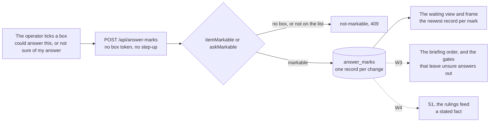

# Overlord W1: delegation marks, the operator's "could answer this" and "not sure of my answer" on Waiting on you Implementation Plan

> **For agentic workers:** REQUIRED SUB-SKILL: Use superpowers:subagent-driven-development (recommended) or
> superpowers:executing-plans to implement this plan task-by-task. Steps use checkbox (`- [ ]`) syntax for tracking.

**Goal:** every question on Waiting on you that the operator was shown carries two boxes:
- "The Overlord could answer this" (`could-answer`): the operator would hand this question over;
- "I'm not sure of my answer" (`unsure`): the operator's answer here is no yardstick for the Overlord's.

Each change is kept, with its time and actor, so that the Overlord later learns which questions to take, and so that
W3's evaluation leaves unsure answers out of every record of agreement.

- `answer_marks` holds every change, append-only. The newest record for a row's mark stands.
- One session-gated operator door, `POST /api/answer-marks`, is its one writer. It confers nothing, so it needs no
  step-up and works while sign-in is dark.
- The waiting view carries each row's two marks. The console draws the boxes on item rows, cleared item rows and an
  item's own page (PR A), then on question rows that name an ask and on cleared asks (PR B). Each tick is optimistic,
  and rolls back on a refusal.

**Why:** R21, the operator's ruling of 2026-11-15, in five sentences:
- "The point of overlord is to make many routine decisions for the operator. I'd like you to add a checkbox to 'waiting
  on you' that I can tick in order to help train what kinds of questions overlord should answer on my behalf."
- "Ok keep in mind that for many questions I'm asked I have low confidence in my answer and overlord would decide
  better."
- "I want to delegate details to overlord and higher level stuff stays with me."
- "The low confidence questions are ones where we're taking about specific implementation detail low level."
- "I can answer outcomes and tech direction questions, for sure, but I don't want to be answering every tech detail
  question if overlord confidence is high."

The spec delta that records it is in this plan's own pull request: §9.2.1 and C70 for the marks and the principle, the
amendments that make an unsure answer no yardstick, and §9.5.1, a proposal on tech detail that waits for the operator.
The labels are worth most when they are gathered early. So the marks start being recorded now, before any Overlord
exists, and no other W1 piece has to land first. Their readers come in W3 and W4.

**Architecture:** two pull requests in a new lane, M, both in the programme ledgers' own files.

- **PR A, the marks and items (Tasks 1 to 4), ready to build.**
  - `shared/answerMarks.ts` (L0) holds the row kinds, the mark names, the wire view and the body parser.
  - `server/src/coord/answerMarks.ts` (C5, L1) holds `itemMarkable` and `markViewOf`, pure.
  - `server/src/coord/answerMarkStore.ts` (C5, L3) holds the table's one writer and its read.
  - The door joins `registerLedgerOperatorRoutes` in `server/src/coord/ledgersRoutes.ts`. `viewOfItem`, the one builder
    of an `ItemView`, attaches each item's two marks.
  - The console: `pwa/src/ledgers/answerMarkWords.ts` (L1) and `pwa/src/ledgers/AnswerMarkBox.tsx` (L4), drawn twice a
    row by `WaitingScreen.tsx`'s item and cleared rows and by `ItemView.tsx`.
- **PR B, asks (Tasks 5 and 6), after PR A.**
  - `askMarkable` joins the L1 file. The store gains the read of the asks the operator has, and the waiting view gains
    two optional lists of them.
  - The door's `ask` arm. The question row draws the boxes when the server reads its session's listed ask as live,
    through the live-ask port the portfolio already uses (`liveAsk`, by `askKey`). Recently cleared gains the listed
    asks that are not live: released, declined or answered by the operator, inside 48 hours of their last change of
    state (question 3, review 2176 F8).

W1 builds no reader of the marks beyond the waiting view. The evaluation rules for `unsure` (§9.2.1, §9.5, H43, §7.2,
M1), the briefing order and the S1 feed are each built by the W3 or W4 piece that owns them, from the records this
piece keeps ("Index changes").

**Tech Stack:** TypeScript (ESM), `node:sqlite`, Fastify, React, vitest. No new dependency.

**Spec:** `docs/superpowers/specs/2026-11-09-overlord-design.md`, as this plan's pull request revises it:

- §9.2.1 and C70 (Table 13a): the principle (details to the Overlord, higher-level decisions with the operator), the
  two marks, which rows carry them, that they grant nothing and are never answers, what each feeds, where they live
  and their one writer;
- the binding amendments for `unsure`: §6.3's H34 (`U`), §6.5's arming bullet and M1 paragraph, §6.6's counting
  bullet, §6.9's H42 and H43, §7.2's evidence, §7.5's arming bullet, §9.5 ("An unsure answer is not the reference",
  and the consistency pairs), §9.6's spot-checks, I15, §12's M1 and M18, and "Where things stand"'s W3 line;
- the mark a gate reads: the one standing at the reveal of the Overlord's recommendation, or, with no reveal, when
  the row left Recently cleared (the coordinator's ruling on review 2176 F1);
- the wipe: it removes the marks and keeps `unsure_excluded`, the ids of the answers that were marked unsure, so they
  stay out of every gate; §9.4's rules 11 and 12, §7.6's replayed wipe and Table 11.1a (the ruling on F4);
- §9.5.1, the proposal on tech detail, which nothing applies until the operator approves it;
- §2's R21 row, the Status line, "In short", §4's "Waiting on you stays where it is", §6.5's routine answers, §7.2's
  proposal bullet, §9.2's S1 feed and Figure 7, Table 9.2a's `stated` row, and §9.5's blind-sample bullets;
- Table 11.1a's row `answer_marks`, Table 11.1e's row "The operator's answer marks", and Table 14's W1 row;
- "Where things stand": R21 under Agreed; the §9.5.1 proposal first under Waiting on you, then the account pools,
  then C70 and the classifier question; three Later rows;
- the `authority` row of the act log, whose `delegated` no longer calls "You decide" an answer mark (F3);
- Appendix B, Table B6.

The index is `docs/superpowers/plans/2026-11-14-overlord-w1.md` (#2814, on `main`). It has no row for this piece: the
ruling came after it. "Index changes" below says what the index should gain. This plan builds on its rules for every
piece: "Where lanes meet" (the append-only registries, `ledgersRoutes.ts`, `ledgersStore.ts`), the large-file section's
growth check, and question 17 (the operator's doors).

The programme ledgers design is `docs/superpowers/specs/2026-10-31-programme-ledgers-design.md`: §2 (what the operator
sees), §3.3 (states, and "Done items leave the list and appear in Recently cleared", 48 hours since D-8194) and §7
(architecture).

## Open questions

The coordinator's brief and its four addenda gave defaults. Each is built below unless the code proved one wrong, and
each question says which. The plan builds every recommendation unless the coordinator or the operator rules otherwise.

1. **What are they called?** (Slug `mark-is-an-answer-mark`.) The ticket and the brief say "delegation mark". In
   `server/src/coord/` the word "delegation" already names the delegation broker's leases, journals and adoption
   (`delegation-*.ts`, `delegationLeaseDoor.ts`, `delegationAdoptStep.ts`), in the same context, C5. One context keeps
   one word for one thing.
   **Ruled (the coordinator, fix round 1):** "answer marks" in code, in the spec and in this plan, named `could-answer`
   and `unsure`. The console's labels are the operator's words. This file keeps the name the brief gave it, so that
   the index finds it. The spec's act-log `authority` row no longer calls "You decide" "the operator's answer mark"
   (review 2176 F3), so the phrase names one thing.
2. **Two booleans or one three-way choice?** (The first addendum's question; slug `two-independent-marks`.)
   **Recommendation, built here: two booleans.** They are independent facts with different readers. The operator can be
   sure of an answer and still hand the question over, because it is routine, or unsure and still keep it. A three-way
   choice ("mine", "could answer", "unsure") would make them pick one, and would lose exactly the rows where both
   hold, which are the strongest signal for the Overlord. Each mark is its own value in one table, keyed by its name.
3. **Which rows carry the boxes** (slug `marks-on-rows-the-operator-was-shown`). The default is "items and asks, open
   and recently cleared, and on an item's own sheet". Four findings from the code and the spec:
   - **Asks are not rows of `/api/waiting`.** The question rows come from fleet sessions in the attention bucket
     (`pwa/src/ledgers/ledgerWords.ts#questionRows`, `pwa/src/fleet/rollup.ts#operatorAsk`), one per session, keyed by
     its id. An `asks` row exists only for a child that a parent holds a question for (`server/src/coord/questions.ts`,
     the `hold` function). A root session's own ask and a permission prompt have no `asks` row.
   - **Recently cleared lists items only** (`WaitingScreen.tsx#ClearedTrail`). No cleared question row exists.
   - **An item has a page, not a sheet** (`pwa/src/ledgers/ItemView.tsx`, routed).
   - **A `do` item and a `secret` item are not questions.** Spec Table 6.1a: "a secret is O4 and never reaches a
     session, and a `do` item records the operator's own act". Neither can be answered by the Overlord, and "unsure of
     my answer" has no answer to attach to.

   **Recommendation, built here:**
   - PR A: a `decide` or `value` item the operator was shown, while it is open or in Recently cleared, on its row, its
     cleared row and its page. That is before the answer and after it, as the first addendum asks.
   - PR B: an ask that reached the operator, following today's ask states exactly (review 2176 F8, measured under
     "What exists today"). That is an ask in `released` or `declined`, or one the operator answered (`answeredBy` is
     `ASK_OPERATOR_PRINCIPAL`), while it is live or within 48 hours of its last change of state. Live means its child's
     newest hook state is waiting on this ask's own `askKey`, read through the live-ask port the portfolio already uses.
     A live ask's boxes sit on its child's question row (before the answer). Every other listed ask is a row of
     Recently cleared (after it). PR B assumes no state move the code does not make: a `declined` ask the operator
     answers in the pane stays `declined`, and a `released` ask whose dialog has gone stays `released`. Each is
     listed until 48 hours after its `releasedAt`.
   - No box on a `do` or `secret` item, a root session's own ask or a permission prompt. Spec Table 6.1a leaves the
     last two out of the Overlord's tier too. The spec's Later list carries them.
4. **What tells a detail from a higher-level question in W1?** (The third addendum's question; slug
   `w1-groups-marks-by-kind`.) The spec tells them apart by a row's effective class, `scoredAs` and the routine or big
   line (§6.7, H40, D-8126 §5.4). None of these exists on a row before W3: items have no class column, and `scoredAs` is
   W3's.
   **Recommendation, built here:** W1 records the marks alone, and a reader groups them by what the row already carries:
   the item's `kind` and `program`, the ask's run and programme. No field is added to item raise in this piece. A
   richer classifier (a field the coordinator sets at raise, or the Overlord's own read checked by code) is an open
   question for W3, and the spec lists it under "Waiting on you".
5. **The evaluation rules for `unsure` are W3's** (slug `unsure-rules-ship-with-their-readers`). The first addendum
   makes an unsure answer no yardstick: never a hit, a miss or an agreeing blind answer. The spec delta states that rule
   at each place that reads the operator's answer as the reference. Their code (`askOrAct`'s cell record, the gates of
   §9.5, grant evidence, consistency pairs, M1) does not exist before W3. **Recommendation:** W1 keeps what those
   readers need: every change with its time, so that a gate can read the mark that stood when the Overlord's
   recommendation was revealed, or, with no reveal, when the row left Recently cleared (§9.2.1, the coordinator's ruling
   on review 2176 F1). A mark set after the reveal is kept and shown and changes no gate. Each W3 piece builds its own
   rule. "Index changes" names them.
6. **A mark on a cleared row?** (The brief's question.) **Yes**, inside the Recently cleared window, `CLEARED_WINDOW_MS`
   (48 hours, `shared/ledgers.ts`). The operator often sees a question's kind best once it is answered, and the first
   addendum asks for a mark "before or after answering". Past the window, and on a withdrawn or dismissed item, the
   door refuses `not-markable`, because the row is on no list. `GET /api/items/:id` still opens an older item
   read-only, with no boxes.
7. **A one-line "why"?** (The brief's question.) **Not in the first pull request.** It is free text that a later reader
   must mask and bound, and the operator asked for boxes. The spec's Later list carries it, with a trigger.
8. **How the Week page or About you shows the marks** (the brief's question). **Later.** The operator model's About you
   (W4) and the Week page's owner, home C, show them. The spec's Later list carries it. W1 ships no reader beyond the
   waiting view.
9. **One table, append-only** (slug `marks-append-only`). The default is "every change is kept with its time and the
   operator's actor", and "the latest value stands".
   **Recommendation:** one table of changes, with no second table of current values. The newest record for a row's mark
   is its current value, read through an index. One table holds each fact once, and a pair of tables would give the
   current value a second writer. Question 5 needs the history too.
10. **The marks copy no fact from their row** (slug `marks-reference-their-rows`). The default says the mark carries
    "the facts a later reader needs to group by kind": the item's kind and class, the ask's kind, the programme and the
    coordinator. **Measured:** no writer under `server/src` deletes an `operator_items` or `asks` row. The one ask
    pruner, `CoordStore#pruneAskQuestions`, blanks the question text only. So every grouping fact stays readable from
    the row the mark names:
    - an item's `kind`, `program` and `raisedBy`;
    - an ask's `runId` (and through `runs`, its programme and claimant), `parentId`, `state` and `releaseReason`;
    - from W3, the classes on both (spec Table 11.1a, "`operatorClass`, `effect` and the urgency on asks and items").

    **Recommendation, built here:** the record stores only the row's kind and id. Copying the facts would give each of
    them a second writer, which `CLAUDE.md` forbids. The default is met by a join, which Task 2 pins with a test. Items
    have no class column today, so a copied class could only be empty anyway.
11. **The door's credential** (slug `answer-mark-door-works-dark`). The default is "session-gated operator door with no
    box token, no step-up".
    **Recommendation:** as the rank door (`POST /api/portfolio/rank`, the portfolio plan's question 4). It calls no
    account gate, works while sign-in is dark, and records the session's device actor
    (`server/src/ccdargv.ts#deviceActor`) when armed and `flag-off` when dark. Armed, it sits behind the auth gate. A
    mark confers nothing, so a refusal while dark would only lose labels. The spec's §9.2.1 says what a dark mark is
    worth: kept and shown, and `inferred` at most in the operator model, because no cookie says who made it.
12. **No session can write a mark** (the brief's default; slug `no-session-path-to-marks`). Three facts, measured:
    - `ccd/ccrc-api`'s closed table has no row for the door. Its header says that operator doors "are operator doors,
      reached from the PWA", never rows, and `ccrc-api-closed.test.ts` pins the table. This plan adds no row.
    - Armed, the auth gate answers 401 `unauthenticated` to any route that is not in `EXEMPT`
      (`server/src/auth/gate.ts#installGate`), and the box token is never consulted there. The door joins no `EXEMPT`
      entry and calls neither `requireMailToken` nor `checkMailToken`, which `box-token-census.test.ts` pins.
    - Dark, nothing stops a process on the box that calls the route directly, exactly as for the tick door. The mark
      then records `flag-off`, so every mark written dark is told apart, and §9.2.1 gives it the weaker basis.
13. **The refusal word** (slug `not-markable-word`). The door needs one word that today's ledger words lack: the row
    exists, and carries no box or is not on the operator's list. `not-open` would read as "already marked done" in the
    console (`LEDGER_REFUSAL_TEXT`), which is wrong for a cleared row that is markable.
    **Recommendation:** `not-markable` (409) in `shared/refusal.ts#LEDGER_ROUTE_REFUSALS`. Its `detail` says why:
    `no-box`, `not-shown`, `past-window` or `not-listed`. An absent item is the existing `unknown-item` (404), and an
    absent ask the existing `unknown-ask` (404). Per the brief, PR A adds `not-markable`'s row to spec Table 11.6. The
    refusal-table guard (`server/test/single-definition/refusal-table.test.ts`) accepts a table word that is a route
    refusal, and reads only the Overlord's groups from code to table. So the row needs no exception-list entry, as the
    portfolio's build notes measured for `rank-changed`.
14. **An absent field must not read as "never marked"** (slug `answer-mark-absent-is-unsupported`). An older server
    sends no `answerMarks` on an item, and a newer one sends it on every markable row.
    **Recommendation:** absent means "this server cannot mark this row", and the console draws no box. A newer server
    sends `{ state: 'never' }` for a mark with no record. A mark read that failed sends `{ state: 'unmeasured' }`, drawn
    as a disabled box with a short reason. That is three answers with three meanings, and none of them is null.
15. **Live from its first pull request** (the brief's default). **Yes.** Nothing is armed. No other piece is needed
    first, and the door is a write the operator makes. No running session sees or does anything new at merge.
16. **The proposal on tech detail** (the fourth addendum; spec §9.5.1). It changes evaluation the operator approved, so
    the spec writes it as a proposal, first under "Waiting on you". **Nothing in this piece depends on it:** whatever
    the operator rules, W1 records the same marks. If approved, it builds in W3 with `askOrAct` and the arming item, and
    its outcome sources are W3's to measure.

## What exists today

Measured on `main` at `dbf90dbfc` (2026-11-15).

- **No mark.** `git grep -i -e 'answer.mark' -e 'could answer'` under `server/src`, `shared`, `pwa/src` and `ccd` finds
  three comments that use the words in passing (in `ccd/ccd`, `ccd/ccrc` and `server/src/coord/questions.ts`), and no
  such concept. The word "mark" in `pwa/src/ledgers` is the tick's "Mark done" button, and `CoordStore#markCallSeen` and
  `markApprovalOperator` are unrelated. A new store function avoids both names.
- **The waiting view** (`server/src/coord/ledgersRoutes.ts`):
  - `waitingViewOf(coord, now, presenceOf, secretOf)` builds `shared/ledgers.ts#WaitingView`, `{ items, cleared, goals,
    calls?, callsCleared? }`. It reads `coord.itemsFor(null, now)`, `callsForOperator`, `pinnedProgrammes` and
    `goalsFor`.
  - `viewOfItem` is the one builder of an `ItemView`, through `itemViewOf(row, events, stale, secret)`.
  - `GET /api/waiting` answers it. So does the `waiting` frame on `/ws/fleet` (`shared/api.ts`, `{ type: 'waiting';
    waiting: WaitingView }`), which `server/src/server.ts` builds through `maskedFrame` and `maskDeep`. A
    `deps.bus.emit('waiting')` after a write sends it again.
  - `GET /api/waiting` and `GET /api/items/:id` are in `server/src/server.ts#MASKED_GET_ROUTES`. A POST's answer is
    masked by default.
- **The lists** (`server/src/coord/ledgersStore.ts#itemsFor`):
  - open: state in `OPEN_ITEM_STATES` (`open`, `checking`), with `heldUntil` NULL or past;
  - cleared: `done` with `closedAt >= now - CLEARED_WINDOW_MS`, and not settled inside its hold.

  Withdrawn and dismissed items are on neither list. The hold rule has one L0 home, `shared/ledgers.ts#operatorShownAt`,
  which `ledgersStore.ts#operatorWasShown` derives from. `itemsFor` spells the same rule in SQL. `CLEARED_WINDOW_MS` is
  48 hours (`shared/ledgers.ts`).
- **Items** (`operator_items`, migration 37 and later `ALTER`s): `id`, `program`, `runId`, `raisedBy`, `kind` (one of
  `ITEM_KINDS`: `decide`, `do`, `value`, `secret`), `title`, `state`, `raisedAt`, `tickedAt`, `closedAt`, `heldUntil`,
  `reachedOperatorAt` and others. There is no class column. `ItemRow`, `ITEM_COLS` and `itemById` are in
  `ledgersStore.ts`. Its writers are `moveItemInTx`, `raiseItemInTx` and `setBlocking`, plus the outbox's reach stamp
  (`single-definition/writers-map.test.ts`).
- **Asks** (`asks`; `CoordStore`, `server/src/coord/store.ts`; `shared/api.ts#AskState`):
  - A child's ask is minted `held` by the question lane's `hold`, only for a child with a parent. It moves to `released`
    by `releaseAsk` (the window lapsed) or to `declined` by `declineAsk` (the parent handed it over). Both set
    `releasedAt`. A mint may write `released` at once, with a `releaseReason` (`AskMintReleaseReason`).
  - The operator's answer path (`questions.ts`, through `takeAskForAnswer`, which takes `held` or `released`) settles it
    `answered` with `answeredBy` = `ASK_OPERATOR_PRINCIPAL` (`settleAsk`). A parent's answer records the parent's id.
  - No writer deletes an ask row. `pruneAskQuestions` blanks `question` and `options` after the retention.
  - **A `declined` ask never leaves that state; a `released` one may** (review 2176 F8, measured; corrected by review
    2217 F1). `releaseAsk` and `declineAsk` move only `held`, and `takeAskForAnswer` refuses `declined`, so a `declined`
    ask the operator answers in the pane is pressed unrecorded and stays `declined`. But `takeAskForAnswer` takes
    `released` into `answering`, a lapsed ask's parent may still answer it late, and `staleAsk` moves `answering` to
    `stale` and overwrites `releasedAt`. So whether an ask reached the operator is read from its reach stamp
    (`reachedOperatorAt`, `pushOutboxStore.ts#stampReach`) once its state has moved on (answer marks B, slug
    reached-is-the-reach-stamp). A `released` ask whose dialog has gone, with no one mid-answer, stays `released`.
  - **The live signal exists.** `server/src/coord/ports.ts#LiveAskRead`, adapted by `FleetWatcher#liveAskKey`, answers
    the `askKey` of the ask a child's newest hook state is waiting on, `null`, or `unmeasured`. The portfolio reads it
    for a `released` or `declined` ask that is its child's newest row (`portfolioStore.ts#portfolioFacts`), and
    `LedgerOperatorDeps.liveAsk` already carries it to the ledger routes.
  - `GET /api/asks` (in `server/src/coord/routes.ts`) takes a session or the box token, and is masked.
- **The operator doors** (`registerLedgerOperatorRoutes`, deps `LedgerOperatorDeps`):
  - Every door is session-gated by the auth gate when it is armed, and none is in `EXEMPT`.
  - The tick, act, decline and dismiss doors write the actor `operator`. The rank door writes
    `deps.authEnabled ? deviceActor(deps.sessionAuth(req).device) : 'flag-off'`.
  - Only the two credential doors take a step-up (`deps.gate(req, reply, { cap: null, stepUp: true })`).
- **The censuses a new door in this file touches** (portfolio PR A, #2842, is the precedent):
  - `server/test/box-token-census.test.ts#LEDGER_OPERATOR_DOORS`, checked against the file in both directions and,
    through `SESSION_ONLY_ALL`, against `CLAUDE.md`'s box-token bullet;
  - `server/test/auth-gate.test.ts`: `scanRoutes('coord/ledgersRoutes.ts')` is 22, `ROUTES.length` is 241, plus the
    sweep's prose counts and the "scanned + static wildcard" comment;
  - `server/src/auth/gate.ts`' header: "all 238 routes".
- **The store.** `server/src/coord/schema.ts#MIGRATIONS` holds 77 entries (the replay quiz's `continuity_quiz_runs` is
  77). `server/test/coord-db.test.ts` pins `COORD_SCHEMA_VERSION` and `MIGRATIONS.length` at 77 in two cases, and finds
  each recent table's slot by its DDL. `server/test/run-close-switch.test.ts` takes the database back to version 53
  by hand and replays migrations 54 to 77, 24 of them. Its comment names each migration, and its count word reads
  "twenty-three", one short, because the replay quiz's migration 77 left the word as it was. PR A sets it to the count
  it then replays.
- **Other sites a new coord file touches:** `server/test/single-definition/core-vocab.test.ts#HANDLE_HOLDERS` (a file
  that holds the `coord.db` handle), `server/test/single-definition/time-ports.test.ts#TIME_PORT_FILES`, and
  `writers-map.test.ts`' `TABLES`.
- **Refusal words.** `shared/refusal.ts#LEDGER_ROUTE_REFUSALS` and `REFUSAL_STATUS`. The console's sentences are
  `pwa/src/lib/refusalWords.ts#LEDGER_REFUSAL_TEXT`, a `Record` over the words it renders. `unknown-item` and
  `unknown-ask` are both 404.
- **The console.**
  - The list lives on the fleet store (`pwa/src/stores/fleet.ts`, `waiting`, `setWaiting`, `waitingSaved`), filled by
    the frame or by `api.waiting`. `pwa/src/ledgers/waitingStore.ts#refetchWaiting` keeps one read on the wire.
  - `pwa/src/ledgers/waitingView.ts` (L1) exports `isWaitingView` and `isGoalsFor`.
  - `WaitingScreen.tsx` draws `ItemRow` (open), `QuestionButton` (questions) and `ClearedTrail` with `ClearedRow`. A
    row's open control is a button, and `RowActs` adds the row's own controls.
  - **No optimistic action exists in `pwa/src/ledgers`.** `WaitingRoutes.tsx#ItemRoute`'s tick and dismiss await the
    call and then `refetchWaiting`. A refusal rejects with an `ApiError`, which `ItemView.tsx`'s `run` wrapper shows
    through `refusalText`. Elsewhere `pwa/src/fleet/PoolList.tsx` is optimistic, and `useMarkerToggle.ts` sets the
    opposite rule for a switch: it waits for the server. Task 4 says why a mark may be optimistic.
  - `pwa/src/lib/api.ts` (growth-checked) holds `tickItem` and `dismissItem`.
- **Contexts.** `server/src/coord/**` is C5, and so is `pwa/src/ledgers/**` (the 08-10 spec's context table). A
  `pwa/src/ledgers/*Words.ts` file is L1. A component is L4.

## Global Constraints

- **Architecture (`CLAUDE.md`).**
  - `shared/answerMarks.ts` is L0 and imports nothing but types. Each literal union carries its `Record<X, true>` map
    (`rings/wire-totality.test.ts`).
  - `server/src/coord/answerMarks.ts` is L1: pure, with no `fs`, no store and no clock, and `now` as an argument. It
    imports values from `shared/` only. Its two row types, `ItemRow` and `AnswerMarkRecord`, come in by `import type`,
    which is erased. If a ring scan reads one as an outward import, the type moves into `shared/answerMarks.ts`.
  - `server/src/coord/answerMarkStore.ts` is L3: synchronous SQL over the store's database, keeping every distinction
    it reads. No repository and no async wrapper over `CoordStore`, which gains one-line delegates only.
  - The door is L4 and decides nothing. Whether a row is markable is `itemMarkable`'s or `askMarkable`'s, and the view
    is `markViewOf`'s.
  - The console: `answerMarkWords.ts` (L1) holds the words, the field's one reader and `shownMark`. `AnswerMarkBox.tsx`
    (L4) acts.
- **One writer.** `answer_marks` is written only by `answerMarkStore.ts#recordAnswerMark`, which only the door calls.
  `writers-map.test.ts` pins the table and the call census, with a planted control each.
- **One rule for "on the list".** `itemMarkable` and `itemsFor` must agree on which listed items carry boxes: every
  `decide` or `value` item `itemsFor` lists is markable, and every other item is not (Task 1). PR B pins the same
  agreement between `askMarkable` and the view's ask lists.
- **Consolidate, don't duplicate.**
  - `itemMarkable` reads `operatorShownAt`, `OPEN_ITEM_STATES` and `CLEARED_WINDOW_MS` (`shared/ledgers.ts`), never a
    copy of them.
  - The door's actor rule is the rank door's expression. It is not wrapped in a helper of its own, because it is two
    uses of one existing function.
  - The console's refusal sentence joins `LEDGER_REFUSAL_TEXT`.
  - The two marks share one table, one writer, one door and one component. The mark's name is a column and a prop,
    never a second mechanism.
- **Failure contracts. Nothing unmeasured reads as a value.**
  - A mark read that throws makes `answerMarksOf` answer `{ ok: false, detail }`. The waiting view then gives each
    markable item `{ state: 'unmeasured' }` for both marks and still answers the list: a mark never blocks Waiting on
    you.
  - A record whose `kind` or `mark` this build does not know (a newer build's) is skipped by every reader and counted
    in the store's answer as `unreadable`, never folded into a known one.
  - A `value` other than 0 or 1 cannot be stored (a `CHECK`).
  - The door's read or write that throws answers 500 through Fastify's default, as the tick does. The console rolls the
    box back.
  - An older server sends no `answerMarks`, so the console draws no box (question 14). An older console ignores the
    field.
- **Wire: additive.** `ItemView` gains an optional `answerMarks`, and PR B gives `WaitingView` two optional lists.
  `FLEET_PROTO` is not bumped.
- **What a merge arms.** Nothing a running session sees or does changes. PR A: the boxes appear on Waiting on you, and
  no record exists until the operator ticks one. No reader beyond the waiting view reads a mark in W1. PR B: the same,
  for asks.
- **SAFETY (`CLAUDE.md`).** No ccd verb, no fleet act and no live `~/.ccrc`. Tests build `coord.db` in memory or in a
  fixture directory under the per-run temp root.
- **Tests.** Run every test through `ccrc test --`, from `server/` as `ccrc test -- ./node_modules/.bin/vitest run
  test/<file>.test.ts` and from `pwa/` the same way. Each task's last run adds both server `tsc` runs (`ccrc test -- npx
  tsc --noEmit -p tsconfig.json` and `-p test/tsconfig.tests.json`) and pwa's `tsc`, because `shared/` changes.
- **Growth check.** Every growth-checked file stays within 40 net lines in each pull request, with no waiver (the PR
  split below has the estimates).
- **Mutation floors.** `itemMarkable`, `markViewOf` and `parseAnswerMarkWrite` (PR A), and `askMarkable` (PR B), each
  join `MUTANT_SETS` (`server/test/sim/mutation-floors.test.ts`) through a new `server/test/sim/answerMarkSets.ts`, and
  `server/test/sim/mutation-floors.json`, in the pull request that creates them.
- **Censuses** are named in each task. Every guard ships with the test that goes red without it.
- **Public repository.** No private names. Fixtures use `prog-a`, `prog-b`, `lane-a-project-a` and the actor label
  `op-a`. Cite by symbol or `@anchor`. No D-number is invented: departures are slugs under "Deviations found", and the
  coordinator mints numbers.


*Figure 1. One door writes, and in W1 only the waiting view reads. The dashed readers come with their waves (§9.2.1).*

## Review Focus

1. **A mark confers nothing, and only the operator writes one.** One writer, reached only by the door. No box-token
   route, no `ccrc-api` verb and no session path, as the censuses prove in both directions. No decider of authority
   reads the table.
2. **The boxes and the list agree.** A row the console shows carries boxes exactly when the door accepts a mark on it.
   One rule each for items and asks, pinned against the lists.
3. **Nothing unmeasured reads as a value.** "Never marked", "withdrawn", "unmeasured" and "this server cannot mark" are
   four answers, and none is null. A failed mark read never blocks the list.
4. **The history W3 needs is kept.** Every change of each mark is a record with its time, so a gate can read the
   `unsure` mark that stood when a row left Recently cleared.
5. **The optimistic box never lies.** It shows the operator's tap at once, rolls back on any refusal or failure with
   the server's reason, and takes the server's value as soon as it arrives.

## The PR split

| PR | Tasks | What it ships | Needs first | Growth-checked files, estimate (net lines) |
|---|---|---|---|---|
| A | 1 to 4 | The vocabulary and the parser; `itemMarkable` and `markViewOf`; `answer_marks` with its writer and read; the door with its item arm; `ItemView.answerMarks`; the two boxes on item rows, cleared item rows and the item page; `not-markable` with its Table 11.6 row | nothing: **ready to build** | `schema.ts` +23 (one migration with its comment); `store.ts` +3 (two delegates, one import); `pwa/src/lib/api.ts` +6 (one call); `server.ts` 0; `shared/api.ts` 0 |
| B | 5 and 6 | `askMarkable`; the read of the asks the operator has, live through the portfolio's `liveAsk` port or inside 48 hours of their last change of state; `WaitingView.asks`; the door's ask arm; the boxes on live question rows and on cleared asks; `unknown-ask` in the console's sentences | PR A | `store.ts` +1 (one delegate); `schema.ts` 0; `pwa/src/lib/api.ts` 0; `shared/api.ts` 0 |

Each pull request merges `main` once before merge and re-measures its migration slot (the index's "Where lanes meet").
Migration numbers are taken at build time, never here.

For scale, the files that are not growth-checked change by about this much:

| File | PR A | PR B |
|---|---|---|
| `shared/answerMarks.ts` | +85, new | +35 |
| `server/src/coord/answerMarks.ts` | +60, new | +30 |
| `server/src/coord/answerMarkStore.ts` | +85, new | +50 |
| `server/src/coord/ledgersRoutes.ts` | +55 | +30 |
| `shared/ledgers.ts` | +3 | +4 |
| `shared/refusal.ts` | +3 | |
| `pwa/src/lib/refusalWords.ts` | +3 | +2 |
| `server/src/coord/portfolioStore.ts` | | 0 (one `export`) |
| `pwa/src/ledgers/answerMarkWords.ts` | +60, new | +10 |
| `pwa/src/ledgers/AnswerMarkBox.tsx` | +85, new | |
| `pwa/src/ledgers/WaitingScreen.tsx` | +16 | +35 |
| `pwa/src/ledgers/ItemView.tsx` | +8 | |
| `pwa/src/ledgers/ledgerWords.ts` | | +25 |
| `CLAUDE.md` | +2 | |

## Index changes

The index (#2814) should carry these. The coordinator passes them to the index's own fix round.

- **A new row in Table W1, "Delegation marks"**, plan `w1-delegation-marks.md`: "A: the answer marks' table
  (`could-answer` and `unsure`), its one writer, the operator's door and the two boxes on `decide` and `value` item
  rows, cleared items and the item page (R21, §9.2.1). B: the asks the operator has, in the waiting view and on question
  rows and cleared asks". Size: 2 PRs, 6 tasks. Needs first: "A: nothing, **ready to build**. B: PR A". Lane: M.
- **"Where each Table 14 item went"** gains the row "The operator's two answer marks on Waiting on you (R21) |
  Delegation marks".
- **"Ready to build now"** gains delegation marks PR A.
- **Lane M, the operator's marks:** `shared/answerMarks.ts`, `server/src/coord/answerMarks.ts` and `answerMarkStore.ts`;
  the door and the marks in `viewOfItem` and `waitingViewOf` in `ledgersRoutes.ts`;
  `pwa/src/ledgers/answerMarkWords.ts`, `AnswerMarkBox.tsx`, and the rows in `WaitingScreen.tsx`, `ItemView.tsx` and
  `ledgerWords.ts`; one call in `pwa/src/lib/api.ts`.
- **Figure W1** gains `MA["marks A"] --> MB["marks B"]`, in the "Ready to build" group for A. No other piece needs it in
  W1.
- **"Where lanes meet":**
  - the append-only registries gain this piece's one migration, its census rows (`LEDGER_OPERATOR_DOORS`, the
    auth-gate counts, `CLAUDE.md`'s box-token bullet), `TABLES`, `TIME_PORT_FILES`, `HANDLE_HOLDERS` and `MUTANT_SETS`;
  - `ledgersRoutes.ts` gains lane M: the door in the operator registration, and the marks in `viewOfItem` and
    `waitingViewOf`. Lane E's `pushBlocking`, lane P's goals doors and lane H's item-raise refusal are other functions;
  - `shared/refusal.ts` gains lane M's `not-markable` in `LEDGER_ROUTE_REFUSALS`;
  - `server/src/coord/portfolioStore.ts` (the portfolio's lane) gains one `export` on `NEWEST_ASK` in PR B, so the ask
    read shares the newest-ask rule;
  - `pwa/src/lib/api.ts` gains lane M's one call;
  - `pwa/src/ledgers/WaitingScreen.tsx` is lane M's alone in W1. Lane E's response controls sit on the row's detail
    page and the digest (the index's lane E list), so the second to land merges `main` once.
- **"What a merge arms"** gains: "The answer marks' two boxes appear on Waiting on you with delegation marks PR A. They
  write only `answer_marks`, which nothing in W1 reads but the waiting view."
- **The spec-fixes list** gains nothing: the spec delta is in this plan's own pull request, and `not-markable`'s Table
  11.6 row lands with PR A.
- **Later pieces that read the marks** (each piece's own plan, not W1):
  - W3, step one: the briefing order by `could-answer` and `unsure` marks, and the marks on the arming item; the
    `unsure` rule in each record of agreement: `askOrAct`'s cell record (H34's `U`), H42's records, H43's hits and
    misses, the gates of Table 9.5a with their left-out counts, the consistency pairs, I15, and M1 and M18 (§12). Each
    reads the mark that stood at the reveal, or, with no reveal, when the row left Recently cleared (§9.2.1);
  - W3, step two: the marks and the left-out unsure answers on a grant proposal (§7.2);
  - W3, if the operator approves §9.5.1: detail cells earned on measured outcomes and gated on calibrated confidence;
  - W4: the S1 feed, and the wipe and export of the marks, with `unsure_excluded`, the ids the wipe keeps, and the
    replayed wipe (§9.2.1, §9.4, §7.6);
  - home C or W4's About you: showing the marks (question 8).

---

### Task 1: The vocabulary, the parser and the two deciders (L0, L1)

**Files:**
- Create: `shared/answerMarks.ts`
- Create: `server/src/coord/answerMarks.ts`
- Modify: `shared/ledgers.ts` (`ItemView` gains `answerMarks?: AnswerMarksView`, with a comment naming question 14)
- Create: `server/test/answer-marks.test.ts`, `server/test/sim/answerMarkSets.ts`
- Modify: `server/test/sim/mutation-floors.test.ts` and `server/test/sim/mutation-floors.json`
- Modify: `server/test/single-definition/time-ports.test.ts` (`TIME_PORT_FILES` gains `shared/answerMarks.ts` and
  `server/src/coord/answerMarks.ts`)
- Test: `server/test/rings/*.test.ts`

**The vocabulary** (`shared/answerMarks.ts`):
- `AnswerMarkKind = 'item' | 'ask'`, the kind of row a mark names, with `ANSWER_MARK_KIND_MAP: Record<AnswerMarkKind,
  true>`, `ANSWER_MARK_KINDS` derived from it, and `isAnswerMarkKind`.
- `AnswerMarkName = 'could-answer' | 'unsure'`, with `ANSWER_MARK_NAME_MAP`, `ANSWER_MARK_NAMES` and `isAnswerMarkName`.
- `AnswerMarkView`, one mark on the wire:
  - `{ state: 'never' }`: markable, no record;
  - `{ state: 'marked' | 'withdrawn'; at: number; signedIn: boolean }`: the newest record, ticked or unticked, its time,
    and whether its actor was a signed-in session (`flag-off` reads `false`);
  - `{ state: 'unmeasured'; detail: string }`: the mark read failed.
- `ANSWER_MARK_STATE_MAP` over the four states.
- `AnswerMarksView = { couldAnswer: AnswerMarkView; unsure: AnswerMarkView }`, both marks of one row.
- `parseAnswerMarkWrite(body: unknown)` answers `{ ok: true, write: { kind, id, mark, value } }` or `{ ok: false }`.
  `kind` must be an `AnswerMarkKind`, `id` a positive safe integer, `mark` an `AnswerMarkName`, `value` a boolean, and
  no other key may be present. In PR A the parser accepts `ask` too: the door refuses it until PR B (Task 3).

**The deciders** (`server/src/coord/answerMarks.ts`):
- `itemMarkable(row: Pick<ItemRow, 'kind' | 'state' | 'raisedAt' | 'heldUntil' | 'closedAt'>, now)` answers
  `markable`, or `not-markable` with one of four reasons, first match:
  - `no-box`: the item's `kind` is not `decide` or `value` (question 3);
  - `not-shown`: `operatorShownAt(row)` is null or after `now` (held, or settled inside its hold);
  - `past-window`: `done` with `closedAt < now - CLEARED_WINDOW_MS`;
  - `not-listed`: any other state (`withdrawn`, `dismissed`, or a state this build does not know).

  A shown `decide` or `value` item that is `open` or `checking`, or `done` inside the window, is markable.
- `markViewOf(newest: AnswerMarkRecord | null | 'unmeasured', detail?)` answers one `AnswerMarkView`. `null` is
  `never`, and a record's `actor` of `flag-off` gives `signedIn: false`. The record type lives in the store's file and
  is passed as a plain row.

- [ ] **Step 1: Failing tests** (`test/answer-marks.test.ts`):
  - the parser accepts `{ kind: 'item', id: 3, mark: 'unsure', value: true }` and refuses each of: a missing key, an
    extra key, `kind: 'approval'`, `mark: 'sure'`, `id` of 0, `-1`, `1.5` or `"3"`, and `value` of `1` or `"true"`;
  - `itemMarkable` over each kind, each state and the window's two edges: `closedAt` exactly at
    `now - CLEARED_WINDOW_MS` (markable) and one millisecond before it (`past-window`);
  - a `do` item and a `secret` item are `no-box` whatever their state;
  - a held item (`heldUntil` after `now`) is `not-shown`, and one closed before its `heldUntil` is `not-shown`;
  - **the agreement:** over one fixture set of items of every kind and state, held and not, inside and outside the
    window, in an in-memory `coord.db`, the `decide` and `value` items in `itemsFor(null, now)`'s `open` and `cleared`
    are exactly the items `itemMarkable` calls markable;
  - `markViewOf` gives each of the four states, and `flag-off` reads `signedIn: false`.
- [ ] **Step 2: Run.** Red.
- [ ] **Step 3: Implement** both files and the `ItemView` field.
- [ ] **Step 4: Mutation sets.** `answerMarkSets.ts` holds the sets for `itemMarkable`, `markViewOf` and
  `parseAnswerMarkWrite`. Each joins `MUTANT_SETS`, and its measured floor joins `mutation-floors.json`.
- [ ] **Step 5: Run** this suite, `test/single-definition/time-ports.test.ts`, `test/rings/*.test.ts`,
  `test/sim/mutation-floors.test.ts` and the three `tsc` runs. Green.
- [ ] **Step 6: Red check.** Each change below reds a case. Restore each from a saved copy.
  - Make `itemMarkable` ignore `heldUntil`: the agreement case reds.
  - Make it accept a `do` item: the `no-box` case reds.
  - Use `>` for `>=` at the window's edge: the edge case reds.
  - Read a `flag-off` actor as signed in: the view case reds.
- [ ] **Step 7: Commit.** `feat(marks): the answer marks' vocabulary, their parser and itemMarkable, pure (Overlord W1,
      R21)`

### Task 2: `answer_marks`, its one writer and its read (L3)

**Files:**
- Modify: `server/src/coord/schema.ts` (one migration: `answer_marks` and its index)
- Create: `server/src/coord/answerMarkStore.ts` (`recordAnswerMark`, `answerMarksOf`)
- Modify: `server/src/coord/store.ts` (one-line delegates `recordAnswerMark` and `answerMarksOf`, and one import)
- Modify: `server/test/coord-db.test.ts` (both version pins move by one; a new `describe` finds the slot by its DDL, as
  the replay quiz's does: one new table, nothing on an existing table, and the migration reaches a database at the
  version before it with every row as it was)
- Modify: `server/test/run-close-switch.test.ts` (its undo step drops `answer_marks`; its comment names the migration,
  and its count word is set to the count it then replays)
- Modify: `server/test/single-definition/writers-map.test.ts`:
  - `TABLES` gains `answer_marks`, written only by `answerMarkStore.ts#recordAnswerMark`;
  - a new case pins that `recordAnswerMark(` is called under `server/src` only by `CoordStore`'s delegate and the
    door's handler in `ledgersRoutes.ts`, with a planted second call that reds it.
- Modify: `server/test/single-definition/core-vocab.test.ts` (`HANDLE_HOLDERS` gains `answerMarkStore.ts`, with a
  comment line in the file's idiom)
- Modify: `server/test/single-definition/time-ports.test.ts` (`TIME_PORT_FILES` gains `answerMarkStore.ts`)
- Create: `server/test/answer-mark-store.test.ts`

**Schema:**

```sql
CREATE TABLE answer_marks (
  id     INTEGER PRIMARY KEY AUTOINCREMENT,
  kind   TEXT NOT NULL,                            -- AnswerMarkKind; read through isAnswerMarkKind, never a cast
  rowId  INTEGER NOT NULL,                         -- operator_items.id or asks.id, by kind; no copy of either row
  mark   TEXT NOT NULL,                            -- AnswerMarkName; read through isAnswerMarkName, never a cast
  value  INTEGER NOT NULL CHECK (value IN (0, 1)),
  at     INTEGER NOT NULL,                         -- wall ms of the change
  actor  TEXT NOT NULL                             -- the session's device actor, or flag-off
);
CREATE INDEX answer_marks_row ON answer_marks (kind, rowId, mark, id);
```

`kind` and `mark` carry no `CHECK`, on purpose: a later build may name another kind of row (the spec's Later row) or
another mark, and an older build must still open the database. Every reader takes them through `isAnswerMarkKind` and
`isAnswerMarkName`. The migration's comment states the slot to re-measure, as every migration does. It adds a new table
and changes nothing on an existing one, so an older build ignores it (Table 11.1a: "Ignores it").

**The writer.** `recordAnswerMark(db, write: { kind, id, mark, value }, actor, now)` runs in one transaction:
1. It reads the newest record for `(kind, id, mark)`.
2. If that record's `value` equals `write.value`, it writes nothing and answers `{ changed: false, newest }`.
3. With no record yet and `value: false`, it writes nothing and answers `{ changed: false, newest: null }`: a withdrawal
   of nothing.
4. Otherwise it inserts one record and answers `{ changed: true, newest }`.

It does not check that the row exists or is markable: the door has done that before it calls (Task 3), with no `await`
between, so the transaction is the whole guard.

**The read.** `answerMarksOf(db, kind, ids: readonly number[])` answers `{ ok: true, newest: Map<number,
{ couldAnswer: AnswerMarkRecord | null; unsure: AnswerMarkRecord | null }>, unreadable: number }` or
`{ ok: false, detail }`. It reads the newest record of each id and mark in one statement, and skips and counts any
record whose `kind` or `mark` its build does not know. A throw becomes `{ ok: false, detail }` with the error's
message.

- [ ] **Step 1: Failing tests** (`test/answer-mark-store.test.ts`, an in-memory `coord.db`):
  - a fresh database has the table and no record;
  - a `could-answer` tick writes one record with the given `at` and `actor`, and the same tick again writes nothing;
  - tick, untick, tick writes three records, and the read answers the newest, ticked;
  - an untick of a mark never ticked writes nothing;
  - the two marks of one row are independent: ticking `unsure` leaves `could-answer` as it was, and the read answers
    both;
  - marks on `item:3` and `ask:3` are separate rows;
  - a record written by hand with `mark: 'sure'` (standing in for a newer build) on a row the read asks for is skipped
    and counted `unreadable`. A record with `kind: 'approval'` is never selected, because the read is keyed by kind, so
    the case asserts that it changes neither the answer nor the count (review 2176 F12);
  - a read on a closed database answers `{ ok: false }`, never an empty map;
  - **the history** (question 5): the records of one mark come back in order with their times, so the value that stood
    at any instant can be read;
  - **the join** (question 10): a marked item's `kind`, `program` and `raisedBy` read back through `rowId`, and a marked
    ask's programme reads back through `asks.runId` to `runs.program`, so no fact is copied.
- [ ] **Step 2: Run.** Red.
- [ ] **Step 3: Implement** the migration, the store file and the delegates.
- [ ] **Step 4: Run** this suite, `test/coord-db.test.ts`, `test/run-close-switch.test.ts`,
  `test/single-definition/*.test.ts`, `test/rings/*.test.ts` and both server `tsc` runs. Green.
- [ ] **Step 5: Red check.** Each change below reds a case. Restore each from a saved copy.
  - Make the writer insert when the value is unchanged.
  - Key the newest record on `(kind, id)` without `mark`: the independence case reds.
  - Make the read answer an empty map on a throw.
  - Add a second `INSERT INTO answer_marks` in a function of `ledgersStore.ts`: `writers-map.test.ts` reds.
- [ ] **Step 6: Commit.** `feat(marks): answer_marks, its one writer and its read (Overlord W1, R21)`

### Task 3: The door, and the marks on every item the view carries

**Files:**
- Modify: `server/src/coord/ledgersRoutes.ts`:
  - `viewOfItem` gains a `marks` argument and attaches `answerMarks` when `itemMarkable` says markable. Of its eight
    callers (review 2176 F13):
    - `waitingViewOf` and `GET /api/items/:id` pass the marks they read (below);
    - the coordinator's box-token read, `GET /api/programmes/:slug/items`, passes none, so its items carry no
      `answerMarks`: a coordinator never sees the operator's marks, and an unsure mark least of all;
    - the operator's tick, act, decline, dismiss and secret responses each read the one item's marks after their move
      and pass them, so the item they answer carries its marks as the next `waiting` frame will. An item the move took
      off the list (dismissed, or past the window) carries none, as the view would;
  - `waitingViewOf` reads `answerMarksOf('item', ids)` once, for every item in `items` and `cleared`, and passes each
    item its marks. On `{ ok: false }` every markable item carries `{ state: 'unmeasured', detail }` for both marks;
  - `GET /api/items/:id` passes its one item's marks the same way;
  - `registerLedgerOperatorRoutes` gains `POST /api/answer-marks`.
- Modify: `shared/refusal.ts` (`LEDGER_ROUTE_REFUSALS` gains `notMarkable: 'not-markable'`, with its 409 in
  `REFUSAL_STATUS`)
- Modify: `docs/superpowers/specs/2026-11-09-overlord-design.md` (Table 11.6 gains `not-markable`'s row: the door is
  "The answer-mark door"; the meaning is "The row carries no box, or is not on the operator's list: never shown, past
  the Recently cleared window, or in no list's state. The detail names which"; the call is C70)
- Modify: `server/test/box-token-census.test.ts` (`LEDGER_OPERATOR_DOORS` gains `/api/answer-marks`, with a comment
  line)
- Modify: `CLAUDE.md` (the box-token bullet's sentence on the programme ledgers' operator doors names `POST
  /api/answer-marks`, "the operator's answer marks on a Waiting on you row, which work while sign-in is dark and record
  `flag-off` then", which `SESSION_ONLY_ALL` checks)
- Modify: `server/test/auth-gate.test.ts`:
  - `scanRoutes('coord/ledgersRoutes.ts')` goes from 22 to 23;
  - `ROUTES.length` and the sweep's prose counts each rise by one, with the "scanned + static wildcard" comment and a
    dated comment line;
  - `FLAG_AWARE` is unchanged (below).
- Modify: `server/src/auth/gate.ts` (its header's route count rises by one, which `auth-gate.test.ts` checks)
- Create: `server/test/answer-mark-routes.test.ts`
- `LedgerOperatorDeps` does not change: the door reads `authEnabled` and `sessionAuth`, which the deps carry today, so
  no hand-built deps in another test change.

**The door.** `POST /api/answer-marks`. It calls no account gate and works while sign-in is dark (question 11). Its
order:
1. `if (!coord)` answers `not-configured`. Dark and signed in, a bodiless request then reaches the same answers, so the
   door does not join `FLAG_AWARE`.
2. Its actor is `deps.authEnabled ? deviceActor(deps.sessionAuth(req).device) : 'flag-off'`.
3. `parseAnswerMarkWrite(req.body)`. A refusal is `bad-request`.
4. The `item` arm: `coord.itemById(id)`. Absent is `unknown-item` (404). `itemMarkable(row, now)`. `not-markable` (409)
   carries the reason as `detail`. The `ask` arm answers `bad-request` with the detail `ask-marks-not-yet` until PR B
   (Task 5).
5. `coord.recordAnswerMark(write, actor, now)`.
6. When the answer is `changed`, `deps.bus.emit('waiting')`, so every console draws the new value.
7. It answers `{ ok: true, mark: write.mark, answerMark: markViewOf(newest) }`.

The door does no `await` between its read and its write.

- [ ] **Step 1: Failing tests** (`test/answer-mark-routes.test.ts`, `buildServer` over an in-memory store):
  - Armed, with a fixture session:
    - a `could-answer` tick on an open `decide` item answers `marked` with `signedIn: true`, stores the session's
      device actor, and emits one `waiting` frame;
    - the same tick again answers `marked`, stores nothing more and emits no frame;
    - an `unsure` tick on the same item leaves its `could-answer` mark as it was;
    - without a session it is 401, and with the box token alone it is still 401;
  - Dark: the door accepts the same tick and stores `flag-off`, and the view reads `signedIn: false`;
  - Refusals:
    - an absent item is 404 `unknown-item`;
    - a `do` item, a withdrawn item, a held item and a cleared item past the window are each 409 `not-markable`, with
      `detail` `no-box`, `not-listed`, `not-shown` and `past-window`;
    - each shape refusal of Task 1 is `bad-request`, and so is `kind: 'ask'` in PR A;
  - The view:
    - `GET /api/waiting` carries `answerMarks` on every open and cleared `decide` and `value` item: `never` for both
      before a tick, and the ticked mark `marked` after it;
    - a `do` or `secret` item carries no `answerMarks`;
    - `GET /api/items/:id` on an item past the window carries no `answerMarks`;
    - with the mark read made to throw, `GET /api/waiting` still answers its items, each with both marks `unmeasured`;
    - `GET /api/programmes/:slug/items` with the box token carries no `answerMarks` on a marked item;
    - a tick's response carries the ticked item's marks, and a dismiss's response carries none.
- [ ] **Step 2: Run.** Red.
- [ ] **Step 3: Implement** the handler, the view's marks, the word, the census edits and the Table 11.6 row.
- [ ] **Step 4: Run** this suite, `test/box-token-census.test.ts`, `test/auth-gate.test.ts`, `test/secret-mask.test.ts`,
  `test/ledgers-operator-routes.test.ts`, `test/refusal-status.test.ts`,
  `test/single-definition/refusal-table.test.ts`, `test/overlord-skill.test.ts`, `test/rings/*.test.ts` and the three
  `tsc` runs. Green. If `auth-gate.test.ts`' dark sweep names the door, its order differs from step 1 above: fix the
  order, never `FLAG_AWARE`.
- [ ] **Step 5: Red check.** Each change below reds a case. Restore each from a saved copy.
  - Register the door with a `checkMailToken` call: `box-token-census.test.ts` reds.
  - Store the gate's actor while dark instead of `flag-off`: the dark case reds.
  - Skip `itemMarkable` in the door: the four `not-markable` cases red.
  - Let `waitingViewOf` throw on a failed mark read: the unmeasured case reds.
- [ ] **Step 6: Commit.** `feat(marks): the operator's answer-mark door and the marks on every listed item (Overlord W1,
      R21)`

### Task 4: The two boxes on Waiting on you, optimistic and rolled back on a refusal

**Files:**
- Create: `pwa/src/ledgers/answerMarkWords.ts` (L1)
- Create: `pwa/src/ledgers/AnswerMarkBox.tsx` (L4)
- Modify: `pwa/src/lib/api.ts` (`setAnswerMark(kind, id, mark, value)`: `POST /api/answer-marks`, answering
  `{ ok: true; mark: AnswerMarkName; answerMark: AnswerMarkView }`, a refusal rejecting with an `ApiError` like every
  non-2xx)
- Modify: `pwa/src/lib/refusalWords.ts` (`LEDGER_REFUSAL_TEXT` gains `not-markable`: "This row has left your list, so
  it cannot be marked any more. The list will update.")
- Modify: `pwa/src/ledgers/WaitingScreen.tsx` (`ItemRow` and `ClearedRow` draw the two boxes beside the row's open
  button, never inside it)
- Modify: `pwa/src/ledgers/ItemView.tsx` (the item's page draws the two boxes in its panel)
- Create: `pwa/test/answer-mark-words.test.ts`, `pwa/test/answer-mark-box.test.tsx`
- Modify: `pwa/test/waiting-screen.test.tsx`, and `pwa/test/ledgersFixture.ts` if its items need the field

**The words** (`answerMarkWords.ts`):
- `ANSWER_MARK_LABEL: Record<AnswerMarkName, string>`: `could-answer` is "The Overlord could answer this", and `unsure`
  is "I'm not sure of my answer".
- `ANSWER_MARK_EXPLAINER`: "Tick the questions you would let the Overlord answer for you, and the answers you are not
  sure of. It learns from both. A tick gives it no authority, and you can untick at any time."
- `answerMarksOf(item: ItemView)`, the one reader of the field. Absent is `'unsupported'`, and anything that is not an
  `AnswerMarksView` is `'unsupported'` too.
- `shownMark(server: AnswerMarkView, pending: boolean | null, current: boolean)` answers `{ checked: boolean; disabled:
  boolean; note: string | null }`:
  - `unmeasured` gives a disabled, unchecked box with the note "Could not read this mark";
  - while a write is pending, `checked` is the pending value and the box is disabled, so a second tap waits;
  - a page that is not current (the saved copy: `NotCurrentLine` shows) gives a disabled box;
  - otherwise `checked` is `marked`, and `withdrawn` and `never` are both unchecked.

**The box** (`AnswerMarkBox.tsx`), drawn once per mark: a labelled checkbox (`<input type="checkbox">` with a
`<label>`), its own control beside the row's button. The row draws nothing when `answerMarksOf` answers
`unsupported`.
1. A tap sets `pending` to the new value and calls `api.setAnswerMark`.
2. **One settle rule** (review 2176 F14). When the call resolves, `pending` clears and the box keeps the answer's own
   `answerMark` as `settled`. From then on it shows the newer of `settled` and the view's mark, by `at`, and drops
   `settled` once the view's mark is at least as new. A `never` has no time, so a view of `never` loses to a `settled`
   record. So the box never flickers back, and a lost `waiting` frame changes nothing.
3. On a refusal or a failure it clears `pending`, so the box shows the server's value again, and shows the reason
   beside it through `refusalText(err, LEDGER_REFUSAL_TEXT)`.

**Why a mark may be optimistic** when a switch may not (`useMarkerToggle.ts` waits for the server): a mark confers
nothing and changes nothing the box does, a refusal leaves nothing behind, and the operator can untick at once. A
switch changes what the fleet does, so it must not look set before it is.
4. The first time either box is used on a device it shows `ANSWER_MARK_EXPLAINER` once, under a per-device
   `localStorage` key. Every read and write of the key is wrapped in `try`/`catch`, and the box works without storage.

- [ ] **Step 1: Failing tests:**
  - `answer-mark-words.test.ts`: `answerMarksOf` over an absent field, a malformed one and each state of each mark;
    `shownMark` over each state, with a pending value, and with a page that is not current;
  - `answer-mark-box.test.tsx`, with `api.setAnswerMark` stubbed:
    - a tap checks the box at once and disables it while the call is pending;
    - a resolved call leaves it checked, and a later view carrying `marked` keeps it checked and enabled;
    - a view frame older than the resolved answer (an earlier `at`, or `never`) does not uncheck it;
    - a rejected call with `not-markable` unchecks it again and shows the sentence;
    - a rejected network call unchecks it again;
    - ticking `unsure` sends `mark: 'unsure'` and leaves the `could-answer` box as it was;
    - the explainer shows on the first use and not on the second, and a `localStorage` that throws changes nothing else;
  - `waiting-screen.test.tsx`: an open item and a cleared item each draw both boxes when the view carries
    `answerMarks`, and neither draws one when the field is absent (an older server); the boxes are not inside the
    row's button.
- [ ] **Step 2: Run** from `pwa/`. Red.
- [ ] **Step 3: Implement** the words, the box, the call, the sentence and the three placements.
- [ ] **Step 4: Run** these suites, `pwa/test/waiting-routes.test.tsx`, `pwa/test/waiting-store.test.tsx`,
  `pwa/test/offline-waiting.test.ts`, `pwa/test/waiting-saved-copy.test.tsx` and pwa's `tsc`, and from `server/` the
  single-definition suites and `test/rings/*.test.ts` (`pwa-rings` and `pwa-one-owner` among them), because a pwa change
  can red a server scan. Green.
- [ ] **Step 5: Red check.** Each change below reds a case. Restore each from a saved copy.
  - Leave `pending` set after a refusal: the rollback case reds.
  - Draw the boxes when `answerMarks` is absent: the older-server case reds.
- [ ] **Step 6: Commit.** `feat(marks): the two answer-mark boxes on Waiting on you and on an item's page (Overlord W1,
      R21)`

**PR A ends here.** Its body states:
- the door is an operator door in the ledger registration, works dark with actor `flag-off`, needs no step-up and is
  reachable by no box-token route and no `ccrc-api` verb;
- questions 1, 2, 3, 9, 10 and 11, with their slugs;
- the floors, and the agreement test between `itemMarkable` and `itemsFor`;
- that nothing changes at merge but the boxes, and that no W1 code reads a mark beyond the waiting view.

### Task 5: The asks the operator has, in the view and at the door

This task follows today's ask states exactly ("What exists today", review 2176 F8). A `released` or `declined` ask never
leaves that state, so it is listed while it is live or within 48 hours of its last change of state, and never on the
strength of a state move the code does not make.

**Files:**
- Modify: `shared/answerMarks.ts` (`AskMarkRow` and its `how` map)
- Modify: `shared/ledgers.ts` (`WaitingView` gains `asks?: AskMarkRow[]`)
- Modify: `server/src/coord/answerMarks.ts` (`askMarkable`)
- Modify: `server/src/coord/answerMarkStore.ts` (`askMarkTargets`, the read of the asks the operator has)
- Modify: `server/src/coord/portfolioStore.ts` (export `NEWEST_ASK`, the newest-ask rule, so the read uses it rather
  than spelling it again)
- Modify: `server/src/coord/store.ts` (one delegate)
- Modify: `server/src/coord/ledgersRoutes.ts` (`waitingViewOf` carries `asks`, with their marks; the door's `ask` arm)
- Modify: `server/test/sim/answerMarkSets.ts`, `server/test/sim/mutation-floors.json`
- Modify: `server/test/answer-marks.test.ts`, `server/test/answer-mark-store.test.ts`,
  `server/test/answer-mark-routes.test.ts`

**The wire.** `AskMarkRow = { id, childId, program: string | null, question, how, at, live, answerMarks }`:
- `how` says how the ask reached the operator: `declined` (its parent handed it over), `lapsed` (released with no
  `releaseReason`: the parent's window ran out), `released-at-mint` (minted `released`, with the reason carried as
  `reason`), or `answered` (the operator answered it). A row in any other state is not listed.
- `at` is the ask's last change of state: `releasedAt`, or `answeredAt` for `answered`.
- `live` is `true` when the ask is its child's newest row and the live-ask port reads the child's hook state waiting
  on this ask's own `askKey`; `false` when it reads another key or none, or the ask is not its child's newest;
  `'unmeasured'` when the port answers `unmeasured`. An `answered` row is never live.
- `question` is the ask's first line, which a child wrote. It rides the masked GET and the masked frame, as item
  titles do. After the retention it is empty, and the row is still listed.

**The decider.** `askMarkable(row, live: boolean | 'unmeasured', now)` answers `markable`, or `not-markable` with a
reason:
- `released` or `declined`: markable when `live` is `true`, or when `releasedAt >= now - CLEARED_WINDOW_MS`.
  Otherwise `past-window`. An `unmeasured` live read counts as not live, so only the window applies;
- `answered` with `answeredBy` the operator: markable when `answeredAt >= now - CLEARED_WINDOW_MS`, otherwise
  `past-window`. Answered by its parent: `not-shown`;
- `held`: `not-shown`. `answering`, `stale`, `unknown` or a state this build does not know: `not-listed`.

**The read.** `askMarkTargets(db, now, liveAsk)` answers the listed asks, newest first:
- one statement selects the `released` and `declined` asks with `releasedAt` inside the window or that are their
  child's newest row (`NEWEST_ASK`), and the asks the operator answered inside the window;
- for each `released` or `declined` ask that is its child's newest row it asks `liveAsk(childId)` once and compares
  the key with the row's `askKey`, as `portfolioFacts` does;
- it drops every row `askMarkable` would not call markable, so a newest row past the window that is not live is read
  and not listed. That read is bounded by the number of children, never by time;
- each row is joined to `runs` through `runId` for the programme (`null` with no run row).

The view attaches each row's marks through `answerMarksOf('ask', ids)`, with the same unmeasured arm as items.

**The door's ask arm.** `coord.askById(id)`: absent is `unknown-ask` (404), and an unreadable row is the existing
`ask-unreadable` (503) with its detail, as `GET /api/asks` answers it, never an absent row. For a `released` or
`declined` ask that is its child's newest row, it asks `deps.liveAsk(row.childId)`. Then `askMarkable(row, live, now)`,
then the same record, frame and answer as the item arm. The door does no `await` between its read and its write.

- [ ] **Step 1: Failing tests:**
  - `askMarkable` over every state, with `live` `true`, `false` and `'unmeasured'`, the parent's answer and the
    window's two edges;
  - **the states the code keeps:** a `declined` ask the operator answered in the pane (left `declined`, as the code
    leaves it) is listed until 48 hours after its `releasedAt` and then not; a `released` ask whose dialog has gone
    (the port reads another key) is listed only inside the window;
  - **the dialog, not the child:** a child's older released ask, while the child now waits on a permission prompt or
    on a newer ask, reads `live: false`, so its boxes never sit on the child's current question row;
  - a live ask past the window is listed and markable, and the same ask with the port answering `unmeasured` is not;
  - **the agreement:** over one fixture set of asks and one stub port, `askMarkTargets` lists exactly the asks
    `askMarkable` calls markable;
  - the read joins the programme, and gives `null` for a run row that is absent;
  - the door: a tick of either mark on a live released ask answers `marked`; a declined ask inside the window answers
    `marked`; one past the window is `not-markable` (`past-window`); a held ask is `not-markable` (`not-shown`); an
    absent ask is 404 `unknown-ask`; an ask answered by its parent is `not-markable` (`not-shown`);
  - `GET /api/waiting` carries `asks` with `live` and both marks.
- [ ] **Step 2: Run.** Red.
- [ ] **Step 3: Implement.**
- [ ] **Step 4: Run** the three suites, `test/portfolio*.test.ts`, `test/single-definition/*.test.ts`,
  `test/rings/*.test.ts`, `test/sim/mutation-floors.test.ts`, `test/secret-mask.test.ts` and the three `tsc` runs.
  Green.
- [ ] **Step 5: Red check.** Each change below reds a case. Restore each from a saved copy.
  - Read `live` by child alone, without comparing `askKey`: the older-ask case reds.
  - Drop the window bound for an ask that is not live: the declined-in-the-pane case reds.
  - Accept the parent's answer as the operator's: its case reds.
- [ ] **Step 6: Commit.** `feat(marks): the asks the operator has, their marks and the door's ask arm (Overlord W1,
      R21)`

### Task 6: The boxes on question rows and on cleared asks

**Files:**
- Modify: `pwa/src/ledgers/answerMarkWords.ts` (`askMarksFor(sessionId, asks)`, the join of a question row to its live
  ask)
- Modify: `pwa/src/ledgers/ledgerWords.ts` (`clearedTrail` and `clearedGroups` take a union of cleared items and the
  listed asks that are not live, newest first, grouped by programme as today)
- Modify: `pwa/src/ledgers/WaitingScreen.tsx` (`QuestionButton`'s row draws the two boxes when `askMarksFor` finds the
  session's live ask; `ClearedTrail` draws a cleared ask row, with its `how` in words and its age, with its boxes)
- Modify: `pwa/src/lib/refusalWords.ts` (`LEDGER_REFUSAL_TEXT` gains `unknown-ask`, which the door can now answer:
  "This question is no longer on record, so it cannot be marked.")
- Modify: `pwa/test/answer-mark-words.test.ts`, `pwa/test/ledger-words.test.ts`, `pwa/test/waiting-screen.test.tsx`

`askMarksFor` takes only a row whose `childId` is the session's id and whose `live` is `true`. The server compared the
row's `askKey` with the dialog the child is waiting on, so the boxes name the question the row shows, never an older ask
of the same child.

- [ ] **Step 1: Failing tests:**
  - `askMarksFor` finds the session's live ask, and answers nothing for a session with no listed ask (a root session's
    own ask, an ask still held), for one whose listed ask is not live (its dialog has gone, or it now shows a
    permission prompt) and when the view has no `asks` field (an older server);
  - the cleared trail orders items and asks that are not live together by their time, and groups them by programme;
  - the screen draws both boxes on a question row whose session has a live ask, and on a cleared ask, and none on a
    question row whose session has none;
  - `unknown-ask` has its sentence.
- [ ] **Step 2: Run.** Red.
- [ ] **Step 3: Implement.**
- [ ] **Step 4: Run** these suites, the waiting suites of Task 4, pwa's `tsc`, and the server's single-definition and
  rings suites. Green.
- [ ] **Step 5: Red check.** Draw the boxes on every question row of a session with a listed ask, live or not: the
  permission-prompt case reds. Restore from a saved copy.
- [ ] **Step 6: Commit.** `feat(marks): the answer-mark boxes on question rows and on cleared asks (Overlord W1, R21)`

**PR B ends here.** Its body states the rows that carry no box and why (question 3), the floor, and that nothing changes
at merge but the boxes.

## Deviations found

Each entry is a departure from the brief's defaults or from the spec's text that this plan makes, by slug. The
coordinator mints numbers.

- **`mark-is-an-answer-mark`**: the brief's "delegation mark" is the "answer mark" in code and the spec, because
  "delegation" names the delegation broker in C5 (question 1).
- **`two-independent-marks`**: `could-answer` and `unsure` are two marks, not one three-way choice (question 2).
- **`marks-on-rows-the-operator-was-shown`**: the brief's "every row" is every question the operator was shown: `decide`
  and `value` items, and the ask rows that reached the operator. A `do` or `secret` item, a root session's own ask and a
  permission prompt carry no box. The item's "sheet" is its page (question 3).
- **`w1-groups-marks-by-kind`**: W1 tells details apart only by the marks and the row's kind; a richer classifier is
  W3's open question (question 4).
- **`unsure-rules-ship-with-their-readers`**: the spec's rules for an unsure answer build in W3 with the records they
  change; W1 keeps the history they read (question 5).
- **`marks-reference-their-rows`**: the brief's "carrying the facts a later reader needs" is met by a join, not a copy,
  because no item or ask row is ever deleted (question 10).
- **`marks-append-only`**: one table of changes, with no table of current values (question 9).
- **`answer-mark-door-works-dark`**: the door works while sign-in is dark and records `flag-off`, as the rank door does.
  The spec's §9.2.1 gives a dark mark the weaker basis (question 11).
- **`not-markable-word`**: one new ledger word, `not-markable`, with its Table 11.6 row in PR A (question 13).
- **`answer-mark-absent-is-unsupported`**: an absent `answerMarks` means "this server cannot mark", never "never marked"
  (question 14).
- **`ask-marks-follow-todays-ask-states`**: PR B lists an ask while it is live, read through the portfolio's `liveAsk`
  port, or within 48 hours of its release, its answer or the time it went stale; an ask that reached the operator
  stays listed whoever answers it later (question 3, review 2176 F8, corrected by review 2217 F1). The first draft held each child's newest released ask open with no bound and
  joined it to a question row by child alone.
- **`coordinator-read-carries-no-marks`**: the coordinator's box-token item read carries no marks, and each operator
  response carries the marks of the item it answers (Task 3, review 2176 F13).

## Where things stand

**Agreed:**
- The operator's ruling R21 (2026-11-15, five sentences), and the coordinator's defaults in the brief and its addenda,
  built as questions 2 to 16 state.
- The coordinator's rulings on review 2176: the name stays "answer marks" (question 1); a gate reads the mark standing
  at the reveal; a wipe keeps the ids of the answers that were marked unsure; PR B follows today's ask states.
- The spec delta in this plan's pull request: §9.2.1 and C70, the amendments that make an unsure answer no yardstick,
  and the proposal of §9.5.1.

**Waiting on the coordinator:**
- The index changes above, for the index's fix round.

**Waiting on the operator** (the spec's "Waiting on you"):
- The proposal on tech detail, §9.5.1, on this plan's pull request. Nothing in this piece waits for it (question 16).
- C70's approval, on the same pull request.
- What tells a detail from a higher-level question beyond the class, for W3 (question 4).

**Later:**
- Marks on a root session's own ask and on a permission prompt (question 3).
- A one-line "why" on a mark (question 7).
- The marks on the Week page and on About you (question 8).
- The W3 and W4 readers named under "Index changes": each reads the marks in its own plan (§9.2.1).
