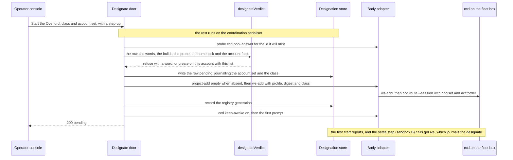
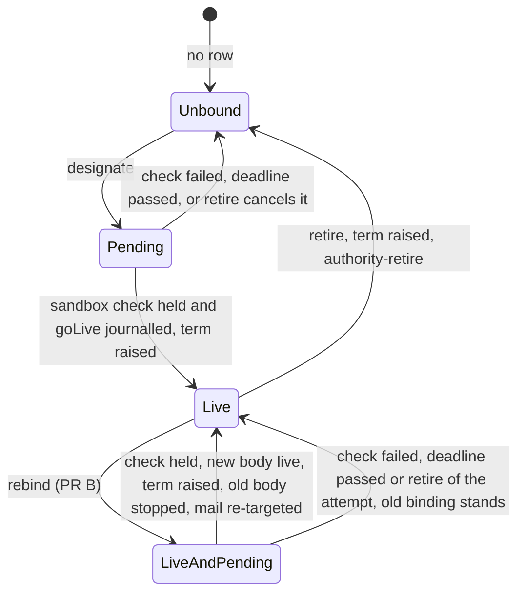

# Overlord W1: the designation, Start, Retire, Rebind and Restart the Overlord Implementation Plan

> **For agentic workers:** REQUIRED SUB-SKILL: Use superpowers:subagent-driven-development (recommended) or
> superpowers:executing-plans to implement this plan task by task. Steps use checkbox (`- [ ]`) syntax for tracking.

**Goal:** the operator makes the one Overlord, and only the operator can.

- One singleton row, `overlord_designation`, names the session that is the Overlord's body. It holds the binding
  (`live`, plus at most one `pending` attempt), `term`, `designatedTerm`, the model class, the account set
  `accountPools`, the past session ids, the actor the gate recorded, the last attempt's outcome, and the ids still to
  stop (`stopsOwed`). Only the moves that grant or remove authority append an authority record, inside the same
  transaction and before the row (cross-plan ruling X2): `goLive` (`authority-designate` or `authority-rebind`) and
  the retire of a bound row (`authority-retire`). The designate door also journals the account set and the model class.
- **PR A.** "Start the Overlord" (`POST /api/overlord/designate`) checks everything before it creates anything:
  - an existing binding or attempt (`overlord-exists`);
  - the capability words (`capability-missing`);
  - build agreement (`launch-profile-unmet`);
  - the placing agent's own `ccd pool-answer`;
  - at least two accounts in the set that can serve the class (`overlord-single-account`).

  Then, on the coordination serialiser, it writes the row `pending`, creates the session in the `overlord` project on
  the account the widened `projectHome` picks from the set, with `profile`, `profiledigest` and `class` on the create's
  route, writes `poolset` and `acctorder` through `ccd route --session`, sets the two sleep markers (`ccd keep-awake`),
  sends the new body its first prompt (X4), and answers `pending` at once. Retire (`DELETE /api/overlord/designate`)
  keeps the row, raises the term when it unbinds a live body, clears the route record's set and digest, clears the
  markers, and stops the retired body. `roleOf` reads the designation at its four callers, and every live-generation
  lookup reads the Overlord's identity (X5), so the body's first launch already has the `overlord` profile and a
  restart finds its own generation. The roll lane and `decideSleep` hold it (X6).
- **PR B.** Rebind (`POST /api/overlord/rebind`) replaces a lost body without a second Overlord. Restart the Overlord
  (`POST /api/overlord/restart`) starts the same session id again by the resume path. When a rebind goes live, the
  old body is cleared, loses its markers and is stopped, and the queued `overlord` mail follows the new body. The
  pending deadline fails a start that never reports, through the renewal act's acting side.
- **PR C.** Two Settings server doors write the model class and the account set, each with its step-up rule.

**Why:** R7 (one and only one), C2, C4, C45, C46, C56; H3 (one per server, actors, opaque ids), H12 (the term), H16
(the account set) and H27 (journalled authority). The pool set piece made the set a route field ccd honours; the sandbox
piece made the profile fail closed and settles `pending` to `live`. Nothing yet writes either, and nothing yet reads a
designation: `roleOf`'s `designation` input is the constant `'none'` (`server/src/roleOf.ts#roleFactsOf`).

**Architecture:** decide in L1, act in L4, and keep one writer per fact.

- **L0.** A new one-concern sibling, `shared/overlord-designation.ts` (question 1 of the index's large-file section,
  slug `wire-types-in-sibling-modules`): the view, the model class words, the attempt outcomes, the door bodies, and
  the capability words designate and rebind require. The account set is `shared/poolset.ts#PoolSet`, reused.
- **L1.** `server/src/coord/overlordDesignation.ts` holds the deciders:
  - `designateVerdict`, `retireVerdict`, and in PR B `rebindVerdict`, `restartVerdict` and `pendingDeadlineOf`;
  - `overlordAccounts`, the ordered list and the count of C56;
  - in PR C, `modelClassVerdict`, `accountSetVerdict` and `setWidens`.

  `server/src/limits.ts#projectHome` and `projectPlacement` take the session's side (`SessionPoolSide`), not only a
  project's (the index's Q5). `roleFactsOf` reads a `designation` input, and `server/src/roleOf.ts#identityOf` names
  the generation identity of a session (X5). `autoRollVerdict` and `decideSleep` (under both policy rows) gain the
  hold `overlord`, all in PR A (X6).
- **L3.** `server/src/coord/overlordDesignationStore.ts` holds the row's writers and its one reader. `CoordStore`
  carries one-line delegates (the `ledgersStore.ts` idiom). `server/src/coord/overlordBody.ts` is the adapter over ccd
  for the body: create, the route write, the pool-answer probe, stop, keep-awake, and in PR B ensure. It is the one
  file of this piece that composes `CCD_ARGV`. The first prompt goes through W1a's `SessionHost.deliver` port.
- **L4.** A new routes file, `server/src/coord/overlordRoutes.ts`, registered from `server/src/server.ts` beside
  `registerFaceRoutes`. Each door asks the account gate (`server/src/accounts/gate.ts#createAccountGate`) for a
  session and a step-up, reads its facts, asks its decider and acts on the answer. Designate, retire and rebind run
  their bodies on the coordination serialiser (`server/src/coord/routes.ts`'s `CoordRoutes.serial`, the server's one
  `CoordMutex`), so no two of them interleave across their awaited ccd calls. Other W1 pieces add their handlers to
  this file later (index, "Where lanes meet").
- **One owed-stop drain.** Every id a move leaves running without a binding goes into the row's `stopsOwed` in that
  move's transaction. One L4 helper, `drainOwedStops`, stops each through `stopCreated`, clears its set and digest,
  turns its markers off, and removes the id with the store's `stopDone`. Retire, the settle step and the deadline
  sweep all call it. A stop that answers "no such session" counts as stopped, so no id is retried forever.


*Figure 1. Start the Overlord. Every refusal comes before the row and the session exist, so a refused start leaves
nothing behind. Any failure after the row write fails the attempt and stops what was created. The door answers
`pending`; the outcome of the attempt is read from the row.*


*Figure 2. The row's binding. "Unbound" means neither live nor pending, and covers both "never designated" and
"retired": the row keeps its term, its past ids, its class and its set. A pending attempt never raises the term, its
cancellation appends no authority record, and no state lowers the term. The retire door on a live row retires the
live body and cancels any attempt with it.*

**Tech Stack:** TypeScript (ESM), `node:sqlite`, Fastify, vitest with `makeCcdHarness` for the ccd-facing tests. No new
dependency. No ccd change: every ccd verb this piece composes exists, or is shipped by the pool set, sandbox or ccd arms
piece.

**Spec:** `docs/superpowers/specs/2026-11-09-overlord-design.md`:

- §3.1 whole: one row by construction, one per server, the term and the incarnation, no second start, no Overlord from
  below, the rebind, mail to the role following the rebind, state keyed by the identity, retiring keeps the row.
- §3.2 C2 whole (what the row holds, its writers, the three doors, the account gate, designation in two steps, a
  start that never reports, what designation checks and does, Start the Overlord) and C4 (no runs; the sleep decider's
  `overlord` hold; the roll lane's hold; the two accident guards).
- §3.4: C45 (the class on the designation, written by the operator's doors; Settings `fable` keeps the step-up, `opus`
  needs none), C46 (the set, its one writer, widening and narrowing, the empty set serves nothing, when the set
  changes, "An older ccd"), C56 (at least two, the ordered list drawn only from the set).
- §6.4 C23 (a dead Overlord's Restart control, the resume path) for the Restart door only; the push is readiness's.
- §7.6 H27: designate, rebind and retire are authority records, appended inside the transaction before the row. Which
  move carries each record is cross-plan ruling X2.
- §11.2: the operator's doors are cookie doors with the account gate's step-up.
- Table 11.1a (`overlord_designation`), Table 11.1d (the ccd words, the two Settings rows), Table 11.1e (the three
  doors, Restart, the account set's row), Table 11.6 (`overlord-exists`, `overlord-body-alive`,
  `overlord-single-account`, `overlord-sandbox-unmet`, `capability-missing`, `launch-profile-unmet`).
- Table 13.1: H3 and H12 are `shape` calls of W1, so the row and its doors ship here. H16 is a `tightening` of W1.

**The index:** `docs/superpowers/plans/2026-11-14-overlord-w1.md`, row "Designation", lane C, three pull requests. The
coordinator's brief for this plan (run 2143) corrects the row. The corrections are marked "(ruled)" below, and "Index
changes" lists what the index should carry.

## Open questions

Each carries the answer this plan builds. The index's questions this piece builds on are restated at the end.

1. **The row's shape** (slug `designation-row-carries-one-pending-attempt`). §3.1 says rebind writes the replacement
   `pending` while "the old binding stands". So the row has two slots: the live binding (`sessionId`, `generation`)
   and one pending attempt (`pendingId`, `pendingGeneration`, `pendingSince`, `pendingDeadlineAt`, `pendingKind`, which
   is `designate` or `rebind`). The sandbox piece's question 3 asked this plan for the failed attempt's columns: the
   last attempt's outcome is `attemptId`, `attemptOutcome` and `attemptAt`, written when an attempt ends without going
   live. The ids still to stop are their own column, `stopsOwed` (review F5), so a later failed attempt that rewrites
   `attemptId` never loses an earlier stop. **Recommendation:** one table, one migration in PR A, with every column the
   three pull requests use, so PR B and C add no migration. CHECK constraints:
   - `id = 1`;
   - a pending attempt always has a deadline;
   - `generation` is set when `sessionId` is.
2. **Which id the pool-answer probe asks about** (slug `pool-answer-probe-asks-the-minted-id`). The door needs the
   agent's own answer to `ccd pool-answer` (ruled), but no Overlord session exists before the create.
   **Recommendation:** the door first mints the id it will create (`shared/slug.ts#workspaceId('overlord', slug)`,
   with the slug from the `Entropy` port). It asks the agent `ccd pool-answer --session <that id>`, reading the result
   `ran` first (the pool set's Task 6 contract, `parsePoolAnswer`):
   - `answer`, or `refused` with code 1 (`no such session`), means the agent ran the verb, so the word is present;
   - `not-run`, an older agent's `forbidden`, refuses `capability-missing` naming `pool-set` (ruled);
   - any other code, or `unparsed`, refuses `capability-missing` naming `pool-set`, with the detail "the agent's pool
     answer could not be read". Unmeasured never passes.
3. **Build skew at the create** (slug `designate-refuses-launch-profile-unmet-under-skew`). Under skew ccd refuses the
   spawn, because the row it has installed does not hash to the server's `profiledigest` (sandbox question 5). The
   sandbox plan asks this piece to refuse first. **Recommendation:** designate and rebind read
   `server/src/fleetstate.ts#inventoryBuildAgreement` (sandbox A), and refuse anything but `agreed` with the existing
   word `launch-profile-unmet`. The detail is `skewed` (naming both builds) or `unmeasured`. A lone `both` node row
   reads `agreed` (ruled). Table 11.6's row for the word gains designate and rebind among its doors, a spec fix. No new
   word.
4. **What retire does to the retired body** (slug `retire-stops-the-retired-body`). The spec says retire clears the
   binding; it does not say what happens to the session. Left running, the retired body's role would read `plain` or
   `coordinator` at the profile lane's next pass. Its next spawn would then run the Overlord's conversation with a
   shell, which C2 forbids ("never runs as `plain`, with a shell or a fork that could outlive the designation").
   **Recommendation:** retire puts the bound session and any pending one on `stopsOwed` in its transaction, then
   drains them (`drainOwedStops`): the route clears, the markers off, and the stop through the stop route's own argv
   (`stopCreated`, below). A stop that fails stays owed: the answer says `stopped: false`, and the settle step and
   the deadline sweep drain it again (review F5, ruled). A stop that finds no such session reads as stopped. Its
   workspace is kept: retire never archives or removes.
5. **The pending deadline's length** (slug `pending-deadline-covers-the-first-turn`). §3.2 says "the `carded` deadline
   and its one re-nudge". The sandbox check settles on the loads report, which rides the first `Stop`, after the card
   is read and the probes run. **Recommendation:** the deadline is set once, at the create:
   `STATE_DEADLINE_S.clearing + carded + probing` (`shared/continuity.ts#STATE_DEADLINE_S`, 90 + 45 + 165 = 300 s),
   derived, never a new literal. A healthy first start settles inside it.
6. **The Overlord's generations: identity and term** (slug `overlord-generation-carries-the-term`; ruled, X5). §3.1
   keys the Overlord's state by the identity `overlord`, and says the body made `live` carries the raised term. The
   generations lane mints `identity: sessionId` and `term: GENERATIONS_TERM` (1) today
   (`server/src/continuity/generationsLane.ts#GENERATIONS_TERM`, "the designation's term arrives with W1"), and every
   live-generation lookup is keyed by session id. Re-keying the mint alone would break the Overlord's second start:
   `continuity_generations_live` is unique on `identity` for live rows, so a lookup by session id finds nothing, and
   the mint collides with the Overlord's own live row (`mintGeneration` throws `Superseded`; review F1). **Ruled:**
   designation A does it at every site. One `identityOf(sessionId, designation)` is used by every live-generation
   lookup: the generations lane's mint and `liveGen`, `cardFacts.ts`, and `continuity/routes.ts`'s `anchorReads` and
   `liveGenerationOf`. It answers `overlord` for the live bound id, and for the pending id of a `designate` attempt
   (no other body holds the identity then). A rebind's pending body keeps its own session id as identity until it goes
   live, so the old body's live `overlord` row stands while the new one is checked. `goLive` re-stamps the pending
   body's live generation, when the lane has minted one, with identity `overlord` and the raised term, and for a rebind
   ends the old body's live generation, all in its one transaction. A mint after that reads the raised term from the
   row.
7. **Rebind's re-target of parked mail** (slug `rebind-repoints-outstanding-mail-only`). §3.1 says the rebind
   "re-targets every queued delivery". The precedent is `CoordStore.reclaimProgram`. It repoints outstanding
   deliveries through the one delivery writer (`writeDeliveries`), and its envelope is not re-rendered (D-1142). A
   parked delivery stays visible on the old id, and only `requeueAbandonedMail` gives the heir a copy, joined through
   `runs`, which `overlord` mail never has. **Recommendation:** repoint outstanding deliveries whose mail's `toId` is
   `overlord` and whose delivery names the old body. Parked ones stay on the old id, visible, as in D-1142. W1 queues
   no `overlord` mail before the timers piece, so the repoint is tested on rows the test writes.
8. **Retire, and Restart, on a row that binds nothing** (slug `retire-on-unbound-is-a-no-op`; ruled with review
   F11). Table 11.6 has no word for it. "Unbound" means neither live nor pending. **Ruled:**
   - retire on an unbound row, or with no row, answers 200 `{ ok: true, changed: false }` and writes nothing;
   - retire on a pending-only row cancels the attempt (outcome `retired`), puts its body on `stopsOwed` and drains it.
     It raises no term and appends no authority record, because a pending attempt was never granted authority;
   - retire on a live row appends `authority-retire` with `previousSessionId` set to the bound session, raises the
     term, and cancels any pending attempt with it;
   - Restart and rebind with no live binding, and the Settings doors with no row, answer 404 `not-found`, an existing
     `REFUSAL_STATUS` word.
9. **A rebind while an attempt is pending** (slug `rebind-refuses-while-an-attempt-is-pending`; ruled, review F6). The
   row has one pending slot, and Table 11.6 scopes `overlord-exists` to designate. **Ruled:** a new word,
   `overlord-attempt-pending` (409): rebind refuses it while any attempt is pending, and `rebindPending` re-reads the
   slot inside its transaction and refuses too, so two racing rebinds are safe. Designate keeps `overlord-exists` for
   a bound or pending row. A spec fix adds the word's Table 11.6 row.
10. **A held check whose go-live record is refused** (slug `go-live-retries-a-refused-authority-record`; ruled, X2).
    `goLive` appends `authority-designate` or `authority-rebind`, and `appendInTx` can refuse. **Ruled:** a refused
    append rolls `goLive` back and the attempt stays pending. The deadline sweep's pass asks the settle step again for a
    pending attempt whose newest start holds a recorded held verdict. At the pending deadline the attempt fails with
    the outcome `authority-unrecorded` (a new `ATTEMPT_OUTCOME_MAP` word). A spec fix adds its Table 11.6 row.

The index's questions:

- **Q5** (`designate-widens-project-placement`): built. `projectHome` and `projectPlacement` take `SessionPoolSide`,
  and the doors pass the set (Task 2).
- **Q6:** read as built by the pool set piece: `poolset` and `acctorder` are lane-only route fields, written only
  through `ccd route --session`, and an empty value clears them.
- **Q17:** the doors keep `createAccountGate` and record its actor on the row. The `CallerIdentity` port is gates A's,
  which adds the actor column's strength later.
- **Q33** (`designate-refuses-without-continuity-v1`), widened by the brief (ruled): designate and rebind refuse
  `capability-missing` without `pool-set`, `keep-awake`, `hibernate-fresh`, `launch-surface-v1` and `project-add`
  from ccd (`project-add` by fix round 1's ruling on review M10), and without `continuity-v1` from the server.
- **Q36:** PR A waits for pool set B (B1 and B2), ccd arms A, B and C (C2 if C splits; X6), authority journal A (and
  with it A0, X1) and sandbox A2 (ruled).

## Cross-plan rulings (fix round 1)

The coordinator's rulings on the four W1 plan reviews (authority journal 2140, private store 2141, ccd arms 2142,
designation 2143). The parts that touch this plan are quoted in the coordinator's words. The rest is each owning
plan's.

- **X1:** the shared journal-file adapters have one owner, the authority journal plan, and ship as authority journal
  A0. This plan calls only `OverlordAuthorityJournal.appendInTx`. The contract is the authority plan's.
- **X2:** "Only moves that grant or remove authority are journalled: `goLive` appends `authority-designate` (a first
  body) or `authority-rebind` (a rebind), carrying the raised term, the session id and the generation; `retire` of a
  bound row appends `authority-retire` with `previousSessionId` set to the bound session. `designatePending`,
  `bindPendingGeneration` and `failPending` grant nothing and append nothing. The designate door also journals the
  account set and the model class (C46) as their own records in its transaction. The generation is a string (the UUID
  ccd records), never a number, in the authority grammar and its fold. `appendInTx` answers `{ok:false, …}` and never
  throws: every caller checks the result and writes no row when it is refused. A door maps the refusal as the
  authority plan says. `goLive` in sandbox B's settle step completes the operator's designate or rebind act
  (attributed to that attempt's actor): a refused append rolls `goLive` back, the attempt stays pending and the
  settle tries again on its next pass; at the pending deadline the attempt fails with an outcome the designation plan
  names and adds to its spec-fixes list as a Table 11.6 row (plan-driven consistency). Designation A adds
  `overlord_designation` to `OVERLORD_AUTHORITY_TABLES`." This plan's outcome is `authority-unrecorded` (question 10).
- **X3:** "While the journal is not coherent, an operator narrowing (Pause, retire, a rung down, a latch raise) writes
  its row only, with no append and with the head row unmoved, so the operator keeps every lever; Confirm the restore
  folds the narrower row side in, as `restoreStricter` already takes the narrowest value. A widening is still
  refused." Retire is such a narrowing (Task 1). The rest is the authority plan's.
- **X4:** "The designation piece owns it, as sandbox ruling G1 to G3 already says: Start the Overlord (designate),
  Restart and rebind send the new body its first prompt after the create. A renewal of a running body is the renewal
  act's (its deliver at `carded`, or the door process's first call once that piece exists)." Tasks 5 to 7.
- **X5:** "It stays in designation A, done at every site: one `identityOf(sessionId, designation)` used by every
  live-generation lookup (the generations lane, the card facts, the anchor read and `liveGenerationOf`), so a restart
  of the Overlord finds its own live row. `goLive` re-stamps the pending generation with the raised term, and ends the
  old body's live generation in the same transaction for a rebind. Tests: a restart of the Overlord, and a rebind
  with the old generation live." Question 6, Tasks 1, 3 and 6.
- **X6:** "Designation A's create calls `keepAwake('on')`, its retire calls `keepAwake('off')`, and `decideSleep`'s
  `overlord` hold moves from designation C into designation A. Designation A needs ccd arms A, B and C (C2 if C
  splits), so no designated Overlord runs before `longLived` reaches the launch row or before the fresh pick exists.
  Figure W1 gains sandbox A → ccd arms B." Tasks 3 to 5.
- **X7:** "Designation A ships `designationRead()` answering exactly three arms: `{designated, sessionId, term}`,
  `{not-designated}`, or `{unmeasured, why}`. The private store's prompt route answers 502 `unmeasured` on the third
  arm before any typing, for every prompt (an unreadable `coord.db` is a server-wide failure already); a test pins that
  arm." Task 1. Each arm carries the row's view as well (Task 1's interface), so the doors and lanes read one reader.
- **X8:** "`keep-awake` is advertised by a capability token (`capRow`, refusing on no evidence), the cap word
  `keep-awake`, as Table 11.6's `capability-missing` needs." The token's home is the ccd arms plan. This plan asks it
  through `capSupported` (Task 2).
- **X9:** "Plan decisions stay plain-words slugs, as every other W1 piece's do. No D-number is minted for them."
- **X10:** the coordinator makes every index change in its own index edit. This plan edits no other plan.

## What exists today

Measured on `origin/main` at `49a34f76e` (2026-11-15). The pool set A2 (#2846) and history A (#2841) are merged. The
journal kernel (#2848), sandbox A (#2847, read from `origin/ws/overlord-build-sandbox-a`) and portfolio A (#2842) are
in flight.

- **The role reader.** `server/src/roleOf.ts#roleOf` answers `overlord` first when `RoleFacts.designation` is `pending`
  or `live`. `roleFactsOf(sessionId, RoleFactInputs)` is the one assembly, and it fixes `designation: 'none'`.
  `RoleFactInputs` has `child`, `childRunKind`, `openCoordinators` and `intentDeclared`, and no designation. It has
  four callers:
  - `server/src/continuity/profileLane.ts` (the launch-profile lane);
  - `server/src/continuity/generationsLane.ts`, through its local `roleFor`;
  - `server/src/continuity/cardFacts.ts#sessionRoleRead`;
  - the mail lane's pace in `server/src/watch.ts` (`mailPaceOf(roleOf(roleFactsOf(…)))`).

  `ROLE_FACTS_CHILD_AXIS` keeps `designation: 'none'` and is out of scope (index, "Where lanes meet"). `roleFactsOf`
  is in `MUTANT_SETS` through `server/test/sim/renewalDeciderSets.ts#roleFactsOfCases`, at floor 1.
- **The sleep decider.** `server/src/sleep.ts#decideSleep(input, policy)` runs one ladder under two rows:
  - `server/src/stopDone.ts#RUN_DONE_POLICY` (`STOP_DONE_HOLD_MAP`, `STOP_DONE_HOLDS`);
  - `server/src/coord/hibernate.ts#IDLE_HOURS_POLICY` (`HIBERNATE_HOLD_MAP`, `HIBERNATE_HOLDS`).

  A hold word outside the row's list throws, and `sleep-lanes-pin.test.ts` holds each row to its list. Every fact the
  lane did not read holds (`unmeasured`). `HIBERNATE_KEBABS` derives from the map, for `mail-routes.test.ts`'s census.
  Neither decider is in `MUTANT_SETS`.
- **The roll lane.** `server/src/rollLane.ts#ROLL_LANE` asks `server/src/coord/rollTarget.ts#autoRollVerdict`, which
  skips by `AUTO_ROLL_SKIP_MAP` (`setting-off`, `role-unknown`, `not-coordinator`, `no-roll`, `idle-gate`, …). The
  role it reads is the wire's `FleetSession.role`, which is `coordinator` for the Overlord either way
  (`shared/fleetRoles.ts`). Not in `MUTANT_SETS`.
- **Placement.** `server/src/limits.ts#projectHome(roster, limits, pool: ProjectPoolWire, edges, cls, shares, nowS)`
  and `projectPlacement(…)` filter by `server/src/poolrule.ts#poolEligible(roster, pool: ProjectPoolWire, edges)` and
  answer `unmeasurable` through `poolUndecidable(pool: ProjectPoolWire)`. `shared/poolrule.ts#poolRule` already takes
  `SessionPoolSide` (pool set A1), whose set arms answer `in-set`, `untagged-in-set`, a set mismatch, or undecidable
  on the `set` side. `projected-home.test.ts` drives `projectHome` and ccd's `_ws_least_loaded` over one fixture table.
  ccd's placer stays project-keyed (Table 3.4d: "Unchanged").
- **The set's wire.** `shared/poolset.ts#PoolSet`, `poolSetSpelling` (answers `spelled`, `empty` or `unspellable`,
  never one null) and `parsePoolSet`. `shared/api.ts#ROUTE_WRITABLE_FIELDS` ends `poolset`, `acctorder`. Both are in
  `ROUTE_LANE_ONLY_FIELDS`, and ccd's `_route_argv_check` refuses both on a `--route`, so only `ccd route --session`
  writes them, and an empty value clears them. `ccd/ccd#cmd_route` already refuses a write or clear of either when
  `CLAUDECODE` is set (`pool-set-operator-only`), so a session's shell cannot touch them through ccd. The server's
  composed write must run without `CLAUDECODE`: the server and the agent are units, never a Claude Code session, and
  Task 4 pins that the adapter's runner passes no `CLAUDECODE`.
- **ccd's words the door needs.** Four are not on `main` yet:
  - `pool-set` and `ccd pool-answer` (`CCD_ARGV.poolAnswer`, `parsePoolAnswer`): pool set B1;
  - the `--below-cap pool-set` floor: pool set B2;
  - `keep-awake` and `ccd keep-awake --session <id> --state on|off`: ccd arms A, advertised by its own capability
    token (X8);
  - `launch-surface-v1`: sandbox A2;
  - `hibernate-fresh`: W1a's fresh start, on `main`;
  - `project-add`: on `main` (`CCD_ARGV.projectAddEmpty` is gated on it).

  `server/src/ccdargv.ts#capSupported(state, token)` answers `false` on no evidence. `ccdCan(state, row)` answers a
  row's default on no evidence, so this piece asks `capSupported` only.
- **The server's own words.** `shared/api.ts#SERVER_CAPS` derives from `SERVER_CAP_MAP`. `continuity-v1` is not in it
  yet: W1a's last piece adds it (`docs/superpowers/plans/2026-11-10-overlord/w1a-continuity-v1.md`).
- **The profile fields** (sandbox A, in flight). `profileFor` returns `profiledigest` for a surfaced role.
  `profileDigestWriteOf(target, standing, builds)` answers `write` only at `agreed`, and `hold` otherwise.
  `fleetstate.ts#inventoryBuildAgreement(coord)` answers `agreed`, `skewed` or `unknown`. The sandbox ruling makes
  designation A's create a recorded second writer of `profile` and `profiledigest` (slug
  `profile-fields-written-at-create`), with the lane converging after.
- **The create.** The named create, `POST /api/projects/:project/workspaces` in `server/src/server.ts`, runs
  `server/src/workspaceCreate.ts#planCreate`, then `CCD_ARGV.wsAddNamed(project, slug, { title, wrapper }, route,
  dec)`. `wsAddNamed` is gated by `WS_TITLE_CAP` and `WS_WRAPPER_CAP`. `shared/slug.ts#workspaceId(project, slug)` is
  the id ccd mints. `POST /api/projects` runs `planProjectAdd`, and `CCD_ARGV.projectAddEmpty(name)` makes an empty
  project; that door already tells a lost answer (`outcome-unknown`) from a refusal.
- **Stop and ensure.** `POST /api/sessions/:id/stop` ends in `stopArgvFor(id, rec, identity)`, a closure inside
  `buildServer`, after `measuredIdentity` and `decideStopClaims`; a session with no registry row refuses
  `unknown-session`. `POST /api/sessions/:id/ensure` runs `CCD_ARGV.ensure(id)`, and records `admitWake('asked', id)`
  for a hibernated session first. `runCcdOr502`, `parseOperatorRoute` and `pwaDec` are closures too.
- **The coordination serialiser.** `server/src/coord/routes.ts`'s `CoordRoutes.serial` runs a write route's body on
  the server's one `CoordMutex`. Its own comment names the check-then-await shape it closes.
- **The account gate.** `createAccountGate(deps)` returns `gate(req, reply, { cap, stepUp })`, which answers
  `{ pass: true, actor, sessionIdHash }` or refuses in order: `auth-off`, `insecure-origin`, `unauthenticated`,
  `unsupported` (a `cap` the box's ccd lacks), `step-up-required`. It is built once in `server.ts` and handed to
  routes files. `server/src/testboxAdmin.ts` is the caller to copy, deciding `stepUp` per request.
- **Mail to a role.** The mail route resolves `coordinator` and `worker` at send (`server/src/coord/routes.ts`). The
  `mail` row keeps the role in `toId`, and `mail_deliveries.toId` holds the resolved session. `overlord` is not a role
  address yet: the Overlord's timers piece adds it. `reclaimProgram`'s `repointCoordinatorMail` is the repoint
  precedent (question 7).
- **The generation deadlines.** `shared/continuity.ts#STATE_DEADLINE_S` holds `{ draining: 120, checkpointed: 60,
  clearing: 90, carded: 45, probing: 165 }`. W1a's renewal act delivers a renewed generation's first prompt at
  `carded` through `SessionHost.deliver` (`w1a-renewal-act.md`, slug `first-prompt-by-deliver`). A new Overlord body
  is not a renewal: this piece sends its first prompt (X4).
- **The generations' lookups.** Every live-generation lookup is keyed by session id: the generations lane's `liveGen`,
  `server/src/continuity/cardFacts.ts`, and `server/src/continuity/routes.ts`'s `anchorReads` and `liveGenerationOf`.
  `continuity_generations_live` is a unique index on `identity` over live rows, and
  `server/src/continuity/continuityStore.ts#mintGeneration` throws `Superseded` when it is told no live row exists
  and one does. The lane is shadow by construction, pinned by an import allowlist in
  `continuity-generations-lane.test.ts`. W1a's renewal act adds its acting side (`renewalActs.ts#runActions`, live only
  when the `continuity` row is).
- **The reclaim re-measurement.** `server/src/coord/reclaim.ts#measureClaimant` decides "dead or registry-absent" for
  the reclaim door, and an unmeasurable registry refuses. Rebind's `overlord-body-alive` reads it.
- **The refusal words.** `shared/refusal.ts#OVERLORD_REFUSALS` already has `capability-missing` (501),
  `overlord-exists`, `overlord-body-alive`, `overlord-single-account`, `overlord-sandbox-unmet` and
  `launch-profile-unmet` (409), spread into `REFUSAL_STATUS`. No door sends them yet.
- **The censuses a session-gated routes file meets** (measured by a Sonnet scout and re-read):
  - `server/test/auth-gate.test.ts`: `ROUTES` lists each routes file through `scanRoutes`, then pins the count, the
    `httpCount` sentences and `server/src/auth/gate.ts`'s "stands in front of all N routes". A door that asks the gate
    with `cap: null` answers `auth-off` dark and something else armed, so it joins `FLAG_AWARE` and its sorted list.
  - `server/test/rings/fastify-l4.data.ts#FASTIFY_L4_ALLOWLIST`: one entry for a new Fastify importer.
  - `server/test/secret-mask.test.ts`: a GET is masked (`MASKED_GET_ROUTES`) or listed in its `EXEMPT` with a reason.
  - `server/test/box-token-census.test.ts`: a session-only file outside `coord/routes.ts` is checked by a hand-kept
    door list, both ways, through `registrationsIn` (the `testboxAdmin` describe). `SESSION_ONLY_ALL` joins the
    hand-kept lists to `CLAUDE.md`'s box-token bullet, path by path.
  - `server/test/single-definition/time-ports.test.ts`: `TIME_PORT_FAMILIES` already covers every
    `server/src/**/overlord*.ts`, so the new files take `Clock` and `Entropy` from `deps.time` with no list edit.
  - `server/test/id-argv-census.test.ts` classifies every `CCD_ARGV.<name>(` call in `server/src`, and
    `verb-gate.test.ts` wants a capability gate in the enclosing function.
  - No routes file of the operator's is in `ccd/ccrc-api`'s `ROUTES`.
- **The growth check.** `server/test/growthCheck.ts#GROWTH_FILES` lists `server/src/server.ts`,
  `server/src/watch.ts`, `server/src/coord/store.ts`, `server/src/coord/schema.ts` and `shared/api.ts` among this
  piece's files, at 40 net code lines each per pull request. `shared/api.ts` is capped (#2811).
- **Migrations on `main`:** 75 (`push_outbox` is the last). This plan takes no number: the builder takes the next one at
  build time.

## Global Constraints

- **Architecture (`CLAUDE.md`).**
  - One writer per fact. The row's writers live in `overlordDesignationStore.ts` alone, each named for its move:
    `designatePending`, `bindPendingGeneration`, `goLive`, `failPending`, `retire`, `stopDone`, and in PR B
    `rebindPending`. In PR C, `setModelClass` and `setAccountSet`. `goLive` and `failPending` are the writers sandbox
    B's settle step calls (its Task 9). PR B's deadline sweep calls `failPending` too. `goLive`'s re-stamp of the
    generation goes through a new writer in `continuityStore.ts`, `restampOverlordGeneration`, the generation rows'
    own owner, called inside `goLive`'s transaction.
  - The authority records: `goLive` and the retire of a live row append, and the designate door journals the account
    set and the class in `designatePending`'s transaction (X2). `designatePending`, `bindPendingGeneration`,
    `failPending`, `stopDone` and a pending-only retire append nothing. Every append checks `appendInTx`'s answer and
    writes no row on `{ ok: false }`.
  - The route record's `poolset`, `acctorder` and `class` have two writers, the designation's doors and the renewal
    lane (Table 11.1a, pool set's docstring on `ROUTE_WRITABLE_FIELDS`). The create's `profile` and `profiledigest`
    are the recorded second writer (sandbox ruling G2). The body's two markers are `ccd keep-awake`'s.
  - Decide in L1, act in L4. The routes file reads facts, calls a verdict, and acts on it. It holds no `if` over a
    refusal word. `overlordDesignation.ts` imports L0 and `server/src/poolrule.ts` only: no `fs`, no Fastify, no
    clock (it takes `now`). `server/src/limits.ts` and `server/src/shares.ts` import `node:path` and `FleetIO`, so
    the decider takes their answers as facts: the door calls `projectHome` and builds the share readings with
    `shareFor`, and passes both in (review M11).
  - Consolidate. Placement is `projectHome` widened, not a second picker. The create is `CCD_ARGV.wsAddNamed`, as the
    named-create door composes it. The stop is the stop route's own argv, through one `stopCreated` port that sandbox
    B reuses. The mail repoint goes through `writeDeliveries`. The first prompt goes through `SessionHost.deliver`. The
    step-up is the account gate's. The serialiser is `CoordRoutes.serial`. The holds are rows of the existing tables.
    Nothing here is a second mechanism.
  - The session id is opaque. Nothing parses it. The slug comes from `Entropy`, and the id from `workspaceId`.
- **Failure contracts (fail closed for the Overlord).**
  - Every refusal of designate and rebind comes before the row is written and the session created, as do the
    capability words, the probe, build agreement and the count (§3.2, Table 11.6). A refused start leaves nothing. A
    forced rebind stops the old body only after every verdict refusal (review F7).
  - After the row is written, any failure ends the attempt: a failed create, a create whose answer was lost, a failed
    generation read, a failed route write, and any refusal of a later store write (`bindPendingGeneration` finding
    the attempt gone):
    - `failPending` records `create-failed` with the detail, and puts the minted id on `stopsOwed` when ccd may have
      made the session (review F5);
    - the door drains `stopsOwed` through `stopCreated`;
    - the door answers 502 with the failure's own detail, as the named create answers it today.
  - A failed `keepAwake` or first prompt does not fail the door. The markers are guards, never the fact (C4), and
    the server's holds stand without them. A first prompt that is not delivered leaves the attempt pending until its
    deadline, which then fails it `deadline-passed`, and the answer says `prompted: false`.
  - The pending row is never left without a deadline (CHECK).
  - An unreadable designation is never read as "nobody is designated". `designationRead()` answers three arms (X7):
    `designated`, `not-designated`, or `unmeasured` for a row it cannot narrow (an unknown word, a set that does not
    parse, `coord.db` unreadable). It never throws. Each caller fails closed in its own existing way (Task 3's table).
    The doors answer 503 `unavailable`, an existing `REFUSAL_STATUS` word, with the detail "the designation row could
    not be read", and write nothing.
  - An authority append the journal refuses: a door maps `authority-rolled-back` to that word and every other error to
    `journal-unreadable` (503), as the authority plan says, and writes no row. A retire over an incoherent journal
    writes its row only (X3).
  - A lane whose coordination port is absent (`store: 'optional'` on the roll lane) has no `coord.db`, so no
    designation can exist there, and it reads `not-designated` with no row. That is a measured absence, not an
    unreadable row.
  - `capability-missing` never passes on no evidence: `capSupported` answers `false` for `ccdVerbs === null`.
  - An older server reads a newer `coord.db` and ignores the table, so no Overlord exists there. An older ccd refuses
    a route write that carries `poolset` (`unknown routing field`), but the doors refuse long before, on `pool-set`.
- **What the doors trust, and the accepted residuals.** Identity on the fleet is attribution. The doors are the
  operator's cookie doors behind the step-up, so no session can designate. A session's shell cannot write the set
  through ccd (`cmd_route`'s `CLAUDECODE` refusal), but any same-user process outside a session can, or can touch the
  markers, as C46 and C4 say. The server writes the record again at each renewal and change (the renewal lane's arm,
  not this piece's). Accepted as accident guards in shared-user mode.
- **What a merge arms.** Nothing a running session sees.
  - PR A: no row exists until the operator taps Start, and the console offers it only under `overlord-v1` (Q33). With
    no row, `roleOf`'s new input reads `not-designated`, `identityOf` answers the session id, and the roll and sleep
    holds never fire. `projectHome` with a project side answers byte for byte as before. The doors refuse
    `capability-missing` until W1a's `continuity-v1` lands. Once a row exists, the Overlord has both holds and its
    markers from its create, so no window opens before PR B or C (X6, review M6).
  - PR B adds doors, and a deadline sweep that acts only on a row and only when the `continuity` row is live.
  - PR C adds Settings doors that refuse with no row.
- **SAFETY (`CLAUDE.md`).** No new ccd verb. The server composes `project-add`, `ws-add`, `route --session`,
  `pool-answer`, `stop`, `ensure` and `keep-awake`, each behind its capability gate, and never a destructive workspace
  verb: retire and a failed attempt stop, and never archive or remove. ccd-facing tests use fixture HOMEs
  (`makeCcdHarness`). No test runs ccd against the live `$HOME`.
- **Growth check.** Every growth-checked file stays within 40 net code lines per pull request, with no waiver. The
  estimates are in the PR split. A task that measures over its row stops and asks; it never plans a waiver.
- **Mutation floors.** `designateVerdict`, `overlordAccounts`, `retireVerdict`, `designationFactOf`, `identityOf`,
  `rebindVerdict`, `restartVerdict`, `pendingDeadlineOf`, `modelClassVerdict`, `accountSetVerdict` and `setWidens` are
  new L1 deciders. Each joins
  `MUTANT_SETS` (`server/test/sim/mutation-floors.test.ts`) through a new `server/test/sim/designationSets.ts`, and
  `server/test/sim/mutation-floors.json` at floor 1, in its task's pull request. Three existing deciders change and are
  not in `MUTANT_SETS`: `autoRollVerdict`, `decideSleep` and `projectHome`. Each new arm ships a test that goes red
  when the arm is deleted, measured by hand with `mutation-run.py`, as each task says. `roleFactsOf`'s set gains its
  cases.
- **Tests.** From `server/`: `ccrc test -- ./node_modules/.bin/vitest run test/<file>.test.ts`. A task's last run adds
  `ccrc test -- npx tsc --noEmit -p tsconfig.json` and `-p test/tsconfig.tests.json`. For a `shared/` change, add
  `cd ../pwa && ccrc test -- ./node_modules/.bin/tsc --noEmit`. ccd suites are load-sensitive: re-run a red one alone
  first.
- **Public repository.** Fixtures use `pool-a`, `pool-b`, `lane-a`, `lane-b`, `lane-c` and the `overlord` project.
  Real pool names are the operator's data and appear nowhere. Cite by symbol or `@anchor`. No D-number is invented: a
  builder's new departures go in `docs/superpowers/plans/2026-11-14-overlord-w1/w1-designation/notes.md`.

## Review Focus

1. **Nothing before the checks.** No refusal of designate or rebind leaves a row, a session, a route field or a
   marker behind. A test drives each refusal and reads the store, the fake ccd's calls and the registry after.
2. **One Overlord.** No sequence of doors yields two bound sessions. The CHECK holds one row, and every write is one
   transaction. Designate, retire and rebind run on the serialiser, so none interleaves with another across its ccd
   calls. A pending attempt never raises the term, and nothing lowers it. Two designates racing: the second reads the
   first's pending row and refuses `overlord-exists`. A rebind while an attempt is pending refuses
   `overlord-attempt-pending`.
3. **The set binds, and the list only orders.** The first account and every listed account pass `poolRule` under the
   set, and the pick is inside the counted list. The list holds no pay-per-use or other-provider lane, and the count
   excludes disabled, signed-out and unservable accounts. An empty set counts zero and refuses. A project side answers
   exactly as on `main`.
4. **`roleOf` sees the pending body, and the generations find the Overlord.** A pending row reads `overlord` at every
   caller, so the profile lane writes no `plain` over the create's `profile`. Every live-generation lookup goes through
   `identityOf`, so a restarted Overlord finds its own live row. An unmeasured designation fails each caller closed,
   never as `not-designated`.
5. **Nothing runs as the Overlord without a row.** The set, `acctorder` and `profiledigest` are cleared on the body
   that loses its binding, its markers go off, and it is stopped. Every such id is on `stopsOwed` in the transaction
   that unbinds it, so a stop that fails, or a door that dies, is drained again later. On a rebind, the old body loses
   its binding and its generation in the transaction that grants the new one, and its route record, markers and
   process right after, from the settle door.
6. **Authority is journalled where it moves.** `goLive` and the retire of a live row append before the row, and a
   refused append writes no row. Nothing else appends.

## The PR split

Net code lines, as `server/test/growthCheck.ts` counts them (comments and blank lines dropped), estimated against
`origin/main` at `49a34f76e`.

| PR | Tasks | What it ships | Needs first | Growth-checked files, estimate |
|---|---|---|---|---|
| A | 1 to 5 | The row, its writers and reader, and the authority records; the deciders and the widened placement; `roleOf`'s reader at four callers, `identityOf` at every live-generation lookup, `goLive`'s re-stamp, and the roll and sleep holds; the body adapter with keep-awake; designate (with its first prompt), retire and the read, on the serialiser; the owed-stop drain; the swap route's early refusal by the session's side | pool set B (B1 and B2), ccd arms A, B and C (C2 if C splits), authority journal A (and A0), sandbox A2 (ruled, X1, X6) | `server/src/coord/schema.ts` about +28 (one migration); `server/src/coord/store.ts` about +14 (delegates); `server/src/server.ts` about +28 (registration, `stopCreated`, the body adapter's and the routes file's deps: the serialiser, `SessionHost`; the swap route's side read); `server/src/watch.ts` about +6 (the mail pace's designation read); `server/src/coord/routes.ts` 0; `shared/api.ts` 0 |
| B | 6 and 7 | Rebind (with its first prompt), its go-live arm, the old body's clear, stop and markers off from the settle door, and the mail repoint; Restart (with its first prompt); the pending deadline and the settle retry, through the renewal act's acting side | PR A, sandbox B, W1a's renewal act and renewal hand-offs | `server/src/coord/store.ts` about +6; `server/src/server.ts` about +5 (the ensure port, the settle door's designation deps); `server/src/coord/schema.ts` 0 |
| C | 8 and 9 | The model class and account set Settings doors | PR A | `server/src/coord/store.ts` about +4; `server/src/server.ts` 0 |

The review measured `server.ts` and `watch.ts` higher than the first estimate (about +20 to +30 and +6 to +9). Both
stay under 40. A task that measures over its row stops and asks.

For scale, the files that are not growth-checked change by about:

- new files: `shared/overlord-designation.ts` +100, `server/src/coord/overlordDesignation.ts` +260,
  `server/src/coord/overlordDesignationStore.ts` +270, `server/src/coord/overlordBody.ts` +160,
  `server/src/coord/overlordRoutes.ts` +300 (PR A), +170 (PR B) and +110 (PR C);
- `server/src/limits.ts` +14, `server/src/poolrule.ts` +6, `server/src/roleOf.ts` +30,
  `server/src/coord/rollTarget.ts` +8, `server/src/rollLane.ts` +6, `server/src/sleep.ts` +4,
  `server/src/stopDone.ts` +3, `server/src/coord/hibernate.ts` +3, `server/src/sleepLane.ts` +12,
  `server/src/continuity/continuityStore.ts` +25 (`restampOverlordGeneration`), `server/src/continuity/routes.ts` +6
  (PR A, the two lookups) and +25 (PR B, the settle door's rebind acts);
- `server/src/continuity/{profileLane,generationsLane,cardFacts}.ts` about +10 each, and in PR B
  `generationsLane.ts` +15 and `renewalActs.ts` +25 more (the deadline sweep's action and its port);
- `shared/refusal.ts` +1 (PR B, `overlord-attempt-pending`).

## Index changes

The coordinator makes these in its own index edit (X10). Its row and lane lists name only what is shown here.

- **The row (ruled).**
  - Designation A needs pool set B (B1 and B2, not only B), ccd arms A, B and C (C2 if C splits; X6), authority
    journal A (and A0 before it; X1), and sandbox A2 for `launch-surface-v1`. Figure W1 splits `SA` into `SA` and
    `SA2` and `PB` into `PB`, `PB1` and `PB2`, and gains `SA2 --> DA`, `PB2 --> DA`, `PB1 --> SA2` (sandbox's own
    edge), sandbox A → ccd arms B (X6), and ccd arms C → designation A (review M2).
  - A's `capability-missing` list is ccd's `pool-set`, `keep-awake`, `hibernate-fresh`, `launch-surface-v1` and
    `project-add`, and the server's `continuity-v1`. The create's own words, `ws-title-v1` and `ws-wrapper-v1`, are
    asked too (slug `designate-asks-the-create-words`).
  - A writes `profile` and `profiledigest` at the create.
  - A's door answers `pending` at once. `overlord-sandbox-unmet` is the attempt's outcome on the row (sandbox
    question 3).
  - A refuses `launch-profile-unmet` under build skew (question 3).
  - A ships the `CoordStore` writers `goLive` and `failPending`, which sandbox B's settle step calls, and adds
    `overlord_designation` to `OVERLORD_AUTHORITY_TABLES` (X2).
- **More of A** (this plan):
  - one migration with every column B and C use, `stopsOwed` among them (question 1);
  - the body adapter `server/src/coord/overlordBody.ts`, with `keepAwake`;
  - a `GET /api/overlord/designation` read for the console;
  - retire stops the retired body through the owed-stop drain (question 4);
  - `identityOf` at every live-generation lookup, and `goLive`'s re-stamp (question 6, X5);
  - the sleep hold and the keep-awake calls, moved from C and B (X6);
  - the first prompt of a new body (X4);
  - `designationRead()`'s three arms (X7).
- **The first prompt's owner** (X4, review F3): designation A (designate) and B (rebind and Restart) send a new body
  its first prompt after the create. The index row says so, and the renewal act's note (`first-prompt-by-deliver`) is
  corrected: a renewal of a running body is the renewal act's; a new body's is the designation's.
- **The old body after a rebind** (review F4): designation B's Task 6 clears it, turns its markers off and stops it,
  from the settle door's file (`server/src/continuity/routes.ts`), after `goLive`'s rebind arm.
- **The deadline sweep** (review F9): designation B needs W1a's renewal act's acting side (`renewalActs.ts`), not
  the shadow lane alone. It acts only when the `continuity` row is live.
- **The swap route's early refusal** reads the session's side in designation A, the first piece that writes a set
  (pool set A3's review F13, ruled).
- **The operator's first Start** waits for the `launch-profile` lane live as well as the `continuity` lane (review
  M7).
- **Lane C's files** gain `shared/overlord-designation.ts`, `server/src/coord/overlordDesignation.ts`,
  `overlordDesignationStore.ts` and `overlordBody.ts`; and, shared with other lanes, `server/src/limits.ts`
  (`projectHome`, `projectPlacement`), `server/src/poolrule.ts` (`poolEligible`, `poolUndecidable`),
  `server/src/coord/rollTarget.ts`, `server/src/rollLane.ts`, `server/src/sleep.ts`, `server/src/stopDone.ts`,
  `server/src/coord/hibernate.ts`, `server/src/sleepLane.ts`, `server/src/continuity/continuityStore.ts`,
  `server/src/continuity/routes.ts`, `server/src/continuity/renewalActs.ts` (B), and the three continuity files that
  call `roleOf`.
- **Where lanes meet:**
  - `stopCreated` is created by designation A in `server.ts` and reused by sandbox B, which no longer adds it. Its
    contract: `stopCreated(id)` answers `{ ok: true }`, `{ ok: true, absent: true }` for no registry row, or
    `{ ok: false, detail }`, and never throws (review M3). Sandbox B's settle step reads that answer;
  - `overlordRoutes.ts`'s operator doors are named in `box-token-census.test.ts`'s new `OVERLORD_OPERATOR_DOORS`
    list (copying the ledger operator doors' describe) and in `CLAUDE.md`'s box-token bullet. Every later piece that
    adds an operator door to the file adds it there. The Overlord's own box-token doors (gates, inbox and the rest)
    are counted by the census's lane scan, as every `EXEMPT` door is.
- **Renewal readings:** `classChanged` reads the designation's `model` through `designationRead()` (designation C
  changes it), against the generation's recorded model.
- **The operator item for a count below two** (C56, "A later drop is told") has no owner in Table W1. Recommendation:
  the renewal readings piece, beside `accountOutsideSet`, which reads the same list.
- **The pay-per-use lane for the Overlord** (review F10, ruled): no operator-lists-it fact exists, so W1's list
  holds no pay-per-use or other-provider lane. The piece that adds that fact adds the lane to the list, uncounted.
- **Spec fixes** (review M1, the full list):
  - `capability-missing`'s word list names `launch-surface-v1`, `project-add` and `continuity-v1` beside ccd's three
    words, and the create's `ws-title-v1` and `ws-wrapper-v1`, in all four places: §3.2 C2, Table 11.1d's ccd row,
    the design calls' C2 row and Table 11.6;
  - Table 11.6's `launch-profile-unmet` row gains designate and rebind among its doors, and its Meaning column gains
    "the server's and the fleet node's builds do not agree";
  - Table 11.6's `overlord-body-alive` row gains Restart (a live or unmeasured body has nothing to restart);
  - Table 11.6 gains `overlord-attempt-pending` (409, rebind while an attempt is pending; question 9) and the attempt
    outcome `authority-unrecorded` (question 10);
  - §3.2's "`carded` deadline" reads "the first start's deadline" (question 5).

---

### Task 1: The row, its writers, its reader and the authority records (PR A)

**Files:**
- Create: `shared/overlord-designation.ts` (L0, imports types from `shared/poolset.ts` only)
- Create: `server/src/coord/overlordDesignationStore.ts` (C5, L3)
- Modify: `server/src/coord/schema.ts` (one migration), `server/src/coord/store.ts` (one-line delegates)
- Modify: `server/src/continuity/continuityStore.ts` (`restampOverlordGeneration`, the generation rows' writer for
  `goLive`, X5)
- Modify: the authority plan's `OVERLORD_AUTHORITY_TABLES` list (gains `overlord_designation`, X2)
- Modify: `server/test/run-close-switch.test.ts` (its undo step drops the table, and its count),
  `server/test/coord-db.test.ts`
- Modify: `server/test/single-definition/writers-map.test.ts` (`TABLES` gains `overlord_designation` with its writers,
  and the generations table gains `restampOverlordGeneration`)
- Create: `server/test/overlord-designation-store.test.ts`

**Interfaces:**

```ts
// shared/overlord-designation.ts
export const OVERLORD_MODEL_CLASSES = ['fable', 'opus'] as const;
export type OverlordModelClass = (typeof OVERLORD_MODEL_CLASSES)[number];
export const PENDING_KINDS = ['designate', 'rebind'] as const;
/** How an attempt ended without going live; written on the row, read by the console and the board. */
export const ATTEMPT_OUTCOME_MAP = {
  'overlord-sandbox-unmet': 'a property of the sandbox check failed at the first start',
  'create-failed': 'ccd could not create the session or write its route record',
  'deadline-passed': 'the first start never reported before its deadline',
  'authority-unrecorded': 'the check held, but the authority journal refused the go-live record until the deadline',
  retired: 'the operator retired the Overlord while this attempt was pending',
} as const;
export type AttemptOutcome = keyof typeof ATTEMPT_OUTCOME_MAP;
/** ccd's words designate and rebind require (Q33, ruled; `project-add`, review M10), and the server's own. */
export const DESIGNATE_CCD_WORDS =
  ['pool-set', 'keep-awake', 'hibernate-fresh', 'launch-surface-v1', 'project-add'] as const;
export const DESIGNATE_SERVER_WORDS = ['continuity-v1'] as const;
export interface DesignationView {
  readonly bound: { readonly sessionId: string; readonly generation: string } | null;   // null: no live binding
  readonly pending: { readonly sessionId: string; readonly kind: (typeof PENDING_KINDS)[number];
    readonly deadlineAt: number;
    readonly generation: string | null } | null;   // null: no attempt. `generation` null: the create has not answered yet
  readonly term: number; readonly designatedTerm: number;
  readonly model: OverlordModelClass; readonly accountPools: PoolSet;
  readonly pastIds: readonly string[]; readonly actor: string;
  readonly lastAttempt: { readonly sessionId: string; readonly outcome: AttemptOutcome; readonly at: number } | null;
  readonly stopsOwed: readonly string[];
}
/** X7: exactly three arms. `designated` is a live binding; `not-designated` is no row, or a row with no live binding
 *  (a pending-only row among them); `unmeasured` is a row or a database this reader cannot narrow. */
export type DesignationRead =
  | { readonly kind: 'designated'; readonly sessionId: string; readonly term: number; readonly row: DesignationView }
  | { readonly kind: 'not-designated'; readonly row: DesignationView | null }
  | { readonly kind: 'unmeasured'; readonly why: string };
```

`bound: null` and `pending: null` each say one thing, "no such binding", and the view carries no other absence on them.
`pending.generation` is the `pendingGeneration` column, the incarnation `bindPendingGeneration` records once the create
answers, and `null` says only that it is not recorded yet. Gates B's step 1 reads it to tell a pending body whose
incarnation is recorded from one whose is not (gates plan, fix round 1, F7).
A row that cannot be narrowed is never a view: `designationRead()` answers `unmeasured` and never throws (X7, Global
Constraints). The private store's prompt route reads the first two arms' `sessionId` and `term`, and answers 502
`unmeasured` on the third.

**The table:**

```sql
CREATE TABLE overlord_designation (
  id INTEGER PRIMARY KEY CHECK (id = 1),
  sessionId TEXT, generation TEXT,
  pendingId TEXT, pendingGeneration TEXT, pendingKind TEXT CHECK (pendingKind IN ('designate','rebind')),
  pendingSince INTEGER, pendingDeadlineAt INTEGER, pendingActor TEXT,
  term INTEGER NOT NULL CHECK (term >= 0), designatedTerm INTEGER NOT NULL CHECK (designatedTerm >= 0),
  model TEXT NOT NULL CHECK (model IN ('fable','opus')),
  accountPools TEXT NOT NULL, pastIds TEXT NOT NULL DEFAULT '[]', actor TEXT NOT NULL,
  attemptId TEXT, attemptOutcome TEXT, attemptAt INTEGER,
  stopsOwed TEXT NOT NULL DEFAULT '[]',
  updatedAt INTEGER NOT NULL,
  CHECK ((sessionId IS NULL) = (generation IS NULL)),
  CHECK ((pendingId IS NULL) = (pendingKind IS NULL)),
  CHECK (pendingId IS NULL
    OR (pendingDeadlineAt IS NOT NULL AND pendingSince IS NOT NULL AND pendingActor IS NOT NULL)),
  CHECK (pendingKind IS NOT 'rebind' OR sessionId IS NOT NULL)
);
```

`pendingGeneration` stays null from the row write until the create returns (question 1). It is TEXT, the UUID ccd
records in `$REG/<id>.generation`, and so is `generation` (X2: never a number). `accountPools` is
`{"pools":[…],"untagged":bool}`, in the operator's order. The model class column is the operator's choice (C45).
`pendingActor` is the attempt's actor, so `goLive`'s record is attributed to the operator who started it (X2).

**The writers**, each one `tx(db, …)`. A writer that appends calls authority journal A's
`OverlordAuthorityJournal.appendInTx(db, entry)` first, checks the answer, and writes no row on `{ ok: false }`,
returning `{ ok: false, authority: error }` for its caller to map (X2):

- `designatePending({ sessionId, deadlineAt, model, accountPools, actor, at })`: the row's insert or update. It
  refuses (returns `{ ok: false, reason: 'exists' }`) when a session is bound or pending, read inside the
  transaction, so two racing designates are safe. It appends `authority-account-set` and `authority-model-class`
  (C46, X2) before the row; it appends no designate record.
- `bindPendingGeneration(sessionId, generation)`: sets `pendingGeneration` once. It refuses another id, or an attempt
  that is no longer pending (a retire got there first), with `{ ok: false, reason: 'not-pending' }`. No append.
- `goLive(sessionId, generation, at)`: only for the pending id; anything else is `{ ok: true, changed: false }`. For a
  `designate` attempt it appends `authority-designate` with the raised term, the session id and the generation, then
  moves the attempt into the binding with `term += 1` and `designatedTerm = term`, clears the pending slot, and calls
  `restampOverlordGeneration` (the body's live generation, when one is minted, takes identity `overlord` and the
  raised term; X5). PR B's `rebind` arm is added in Task 6.
- `failPending(sessionId, outcome, at, owesStop)`: only for the pending id. It clears the slot, writes the attempt's
  outcome, and adds the id to `stopsOwed` when `owesStop`. It never touches the term or the live binding. No append.
- `retire(actor, at)`: three cases (question 8).
  - Nothing live or pending: `{ ok: true, changed: false }`, nothing written.
  - A pending-only row: the attempt's outcome `retired`, its id onto `stopsOwed`, no term raised, no append.
  - A live row: appends `authority-retire` with the raised term and `previousSessionId` set to the bound id, then
    unbinds, appends the bound id to `pastIds`, raises the term, cancels any pending attempt (`retired`), and puts
    both ids on `stopsOwed`. Over an incoherent journal the retire writes its row only, with no append, as the
    authority plan's narrowing rule says (X3); every other refused append writes nothing.

  It answers the ids it put on `stopsOwed`, and the term.
- `stopDone(sessionId)`: removes one id from `stopsOwed`. No append.
- `designationRead()`: the one reader. It narrows the row through `parsePoolSet`-equivalent checks on
  `accountPools`, the class words, the pending kind, the outcome word and `stopsOwed`, and answers X7's three arms.

- [ ] **Step 1: Failing tests.**
  - The CHECKs: a second row, a pending row without a deadline or an actor, and a `rebind` pending row with no
    binding are each refused by SQLite.
  - Appends (a fake `appendInTx`): `designatePending` appends the account set and the class, and no designate
    record; `goLive` appends `authority-designate` with the raised term, the id and the string generation; a live
    retire appends `authority-retire` with `previousSessionId`; `bindPendingGeneration`, `failPending`, `stopDone` and
    a pending-only retire append nothing. Each appending writer, given `{ ok: false }`, writes no row and answers the
    error.
  - A retire over an incoherent journal (the authority guard's answer) writes its row and appends nothing.
  - `designatePending` refuses when a row is bound or pending. `bindPendingGeneration` refuses after a retire.
  - `goLive` raises the term once and re-stamps the body's live generation (`identity: 'overlord'`, the raised term).
    A resent `goLive` for a session that is no longer pending changes nothing.
  - `failPending` keeps the term and the binding, and owes the stop only when asked.
  - `retire` on each of its three cases (question 8): the term, the past ids, the outcome and `stopsOwed`.
  - `stopDone` removes one id. A later failed attempt never drops an earlier owed id.
  - `designationRead()`: each of the three arms; `unmeasured` on a hand-written bad `model`, `accountPools` or
    `stopsOwed`, and on a closed database.
  - `run-close-switch.test.ts`'s undo step and `coord-db.test.ts`'s count move with the migration. `writers-map`
    names the seven writers and `restampOverlordGeneration`.
- [ ] **Step 2: Run.** Red. **Step 3: Implement.** **Step 4: Run** the suite, `writers-map`, `coord-db`,
  `run-close-switch`, `growth-check` armed and both `tsc` runs. Green.
- [ ] **Step 5: Mutation, by hand.** Drop the "refuses when pending" read: the race test goes red. Raise the term in
  `failPending`: red. Ignore `appendInTx`'s `{ ok: false }`: red. Append from `designatePending` a designate record:
  red. Restore.
- [ ] **Step 6: Commit.** `feat(overlord): the designation row, its writers and its authority records (C2, H12, H27)`

### Task 2: The deciders, and placement widened to the set (PR A)

**Files:**
- Create: `server/src/coord/overlordDesignation.ts` (C5, L1)
- Modify: `server/src/poolrule.ts` (`poolEligible` and `poolUndecidable` take `SessionPoolSide`)
- Modify: `server/src/limits.ts` (`projectHome` and `projectPlacement` take `SessionPoolSide`; the index's Q5)
- Modify: `server/test/projected-home.test.ts` (set rows, TypeScript side only), `server/test/pools.test.ts`
- Create: `server/test/overlord-designation-verdicts.test.ts`, `server/test/sim/designationSets.ts`
- Modify: `server/test/sim/mutation-floors.test.ts` (`MUTANT_SETS`), `server/test/sim/mutation-floors.json`

**Interfaces:**

```ts
export interface AccountFacts {
  readonly roster: Roster; readonly limits: Readonly<Record<string, AccountLimits>>;
  readonly edges: ReadonlyMap<string, readonly string[]>;
  readonly shares: Readonly<Record<string, ShareReading>>;   // built by the door with `shares.ts#shareFor`
  readonly nowS: number;
}
export interface DesignateFacts {
  readonly read: DesignationRead;
  readonly ccdWords: readonly string[] | null;          // the fleet state's `ccdVerbs`; null is no evidence
  readonly serverWords: readonly string[];               // `SERVER_CAPS`
  readonly builds: BuildAgreement;
  readonly probe: ReturnType<typeof parsePoolAnswer>;    // asked of the id the door minted (question 2)
  readonly model: OverlordModelClass; readonly accountPools: PoolSet;
  readonly accounts: AccountFacts;
  readonly home: ProjectedHome;      // the door's `projectHome(…, { state: 'set', set }, …)`
}
export type DesignateVerdict =
  | { readonly act: 'refuse'; readonly word: 'overlord-exists' | 'capability-missing' | 'launch-profile-unmet'
      | 'overlord-single-account'; readonly detail: string;
      readonly needs?: readonly string[]; readonly count?: number }
  | { readonly act: 'refuse-input'; readonly why: 'unspellable' }
  | { readonly act: 'create'; readonly wrapper: string; readonly acctorder: string; readonly poolset: string };
export function designateVerdict(f: DesignateFacts): DesignateVerdict;

/** C56: every enabled Anthropic account the set admits, in the set's pool order, roster order within a pool,
 *  untagged accounts after every pool (only when the set admits them); and how many of them count: not signed out,
 *  servable for the class now. No pay-per-use or other-provider lane is listed until an operator-lists-it fact exists
 *  (review F10, ruled). The list orders and never admits: every member passes `poolRule` under the set. */
export function overlordAccounts(set: PoolSet, cls: OverlordModelClass, f: AccountFacts):
  { readonly list: readonly string[]; readonly counted: readonly string[] };

export function retireVerdict(read: DesignationRead):
  | { readonly act: 'retire-live' } | { readonly act: 'cancel-pending' }
  | { readonly act: 'none' } | { readonly act: 'unmeasured' };
```

**The order** in `designateVerdict` (first refusal wins):

1. `overlord-exists`, when a session is bound or pending.
2. `capability-missing`, naming every missing word: each of `DESIGNATE_CCD_WORDS`, and `ws-title-v1` and
   `ws-wrapper-v1` for the create, absent from `ccdWords` (`null` misses them all); then `DESIGNATE_SERVER_WORDS`
   absent from `serverWords`; then the probe's verdict (question 2).
3. `launch-profile-unmet`, for builds other than `agreed` (question 3).
4. `refuse-input`, for a set `poolSetSpelling` answers `unspellable`. The door answers 400 `bad-request`.
5. `overlord-single-account`, with the count, when `overlordAccounts(…).counted.length < 2`. An empty set counts zero.
6. `create`, on the wrapper `home` names when it is in `counted`; otherwise on the first of `counted`, so the pick is
   always inside the counted list. `acctorder` is the list joined by `,`, and `poolset` the spelling.

**Pay-per-use and other providers** are read from the roster's one fact, the provider's API-key kind
(`shared/roster-json.mjs#API_KEY_PROVIDERS`, and its TypeScript twin in `shared/roster.ts`'s provider table; the
builder cites whichever `parseRoster`'s output carries). Such a lane is left out of the list, so it can be neither
picked nor ordered. "Signed out" is `limits[id].authDead === true`, the same predicate `projectHome` reads.
"Servable" is `shared/serviceability.ts#serviceability(cls, …)` not `unservable`. When serviceability A widens that
answer with the billing fact and the continuity record, the count follows with no edit here.

**The widening.** `poolEligible` and `poolUndecidable` take `SessionPoolSide`. Through `poolRule`'s overloads, a
project side keeps its `ProjectPoolVerdict`. `poolUndecidable` decides from the verdict's reason, not from `!ok`:
it asks `poolRule` with an untagged account and answers `true` only for `pool-undecidable` on the project's or the
set's side (review F8). For a project side that is what `!ok` meant (an untagged account is the most permissive
input), so it answers byte for byte as before; for a set without `+untagged`, an untagged account's `pool-mismatch`
no longer reads as undecidable. `projectPlacement` gains an overload: a project side answers the wire's
`ProjectPlacement` exactly as today, and a set side answers `SetPlacement`, declared in
`shared/overlord-designation.ts`: `{ kind: 'projected', wrapper, score } | { kind: 'none', set: PoolSet } |
{ kind: 'unmeasurable' }`. No existing field takes a new meaning, the wire type and its PWA readers do not change,
and `shared/api.ts` stays at +0 (review M11). `projected-home.test.ts`'s parity with `_ws_least_loaded` stays on
the project rows only. The set rows are TypeScript-only cases in the same file, because ccd's placer is unchanged
(Table 3.4d).

- [ ] **Step 1: Failing tests.**
  - Each refusal in order, and a fact that would refuse twice answers the first.
  - `ccdWords: null` names all seven ccd words (`project-add` among them).
  - Each probe arm of question 2.
  - `skewed` and `unknown` refuse `launch-profile-unmet` with their details. A lone `both` row's agreement reads
    `agreed` and passes (ruled).
  - The empty set and a one-account set refuse with counts 0 and 1.
  - A set admitting a pay-per-use lane does not list it, and the pick never lands on it.
  - `+untagged` admits untagged accounts, listed after every pool.
  - A disabled account is neither listed nor counted. A signed-out or unservable one is listed and not counted.
  - The pick is in `counted`: a `home` outside it falls back to the first counted account.
  - `projectPlacement` rows (review F8): a set without `+untagged` with a home answers `projected`; with no lane,
    `{ kind: 'none', set }`; `set-unreadable` answers `unmeasurable`. `projectHome` and `projectPlacement` with a
    project side answer as before on every existing fixture row.
  - `retireVerdict`: each arm, `unmeasured` for an unmeasured read.
- [ ] **Step 2: Run.** Red. **Step 3: Implement.**
- [ ] **Step 4: Mutation.** `designateVerdict`, `overlordAccounts` and `retireVerdict` join `MUTANT_SETS` through
  `designationSets.ts`, at floor 1, with mutants that:
  - swap steps 1 and 2;
  - read `ccdWords: null` as present;
  - list a pay-per-use lane;
  - list an account outside the set;
  - pick outside `counted`;
  - pass `unknown` builds.

  By hand: make `poolEligible` ignore the set arm, and the set rows go red. Make `poolUndecidable` read `!ok` again,
  and the `projected` set row goes red.
- [ ] **Step 5: Run** the suites, `pools`, `projected-home`, `mutation-floors` and both `tsc` runs, and the pwa `tsc`
  for the new L0 file.
- [ ] **Step 6: Commit.** `feat(overlord): designateVerdict, the account list and placement in the set (C46, C56)`

### Task 3: `roleOf` and the generations read the designation, and the roll and sleep lanes hold the Overlord (PR A)

**Files:**
- Modify: `server/src/roleOf.ts` (`RoleFactInputs.designation`, `roleFactsOf`; new L1 `designationFactOf` and
  `identityOf`)
- Modify: `server/src/continuity/profileLane.ts`, `server/src/continuity/generationsLane.ts`,
  `server/src/continuity/cardFacts.ts`, `server/src/watch.ts` (the mail pace site): each reads the designation once
  per pass and passes it
- Modify: `server/src/continuity/generationsLane.ts` (the mint and `liveGen` through `identityOf`, and the term),
  `server/src/continuity/cardFacts.ts` (its live-generation lookup), `server/src/continuity/routes.ts` (`anchorReads`
  and `liveGenerationOf` through `identityOf`) (X5, review F1)
- Modify: `server/src/coord/rollTarget.ts` (`AUTO_ROLL_SKIP_MAP.overlord`, `AutoRollInput.overlord`),
  `server/src/rollLane.ts` (reads the designation once per pass)
- Modify: `server/src/sleep.ts` (`SleepInput.overlord: boolean | null`; the ladder's hold), `server/src/stopDone.ts`
  (`STOP_DONE_HOLD_MAP.overlord`), `server/src/coord/hibernate.ts` (`HIBERNATE_HOLD_MAP.overlord`),
  `server/src/sleepLane.ts` (both rows' input builders read the designation once per pass, through their coordination
  ports `RunDoneCoordPort` and `IdleHoursCoordPort`, which gain `designationRead`; `CoordStore` already satisfies them)
  (X6, moved from PR C)
- Modify: `server/test/sim/renewalDeciderSets.ts#roleFactsOfCases`
- Test: `server/test/role-of.test.ts`, `server/test/continuity-profile-lane.test.ts`,
  `server/test/continuity-generations-lane.test.ts`, `server/test/continuity-card-facts.test.ts`,
  `server/test/continuity-anchor.test.ts` (`anchorReads`), `server/test/continuity-notes-route.test.ts`
  (`liveGenerationOf`),
  `server/test/mail-pace.test.ts`, `server/test/roll-lane.test.ts`, `server/test/sleep-lanes-pin.test.ts`,
  `server/test/stop-done-verdict.test.ts`, `server/test/hibernate-verdict.test.ts`,
  `server/test/hibernate-census.test.ts`

**Interfaces:**

```ts
// server/src/roleOf.ts
/** The designation as one caller read it this pass: no row, or the ids it binds. An unmeasured read never reaches
 *  here: the caller fails closed first (the table below). */
export type DesignationFact = { readonly kind: 'none' }
  | { readonly kind: 'row'; readonly live: string | null; readonly pending: string | null;
      readonly pendingKind: 'designate' | 'rebind' | null; readonly term: number };
export interface RoleFactInputs { /* …today's four… */ readonly designation: DesignationFact }
/** `pending` when the id is the pending attempt, `live` when it is the binding, `none` otherwise. */
export function designationFactOf(sessionId: string, d: DesignationFact): RoleFacts['designation'];
/** X5: the generation identity of a session. `overlord` for the live bound id, and for the pending id of a
 *  `designate` attempt; the session id for everything else, a rebind's pending body included. */
export function identityOf(sessionId: string, d: DesignationFact): string;
```

`roleFactsOf` calls `designationFactOf`. A pending row reads `overlord` (the index's test). `roleOf` matches by session
id: the generation is the fence's to check at the doors (gates piece), and a body never inherits a door from a role
reading (slug `role-reads-the-id-the-fence-reads-the-generation`).

**What an unmeasured designation does at each caller** (fail closed, each by its own existing path):

| Caller | On `unmeasured` |
|---|---|
| The profile lane | Writes nothing this pass, counted with `roleUnread` and journalled once, so no `profile` and no `profiledigest` moves on any row |
| The generations lane | `fail('designation', …)`, as its `fail('cursor', …)`. Nothing mints that pass, and the starts are read again next pass |
| The card facts, the anchor read, `liveGenerationOf` | The card's role fact reads unmeasured (`cardRoleOf`'s existing unread arm); the two route reads answer their existing unmeasured arm |
| The mail pace | The sweep refuses delivery for the pass, logged once (`console.warn('ccrc-server: …')`), and raises one operator push through the server's existing operator push, once per episode, cleared when a read succeeds (review M9). A pace read as `plain` for the Overlord would deliver to it at a coordinator's pace, and no other value is safe |
| The roll lane | Skips every row `designation-unreadable`, a new `AUTO_ROLL_SKIP_MAP` word |
| The sleep lanes | `overlord: null`, which holds `unmeasured` |

**The generations' identity and term** (question 6, X5). The lane's mint and its `liveGen` lookup key by
`identityOf(sessionId, fact)`, and so do the card facts' lookup and the routes' `anchorReads` and
`liveGenerationOf`. A start keyed `overlord` mints with `term: fact.term`; every other start keeps `GENERATIONS_TERM`.
So a restart of the Overlord finds its own live row and mints with `expect` set to it, and never meets `Superseded`.
`goLive` re-stamps the term when it raises it (Task 1).

**The roll hold.** `autoRollVerdict` skips `overlord` right after the setting checks, for a row whose id is bound or
pending. The renewal lane moves the Overlord to a new build, never the roll (§3.3.8).

**The sleep hold** (X6). The hold is read right after `unmeasured` and before `opted-out`: `overlord: true` holds
`overlord`, and `null` (the lane did not read the designation) holds `unmeasured`. So a sleep lane never hibernates
or stops the bound or pending body, whatever the markers say (C4: the markers are guards, not carriers). The roll's
idle gate runs `IDLE_HOURS_POLICY` too. Its input builder (`server/src/rollLane.ts`'s `ask`) passes `overlord` from
the designation this task already reads there, never `null`, so an ordinary session's roll does not start holding
`unmeasured`. For the Overlord, the roll skip answers before the idle gate.

**The skew case** (ruled, sandbox A review 2135 F8): the profile lane's pass over a bound session under `skewed`
builds sends no `profiledigest`, and sends the profile `overlord`.

- [ ] **Step 1: Failing tests.**
  - `designationFactOf`: live, pending, another id, and no row. `identityOf`: the live id, a designate's pending id,
    a rebind's pending id (its own id), another id, and no row.
  - A pending row reads `overlord` at each of the four callers.
  - The profile lane, for a pending body, sends no `profile` other than `overlord`. Under skew it sends no
    `profiledigest`.
  - Each caller's row of the table above.
  - The generations lane mints a bound start as `overlord` with the row's term, and a coordinator's as before.
  - **A restart of the Overlord** (X5): a live `overlord` generation, then a new start of the same bound session,
    mints against it (no `Superseded`); the card, the anchor read and `liveGenerationOf` find it.
  - **A rebind with the old generation live** (X5): the pending body's start mints under its own id, and the old
    body's `overlord` row stands.
  - The roll lane skips the bound and the pending id `overlord`, and rolls every other row as before; an ordinary
    session's idle gate never reads `unmeasured`.
  - Each sleep row holds `overlord` for the bound and the pending id, and `unmeasured` for an unread designation.
    Every other session's verdict is unchanged across the existing matrix.
- [ ] **Step 2: Run.** Red. **Step 3: Implement.**
- [ ] **Step 4: Mutation.** `designationFactOf` and `identityOf` join `MUTANT_SETS` (floor 1), with mutants that read
  `pending` as `none` and that key a rebind's pending body `overlord`. `roleFactsOfCases` gains the designation cases.
  By hand: delete the roll lane's `overlord` line, then the sleep ladder's hold line, and each test goes red. Restore.
- [ ] **Step 5: Run** the suites above, `mail-routes` (the kebab census), `mutation-floors`, `growth-check` armed and
  both `tsc` runs.
- [ ] **Step 6: Commit.** `feat(overlord): roleOf and the generations read the designation, and the Overlord's holds`

### Task 4: The body adapter over ccd (PR A)

**Files:**
- Create: `server/src/coord/overlordBody.ts` (C5, L3: the port is declared by its consumer, `overlordRoutes.ts`)
- Modify: `server/src/server.ts` (`stopCreated`, built from `stopArgvFor` and the stop route's own identity
  measurement; the adapter's deps: `runCcd`, `fleetState`, `pwaDec`, the registry reader)
- Modify: `server/test/id-argv-census.test.ts` (a row for each id-taking builder call: `routeSet`, `poolAnswer`,
  `keepAwake`, and the stop through `stopCreated`), `server/test/verb-gate.test.ts` if it lists files
- Create: `server/test/overlord-body.test.ts` (a fake runner, and fixture-HOME cases through `makeCcdHarness`)

**Interfaces:**

```ts
export type BodyAnswer = { ok: true } | { ok: false; detail: string };
export interface OverlordBody {
  /** `project-add --empty overlord` when the project is absent (a listing that fails is not "absent": it refuses). */
  ensureProject(): Promise<BodyAnswer>;
  /** `ws-add --title Overlord --wrapper <w> --route class=…,profile=overlord,profiledigest=… overlord <slug>` */
  create(slug: string, id: string, wrapper: string, route: RouteFields, dec: ActorFlags | null):
    Promise<{ ok: true; generation: string } | { ok: false; detail: string; created: 'yes' | 'no' | 'unknown' }>;
  /** `ccd route --session <id> --set poolset=… --set acctorder=…`; the empty values clear. */
  writeSet(id: string, set: { poolset: string; acctorder: string }): Promise<BodyAnswer>;
  clearProfile(id: string): Promise<BodyAnswer>;   // profiledigest=
  poolAnswer(id: string): Promise<ReturnType<typeof parsePoolAnswer>>;
  /** `ccd keep-awake --session <id> --state on|off` (ccd arms A), gated on `keep-awake` (X6, X8). */
  keepAwake(id: string, state: 'on' | 'off'): Promise<BodyAnswer>;
  /** `stopCreated`: never throws. `absent` is no registry row for the id, which the drain reads as stopped. */
  stop(id: string): Promise<{ ok: true; absent: boolean } | { ok: false; detail: string }>;
}
```

**`create`'s `created`** tells "ccd made nothing" from "made it, and something after failed", so the door owes a stop
only for what may exist. `yes` and `no` come from `ws-add`'s answer. A lost answer (a timeout or a dropped link,
which `POST /api/projects` already classifies `outcome-unknown`) is re-measured: the adapter reads the registry for
the minted id. A row answers `yes`, a measured absence `no`, and a registry it cannot read `unknown`, which the door
treats as `yes` (review M8). A generation that cannot be read after a made session is `ok: false, created: 'yes'`.

**`stopCreated`** (review M3) is the stop route's own path: `measuredIdentity`, then `stopArgvFor`, then `runCcd`. Its
answer is the contract above, for this piece and for sandbox B's settle step: `{ ok: true, absent: true }` for an id
with no registry row (the route's `unknown-session`), `{ ok: false, detail }` for every other failure. It skips
`decideStopClaims`: the Overlord claims no runs.

Every call is gated by `capSupported` on its word (`ws-title-v1`, `ws-wrapper-v1`, `project-add`, `pool-set` for the
route write and the probe, `keep-awake`). The census rows place each call's gate in this file. The runner the adapter
uses passes no `CLAUDECODE`, so `cmd_route`'s session-shell refusal never meets the server's composed write (review
M5).

- [ ] **Step 1: Failing tests.**
  - Each call's argv against `whitelist-subset`, `keepAwake`'s among them.
  - `create`'s `--route` carries `class`, `profile` and `profiledigest`, and never `poolset` or `acctorder` (ccd
    refuses them there).
  - `writeSet` with empty values clears both files in a fixture HOME. Run with `CLAUDECODE` set in the harness's
    environment, the same write refuses `pool-set-operator-only`, and the adapter's runner, given an environment with
    `CLAUDECODE`, strips it (the pin).
  - `create`: a failed generation read answers `created: 'yes'`; a lost answer with the registry row present answers
    `yes`, with it measured absent `no`, and with the registry unreadable `unknown`.
  - `ensureProject`: a failed listing refuses, and never runs `project-add`.
  - `stop` composes the stop route's own argv for a workspace row, answers `absent: true` for no row, and never throws.
  - `id-argv-census` and `verb-gate` stay green with the new rows.
- [ ] **Step 2: Run.** Red. **Step 3: Implement.** **Step 4: Run** the suite, `whitelist-subset`, `id-argv-census`,
  `verb-gate`, `growth-check` armed and both `tsc` runs.
- [ ] **Step 5: Mutation, by hand** (review M4). Fold a lost answer into `created: 'no'`: the lost-answer case goes
  red. Read a failed listing as absent: the `ensureProject` case goes red. Restore.
- [ ] **Step 6: Commit.** `feat(overlord): the body adapter, one place that composes ccd for the Overlord`

### Task 5: The doors: designate, retire and the read (PR A)

**Files:**
- Create: `server/src/coord/overlordRoutes.ts` (C5, L4): `registerOverlordRoutes(app, deps)`, and `drainOwedStops`
- Modify: `shared/overlord-designation.ts` (the body parsers)
- Modify: `shared/injected-prompts.mjs` and `shared/injected-prompts.d.mts` (the row `overlord-first-prompt`, typer `server`)
- Modify: `server/src/server.ts` (the registration beside `registerFaceRoutes`, with `serial` from the coordination
  routes' handle, as `hierarchyRoutes.ts` takes `CoordRoutesHandle['serial']`, and W1a's `SessionHost`)
- Modify: `server/test/auth-gate.test.ts` (`ROUTES` gains `...scanRoutes('coord/overlordRoutes.ts')`, the count and
  its comment, the `httpCount` sentences, and `FLAG_AWARE` with its sorted list for the two doors and the read, which
  ask the gate with `cap: null`), `server/src/auth/gate.ts` (its "all N routes" sentence)
- Modify: `server/test/box-token-census.test.ts` (a hand-kept `OVERLORD_OPERATOR_DOORS`, checked both ways through
  `registrationsIn` against the file's session-gated registrations, and spread into `SESSION_ONLY_ALL`, copying the
  ledger operator doors' describe), `CLAUDE.md` (the box-token bullet names the paths, in the census's words)
- Modify: `server/test/rings/fastify-l4.data.ts#FASTIFY_L4_ALLOWLIST` (the file, with its reason)
- Modify: `server/test/secret-mask.test.ts` (`EXEMPT` gains `GET /api/overlord/designation`, reason: the answer holds
  server-minted ids, the operator's class and pool names, and no session-written text)
- Modify: `server/src/poolrule.ts` (`sessionPoolSideOf`; `poolVerdict` takes `SessionPoolSide`) and
  `server/src/server.ts` (the swap route's early pool refusal reads the session's side; `refusePool`'s set answer)
- Create: `server/test/overlord-designate-route.test.ts`; extend `server/test/swap-route-pool.test.ts` and
  `server/test/pools.test.ts`

**The doors.** Each one asks the gate first (`{ cap: null, stepUp: true }`), then runs its body on `deps.serial`
(the coordination serialiser): it reads its facts, asks its decider, and acts. A refused authority append answers as
the authority plan maps it: `authority-rolled-back` as that word, every other error `journal-unreadable` (503), and
nothing is created.

- `GET /api/overlord/designation`, session-gated with no step-up, not serialised. It answers the view, the list and
  the counted accounts under the row's set and class (`overlordAccounts`), and `unknown-pool` warnings for set names
  no account carries (`poolRostered`). With no row it answers `{ ok: true, designation: null }`; on `unmeasured`, 503
  `unavailable`.
- `POST /api/overlord/designate`, body `{ model, accountPools }`, parsed by one L0 parser in
  `shared/overlord-designation.ts`. A bad body answers 400 `bad-request`. The door then:
  1. mints the slug from `Entropy` and the id from `workspaceId`;
  2. asks `body.poolAnswer(id)`;
  3. reads every fact once, calls `projectHome` for the set and builds the share readings, and asks
     `designateVerdict`;
  4. on `create`: `designatePending` (the deadline from question 5, the gate's actor; it journals the set and the
     class), `body.ensureProject()`, `body.create(…)`, `bindPendingGeneration`, `body.writeSet(…)`;
  5. `body.keepAwake(id, 'on')`, then the first prompt: `SessionHost.deliver(id, 'overlord-first-prompt')` (X4);
  6. answers 200 `{ ok: true, state: 'pending', sessionId, deadlineAt, warnings, awake, prompted }`.

  Any failure in step 4 after `designatePending`, including a refusal of `bindPendingGeneration` (review F5), runs
  `failPending(id, 'create-failed', owesStop)` with `owesStop` true unless `create` answered `created: 'no'`, then
  `drainOwedStops`, then answers 502 with the failure's detail. A failed `keepAwake` or first prompt does not fail the
  door; the answer says `awake: false` or `prompted: false`. A first prompt never delivered leaves the attempt to its
  deadline.
- `DELETE /api/overlord/designate`. On `retireVerdict` (question 8):
  - `none`: `{ ok: true, changed: false }`, nothing written;
  - `cancel-pending`: `retire` cancels the attempt (no term raised, no append);
  - `retire-live`: `retire` appends `authority-retire`, raises the term, and cancels any attempt with it.

  Then `drainOwedStops` stops each owed id, and the door answers `{ ok: true, changed: true, term, stopped: [...],
  owed: [...] }`, naming any id whose stop failed and stays owed.

**The first prompt** is one `INJECTED_PROMPTS` row, `overlord-first-prompt`, owned by this piece (ruled, review 2162
F9): `SessionHost.deliver` takes an injected prompt's key, so the line is a row of that census, never a constant of
this piece's L0 file. This piece adds the row and widens the port's prompt type to take it (on the renewal act's
branch, `RenewalPrompt` in `server/src/continuity/sessionHost.ts`, with its one `sendPrompt` in `renewalWiring.ts`).
Its first text sends the body to its card. Door process A re-texts the row so that it names the door tools, and the
renewal act delivers the same row to a renewed Overlord generation; the sending of a new body's first prompt stays here
(X4).

**`drainOwedStops(ids)`**, the one drain (review F5), for each id: `writeSet` with empty values, `clearProfile`,
`keepAwake(id, 'off')`, then `stop`. An `ok` stop, or `absent`, ends with `stopDone(id)`. A failed stop leaves the id
owed and logs one `console.warn('ccrc-server: …')`. The route clears and the markers off are best effort: a stopped
body's route record is inert, and a respawn of an owed id is stopped again by the next drain. The settle step and the
deadline sweep (PR B) call it on `stopsOwed` too; until PR B, only the next retire drains it.

The two writes the door makes after `ws-add` race nothing that matters. The profile lane reads the pending row and
writes `overlord`. ccd's tick has no reason to move a session that has not finished its first turn, and the set binds
every later start (Table 3.4d's `_ws_wrapper_why` row). The window between the create and `writeSet` is stated in the
pull request.

**The swap route reads the session's side** (the coordinator's ruling, from pool set A3's review F13). `POST
/api/sessions/:id/swap` refuses early, before it queues, when the target breaks the pool rule, and today it reads the
project's tag only. Once this piece writes a set, a session in a project tagged differently would be refused a target
its set allows (ccd refuses outside the set itself, so the reverse is already safe). So the early refusal reads the
session's side:
- `sessionPoolSideOf(route, projectPool)` (L1, in `server/src/poolrule.ts`) answers the set when the session's route
  record carries `poolset` (`parsePoolSet` of `route.fields.poolset`), `set-unreadable` when `route.unreadable` names
  `poolset`, `set-malformed` when it does not parse, and the project's side when no set stands, exactly as today;
- `poolVerdict` takes `SessionPoolSide` through `poolRule`'s overloads, so a project side answers byte for byte as
  before;
- `refusePool` answers a set mismatch 409 `pool-mismatch` with `accountPool` and `set` (the spelling) in place of
  `projectPool`, an additive field the route's readers tolerate absent, and an undecidable set 503 `pool-unreadable`
  with its state, as an undecidable project does. `cmd_swap` stays the authoritative gate at execution.

- [ ] **Step 1: Failing tests** (a fake gate, a fake body, a fake `SessionHost`, an in-memory `coord.db`, the fake
  clock and entropy):
  - The swap route (`swap-route-pool.test.ts`): a session with a set `pool-b` in a project tagged `pool-a` swaps to a
    `pool-b` account (no early refusal) and is refused a `pool-a` one `pool-mismatch` with `set`; an unreadable
    `poolset` refuses `pool-unreadable`; a session with no set answers every existing row as before.
    `sessionPoolSideOf`'s four arms in `pools.test.ts`.
  - The gate refuses (`auth-off`, `step-up-required`) before anything is read.
  - Every refusal of Task 2 reaches the wire with its status from `REFUSAL_STATUS` and its detail, and writes nothing
    (Review Focus 1).
  - A create answers `pending`, with the row pending, its generation bound, the set written, the markers on, and the
    first prompt sent once.
  - A failed create, a lost create answer, a failed generation read and a failed `writeSet` each record
    `create-failed`, owe and drain exactly the session that may exist, and answer 502. `created: 'no'` owes nothing.
  - A refused authority append (`authority-rolled-back`, `journal-append`) answers its mapped word and creates
    nothing.
  - **A retire while the create is in flight** (review F5): with the serialiser, the retire waits for the designate
    and then cancels its attempt and stops its body. Without it (the serialiser bypassed in the test),
    `bindPendingGeneration` refuses and the designate fails the attempt and owes the stop. Either way nothing runs
    with no row.
  - Two concurrent designates: one `pending`, one `overlord-exists`.
  - Retire on each of its three cases. A stop that fails stays on `stopsOwed`, and the next retire drains it. A stop
    that answers `absent` clears it.
  - A failed `keepAwake` or prompt answers `awake: false` or `prompted: false` and keeps the attempt.
  - The read answers the list and the counted accounts; `unmeasured` answers 503.
  - The census suites: `auth-gate`, `box-token-census`, `fastify-l4`, `secret-mask`, `time-ports`.
- [ ] **Step 2: Run.** Red. **Step 3: Implement.** **Step 4: Run** the suite, the census suites, `growth-check` armed
  and both `tsc` runs.
- [ ] **Step 5: Mutation, by hand.** Move `designatePending` before the verdict: Review Focus 1's tests go red. Drop
  the drain after a failed `writeSet`: red. Run the designate body off the serialiser: the in-flight retire case's
  serialised half goes red. Have the swap route read the project's side again: the set swap case goes red. Restore.
- [ ] **Step 6: Commit.** `feat(overlord): Start the Overlord and retire, behind the account gate (C2, R7)`

**PR A ends here.** Its body states:

- what a merge arms (nothing until `continuity-v1` and the operator's Start), and that a started Overlord has its
  sleep and roll holds and its markers from the create (X6);
- the two route writes after the create;
- the window before designation B: a pending row whose session never reports stays pending until the operator
  retires it or B's sweep lands, and an owed stop is drained only by the next retire;
- the recorded second writer of `profile` and `profiledigest`.

### Task 6: Rebind, and the new body going live (PR B)

**Files:**
- Modify: `server/src/coord/overlordDesignation.ts` (`rebindVerdict`), `overlordDesignationStore.ts`
  (`rebindPending`, `goLive`'s `rebind` arm, the repoint), `server/src/coord/store.ts` (delegates; the repoint's
  private member beside `repointCoordinatorMail`)
- Modify: `server/src/continuity/continuityStore.ts` (`restampOverlordGeneration` ends the old body's live generation
  for a rebind)
- Modify: `shared/refusal.ts` (`overlord-attempt-pending`: 409 in `OVERLORD_REFUSALS`; question 9)
- Modify: `server/src/coord/overlordRoutes.ts` (`POST /api/overlord/rebind`), the census lists of Task 5
- Modify: `server/src/continuity/routes.ts` (the loads door's settle step, sandbox B's: after `goLive`'s rebind arm,
  `drainOwedStops` for the old body; its fail-pending path through `failPending(…, owesStop: true)` and the drain),
  `server/src/continuity/sandboxCheck.ts` if its `SettleAct` needs the rebind's old id, and `server/src/server.ts`
  (the continuity routes' deps gain the drain) (review F4)
- Modify: `server/test/sim/designationSets.ts`, `server/test/sim/mutation-floors.json`
- Create: `server/test/overlord-rebind.test.ts`; extend `server/test/sandbox-settle.test.ts` and
  `server/test/continuity-start-loads-route.test.ts`

**The door**, body `{ force?: boolean }`, gate `{ cap: null, stepUp: true }`, on the serialiser. A rebind keeps the
row's class and set: the Settings doors change them (slug `rebind-keeps-the-class-and-set`), so a rebind journals
nothing at the door.

**`rebindVerdict`'s order** (first refusal wins; review F6):

1. `not-found`, with no live binding;
2. `overlord-attempt-pending`, while any attempt is pending (question 9);
3. `overlord-body-alive`, unless the old session measures dead or absent by
   `server/src/coord/reclaim.ts#measureClaimant`'s re-measurement. An unmeasurable registry refuses too. `force: true`
   lifts this step only;
4. designate's steps 2 to 5: `capability-missing`, `launch-profile-unmet`, `refuse-input`, `overlord-single-account`;
5. `create`, as designate's step 6.

**On `create`** the door, in order (review F7):

1. with `force`, stops the old body through `stopCreated`. A failed stop refuses `overlord-body-alive` with the detail
   "the forced stop failed", and nothing else happens. So a refused rebind never leaves the Overlord stopped;
2. `rebindPending`, which re-reads the slot inside its transaction and refuses `overlord-attempt-pending` when one
   appeared; the old binding stands;
3. designate's steps 4 to 6 for the new body: create, bind, `writeSet`, `keepAwake(new, 'on')`, the first prompt
   (X4). A failure fails the attempt, owes and drains only the new body.

**Going live.** `goLive`'s `rebind` arm runs in one transaction:

- appends `authority-rebind` with the raised term, the new id, its generation and `previousSessionId` set to the old
  id (X2); a refused append rolls everything back (question 10);
- the pending body becomes the binding, and the term rises once;
- the old id joins `pastIds` and `stopsOwed`;
- `restampOverlordGeneration` ends the old body's live generation and re-stamps the new body's, when minted, with
  identity `overlord` and the raised term (X5);
- `repointOverlordMail(newId, [oldId])` moves the outstanding deliveries whose mail's `toId` is `overlord`
  (question 7);
- the transaction answers the old id.

**After the commit, in the settle door** (`server/src/continuity/routes.ts`, review F4): `drainOwedStops` clears the
old body's set, `acctorder` and `profiledigest`, turns its markers off, and stops it (a forced rebind's old body
answers `absent` or an already-stopped `ok`). A stop that fails stays owed, and the deadline sweep's next pass
drains it. Holds and grants have no rows in W1, so their release and their latch are the pieces that create them
(§6.7, §7.2).

A failed or expired rebind attempt (`failPending`) leaves the old binding, its generation and its route record
untouched, and owes only the new body's stop.

- [ ] **Step 1: Failing tests.**
  - `rebindVerdict`'s order: no binding, a pending attempt, alive, absent, unmeasurable, and `force`; a fact that
    would refuse twice answers the first.
  - A refused forced rebind (a capability missing, say) stops nothing. A forced rebind whose stop fails refuses
    `overlord-body-alive` and creates nothing.
  - Two racing rebinds: one pending, one `overlord-attempt-pending`.
  - `goLive` for a rebind is one transaction: a refused append or a throwing repoint leaves the old binding, its live
    generation and the term unchanged.
  - **A rebind with the old generation live** (X5): after `goLive`, the old generation is ended, the new one carries
    identity `overlord` and the raised term, and the old body is on `stopsOwed`.
  - The settle door drains the old body: its set and digest cleared, markers off, stopped; a failed stop stays owed.
  - The repoint moves only `overlord` mail's outstanding deliveries to the old id. A parked one stays, and the
    envelope is not re-rendered.
  - A failed attempt keeps the old body's route record and generation.
  - The censuses for the new door.
- [ ] **Step 2: Run.** Red. **Step 3: Implement.**
- [ ] **Step 4: Mutation.** `rebindVerdict` joins at floor 1, with mutants that drop the alive step, that skip the
  unmeasurable refusal, and that drop the pending step. By hand: repoint every delivery to the old id, and the
  parked-mail test goes red; stop the old body before the verdict, and the refused-forced-rebind test goes red.
- [ ] **Step 5: Run**, as Task 5, with `sandbox-settle` and `continuity-start-loads-route`.
- [ ] **Step 6: Commit.** `feat(overlord): Rebind the Overlord, and mail to the role follows it (R7, C2)`

### Task 7: Restart, the pending deadline and the settle retry (PR B)

**Files:**
- Modify: `server/src/coord/overlordDesignation.ts` (`restartVerdict`, `pendingDeadlineOf`)
- Modify: `server/src/coord/overlordBody.ts` (`ensure(id)`, gated on its word, recording `admitWake('asked', id)` as
  the ensure route does; review M10)
- Modify: `server/src/coord/overlordRoutes.ts` (`POST /api/overlord/restart`)
- Modify: `server/src/continuity/generationsLane.ts` (one decision per pass: `pendingDeadlineOf`, yielding an action),
  `server/src/continuity/renewalActs.ts` (the action `overlord-attempt`, run through a port the lane declares),
  `server/src/server.ts` (the ensure port, and the port's adapter: the store's writers, the settle step and the drain)
- Modify: `server/test/continuity-generations-lane.test.ts` (its import allowlist gains the port's type module and
  nothing that sends; review F9)
- Create: `server/test/overlord-restart-deadline.test.ts`; extend the rebind and designate suites and
  `server/test/continuity-renewal-acts.test.ts`

**Restart.** `POST /api/overlord/restart`, gate `{ cap: null, stepUp: false }`, on the serialiser. It is a recovery,
and it changes no authority (§11.2 lists no step-up for it). `restartVerdict`:

- no live binding answers `not-found`;
- a body that measures alive answers 409 `overlord-body-alive` (nothing to restart);
- an unmeasured body answers 409 `overlord-body-alive`, detail `unmeasured`;
- otherwise `ensure` runs on the bound id, the resume path (C23), then `keepAwake(id, 'on')` and the first prompt
  (X4). A gone workspace is rebind's case, which the ensure's own failure names.

**The pending deadline and the settle retry** (the renewal lane writes the row in this one case, §3.2; review F9,
X2). The generations lane stays shadow by construction: each pass it asks `pendingDeadlineOf(read, settleRead, now)`,
an L1 decider, and hands its answer to `renewalActs.ts#runActions` as one action, which acts only when the
`continuity` row is live, through `OverlordAttemptPort`, a port the lane declares:

```ts
export interface OverlordAttemptPort {
  /** The settle step again, for a pending attempt whose newest start holds a recorded held verdict (question 10). */
  resettle(sessionId: string): Promise<{ changed: boolean }>;
  /** `failPending(id, outcome, at, true)`, then the drain. */
  expire(sessionId: string, outcome: 'deadline-passed' | 'authority-unrecorded'): Promise<{ changed: boolean }>;
  /** `drainOwedStops(stopsOwed)`. */
  drain(): Promise<void>;
}
```

`pendingDeadlineOf` answers, by the wall clock (the server's own deadline, set once, never extended, §11.5):

- `resettle` for a pending attempt inside its deadline whose newest start holds a held verdict (a refused go-live
  append);
- `expire` with `authority-unrecorded` past the deadline when that held verdict stands, and with `deadline-passed`
  otherwise;
- `drain` when `stopsOwed` is not empty;
- `none` otherwise.

In shadow the lane records the would-be action in its existing shadow record (the action's name and the session
id), and calls no port: no row is written and nothing is stopped. Live, the port's adapter in `server.ts` runs the
store's writers and the drain, each a transaction of its own, so a concurrent door sees either side.

- [ ] **Step 1: Failing tests.**
  - Restart's three refusals, and the `ensure` it composes, with `admitWake` recorded and the first prompt sent.
  - **A restart of the Overlord** (X5) finds its own live generation (the lane's mint against it), end to end with
    the fakes.
  - The deadline: before it nothing happens; after it the attempt fails, its body is drained, once. A restart of the
    server in between reads the durable column.
  - A refused go-live append: the next pass resettles and goes live; past the deadline the attempt fails
    `authority-unrecorded`.
  - An owed stop is drained by the next pass, and an `absent` answer clears it.
  - A rebind attempt's expiry keeps the old body bound.
  - With the `continuity` row in shadow: no port call, no row write, and the shadow record names the action.
  - The generations lane's import allowlist holds: the lane imports the port's type and nothing that sends.
- [ ] **Step 2: Run.** Red. **Step 3: Implement.**
- [ ] **Step 4: Mutation.** `restartVerdict` and `pendingDeadlineOf` join at floor 1, with mutants that expire at the
  deadline minus one, that restart a live body, and that expire a held attempt `deadline-passed`. By hand: drop the
  action from the pass, and the deadline test goes red; run it in shadow, and the shadow test goes red.
- [ ] **Step 5: Run**, as Task 5, with the generations lane's and the renewal acts' suites.
- [ ] **Step 6: Commit.** `feat(overlord): Restart the Overlord, and the first start's deadline (C23, §3.2)`

### Task 8: The model class's Settings door (PR C)

**Files:**
- Modify: `server/src/coord/overlordDesignation.ts` (`modelClassVerdict`), `overlordDesignationStore.ts`
  (`setModelClass`, journalled), `overlordRoutes.ts` (`POST /api/overlord/model`), the census lists of Task 5
- Create: `server/test/overlord-settings-doors.test.ts`

`POST /api/overlord/model`, body `{ model }`. The gate's `stepUp` is decided per request:

- `true` when the body selects `fable` (C45, §11.2);
- `false` for `opus`.

`modelClassVerdict(read, model)` answers `none` when the class is unchanged, and `set` otherwise. With no row, the
door answers `not-found`. On `set`, the door calls `setModelClass` (one transaction; `authority-model-class` is
appended first and its answer checked, X2), then `routeSet(boundId, { class })` through the body adapter, as one
server-composed write that D-6790 does not refuse (C45). Over an incoherent journal a change to `opus` is a narrowing
and writes its row only, and a change to `fable` is a widening and refuses (X3). A failed route write is reported in
the answer. The renewal lane writes the record again at the next renewal.
The change lands at the next renewal, never mid-generation (C44). The renewal readings piece's `classChanged` reads it.

- [ ] **Step 1: Failing tests.**
  - `fable` asks the step-up and `opus` does not.
  - With no row, `not-found`.
  - The authority record precedes the row, and a refused append writes no row.
  - Over an incoherent journal: `opus` writes its row only, and `fable` refuses.
  - The route write's `class`.
  - The renewal path is never called from the door.
- [ ] **Step 2 to 5** as Task 5, `modelClassVerdict` joining `MUTANT_SETS` at floor 1, with a mutant that drops the
  step-up for `fable`.
- [ ] **Step 6: Commit.** `feat(overlord): the model class's Settings door (C45)`

### Task 9: The account set's Settings door (PR C)

**Files:**
- Modify: `server/src/coord/overlordDesignation.ts` (`accountSetVerdict`, `setWidens`),
  `overlordDesignationStore.ts` (`setAccountSet`, journalled), `overlordRoutes.ts` (`POST /api/overlord/account-set`),
  the census lists of Task 5
- Extend: `server/test/overlord-settings-doors.test.ts`

`POST /api/overlord/account-set`, body `{ accountPools }`.

`setWidens(old, next)` is `true` when `next` adds a pool or turns `untagged` on (C46). The gate asks the step-up then,
and not for a narrowing. A reorder alone is neither, and needs none.

`accountSetVerdict(read, next, facts)` answers in order:

1. `not-found` with no row;
2. `refuse-input` when the set is unspellable;
3. `overlord-single-account` with the count, while a session is bound or pending and fewer than two count;
4. `set`, carrying the new spelling and list.

With a row that binds nothing, the set is saved for the next Start, and the count only warns.

On `set` the door:

- calls `setAccountSet`, with `authority-account-set` appended first and its answer checked (X2). Over an
  incoherent journal a narrowing writes its row only, and a widening or a reorder that also widens refuses (X3);
- then, for the bound id, calls `writeSet` with the new spelling and list (the list in the set's new order);
- answers the list, the count, and `unknown-pool` warnings, which are never refusals.

A generation on an account the set no longer admits is the renewal lane's hard trigger (Table 3.3.11b), not this
door's.

- [ ] **Step 1: Failing tests.**
  - The step-up is asked for each widening and for no narrowing or reorder.
  - Below two refuses only while bound or pending.
  - An empty set refuses while bound, and is saved with a warning while unbound.
  - Unknown names warn.
  - A refused append writes no row. Over an incoherent journal a narrowing writes its row only, and a widening refuses.
  - The route write carries the new list.
- [ ] **Step 2 to 5** as Task 5. `accountSetVerdict` and `setWidens` join at floor 1, with mutants that read a
  reorder as a widening and that skip the count while bound.
- [ ] **Step 6: Commit.** `feat(overlord): the account set's Settings door, widening behind the step-up (C46, C56)`

## Deviations found

These are the departures from the spec's text that this plan makes, by slug. Plan decisions stay plain-words slugs,
and no D-number is minted for them (X9).

- **`designation-row-carries-one-pending-attempt`** (question 1): the row has a live slot and one pending slot,
  records the last failed attempt, and keeps the ids still to stop, so a rebind's old binding stands while its
  replacement is checked.
- **`pool-answer-probe-asks-the-minted-id`** (question 2): the designate door asks `ccd pool-answer` of the id it is
  about to create, and reads `ran` before the code.
- **`designate-refuses-launch-profile-unmet-under-skew`** (question 3): designate and rebind refuse with the existing
  word when the builds are not `agreed`. Table 11.6's row gains the two doors.
- **`designate-asks-the-create-words`**: beyond Q33's words, the doors refuse `capability-missing` without
  `ws-title-v1`, `ws-wrapper-v1` and `project-add`, which the create needs.
- **`retire-stops-the-retired-body`** (question 4): retire stops the body it unbinds, clears its set and digest, and
  turns its markers off; a stop that fails stays owed and is drained again.
- **`pending-deadline-covers-the-first-turn`** (question 5): the pending deadline is `clearing + carded + probing`, not
  `carded` and its re-nudge.
- **`overlord-generation-carries-the-term`** (question 6, X5): every live-generation lookup keys the Overlord's
  generations by the identity `overlord`, and `goLive` stamps the raised term.
- **`rebind-repoints-outstanding-mail-only`** (question 7): parked `overlord` deliveries stay on the old id, as D-1142
  leaves a reclaim's.
- **`retire-on-unbound-is-a-no-op`** (question 8): retire with neither a live body nor an attempt answers
  `changed: false`; retire of a pending-only row cancels it with no term raised and no authority record; Restart and
  rebind answer `not-found` with no live body.
- **`rebind-refuses-while-an-attempt-is-pending`** (question 9): a new word, `overlord-attempt-pending`.
- **`go-live-retries-a-refused-authority-record`** (question 10, X2): a refused go-live append keeps the attempt
  pending, and the deadline fails it `authority-unrecorded`.
- **`rebind-keeps-the-class-and-set`**: §3.1's rebind names no class or set, so it takes the row's. The Settings doors
  change them.
- **`role-reads-the-id-the-fence-reads-the-generation`**: `roleOf` matches the designation by session id. The
  incarnation check (§3.1, "a recreated session with the same name gets nothing") is the fence's, at the doors.
- **`set-written-after-the-create`**: §3.2 says the door writes the route record once, with the class, the set and
  the list. The class rides `ws-add --route`, and the set and the list follow through `ccd route --session`, because
  ccd refuses them on a `--route` (pool set's `route-argv-refuses-the-set`). The first placement is the server's pick
  inside the set, and the set binds every later start.
- **`restart-needs-no-step-up`**: §11.2 lists no step-up for Restart, so it has none. It changes no authority.
- **`designate-journals-at-go-live`** (X2): §7.6 calls designate an authority record. The record is appended when the
  body goes live, not when the door writes the attempt, because only then are the term and the generation final.

## Where things stand

**Agreed:**
- From the brief (run 2143):
  - the three pull requests and what each ships;
  - the capability list, with `launch-surface-v1` and `continuity-v1`;
  - the agent's own `pool-answer`, read `ran` first;
  - the create-time `profile` and `profiledigest`;
  - `pending` at once, with the outcome on the row;
  - the set cleared with empty values;
  - `ccd route` writing the set only through `--session`;
  - the skew case in A's tests;
  - a lone `both` row reads `agreed`.
- From fix round 1 (review 2147): F1 to F11 and M1 to M11 as ruled, and the cross-plan rulings X1 to X10:
  - only `goLive` and a live retire append designation records, and the designate door journals the set and the
    class (X2);
  - this piece sends a new body's first prompt (X4);
  - `identityOf` at every live-generation lookup, and `goLive`'s re-stamp (X5);
  - the sleep hold and the keep-awake calls in A, which needs ccd arms A, B and C (X6);
  - `designationRead()`'s three arms (X7);
  - the serialiser, the owed stops and their drain (F5); the new word `overlord-attempt-pending` (F6); the forced
    stop after every verdict refusal (F7); undecidability from the verdict's reason (F8); the deadline sweep through
    the renewal act's acting side (F9); no pay-per-use lane in the list (F10); "unbound" as neither live nor pending
    (F11); `project-add` in the capability list (M10);
  - the swap route's early refusal reads the session's side, in PR A (pool set A3's review F13).
- From the index: Q5, Q6, Q17, Q33 and Q36 as restated above.

**Waiting on the coordinator:** the index edit (X10), from "Index changes" above.

**Waiting on the operator:** nothing. The operator's first Start waits, as the index says, for sign-in, for
`continuity-v1`, for the `continuity` and `launch-profile` lanes' arming (review M7), and for doctor's
`overlord-mods` check on the set's accounts.

**Needs before it starts:**
- PR A: pool set B1 and B2, ccd arms A, B and C (C2 if C splits), authority journal A (after A0) and sandbox A2.
- PR B: PR A, sandbox B, and W1a's renewal act and renewal hand-offs.
- PR C: PR A.

**What depends on it:** authority journal C, the ladder, gates A, sequence A, sandbox B (`goLive`, `failPending`,
`stopCreated`), door process A (the `overlord-first-prompt` row), private store B (`designationRead()`), portfolio B,
other-lane refusals, home A (A); readiness, home B and the Overlord's timers (B); home C and the renewal readings (C).

**Later:**
- The operator item when the count drops below two (C56), with its owner named by the index.
- A pay-per-use lane for the Overlord, once an operator-lists-it fact exists (review F10).
- `CallerIdentity`'s strength on the actor column (gates A).
- The holds' release and the grants' latch at rebind, with the pieces that create holds (W3) and grants (W3).
