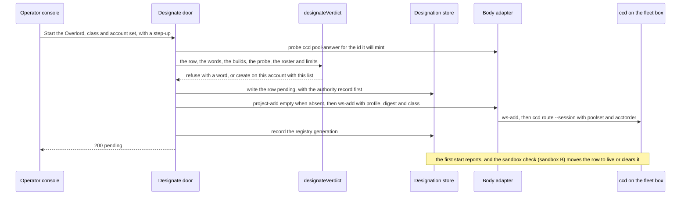
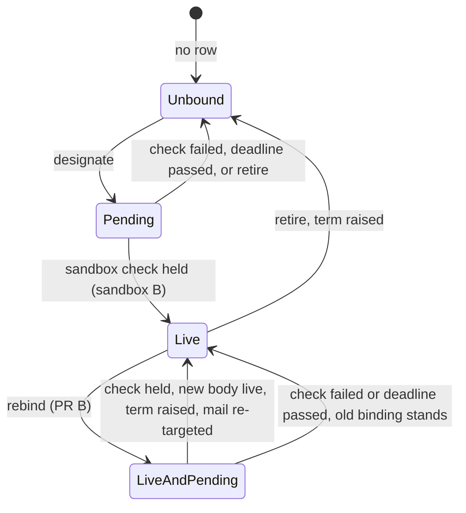

# Overlord W1: the designation, Start, Retire, Rebind and Restart the Overlord Implementation Plan

> **For agentic workers:** REQUIRED SUB-SKILL: Use superpowers:subagent-driven-development (recommended) or
> superpowers:executing-plans to implement this plan task by task. Steps use checkbox (`- [ ]`) syntax for tracking.

**Goal:** the operator makes the one Overlord, and only the operator can.

- One singleton row, `overlord_designation`, names the session that is the Overlord's body. It holds the binding
  (`live`, plus at most one `pending` attempt), `term`, `designatedTerm`, the model class, the account set
  `accountPools`, the past session ids, the actor the gate recorded, and the last attempt's outcome. Every write
  appends its record to the authority journal inside the same transaction, before the row.
- **PR A.** "Start the Overlord" (`POST /api/overlord/designate`) checks everything before it creates anything:
  - an existing binding (`overlord-exists`);
  - the capability words (`capability-missing`);
  - build agreement (`launch-profile-unmet`);
  - the placing agent's own `ccd pool-answer`;
  - at least two accounts in the set that can serve the class (`overlord-single-account`).

  Then it writes the row `pending`, creates the session in the `overlord` project on the account the widened
  `projectHome` picks from the set, with `profile`, `profiledigest` and `class` on the create's route, writes `poolset`
  and `acctorder` through `ccd route --session`, and answers `pending` at once. Retire (`DELETE
  /api/overlord/designate`) keeps the row, raises the term, clears the route record's set and digest, and stops the
  retired body. `roleOf` reads the designation at its four callers, so the body's first launch already has the
  `overlord` profile. The roll lane never rolls it.
- **PR B.** Rebind (`POST /api/overlord/rebind`) replaces a lost body without a second Overlord. Restart the Overlord
  (`POST /api/overlord/restart`) starts the same session id again by the resume path. The pending deadline fails a
  start that never reports. `ccd keep-awake` sets and clears the two accident guards. When a rebind goes live, the
  queued `overlord` mail follows the new body.
- **PR C.** `decideSleep` holds the designated session under both policy rows. Two Settings server doors write the
  model class and the account set, each with its step-up rule.

**Why:** R7 (one and only one), C2, C4, C45, C46, C56; H3 (one per server, actors, opaque ids), H12 (the term), H16
(the account set) and H27 (journalled authority). The pool set piece made the set a route field ccd honours; the sandbox
piece made the profile fail closed and settles `pending` to `live`. Nothing yet writes either, and nothing yet reads a
designation: `roleOf`'s `designation` input is the constant `'none'` (`server/src/roleOf.ts#roleFactsOf`).

**Architecture:** decide in L1, act in L4, and keep one writer per fact.

- **L0.** A new one-concern sibling, `shared/overlord-designation.ts` (question 1 of the index's large-file section,
  slug `wire-types-in-sibling-modules`): the view, the model class words, the attempt outcomes, the door bodies, and
  the capability words designate and rebind require. The account set is `shared/poolset.ts#PoolSet`, reused.
- **L1.** `server/src/coord/overlordDesignation.ts` holds the deciders:
  - `designateVerdict`, `retireVerdict`, and in PR B `rebindVerdict`, `restartVerdict` and `pendingDeadlineOf`;
  - `overlordAccounts`, the ordered list and the count of C56;
  - in PR C, `modelClassVerdict` and `accountSetVerdict`.

  `server/src/limits.ts#projectHome` and `projectPlacement` take the session's side (`SessionPoolSide`), not only a
  project's (question 5). `roleFactsOf` reads a `designation` input, `autoRollVerdict` gains the hold `overlord`, and
  in PR C `decideSleep` gains it under both policy rows.
- **L3.** `server/src/coord/overlordDesignationStore.ts` holds the row's writers and its one reader. `CoordStore`
  carries one-line delegates (the `ledgersStore.ts` idiom). `server/src/coord/overlordBody.ts` is the adapter over ccd
  for the body: create, the route write, the pool-answer probe, stop, and in PR B ensure and keep-awake. It is the
  one file of this piece that composes `CCD_ARGV`.
- **L4.** A new routes file, `server/src/coord/overlordRoutes.ts`, registered from `server/src/server.ts` beside
  `registerFaceRoutes`. Each door asks the account gate (`server/src/accounts/gate.ts#createAccountGate`) for a
  session and a step-up, reads its facts, asks its decider and acts on the answer. Other W1 pieces add their handlers
  to this file later (index, "Where lanes meet").


*Figure 1. Start the Overlord. Every refusal comes before the row and the session exist, so a refused start leaves
nothing behind. The door answers `pending`; the outcome of the attempt is read from the row.*


*Figure 2. The row's binding. "Unbound" covers both "never designated" and "retired": the row keeps its term, its past
ids, its class and its set. A pending attempt never raises the term, and no state lowers it.*

**Tech Stack:** TypeScript (ESM), `node:sqlite`, Fastify, vitest with `makeCcdHarness` for the ccd-facing tests. No new
dependency. No ccd change: every ccd verb this piece composes exists, or is shipped by the pool set, sandbox or ccd arms
piece.

**Spec:** `docs/superpowers/specs/2026-11-09-overlord-design.md`:

- §3.1 whole: one row by construction, one per server, the term and the incarnation, no second start, no Overlord from
  below, the rebind, mail to the role following the rebind, state keyed by the identity, retiring keeps the row.
- §3.2 C2 whole (what the row holds, its writers, the three doors, the account gate, designation in two steps, a
  start that never reports, what designation checks and does, Start the Overlord) and C4 (no runs; the sleep decider's
  `overlord` hold; the roll lane's hold; the two accident guards).
- §3.4: C45 (the class on the designation, written by the operator's doors; Settings `fable` keeps the step-up, `opus`
  needs none), C46 (the set, its one writer, widening and narrowing, the empty set serves nothing, when the set
  changes, "An older ccd"), C56 (at least two, the ordered list drawn only from the set).
- §6.4 C23 (a dead Overlord's Restart control, the resume path) for the Restart door only; the push is readiness's.
- §7.6 H27: designate, rebind and retire are authority records, appended inside the transaction before the row.
- §11.2: the operator's doors are cookie doors with the account gate's step-up.
- Table 11.1a (`overlord_designation`), Table 11.1d (the ccd words, the two Settings rows), Table 11.1e (the three
  doors, Restart, the account set's row), Table 11.6 (`overlord-exists`, `overlord-body-alive`,
  `overlord-single-account`, `overlord-sandbox-unmet`, `capability-missing`, `launch-profile-unmet`).
- Table 13.1: H3 and H12 are `shape` calls of W1, so the row and its doors ship here. H16 is a `tightening` of W1.

**The index:** `docs/superpowers/plans/2026-11-14-overlord-w1.md`, row "Designation", lane C, three pull requests. The
coordinator's brief for this plan (run 2143) corrects the row. The corrections are marked "(ruled)" below, and "Index
changes" lists what the index should carry.

## Open questions

Each carries the answer this plan builds. The index's questions this piece builds on are restated at the end.

1. **The row's shape** (slug `designation-row-carries-one-pending-attempt`). §3.1 says rebind writes the replacement
   `pending` while "the old binding stands". So the row has two slots: the live binding (`sessionId`, `generation`)
   and one pending attempt (`pendingId`, `pendingGeneration`, `pendingSince`, `pendingDeadlineAt`, `pendingKind`, which
   is `designate` or `rebind`). The sandbox piece's question 3 asked this plan for the failed attempt's columns: the
   last attempt's outcome is `attemptId`, `attemptOutcome` and `attemptAt`, written when an attempt ends without going
   live. **Recommendation:** one table, one migration in PR A, with every column the three pull requests use, so PR B
   and C add no migration. CHECK constraints:
   - `id = 1`;
   - a pending attempt always has a deadline;
   - `generation` is set when `sessionId` is.
2. **Which id the pool-answer probe asks about** (slug `pool-answer-probe-asks-the-minted-id`). The door needs the
   agent's own answer to `ccd pool-answer` (ruled), but no Overlord session exists before the create.
   **Recommendation:** the door first mints the id it will create (`shared/slug.ts#workspaceId('overlord', slug)`,
   with the slug from the `Entropy` port). It asks the agent `ccd pool-answer --session <that id>`, reading the result
   `ran` first (the pool set's Task 6 contract, `parsePoolAnswer`):
   - `answer`, or `refused` with code 1 (`no such session`), means the agent ran the verb, so the word is present;
   - `not-run`, an older agent's `forbidden`, refuses `capability-missing` naming `pool-set` (ruled);
   - any other code, or `unparsed`, refuses `capability-missing` naming `pool-set`, with the detail "the agent's pool
     answer could not be read". Unmeasured never passes.
3. **Build skew at the create** (slug `designate-refuses-launch-profile-unmet-under-skew`). Under skew ccd refuses the
   spawn, because the row it has installed does not hash to the server's `profiledigest` (sandbox question 5). The
   sandbox plan asks this piece to refuse first. **Recommendation:** designate and rebind read
   `server/src/fleetstate.ts#inventoryBuildAgreement` (sandbox A), and refuse anything but `agreed` with the existing
   word `launch-profile-unmet`. The detail is `skewed` (naming both builds) or `unmeasured`. A lone `both` node row
   reads `agreed` (ruled). Table 11.6's row for the word gains designate and rebind among its doors, a spec fix. No new
   word.
4. **What retire does to the retired body** (slug `retire-stops-the-retired-body`). The spec says retire clears the
   binding; it does not say what happens to the session. Left running, the retired body's role would read `plain` or
   `coordinator` at the profile lane's next pass. Its next spawn would then run the Overlord's conversation with a
   shell, which C2 forbids ("never runs as `plain`, with a shell or a fork that could outlive the designation").
   **Recommendation:** retire stops the bound session and any pending one through the stop route's own argv
   (`stopCreated`, below), after the row's transaction and the route clears. A failed stop is logged, and the answer
   says `stopped: false`. Its workspace is kept: retire never archives or removes.
5. **The pending deadline's length** (slug `pending-deadline-covers-the-first-turn`). §3.2 says "the `carded` deadline
   and its one re-nudge". The sandbox check settles on the loads report, which rides the first `Stop`, after the card
   is read and the probes run. **Recommendation:** the deadline is set once, at the create:
   `STATE_DEADLINE_S.clearing + carded + probing` (`shared/continuity.ts#STATE_DEADLINE_S`, 90 + 45 + 165 = 300 s),
   derived, never a new literal. A healthy first start settles inside it.
6. **The Overlord's generations: identity and term** (slug `overlord-generation-carries-the-term`). §3.1 keys the
   Overlord's state by the identity `overlord`, and says the body made `live` carries the raised term. The generations
   lane mints `identity: sessionId` and `term: GENERATIONS_TERM` (1) today
   (`server/src/continuity/generationsLane.ts#GENERATIONS_TERM`, "the designation's term arrives with W1"). No index
   row names the change. **Recommendation:** designation A's Task 3 makes it. The lane already reads the designation
   for `roleOf`, so a start of a bound or pending session mints with identity `overlord` and the row's `term`. Every
   other identity is unchanged. The coordinator may move this to the renewal readings piece instead.
7. **Rebind's re-target of parked mail** (slug `rebind-repoints-outstanding-mail-only`). §3.1 says the rebind
   "re-targets every queued delivery". The precedent is `CoordStore.reclaimProgram`. It repoints outstanding
   deliveries through the one delivery writer (`writeDeliveries`), and its envelope is not re-rendered (D-1142). A
   parked delivery stays visible on the old id, and only `requeueAbandonedMail` gives the heir a copy, joined through
   `runs`, which `overlord` mail never has. **Recommendation:** repoint outstanding deliveries whose mail's `toId` is
   `overlord` and whose delivery names the old body. Parked ones stay on the old id, visible, as in D-1142. W1 queues
   no `overlord` mail before the timers piece, so the repoint is tested on rows the test writes.
8. **Retire, and Restart, on a row that binds nothing** (slug `retire-on-unbound-is-a-no-op`). Table 11.6 has no word
   for it. **Recommendation:** retire on an unbound row, or with no row, answers 200 `{ ok: true, changed: false }` and
   writes nothing, so it appends no authority record and raises no term. Restart and rebind with nothing bound, and
   the Settings doors with no row, answer 404 `not-found`, an existing `REFUSAL_STATUS` word. No new word.

The index's questions:

- **Q5** (`designate-widens-project-placement`): built. `projectHome` and `projectPlacement` take `SessionPoolSide`,
  and the doors pass the set (Task 2).
- **Q6:** read as built by the pool set piece: `poolset` and `acctorder` are lane-only route fields, written only
  through `ccd route --session`, and an empty value clears them.
- **Q17:** the doors keep `createAccountGate` and record its actor on the row. The `CallerIdentity` port is gates A's,
  which adds the actor column's strength later.
- **Q33** (`designate-refuses-without-continuity-v1`), widened by the brief (ruled): designate and rebind refuse
  `capability-missing` without `pool-set`, `keep-awake`, `hibernate-fresh` and `launch-surface-v1` from ccd, and
  without `continuity-v1` from the server.
- **Q36:** PR A waits for pool set B, ccd arms, authority journal A and sandbox A2 (ruled).

## What exists today

Measured on `origin/main` at `49a34f76e` (2026-11-15). The pool set A2 (#2846) and history A (#2841) are merged. The
journal kernel (#2848), sandbox A (#2847, read from `origin/ws/overlord-build-sandbox-a`) and portfolio A (#2842) are
in flight.

- **The role reader.** `server/src/roleOf.ts#roleOf` answers `overlord` first when `RoleFacts.designation` is `pending`
  or `live`. `roleFactsOf(sessionId, RoleFactInputs)` is the one assembly, and it fixes `designation: 'none'`.
  `RoleFactInputs` has `child`, `childRunKind`, `openCoordinators` and `intentDeclared`, and no designation. It has
  four callers:
  - `server/src/continuity/profileLane.ts` (the launch-profile lane);
  - `server/src/continuity/generationsLane.ts`, through its local `roleFor`;
  - `server/src/continuity/cardFacts.ts#sessionRoleRead`;
  - the mail lane's pace in `server/src/watch.ts` (`mailPaceOf(roleOf(roleFactsOf(…)))`).

  `ROLE_FACTS_CHILD_AXIS` keeps `designation: 'none'` and is out of scope (index, "Where lanes meet"). `roleFactsOf`
  is in `MUTANT_SETS` through `server/test/sim/renewalDeciderSets.ts#roleFactsOfCases`, at floor 1.
- **The sleep decider.** `server/src/sleep.ts#decideSleep(input, policy)` runs one ladder under two rows:
  - `server/src/stopDone.ts#RUN_DONE_POLICY` (`STOP_DONE_HOLD_MAP`, `STOP_DONE_HOLDS`);
  - `server/src/coord/hibernate.ts#IDLE_HOURS_POLICY` (`HIBERNATE_HOLD_MAP`, `HIBERNATE_HOLDS`).

  A hold word outside the row's list throws, and `sleep-lanes-pin.test.ts` holds each row to its list. Every fact the
  lane did not read holds (`unmeasured`). `HIBERNATE_KEBABS` derives from the map, for `mail-routes.test.ts`'s census.
  Neither decider is in `MUTANT_SETS`.
- **The roll lane.** `server/src/rollLane.ts#ROLL_LANE` asks `server/src/coord/rollTarget.ts#autoRollVerdict`, which
  skips by `AUTO_ROLL_SKIP_MAP` (`setting-off`, `role-unknown`, `not-coordinator`, `no-roll`, `idle-gate`, …). The
  role it reads is the wire's `FleetSession.role`, which is `coordinator` for the Overlord either way
  (`shared/fleetRoles.ts`). Not in `MUTANT_SETS`.
- **Placement.** `server/src/limits.ts#projectHome(roster, limits, pool: ProjectPoolWire, edges, cls, shares, nowS)`
  and `projectPlacement(…)` filter by `server/src/poolrule.ts#poolEligible(roster, pool: ProjectPoolWire, edges)` and
  answer `unmeasurable` through `poolUndecidable(pool: ProjectPoolWire)`. `shared/poolrule.ts#poolRule` already takes
  `SessionPoolSide` (pool set A1), whose set arms answer `in-set`, `untagged-in-set`, a set mismatch, or undecidable
  on the `set` side. `projected-home.test.ts` drives `projectHome` and ccd's `_ws_least_loaded` over one fixture table.
  ccd's placer stays project-keyed (Table 3.4d: "Unchanged").
- **The set's wire.** `shared/poolset.ts#PoolSet`, `poolSetSpelling` (answers `spelled`, `empty` or `unspellable`,
  never one null) and `parsePoolSet`. `shared/api.ts#ROUTE_WRITABLE_FIELDS` ends `poolset`, `acctorder`. Both are in
  `ROUTE_LANE_ONLY_FIELDS`, and ccd's `_route_argv_check` refuses both on a `--route`, so only `ccd route --session`
  writes them, and an empty value clears them.
- **ccd's words the door needs.** None is on `main` yet:
  - `pool-set` and `ccd pool-answer` (`CCD_ARGV.poolAnswer`, `parsePoolAnswer`): pool set B1;
  - the `--below-cap pool-set` floor: pool set B2;
  - `keep-awake` and `ccd keep-awake --state on|off <id>`: ccd arms;
  - `launch-surface-v1`: sandbox A2;
  - `hibernate-fresh`: W1a's fresh start, which is on `main`.

  `server/src/ccdargv.ts#capSupported(state, token)` answers `false` on no evidence. `ccdCan(state, row)` answers a
  row's default on no evidence, so this piece asks `capSupported` only.
- **The server's own words.** `shared/api.ts#SERVER_CAPS` derives from `SERVER_CAP_MAP`. `continuity-v1` is not in it
  yet: W1a's last piece adds it (`docs/superpowers/plans/2026-11-10-overlord/w1a-continuity-v1.md`).
- **The profile fields** (sandbox A, in flight). `profileFor` returns `profiledigest` for a surfaced role.
  `profileDigestWriteOf(target, standing, builds)` answers `write` only at `agreed`, and `hold` otherwise.
  `fleetstate.ts#inventoryBuildAgreement(coord)` answers `agreed`, `skewed` or `unknown`. The sandbox ruling makes
  designation A's create a recorded second writer of `profile` and `profiledigest` (slug
  `profile-fields-written-at-create`), with the lane converging after.
- **The create.** The named create, `POST /api/projects/:project/workspaces` in `server/src/server.ts`, runs
  `server/src/workspaceCreate.ts#planCreate`, then `CCD_ARGV.wsAddNamed(project, slug, { title, wrapper }, route,
  dec)`. `wsAddNamed` is gated by `WS_TITLE_CAP` and `WS_WRAPPER_CAP`. `shared/slug.ts#workspaceId(project, slug)` is
  the id ccd mints. `POST /api/projects` runs `planProjectAdd`, and `CCD_ARGV.projectAddEmpty(name)` makes an empty
  project.
- **Stop and ensure.** `POST /api/sessions/:id/stop` ends in `stopArgvFor(id, rec, identity)`, a closure inside
  `buildServer`, after `measuredIdentity` and `decideStopClaims`. `POST /api/sessions/:id/ensure` runs
  `CCD_ARGV.ensure(id)`. `runCcdOr502`, `parseOperatorRoute` and `pwaDec` are closures too.
- **The account gate.** `createAccountGate(deps)` returns `gate(req, reply, { cap, stepUp })`, which answers
  `{ pass: true, actor, sessionIdHash }` or refuses in order: `auth-off`, `insecure-origin`, `unauthenticated`,
  `unsupported` (a `cap` the box's ccd lacks), `step-up-required`. It is built once in `server.ts` and handed to
  routes files. `server/src/testboxAdmin.ts` is the caller to copy, deciding `stepUp` per request.
- **Mail to a role.** The mail route resolves `coordinator` and `worker` at send (`server/src/coord/routes.ts`). The
  `mail` row keeps the role in `toId`, and `mail_deliveries.toId` holds the resolved session. `overlord` is not a role
  address yet: the Overlord's timers piece adds it. `reclaimProgram`'s `repointCoordinatorMail` is the repoint
  precedent (question 7).
- **The generation deadlines.** `shared/continuity.ts#STATE_DEADLINE_S` holds `{ draining: 120, checkpointed: 60,
  clearing: 90, carded: 45, probing: 165 }`. W1a's renewal act delivers a fresh generation's first prompt at `carded`
  (`w1a-renewal-act.md`, slug `first-prompt-by-deliver`), so this piece types nothing into the new body.
- **The reclaim re-measurement.** `server/src/coord/reclaim.ts#measureClaimant` decides "dead or registry-absent" for
  the reclaim door, and an unmeasurable registry refuses. Rebind's `overlord-body-alive` reads it.
- **The refusal words.** `shared/refusal.ts#OVERLORD_REFUSALS` already has `capability-missing` (501),
  `overlord-exists`, `overlord-body-alive`, `overlord-single-account`, `overlord-sandbox-unmet` and
  `launch-profile-unmet` (409), spread into `REFUSAL_STATUS`. No door sends them yet.
- **The censuses a session-gated routes file meets** (measured by a Sonnet scout and re-read):
  - `server/test/auth-gate.test.ts`: `ROUTES` lists each routes file through `scanRoutes`, then pins the count, the
    `httpCount` sentences and `server/src/auth/gate.ts`'s "stands in front of all N routes". A door that asks the gate
    with `cap: null` answers `auth-off` dark and something else armed, so it joins `FLAG_AWARE` and its sorted list.
  - `server/test/rings/fastify-l4.data.ts#FASTIFY_L4_ALLOWLIST`: one entry for a new Fastify importer.
  - `server/test/secret-mask.test.ts`: a GET is masked (`MASKED_GET_ROUTES`) or listed in its `EXEMPT` with a reason.
  - `server/test/box-token-census.test.ts`: a session-only file outside `coord/routes.ts` is checked by a hand-kept
    door list, both ways, through `registrationsIn` (the `testboxAdmin` describe). `SESSION_ONLY_ALL` joins the
    hand-kept lists to `CLAUDE.md`'s box-token bullet, path by path.
  - `server/test/single-definition/time-ports.test.ts`: `TIME_PORT_FAMILIES` already covers every
    `server/src/**/overlord*.ts`, so the new files take `Clock` and `Entropy` from `deps.time` with no list edit.
  - `server/test/id-argv-census.test.ts` classifies every `CCD_ARGV.<name>(` call in `server/src`, and
    `verb-gate.test.ts` wants a capability gate in the enclosing function.
  - No routes file of the operator's is in `ccd/ccrc-api`'s `ROUTES`.
- **The growth check.** `server/test/growthCheck.ts#GROWTH_FILES` lists `server/src/server.ts`,
  `server/src/watch.ts`, `server/src/coord/store.ts`, `server/src/coord/schema.ts` and `shared/api.ts` among this
  piece's files, at 40 net code lines each per pull request. `shared/api.ts` is capped (#2811).
- **Migrations on `main`:** 75 (`push_outbox` is the last). This plan takes no number: the builder takes the next one at
  build time.

## Global Constraints

- **Architecture (`CLAUDE.md`).**
  - One writer per fact. The row's writers live in `overlordDesignationStore.ts` alone, each named for its move:
    `designatePending`, `bindPendingGeneration`, `goLive`, `failPending`, `retire`, and in PR B `rebindPending`. In PR
    C, `setModelClass` and `setAccountSet`. `goLive` and `failPending` are the writers sandbox B's settle step calls
    (its Task 9). PR B's deadline sweep calls `failPending` too.
  - The route record's `poolset`, `acctorder` and `class` have two writers, the designation's doors and the renewal
    lane (Table 11.1a, pool set's docstring on `ROUTE_WRITABLE_FIELDS`). The create's `profile` and `profiledigest`
    are the recorded second writer (sandbox ruling G2). The body's two markers are `ccd keep-awake`'s.
  - Decide in L1, act in L4. The routes file reads facts, calls a verdict, and acts on it. It holds no `if` over a
    refusal word. `overlordDesignation.ts` imports L0 and `server/src/poolrule.ts` only: no `fs`, no Fastify, no
    clock (it takes `now`).
  - Consolidate. Placement is `projectHome` widened, not a second picker. The create is `CCD_ARGV.wsAddNamed`, as the
    named-create door composes it. The stop is the stop route's own argv, through one `stopCreated` port that sandbox
    B reuses. The mail repoint goes through `writeDeliveries`. The step-up is the account gate's. The holds are rows of
    the existing tables. Nothing here is a second mechanism.
  - The session id is opaque. Nothing parses it. The slug comes from `Entropy`, and the id from `workspaceId`.
- **Failure contracts (fail closed for the Overlord).**
  - Every refusal of designate and rebind comes before the row is written and the session created, as do the
    capability words, the probe, build agreement and the count (§3.2, Table 11.6). A refused start leaves nothing.
  - After the row is written, any failure of the create or the route write ends the attempt:
    - `failPending` records `create-failed` with ccd's detail;
    - the created session, if one exists, is stopped through `stopCreated`;
    - the door answers 502 with the create's own failure, as the named create answers it today.
  - The pending row is never left without a deadline (CHECK).
  - An unreadable designation is never read as "nobody is designated". `designationRead()` answers `none`, a row, or
    throws on a row it cannot narrow (an unknown state word, a set that does not parse). Each caller fails closed in
    its own existing way (Task 3's table). The doors answer 503 `unavailable`, an existing `REFUSAL_STATUS` word, with
    the detail "the designation row could not be read", and write nothing.
  - A lane whose coordination port is absent (`store: 'optional'` on the roll lane) has no `coord.db`, so no
    designation can exist there, and it reads `none`. That is a measured absence, not an unreadable row.
  - `capability-missing` never passes on no evidence: `capSupported` answers `false` for `ccdVerbs === null`.
  - An older server reads a newer `coord.db` and ignores the table, so no Overlord exists there. An older ccd refuses
    a route write that carries `poolset` (`unknown routing field`), but the doors refuse long before, on `pool-set`.
- **What the doors trust, and the accepted residuals.** Identity on the fleet is attribution. The doors are the
  operator's cookie doors behind the step-up, so no session can designate. But any same-user process can run `ccd
  route` on the Overlord's row, or touch its markers, as C46 and C4 say. The server writes the record again at each
  renewal and change (the renewal lane's arm, not this piece's). Accepted as accident guards in shared-user mode.
- **What a merge arms.** Nothing a running session sees.
  - PR A: no row exists until the operator taps Start, and the console offers it only under `overlord-v1` (Q33). With
    no row, `roleOf`'s new input reads `none` and the roll hold never fires. `projectHome` with a project side answers
    byte for byte as before. The doors refuse `capability-missing` until W1a's `continuity-v1` lands.
  - PR B adds doors and a sweep that act only on a row.
  - PR C adds holds that fire only for the bound session, and Settings doors that refuse with no row.
- **SAFETY (`CLAUDE.md`).** No new ccd verb. The server composes `project-add`, `ws-add`, `route --session`,
  `pool-answer`, `stop`, `ensure` and `keep-awake`, each behind its capability gate, and never a destructive workspace
  verb: retire and a failed attempt stop, and never archive or remove. ccd-facing tests use fixture HOMEs
  (`makeCcdHarness`). No test runs ccd against the live `$HOME`.
- **Growth check.** Every growth-checked file stays within 40 net code lines per pull request, with no waiver. The
  estimates are in the PR split. A task that measures over its row stops and asks; it never plans a waiver.
- **Mutation floors.** `designateVerdict`, `overlordAccounts`, `retireVerdict`, `designationFactOf`, `rebindVerdict`,
  `restartVerdict`, `pendingDeadlineOf`, `modelClassVerdict` and `accountSetVerdict` are new L1 deciders. Each joins
  `MUTANT_SETS` (`server/test/sim/mutation-floors.test.ts`) through a new `server/test/sim/designationSets.ts`, and
  `server/test/sim/mutation-floors.json` at floor 1, in its task's pull request. Three existing deciders change and are
  not in `MUTANT_SETS`: `autoRollVerdict`, `decideSleep` and `projectHome`. Each new arm ships a test that goes red
  when the arm is deleted, measured by hand with `mutation-run.py`, as each task says. `roleFactsOf`'s set gains its
  cases.
- **Tests.** From `server/`: `ccrc test -- ./node_modules/.bin/vitest run test/<file>.test.ts`. A task's last run adds
  `ccrc test -- npx tsc --noEmit -p tsconfig.json` and `-p test/tsconfig.tests.json`. For a `shared/` change, add
  `cd ../pwa && ccrc test -- ./node_modules/.bin/tsc --noEmit`. ccd suites are load-sensitive: re-run a red one alone
  first.
- **Public repository.** Fixtures use `pool-a`, `pool-b`, `lane-a`, `lane-b`, `lane-c` and the `overlord` project.
  Real pool names are the operator's data and appear nowhere. Cite by symbol or `@anchor`. No D-number is invented: a
  builder's new departures go in `docs/superpowers/plans/2026-11-14-overlord-w1/w1-designation/notes.md`.

## Review Focus

1. **Nothing before the checks.** No refusal of designate or rebind leaves a row, a session, a route field or a
   marker behind. A test drives each refusal and reads the store, the fake ccd's calls and the registry after.
2. **One Overlord.** No sequence of doors yields two bound sessions. The CHECK holds one row, and every write is one
   transaction. A pending attempt never raises the term, and nothing lowers it. Two designates racing: the second
   reads the first's pending row and refuses `overlord-exists`.
3. **The set binds, and the list only orders.** The first account and every listed account pass `poolRule` under the
   set. The count excludes pay-per-use, disabled, signed-out and unservable accounts. An empty set counts zero and
   refuses. A project side answers exactly as on `main`.
4. **`roleOf` sees the pending body.** A pending row reads `overlord` at every caller, so the profile lane writes no
   `plain` over the create's `profile`. An unreadable designation fails each caller closed, never as `none`.
5. **Retire and rebind leave nothing that runs as the Overlord without a row.** The set, `acctorder` and
   `profiledigest` are cleared on the body that loses its binding, and that body is stopped. On a rebind, the old body
   loses its powers in the same transaction that grants the new one.

## The PR split

Net code lines, as `server/test/growthCheck.ts` counts them (comments and blank lines dropped), estimated against
`origin/main` at `49a34f76e`.

| PR | Tasks | What it ships | Needs first | Growth-checked files, estimate |
|---|---|---|---|---|
| A | 1 to 5 | The row, its writers and reader, and the authority records; the deciders and the widened placement; `roleOf`'s reader at four callers, the generations' identity and term, and the roll hold; the body adapter; designate, retire and the read | pool set B (B1 and B2), ccd arms, authority journal A, sandbox A2 (ruled) | `server/src/coord/schema.ts` about +26 (one migration); `server/src/coord/store.ts` about +12 (delegates); `server/src/server.ts` about +14 (registration, `stopCreated`, the body adapter's deps); `server/src/watch.ts` about +3 (the mail pace's designation read); `shared/api.ts` 0 |
| B | 6 and 7 | Rebind with its go-live arm and the mail repoint; Restart; the pending deadline sweep; the keep-awake calls | PR A, sandbox B, W1a's renewal act and renewal hand-offs | `server/src/coord/store.ts` about +6; `server/src/server.ts` about +3 (the ensure port); `server/src/coord/schema.ts` 0 |
| C | 8 to 10 | `decideSleep`'s `overlord` hold under both rows; the model class and account set Settings doors | PR A | `server/src/coord/store.ts` about +4; `server/src/watch.ts` 0 (the sleep lanes read the designation through their coordination ports, `RunDoneCoordPort` and `IdleHoursCoordPort`, which gain `designationRead`, and `CoordStore` already satisfies them); `server/src/server.ts` 0 |

For scale, the files that are not growth-checked change by about:

- new files: `shared/overlord-designation.ts` +90, `server/src/coord/overlordDesignation.ts` +260,
  `server/src/coord/overlordDesignationStore.ts` +230, `server/src/coord/overlordBody.ts` +140,
  `server/src/coord/overlordRoutes.ts` +260 (PR A), +150 (PR B) and +110 (PR C);
- `server/src/limits.ts` +10, `server/src/poolrule.ts` +6, `server/src/roleOf.ts` +20,
  `server/src/coord/rollTarget.ts` +8, `server/src/rollLane.ts` +6, `server/src/sleep.ts` +4,
  `server/src/stopDone.ts` +3, `server/src/coord/hibernate.ts` +3, `server/src/sleepLane.ts` +12;
- `server/src/continuity/{profileLane,generationsLane,cardFacts}.ts` about +10 each, and in PR B
  `generationsLane.ts` +12 more (the deadline sweep's call).

## Index changes

The index should carry these. Its row and lane lists name only what is shown here.

- **The row (ruled).**
  - Designation A needs pool set B (B1 and B2, not only B), ccd arms, authority journal A, and sandbox A2 for
    `launch-surface-v1`. Figure W1 gains `SA2 --> DA` and `PB2 --> DA`.
  - A's `capability-missing` list is ccd's `pool-set`, `keep-awake`, `hibernate-fresh` and `launch-surface-v1`, and
    the server's `continuity-v1`. The create's own words, `ws-title-v1` and `ws-wrapper-v1`, are asked too (slug
    `designate-asks-the-create-words`).
  - A writes `profile` and `profiledigest` at the create.
  - A's door answers `pending` at once. `overlord-sandbox-unmet` is the attempt's outcome on the row (sandbox
    question 3).
  - A refuses `launch-profile-unmet` under build skew (question 3).
  - A ships the `CoordStore` writers `goLive` and `failPending`, which sandbox B's settle step calls.
- **More of A** (this plan):
  - one migration with every column B and C use (question 1);
  - the body adapter `server/src/coord/overlordBody.ts`;
  - a `GET /api/overlord/designation` read for the console;
  - retire stops the retired body (question 4);
  - the generations lane mints the Overlord's starts with identity `overlord` and the row's term (question 6).
- **Lane C's files** gain `shared/overlord-designation.ts`, `server/src/coord/overlordDesignation.ts`,
  `overlordDesignationStore.ts` and `overlordBody.ts`; and, shared with other lanes, `server/src/limits.ts`
  (`projectHome`), `server/src/poolrule.ts` (`poolEligible`, `poolUndecidable`), `server/src/coord/rollTarget.ts`,
  `server/src/rollLane.ts`, `server/src/sleepLane.ts`, and the three continuity files that call `roleOf`.
- **Where lanes meet:**
  - `stopCreated` is created by designation A in `server.ts` and reused by sandbox B, which no longer adds it;
  - `overlordRoutes.ts`'s operator doors are named in `box-token-census.test.ts`'s new `OVERLORD_OPERATOR_DOORS`
    list and in `CLAUDE.md`'s box-token bullet. Every later piece that adds an operator door to the file adds it there.
    The Overlord's own box-token doors (gates, inbox and the rest) are counted by the census's lane scan, as every
    `EXEMPT` door is.
- **Renewal readings:** `classChanged` reads the designation's `model` through `designationRead()` (designation C
  changes it), against the generation's recorded model.
- **The operator item for a count below two** (C56, "A later drop is told") has no owner in Table W1. Recommendation:
  the renewal readings piece, beside `accountOutsideSet`, which reads the same list.
- **Spec fixes:** Table 11.6's `launch-profile-unmet` row gains designate and rebind; §3.2's "`carded` deadline" reads
  "the first start's deadline" (question 5); Table 11.6's `capability-missing` row names `launch-surface-v1` and
  `continuity-v1` beside ccd's three words.

---

### Task 1: The row, its writers, its reader and the authority records (PR A)

**Files:**
- Create: `shared/overlord-designation.ts` (L0, imports types from `shared/poolset.ts` only)
- Create: `server/src/coord/overlordDesignationStore.ts` (C5, L3)
- Modify: `server/src/coord/schema.ts` (one migration), `server/src/coord/store.ts` (one-line delegates)
- Modify: `server/test/run-close-switch.test.ts` (its undo step drops the table, and its count),
  `server/test/coord-db.test.ts`
- Modify: `server/test/single-definition/writers-map.test.ts` (`TABLES` gains `overlord_designation` with its writers)
- Create: `server/test/overlord-designation-store.test.ts`

**Interfaces:**

```ts
// shared/overlord-designation.ts
export const OVERLORD_MODEL_CLASSES = ['fable', 'opus'] as const;
export type OverlordModelClass = (typeof OVERLORD_MODEL_CLASSES)[number];
export const PENDING_KINDS = ['designate', 'rebind'] as const;
/** How an attempt ended without going live; written on the row, read by the console and the board. */
export const ATTEMPT_OUTCOME_MAP = {
  'overlord-sandbox-unmet': 'a property of the sandbox check failed at the first start',
  'create-failed': 'ccd could not create the session or write its route record',
  'deadline-passed': 'the first start never reported before its deadline',
  retired: 'the operator retired the Overlord while this attempt was pending',
} as const;
export type AttemptOutcome = keyof typeof ATTEMPT_OUTCOME_MAP;
/** ccd's words designate and rebind require (Q33, ruled), and the server's own. */
export const DESIGNATE_CCD_WORDS = ['pool-set', 'keep-awake', 'hibernate-fresh', 'launch-surface-v1'] as const;
export const DESIGNATE_SERVER_WORDS = ['continuity-v1'] as const;
export interface DesignationView {
  readonly bound: { readonly sessionId: string; readonly generation: string } | null;   // null: unbound, by design
  readonly pending: { readonly sessionId: string; readonly kind: (typeof PENDING_KINDS)[number];
    readonly deadlineAt: number } | null;
  readonly term: number; readonly designatedTerm: number;
  readonly model: OverlordModelClass; readonly accountPools: PoolSet;
  readonly pastIds: readonly string[]; readonly actor: string;
  readonly lastAttempt: { readonly sessionId: string; readonly outcome: AttemptOutcome; readonly at: number } | null;
}
export type DesignationRead = { readonly kind: 'none' } | { readonly kind: 'row'; readonly row: DesignationView };
```

`bound: null` and `pending: null` each say one thing, "no such binding", and the view carries no other absence on them.
A row that cannot be narrowed is not `null`: `designationRead()` throws `DesignationUnreadable` (question 1's
contract, and Global Constraints).

**The table:**

```sql
CREATE TABLE overlord_designation (
  id INTEGER PRIMARY KEY CHECK (id = 1),
  sessionId TEXT, generation TEXT,
  pendingId TEXT, pendingGeneration TEXT, pendingKind TEXT CHECK (pendingKind IN ('designate','rebind')),
  pendingSince INTEGER, pendingDeadlineAt INTEGER,
  term INTEGER NOT NULL CHECK (term >= 0), designatedTerm INTEGER NOT NULL CHECK (designatedTerm >= 0),
  model TEXT NOT NULL CHECK (model IN ('fable','opus')),
  accountPools TEXT NOT NULL, pastIds TEXT NOT NULL DEFAULT '[]', actor TEXT NOT NULL,
  attemptId TEXT, attemptOutcome TEXT, attemptAt INTEGER,
  updatedAt INTEGER NOT NULL,
  CHECK ((sessionId IS NULL) = (generation IS NULL)),
  CHECK ((pendingId IS NULL) = (pendingKind IS NULL)),
  CHECK (pendingId IS NULL OR (pendingDeadlineAt IS NOT NULL AND pendingSince IS NOT NULL)),
  CHECK (pendingKind IS NOT 'rebind' OR sessionId IS NOT NULL)
);
```

`pendingGeneration` stays null from the row write until the create returns (question 1). `accountPools` is
`{"pools":[…],"untagged":bool}`, in the operator's order. The model class column is the operator's choice (C45).

**The writers**, each one `tx(db, …)` that first appends the authority record through authority journal A's
synchronous writer (its plan names it; the record carries the operation key and the row's new values, never a
message), then writes the row:

- `designatePending({ sessionId, deadlineAt, model, accountPools, actor, at })`: the row's insert or update. It
  refuses (returns `{ ok: false, reason: 'exists' }`) when a session is bound or pending, read inside the
  transaction. That makes two racing designates safe.
- `bindPendingGeneration(sessionId, generation)`: sets `pendingGeneration` once. It refuses another id.
- `goLive(sessionId, generation, at)`: only for the pending id. A `designate` attempt moves into the binding, with
  `term += 1` and `designatedTerm = term`. PR B's `rebind` arm is added in Task 6. It clears the pending slot.
- `failPending(sessionId, outcome, at)`: only for the pending id. It clears the slot and writes the attempt's outcome.
  It never touches the term or the live binding.
- `retire(actor, at)`: unbinds, appends the bound id to `pastIds`, `term += 1`, and clears any pending slot with the
  outcome `retired`. It answers the ids it unbound, for the door to stop.
- `designationRead()`: the one reader. It narrows the row through `parsePoolSet`-equivalent checks on
  `accountPools`, the class words and the pending kind, or throws `DesignationUnreadable`.

- [ ] **Step 1: Failing tests.**
  - The CHECKs: a second row, a pending row without a deadline, and a `rebind` pending row with no binding are each
    refused by SQLite.
  - Every writer: the authority writer is called before the row, inside the same transaction. A throwing authority
    writer leaves no row.
  - `designatePending` refuses when a row is bound or pending.
  - `goLive` raises the term once. A resent `goLive` for a session that is no longer pending changes nothing.
  - `failPending` keeps the term and the binding.
  - `retire` keeps the class, the set and the past ids, raises the term, and answers the ids it unbound. On an
    unbound row it writes nothing and appends no authority record.
  - `designationRead()` throws on a hand-written bad `model` or `accountPools`.
  - `run-close-switch.test.ts`'s undo step and `coord-db.test.ts`'s count move with the migration. `writers-map`
    names the five writers.
- [ ] **Step 2: Run.** Red. **Step 3: Implement.** **Step 4: Run** the suite, `writers-map`, `coord-db`,
  `run-close-switch`, `growth-check` armed and both `tsc` runs. Green.
- [ ] **Step 5: Mutation, by hand.** Drop the "refuses when pending" read: the race test goes red. Raise the term in
  `failPending`: red. Restore.
- [ ] **Step 6: Commit.** `feat(overlord): the designation row, its writers and its authority records (C2, H12, H27)`

### Task 2: The deciders, and placement widened to the set (PR A)

**Files:**
- Create: `server/src/coord/overlordDesignation.ts` (C5, L1)
- Modify: `server/src/poolrule.ts` (`poolEligible` and `poolUndecidable` take `SessionPoolSide`)
- Modify: `server/src/limits.ts` (`projectHome` and `projectPlacement` take `SessionPoolSide`; Q5)
- Modify: `server/test/projected-home.test.ts` (set rows, TypeScript side only), `server/test/pools.test.ts`
- Create: `server/test/overlord-designation-verdicts.test.ts`, `server/test/sim/designationSets.ts`
- Modify: `server/test/sim/mutation-floors.test.ts` (`MUTANT_SETS`), `server/test/sim/mutation-floors.json`

**Interfaces:**

```ts
export interface DesignateFacts {
  readonly read: DesignationRead;
  readonly ccdWords: readonly string[] | null;          // the fleet state's `ccdVerbs`; null is no evidence
  readonly serverWords: readonly string[];               // `SERVER_CAPS`
  readonly builds: BuildAgreement;
  readonly probe: ReturnType<typeof parsePoolAnswer>;    // asked of the id the door minted (question 2)
  readonly model: OverlordModelClass; readonly accountPools: PoolSet;
  readonly roster: Roster; readonly limits: Readonly<Record<string, AccountLimits>>;
  readonly edges: ReadonlyMap<string, readonly string[]>; readonly shares: SharesRead; readonly nowS: number;
}
export type DesignateVerdict =
  | { readonly act: 'refuse'; readonly word: 'overlord-exists' | 'capability-missing' | 'launch-profile-unmet'
      | 'overlord-single-account'; readonly detail: string;
      readonly needs?: readonly string[]; readonly count?: number }
  | { readonly act: 'refuse-input'; readonly why: 'unspellable' }
  | { readonly act: 'create'; readonly wrapper: string; readonly acctorder: string; readonly poolset: string };
export function designateVerdict(f: DesignateFacts): DesignateVerdict;

/** C56: every enabled account the set admits, in the set's pool order, roster order within a pool, untagged last
 *  (only when the set admits them); and how many of them count: not pay-per-use, not signed out, servable for the
 *  class now. The list orders and never admits: every member passes `poolRule` under the set. */
export function overlordAccounts(set: PoolSet, cls: OverlordModelClass, roster: Roster,
  limits: Readonly<Record<string, AccountLimits>>, edges: ReadonlyMap<string, readonly string[]>,
  shares: SharesRead, nowS: number): { readonly list: readonly string[]; readonly counted: number };

export function retireVerdict(read: DesignationRead): { readonly act: 'retire' } | { readonly act: 'none' };
```

**The order** in `designateVerdict` (first refusal wins):

1. `overlord-exists`, when a session is bound or pending.
2. `capability-missing`, naming every missing word: each of `DESIGNATE_CCD_WORDS`, and `ws-title-v1` and
   `ws-wrapper-v1` for the create, absent from `ccdWords` (`null` misses them all); then `DESIGNATE_SERVER_WORDS`
   absent from `serverWords`; then the probe's verdict (question 2).
3. `launch-profile-unmet`, for builds other than `agreed` (question 3).
4. `refuse-input`, for a set `poolSetSpelling` answers `unspellable`. The door answers 400 `bad-request`.
5. `overlord-single-account`, with the count, when `overlordAccounts(…).counted < 2`. An empty set counts zero.
6. `create`, on the wrapper `projectHome(roster, limits, { state: 'set', set }, edges, model, shares, nowS)` picks,
   with `acctorder` (the list joined by `,`) and `poolset` (the spelling).

**Pay-per-use** is read from the roster's one fact, the provider's API-key kind
(`shared/roster-json.mjs#API_KEY_PROVIDERS`, and its TypeScript twin in `shared/roster.ts`'s provider table; the
builder cites whichever `parseRoster`'s output carries). "Signed out" is `limits[id].authDead === true`, the same
predicate `projectHome` reads. "Servable" is `shared/serviceability.ts#serviceability(cls, …)` not `unservable`. When
serviceability A widens that answer with the billing fact and the continuity record, the count follows with no edit
here.

**The widening.** `poolEligible` and `poolUndecidable` take `SessionPoolSide`. Through `poolRule`'s overloads, a
project side keeps its `ProjectPoolVerdict`. `projectPlacement`'s `none` arm carries `pool: name | null` for a
project. For a set it carries the spelling (`set:<spelling>`), or `-` for the empty set, in the same field, so no
reader narrows a new shape. `projected-home.test.ts`'s parity with `_ws_least_loaded` stays on the project rows only.
The set rows are TypeScript-only cases in the same file, because ccd's placer is unchanged (Table 3.4d).

- [ ] **Step 1: Failing tests.**
  - Each refusal in order, and a fact that would refuse twice answers the first.
  - `ccdWords: null` names all six ccd words.
  - Each probe arm of question 2.
  - `skewed` and `unknown` refuse `launch-profile-unmet` with their details. A lone `both` row's agreement reads
    `agreed` and passes (ruled).
  - The empty set and a one-account set refuse with counts 0 and 1.
  - A set admitting a pay-per-use lane lists it last and does not count it.
  - `+untagged` admits untagged accounts, listed after every pool.
  - A disabled account is neither listed nor counted. A signed-out or unservable one is listed and not counted.
  - The pick is in the set. `projectHome` with a project side answers as before on every existing fixture row.
- [ ] **Step 2: Run.** Red. **Step 3: Implement.**
- [ ] **Step 4: Mutation.** `designateVerdict`, `overlordAccounts` and `retireVerdict` join `MUTANT_SETS` through
  `designationSets.ts`, at floor 1, with mutants that:
  - swap steps 1 and 2;
  - read `ccdWords: null` as present;
  - count a pay-per-use lane;
  - list an account outside the set;
  - pass `unknown` builds.

  By hand: make `poolEligible` ignore the set arm. The set rows go red.
- [ ] **Step 5: Run** the suites, `pools`, `projected-home`, `mutation-floors` and both `tsc` runs.
- [ ] **Step 6: Commit.** `feat(overlord): designateVerdict, the account list and placement in the set (C46, C56)`

### Task 3: `roleOf` reads the designation, and the roll lane holds the Overlord (PR A)

**Files:**
- Modify: `server/src/roleOf.ts` (`RoleFactInputs.designation`, `roleFactsOf`; a new L1 `designationFactOf`)
- Modify: `server/src/continuity/profileLane.ts`, `server/src/continuity/generationsLane.ts`,
  `server/src/continuity/cardFacts.ts`, `server/src/watch.ts` (the mail pace site): each reads the designation once
  per pass and passes it
- Modify: `server/src/coord/rollTarget.ts` (`AUTO_ROLL_SKIP_MAP.overlord`, `AutoRollInput.overlord`),
  `server/src/rollLane.ts` (reads the designation once per pass)
- Modify: `server/test/sim/renewalDeciderSets.ts#roleFactsOfCases`
- Test: `server/test/role-of.test.ts`, `server/test/continuity-profile-lane.test.ts`,
  `server/test/continuity-generations-lane.test.ts`, `server/test/continuity-card-facts.test.ts`,
  `server/test/mail-pace.test.ts`, `server/test/roll-lane.test.ts`

**Interfaces:**

```ts
// server/src/roleOf.ts
/** The designation as one caller read it this pass: no row, or the ids it binds. An unreadable row never reaches here:
 *  the caller fails closed first (the table below). */
export type DesignationFact = { readonly kind: 'none' }
  | { readonly kind: 'row'; readonly live: string | null; readonly pending: string | null };
export interface RoleFactInputs { /* …today's four… */ readonly designation: DesignationFact }
/** `pending` when the id is the pending attempt, `live` when it is the binding, `none` otherwise. */
export function designationFactOf(sessionId: string, d: DesignationFact): RoleFacts['designation'];
```

`roleFactsOf` calls `designationFactOf`. A pending row reads `overlord` (the index's test). `roleOf` matches by session
id: the generation is the fence's to check at the doors (gates piece), and a body never inherits a door from a role
reading (slug `role-reads-the-id-the-fence-reads-the-generation`).

**What an unreadable designation does at each caller** (fail closed, each by its own existing path):

| Caller | On `DesignationUnreadable` |
|---|---|
| The profile lane | Writes nothing this pass, counted with `roleUnread` and journalled once, so no `profile` and no `profiledigest` moves on any row |
| The generations lane | `fail('designation', …)`, as its `fail('cursor', …)`. Nothing mints that pass, and the starts are read again next pass |
| The card facts | The card's role fact reads unmeasured (`cardRoleOf`'s existing unread arm) |
| The mail pace | The sweep refuses delivery for the pass, logged once (`console.warn('ccrc-server: …')`). A pace read as `plain` for the Overlord would deliver to it at a coordinator's pace, and no other value is safe |
| The roll lane | Skips every row `designation-unreadable`, a new `AUTO_ROLL_SKIP_MAP` word |

**The generations' identity and term** (question 6): in the lane's mint, a start whose session is the row's bound or
pending id mints `identity: 'overlord'` and `term: row.term`. Every other start keeps `identity: sessionId` and
`GENERATIONS_TERM`.

**The roll hold.** `autoRollVerdict` skips `overlord` right after the setting checks, for a row whose id is bound or
pending. The renewal lane moves the Overlord to a new build, never the roll (§3.3.8).

**The skew case** (ruled, sandbox A review 2135 F8): the profile lane's pass over a bound session under `skewed`
builds sends no `profiledigest`, and sends the profile `overlord`.

- [ ] **Step 1: Failing tests.**
  - `designationFactOf`: live, pending, another id, and no row.
  - A pending row reads `overlord` at each of the four callers.
  - The profile lane, for a pending body, sends no `profile` other than `overlord`. Under skew it sends no
    `profiledigest`.
  - Each caller's row of the table above.
  - The generations lane mints a bound start as `overlord` with the row's term, and a coordinator's as before.
  - The roll lane skips the bound and the pending id `overlord`, and rolls every other row as before.
- [ ] **Step 2: Run.** Red. **Step 3: Implement.**
- [ ] **Step 4: Mutation.** `designationFactOf` joins `MUTANT_SETS` (floor 1), with a mutant that reads `pending` as
  `none`. `roleFactsOfCases` gains the designation cases. By hand: delete the roll lane's `overlord` line, and the
  roll test goes red. Restore.
- [ ] **Step 5: Run** the six suites, `mutation-floors`, `growth-check` armed and both `tsc` runs.
- [ ] **Step 6: Commit.** `feat(overlord): roleOf reads the designation, and the roll lane holds the Overlord (C4)`

### Task 4: The body adapter over ccd (PR A)

**Files:**
- Create: `server/src/coord/overlordBody.ts` (C5, L3: the port is declared by its consumer, `overlordRoutes.ts`)
- Modify: `server/src/server.ts` (`stopCreated`, built from `stopArgvFor` and the stop route's own identity
  measurement; the adapter's deps: `runCcd`, `fleetState`, `pwaDec`)
- Modify: `server/test/id-argv-census.test.ts` (a row for each id-taking builder call: `routeSet`, `poolAnswer`, and
  the stop through `stopCreated`), `server/test/verb-gate.test.ts` if it lists files
- Create: `server/test/overlord-body.test.ts` (a fake runner, and one fixture-HOME case through `makeCcdHarness`)

**Interfaces:**

```ts
export interface OverlordBody {
  /** `project-add --empty overlord` when the project is absent (a listing that fails is not "absent": it refuses). */
  ensureProject(): Promise<{ ok: true } | { ok: false; detail: string }>;
  /** `ws-add --title Overlord --wrapper <w> --route class=…,profile=overlord,profiledigest=… overlord <slug>` */
  create(slug: string, wrapper: string, route: RouteFields, dec: ActorFlags | null):
    Promise<{ ok: true; generation: string } | { ok: false; detail: string; created: boolean }>;
  /** `ccd route --session <id> --set poolset=… --set acctorder=…`; the empty values clear. */
  writeSet(id: string, set: { poolset: string; acctorder: string }):
    Promise<{ ok: true } | { ok: false; detail: string }>;
  clearProfile(id: string): Promise<{ ok: true } | { ok: false; detail: string }>;   // profiledigest=
  poolAnswer(id: string): Promise<ReturnType<typeof parsePoolAnswer>>;
  stop(id: string): Promise<{ ok: true } | { ok: false; detail: string }>;          // `stopCreated`
}
```

`create` reads the registry row's generation after `ws-add` returns, through the registry reader's measured read of
`$REG/<id>.generation`. A generation that cannot be read is `ok: false, created: true`, and the door then fails the
attempt and stops the session. `created` tells "ccd made nothing" from "made it, and something after failed", so the
door stops only what exists. Every call is gated by `capSupported` on its word (`ws-title-v1`, `ws-wrapper-v1`,
`pool-set` for the route write and the probe). The census rows place each call's gate in this file.

- [ ] **Step 1: Failing tests.**
  - Each call's argv against `whitelist-subset`.
  - `create`'s `--route` carries `class`, `profile` and `profiledigest`, and never `poolset` or `acctorder` (ccd
    refuses them there).
  - `writeSet` with empty values clears both files in a fixture HOME.
  - A failed generation read answers `created: true`.
  - `stop` composes the stop route's own argv for a workspace row.
  - `id-argv-census` and `verb-gate` stay green with the new rows.
- [ ] **Step 2: Run.** Red. **Step 3: Implement.** **Step 4: Run** the suite, `whitelist-subset`, `id-argv-census`,
  `verb-gate`, `growth-check` armed and both `tsc` runs.
- [ ] **Step 5: Commit.** `feat(overlord): the body adapter, one place that composes ccd for the Overlord`

### Task 5: The doors: designate, retire and the read (PR A)

**Files:**
- Create: `server/src/coord/overlordRoutes.ts` (C5, L4): `registerOverlordRoutes(app, deps)`
- Modify: `server/src/server.ts` (the registration beside `registerFaceRoutes`)
- Modify: `server/test/auth-gate.test.ts` (`ROUTES` gains `...scanRoutes('coord/overlordRoutes.ts')`, the count and
  its comment, the `httpCount` sentences, and `FLAG_AWARE` with its sorted list for the three doors and the read,
  which ask the gate with `cap: null`), `server/src/auth/gate.ts` (its "all N routes" sentence)
- Modify: `server/test/box-token-census.test.ts` (a hand-kept `OVERLORD_OPERATOR_DOORS`, checked both ways through
  `registrationsIn` against the file's session-gated registrations, and spread into `SESSION_ONLY_ALL`), `CLAUDE.md`
  (the box-token bullet names the three paths, in the census's words)
- Modify: `server/test/rings/fastify-l4.data.ts#FASTIFY_L4_ALLOWLIST` (the file, with its reason)
- Modify: `server/test/secret-mask.test.ts` (`EXEMPT` gains `GET /api/overlord/designation`, reason: the answer holds
  server-minted ids, the operator's class and pool names, and no session-written text)
- Create: `server/test/overlord-designate-route.test.ts`

**The doors.** Each one asks the gate first (`{ cap: null, stepUp: true }`), then reads its facts, asks its decider,
and acts.

- `GET /api/overlord/designation`, session-gated with no step-up. It answers the view, the list and the count under
  the row's set and class (`overlordAccounts`), and `unknown-pool` warnings for set names no account carries
  (`poolRostered`). With no row it answers `{ ok: true, designation: null }`.
- `POST /api/overlord/designate`, body `{ model, accountPools }`, parsed by one L0 parser in
  `shared/overlord-designation.ts`. A bad body answers 400 `bad-request`. The door then:
  1. mints the slug from `Entropy` and the id from `workspaceId`;
  2. asks `body.poolAnswer(id)`;
  3. reads every fact once and asks `designateVerdict`;
  4. on `create`: `designatePending` (the deadline from question 5, the gate's actor), `body.ensureProject()`,
     `body.create(…)`, `bindPendingGeneration`, `body.writeSet(…)`;
  5. answers 200 `{ ok: true, state: 'pending', sessionId, deadlineAt, warnings }`.

  Any failure after `designatePending` runs `failPending(id, 'create-failed')`, then `body.stop(id)` when the session
  was created, then answers 502 with the failure's detail.
- `DELETE /api/overlord/designate`. On `retireVerdict`'s `retire`, it calls `retire`. Then, for each id the store
  unbound, it calls `writeSet` with empty values and `clearProfile`, then `stop` (question 4). It answers
  `{ ok: true, changed: true, term, stopped: [...], cleared: [...] }`, naming any step that failed. On `none` it
  answers `{ ok: true, changed: false }`.

The two writes the door makes after `ws-add` race nothing that matters. The profile lane reads the pending row and
writes `overlord`. ccd's tick has no reason to move a session that has not finished its first turn, and the set binds
every later start (Table 3.4d's `_ws_wrapper_why` row). The window between the create and `writeSet` is stated in the
pull request.

- [ ] **Step 1: Failing tests** (a fake gate, a fake body, an in-memory `coord.db`, the fake clock and entropy):
  - The gate refuses (`auth-off`, `step-up-required`) before anything is read.
  - Every refusal of Task 2 reaches the wire with its status from `REFUSAL_STATUS` and its detail, and writes nothing
    (Review Focus 1).
  - A create answers `pending`, with the row pending, its generation bound, and the set written.
  - A failed create, a failed generation read and a failed `writeSet` each record `create-failed`. Each stops exactly
    the session that exists, and answers 502.
  - Two concurrent designates: one `pending`, one `overlord-exists`.
  - Retire on a bound row clears and stops it, and raises the term. Retire on an unbound row answers `changed: false`.
  - The read answers the list and the count.
  - The census suites: `auth-gate`, `box-token-census`, `fastify-l4`, `secret-mask`, `time-ports`.
- [ ] **Step 2: Run.** Red. **Step 3: Implement.** **Step 4: Run** the suite, the census suites, `growth-check` armed
  and both `tsc` runs.
- [ ] **Step 5: Mutation, by hand.** Move `designatePending` before the verdict: Review Focus 1's tests go red. Drop
  the stop after a failed `writeSet`: red. Restore.
- [ ] **Step 6: Commit.** `feat(overlord): Start the Overlord and retire, behind the account gate (C2, R7)`

**PR A ends here.** Its body states:

- what a merge arms (nothing until `continuity-v1` and the operator's Start);
- the two route writes after the create;
- the window before designation B, when a pending row whose session never reports stays pending until the operator
  retires it or B's sweep lands;
- the recorded second writer of `profile` and `profiledigest`.

### Task 6: Rebind, and the new body going live (PR B)

**Files:**
- Modify: `server/src/coord/overlordDesignation.ts` (`rebindVerdict`), `overlordDesignationStore.ts`
  (`rebindPending`, `goLive`'s `rebind` arm, the repoint), `server/src/coord/store.ts` (delegates; the repoint's
  private member beside `repointCoordinatorMail`)
- Modify: `server/src/coord/overlordRoutes.ts` (`POST /api/overlord/rebind`), the census lists of Task 5
- Modify: `server/test/sim/designationSets.ts`, `server/test/sim/mutation-floors.json`
- Create: `server/test/overlord-rebind.test.ts`

**The door**, body `{ model, accountPools, force?: boolean }`, gate `{ cap: null, stepUp: true }`.

`rebindVerdict` adds two steps to `designateVerdict`'s order, ahead of the capability step:

- no binding refuses `not-found`;
- `overlord-body-alive` applies unless the old session measures dead or absent by
  `server/src/coord/reclaim.ts#measureClaimant`'s re-measurement. An unmeasurable registry refuses too. `force:
  true` lifts it, and the door then stops the old body first, through `stopCreated`, before anything else.

The other refusals are designate's. On `create` the door runs the same steps as designate, with `rebindPending` (the
old binding stands).

**Going live.** `goLive`'s `rebind` arm runs in one transaction:

- the pending body becomes the binding, and the term rises once;
- the old id joins `pastIds`;
- `repointOverlordMail(newId, [oldId])` moves the outstanding deliveries whose mail's `toId` is `overlord`
  (question 7);
- the transaction answers the old id.

Holds and grants have no rows in W1, so their release and their latch are the pieces that create them (§6.7, §7.2).
The caller (sandbox B's settle step) then:

- clears the old body's set (`writeSet` with empty values) and its `profiledigest`;
- stops the old body, unless the forced path already stopped it.

A failed or expired rebind attempt (`failPending`) leaves the old binding and its route record untouched.

- [ ] **Step 1: Failing tests.**
  - `rebindVerdict`'s order: alive refuses, absent passes, unmeasurable refuses, and `force` passes.
  - The forced path stops the old body before the create.
  - `goLive` for a rebind is one transaction: a throwing repoint leaves the old binding and the term unchanged.
  - The repoint moves only `overlord` mail's outstanding deliveries to the old id. A parked one stays, and the
    envelope is not re-rendered.
  - A failed attempt keeps the old body's route record.
  - The censuses for the new door.
- [ ] **Step 2: Run.** Red. **Step 3: Implement.**
- [ ] **Step 4: Mutation.** `rebindVerdict` joins at floor 1, with mutants that drop the alive step and that skip the
  unmeasurable refusal. By hand: repoint every delivery to the old id, and the parked-mail test goes red.
- [ ] **Step 5: Run**, as Task 5.
- [ ] **Step 6: Commit.** `feat(overlord): Rebind the Overlord, and mail to the role follows it (R7, C2)`

### Task 7: Restart, the pending deadline and the keep-awake calls (PR B)

**Files:**
- Modify: `server/src/coord/overlordDesignation.ts` (`restartVerdict`, `pendingDeadlineOf`)
- Modify: `server/src/coord/overlordBody.ts` (`ensure(id)`, `keepAwake(id, 'on' | 'off')`, each gated on its word)
- Modify: `server/src/coord/overlordRoutes.ts` (`POST /api/overlord/restart`; the keep-awake calls in designate,
  rebind and retire)
- Modify: `server/src/continuity/generationsLane.ts` (one call per pass: the deadline sweep), `server/src/server.ts`
  (the ensure port)
- Create: `server/test/overlord-restart-deadline.test.ts`; extend the rebind and designate suites

**Restart.** `POST /api/overlord/restart`, gate `{ cap: null, stepUp: false }`. It is a recovery, and it changes no
authority (§11.2 lists no step-up for it). `restartVerdict`:

- no binding answers `not-found`;
- a body that measures alive answers 409 `overlord-body-alive` (nothing to restart);
- an unmeasured body answers 409 `overlord-body-alive`, detail `unmeasured`;
- otherwise `ensure` runs on the bound id, the resume path (C23). A gone workspace is rebind's case, which the
  ensure's own failure names.

**The pending deadline** (the renewal lane writes the row in this one case, §3.2). Each generations pass asks
`pendingDeadlineOf(read, now)`. It answers `expired` for a pending attempt past `pendingDeadlineAt`, by the wall clock
(the server's own deadline, set once, never extended, §11.5). The pass calls `failPending(id, 'deadline-passed')`,
then the body's `writeSet` clear (a rebind attempt only clears its own new body), `clearProfile` and `stop`. A stop that
fails is retried on the next pass: the attempt's outcome stands, and the pass reads the stopped id from
`attemptId`.

**The guards.** designate and rebind call `keepAwake(newId, 'on')` after the create. failPending, retire and a
rebind going live call `keepAwake(oldId, 'off')`. A failed call is logged and does not fail the door: the markers are
guards, never the fact (C4), and the server's holds stand without them.

- [ ] **Step 1: Failing tests.**
  - Restart's three refusals, and the `ensure` it composes.
  - The deadline: before it nothing happens; after it the attempt fails, is cleared and stopped, once. A restart of
    the server in between reads the durable column.
  - A rebind attempt's expiry keeps the old body bound.
  - The keep-awake calls on each door, and a failed one does not fail the door.
- [ ] **Step 2: Run.** Red. **Step 3: Implement.**
- [ ] **Step 4: Mutation.** `restartVerdict` and `pendingDeadlineOf` join at floor 1, with mutants that expire at the
  deadline minus one and that restart a live body. By hand: drop the sweep's call, and the deadline test goes red.
- [ ] **Step 5: Run**, as Task 5, with the generations lane's suite.
- [ ] **Step 6: Commit.** `feat(overlord): Restart the Overlord, the first start's deadline, and its accident guards`

### Task 8: `decideSleep` holds the Overlord under both rows (PR C)

**Files:**
- Modify: `server/src/sleep.ts` (`SleepInput.overlord: boolean | null`; the ladder's hold), `server/src/stopDone.ts`
  (`STOP_DONE_HOLD_MAP.overlord`), `server/src/coord/hibernate.ts` (`HIBERNATE_HOLD_MAP.overlord`),
  `server/src/sleepLane.ts` (both rows' input builders read the designation once per pass)
- Test: `server/test/sleep-lanes-pin.test.ts`, `server/test/roll-lane.test.ts`, `server/test/stop-done-verdict.test.ts`,
  `server/test/hibernate-verdict.test.ts`, `server/test/hibernate-census.test.ts`

The hold is read right after `unmeasured` and before `opted-out`: `overlord: true` holds `overlord`, and `null` (the
lane did not read the designation) holds `unmeasured`. So a sleep lane never hibernates or stops the bound or pending
body, whatever the markers say (C4: the markers are guards, not carriers). The roll's idle gate runs
`IDLE_HOURS_POLICY` too. Its input builder (`server/src/rollLane.ts`'s `ask`) passes `overlord` from the designation
Task 3 already reads there, never `null`, so an ordinary session's roll does not start holding `unmeasured`. A test
on `roll-lane.test.ts` pins that. For the Overlord, Task 3's skip answers before the idle gate.

- [ ] **Step 1: Failing tests.** Each row holds `overlord` for the bound and the pending id, and `unmeasured` for an
  unread designation. Every other session's verdict is unchanged across the existing matrix.
- [ ] **Step 2: Run.** Red. **Step 3: Implement.** **Step 4: Mutation, by hand:** delete the hold line, and the new
  cases go red. Restore. **Step 5: Run** the sleep suites, `mail-routes` (the kebab census) and both `tsc` runs.
- [ ] **Step 6: Commit.** `feat(overlord): the sleep decider holds the Overlord under both policy rows (C4)`

### Task 9: The model class's Settings door (PR C)

**Files:**
- Modify: `server/src/coord/overlordDesignation.ts` (`modelClassVerdict`), `overlordDesignationStore.ts`
  (`setModelClass`, journalled), `overlordRoutes.ts` (`POST /api/overlord/model`), the census lists of Task 5
- Create: `server/test/overlord-settings-doors.test.ts`

`POST /api/overlord/model`, body `{ model }`. The gate's `stepUp` is decided per request:

- `true` when the body selects `fable` (C45, §11.2);
- `false` for `opus`.

`modelClassVerdict(read, model)` answers `none` when the class is unchanged, and `set` otherwise. With no row, the
door answers `not-found`. On `set`, the door calls `setModelClass` (one transaction, the authority record first),
then `routeSet(boundId, { class })` through the body adapter, as one server-composed write that D-6790 does not refuse
(C45). A failed route write is reported in the answer. The renewal lane writes the record again at the next renewal.
The change lands at the next renewal, never mid-generation (C44). The renewal readings piece's `classChanged` reads it.

- [ ] **Step 1: Failing tests.**
  - `fable` asks the step-up and `opus` does not.
  - With no row, `not-found`.
  - The authority record precedes the row.
  - The route write's `class`.
  - The renewal path is never called from the door.
- [ ] **Step 2 to 5** as Task 5, `modelClassVerdict` joining `MUTANT_SETS` at floor 1, with a mutant that drops the
  step-up for `fable`.
- [ ] **Step 6: Commit.** `feat(overlord): the model class's Settings door (C45)`

### Task 10: The account set's Settings door (PR C)

**Files:**
- Modify: `server/src/coord/overlordDesignation.ts` (`accountSetVerdict`, `setWidens`),
  `overlordDesignationStore.ts` (`setAccountSet`, journalled), `overlordRoutes.ts` (`POST /api/overlord/account-set`),
  the census lists of Task 5
- Extend: `server/test/overlord-settings-doors.test.ts`

`POST /api/overlord/account-set`, body `{ accountPools }`.

`setWidens(old, next)` is `true` when `next` adds a pool or turns `untagged` on (C46). The gate asks the step-up then,
and not for a narrowing. A reorder alone is neither, and needs none.

`accountSetVerdict(read, next, facts)` answers in order:

1. `not-found` with no row;
2. `refuse-input` when the set is unspellable;
3. `overlord-single-account` with the count, while a session is bound or pending and fewer than two count;
4. `set`, carrying the new spelling and list.

With a row that binds nothing, the set is saved for the next Start, and the count only warns.

On `set` the door:

- calls `setAccountSet`, with the authority record first;
- then, for the bound id, calls `writeSet` with the new spelling and list (the list in the set's new order);
- answers the list, the count, and `unknown-pool` warnings, which are never refusals.

A generation on an account the set no longer admits is the renewal lane's hard trigger (Table 3.3.11b), not this
door's.

- [ ] **Step 1: Failing tests.**
  - The step-up is asked for each widening and for no narrowing or reorder.
  - Below two refuses only while bound or pending.
  - An empty set refuses while bound, and is saved with a warning while unbound.
  - Unknown names warn.
  - The route write carries the new list.
- [ ] **Step 2 to 5** as Task 5. `accountSetVerdict` and `setWidens` join at floor 1, with mutants that read a
  reorder as a widening and that skip the count while bound.
- [ ] **Step 6: Commit.** `feat(overlord): the account set's Settings door, widening behind the step-up (C46, C56)`

## Deviations found

These are the departures from the spec's text that this plan makes, by slug. The coordinator mints the numbers.

- **`designation-row-carries-one-pending-attempt`** (question 1): the row has a live slot and one pending slot, and
  records the last failed attempt, so a rebind's old binding stands while its replacement is checked.
- **`pool-answer-probe-asks-the-minted-id`** (question 2): the designate door asks `ccd pool-answer` of the id it is
  about to create, and reads `ran` before the code.
- **`designate-refuses-launch-profile-unmet-under-skew`** (question 3): designate and rebind refuse with the existing
  word when the builds are not `agreed`. Table 11.6's row gains the two doors.
- **`designate-asks-the-create-words`**: beyond Q33's words, the doors refuse `capability-missing` without
  `ws-title-v1` and `ws-wrapper-v1`, which the named create needs.
- **`retire-stops-the-retired-body`** (question 4): retire stops the body it unbinds, and clears its set and digest.
- **`pending-deadline-covers-the-first-turn`** (question 5): the pending deadline is `clearing + carded + probing`, not
  `carded` and its re-nudge.
- **`overlord-generation-carries-the-term`** (question 6): the generations lane mints the Overlord's starts with
  identity `overlord` and the designation's term.
- **`rebind-repoints-outstanding-mail-only`** (question 7): parked `overlord` deliveries stay on the old id, as D-1142
  leaves a reclaim's.
- **`retire-on-unbound-is-a-no-op`** (question 8): retire with nothing bound answers `changed: false`, and Restart
  answers `not-found`.
- **`role-reads-the-id-the-fence-reads-the-generation`**: `roleOf` matches the designation by session id. The
  incarnation check (§3.1, "a recreated session with the same name gets nothing") is the fence's, at the doors.
- **`set-written-after-the-create`**: §3.2 says the door writes the route record once, with the class, the set and
  the list. The class rides `ws-add --route`, and the set and the list follow through `ccd route --session`, because
  ccd refuses them on a `--route` (pool set's `route-argv-refuses-the-set`). The first placement is the server's pick
  inside the set, and the set binds every later start.
- **`restart-needs-no-step-up`**: §11.2 lists no step-up for Restart, so it has none. It changes no authority.

## Where things stand

**Agreed:**
- From the brief (run 2143):
  - the three pull requests and what each ships;
  - PR A's prerequisites, pool set B2, ccd arms, authority journal A and sandbox A2;
  - the capability list, with `launch-surface-v1` and `continuity-v1`;
  - the agent's own `pool-answer`, read `ran` first;
  - the create-time `profile` and `profiledigest`;
  - `pending` at once, with the outcome on the row;
  - the set cleared with empty values;
  - `ccd route` writing the set only through `--session`;
  - the skew case in A's tests;
  - a lone `both` row reads `agreed`.
- From the index: Q5, Q6, Q17, Q33 and Q36 as restated above.

**Waiting on the coordinator:** questions 1 to 8 stand as recommendations, and "Index changes" above.

**Waiting on the operator:** nothing. The operator's first Start waits, as the index says, for sign-in, for
`continuity-v1` and the `continuity` lane's arming, and for doctor's `overlord-mods` check on the set's accounts.

**Needs before it starts:**
- PR A: pool set B1 and B2, ccd arms, authority journal A and sandbox A2.
- PR B: PR A, sandbox B, and W1a's renewal act and renewal hand-offs.
- PR C: PR A.

**What depends on it:** authority journal C, the ladder, gates A, sequence A, sandbox B (`goLive`, `failPending`,
`stopCreated`), door process A, private store B, portfolio B, other-lane refusals, home A (A); readiness, home B and
the Overlord's timers (B); home C and the renewal readings (C).

**Later:**
- The operator item when the count drops below two (C56), with its owner named by the index.
- `CallerIdentity`'s strength on the actor column (gates A).
- The holds' release and the grants' latch at rebind, with the pieces that create holds (W3) and grants (W3).
