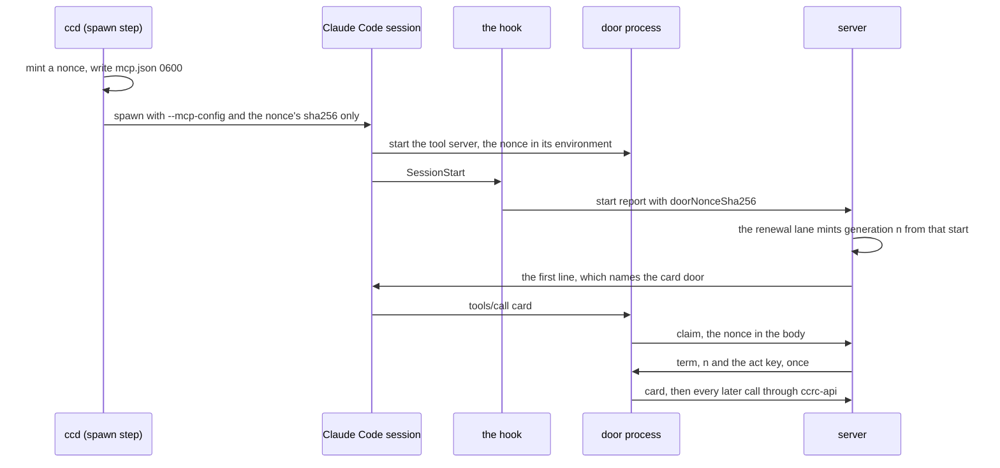
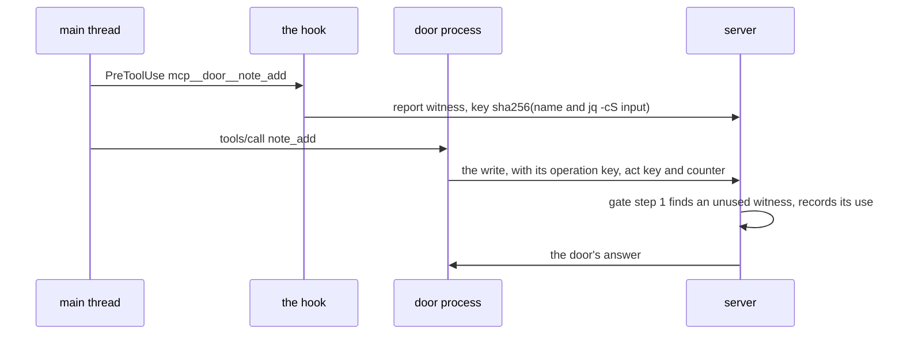

# Overlord W1: the door process and its readers Implementation Plan

> **For agentic workers:** REQUIRED SUB-SKILL: Use superpowers:subagent-driven-development (recommended) or
> superpowers:executing-plans to implement this plan task-by-task. Steps use checkbox (`- [ ]`) syntax for tracking.

**Goal:** the Overlord's doors reach it as typed tools served by one small process of its own, which holds the
credential and the fence, so the model never sees a key; and the hook reports what the session really did, so the
server can tell a witnessed write from a forged one.

- **PR A, the door process.**
  - ccd starts a door process with each generation. Its spawn step lives in a new library, `ccd/lib/door.sh`, and
    writes a one-time launch nonce into the door process's environment, never into the pane's command.
  - The server binds that nonce to the generation it mints, by the nonce's hash on the start report. It issues the act
    key once, to the first call that presents the nonce.
  - The door process is an MCP stdio server, `ccd/door-process.mjs`, with `ccrc-api` inside: every tool it serves is
    one `ccrc-api` verb, so the route table and the token handling stay in one client.
  - It keeps the per-prompt delta cache (C38), which the hook prints on every prompt with no network call.
- **PR B, the readers and the reports.**
  - The readers' one read tool.
  - The hook's reports through one report door: the witness, reader start and stop, the model switch, and "picked
    up".
  - The hook's guard arms: reader scope, reader model, and a typed `/model` refused.
  - What reads the reports: the witness step of the gate order, the third unwitnessed write's latch, the off-model
    condition, closed-book grading in the probes, and two readings the renewal readings piece wires (`modelDrift`,
    `readersRunning`).

**Why:** §3.6 H1 and §3.3.11 H12: the model must not hold the act key, and "today the client reads its uuid from the
registry file at the moment of the call (`ccd/ccrc-api`), so any process in the pane passes as current: a reader started
before a renewal, the old body after a rebind, a forked copy. The fence refuses all three." §7.4: "a write with no
witness has no turn behind it." §3.3.10 C55: readers keep the Overlord's context lean, and never act.

**Architecture:** two pull requests in lane B.

- **PR A (Tasks 1 to 5).**
  - `shared/continuity-door.ts` (L0): the fence's header names, the claim's wire, the delta cache's grammar and its
    starting values.
  - `server/src/continuity/actKey.ts` (C3, L1): `actKeyClaimVerdict`, pure.
  - `server/src/continuity/actKeyStore.ts` (C3, L3): `continuity_act_keys`, its one writer and its reads.
  - The claim door, `POST /api/sessions/:id/act-key`, in `server/src/continuity/routes.ts`.
  - `ccd/lib/door.sh`: the spawn step and its purge. `ccd/ccd` gains one-line calls.
  - `ccd/door-process.mjs`: the process, with its tool table.
  - `ccd/ccrc-api`: the fence's headers on curl's stdin, and two rows.
  - The hook: the start report carries the nonce's hash, and `UserPromptSubmit` prints the delta.
- **PR B (Tasks 6 to 8).**
  - `shared/continuity-reports.ts` (L0): the report kinds and their wire.
  - `server/src/continuity/hookReports.ts` (C3, L1): the deciders over reports.
  - `server/src/continuity/hookReportStore.ts` (C3, L3): `continuity_hook_reports` and `continuity_witness_checks`.
  - The report door, `POST /api/sessions/:id/report`, in the continuity routes file.
  - The hook's report arms and guard arms.
  - The witness input of gates B's decider, the ladder's two rows, closed-book in `probeDoor.ts`.

**Tech Stack:** bash (`ccd/ccd`, `ccd/lib/door.sh`, `ccd/session-hook.sh`, `ccd/ccrc-api`, `ccd/ccrc`), Node ESM with
no dependency (`ccd/door-process.mjs`), TypeScript (ESM), `node:sqlite`, Fastify, vitest. No new dependency.

**Spec:** `docs/superpowers/specs/2026-11-09-overlord-design.md`:

- §3.6 H1, the bullet "The door process (H9)" whole: one process per generation started by ccd from the launch
  profile; every door as a typed tool and one read tool to readers; it holds the credential, the identity and the
  fence; the launch nonce; `ccrc-api` inside it; the delta cache in a directory of the session's own. The fallback
  bullet, which is not built (question 1). W0a's "As measured" paragraph (W0-15 to W0-19).
- §3.6 H2, "No authority or switch in a file on a fleet host", and Table 3.6a's rows "the door process's delta cache",
  "the model-switch journal" and "the act key file, W0's fallback only".
- §3.3.3 C38, the bullet "A delta on every prompt", and W0a's measurement of a 600-character `UserPromptSubmit`
  context.
- §3.3.10 C55: what a reader is, "a reader never acts", "a second line" (the subagent-scope arm), and "Bounds" (three
  readers, `sonnet`, the hook arm that refuses a reader call naming another model).
- §3.3.11 H12, "The fence": the nonce, the key issued once, the counter, "a start the server did not receive is
  reported again", `stale-designation` and `stale-generation`, and why.
- §3.3.5 C41, "Closed-book": "the server records whether any read door was called between the probe and the answer".
- §3.4, Table 3.4b's row "The model changes inside a generation", W0-11 and W0-12's measurement, and §3.3.7's "a
  change of model inside a generation is model drift".
- §3.8: "Picked up: the prompt hook reported the id" and "Delivery is like mail".
- §7.4: "An unwitnessed write is refused and counted". §7.5, Table 7.5a's rows "the third unwitnessed write in a day"
  and "a generation off the designated model, its replay not passed".
- §11.2: the gate order's step 1 (`unwitnessed`) and "After the gates"; Table 11.2's row "The hook's reports".
- Table 11.1a, the row `continuity_generations` (the act key, bound at the mint); Table 11.1b, the row "The door
  process, with `ccrc-api` inside; the reader types it serves"; Table 11.1e, the row "The hook's reports".
- Table 11.6, the rows `unwitnessed` and `stale-generation`.
- Table 13.1, rows H9 and H12 (`shape`, W1): a shape call ships with the piece that creates its table or door. This
  piece creates the act-key table, the claim door, the report door and their tables, so H9's door process and H12's
  fence half ship here, and gates B ships H12's check.

The index is `docs/superpowers/plans/2026-11-14-overlord-w1.md`. This plan builds on its row "Door process and
readers" (lane B, two pull requests), its questions 13, 16, 20, 26, 30 and 36, "Where lanes meet" (the new ccd library
sites, `ccd/session-hook.sh`, `server/src/continuity/routes.ts`, the ladder's tables) and "What a merge arms". It takes
the coordinator's corrections in brief 20630 as binding over the index's text.

## Open questions

The index's questions come first, each with how this plan builds it. The others are ones the spec leaves open or the
tree contradicts. The plan builds every recommendation unless the coordinator or the operator rules otherwise.

1. **Question 13: how the door process carries `ccrc-api`, and who starts it** (slug
   `door-process-wraps-the-one-client`). **Built as recommended.**
   - An MCP stdio server that calls the existing `ccrc-api` verbs, one child process a call. No second client: the
     route table, the address, the box token and the closed-client rules stay in `ccd/ccrc-api`.
   - **ccd starts it, through the tool-server config.** Claude Code starts a stdio tool server itself, as a child of
     the session, from the `--mcp-config` file it is given. So "ccd starts it with each generation" means ccd writes a
     fresh config with a fresh nonce at every spawn (Task 3), and the session it starts runs the process. A process
     ccd forked beside the session could not be the session's tool server.
   - Its tool names are the door names the `ccrc-overlord` skill uses, with each space as `_` (the skill plan's slug
     `skill-names-doors-by-name`), each mapped to its `ccrc-api` verb. A test holds the tool table, `ccrc-api`'s
     `ROUTES` and the skill's door table together (Task 4).
   - The fallback (a shell that runs only `ccrc-api`, and the act key file) is not built.
2. **Question 30: is the door process a launcher on `PATH`?** **No, as recommended.** It is a Node program installed
   beside `compact-card.mjs`, at `~/.cc-sessions/door-process.mjs`, and started by `node` by its absolute path from the
   tool-server config. `_inst_bins` and `install-census.test.ts`'s launcher list do not change. The file lists that
   carry `compact-card.mjs` gain it: `ccd/ccrc`'s install (`_inst_atomic`), update backup (`_upd_backup_copy`) and
   uninstall lists, `deploy/deploy.sh`'s install and backup lines, and their pins (Task 4). It is pinned by digest at
   install, as the redactor is (slug `door-process-file-pinned-at-install`).
3. **Question 16: a late or lost witness refuses the write `unwitnessed`.** Settled; built in Task 8. An unreadable
   witness store is not a missing witness: it refuses 502 `unmeasured` and is not counted (Review Focus 3).
4. **Question 20: the ladder's two cause rows ship here** (the third unwitnessed write in a day, and off the
   designated model). Built in Task 8, after the ladder.
5. **Question 26: the nudge rides the mail lane**, and "picked up" stays the hook's report of the id that line names
   (the private store's ruling). This piece ships that report and its door (ruled, F9), and the pattern the hook
   matches is held equal to the private store's renderer by a test (Task 6).
6. **What is the witness's operation key?** (Slug `witness-key-is-the-call-digest`.) §7.4 says "the same call (session
   and operation key)" and names no key. **Recommendation:** the sha256 of the tool's full name, a newline, and the
   tool input printed by `jq -cS`. The hook computes it from the `PreToolUse` payload, and the door process computes it
   from the MCP call's name and arguments through the same `jq -cS`, so one canonical form serves both sides. A call
   repeated with the same input is the same key, and each witness is used once (Task 8). The alternative, the tool-use
   id Claude Code may pass in an MCP call's `_meta`, is unmeasured. Task 6's live step measures that the two digests
   agree on the pinned build. A mismatch reads as `unwitnessed`, which fails closed.
7. **What happens to a door process that dies inside a generation?** (Slug `lost-door-process-waits-for-a-renewal`.)
   Its key was in memory only, and the nonce is spent, so a restarted door process cannot claim again: its writes
   refuse `stale-generation`, and its reads, card, probe and note still answer. **Recommendation:** in W1 the second
   claim is recorded and shown on the board (a fact, `claimsRefused` on the act-key row), and the remedy is the
   operator's Renew now (W1a's hand-offs), which starts a fresh generation with a fresh door process. Making a refused
   second claim a hard renewal trigger is a row in Table 3.3.11b, so it goes to the spec-fixes run as a proposal, not
   into this build. A key file on disk would survive the crash, but it is a credential in a file a child of the same
   user can read, which is what §3.6 keeps for the fallback only.
8. **Does a `PreModelSwitch` hook refusal stop a typed `/model`?** W0-12 measured that the event fires with
   `from_model` and `to_model`, not that a refusal blocks it. **Recommendation:** ship the arm (Task 7) and report the
   switch either way. If Claude Code ignores the refusal, the switch is still journalled, model drift is a hard
   renewal trigger, and the next generation starts on the designated model. Task 7's live step records which.
9. **Which doors may a reader read?** §3.3.10 says readers have "one read tool from the door process" and names no
   list. **Recommendation:** the read tool serves the rows of the tool table marked `reader: true`, which in W1 are
   `board` and `history` (each once its piece has added its `ccrc-api` row). Never `messages` (the operator's words reach
   the main thread only, §3.8), and never `card`, `probe` or the notes (they are the generation's own memory, and
   closed-book grading counts them).
10. **The bound of three readers.** §3.3.10 says "at most three readers run at once" and names no enforcer.
    **Recommendation:** the reader-scope arm refuses a fourth `Agent` call while three readers stand in the hook's own
    roster (slug `reader-bound-in-the-scope-arm`). The roster is the subagent list the hook already keeps (D-5232),
    from which a `SubagentStop` removes the entry; the join file is not used for this, because a join is a fact, not
    liveness.
11. **Model-switch reports for which sessions?** **Recommendation:** for every session the start report covers (a
    non-child, non-fork session), so a coordinator's drift is measured the same way (R13). The refusal of a typed
    `/model` applies only to a session with a door (Task 7).
12. **Starting values** (Table 11.5b has none of them). **Recommendation:** in `shared/continuity-door.ts` and
    `shared/continuity-reports.ts`, each named once: the witness window 120 s, witness rows kept 24 h, witness checks
    kept 7 days, a reader start with no stop read as unmeasured after 30 min, the delta refreshed every 60 s with a
    180 s lease and at most 300 characters, and the report door's hook timeout 3 s. The spec-fixes run adds them to
    Table 11.5b.

## What exists today

Measured on `main` at `2b082b91f` (2026-11-15), and on the open branches named.

- **The launch profile's surface (sandbox A, #2847, open).** On its branch, `LaunchSurface` in `shared/fleetRoles.ts`
  declares `toolServer: 'door'` and one reader type, `overlord-reader`, whose only tool is `mcp__door__read` on model
  `sonnet`. The surface branch of `ccd/ccd#_profile_spawn_compose` adds `--setting-sources project --tools Agent,Skill
  --strict-mcp-config --agents <json>` and `CCRC_LAUNCH_PROFILE=<role>:<digest>` to the spawn's environment, and
  leaves the tool server's launch to this piece: "Its `--mcp-config` joins the surface branch of
  `_profile_spawn_compose` with one line" (`w1-sandbox.md`). The sandbox check requires `door` present, so sandbox B
  needs door process A.
- **The spawn.** `ccd/ccd#_profile_spawn_compose` runs once per spawn, before both spawn lines, and its
  `PROFILE_SPAWN_ENV` joins `$resenv`, which is written into the pane's `exec env … claude …` command. So anything in
  that environment is in the pane's command and in every process listing: the nonce must never go there.
- **The libraries.** `ccd/ccd#_ccd_lib_load` reads `ccd/lib/disk-retention.sh`, `train-proof.sh`,
  `delegation-lease.sh` and `pool-set.sh`, each checked against its `__CCD_LIB_*_SHA256` pin, before evaluating any.
  The ccd arms plan adds `ccd/lib/long-lived.sh` (#2854, open). The split pin's new-code arm
  (`server/test/ccdSplit.ts#pureMoveVerdict`, slug `new-code-library-is-not-a-move`) passes a new pointer whose region
  defines no function and assigns no variable the base program defines.
- **The growth check.** `server/test/growthCheck.ts`: `ccd/ccd`, `ccd/ccrc`, `ccd/session-hook.sh`,
  `server/src/coord/schema.ts`, `server/src/server.ts`, `shared/api.ts` and every `ccd/lib/*.sh` grow at most
  `GROWTH_LIMIT` (40) net lines a pull request, and `PROGRAM_ROW` (`ccd (program)`) sums `ccd/ccd` and every
  non-`ccrc-*` library at 40. `ccd/ccrc-api`, `ccd/install-session-hooks.sh`, `deploy/deploy.sh` and
  `server/src/continuity/*` are not listed.
- **Node programs beside ccd.** `ccd/compact-card.mjs` is installed to `~/.cc-sessions/compact-card.mjs` by
  `ccd/ccrc`'s `_inst_atomic`, backed up by `_upd_backup_copy`, removed by the uninstall list, and pushed by
  `deploy/deploy.sh`'s `install_atomic`. The hook resolves `node` from `PATH` (`command -v node`). The redactor's two
  `.mjs` files are pinned by digest in `ccd/ccd` (`__CCD_REDACT_SHA256`, `__CCD_REDACT_CLI_SHA256`), rendered by
  `ccd/ccd-entry-install.py`.
- **`ccrc-api`.** `ccd/ccrc-api#send_request` sends the box token on curl's stdin as a config line (`-K -`), never on
  its argv (R16). `ROUTES` holds eighty-three rows on `main`; `sessions.start`, `sessions.card` (with `--anchor`),
  `sessions.probe`, `probe.answer`, `note.*` and `timer.*` are the continuity rows. The client derives `fromId` and
  `fromUuid` from the pane.
- **The start report.** `ccd/session-hook.sh#_hook_start_report` sends every non-child, non-fork `SessionStart` to
  `POST /api/sessions/:id/start` through `ccrc-api sessions start`, spooled in `$REG/<id>.startpending`.
  `server/src/continuity/continuityStore.ts#insertStart` is its one writer, into `continuity_starts` (its migration in
  `server/src/coord/schema.ts`). The renewal lane mints a generation from a start row and keeps its `startId`.
- **The continuity doors.** `server/src/continuity/routes.ts#registerContinuityRoutes` registers the start report, the
  card, the notes, the handover, the timers and the probe doors: box-token lanes, each with an `EXEMPT` reason in
  `server/src/auth/gate.ts`, counted in `server/test/box-token-census.test.ts`'s `CONTINUITY_LANES` and in the
  machine-lane count word (eighty-four on `main`), which `auth/gate.ts`'s header comments and `README.md`'s auth
  paragraph repeat. `auth-gate.test.ts` lists each door.
- **The anchor.** `ccd/session-hook.sh#_hook_anchor_fetch` asks `ccrc-api card --anchor --form start|prompt|fork`
  under the hook's one network budget, and `_hook_anchor_owed` prints the prompt anchor on the first
  `UserPromptSubmit` after an automatic compaction. The one stdout payload of an event is one envelope (R7b).
- **The hook's subagent roster.** A `SubagentStart` records the agent id in the owner's join file `$REG/<id>.joined`
  (D-5232). A tool event with an `agent_id` counts as a subagent's only when a join for that id is recorded, never on a
  bare `agent_id` (the delegation broker's amendment `tool-agent-id-alone-is-unjoined-evidence`).
- **The hook's events.** `shared/hook-events.ts#HOOK_EVENT_MAP` lists twelve; no model-switch event. `ccd/install-session-hooks.sh`
  registers them for every account, and `install-session-hooks.test.ts` holds the map to the hook's arms both ways.
- **The no-model arm.** The D-6798 arm in `ccd/session-hook.sh` denies an `Agent` call that names no model. Sandbox A
  makes it read the pin from the environment (`CLAUDE_CODE_SUBAGENT_MODEL_FORCE=1` with
  `CLAUDE_CODE_SUBAGENT_MODEL`), so under the Overlord's profile a reader call passes it.
- **The model on the server.** `server/src/usage.ts` parses the status line sidecar's `model` and its `class`
  (`familyClassOf`). `continuity_starts` and `continuity_generations` keep the start's `model`.
  `server/src/continuity/generationsLane.ts#renewalInputsOf` answers `modelDrift: W1` (unmeasured, "W1").
- **Closed-book.** `server/src/continuity/probeDoor.ts#bookOf` answers `open` after a card or notes read and
  `unmeasured` otherwise, and `BOOK_STATES_RECORDED` leaves out `closed`, which "needs W1's witness" (`shared/continuity.ts`,
  slug `closed-book-is-unmeasured-in-w1a`).
- **The refusal words.** `shared/refusal.ts#OVERLORD_REFUSALS` holds `unwitnessed` (409, "gates B, door process B"),
  `stale-generation` (409), `renewing`'s W1a row and `not-the-overlord`. This piece needs no new word.
- **The deny list.** `shared/api.ts#ACCOUNT_SECRET_PATHS` becomes `Read(…)` rules in `ACCOUNT_DENY_RULES`, which every
  session is spawned with, children included. `ccd/install-session-hooks.sh` holds a bash copy, held equal by
  `server/test/account-deny.test.ts`, and the hook's account arm (the jq definitions `ASEC` and `APSEC`) refuses the
  path-qualified, quoted and `$VAR` forms (`session-hook-account-deny.test.ts`).
- **Time and chance.** `server/src/time/ports.ts#Entropy` (`hex(bytes)`, "for secrets and ids") and `Clock`. Every file
  under `server/src/continuity/` and every `shared/continuity*.ts` is in `time-ports.test.ts`'s families already.
- **The first line of a fresh conversation.** On the renewal act's branch (#2852, open), `renewalActs.ts`'s
  `first-prompt` case calls `deps.host.deliver(sessionId, 'renewal-first-prompt')`, an `INJECTED_PROMPTS` row whose
  text names `ccrc-api card` and `ccrc-api probe`. Its departure `first-prompt-by-deliver` says: "for the Overlord (W1)
  this line is the door process's first call instead." The designation plan (#2856, open) owns a new body's first
  prompt (its X4), as `OVERLORD_FIRST_PROMPT`, and says "Door process A re-points it to the door's first call in its own
  pull request; the sending stays here."
- **Not on `main`:** sandbox A, the designation, the ladder, gates A and B, the private store, the renewal act, the
  board and history B, and the inbox. Each interface this plan reads from them is taken from its plan or the spec, and
  says so.

## Global Constraints

- **Architecture (`CLAUDE.md`).**
  - `shared/continuity-door.ts` and `shared/continuity-reports.ts` are L0: they import nothing. Each literal union
    carries its `Record<X, true>` map (`rings/wire-totality.test.ts`).
  - `actKey.ts` and `hookReports.ts` are L1: pure, no `fs`, no store, no clock. `now` is an argument.
  - `actKeyStore.ts` and `hookReportStore.ts` are L3: SQL only, synchronous over `coord.db`'s handle, each keeping
    every distinction it reads. No repository and no async wrapper over `CoordStore`.
  - The doors are L4 in the continuity routes file and decide nothing: the claim's answer is `actKeyClaimVerdict`'s,
    a report's validity `hookReportOf`'s.
  - The pick-up crosses from C3 to C11. C3 declares the port it consumes, `MessagePickUp`, in
    `server/src/continuity/routes.ts`'s deps (the consumer's file), and the composition root passes the private store's
    `moveMessage` and `messageSessionOf` behind it. No C3 file imports the private store.
  - The door process is a ccd-side component: it names no tmux, no systemd and nothing of Claude Code's on-disk layout,
    and it reaches the server only through `ccrc-api`.
- **One writer each.**
  - `continuity_act_keys`: `actKeyStore.ts#issueActKey` (the claim door) for a row, `noteRefusedClaim` (the claim
    door) for `claimsRefused`, and gates B's fence step for the counter (`advanceActCounter`, shipped here, called only
    there). Three facts, three writers, one row.
  - `continuity_starts.doorNonceSha256`: `insertStart`, as every column of that row.
  - `continuity_hook_reports`: `hookReportStore.ts#insertHookReport` (the report door), which also prunes its own
    expired witness rows.
  - `continuity_witness_checks`: `hookReportStore.ts#recordWitnessCheck` (the witness step).
  - The delta cache file: the door process. `$REG/.door/<id>/mcp.json`: `ccd/lib/door.sh#_door_spawn`, removed by
    `_door_purge` from `_reg_purge`.
  - "Picked up" on `operator_messages`: the private store's `moveMessage(id, 'pick-up', 'hook')`, called only by the
    report door.
  - A census in `single-definition/writers-map.test.ts` pins each table's writers (Tasks 1 and 6).
- **The act key and the nonce are secrets.**
  - Never printed, never in a log line, never in a transcript or a tool result, never in the pane or its command, never
    on any argv.
  - The nonce lives in `$REG/.door/<id>/mcp.json` (0600, its directory 0700), in the door process's memory and its
    initial environment, and once in the claim's request body. Only its sha256 rides the spawn's environment and the
    start report.
  - The key is minted by the server's `Entropy`, stored only as its sha256, answered once, held in the door process's
    memory, and handed to each `ccrc-api` child in that child's environment, which `ccrc-api` puts on curl's stdin.
  - No child can read either through a tool: `~/.cc-sessions/.door/**` joins `ACCOUNT_SECRET_PATHS`, so every session
    is spawned with `Read(~/.cc-sessions/.door/**)` denied and the hook's account arm refuses the shell forms (Task 3).
  - **Where sessions share a UNIX user this is an accident guard, not a wall** (§3.3.11): any process of that user can
    read `/proc/<pid>/environ` and the 0600 file. In a container it is a credential. The plan says so in each place.
  - Rotation is per generation. Every start (a renewal, a crash restart, a swap landing, a wake) spawns a fresh door
    process with a fresh nonce. A key is valid only while its generation is the identity's live one, so the next mint
    voids it with no write. A nonce hash binds at most one generation (a unique column), so a typed `/clear`, which
    starts a conversation without a spawn, finds its nonce spent.
- **ccd.**
  - **Zero new ccd verbs.** The spawn step is an internal function of the spawn path. Its SAFETY status: no verb, so
    nothing to forbid; it writes one per-session directory under the registry and removes only that directory's two
    named files. It stops nothing and deletes nothing else. Every test runs in a fixture HOME (`makeCcdHarness`).
  - Only new helpers go in `ccd/lib/door.sh`; no existing function moves. Callers pass validated session ids: the
    spawn has validated `$id` before `_profile_spawn_compose` runs, and `_reg_purge` takes ids only from its callers.
  - Every new function that parses carries `local LC_ALL=C IFS=' '`. Constants are plain assignments (the loader
    evaluates a library inside a function). A read of a file a session could replace with a FIFO is bounded
    (`_plat_timeout`).
  - `ccd/ccd` and `ccd (program)` each stay within 40 net lines in each pull request.
- **The hook** fails open, as its header says, for reports: a report it cannot send is lost, never retried in a loop,
  and never delays a tool call past the report door's timeout. Its guard arms fail closed only where the spec asks: a
  door write tool in a recorded reader's scope, a fourth reader, a reader call naming another model, a typed `/model`
  in a session with a door.
- **Wire discipline.** Every new field is additive. The start report's `doorNonceSha256` is absent from an older hook,
  and the server reads absence as "this start bound no nonce", which a claim reads as `stale-generation`, never as a
  match. `FLEET_PROTO` does not move.
- **Censuses move with each door.** The claim door (PR A) and the report door (PR B) each touch: `auth/gate.ts`'s
  `EXEMPT` (one reason each), `server/test/auth-gate.test.ts` (its door lists and count comment),
  `server/test/box-token-census.test.ts` (`CONTINUITY_LANES`, the number-word list, and the count), the machine-lane
  count word in `auth/gate.ts`'s two header comments and `README.md`'s auth paragraph, `server/test/rings/fastify-l4.data.ts`
  if it lists the continuity routes, and `ccd/ccrc-api`'s `ROUTES` with its count word, `server/test/ccrc-api.test.ts`'s
  length and `WORDS`. Neither is a GET, so `MASKED_GET_ROUTES` does not change. Neither is a coordination write, so
  `CLAUDE.md`'s box-token paragraph does not change (the census reads it against `SESSION_ONLY`, which these doors are
  not in).
- **Migrations.** One a pull request. Each edits `server/test/run-close-switch.test.ts` (its undo step and count) and
  `server/test/coord-db.test.ts` (the version), and takes its number at build time, re-measured before merge.
- **Mutation floors.** Every new L1 decider joins `MUTANT_SETS` (`server/test/sim/mutation-floors.test.ts`) and
  `server/test/sim/mutation-floors.json` in the pull request that creates it, with the floor the builder measures
  (`../ccrc-coordinator/references/mutation-run.py`).
- **Public repository.** Fixtures use `lane-a`, `project-a` and `<projects-root>`. No host, account or path of a real
  deployment.

## Review Focus

1. **The model never holds a key.** Trace the nonce from ccd to the claim, and the key from the server to curl's stdin.
   No argv, no log, no tool result, no pane text, no file but the 0600 config (nonce) carries either, and the deny path
   covers that file for every session. A fixture run of the door process greps its whole stdout for the key.
2. **One nonce, one generation, one key.** A spent nonce, a nonce bound to an earlier generation, a start with no
   nonce, and a generation not yet minted each answer their own word (`stale-generation` with a reason, or
   `renewing`), and none issues a key. The key's validity is derived from the generation's state, so no void write is
   needed and none can be missed.
3. **Unmeasured is never a value.** An unreadable witness store refuses 502 `unmeasured` and counts toward no latch. A
   reader with a lost stop reads `readersRunning` unmeasured, never zero. A model with no reading is unmeasured drift,
   never "no drift". A delta cache past its lease prints "unknown", never the stale counts.
4. **The hook stays fast and fails open where it reports.** Every report has the report door's 3 s bound inside the
   hook's one network budget, and a report that cannot be sent costs nothing but its own row.
5. **The arms key on facts, never on a role's name.** "Has a door" is the spawn's `CCRC_DOOR_NONCE_SHA256` in the
   environment; "a reader's scope" is a recorded join; "another model" is the pin the launch put in the environment.



*Figure 1. One generation's launch: the nonce never leaves ccd's file and the door process except in the claim, and the
key never leaves the server and the door process except toward curl.*



*Figure 2. A witnessed write. Without the hook's report, or with a report older than the window, the write refuses
`unwitnessed` and counts toward the day's latch.*

## The PR split

| PR | Tasks | What it ships | Needs first | Growth-checked files, estimate (net lines) |
|---|---|---|---|---|
| A | 1 to 5 | The fence's wire; `actKeyClaimVerdict`; `continuity_act_keys` and the start's `doorNonceSha256`; the claim door; `ccd/lib/door.sh` and its one-line calls; the deny path; `ccd/door-process.mjs` with its tool table and installs; the fence headers in `ccrc-api`; the Overlord's first line; the delta cache, the card door's `delta` form and the hook's print | sandbox A (the surface branch and the names `door` and `mcp__door__read`), designation A (`identityOf`, the term, `OVERLORD_FIRST_PROMPT`), W1a's renewal act (the mint path and `renewal-first-prompt`) | `ccd/ccd` +6; `ccd/lib/door.sh` +30, new; `ccd (program)` +36; `ccd/session-hook.sh` +12; `ccd/ccrc` +5; `server/src/coord/schema.ts` +18 (one migration); `server/src/server.ts` +2; `shared/api.ts` +0 (one path in place) |
| B | 6 to 8 | The report kinds; `continuity_hook_reports` and `continuity_witness_checks`; the report door; the hook's witness, reader, model-switch and pick-up reports; the reader-scope, reader-model and typed-`/model` arms; the witness step in gates B's decider; the unwitnessed latch and the off-model condition on the ladder; closed-book; `modelDriftOf` and `readersRunning` | PR A, the ladder, gates B (the decider the witness joins), private store B (the nudge's line and `moveMessage`) | `ccd/session-hook.sh` +34; `server/src/coord/schema.ts` +22 (one migration); `server/src/server.ts` +3; `shared/api.ts` 0 |

**If a measured file passes 40.** `ccd/session-hook.sh` in PR B is the tightest. If the builder measures it over 40,
Task 7 (the guard arms) moves to a PR B2 of its own, after Task 6, in a commit of its own, with no waiver. The
`ccd (program)` row in PR A counts `ccd/ccd` and the new library together: if it measures over 40, the purge helper
stays in `ccd/ccd`'s `_reg_purge` as two literal-path lines and the library keeps only the spawn step.

For scale, the files that are not growth-checked change by about this much:

| File | PR A | PR B |
|---|---|---|
| `ccd/door-process.mjs` | +260, new | +25 (the read tool) |
| `shared/continuity-door.ts` | +70, new | |
| `shared/continuity-reports.ts` | | +80, new |
| `server/src/continuity/actKey.ts` | +60, new | |
| `server/src/continuity/actKeyStore.ts` | +80, new | |
| `server/src/continuity/hookReports.ts` | | +170, new |
| `server/src/continuity/hookReportStore.ts` | | +120, new |
| `server/src/continuity/routes.ts` | +55 | +70 |
| `server/src/continuity/anchor.ts` | +25 | |
| `server/src/continuity/probeDoor.ts` | | +15 |
| `ccd/ccrc-api` | +20 | +3 |
| `ccd/install-session-hooks.sh` | +1 | +2 |
| `deploy/deploy.sh` | +3 | |
| `shared/hook-events.ts` | | +2 |

Each pull request merges `main` once before merge and re-measures its migration slot and its census counts (the
index's "Where lanes meet"). Sandbox A also adds a continuity lane (`POST /api/sessions/:id/start/loads`), so the
second of the two to land re-counts the machine lanes.

---

### Task 1: The fence's wire, the claim's decider and the act-key table (L0, L1, L3)

**Files:**

- Create: `shared/continuity-door.ts` (L0): `ACT_KEY_HEADER` (`x-ccrc-act-key`), `ACT_COUNTER_HEADER`,
  `ACT_TERM_HEADER`, `ACT_GENERATION_HEADER`; `NONCE_SHA256_SHAPE` and `ACT_KEY_SHAPE` (64 lowercase hex); the claim's
  wire `ActKeyClaimAnswer` (`{ ok: true; term: number; generation: number; key: string }`); `CLAIM_WHY_MAP` (below);
  the delta's constants (Task 5).
- Create: `server/src/continuity/actKey.ts` (C3, L1): `actKeyClaimVerdict`.
- Create: `server/src/continuity/actKeyStore.ts` (C3, L3): `issueActKey`, `noteRefusedClaim`, `advanceActCounter`,
  `actKeyOf`, `actKeyByNonce`.
- Modify: `server/src/coord/schema.ts` (one migration: `continuity_act_keys`, and `continuity_starts.doorNonceSha256`).
- Modify: `server/src/continuity/continuityStore.ts#insertStart` (the new column, from `StartInsert`).
- Test: `server/test/continuity-act-key.test.ts` (new), `server/test/continuity-act-key-store.test.ts` (new),
  `server/test/coord-db.test.ts`, `server/test/run-close-switch.test.ts`,
  `server/test/single-definition/writers-map.test.ts`, `server/test/sim/mutation-floors.{test.ts,json}`.

**The table.**

```sql
CREATE TABLE continuity_act_keys (
  generationId INTEGER PRIMARY KEY,          -- continuity_generations.id: one key per generation, ever
  nonceSha256 TEXT NOT NULL UNIQUE,          -- the launch nonce binds at most one generation
  keySha256 TEXT NOT NULL,                   -- the key itself is never stored
  issuedAt INTEGER NOT NULL,
  counter INTEGER NOT NULL DEFAULT 0,        -- gates B's fence step is its one writer
  claimsRefused INTEGER NOT NULL DEFAULT 0,  -- a spent nonce presented again
  lastRefusedAt INTEGER
);
ALTER TABLE continuity_starts ADD COLUMN doorNonceSha256 TEXT;
```

**The decider.** Its inputs are facts the door read, each a `Read` that keeps "unmeasured" apart:

```ts
type ClaimFacts = {
  /** The identity's live generation (designation A's `identityOf`), with its start row's nonce hash. */
  live: Read<{ generationId: number; n: number; term: number; startNonceSha256: string | null } | 'none'>;
  /** sha256 of the presented nonce, hashed by the door (L4); never the nonce itself. */
  presented: string;
  /** The act-key row already holding this nonce hash, in any generation (`actKeyByNonce`). */
  spent: Read<{ generationId: number } | 'none'>;
};
type ClaimVerdict =
  | { kind: 'issue'; generationId: number; n: number; term: number }
  | { kind: 'refuse'; error: 'renewing' | 'stale-generation' | 'unmeasured'; why: ClaimWhy };
```

First match wins:

1. a read that is unmeasured answers `unmeasured` (502, `store-unreadable`);
2. a nonce already spent answers `stale-generation` (`nonce-spent`), and the door calls `noteRefusedClaim` on that row;
3. no live generation answers `renewing` (`not-minted`: the start has not landed, so the door process retries at its
   next call);
4. a live generation whose start bound no nonce answers `stale-generation` (`no-nonce-bound`: an older hook, a start
   nobody spawned, or a typed `/clear`);
5. a hash that differs answers `stale-generation` (`nonce-mismatch`);
6. otherwise `issue`.

`ClaimWhy` is `CLAIM_WHY_MAP`'s keys, said in the refusal's detail and never as a refusal word of its own.

- [ ] **Step 1: Failing tests.**
  - `continuity-act-key.test.ts`: one case per arm in the order above, and the order itself (a spent nonce on a
    generation with no binding answers `nonce-spent`, not `no-nonce-bound`; an unmeasured `spent` beside a mismatch
    answers `unmeasured`); `issue` carries the live row's `n` and `term`; a `null` start hash never matches any
    presented hash, the empty string included.
  - `continuity-act-key-store.test.ts`, on a fixture `coord.db`: `issueActKey` inserts once and answers
    `{ok:false, error:'refused'}` on a second insert for the same generation or the same nonce hash (the unique
    constraint, never a throw); the stored row holds `keySha256` and never the key (`SELECT *` over the whole table
    holds no value equal to the key); `advanceActCounter(g, c)` changes only when `c` is above the stored counter, and
    answers `{changed:false}` otherwise; `noteRefusedClaim` raises `claimsRefused` and stamps the time; every read
    answers `unmeasured` with its detail when the table is missing, never `'none'`.
  - `coord-db.test.ts` names the new version; `run-close-switch.test.ts` drops the migration (its undo step) and its
    count moves by one; `writers-map.test.ts`'s `TABLES` gains `continuity_act_keys: [issueActKey, noteRefusedClaim,
    advanceActCounter]`, and the census reds on a fourth writer.
- [ ] **Step 2: Run them, red.** From `server/`: `ccrc test -- ./node_modules/.bin/vitest run
  test/continuity-act-key.test.ts test/continuity-act-key-store.test.ts test/coord-db.test.ts
  test/run-close-switch.test.ts test/single-definition/writers-map.test.ts`.
- [ ] **Step 3: Implement** the L0 file, the decider, the store and the migration (its number taken at build time).
- [ ] **Step 4: Green, then the mutants.** `actKeyClaimVerdict` joins `MUTANT_SETS` with: each arm deleted, the order
  of `nonce-spent` and `not-minted` swapped, the hash compare negated, `null` read as a match. Its floor is what the
  builder measures, recorded in `mutation-floors.json`.
- [ ] **Step 5: Commit** `feat(continuity): the act-key table and the claim's decider (Overlord W1 door process A)`.

### Task 2: The claim door, the start report's nonce hash, and `ccrc-api`'s claim row

**Files:**

- Modify: `server/src/continuity/routes.ts#registerContinuityRoutes`: `POST /api/sessions/:id/act-key`; the start
  report's body reads `doorNonceSha256`. `ContinuityRouteDeps` gains `entropy: Entropy` and designation A's
  `identityOf`, used at every live-generation lookup.
- Modify: `server/src/server.ts` (the composition passes `entropy`, about +2).
- Modify: `ccd/session-hook.sh#_hook_start_report` (one field, +1).
- Modify: `ccd/ccrc-api` (`ROUTES` gains `sessions.act-key`, and its count word).
- Modify: `server/src/auth/gate.ts` (`EXEMPT`, one reason; the machine-lane count word in its two header comments) and
  `README.md` (the auth paragraph's count word, and the door in the exempt-but-authenticated class).
- Test: `server/test/continuity-act-key-route.test.ts` (new), the start report's route suite,
  `server/test/box-token-census.test.ts`, `server/test/auth-gate.test.ts`, `server/test/ccrc-api.test.ts`, and the
  hook's start report suite.

**The door.** In order:

1. the box token (`checkMailToken`, 401);
2. the path id and the body's shape: `fromUuid`, and `nonce` matching 64 lowercase hex (400 `bad-request`, with no
   echo of the value);
3. the registry's attribution of `fromUuid` (`deps.attribute`: 403 `stale-uuid` and its kin);
4. the facts, each read once: the live generation through `identityOf`, its start row's hash, and the act-key row by
   the presented nonce's hash;
5. `actKeyClaimVerdict`.

On `issue` the door mints `entropy.hex(32)`, hashes it, calls `issueActKey`, and only on `{ok:true}` answers
`200 { ok: true, term, generation, key }`. A refused insert (two claims racing) answers `stale-generation`
(`nonce-spent`), never a key. A refusal answers 409 `stale-generation` or `renewing`, or 502 `unmeasured`, with its
`why` in `detail`. No line the door logs names the nonce or the key: its `console.warn('ccrc-server: …')` names the
session, the generation and the `why` only.

**The start report.** The hook reads `CCRC_DOOR_NONCE_SHA256` from its own environment (the spawn put it there, Task 3)
and adds `doorNonceSha256` to the body only when it is 64 lowercase hex. The route checks the same shape, stores
`null` for an absent field, and refuses a malformed one as it refuses today's malformed fields. An older hook sends no
field, so its start binds nothing.

- [ ] **Step 1: Failing tests.**
  - The route suite, on a fixture store and a fake `Entropy`:
    - each refusal in order (token, shape, attribution, then each verdict arm);
    - a good claim answers the key once, and a second claim with the same nonce answers 409 `stale-generation` with
      `nonce-spent` and raises `claimsRefused`;
    - the stored row holds the key's hash, and the answer body is the only place the key appears (the fake logger's
      lines and every row of every table hold no copy);
    - a claim before the mint answers `renewing`; a generation whose start carried no hash answers `stale-generation`
      (`no-nonce-bound`);
    - a typed `/clear` (a second start row under the same hash, minted as generation n+1) answers `nonce-spent` for
      n+1.
  - The start report's suite: a body with the field stores it; without it stores `null`; a malformed one is refused.
  - The hook's suite (fixture HOME): with `CCRC_DOOR_NONCE_SHA256` a good hash, the spooled body carries it; with a bad
    one, or none, the body has no such field.
  - `box-token-census.test.ts`: `CONTINUITY_LANES` gains `POST /api/sessions/:id/act-key`, the number words gain the
    next one, and the count moves by one. `auth-gate.test.ts`'s lists and count comment name the door.
    `ccrc-api.test.ts`'s length and `WORDS` move by one.
- [ ] **Step 2: Red.** Run the five suites through `ccrc test`.
- [ ] **Step 3: Implement** the door, the field, the `EXEMPT` row (reason: "the door process's one claim: box token,
  attribution and a launch nonce the server bound at the mint; it issues the act key once"), the `ROUTES` row
  `[sessions.act-key]='POST|/api/sessions/{id}/act-key|yes|-'` with a comment saying its body carries a secret and rides
  `--json -` only, and the count words.
- [ ] **Step 4: Green, then mutate by hand:** delete the attribution call (the `stale-uuid` case reds); answer the key
  on a refused insert (the race case reds); log the nonce (the logger scan reds). Revert each.
- [ ] **Step 5: Commit** `feat(continuity): the act-key claim door and the start's nonce hash (Overlord W1 door process A)`.

### Task 3: ccd's spawn step, `ccd/lib/door.sh`, and the deny path

**Files:**

- Create: `ccd/lib/door.sh`: `_door_spawn`, `_door_prog_ok`, `_door_purge`, and the constant `DOOR_REG_DIR=.door`, in
  new-code regions under the split pin's new-code arm (`new-code-library-is-not-a-move`, with its variable arm: the
  library assigns no top-level variable that `ccd/ccd` assigns).
- Modify: `ccd/ccd`:
  - `_ccd_lib_load`: `door.sh` and its pin join the two arrays (in place), and its header comment names it;
  - `__CCD_LIB_DOOR_SHA256=stamp-at-install` with its shellcheck line, and `__CCD_DOOR_SHA256=stamp-at-install` (the
    door program's own pin, Task 4) with its shellcheck line;
  - the surface branch of `_profile_spawn_compose`: one line, `_door_spawn "$id" || { _profile_refused "$id" "door
    process: $DOOR_SPAWN_WHY"; return 1; }`, after the surface flags are added;
  - `_reg_purge`: one line, `_door_purge "$id"`, and its inventory comment names `$REG/.door/<id>/`.
- Modify: the new-library sites the index lists: `ccd/ccd-entry-install.py` (two pins) and `ccd/ccd-entry.py`'s
  header; `ccd/ccrc`'s update backup names (`_upd_backup_copy`) and its uninstall list; `deploy/deploy.sh`;
  `server/test/ccdWsHelpers.ts` (`CCD_LIBS`), `consolidationCensus.ts` (`CCD_LIB_FILES`), `installTreeFixture.ts`,
  `ownership.test.ts`, `session-hook.test.ts`'s `SCANNED`, `single-definition/writers-map.test.ts` and
  `tmux-socket-census.test.ts`; `ccd/contexts.tsv` (three rows, the session host's context) and
  `ccd/contexts-edges.tsv` only if a row crosses a context. The ccd arms' `ccd/lib/long-lived.sh` lands first (Figure
  W1), so this library adds its name beside that one after merging `main`.
- Modify: `shared/api.ts#ACCOUNT_SECRET_PATHS` and `ACCOUNT_WRITE_DIRS` (each gains `~/.cc-sessions/.door/**`, in
  place); `ccd/install-session-hooks.sh`'s bash copy; the hook's account arm (`ASEC`, `APSEC`).
- Test: `server/test/ccd-door-spawn.test.ts` (new, `makeCcdHarness`); the new-library suites (`ccd-lib-load`,
  `ccd-entry-install`, `ccd-install-stamp`, `build-release`, `ccrc-uninstall`, `ccrc-update-flip-backups`,
  `ccd-ws-add-child`, `ccd-split-pin`, and the agent's `ccd-entry-exec` and `deploy-verify`);
  `server/test/account-deny.test.ts`; `server/test/session-hook-account-deny.test.ts`.

**`_door_spawn <id>`** (its caller validated `<id>`):

1. Finds the program: beside this script in a tree, else `~/.cc-sessions/door-process.mjs` (the `carry-dedupe.py`
   precedent). It refuses a symlink or a missing file. In the installed layout it checks the file's sha256 against
   `__CCD_DOOR_SHA256`, with the hash command the loader chose (`__CCD_HASH_CMD`). A source checkout skips the check,
   as the redactor's reader does.
2. Resolves `node` to an absolute path (`command -v node`), or refuses.
3. Mints the nonce: 32 bytes of `/dev/urandom` as hex, checked against the 64-hex shape.
4. Makes `$REG/.door/<id>/` at 0700, and writes `mcp.json` at 0600 through a temp file and `mv` (umask 077 in a
   subshell). jq reads the nonce from its own environment (its `$ENV`), never from its argv. The file is
   `{"mcpServers":{"door":{"type":"stdio","command":<node>,"args":[<program>],"env":{"CCRC_DOOR_NONCE":<nonce>,
   "CCRC_SESSION_ID":<id>,"CCRC_DOOR_DIR":<dir>,"CCRC_API":<the installed ccrc-api>}}}}`.
5. Appends `--mcp-config '<dir>/mcp.json'` to `PROFILE_SPAWN_FLAGS`, and `CCRC_DOOR_NONCE_SHA256=<sha256>` to
   `PROFILE_SPAWN_ENV`. Nothing else reaches the pane's command.

Any failure sets `DOOR_SPAWN_WHY` to a fixed phrase (never a value) and returns 1, and the compose refuses the spawn
through `_profile_refused`, so an Overlord never starts without its doors. A spawn with no surface never calls it.

**`_door_purge <id>`** removes `mcp.json`, `mcp.json.tmp` and `delta` by their literal names inside
`$REG/.door/<id>/`, then the directory if it is empty. Each path is built from `$REG`, the literal `.door` and the
validated id, and nothing else.

- [ ] **Step 1: Failing tests** (`ccd-door-spawn.test.ts`, a fixture HOME, a stub `node` and a fixture program):
  - a surfaced spawn writes `mcp.json` at mode 0600 in a 0700 directory, whose door entry's `CCRC_DOOR_NONCE` is 64
    hex and hashes to the `CCRC_DOOR_NONCE_SHA256` the spawn's environment carries;
  - the pane's command (the harness's recorded tmux argv) holds the hash and the config's path, and never the nonce;
    jq's argv, recorded by a stub wrapper, never holds it;
  - two spawns write two different nonces;
  - a program whose digest differs from the pin, a missing program, a symlinked program and no `node` each refuse the
    spawn with their phrase in `swap.log`, start no pane, and leave no `mcp.json`;
  - a spawn with no surface writes nothing under `$REG/.door/`;
  - `_reg_purge` removes the directory, and a file planted outside `.door/<id>/` survives;
  - the new-library suites: the loader reads and pins `door.sh`; a tampered `door.sh` refuses the load; the split
    pin's new-code arm passes the library, and reds a variant that assigns a top-level variable `ccd/ccd` assigns;
  - `account-deny.test.ts`: `ACCOUNT_DENY_RULES` holds `Read(~/.cc-sessions/.door/**)`, and the bash copy agrees;
    `session-hook-account-deny.test.ts`: a `cat` of a file under that directory is refused in its quoted, `$HOME` and
    path-qualified forms, and `must-allow.json` still passes.
- [ ] **Step 2: Red** through `ccrc test`, each suite named.
- [ ] **Step 3: Implement.** `local LC_ALL=C IFS=' '` in `_door_spawn` and `_door_prog_ok`; constants as plain
  assignments.
- [ ] **Step 4: Green, and measure growth** with `growthCheck`'s own measure (`ccd/ccd` about +6, `ccd/lib/door.sh`
  about +30, `ccd (program)` about +36, `ccd/ccrc` about +2 here), shellcheck clean (the ratchet). By hand: pass the
  nonce with `--arg` (the jq argv case reds); write `mcp.json` without the umask (the mode case reds). Revert each.
- [ ] **Step 5: Commit** `feat(ccd): the door process's spawn step and its deny path (Overlord W1 door process A)`.

### Task 4: The door process, its tool table, the fence on `ccrc-api`, and the Overlord's first line

**Files:**

- Create: `ccd/door-process.mjs`: an MCP stdio server with no dependency: newline-delimited JSON-RPC 2.0, answering
  `initialize`, `notifications/initialized`, `tools/list` and `tools/call`, and an error for anything else.
- Modify: `ccd/ccrc-api#send_request`: when `CCRC_ACT_KEY` is 64 hex, curl's stdin config gains four header lines
  (`ACT_KEY_HEADER`, `ACT_COUNTER_HEADER`, `ACT_TERM_HEADER`, `ACT_GENERATION_HEADER`), each value checked against its
  shape first. Nothing else changes.
- Modify: `ccd/ccrc` (`_inst_atomic` for `door-process.mjs` at 644, `_upd_backup_copy`, the uninstall list),
  `deploy/deploy.sh` (its `install_atomic` and backup lines, beside `compact-card.mjs`'s), and
  `ccd/ccd-entry-install.py` (the `__CCD_DOOR_SHA256` render).
- Modify: `shared/injected-prompts.mjs`: the row designation A adds for `OVERLORD_FIRST_PROMPT` (as
  `overlord-first-prompt`) now names the door tools: `Read your card with your card door, then answer your probes with
  your probe door.` One row serves designation's new body and the renewal's fresh generation.
- Modify: the renewal act's first-prompt case (`server/src/continuity/renewalActs.ts`): the key it delivers comes from
  one L1 table, `FIRST_PROMPT_OF_ROLE`, in `server/src/continuity/renewalFeed.ts` (`overlord` to
  `overlord-first-prompt`, every other long-lived role to `renewal-first-prompt`).
- Test: `server/test/door-process.test.ts` (new), `server/test/door-tools.test.ts` (new),
  `server/test/ccrc-api-act-key.test.ts` (new), `server/test/ccrc-api-closed.test.ts`, `server/test/ccrc-uninstall.test.ts`,
  `server/test/installTreeFixture.ts`, `server/test/ccrc-versioned-audit.test.ts`, the agent's `deploy-verify`,
  `server/test/continuity-renewal-acts.test.ts`, and the injected-prompts census.

**The tool table** is one exported array in `ccd/door-process.mjs`, `DOOR_TOOLS`. Each row is `{ name, verb, class:
'view' | 'operate', reader, input }`: `verb` is a key of `ccrc-api`'s `ROUTES`, and `input` is the JSON schema the
model sees.

- PR A's rows are the verbs on `main`: `card`, `probe`, `probe_answer`, `note_add`, `note_close`, `note_list`,
  `note_handover`, `timer_set`, `timer_list` and `timer_cancel`.
- Each later piece adds the row of the door it ships, in its own pull request, beside its `ccrc-api` row: `inbox`,
  `messages` and `acknowledge` (the inbox), `board` and `history` (board and history B).
- No schema names `fromId`, `fromUuid`, `byId` or `byUuid`. The door process fills attribution from `ccrc-api whoami`
  at each call, and refuses an input that names one.

**A call.**

1. **The claim, once.** At start, before anything else, the process copies the nonce into memory and deletes
   `CCRC_DOOR_NONCE` from its own environment, so no child inherits it. While it holds no key, it claims before serving
   any call: `ccrc-api sessions act-key <id> --json -`, the body `{ fromUuid, nonce }` on stdin, `<id>` its own session
   id, which must equal `ccrc-api whoami`'s or the process refuses every call.
   - `ok`: it keeps `term`, `generation` and `key` in memory, and drops the nonce.
   - `renewing`: it serves the call with no key, and claims again at the next call.
   - Any other refusal: it drops the nonce, serves reads, and answers every `operate` call with the claim's refusal.
2. **The call.** `execFile(CCRC_API, [...verbArgs, '--json', '-'], …)` with the body on stdin and a 35 s timeout. For
   an `operate` row the child's environment adds `CCRC_ACT_KEY`, `CCRC_ACT_TERM`, `CCRC_ACT_GENERATION` and
   `CCRC_ACT_COUNTER`; the counter rises by one before each send and is never reused, even after a send that got no
   answer. A `view` row carries none of them.
3. **The answer.** The tool result is `ccrc-api`'s stdout as one text block, marked as an error when its body says
   `ok: false` or `ccrc-api` exits 3 (`transport`). Nothing else the process holds ever reaches a result.

**How the first line works** (the renewal act's note `first-prompt-by-deliver`). A fresh conversation has no first
turn, and a tool server cannot start one, so the line is still a `SessionHost.deliver`. For the Overlord its text
names the `card` door, so the generation's first tool call is the door process's first call, and the claim happens
inside that call. Designation A sends the line to a new body (its X4), and the renewal act sends it to a renewed
generation. The key is never in the line.

- [ ] **Step 1: Failing tests.**
  - `door-process.test.ts` runs `node ccd/door-process.mjs` against a stub `CCRC_API` (a bash script in the test's
    temp root that records its argv, stdin and environment to files and answers canned bodies):
    - `initialize` names the server `door`; `tools/list` equals `DOOR_TOOLS`' names and schemas;
    - the first call runs `sessions act-key` with the nonce on stdin, never on argv, and later calls do not claim;
    - no child's recorded environment holds `CCRC_DOOR_NONCE`; an `operate` call's child carries the key and a counter
      one above the last; a `view` call's child carries neither;
    - the process's whole stdout, across every case, holds neither the key nor the nonce;
    - a `renewing` claim is retried at the next call, and a `stale-generation` claim answers every `operate` call with
      that refusal while reads still serve;
    - an input naming `fromUuid` is refused; an unknown tool answers a JSON-RPC error; a `whoami` that differs from
      `CCRC_SESSION_ID` refuses every call.
  - `door-tools.test.ts`: every row's `verb` is a key of `ccd/ccrc-api`'s `ROUTES`; every name is the skill's door
    name with spaces as `_`, and every door in `ccd/overlord-skill/references/starting.md`'s table whose `ccrc-api` row
    exists has a tool row (the skill plan's cross-check); `reader` is true on no row in PR A.
  - `ccrc-api-act-key.test.ts`: with `CCRC_ACT_KEY` set, curl's recorded stdin config carries the four headers and its
    argv carries none; a malformed key adds nothing. `ccrc-api-closed.test.ts` still holds (no new argument is a URL).
  - The install suites: `door-process.mjs` is installed at 644 beside `compact-card.mjs`, and backed up and
    uninstalled with it.
  - `continuity-renewal-acts.test.ts`: an `overlord` generation's first prompt delivers `overlord-first-prompt`, a
    coordinator's `renewal-first-prompt`. The injected-prompts census finds the row's text and its typer.
- [ ] **Step 2: Red** through `ccrc test`.
- [ ] **Step 3: Implement.** The process imports only `node:child_process`, `node:fs`, `node:crypto` and `node:path`.
  `FIRST_PROMPT_OF_ROLE` is total over the long-lived roles.
- [ ] **Step 4: Green, then mutate by hand:** keep the nonce in the process's environment (the child-environment case
  reds); send the key on a `view` call (reds); reuse a counter after a failed send (reds). `FIRST_PROMPT_OF_ROLE` joins
  `MUTANT_SETS` (each row swapped). Revert each.
- [ ] **Step 5: Commit** `feat(ccd): the door process with ccrc-api inside, and the Overlord's first line (Overlord W1 door process A)`.

### Task 5: The per-prompt delta cache (C38)

**Files:**

- Modify: `shared/continuity-door.ts`: `DELTA_REFRESH_MS` (60,000), `DELTA_LEASE_MS` (180,000), `DELTA_MAX_CHARS`
  (300), and the cache's first line, `v=1 at=<ms> until=<ms>`.
- Modify: `server/src/continuity/anchor.ts`: the anchor renderer's form union gains `delta`, one line of at most
  `DELTA_MAX_CHARS` holding the canaries (term, generation, card hash, rules version) and then the counts the anchor
  already carries, so a cut keeps the canaries. The card door's `form` query accepts it.
- Modify: `ccd/door-process.mjs`: after each call it serves, and on an unreferenced 60 s timer, it runs `ccrc-api
  card <id> --anchor --form delta` and writes `$CCRC_DOOR_DIR/delta` at 0600 through a temp file and a rename: the
  first line, then the text. A failed fetch writes nothing, so the lease lapses.
- Modify: `ccd/session-hook.sh`: `_hook_door_delta`, called on `UserPromptSubmit` only when `CCRC_DOOR_NONCE_SHA256`
  is set. It refuses a symlink or a file that is not regular, reads with a bound, parses the first line with `local
  LC_ALL=C IFS=' '`, and prints the text while `until` is ahead of now, else `ccrc-delta: unknown (the door process's
  cache is stale)`. It makes no network call. Its line joins the event's one envelope, after the prompt anchor.
- Test: the anchor's suite (the `delta` form), `server/test/door-process.test.ts` (the cache),
  `server/test/session-hook-door-delta.test.ts` (new).

- [ ] **Step 1: Failing tests.**
  - The `delta` form is one line of at most 300 characters, canaries first, and a cut keeps them.
  - The door process writes the cache after a call, with `until` 180 s after `at`, at 0600, by rename, so a reader
    never sees half a file; a failed fetch leaves the old file.
  - The hook (fixture HOME, a fixed clock): a fresh cache prints its text; a cache past `until`, an absent cache with
    the hash set, a malformed first line and a FIFO each print the unknown line within the bound; a session without
    the hash prints nothing; the envelope is one JSON object holding the prompt anchor and the delta; the hook makes no
    `ccrc-api` call on this path (a poisoned client on `PATH` stays untouched).
- [ ] **Step 2: Red. Step 3: Implement. Step 4: Green.** `ccd/session-hook.sh` measures about +12 in PR A with Task
  2's line. The `delta` renderer joins the anchor's mutant set.
- [ ] **Step 5: Commit** `feat(continuity): the door process's delta cache and the prompt's delta line (Overlord W1 door process A)`.

### Task 6: The report door, the hook's reports, and the readers' read tool (PR B)

**Files:**

- Create: `shared/continuity-reports.ts` (L0): `HOOK_REPORT_KIND_MAP` (`witness`, `reader-start`, `reader-stop`,
  `model-switch`, `picked-up`) and the wire `HookReport`, one arm a kind; `OP_KEY_HEADER` (`x-ccrc-op-key`);
  `WITNESS_WINDOW_MS` (120,000), `WITNESS_KEEP_MS` (24 h), `WITNESS_CHECK_KEEP_MS` (7 days), `READER_STALE_MS`
  (30 min), `REPORT_TIMEOUT_S` (3).
- Create: `server/src/continuity/hookReports.ts` (C3, L1): `hookReportOf` (a body to a `HookReport`, or why not).
- Create: `server/src/continuity/hookReportStore.ts` (C3, L3): `insertHookReport` (which also deletes its own
  witness rows older than `WITNESS_KEEP_MS`), `witnessesFor`, `readerEventsSince`, `modelSwitchesSince`.
- Modify: `server/src/coord/schema.ts` (one migration: `continuity_hook_reports`, and `continuity_witness_checks` for
  Task 8).
- Modify: `server/src/continuity/routes.ts`: `POST /api/sessions/:id/report`. `ContinuityRouteDeps` gains
  `pickUp: MessagePickUp`, a port declared there: `{ sessionOf(id: number): Read<{ sessionId: string } | 'absent'>;
  pickUp(id: number, at: number): StoreWrite<{ changed: boolean }> }`, whose adapter the composition root builds from
  the private store's `messageSessionOf` and `moveMessage(id, 'pick-up', 'hook', at)`.
- Modify: `server/src/server.ts` (the adapter, about +3).
- Modify: `ccd/session-hook.sh`: one sender, `_hook_door_report`, and four report arms, below.
- Modify: `shared/hook-events.ts#HOOK_EVENT_MAP` (`PreModelSwitch`, `PostModelSwitch`) and
  `ccd/install-session-hooks.sh`'s `EVENTS_JSON`.
- Modify: `ccd/ccrc-api` (`ROUTES` gains `sessions.report`; and `CCRC_OP_KEY`, when 64 hex, adds `OP_KEY_HEADER` to
  curl's stdin config beside the act key's lines).
- Modify: `ccd/door-process.mjs`: for an `operate` row it computes the operation key (below) and passes
  `CCRC_OP_KEY`; and the `read` tool.
- Modify: the census sites of Task 2, for the report door.
- Test: `server/test/continuity-hook-reports.test.ts` (new), `server/test/continuity-report-route.test.ts` (new),
  `server/test/session-hook-door-reports.test.ts` (new), `server/test/install-session-hooks.test.ts`,
  `server/test/door-process.test.ts`, `server/test/door-tools.test.ts`, the census suites,
  `server/test/single-definition/writers-map.test.ts`, `coord-db.test.ts`, `run-close-switch.test.ts`.

**The tables.**

```sql
CREATE TABLE continuity_hook_reports (
  id INTEGER PRIMARY KEY,
  sessionId TEXT NOT NULL,
  kind TEXT NOT NULL,          -- witness | reader-start | reader-stop | model-switch
  key TEXT,                    -- the operation key, or the agent id
  agentId TEXT,                -- a witness from a reader's scope
  detail TEXT,                 -- the tool name, the agent type, or the switch as JSON
  at INTEGER NOT NULL,         -- the hook's clock
  receivedAt INTEGER NOT NULL  -- the server's clock: every window reads this one
);
CREATE INDEX continuity_hook_reports_by_key ON continuity_hook_reports (sessionId, kind, key, receivedAt);
CREATE TABLE continuity_witness_checks (
  id INTEGER PRIMARY KEY,
  sessionId TEXT NOT NULL,
  generationId INTEGER NOT NULL,
  opKey TEXT NOT NULL,
  witnessId INTEGER UNIQUE,    -- a witness is used at most once
  outcome TEXT NOT NULL,       -- used | unwitnessed
  why TEXT,
  at INTEGER NOT NULL
);
```

"Picked up" is not a row here: it is a move of the operator's message, through the private store's one writer.

**The door.** The token; the path and the body's shape (`fromUuid`, then `hookReportOf`, which bounds every string and
refuses an unknown kind); the attribution of `fromUuid`. Then, by kind:

- `picked-up`: `pickUp.sessionOf(id)`. `absent` answers 404 `unknown-message`; another session's message answers 403
  `not-owner`; unmeasured answers 502 `unmeasured`. Otherwise `pickUp.pickUp(id, now)`, whose `{changed: false}` (a
  message already past picked up) answers 200 with `changed: false`, never a refusal.
- every other kind: `insertHookReport`, answering 200 with the row's id, or 502 `unmeasured` on a failed write.

**The hook's arms.** One sender, `_hook_door_report <json>`, runs `ccrc-api sessions report <id> --json -` under
`_hook_timeout "$REPORT_TIMEOUT_S"` inside the hook's one network budget. It spools nothing and retries nothing: a lost
report costs its own row only.

- **Witness:** on `PreToolUse` of a tool named `mcp__door__*`, after every deny arm has let the call through, the key is
  the sha256 of the tool's full name, a newline, and `jq -cS '.tool_input'`. The report carries `agentId` when the
  event's agent id has a qualifying join (a reader's call), else `null`. Only in a session with a door
  (`CCRC_DOOR_NONCE_SHA256` set).
- **Reader start and stop:** on `SubagentStart` and `SubagentStop`, with the agent id the roster already keeps, and the
  agent type on a start. Only in a session with a door.
- **Model switch:** on `PostModelSwitch`, `{ from, to, how: 'typed' }`, for every session the start report covers
  (question 11). Task 7 adds `typed-refused`.
- **Picked up:** on `UserPromptSubmit`, when the prompt is exactly the private store's nudge line, the id it names. Only
  in a session with a door. The pattern is built in one jq definition, and a test holds it to
  `renderOperatorMessageNudge` (the private store's renderer, `server/src/coord/envelope.ts`).

**The door process's side.** For an `operate` row the operation key is the sha256 of `mcp__door__<name>`, a newline,
and the call's arguments printed by `jq -cS .` (the same program the hook runs, so both sides use one canonical form).
It rides to `ccrc-api` as `CCRC_OP_KEY`. **The `read` tool** is one more row, `{ name: 'read', class: 'view', input:
{ door, args } }`, where `door` is an enum of the rows marked `reader: true`, and the call runs that row's verb. In W1
the enum is empty until board and history B add their rows; the tool then answers that no door is readable yet. It
never serves a row without `reader: true` (question 9).

- [ ] **Step 1: Failing tests.**
  - `continuity-hook-reports.test.ts`: `hookReportOf` accepts each kind's good body and refuses an unknown kind, a key
    that is not 64 hex, an agent id outside the roster's shape, an over-long string and a non-integer id.
  - The route suite: each refusal in order; each kind stores its row; `picked-up` moves the message through the port
    (a fake), refuses another session's message 403 and an absent one 404, and reads a `changed: false` as 200; a
    failed store write answers 502 `unmeasured`; witness rows past `WITNESS_KEEP_MS` are gone after the next insert.
  - The hook's suite (fixture HOME, a recording `ccrc-api` stub): a door tool call in a door session sends one witness
    whose key equals the door process's key for the same input (the same fixture run through both); a call another arm
    denies sends none; a reader's call carries its agent id; a session without the hash sends nothing; a
    `SubagentStart` and `SubagentStop` each send one report; `PostModelSwitch` sends one for a coordinator too; the
    nudge line for three ids sends three pick-ups, and a line that differs by one character sends none; a stub that
    hangs is cut at the bound and the tool call goes on.
  - `install-session-hooks.test.ts`: the two new events are registered and handled, both directions.
  - `door-process.test.ts`: an `operate` call's child carries `CCRC_OP_KEY` equal to the hook's key for that input; a
    `view` call carries none; `read` refuses a door not marked `reader` and lists none in PR B.
  - `writers-map.test.ts`: `continuity_hook_reports: [insertHookReport]`; `continuity_witness_checks:
    [recordWitnessCheck]` (Task 8).
- [ ] **Step 2: Red. Step 3: Implement. Step 4: Green.** `hookReportOf` joins `MUTANT_SETS` (each kind's check
  dropped, the length bound loosened).
- [ ] **Step 5: The live step**, on the fleet box's pinned build, recorded in the pull request: one door call's
  witness key and the door process's key agree (question 6); a typed `/model` fires `PostModelSwitch` with both models.
  It runs in a scratch session the builder starts for the purpose, never in a fleet session's pane.
- [ ] **Step 6: Commit** `feat(continuity): the hook's reports and their door, and the readers' read tool (Overlord W1 door process B)`.

### Task 7: The hook's guard arms: reader scope, reader model, and a typed `/model` (PR B)

**Files:**

- Modify: `ccd/session-hook.sh` (three arms on `PreToolUse` and one on `PreModelSwitch`).
- Test: `server/test/session-hook-reader-arms.test.ts` (new).

**The arms.** Each keys on a fact, never on a role's name.

- **Reader scope** (§3.3.10's "second line"): a `PreToolUse` whose agent id has a qualifying join, for a tool named
  `mcp__door__*` other than `mcp__door__read`, is denied: "a reader holds no write door (C55)". A bare agent id with no
  join is the main thread, as everywhere in the hook.
- **Three readers** (question 10): a main-thread `Agent` call in a session with a door, while the hook's own subagent
  roster (D-5232, from which a `SubagentStop` removes the entry) holds three entries, is denied: "three readers already
  run".
- **Reader model:** an `Agent` call in a session whose environment carries `CLAUDE_CODE_SUBAGENT_MODEL_FORCE=1`, whose
  input names a `model` that is not `$CLAUDE_CODE_SUBAGENT_MODEL`, is denied. Under the pin Claude Code drops the field
  (W0-11), so the arm stands for a launch where the pin did not engage (slug `reader-model-arm-kept-as-a-belt`).
- **A typed `/model`:** `PreModelSwitch` in a session with a door answers the hook's refusal for that event and sends
  `model-switch` with `how: 'typed-refused'`.

- [ ] **Step 1: Failing tests** (fixture HOME): a reader's `mcp__door__note_add` is denied and its `mcp__door__read`
  is allowed; the same tool with an unjoined agent id is allowed; a fourth reader is denied and a third is allowed, and
  a stop frees a place; a reader call naming `opus` under the pin is denied, one naming `sonnet` or none is allowed, and
  without the pin the arm does nothing; a typed `/model` in a door session is refused and reported, and in a session
  without a door it is neither.
- [ ] **Step 2: Red. Step 3: Implement. Step 4: Green;** measure `ccd/session-hook.sh` for Tasks 6 and 7 together
  (about +34). If it passes 40, this task becomes PR B2 (the PR split). By hand: drop the join test from the scope arm
  (the unjoined case reds). Revert.
- [ ] **Step 5: The live step:** whether Claude Code honours the `PreModelSwitch` refusal on the pinned build
  (question 8), recorded in the pull request. Either answer ships: an ignored refusal is still reported, and drift
  renews.
- [ ] **Step 6: Commit** `feat(hook): the reader-scope, reader-model and typed-model arms (Overlord W1 door process B)`.

### Task 8: What reads the reports: the witness step, two ladder rows, closed-book, and two readings (PR B)

**Files:**

- Modify: `server/src/continuity/hookReports.ts`: `witnessVerdict`, `unwitnessedLatchDue`, `offModelOf`,
  `modelDriftOf`, `readersRunning`.
- Modify: `server/src/continuity/hookReportStore.ts`: `recordWitnessCheck`, `usedWitnesses`, `unwitnessedSince`.
- Modify: gates B's gate-order decider and its door runner (the files gates B names): the input `witness`, and the step
  after the fence.
- Modify: the ladder's cause and condition tables (the files the ladder names): one latch row and one condition row.
- Modify: `server/src/continuity/probeDoor.ts#bookOf` and `BOOK_STATES_RECORDED`; `shared/continuity.ts`'s
  `BOOK_STATE_MAP` text for `closed`.
- Test: `server/test/continuity-hook-reports.test.ts`, gates B's decider suite, the ladder's suite,
  `server/test/continuity-probes.test.ts` (or the probe door's suite), `server/test/sim/mutation-floors.{test.ts,json}`.

**The witness step** (§7.4, §11.2's "After the gates"; slug `witness-checked-after-the-fence`).

```ts
type WitnessVerdict =
  | { kind: 'witnessed'; witnessId: number }
  | { kind: 'unwitnessed'; why: 'none' | 'stale' | 'used' | 'reader-scope' | 'before-generation' }
  | { kind: 'unmeasured'; why: string };
witnessVerdict(i: { witnesses: Read<readonly Witness[]>; used: Read<ReadonlySet<number>>; opKey: string | null;
  generationStartedAt: number; now: number }): WitnessVerdict
```

It takes the newest main-thread witness for this session and key, received within `WITNESS_WINDOW_MS` before `now`
and after the generation's start, and not used. A missing `x-ccrc-op-key` is `none`. Only reader-scope witnesses
answer `reader-scope`; only older ones `stale`; only used ones `used`. A failed read answers `unmeasured`.

Gates B's decider takes `witness` at write doors and answers it after `stale-generation` and before `card-unread`:
`unwitnessed` refuses 409 `unwitnessed` with the `why`, `unmeasured` refuses 502 `unmeasured`. The runner records the
outcome with `recordWitnessCheck`: `used` with its witness id on a pass, `unwitnessed` on a refusal, nothing on
`unmeasured`. A witness used by a write that later fails stays used, and the next turn brings a new one.

**The latch.** After recording an `unwitnessed`, the runner reads `unwitnessedSince(designatedSession, now - 24 h)`
and asks `unwitnessedLatchDue({ count, latchStanding })`: true when the count reaches three and no latch for this
cause stands. Then it calls the ladder's one latch writer with the cause `unwitnessed-third` (cap `advise`) and makes
one push through the push outbox's enqueue. The count is rolling, so a restart resets nothing.

**The off-model condition.** `offModelOf({ designatedClass, startClass, switches, sidecarClass })` answers
`Read<boolean>`: true when the generation's start model, any reported switch since its start, or a fresh sidecar's
class differs from the designation's model class; unmeasured when the start model is unknown, or the switches read
failed. The ladder's condition row reads it: one under the operator's rung, never under `chat`. "Its replay not
passed" reads as not passed in W1, because no replay of an off-model generation exists before W3 (slug
`off-model-replay-reads-not-passed-in-w1`).

**Two readings for the renewal readings piece**, which wires them into `renewalInputsOf` and the soft-renewal
assembly (the index's row):

- `modelDriftOf({ startClass, switches, sidecarClass })` answers `Read<boolean>`: a `typed` switch since the
  generation's start, or a fresh sidecar class that differs from the start's. A `typed-refused` report is no drift. A
  stale sidecar with no switch reports is unmeasured: Claude Code's own switch on a flagged request fires no measured
  hook event (W0-12), so only the sidecar can see it.
- `readersRunning({ events, generationStartedAt, now })` answers `Read<number>`: reader starts since the generation's
  start with no stop. A start older than `READER_STALE_MS` with no stop makes the reading unmeasured, naming the agent
  id, never a count that leaves it out.

**Closed-book** (C41). `bookOf(last, askedAt, door)` gains `door: Read<{ covered: boolean; reads: number }>`: `covered`
is true when the generation's start bound a nonce (a session whose every read goes through a door), and `reads` is the
witness reports, main thread or reader, of door tools other than `probe` and `probe_answer`, received between the ask
and the answer. `open` as today, or when `reads` is above zero; `closed` when covered, measured, no reads and no card or
notes read; `unmeasured` otherwise. `BOOK_STATES_RECORDED` gains `closed`. A coordinator, which reads through
`ccrc-api` in a shell the hook does not witness as a door, stays `open` or `unmeasured` (slug `closed-book-needs-a-door`).

- [ ] **Step 1: Failing tests.**
  - `witnessVerdict`: each arm, the window's edges (at 120 s and one past), a witness from before the generation's
    start, a used one, a reader's, two witnesses for one key (the newest unused is taken), and an unmeasured read.
  - Gates B's decider: a write door with a good fence and `unwitnessed` refuses `unwitnessed`; with a bad fence it
    refuses `stale-generation` and records no check; a read door never asks.
  - The runner: the third `unwitnessed` in 24 hours raises the latch once and pushes once; a fourth raises nothing;
    the count survives a restart (rows, not memory).
  - `offModelOf`, `modelDriftOf` and `readersRunning`: each arm, each unmeasured reason, and that no unmeasured read
    folds into `false` or `0`.
  - `bookOf`: `closed` for a door session with no reads between ask and answer; `open` with one reader read; a
    coordinator with no reads stays `unmeasured`.
- [ ] **Step 2: Red. Step 3: Implement. Step 4: Green, then the mutants.** `witnessVerdict`,
  `unwitnessedLatchDue`, `offModelOf`, `modelDriftOf` and `readersRunning` join `MUTANT_SETS`, and `bookOf`'s set
  gains the new arm; floors as measured.
- [ ] **Step 5: Commit** `feat(continuity): the witness step, the unwitnessed latch, off-model, closed-book and two readings (Overlord W1 door process B)`.

## What a merge arms

Nothing changes what a running session sees or does at merge, except where said.

- **PR A.** Only a spawn whose profile has a surface calls `_door_spawn`, and no Overlord exists until the operator
  starts one. Every session is spawned with one more deny rule, `Read(~/.cc-sessions/.door/**)`, and one more write
  directory, over a directory that is empty. The start report gains a field only where the spawn's environment carries
  a hash. The delta prints only there. `ccrc-api` sends the fence's headers only when `CCRC_ACT_KEY` is set.
- **PR B.** `install-session-hooks.sh` registers ccrc's hook on two more events in every account, so every
  non-child session's typed `/model` sends one report (question 11) and changes nothing else. The witness, reader and
  pick-up reports come only from a session with a door. The witness step refuses only the Overlord's write doors. The
  ladder's two rows cannot lower `effectiveRung` below `chat` in W1 (question 19's cap).

## Index changes

The index should carry these. The coordinator passes them to the index's own fix round.

- **The row "Door process and readers":**
  - what it ships: "A: the door process, `ccd/door-process.mjs`, an MCP stdio server with `ccrc-api` inside, its
    tool names the skill's door names (question 13); ccd's spawn step in `ccd/lib/door.sh`, which writes the nonce into
    a 0600 tool-server config and only its hash into the spawn; the nonce's hash on the start report;
    `continuity_act_keys` and the claim door `POST /api/sessions/:id/act-key`, which issues the key once; the fence's
    headers on `ccrc-api`; the deny path `~/.cc-sessions/.door/**`; the Overlord's first line, chosen by role; the delta
    cache (C38) and the card door's `delta` form. B: the readers' read tool; one report door `POST
    /api/sessions/:id/report` for the witness, reader start and stop, the model switch and "picked up"; the reader-scope,
    reader-model and typed-`/model` arms; the witness step in gates B's decider; the ladder's unwitnessed latch and
    off-model condition; closed-book; `modelDriftOf` and `readersRunning`";
  - "needs first": "A: sandbox A, designation A, W1a renewal act. B: PR A, ladder, gates B, private store B".
- **Figure W1:** add `GB --> DPB` (the witness joins gates B's decider) and `PSB --> DPB` (the nudge's line and
  `moveMessage`). Gates B still needs door process A, so no cycle forms.
- **Lane B's file list:** "the act-key columns of `continuity_generations`" becomes "`continuity_act_keys` and
  `continuity_starts.doorNonceSha256`"; the "picked up" door becomes the report door; add `ccd/door-process.mjs`,
  `ccd/lib/door.sh`, `shared/continuity-door.ts`, `shared/continuity-reports.ts`,
  `server/src/continuity/{actKey,actKeyStore,hookReports,hookReportStore}.ts`, `ccd/ccrc-api` (two rows and the
  headers), `shared/hook-events.ts` and `ccd/install-session-hooks.sh` (two events).
- **"Where lanes meet":**
  - `server/src/continuity/routes.ts`: lane B adds the claim door (A) and the report door (B), and extends the start
    report's body, as sandbox A does; the second to land re-counts the machine lanes.
  - `server/src/continuity/anchor.ts` (W1a's): lane B adds the `delta` form.
  - The renewal act's `renewalActs.ts` and `renewalFeed.ts`: lane B adds `FIRST_PROMPT_OF_ROLE`.
  - `shared/injected-prompts.mjs`: designation A adds the Overlord's first-prompt row, and door process A rewrites its
    text to name the door tools.
  - Gates B's decider: door process B adds the witness input and its step.
  - `shared/api.ts`: lane B edits `ACCOUNT_SECRET_PATHS` and `ACCOUNT_WRITE_DIRS` in place (0 net lines).
  - `ccd/ccrc` and `deploy/deploy.sh`: lane B adds the door program's lines beside `compact-card.mjs`'s; question 30
    holds, so `_inst_bins` and the launcher list do not change.
  - The tool table in `ccd/door-process.mjs` is an append-only registry: the inbox and board and history B each add
    their row beside their `ccrc-api` row.
- **"Where each Table 14 item went":** "The fence | Door process (the nonce and the key), gates and identity (the
  check)" stands, with the counter's writer shipped here and called only by gates B.
- **The spec-fixes list gains:**
  - Table 11.1a's `continuity_generations` row: the act key is a table of its own, written by the claim door, and the
    nonce binds through the start report's hash.
  - §11.2 places `unwitnessed` both in step 1 and "once the fence passes": it is checked after the fence.
  - Table 3.6a lacks the tool-server config `$REG/.door/<id>/mcp.json` (writer ccd's spawn step; it holds the nonce
    until the claim spends it; when stale: `stale-generation`). Its row "the model-switch journal" is server rows from
    the hook's report, beside the sidecar's model, not a fleet file.
  - Table 11.1e's hook reports ride one door with a kind each.
  - §3.3.10's three-reader bound has no enforcer: the reader-scope arm.
  - Table 11.5b lacks the witness window, the report timeout, the reader staleness and the delta's refresh, lease and
    size.
  - A door process lost inside a generation has no remedy but a renewal (question 7).

## Deviations found

None found in the tree yet. These are the decisions this plan takes, by slug. The coordinator mints numbers.

- **`act-key-is-its-own-row`**: Table 11.1a keeps the act key on `continuity_generations`, written by the renewal
  lane. Issuing the key is the claim door's act, so it is `continuity_act_keys`, with one writer for each of its three
  facts, and voiding is derived from the generation's state.
- **`nonce-bound-by-its-hash-on-the-start-report`**: "at the mint the server binds that nonce to the generation". The
  binding is the start report's `doorNonceSha256`, which the mint already carries through `startId`; the nonce itself
  reaches the server only in the claim.
- **`nonce-rides-the-tool-server-config`**: the nonce reaches the door process's environment through the 0600 config
  ccd writes, never the pane's command, which every process listing shows.
- **`door-process-installed-beside-compact-card`** (question 30): no launcher on `PATH`; the program is installed
  beside `compact-card.mjs` and started by `node` by its absolute path.
- **`door-process-file-pinned-at-install`**: the program holds the key, so ccd checks its digest at every spawn, as it
  checks its libraries.
- **`hook-reports-share-one-door`**: one report door with a kind each, not four doors.
- **`witness-key-is-the-call-digest`** (question 6): the operation key is the sha256 of the tool name and its
  `jq -cS` input.
- **`witness-checked-after-the-fence`**: §11.2 names `unwitnessed` in step 1 and after the fence; it is checked after.
- **`witness-step-joins-gates-b`**: door process B adds the witness input to gates B's decider, so it needs gates B.
- **`reader-model-arm-kept-as-a-belt`**: sandbox A's plan lets this piece drop the arm; it is kept, reading the pin
  from the environment.
- **`reader-bound-in-the-scope-arm`** (question 10).
- **`model-switch-events-join-hook-events`**: `PreModelSwitch` and `PostModelSwitch` are registered in every account.
- **`off-model-replay-reads-not-passed-in-w1`**.
- **`delta-rides-a-card-door-form`**: the delta's text is the card door's `delta` form, one renderer with the anchor.
- **`lost-door-process-waits-for-a-renewal`** (question 7).
- **`closed-book-needs-a-door`**: `closed` is recorded only for a session whose reads all go through witnessed doors.
- **`first-prompt-chosen-by-role`**: the renewal act's first line comes from `FIRST_PROMPT_OF_ROLE`, so the Overlord's
  names its doors.

## Where things stand

**Agreed:**
- The door process carries `ccrc-api` and is started from the tool-server config ccd writes at each spawn (question 13).
- It is no launcher on `PATH` (question 30).
- A late or lost witness refuses `unwitnessed` (question 16), and this piece ships the ladder's two rows (question 20).
- "Picked up" is the hook's report of the id the private store's nudge names, through this piece's door.
- Zero new ccd verbs, the new library under the split pin's new-code arm, and every growth-checked file within 40.

**Waiting on you** (the coordinator):
- Questions 6 to 12: the operation key, a lost door process, the `PreModelSwitch` refusal, the readable doors, the
  three-reader bound, which sessions report a model switch, and the starting values.
- The index changes above, above all the two new edges into door process B.

**Later:**
- The live steps in Tasks 6 and 7, measured on the pinned build by the builder.
- W2 and W3 add tool rows and reader-readable doors; the act journal's head joins the witness epoch, which is
  authority journal B's, not this piece's.
- A container's `workload` credential replaces the key's shared-user caveat (§7.4); the door process holds whichever
  credential the box gives it, with no change to any door.
