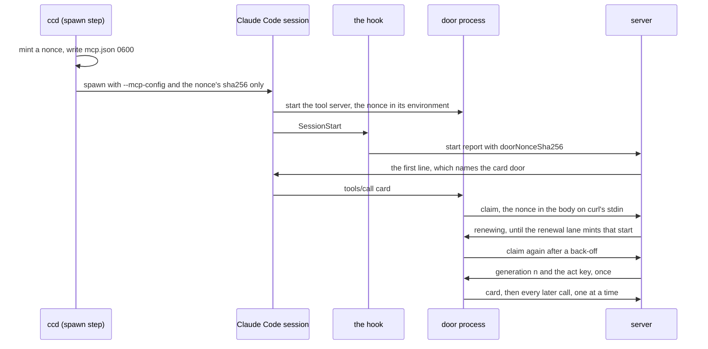
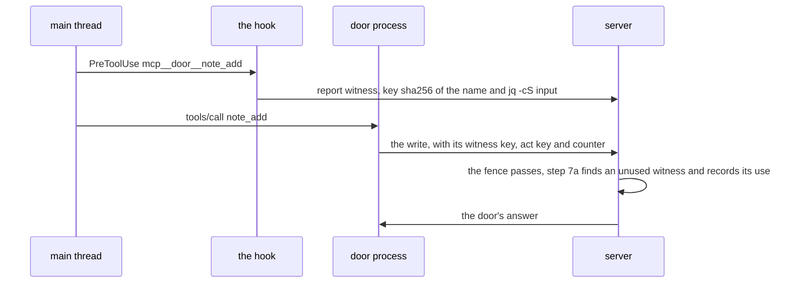

# Overlord W1: the door process and its readers Implementation Plan

> **For agentic workers:** REQUIRED SUB-SKILL: Use superpowers:subagent-driven-development (recommended) or
> superpowers:executing-plans to implement this plan task-by-task. Steps use checkbox (`- [ ]`) syntax for tracking.

**Goal:** the Overlord's doors reach it as typed tools served by one small process of its own, which holds the
credential and the fence, so the model never sees a key; and the hook reports what the session really did, so the
server can tell a witnessed write from a forged one.

- **PR A1 and A2, the door process.**
  - ccd's spawn step, in a new library `ccd/lib/door.sh`, writes a one-time launch nonce into the door process's
    environment through a 0600 tool-server config, never into the pane's command. Claude Code starts the process from
    that config with each generation's launch.
  - The server binds the nonce to the session's newest recorded start, by the nonce's hash on the start report. It
    issues the act key once, to the first call that presents the nonce, once that start's generation is minted.
  - The door process is an MCP stdio server, `ccd/door-process.mjs`, with `ccrc-api` inside: every tool it serves is
    one `ccrc-api` verb, so the route table and the token handling stay in one client.
  - It keeps the per-prompt delta cache (C38), which the hook prints on every prompt with no network call.
- **PR B1 and B2, the readers and the reports.**
  - The readers' one read tool.
  - The hook's reports through one report door: the witness, reader start and stop, a turn's end clearing the readers,
    the model switch, and "picked up".
  - What reads them: the witness gates B's step 7a asks for, the third unwitnessed write's latch, the off-model
    condition, and two readings the renewal readings piece wires (`modelDrift`, `readersRunning`). Closed-book grading
    reads the server's read ledger.
  - The hook's guard arms (PR B2): reader scope, the three-reader bound, reader model, and a typed `/model` refused.

**Why:** §3.6 H1 and §3.3.11 H12: the model must not hold the act key, and "today the client reads its uuid from the
registry file at the moment of the call (`ccd/ccrc-api`), so any process in the pane passes as current: a reader started
before a renewal, the old body after a rebind, a forked copy. The fence refuses all three." §7.4: "a write with no
witness has no turn behind it." §3.3.10 C55: readers keep the Overlord's context lean, and never act.

**Architecture:** four pull requests in lane B, split so that every growth-checked file, and the `ccd (program)` row,
stays within 40 net lines in each.

- **PR A1 (Tasks 1 to 3): the claim, and the library's sites.**
  - `shared/continuity-door.ts` (L0): the fence's header names, the claim's wire, the delta's grammar and the starting
    values.
  - `server/src/continuity/actKey.ts` (C3, L1): `actKeyClaimVerdict`, pure.
  - `server/src/continuity/actKeyStore.ts` (C3, L3): `continuity_act_keys`, its writers and its reads.
  - The claim door, `POST /api/sessions/:id/act-key`, in `server/src/continuity/routes.ts`.
  - `ccd/ccrc-api` sends every request body in the curl config it already sends on stdin, never on curl's argv.
  - `ccd/lib/door.sh`'s first region (`_door_prog_ok`, `_door_purge`), the loader's and installers' sites, the deny
    path, and the start report's nonce hash.
- **PR A2 (Tasks 4 to 6): the spawn step, the process and the delta.**
  - `_door_spawn` and its one line in `_profile_spawn_compose`.
  - `ccd/door-process.mjs`, with its tool table and one argv builder a row, installed and pinned by the entry installer
    in one step.
  - The Overlord's first line re-texted to name the door tools.
  - The delta cache, the anchor's `delta` form at its four sites, and the hook's print.
- **PR B1 (Tasks 7 and 9): the reports and what reads them.**
  - `shared/continuity-reports.ts` (L0), `server/src/continuity/hookReports.ts` (C3, L1) and `hookReportStore.ts`
    (C3, L3).
  - The report door, `POST /api/sessions/:id/report`, and the hook's witness, reader, turn-end and pick-up reports.
  - The witness port gates B declares, bound; the latch; the off-model condition; the two readings; closed-book.
- **PR B2 (Task 8): the hook's model events and guard arms.**
  - `PreModelSwitch` and `PostModelSwitch` join `HOOK_EVENTS`, report-only, with `ccd/lib/launch-profiles.json`
    regenerated.
  - The reader-scope, three-reader and reader-model arms, and a typed `/model` refused on the prompt path.

**Tech Stack:** bash (`ccd/ccd`, `ccd/lib/door.sh`, `ccd/session-hook.sh`, `ccd/ccrc-api`, `ccd/ccrc`), Python
(`ccd/ccd-entry-install.py`), Node ESM with no dependency (`ccd/door-process.mjs`), TypeScript (ESM), `node:sqlite`,
Fastify, vitest. No new dependency.

**Spec:** `docs/superpowers/specs/2026-11-09-overlord-design.md`:

- §3.6 H1, the bullet "The door process (H9)" whole: one process per generation started by ccd from the launch
  profile; every door as a typed tool and one read tool to readers; it holds the credential, the identity and the
  fence; the launch nonce; `ccrc-api` inside it; the delta cache in a directory of the session's own. The fallback
  bullet, which is not built (question 1). W0a's "As measured" paragraph (W0-15 to W0-19).
- §3.6 H2, "No authority or switch in a file on a fleet host", and Table 3.6a's rows "the door process's delta cache",
  "the model-switch journal" and "the act key file, W0's fallback only".
- §3.3.3 C38, "A delta on every prompt", and W0a's measurement of a 600-character `UserPromptSubmit` context.
- §3.3.10 C55: what a reader is, "a reader never acts", "a second line" (the subagent-scope arm), and "Bounds".
- §3.3.11 H12, "The fence": the nonce, the key issued once, the counter, "a start the server did not receive is
  reported again … mints its generation then", `stale-designation` and `stale-generation`, and why.
- §3.3.5 C41, "Closed-book": "the server records whether any read door was called between the probe and the answer".
- §3.4, Table 3.4b's row "The model changes inside a generation", W0-11 and W0-12, and §3.3.7's "a change of model
  inside a generation is model drift".
- §3.8: "Picked up: the prompt hook reported the id", and "Delivery is like mail".
- §7.4: "An unwitnessed write is refused and counted". §7.5, Table 7.5a's rows "the third unwitnessed write in a day"
  and "a generation off the designated model, its replay not passed".
- §11.2: the gate order and "After the gates"; Table 11.2's row "The hook's reports".
- Table 11.1a's row `continuity_generations` (the act key, bound at the mint); Table 11.1b's row "The door process,
  with `ccrc-api` inside; the reader types it serves"; Table 11.1e's row "The hook's reports". Table 11.6's rows
  `unwitnessed` and `stale-generation`.
- Table 13.1, rows H9 and H12 (`shape`, W1): a shape call ships with the piece that creates its table or door. This
  piece creates the act-key table, the claim door, the report door and their tables, so H9's door process and H12's
  fence half ship here, and gates B ships H12's check.

The index is `docs/superpowers/plans/2026-11-14-overlord-w1.md`. This plan builds on its row "Door process and
readers", its questions 13, 16, 20, 26, 30 and 36, "Where lanes meet" and "What a merge arms". It takes the
coordinator's corrections in brief 20630 as binding over the index's text. Revised in fix round 1 (review 2162): the
coordinator's rulings are marked "(ruled, F<n>)". The gates plan (`w1-gates.md`, #2863) received the same rulings on
the witness (F5), the term (F6) and the counter (F7), and this plan meets its shapes.

## Open questions

The index's questions come first, each with how this plan builds it. The others are ones the spec leaves open or the
tree contradicts. The plan builds every recommendation unless the coordinator or the operator rules otherwise.

1. **Question 13: how the door process carries `ccrc-api`, and who starts it** (slug
   `door-process-wraps-the-one-client`). **Built as recommended, with one departure.**
   - An MCP stdio server that calls the existing `ccrc-api` verbs, one child process a call. No second client: the
     route table, the address, the box token and the closed-client rules stay in `ccd/ccrc-api`.
   - **Claude Code starts it, from ccd's config** (slug `claude-code-starts-the-door-process`). A stdio tool server is
     started by Claude Code as a child of the session, from the `--mcp-config` file it is given. So ccd writes a fresh
     config with a fresh nonce at every spawn (Task 4), and Claude Code runs the process. A process ccd forked beside
     the session could not be its tool server. This departs from §3.6 and Table 11.1b ("a fleet-host process ccd
     starts"), and it is why a crashed door process's restart is Claude Code's behaviour, not ccd's (question 7).
   - Its tool names are the door names the `ccrc-overlord` skill uses, with each space as `_` (the skill plan's slug
     `skill-names-doors-by-name`), each mapped to its `ccrc-api` verb through one argv builder (Task 5).
   - The fallback (a shell that runs only `ccrc-api`, and the act key file) is not built.
2. **Question 30: is the door process a launcher on `PATH`?** **No.** The entry installer, `ccd/ccd-entry-install.py`,
   installs it beside the redactor, at `~/.local/libexec/ccrc/door-process.mjs` (mode 644, not on `PATH`), and renders
   its pin into the ccd body in the same step (ruled, F16; slug `door-process-installed-with-its-pin`). `node` starts it
   by its absolute path from the tool-server config. `_inst_bins` and `install-census.test.ts`'s launcher list do not
   change; `ccd/ccrc`'s update backup and uninstall lists gain the path.
3. **Question 16: a late or lost witness refuses the write `unwitnessed`.** Settled. Gates B owns the step (7a, after
   the fence) and its arms; this piece ships `witnessVerdict`, `recordWitnessCheck` and the latch, and binds the port
   gates B declares (ruled, F5). An unreadable witness store answers 502 `unmeasured` and is not counted.
4. **Question 20: the ladder's two cause rows ship here** (the third unwitnessed write in a day, and off the
   designated model). Built in Task 9, after the ladder.
5. **Question 26: the nudge rides the mail lane**, and "picked up" stays the hook's report of the id that line names.
   This piece ships that report and its door (ruled at the index, F9), and the hook's pattern is held equal to the
   private store's renderer by a test (Task 7).
6. **What is the witness key?** (Slug `witness-key-is-the-call-digest`.) §7.4 says "the same call (session and
   operation key)" and names no key. **Recommendation:** the sha256 of these bytes: the tool's full name
   (`mcp__door__<name>`), one newline, and the tool input printed by `jq -cS` with its trailing newline removed; an
   absent input hashes as `{}`. The hook computes it from the `PreToolUse` payload, and the door process from the MCP
   call's name and arguments, both through `jq -cS` (the door process runs jq rather than reimplementing it, so large
   integers, floats, unicode escapes and key order canonicalise the same on both sides). A call repeated with the same
   input is the same key, and each witness is used once (Task 9).
   - **Named apart from W2's operation key** (ruled, F20; slug `witness-key-is-not-the-dedupe-key`). §10.1 uses an
     operation key as the transport's dedupe ("a repeated key returns the first call's row and never acts again").
     This key is not that one: its header is `x-ccrc-witness-key` (`WITNESS_KEY_HEADER`), and W2's dedupe key gets a
     header of its own. Nothing in W1 dedupes on it. A spec fix says so.
   - Task 7's live step measures that the two digests agree on the pinned build, and records Claude Code's tool-use id
     in an MCP call's `_meta` as the fallback, should they not. A mismatch reads as `unwitnessed`, which fails closed.
7. **What happens to a door process that dies inside a generation?** (Slug `lost-door-process-waits-for-a-renewal`;
   ruled, F12.)
   - **What still works.** Its key was in memory only, and the nonce is spent. If Claude Code restarts it, the new
     process's claim answers `stale-generation` (`nonce-spent`), so it serves **reads only**: the card's pages and the
     reads of the inbox and board. Note writes, probe answers and the card's recording page are writes behind the fence
     (gates B, question 12), so they refuse.
   - **What follows.** A crash while the generation is `probing` leaves its probes unanswered, and the generation goes
     `degraded` at `probing`'s deadline (§3.3.11). A crash after `active` stops write-through (C37), and W1 measures no
     soft trigger that would end the generation by itself (`renewalInputsOf` answers `turns`, `backstopDue` and
     `modelDrift` "W1" until the renewal readings piece), so the remedy is the operator's Renew now (W1a's hand-offs,
     which PR A1 needs, question 13).
   - **Whether Claude Code restarts a dead stdio server at all is unmeasured.** Task 5's live step measures it. If it
     does not, no second claim happens, and the tools simply fail.
   - **Where it shows.** `claimsRefused` on the act-key row, read by the board's facts (the board piece's line; the
     index carries it).
   - **The skill's wording.** `starting.md`'s refusal table reads `stale-generation` as "a newer generation exists, stop
     acting". For a lost door process that is wrong; the refusal's detail (`nonce-spent`) tells the two apart, and the
     index passes the wording to the skill's owner.
   - **A hard renewal trigger** for "a refused claim or lost tools on the live generation" is a Table 3.3.11b row, so
     it goes to the spec-fixes run as a proposal for the operator, not into this build.
8. **`PreModelSwitch` is report-only** (ruled, F11). W0-12 measured the event for a typed `/model`; whether it fires
   for Claude Code's own switch on a flagged request is unmeasured, and that switch is pinned on (§3.6 H1), so a
   refusal there could stop the fallback the spec wants. So the hook never refuses `PreModelSwitch`. **Only a typed
   `/model` is refused, on the prompt path:** the `UserPromptSubmit` arm blocks a prompt that begins `/model` in a
   session with a door (Task 8). If the pinned build does not pass a built-in command through `UserPromptSubmit`, the
   switch is still reported by `PostModelSwitch`, drift is a hard renewal trigger, and the next generation starts on the
   designated model. Task 8's live step records both, and which payload field, if any, tells a typed switch from an
   automatic one.
9. **Which doors may a reader read?** **Recommendation:** the read tool serves the rows of the tool table marked
   `reader: true`, which in W1 are `board` and `history` (each once its piece has added its row). Never `messages` (the
   operator's words reach the main thread only, §3.8), and never `card`, `probe` or the notes (the generation's own
   memory, which closed-book grading counts).
10. **The bound of three readers** (slug `reader-bound-in-the-scope-arm`). §3.3.10 says "at most three readers run at
    once" and names no enforcer. **Recommendation:** the B2 arm refuses a fourth `Agent` call while the hook's
    subagent roster (`subs` in `hookstate.json`, D-5232, from which a `SubagentStop` removes the entry) holds three.
    Its residuals are stated, not hidden (Task 8): the roster is rewritten whole and loses writes under load, so a lost
    start can let a fourth reader through, and one message with four `Agent` calls passes, because every `PreToolUse`
    runs before any `SubagentStart`. "In the background" is not enforced.
11. **Model-switch reports for which sessions?** **Recommendation:** every session the start report covers (a
    non-child, non-fork session), so a coordinator's drift is measured the same way (R13). The `/model` refusal applies
    only to a session with a door.
12. **Starting values** (Table 11.5b has none of them). **Recommendation:** each named once in `shared/continuity-door.ts`
    or `shared/continuity-reports.ts`: the witness window 120 s, witness rows kept 24 h, witness checks, reader and
    model-switch rows kept 7 days, a reader start with no stop read as unmeasured after 30 min, the delta refreshed
    every 60 s with a 180 s lease and at most 300 bytes, the report door's hook timeout 3 s, and the claim's retry
    back-off from 1 s doubling to 30 s. The spec-fixes run adds them to Table 11.5b.
13. **What `renewing` needs** (ruled, F8). The claim door's retry word is `renewing`, which is not on `main`'s
    `OVERLORD_REFUSALS`: W1a's renewal hand-offs add it. So PR A1 needs the hand-offs first, which also bring the
    operator's Renew now that question 7 relies on.

## What exists today

Measured on `main` at `04dd17659` (2026-11-15), and on the open branches named.

- **The launch profile's surface (sandbox A, #2847, open).** On its branch, `LaunchSurface` in `shared/fleetRoles.ts`
  declares `toolServer: 'door'` and one reader type, `overlord-reader`, whose only tool is `mcp__door__read` on model
  `sonnet`. The surface branch of `ccd/ccd#_profile_spawn_compose` adds `--setting-sources project --tools Agent,Skill
  --strict-mcp-config --agents <json>` and `CCRC_LAUNCH_PROFILE=<role>:<digest>`, and leaves the tool server's launch
  to this piece with one line. Its `surfaceSettings` registers ccrc's hook on every `HOOK_EVENTS` event, and
  `launchDigestOf` covers the whole row, so a new hook event changes `ccd/lib/launch-profiles.json` and the Overlord's
  digest. `_profile_refused` is on that branch. The sandbox check requires `door` present, so sandbox B needs door
  process A.
- **The spawn.** `ccd/ccd#_profile_spawn_compose` runs once per spawn, before both spawn lines, and its
  `PROFILE_SPAWN_ENV` is spliced into the pane's `exec env … claude …` command. Anything in it is in every process
  listing, so the nonce must never go there. `_spawn_start` checks that the registry fields read, not the id's shape,
  so the new helpers check `_reg_id_ok` themselves.
- **The libraries.** `ccd/ccd#_ccd_lib_load` reads `ccd/lib/disk-retention.sh`, `train-proof.sh`,
  `delegation-lease.sh` and `pool-set.sh`, each against its `__CCD_LIB_*_SHA256` pin, before evaluating any; the ccd
  arms plan adds `long-lived.sh` (#2854). The split pin's new-code arm (`server/test/ccdSplit.ts#pureMoveVerdict`, slug
  `new-code-library-is-not-a-move`) judges a diff that adds a `# @ccd-lib:<name>` pointer, and passes one whose region
  defines no function and assigns no column-0 variable `ccd/ccd` defines.
- **The growth check.** `server/test/growthCheck.ts`: `ccd/ccd`, `ccd/ccrc`, `ccd/session-hook.sh`,
  `server/src/coord/schema.ts`, `server/src/server.ts` and every `ccd/lib/*.sh` grow at most `GROWTH_LIMIT` (40) net
  code lines a pull request (comments are free), and `PROGRAM_ROW` sums `ccd/ccd` and every non-`ccrc-*` library at
  40. `shared/api.ts` is held by its cap file (`growth-caps/shared-api-ts.json`). `ccd/ccrc-api`,
  `ccd/ccd-entry-install.py`, `ccd/install-session-hooks.sh`, `deploy/deploy.sh` and `server/src/continuity/*` are not
  listed.
- **The entry installer.** `ccd/ccd-entry-install.py` installs `shared/redact.mjs` and `shared/redact-cli.mjs` to
  `~/.local/libexec/ccrc/shared/` and renders their pins (`__CCD_REDACT_SHA256`, `__CCD_REDACT_CLI_SHA256`) into the
  ccd body, file first, in one program; `ccd/ccrc`'s `_inst_bins` and `deploy/deploy.sh` both run it.
- **`ccrc-api`.** `ccd/ccrc-api#send_request` sends the box token on curl's stdin as a config line (`-K -`, R16), but
  the request body as `--data-binary "$body"` on curl's argv. The answer lands in `REQ_OUT`, a `mktemp` file under
  `$TMPDIR`, removed by the exit trap. `ROUTES` holds eighty-three rows. The continuity verbs and their argv, from its
  usage: `card [--page N --hash H]` and `card --anchor --form start|prompt|fork` (the pane's id, no positional id, the
  form held to `^(start|prompt|fork)$`); `probe [--page N]` and `probe answer --json -` (the pane's id); `note add`,
  `note close` and `note handover` (`<id> --json -`); `note list <id> [--before | --limit]`; `timer set
  <90m|2h|3d> <note> [--run <id> | --programme <slug>]`, `timer list` and `timer cancel <id>`, which fill the pane's
  identity and take no `--json`. `card` and `probe` print plain text whose footers name `ccrc-api` commands
  (`cmd_card`, `cmd_probe`, and the probe page's tail in `server/src/continuity/probeDoor.ts`).
- **The start report.** `ccd/session-hook.sh#_hook_start_report` sends every non-child, non-fork `SessionStart` to
  `POST /api/sessions/:id/start` through `ccrc-api sessions start`, spooled in `$REG/<id>.startpending` and sent again
  when the server is back. `server/src/continuity/continuityStore.ts#insertStart` is its one writer. The door trusts
  the body's `fromId`/`fromUuid` against the registry's readable uuid. The renewal lane mints a generation from a start
  row (a `resume`, `clear` or `startup` start; a compaction or fork mints none) on its period
  (`RENEWAL_LANE_PERIOD_MS`, 30 s) and keeps its `startId`, so after a crash respawn, a Restart, a swap landing or a
  wake, the old generation stays live until the new start is minted.
- **The continuity doors.** `server/src/continuity/routes.ts#registerContinuityRoutes` registers the start report, the
  card, the notes, the handover, the timers and the probe doors: box-token lanes with `EXEMPT` reasons in
  `server/src/auth/gate.ts`. `server/test/box-token-census.test.ts` counts them in `CONTINUITY_LANES` (ten) and the
  machine-lane number words; `auth/gate.ts`'s header comments carry two count words per passage (machine lanes, and
  all lanes); `README.md`'s auth paragraph repeats them; `auth-gate.test.ts` lists each door and pins `ROUTES.length`;
  `server/test/rings/fastify-l4.data.ts`'s reason string lists the continuity doors.
- **The anchor.** `shared/continuity-card.ts` holds `ANCHOR_FORM_MAP` and `AnchorForm`; `server/src/continuity/anchor.ts`
  renders `AnchorTextForm`s; the card door's route checks the form; `ccrc-api`'s regex checks it again. While the
  `anchor-slot` lane is shadow the door answers `{ dark: true }`. Its ceilings are UTF-8 bytes, and the rules version
  "joins with W1's grants" (not yet in the canaries). `ccd/session-hook.sh#_hook_anchor_fetch` asks it under the hook's
  one network budget; `_hook_anchor_owed` and `_hook_roster_wake` each print a whole envelope of their own on
  `UserPromptSubmit`, one per event only because they exclude each other.
- **The hook's rosters.** A `SubagentStart` adds `{name, startedAt, id}` to the `subs` roster in `hookstate.json`, and a
  `SubagentStop` removes it (D-5232); the roster is rewritten whole, measured at 20 to 37% lost writes under load, and
  the update is skipped when there is no prior state (D-4041). A main-turn `Stop` with no background work empties it.
  Separately, the owner's join file `$REG/<id>.joined` records each `SubagentStart` as a fact, not liveness: a tool
  event counts as a subagent's only when its agent id has a join (the amendment
  `tool-agent-id-alone-is-unjoined-evidence`).
- **The hook's events.** `shared/hook-events.ts#HOOK_EVENT_MAP` lists twelve; no model-switch event.
  `ccd/install-session-hooks.sh` registers them in every account. The main `case` ends `*) exit 0`, and an event arm
  that sets no skip flag falls through to the hookstate write. The three envelope builders hard-code
  `hookEventName:"PreToolUse"`. The header declares that `PreToolUse` waits on nothing over the network, with five
  named exceptions.
- **The account arm.** `shared/api.ts#ACCOUNT_SECRET_PATHS` and `ACCOUNT_WRITE_DIRS` become rules in
  `ACCOUNT_DENY_RULES`, which every session is spawned with. `ccd/install-session-hooks.sh` holds a bash copy, held
  equal by `server/test/account-deny.test.ts`, which also requires `CLAUDE.md`'s SAFETY section to name every entry.
  The hook's account arm (`ASEC`, `APSEC`, and the write defs) refuses the shell forms, but for a non-child session a
  prefilter clears the arm unless the payload holds one of a fixed list of fragments (`account`, `.cc-secrets`,
  `auth-scratch`, `agent.env`, `runtime.env`, `.auth`, the Linear store, `operator-secrets`, `printenv`, `prune` or a
  bare `env`); `.cc-sessions` is in the child branch only.
- **The model on the server.** `server/src/usage.ts` parses the status line sidecar's `model` and `class`.
  `continuity_starts` and `continuity_generations` keep the start's `model`. `generationsLane.ts#renewalInputsOf`
  answers `modelDrift`, `turns` and `backstopDue` as "W1" (unmeasured).
- **Closed-book.** `server/src/continuity/probeDoor.ts#bookOf` answers `open` after a card or notes read and
  `unmeasured` otherwise; `BOOK_STATES_RECORDED` (in `probeDoor.ts`) leaves out `closed`, which "needs W1's witness"
  (slug `closed-book-is-unmeasured-in-w1a`). Its cases are in `continuity-probe-door.test.ts`.
- **The refusal words.** `shared/refusal.ts#OVERLORD_REFUSALS` holds `unwitnessed` (409), `stale-generation` (409),
  `not-the-overlord` and `unmeasured` (502). `renewing` is not in it: `refusal-table.data.json`'s wave map lists it as
  W1a's, added by the renewal hand-offs. `unknown-message` exists nowhere.
- **Time and chance.** `server/src/time/ports.ts#Entropy` (`hex(bytes)`, "for secrets and ids") and `Clock`. Every
  file under `server/src/continuity/` and every `shared/continuity*.ts` is in `time-ports.test.ts`'s families.
- **The first line of a fresh conversation.** On the renewal act's branch (#2852), `SessionHost.deliver` takes
  `RenewalPrompt = Extract<InjectedPromptKey, 'renewal-first-prompt'>`, `renewalWiring.ts` has one `sendPrompt`, and
  `renewalActs.ts` delivers the key at `first-prompt` and at `renudge-card`. The designation plan (on `main`) owns the
  Overlord's first prompt as the `INJECTED_PROMPTS` row `overlord-first-prompt` and widens the port's prompt type for it
  (ruled, F9); this piece re-texts it.
- **The gates plan's shapes (#2863, its branch).** Step 7a asks a `witness(sessionId, key)` port (default
  `unmeasured`) and records through `recordWitnessCheck`; step 5 compares the caller's live generation row's `term` with
  the designation's (no term header); the counter is reached through `overlordGateStore.ts#advanceCounterGuarded`, which
  refuses an `ended` generation and calls `actKeyStore.ts#advanceActCounter`; a refused `stale-generation` write is
  counted in its `overlord_fence_refusals`; the card's recording page is a write (`card-record`), so the card tool
  presents the key, the counter and the witness key.
- **Not on `main`:** sandbox A, the ladder, gates A and B, the private store, the renewal act and hand-offs, the board
  and history B, and the inbox. Each interface this plan reads from them is taken from its plan or the spec, and says
  so.

## Global Constraints

- **Architecture (`CLAUDE.md`).**
  - `shared/continuity-door.ts` and `shared/continuity-reports.ts` are L0: they import nothing. Each literal union
    carries its `Record<X, true>` map (`rings/wire-totality.test.ts`).
  - `actKey.ts` and `hookReports.ts` are L1: pure, no `fs`, no store, no clock. `now` is an argument.
  - `actKeyStore.ts` and `hookReportStore.ts` are L3: SQL only, synchronous over `coord.db`'s handle, each keeping
    every distinction it reads. No repository and no async wrapper over `CoordStore`.
  - The doors are L4 in the continuity routes file and decide nothing.
  - Two ports cross into C11, each declared by its consumer: the report door's `MessagePickUp` (in
    `continuity/routes.ts`'s deps) and closed-book's `ReadLedgerCount` (in `probeDoor.ts`'s deps). The composition root
    builds both from the private store. No C3 file imports the private store.
  - The door process names no tmux, no systemd and nothing of Claude Code's on-disk layout, and reaches the server only
    through `ccrc-api`.
- **One writer each.**
  - `continuity_act_keys`: `actKeyStore.ts#issueActKey` (the claim door) for a row, `noteRefusedClaim` (the claim door)
    for `claimsRefused`, and `advanceActCounter` for the counter, called only through gates B's guarded adapter. Three
    facts, three writers, one row.
  - `continuity_starts.doorNonceSha256`: `insertStart`, as every column of that row.
  - `continuity_hook_reports`: `hookReportStore.ts#insertHookReport` (the report door), which also prunes its own
    rows past their keep.
  - `continuity_witness_checks`: `hookReportStore.ts#recordWitnessCheck`, called by gates B's runner; it prunes its own
    rows past 7 days.
  - `$REG/.door/<id>/mcp.json`: `ccd/lib/door.sh#_door_spawn`. The delta cache: the door process. Both removed by
    `_door_purge` from `_reg_purge`.
  - "Picked up" on `operator_messages`: the private store's `moveMessage(id, 'pick-up', 'hook')`, called only by the
    report door.
  - A census in `single-definition/writers-map.test.ts` pins each table's writers, file-qualified.
- **The act key and the nonce are secrets** (ruled, F1).
  - **No secret on any argv.** `ccrc-api` sends every request body in the curl config it writes to curl's stdin, never
    as `--data-binary "$body"`, so neither the nonce in the claim's body nor any other body is in a process listing. A
    stub `curl` that records its own command line proves it (Task 2). jq reads the nonce from its environment, never
    its argv (Task 4). The door process passes nothing secret on any child's argv.
  - Never printed, never in a log line, never in a transcript or a tool result, never in the pane or its command.
  - **Where the nonce is:** `$REG/.door/<id>/mcp.json` (0600, its directory 0700), the door process's memory and its
    initial environment, and once in the claim's body on curl's stdin. Only its sha256 rides the spawn's environment
    and the start report.
  - **Where the key is:** minted by the server's `Entropy`, stored only as its sha256, answered once, held in the door
    process's memory, handed to each `ccrc-api` child in that child's environment, and put by `ccrc-api` on curl's stdin.
    The claim's answer also sits in `ccrc-api`'s answer file (`REQ_OUT`, a 0600 `mktemp` file under the session's
    `$TMPDIR`) for the length of the claim, until the client's exit trap removes it: a named residual.
  - **No child can read either through a tool:** `~/.cc-sessions/.door/**` joins `ACCOUNT_SECRET_PATHS` and
    `ACCOUNT_WRITE_DIRS`, the hook's non-child prefilter learns the fragment, and `CLAUDE.md`'s SAFETY section names the
    path (Task 3). The Overlord itself has no shell (`tools: ['Agent','Skill']`), and a reader has only
    `mcp__door__read`, so "through a tool" is the whole surface for the session that holds the key.
  - **Where sessions share a UNIX user this is an accident guard, not a wall** (§3.3.11). Any process of that user can
    read `/proc/<pid>/environ` and the 0600 file. Two more residuals are binding and named (ruled, F23): the start door
    trusts the body's `fromId`/`fromUuid` against a readable registry uuid, so a holder of the box token can post a start
    bound to a hash of its own choosing; and a forked copy launched with the same config sends no start report and can
    claim before the original. In a container, where only the session can read its files, it is a credential.
  - **Rotation is per spawn.** Every start that ccd spawns (a renewal, a crash restart, a swap landing, a wake, a
    Restart) writes a fresh nonce. A key is valid only while its generation is the identity's live one, so the next
    mint voids it with no write. A nonce hash binds at most one generation (a unique column), so a typed `/clear`, which
    starts a conversation without a spawn, finds its nonce spent.
- **The door process sends one call at a time** (ruled, F7). Every call, the claim included, runs through one promise
  chain, so at most one claim is in flight and writes reach the server in counter order. The counter rises by one
  before each fenced send and is never reused. So gates B can read a lower counter after a higher one as a fork.
- **ccd.**
  - **Zero new ccd verbs.** The spawn step and the purge are internal functions of the spawn and purge paths. SAFETY:
    no verb, so nothing to forbid; they write and remove only `$REG/.door/<id>/`'s named files, refuse a symlinked
    `$REG/.door` or `<id>` directory, and stop nothing. PR B1 adds one capability word, `door-witness-v1`, to `cmd_caps`
    (a word, not a verb). Every test runs in a fixture HOME (`makeCcdHarness`).
  - Only new helpers go in `ccd/lib/door.sh`; no existing function moves. Each helper checks its id with `_reg_id_ok`.
  - Every new function that parses carries `local LC_ALL=C IFS=' '`. Constants are plain assignments. A read of a file a
    session could replace with a FIFO is bounded (`_plat_timeout`).
  - `ccd/ccd` and `ccd (program)` each stay within 40 net lines in each pull request.
- **The hook.** Its reports fail open: a report it cannot send is lost, never retried in a loop, and never delays a
  tool call past the report door's bound. That is why closed-book reads the server's ledger, never these reports
  (ruled, F10). Its guard arms fail closed only where the spec asks. Every new event arm sets its skip flag and exits,
  so it never reaches the hookstate write (ruled, F14). The witness is a sixth named exception to the header's "no
  network wait on `PreToolUse`", added to that list.
- **Wire discipline.** Every new field is additive. An older hook's start carries no `doorNonceSha256`, which the claim
  reads as "this start bound no nonce", never as a match. `FLEET_PROTO` does not move.
- **Censuses move with each door.** The claim door (A1) and the report door (B1) each touch: `auth/gate.ts`'s `EXEMPT`
  (one reason each) and both count words of its two header passages; `server/test/auth-gate.test.ts` (its door lists,
  its count comment and its `ROUTES.length` assertion); `server/test/box-token-census.test.ts` (`CONTINUITY_LANES`, the
  number words and the count); `README.md`'s auth paragraph; `server/test/rings/fastify-l4.data.ts`'s reason string;
  `ccd/ccrc-api`'s `ROUTES`, its count word, and `server/test/ccrc-api.test.ts`'s length and `WORDS`. Neither door is a
  GET, so `MASKED_GET_ROUTES` does not change. Neither is a coordination write, so `CLAUDE.md`'s box-token paragraph
  does not change.
- **Migrations.** One a pull request (A1 and B1). Each edits `server/test/run-close-switch.test.ts` and
  `server/test/coord-db.test.ts`, and takes its number at build time, re-measured before merge.
- **Mutation floors.** Every new L1 decider joins `MUTANT_SETS` and `mutation-floors.json` in the pull request that
  creates it, with the floor the builder measures (`../ccrc-coordinator/references/mutation-run.py`). A guard proved by
  hand is mutated, run red, and restored from a saved copy, never with `git checkout`.
- **Public repository.** Fixtures use `lane-a`, `project-a` and `<projects-root>`. No host, account or path of a real
  deployment.

## Review Focus

1. **The model never holds a key, and no secret is on an argv.** Trace the nonce from ccd to the claim, and the key from
   the server to curl's stdin. A recording `curl` stub sees no body on its command line; the door process's whole stdout
   and stderr in the fixtures hold neither secret.
2. **One nonce, one start, one key.** The claim binds the newest recorded start. A start not yet reported or not yet
   minted answers `renewing` and the process keeps its nonce and retries; a spent nonce, a superseded start and a start
   with no hash each answer `stale-generation` with their reason. Crash respawn, Restart, swap and wake each reach a key.
3. **Unmeasured is never a value.** An unreadable witness store refuses 502 and counts toward no latch. A reader with a
   lost stop reads `readersRunning` unmeasured until a turn's end clears it, never zero. A stale sidecar with no switch
   report is unmeasured drift. A delta past its lease prints "unknown".
4. **Every tool row can be called.** Each `DOOR_TOOLS` row has an argv builder pinned against the real `ccrc-api`, and
   each verb a row needs is extended where it cannot take the call today.
5. **The arms key on facts, never on a role's name.** "Has a door" is `CCRC_DOOR_NONCE_SHA256` in the environment; "a
   reader's scope" is a recorded join or an `agent_type`; "another model" is the pin the launch put in the environment.



*Figure 1. One generation's launch. The nonce leaves ccd's file and the door process only in the claim, and the key
leaves the server and the door process only toward curl's stdin.*



*Figure 2. A witnessed write. Without the hook's report, or with a report older than the window, the write refuses
`unwitnessed` and counts toward the day's latch.*

## The PR split

| PR | Tasks | What it ships | Needs first | Growth-checked files, estimate (net lines) |
|---|---|---|---|---|
| A1 | 1 to 3 | The fence's wire; `actKeyClaimVerdict`; `continuity_act_keys` and the start's `doorNonceSha256`; the claim door; `ccrc-api`'s bodies on stdin; `door.sh`'s first region and every library and installer site; the deny path; the start report's hash | sandbox A, designation A (`identityOf`), W1a's renewal act (the mint) and renewal hand-offs (`renewing`, Renew now) | `ccd/ccd` +3; `ccd/lib/door.sh` +19, new; `ccd (program)` +22; `ccd/session-hook.sh` +2; `ccd/ccrc` +2; `server/src/coord/schema.ts` +18; `server/src/server.ts` +2; `shared/api.ts` 0 (in place) |
| A2 | 4 to 6 | `_door_spawn` and its compose line; `ccd/door-process.mjs` with its argv builders, installed and pinned in one step; the verbs' door phrasing; the first line's text; the delta at its four sites and the hook's print | PR A1 | `ccd/ccd` +1; `ccd/lib/door.sh` +28; `ccd (program)` +29; `ccd/session-hook.sh` +20; `ccd/ccrc` 0 |
| B1 | 7 and 9 | The report kinds; `continuity_hook_reports` and `continuity_witness_checks`; the report door; the witness, reader, turn-end and pick-up reports; the read tool; `witnessVerdict`, the latch, off-model, the two readings, closed-book; `door-witness-v1` | PR A2, the ladder, gates B (the port and step 7a), private store B (the nudge line, `moveMessage`, the read ledger) | `ccd/session-hook.sh` +22; `ccd/ccd` +1; `ccd (program)` +1; `server/src/coord/schema.ts` +24; `server/src/server.ts` +4; `shared/api.ts` 0 |
| B2 | 8 | `PreModelSwitch` and `PostModelSwitch` in `HOOK_EVENTS`, report-only; `launch-profiles.json` regenerated; the reader-scope, three-reader and reader-model arms; the typed `/model` refusal | PR B1 | `ccd/session-hook.sh` +32 |

**Sequencing B2** (ruled, F13). B2 changes the Overlord's launch row, so a running Overlord reads `launch-profile-unmet`
from B2's merge until its next start. B2 should land before the operator's first designation. If an Overlord already
runs, the operator renews it once B2 is on the fleet, and the pull request says so.

For scale, the files that are not growth-checked change by about this much:

| File | A1 | A2 | B1 | B2 |
|---|---|---|---|---|
| `ccd/door-process.mjs` | | +300, new | +30 | |
| `ccd/ccrc-api` | +15 | +20 | +3 | |
| `ccd/ccd-entry-install.py` | +4 | +12 | | |
| `shared/continuity-door.ts` | +70, new | +10 | | |
| `shared/continuity-reports.ts` | | | +90, new | |
| `server/src/continuity/actKey.ts` | +70, new | | | |
| `server/src/continuity/actKeyStore.ts` | +90, new | | | |
| `server/src/continuity/hookReports.ts` | | | +190, new | |
| `server/src/continuity/hookReportStore.ts` | | | +140, new | |
| `server/src/continuity/routes.ts` | +60 | +3 | +70 | |
| `server/src/continuity/anchor.ts`, `probeDoor.ts`, `shared/continuity-card.ts` | | +30 | +20 | |
| `ccd/install-session-hooks.sh` | +1 | | | +2 |
| `ccd/lib/launch-profiles.json` | | | | regenerated |
| `CLAUDE.md`, `README.md` | +3 | +2 | +2 | |

Each pull request merges `main` once before merge and re-measures its migration slot and census counts. Sandbox A also
adds a continuity lane (`POST /api/sessions/:id/start/loads`), so the second of the two to land re-counts the machine
lanes and `ROUTES.length`.

---

### Task 1: The fence's wire, the claim's decider and the act-key table (PR A1)

**Files:**

- Create: `shared/continuity-door.ts` (L0): `ACT_KEY_HEADER` (`x-ccrc-act-key`), `ACT_COUNTER_HEADER` and
  `ACT_GENERATION_HEADER` (no term header: the server compares the term itself, ruled, F6); `NONCE_SHA256_SHAPE` and
  `ACT_KEY_SHAPE` (64 lowercase hex); the claim's wire `ActKeyClaimAnswer` (`{ ok: true; generation: number; key:
  string }`); `CLAIM_WHY_MAP` (below); `CLAIM_RETRY_MIN_MS` (1,000) and `CLAIM_RETRY_MAX_MS` (30,000).
- Create: `server/src/continuity/actKey.ts` (C3, L1): `actKeyClaimVerdict`.
- Create: `server/src/continuity/actKeyStore.ts` (C3, L3): `issueActKey`, `noteRefusedClaim`, `advanceActCounter`,
  `actKeyOf`, `actKeyByNonce`.
- Modify: `server/src/continuity/continuityStore.ts`: `insertStart` takes the new column; `newestStartOf(sessionId)`
  and `startByNonce(sessionId, sha256)` read a start with its minted generation, if any.
- Modify: `server/src/coord/schema.ts` (one migration).
- Test: `server/test/continuity-act-key.test.ts` (new), `server/test/continuity-act-key-store.test.ts` (new),
  `server/test/continuity-starts-store.test.ts`, `server/test/coord-db.test.ts`, `server/test/run-close-switch.test.ts`,
  `server/test/single-definition/writers-map.test.ts`, `server/test/sim/mutation-floors.{test.ts,json}`.

**The table.**

```sql
CREATE TABLE continuity_act_keys (
  generationId INTEGER PRIMARY KEY,          -- continuity_generations.id: one key per generation, ever
  nonceSha256 TEXT NOT NULL UNIQUE,          -- the launch nonce binds at most one generation
  keySha256 TEXT NOT NULL,                   -- the key itself is never stored
  issuedAt INTEGER NOT NULL,
  counter INTEGER NOT NULL DEFAULT 0,        -- advanceActCounter, reached only through gates B's guarded adapter
  claimsRefused INTEGER NOT NULL DEFAULT 0,  -- a spent nonce presented again
  lastRefusedAt INTEGER
);
ALTER TABLE continuity_starts ADD COLUMN doorNonceSha256 TEXT;
```

`advanceActCounter(g, c)` changes the row only when `c` is above the stored counter, and answers `{ changed }`; gates
B's `advanceCounterGuarded` wraps it in one transaction with the generation's `state <> 'ended'` check (ruled, F7), and
no other caller exists (a census).

**The decider binds the newest recorded start** (ruled, F2). Its inputs are facts the door read, each a `Read` that
keeps "unmeasured" apart:

```ts
type StartFact = { startId: number; nonceSha256: string | null;
  generation: { id: number; n: number; state: GenerationState } | 'not-minted' };
type ClaimFacts = {
  presented: string;                                   // sha256 of the presented nonce, hashed by the door (L4)
  spent: Read<{ generationId: number } | 'none'>;      // an act-key row already holding this hash (actKeyByNonce)
  newest: Read<StartFact | 'none'>;                    // the session's newest recorded start (newestStartOf)
  matching: Read<StartFact | 'none'>;                  // the session's start carrying this hash, if any (startByNonce)
};
type ClaimVerdict =
  | { kind: 'issue'; generationId: number; n: number }
  | { kind: 'refuse'; error: 'renewing' | 'stale-generation' | 'unmeasured'; why: ClaimWhy };
```

First match wins:

1. any read unmeasured: `unmeasured` (502, `store-unreadable`);
2. the nonce already spent: `stale-generation` (`nonce-spent`), and the door calls `noteRefusedClaim` on that row;
3. no start carries the hash: `renewing` (`start-unreported`): the start report has not landed (the hook spools it while
   the server is away), so the door process keeps its nonce and retries;
4. the matching start is not the newest: `stale-generation` (`superseded`: a newer spawn's door process exists);
5. the matching start's generation is not minted yet: `renewing` (`not-minted`: the renewal lane mints it within its
   period, while the old generation may still be live);
6. the matching start's generation is `ended`: `stale-generation` (`generation-ended`);
7. otherwise `issue`, for that generation.

A start with no hash (an older hook, a start nobody spawned) never matches. `ClaimWhy` is `CLAIM_WHY_MAP`'s keys,
said in the refusal's detail and never as a refusal word of its own.

- [ ] **Step 1: Write the failing tests.**
  - `continuity-act-key.test.ts`: one case per arm in the order above, and the order itself (a spent nonce whose start
    is superseded answers `nonce-spent`; an unmeasured `matching` beside a spent nonce answers `unmeasured`). The four
    restarts, each with the old generation still live and the new start not minted: a crash respawn, a Restart, a swap
    landing and a wake each answer `renewing` (`not-minted`), then `issue` once the new start is minted, never
    `stale-generation`. A spooled start (none carries the hash) answers `renewing` (`start-unreported`).
  - `continuity-act-key-store.test.ts` (a fixture `coord.db`): `issueActKey` inserts once, and answers `{ok:false,
    error:'refused'}` on a second insert for the same generation or the same hash (the unique constraint, never a
    throw); the table never holds the key (`SELECT *` holds no value equal to it); `advanceActCounter` changes only on a
    higher counter; `noteRefusedClaim` raises `claimsRefused`; every read answers `unmeasured` with its detail when the
    table is missing, never `'none'`.
  - `continuity-starts-store.test.ts`: the column stored and read; `newestStartOf` and `startByNonce` with and without a
    minted generation.
  - `coord-db.test.ts` names the version; `run-close-switch.test.ts` gains the undo step and its count;
    `writers-map.test.ts`'s `TABLES` gains `continuity_act_keys` with its three writers, file-qualified.
- [ ] **Step 2: Run them, and see them fail.** From `server/`: `ccrc test -- ./node_modules/.bin/vitest run
  test/continuity-act-key.test.ts test/continuity-act-key-store.test.ts test/continuity-starts-store.test.ts
  test/coord-db.test.ts test/run-close-switch.test.ts test/single-definition/writers-map.test.ts`.
- [ ] **Step 3: Implement** the L0 file, the decider, the store and the migration (its number taken at build time).
- [ ] **Step 4: Run them, and see them pass.**
- [ ] **Step 5: The mutants.** `actKeyClaimVerdict` joins `MUTANT_SETS`: each arm deleted; arms 3 and 4 swapped; arms
  5 and 6 swapped; the hash compare negated; a `null` hash read as a match. The floor is what the builder measures.
- [ ] **Step 6: Commit** `feat(continuity): the act-key table and the claim's decider (Overlord W1 door process A1)`.

### Task 2: The claim door, the start's nonce hash, and `ccrc-api`'s bodies on stdin (PR A1)

**Files:**

- Modify: `ccd/ccrc-api#send_request`: the body joins the curl config written to curl's stdin as one `data-binary`
  line, with `\` and `"` escaped as curl's config grammar requires, and `--data-binary` leaves the argv (ruled, F1).
  `ROUTES` gains `[sessions.act-key]='POST|/api/sessions/{id}/act-key|yes|-'`, with a comment that its body carries a
  secret, and the count word.
- Modify: `server/src/continuity/routes.ts#registerContinuityRoutes`: `POST /api/sessions/:id/act-key`; the start
  report reads `doorNonceSha256`. `ContinuityRouteDeps` gains `entropy: Entropy`.
- Modify: `server/src/server.ts` (the composition passes `entropy`, about +2).
- Modify: `ccd/session-hook.sh#_hook_start_report` (one field, +1).
- Modify: `server/src/auth/gate.ts` (`EXEMPT`, one reason; both count words of its two header passages), `README.md`
  (the auth paragraph's count words, and the door in the exempt-but-authenticated class),
  `server/test/rings/fastify-l4.data.ts` (the reason string's door list).
- Test: `server/test/ccrc-api-stdin-body.test.ts` (new), `server/test/continuity-act-key-route.test.ts` (new),
  `server/test/continuity-start-route.test.ts`, `server/test/session-hook-start-report.test.ts`,
  `server/test/box-token-census.test.ts`, `server/test/auth-gate.test.ts`, `server/test/ccrc-api.test.ts`,
  `server/test/ccrc-api-closed.test.ts`.

**The body on stdin.** This changes how every `ccrc-api` POST travels, on every session, so it ships behind a
characterization first: for each row's fixture body, the bytes the suite's local server receives are the same before
and after. A body holding a newline, a quote, a backslash and a non-ASCII character is in the fixtures.

**The door.** In order:

1. the box token (`checkMailToken`, 401);
2. the path id and the body's shape: `fromUuid`, and `nonce` matching 64 lowercase hex (400 `bad-request`, with no
   echo of the value);
3. the registry's attribution of `fromUuid` (`deps.attribute`: 403 `stale-uuid` and its kin);
4. the facts, each read once, in one synchronous stretch: `actKeyByNonce`, `newestStartOf`, `startByNonce`;
5. `actKeyClaimVerdict`.

On `issue` the door mints `entropy.hex(32)`, hashes it, calls `issueActKey`, and only on `{ok:true}` answers
`200 { ok: true, generation, key }`. A refused insert (two claims racing) answers `stale-generation` (`nonce-spent`),
never a key. A refusal answers 409 `stale-generation` or `renewing`, or 502 `unmeasured`, with its `why` in `detail`.
No line the door logs names the nonce or the key: its `console.warn('ccrc-server: …')` names the session, the start and
the `why` only.

**The start report.** The hook reads `CCRC_DOOR_NONCE_SHA256` from its environment (the spawn put it there, Task 4) and
adds `doorNonceSha256` only when it is 64 lowercase hex. The route checks the same shape, stores `null` for an absent
field, and refuses a malformed one as it refuses today's malformed fields.

- [ ] **Step 1: Write the failing tests.**
  - `ccrc-api-stdin-body.test.ts`: the real `ccrc-api` with a recording `curl` stub on `PATH` that writes its own
    command line (`/proc/self/cmdline`) and its stdin to files: for `sessions act-key` and for three other POST rows, the
    command line holds neither the body nor any value from it, and the stdin config holds the body; the
    characterization above against the suite's local server.
  - The route suite (a fixture store, a fake `Entropy`): each refusal in order; a good claim answers the key once; a
    second claim with the same nonce answers 409 `stale-generation` (`nonce-spent`) and raises `claimsRefused`; the four
    restarts of Task 1 through the door; a typed `/clear` (a second start under the same hash, minted as generation n+1)
    answers `nonce-spent`; the fake logger's lines and every table hold no copy of the key or the nonce.
  - The start route's and the hook's start-report suites: the field stored, absent, or refused; the hook sends it only
    for a good hash (a fixture HOME).
  - The censuses: `CONTINUITY_LANES` gains the door, the number words gain the next one, both count words in
    `auth/gate.ts` move by one, `auth-gate.test.ts` names the door and its `ROUTES.length` moves by one,
    `ccrc-api.test.ts`'s length and `WORDS` move by one.
- [ ] **Step 2: Run them, and see them fail** (each suite through `ccrc test`).
- [ ] **Step 3: Implement** the client change, the door, the field, the `EXEMPT` row (reason: "the door process's one
  claim: box token, attribution and a launch nonce bound to the session's newest start; it issues the act key once"), the
  `ROUTES` row and the count words.
- [ ] **Step 4: Run them, and see them pass.**
- [ ] **Step 5: Prove the guards by hand:** put the body back on the argv (the cmdline case fails); answer the key on a
  refused insert (the race case fails); log the nonce (the logger case fails). Restore each from a saved copy.
- [ ] **Step 6: Commit** `feat(continuity): the act-key claim door, the start's nonce hash, and ccrc-api bodies on stdin (Overlord W1 door process A1)`.

### Task 3: The library's first region, its sites, and the deny path (PR A1)

**Files:**

- Create: `ccd/lib/door.sh`, its first region: `_door_prog_ok` (the program's digest against `__CCD_DOOR_SHA256`, with
  the hash command the loader chose; a source checkout skips it, as the redactor's reader does), `_door_purge`, and the
  constant `DOOR_REG_DIR=.door`. A new-code region under the split pin's new-code arm, pointed at by `# @ccd-lib:door`.
- Modify: `ccd/ccd`: `_ccd_lib_load`'s two arrays (in place) and its header comment; `__CCD_LIB_DOOR_SHA256` and
  `__CCD_DOOR_SHA256`, each `stamp-at-install` with its shellcheck line; `_reg_purge`: one line, `_door_purge "$id"`,
  its inventory comment, and its unlink count.
- Modify: the library and installer sites: `ccd/ccd-entry-install.py` (the library's pin) and `ccd/ccd-entry.py`'s
  header; `ccd/ccrc`'s update backup names (`_upd_backup_copy`) and uninstall list; `deploy/deploy.sh`;
  `server/test/ccdWsHelpers.ts` (`CCD_LIBS`), `consolidationCensus.ts` (`CCD_LIB_FILES`), `installTreeFixture.ts`,
  `install-census.test.ts` (the `libDecl` prefix union and the backup order), `ccd-docs-helper-redactor.test.ts` (the
  loader's hash-call count), `ccrc-install-tree.test.ts`, `ownership.test.ts`, `session-hook.test.ts`'s `SCANNED`,
  `single-definition/writers-map.test.ts`, `tmux-socket-census.test.ts` and `ccd-workspaces.test.ts` (`_reg_purge`'s
  unlink count); `README.md`'s library paragraphs and restore list; `ccd/contexts.tsv` (the new functions' rows) and
  `ccd/contexts-edges.tsv` (`_reg_purge -> _door_purge`). The ccd arms' `long-lived.sh` lands first (Figure W1), so this
  library adds its name beside that one after merging `main`. The file-split plan
  (`docs/superpowers/plans/2026-11-06-ccd-file-split.md`) lists libraries; the index passes it this name.
- Modify: the deny path (ruled, F4): `shared/api.ts#ACCOUNT_SECRET_PATHS` and `ACCOUNT_WRITE_DIRS` each gain
  `~/.cc-sessions/.door/**` (in place, and their doc comment); `ccd/install-session-hooks.sh`'s bash copy; the hook's
  account arm (`ASEC`, `APSEC` and the write defs); the hook's **non-child prefilter** gains the `.cc-sessions/.door`
  fragment, so the arm runs for a top-level session; `CLAUDE.md`'s SAFETY section gains one sentence naming
  `~/.cc-sessions/.door/` as the door process's directory, which no session reads or writes.
- Test: `server/test/ccd-door-lib.test.ts` (new, `makeCcdHarness`); the library suites (`ccd-lib-load`,
  `ccd-entry-install`, `ccd-install-stamp`, `build-release`, `ccrc-uninstall`, `ccrc-update-flip-backups`,
  `ccd-ws-add-child`, `ccd-split-pin`, `ccd-workspaces`, and the agent's `ccd-entry-exec` and `deploy-verify`);
  `server/test/account-deny.test.ts`; `server/test/session-hook-account-deny.test.ts`.

**`_door_purge <id>`** checks the id with `_reg_id_ok`, refuses when `$REG/.door` or `$REG/.door/<id>` is a symlink,
then removes `mcp.json`, `mcp.json.tmp`, `delta` and `delta.tmp` by their literal names, then the directory if it is
empty. Each unlink failure goes through `_reg_purge_unremoved`, as `_reg_purge`'s own do. A door process still running
can write `delta` again after the purge (it holds no row lock); it exits when its session's stdin closes (Task 5), so
the file is left at most once, and the next spawn's purge or write replaces it: a named residual, the `joined` file's
two-sided case.

- [ ] **Step 1: Write the failing tests.**
  - `ccd-door-lib.test.ts`: `_door_prog_ok` passes the pinned file and refuses a changed, missing or symlinked one;
    `_door_purge` removes the four names and the empty directory, leaves a file planted beside it, refuses a bad id and a
    symlinked directory, and reports an unremovable file through `_reg_purge_unremoved`.
  - The library suites: the loader reads and pins `door.sh`; a tampered `door.sh` refuses the load; the split pin's
    new-code arm passes the region, and fails a variant that assigns a column-0 variable `ccd/ccd` assigns.
  - `account-deny.test.ts`: `ACCOUNT_DENY_RULES` holds the read and write rules for the path, the bash copy agrees, and
    `CLAUDE.md`'s SAFETY section names it. `session-hook-account-deny.test.ts`: a `cat` of a file under the path is
    refused for a **non-child** session and a child alike, in the quoted, `$HOME` and path-qualified forms; deleting the
    prefilter fragment makes the non-child case fail; `must-allow.json` still passes.
- [ ] **Step 2: Run them, and see them fail.**
- [ ] **Step 3: Implement.** `local LC_ALL=C IFS=' '` in `_door_prog_ok`; constants as plain assignments.
- [ ] **Step 4: Run them, and see them pass.** Measure growth with `growthCheck`'s own measure (`ccd/ccd` about +3,
  `door.sh` about +19, `ccd (program)` about +22, `session-hook.sh` about +2 with Task 2's line) and shellcheck (the
  ratchet).
- [ ] **Step 5: Commit** `feat(ccd): the door library's first region, its sites, and the deny path (Overlord W1 door process A1)`.

### Task 4: ccd's spawn step (PR A2)

**Files:**

- Modify: `ccd/lib/door.sh`: `_door_spawn`, a second new-code region.
- Modify: `ccd/ccd`: the surface branch of `_profile_spawn_compose` gains one line, after the surface flags:
  `_door_spawn "$id" || { _profile_refused "$id" "door process: $DOOR_SPAWN_WHY"; return 1; }`.
- Modify: `ccd/contexts-edges.tsv` (`_profile_spawn_compose -> _door_spawn`).
- Test: `server/test/ccd-door-spawn.test.ts` (new, `makeCcdHarness`).

**`_door_spawn <id>`** checks the id with `_reg_id_ok`, then:

1. Finds the program: beside this script in a tree, else `~/.local/libexec/ccrc/door-process.mjs`, and checks it with
   `_door_prog_ok`.
2. Resolves `node` to an absolute path with `command -v node`, under the PATH ccd runs with (ruled, F25: Step 5
   measures, on the fleet box, which PATH that is under `ccd supervise`'s unit and which `node` it finds, against the
   pane's `SESSION_PANE_PATH`).
3. Mints the nonce: 32 bytes of `/dev/urandom` as hex, checked against the 64-hex shape.
4. Refuses a symlinked `$REG/.door` or `<id>` directory; makes it at 0700; writes `mcp.json` at 0600 through a temp file
   and `mv` (umask 077 in a subshell). jq reads the nonce from its own environment (its `$ENV`), never its argv:
   `{"mcpServers":{"door":{"type":"stdio","command":<node>,"args":[<program>],"env":{"CCRC_DOOR_NONCE":<nonce>,
   "CCRC_SESSION_ID":<id>,"CCRC_DOOR_DIR":<dir>,"CCRC_API":<the installed ccrc-api>}}}}`.
5. Appends `--mcp-config '<dir>/mcp.json'` to `PROFILE_SPAWN_FLAGS` and `CCRC_DOOR_NONCE_SHA256=<sha256>` to
   `PROFILE_SPAWN_ENV`. Nothing else reaches the pane's command.

Any failure sets `DOOR_SPAWN_WHY` to a fixed phrase, never a value, and returns 1; the compose then refuses the spawn
through `_profile_refused`, so an Overlord never starts without its doors. A spawn with no surface never calls it.

- [ ] **Step 1: Write the failing tests** (a fixture HOME, a stub `node`, a fixture program and its pin):
  - a surfaced spawn writes `mcp.json` at 0600 in a 0700 directory, whose `CCRC_DOOR_NONCE` is 64 hex and hashes to the
    `CCRC_DOOR_NONCE_SHA256` in the spawn's environment;
  - the pane's command (the harness's recorded tmux argv) holds the hash and the path, never the nonce; a recording jq
    wrapper's argv never holds it;
  - two spawns write two different nonces;
  - a changed program, a missing program, a symlinked program, a symlinked `.door` directory and no `node` each refuse
    the spawn with their phrase in `swap.log`, start no pane, and leave no `mcp.json`;
  - a spawn with no surface writes nothing under `$REG/.door/`.
- [ ] **Step 2: Run them, and see them fail.**
- [ ] **Step 3: Implement**, with `local LC_ALL=C IFS=' '`.
- [ ] **Step 4: Run them, and see them pass.** Measure growth (`ccd/ccd` +1, `door.sh` about +28, `ccd (program)` about
  +29). By hand: pass the nonce with `--arg` (the jq case fails); drop the umask (the mode case fails). Restore each from
  a saved copy.
- [ ] **Step 5: The live step**, recorded in the pull request: on the fleet box, the PATH a `claude-session@` unit's
  `ccd supervise` runs with, the `node` it resolves, and its version against the node floor. A scratch run of
  `_door_spawn` in a fixture HOME on that box, never the live registry.
- [ ] **Step 6: Commit** `feat(ccd): the door process's spawn step (Overlord W1 door process A2)`.

### Task 5: The door process, its argv builders, its install, and the first line's text (PR A2)

**Files:**

- Create: `ccd/door-process.mjs`: an MCP stdio server with no dependency (newline-delimited JSON-RPC 2.0: `initialize`,
  `notifications/initialized`, `tools/list`, `tools/call`, and an error for anything else). It exits when its stdin
  closes (ruled, F24), so an orphaned process never outlives its session.
- Modify: `ccd/ccrc-api#send_request`: when `CCRC_ACT_KEY` is 64 hex, the stdin config gains `ACT_KEY_HEADER`,
  `ACT_COUNTER_HEADER` and `ACT_GENERATION_HEADER` lines, each value checked against its shape first.
- Modify: `ccd/ccrc-api`'s `cmd_card` and `cmd_probe`, and the probe page's tail in `server/src/continuity/probeDoor.ts`:
  a `--door` flag (and a `door=1` query the client sends with it) phrases each next-step line as a door call ("call the
  card door with page 2", "answer with the probe_answer door") instead of a shell command; one renderer arm each.
- Modify: `ccd/ccd-entry-install.py`: installs `ccd/door-process.mjs` to `~/.local/libexec/ccrc/door-process.mjs` at 644
  and renders `__CCD_DOOR_SHA256` from the file it installs, file first, in the same step, as it does for the redactor
  (ruled, F16). `ccd/ccrc`'s backup and uninstall lists name the path; `deploy/deploy.sh` reaches it through the entry
  installer.
- Modify: `shared/injected-prompts.mjs`: designation A's row `overlord-first-prompt` is re-texted to name the door tools:
  `Read your card with your card door, then answer your probes with your probe door.`
- Modify: the renewal act's first prompt (`server/src/continuity/renewalActs.ts`, `renewalFeed.ts`): one L1 table,
  `FIRST_PROMPT_OF_ROLE` (`overlord` to `overlord-first-prompt`, every other long-lived role to `renewal-first-prompt`),
  used at both delivery sites, `first-prompt` and `renudge-card`. Designation A has widened `SessionHost.deliver`'s
  prompt type and its `sendPrompt` to take the row (ruled, F9).
- Test: `server/test/door-process.test.ts` (new), `server/test/door-tools.test.ts` (new),
  `server/test/door-tools-argv.test.ts` (new), `server/test/ccrc-api-act-key.test.ts` (new),
  `server/test/ccrc-api-closed.test.ts`, `server/test/continuity-probe-door.test.ts`, the entry installer's and the
  uninstall suites, `server/test/continuity-renewal-acts.test.ts`, the injected-prompts census.

**The tool table** is one exported array in `ccd/door-process.mjs`, `DOOR_TOOLS`. Each row is `{ name, verb, class:
'view' | 'operate', fenced, reader, input, argv }`: `verb` is a key of `ccrc-api`'s `ROUTES`, `input` the JSON schema the
model sees, `argv(input, self)` the row's one argv builder (ruled, F3), and `fenced` whether the call carries the key,
the counter and the witness key.

| Tool | `ccrc-api` argv | Body on stdin | Class | Fenced |
|---|---|---|---|---|
| `card` | `card --door [--page N] [--hash H]` | none | `view` | yes: the page that records the read is a write (gates B, question 12) |
| `probe` | `probe --door [--page N]` | none | `view` | no |
| `probe_answer` | `probe answer --json -` | the answers | `operate` | yes |
| `note_add` | `note add <self> --json -` | the note | `operate` | yes |
| `note_close` | `note close <self> --json -` | `{ revises, closes: true }` | `operate` | yes |
| `note_list` | `note list <self> [--before T] [--limit N]` | none | `view` | no |
| `note_handover` | `note handover <self> --json -` | the handover | `operate` | yes |
| `timer_set` | `timer set <duration> <note> [--run R \| --programme P]` | none | `operate` | yes |
| `timer_list` | `timer list` | none | `view` | no |
| `timer_cancel` | `timer cancel <id>` | none | `operate` | yes |

`<self>` is the door process's own session id. The `card` and `probe` schemas carry their paging fields. A timer's note
rides the argv because `timer set` takes it there; it is the model's own text, not a secret. Each later piece adds the
row of the door it ships, beside its `ccrc-api` row: `inbox`, `messages` and `acknowledge` (the inbox), `board` and
`history` (board and history B). No schema names `fromId`, `fromUuid`, `byId` or `byUuid`: the client fills
attribution from the pane, and the door process refuses an input that names one.

**A call.**

1. **Start.** The process copies the nonce into memory, deletes `CCRC_DOOR_NONCE` from its own environment so no child
   inherits it, and checks that `ccrc-api whoami` names `CCRC_SESSION_ID`, or it refuses every call. Parse errors are
   answered with a fixed message, never a quote of the input, and nothing it logs to stderr names a secret (ruled, F21).
2. **The claim, once, one at a time.** While it holds no key, a fenced call first claims: `ccrc-api sessions act-key
   <self> --json -`, the body `{ fromUuid, nonce }` on stdin. `ok` keeps `generation` and `key` in memory and drops the
   nonce. `renewing` keeps the nonce and retries after a back-off from `CLAIM_RETRY_MIN_MS` doubling to
   `CLAIM_RETRY_MAX_MS`; the call itself is served without a key, and a fenced write refuses on the server. Any
   `stale-generation` drops the nonce; reads still serve.
3. **The call.** Every call runs through one promise chain (ruled, F7). `execFile(CCRC_API, row.argv(input, self), …)`,
   the body on stdin, a 35 s timeout. A fenced call's child environment adds `CCRC_ACT_KEY`, `CCRC_ACT_GENERATION` and
   `CCRC_ACT_COUNTER`; the counter rises by one before each fenced send and is never reused, even after a send that got no
   answer. B1 adds the witness key.
4. **The answer.** The tool result is `ccrc-api`'s stdout as one text block, marked as an error when its JSON body says
   `ok: false`, when a text verb exits non-zero, or when `ccrc-api` exits 3 (`transport`). Nothing else the process holds
   ever reaches a result.

**How the first line works** (the renewal act's note `first-prompt-by-deliver`). A fresh conversation has no first
turn, and a tool server cannot start one, so the line is still a `SessionHost.deliver`. Its text names the `card` door,
so the generation's first tool call is the door process's first call, and the claim happens inside it. Designation A
sends the row to a new body (X4), and the renewal act sends it to a renewed Overlord generation. The key is never in
the line.

- [ ] **Step 1: Write the failing tests.**
  - `door-process.test.ts` runs `node ccd/door-process.mjs` against a stub `CCRC_API` (a bash script in the test's temp
    root recording its argv, stdin and environment):
    - `initialize` names the server `door`; `tools/list` equals `DOOR_TOOLS`' names and schemas;
    - the first fenced call claims with the nonce on stdin, never argv; later calls do not claim; two calls sent at once
      produce one claim, and their sends reach the stub in counter order;
    - no child's environment holds `CCRC_DOOR_NONCE`; a fenced call's child carries the key and a counter one above the
      last; an unfenced call's carries neither;
    - `renewing` keeps the nonce and retries with the back-off (a fake clock); `stale-generation` drops it, and reads
      still serve;
    - the process's whole stdout and stderr, across every case and a malformed JSON-RPC line, hold neither secret;
    - an input naming `fromUuid` is refused; an unknown tool answers a JSON-RPC error; a `whoami` that differs refuses
      every call; closing stdin ends the process.
  - `door-tools-argv.test.ts`: each row's `argv` run through the **real** `ccrc-api` against a recording curl stub
    reaches the row's route with the row's query and body (one case a row).
  - `door-tools.test.ts`: every `verb` is a `ROUTES` key; every name is the skill's door name with spaces as `_`, or is
    on the named list `DOOR_ONLY_TOOLS` (`probe`, `note_handover`, each with its reason: `starting.md`'s table lacks
    them, and the index passes them to the skill's owner) (ruled, F26); `reader` is true on no row in A2.
  - `ccrc-api-act-key.test.ts`: with `CCRC_ACT_KEY` set, the stdin config carries the three headers and the argv none; a
    malformed key adds nothing. `ccrc-api-closed.test.ts` still holds (no new argument is a URL; `--door` is a flag).
  - `continuity-probe-door.test.ts`: the `door=1` tail names no shell command; the default tail is unchanged.
  - The installer suites: the program installed at 644, its pin rendered from the installed bytes in the same run, and
    a run that fails between them leaves neither changed.
  - `continuity-renewal-acts.test.ts`: an `overlord` generation's first prompt and re-nudge deliver
    `overlord-first-prompt`, a coordinator's `renewal-first-prompt`.
- [ ] **Step 2: Run them, and see them fail.**
- [ ] **Step 3: Implement.** The process imports only `node:child_process`, `node:fs`, `node:crypto` and `node:path`.
- [ ] **Step 4: Run them, and see them pass.** By hand: keep the nonce in the environment (the child case fails); send
  the key on an unfenced call (fails); reuse a counter after a failed send (fails); run two calls without the chain (the
  order case fails). Restore each from a saved copy. `FIRST_PROMPT_OF_ROLE` joins `MUTANT_SETS` (each row swapped).
- [ ] **Step 5: The live step**, recorded in the pull request: in a scratch session the builder starts on the pinned
  build, kill the door process and record whether Claude Code restarts a dead stdio tool server (question 7).
- [ ] **Step 6: Commit** `feat(ccd): the door process with ccrc-api inside, its argv builders, and the first line's text (Overlord W1 door process A2)`.

### Task 6: The per-prompt delta cache (C38) (PR A2)

**Files:**

- Modify: `shared/continuity-door.ts`: `DELTA_REFRESH_MS` (60,000), `DELTA_LEASE_MS` (180,000), `DELTA_MAX_BYTES`
  (300, UTF-8 bytes, as the anchor's ceilings are), and the cache's first line, `v=1 at=<ms> until=<ms>`.
- Modify: the `delta` form at its four sites (ruled, F3): `shared/continuity-card.ts` (`ANCHOR_FORM_MAP`, `AnchorForm`,
  `AnchorTextForm`); `server/src/continuity/anchor.ts` (one line of at most `DELTA_MAX_BYTES`: the canaries the anchor has
  today, term, generation and card hash, then its counts, so a cut keeps the canaries; the rules version joins when the
  anchor's does); the card door's form check in `routes.ts`; and `ccrc-api`'s form regex in `cmd_card`.
- Modify: `ccd/door-process.mjs`: after each call it serves, and on an unreferenced 60 s timer, it runs `ccrc-api card
  --anchor --form delta` and writes `$CCRC_DOOR_DIR/delta` at 0600 through `delta.tmp` and a rename. A text answer
  writes the text; a `{ dark: true }` answer (the anchor slot still shadow) writes an empty text, so the hook prints
  nothing; a failed fetch writes nothing, so the lease lapses.
- Modify: `ccd/session-hook.sh`: `_hook_door_delta`, on `UserPromptSubmit` only when `CCRC_DOOR_NONCE_SHA256` is set. It
  refuses a symlink or a file that is not regular, reads with a bound, parses the first line with `local LC_ALL=C
  IFS=' '`, and yields the text while `until` is ahead of now, nothing for an empty text, else `ccrc-delta: unknown (the
  door process's cache is stale)`. It makes no network call. Its line goes into the envelope that
  `_hook_roster_wake` or `_hook_anchor_owed` prints, through one variable each appends, or into an envelope of its own
  when neither prints (ruled, F14): one envelope an event either way.
- Test: `server/test/continuity-anchor.test.ts`, the card route's suite, `server/test/door-process.test.ts`,
  `server/test/session-hook-door-delta.test.ts` (new).

- [ ] **Step 1: Write the failing tests.**
  - The `delta` form: one line, at most 300 bytes, canaries first, kept by a cut; the route and the client accept it;
    a dark answer stays dark.
  - The door process writes the cache after a call, with `until` 180 s after `at`, at 0600, by rename; a dark answer
    writes an empty text; a failed fetch leaves the old file.
  - The hook (a fixture HOME, a fixed clock): a fresh cache prints its text; an empty text prints nothing; a cache past
    `until`, an absent cache with the hash set, a malformed first line and a FIFO each print the unknown line within the
    bound; a session without the hash prints nothing; with the prompt anchor or the roster wake owed, the stdout is one
    JSON object holding both; the hook makes no `ccrc-api` call on this path (a poisoned client on `PATH` stays
    untouched).
- [ ] **Step 2: Run them, and see them fail.**
- [ ] **Step 3: Implement.**
- [ ] **Step 4: Run them, and see them pass.** `ccd/session-hook.sh` measures about +20 in A2. The `delta` renderer
  joins the anchor's mutant set.
- [ ] **Step 5: Commit** `feat(continuity): the door process's delta cache and the prompt's delta line (Overlord W1 door process A2)`.

### Task 7: The report door, the hook's reports, and the readers' read tool (PR B1)

**Files:**

- Create: `shared/continuity-reports.ts` (L0): `HOOK_REPORT_KIND_MAP` (`witness`, `reader-start`, `reader-stop`,
  `readers-clear`, `model-switch`, `picked-up`) and the wire `HookReport`, one arm a kind; `WITNESS_KEY_HEADER`
  (`x-ccrc-witness-key`, ruled, F20); `WITNESS_WINDOW_MS` (120,000), `WITNESS_KEEP_MS` (24 h), `REPORT_KEEP_MS` (7
  days), `READER_STALE_MS` (30 min), `REPORT_TIMEOUT_S` (3).
- Create: `server/src/continuity/hookReports.ts` (C3, L1): `hookReportOf` (a body to a `HookReport`, or why not).
- Create: `server/src/continuity/hookReportStore.ts` (C3, L3): `insertHookReport` (which also deletes its own rows past
  their keep), `witnessesFor`, `readerEventsSince`, `modelSwitchesSince`.
- Modify: `server/src/coord/schema.ts` (one migration: `continuity_hook_reports` and `continuity_witness_checks`).
- Modify: `server/src/continuity/routes.ts`: `POST /api/sessions/:id/report`. `ContinuityRouteDeps` gains `pickUp:
  MessagePickUp`, a port declared there: `{ sessionOf(id): Read<{ sessionId: string } | 'absent'>; pickUp(id, at):
  StoreWrite<{ changed: boolean }> }`.
- Modify: `server/src/server.ts` (the adapter from the private store's `messageSessionOf` and `moveMessage(id,
  'pick-up', 'hook', at)`, about +4).
- Modify: `shared/refusal.ts`: `unknown-message` (404) joins the W1 group, with the Table 11.6 test's exception list and
  wave map in the same pull request (ruled, F8).
- Modify: `ccd/session-hook.sh`: one sender, `_hook_door_report`, and four report arms, below.
- Modify: `ccd/ccrc-api`: `ROUTES` gains `sessions.report`; `CCRC_WITNESS_KEY`, when 64 hex, adds `WITNESS_KEY_HEADER`
  to the stdin config.
- Modify: `ccd/door-process.mjs`: a fenced call computes the witness key (question 6) and passes `CCRC_WITNESS_KEY`; the
  `read` tool.
- Modify: the census sites of Task 2, for the report door.
- Test: `server/test/continuity-hook-reports.test.ts` (new), `server/test/continuity-report-route.test.ts` (new),
  `server/test/session-hook-door-reports.test.ts` (new), `server/test/door-process.test.ts`,
  `server/test/door-tools.test.ts`, the censuses, the refusal-table test, `writers-map.test.ts`, `coord-db.test.ts`,
  `run-close-switch.test.ts`.

**The tables.**

```sql
CREATE TABLE continuity_hook_reports (
  id INTEGER PRIMARY KEY,
  sessionId TEXT NOT NULL,
  kind TEXT NOT NULL,          -- witness | reader-start | reader-stop | readers-clear | model-switch
  key TEXT,                    -- the witness key, or the agent id
  agentId TEXT,                -- a witness from a reader's scope
  detail TEXT,                 -- the tool name, the agent type, or the switch as JSON
  at INTEGER NOT NULL,         -- the hook's clock
  receivedAt INTEGER NOT NULL  -- the server's clock: every window reads this one
);
CREATE INDEX continuity_hook_reports_by_key ON continuity_hook_reports (sessionId, kind, key, receivedAt);
CREATE TABLE continuity_witness_checks (
  id INTEGER PRIMARY KEY,
  sessionId TEXT NOT NULL,
  generationId INTEGER NOT NULL,
  witnessKey TEXT,
  witnessId INTEGER UNIQUE,    -- a witness is used at most once
  outcome TEXT NOT NULL,       -- used | unwitnessed
  why TEXT,
  at INTEGER NOT NULL
);
```

"Picked up" is not a row here: it is a move of the operator's message through the private store's one writer.

**The door.** The token; the path and the body's shape (`fromUuid`, then `hookReportOf`, which bounds every string and
refuses an unknown kind); the attribution of `fromUuid`. Then, by kind:

- `picked-up`: `pickUp.sessionOf(id)`. `absent` answers 404 `unknown-message`; another session's message answers 403
  `not-owner`; unmeasured answers 502 `unmeasured`. Otherwise `pickUp.pickUp(id, now)`: `{changed: false}` (a message
  already past picked up) answers 200 with `changed: false`, never a refusal.
- every other kind: `insertHookReport`, 200 with the row's id, or 502 `unmeasured` on a failed write.

**The hook's arms.** One sender, `_hook_door_report <json>`, runs `ccrc-api sessions report <self> --json -` under
`_hook_timeout "$REPORT_TIMEOUT_S"` inside the hook's one network budget; it spools nothing and retries nothing. Each arm
runs only in a session with a door, on events the hook already handles:

- **Witness:** on `PreToolUse` of a tool named `mcp__door__*`, after every deny arm has let the call through: the
  witness key of question 6, and `agentId` when the event's agent id has a qualifying join or carries an `agent_type`.
  The header's list of `PreToolUse` network exceptions gains this one, with its bound.
- **Reader start and stop:** on `SubagentStart` and `SubagentStop`, the agent id the roster keeps, and the type on a
  start.
- **A turn's end clears the readers** (ruled, F15): on the main-turn `Stop` whose background work is none, where the
  hook already empties its roster, it sends `readers-clear`, so one lost stop heals at the next quiet turn end.
- **Picked up:** on `UserPromptSubmit`, each line of the prompt that is exactly the private store's nudge line yields
  one report of the id it names. The pattern is one jq definition, held to `renderOperatorMessageNudge`
  (`server/src/coord/envelope.ts`) by a test.

**The read tool** is one row, `{ name: 'read', class: 'view', fenced: false, input: { door, args } }`, where `door` is an
enum of the rows marked `reader: true`; the call runs that row's argv builder. In W1 the enum is empty until board and
history B add their rows, and the tool answers that no door is readable yet. It never serves a row without `reader:
true` (question 9).

- [ ] **Step 1: Write the failing tests.**
  - `continuity-hook-reports.test.ts`: `hookReportOf` accepts each kind's good body, and refuses an unknown kind, a key
    that is not 64 hex, an agent id outside the roster's shape, an over-long string and a non-integer id.
  - The route suite: each refusal in order; each kind stores its row; `picked-up` moves the message through a fake port,
    refuses another session's message 403 and an absent one 404 `unknown-message`, and answers `changed: false` with
    200; a failed write answers 502; rows past their keep are gone after the next insert.
  - The hook's suite (a fixture HOME, a recording `ccrc-api` stub): a door tool call sends one witness whose key equals
    the door process's key for the same input (one fixture through both, with a large integer, a float, a unicode
    escape and keys out of order); a call another arm denies sends none; a reader's call carries its agent id; a session
    without the hash sends nothing; starts and stops send one report each; a quiet `Stop` sends `readers-clear` and a
    `Stop` with background work does not; a prompt holding three nudge lines sends three pick-ups, and a line that
    differs by one character sends none; a stub that hangs is cut at the bound and the tool call goes on; hookstate is
    unchanged by every report.
  - `door-process.test.ts`: a fenced call's child carries `CCRC_WITNESS_KEY` equal to the hook's key; an unfenced one
    carries none; `read` refuses a door not marked `reader` and lists none in B1.
  - The refusal-table test: `unknown-message` is on its exception list with its wave.
  - `writers-map.test.ts`: `continuity_hook_reports: [insertHookReport]`, `continuity_witness_checks:
    [recordWitnessCheck]`.
- [ ] **Step 2: Run them, and see them fail.**
- [ ] **Step 3: Implement.**
- [ ] **Step 4: Run them, and see them pass.** `hookReportOf` joins `MUTANT_SETS` (each kind's check dropped, the length
  bound loosened).
- [ ] **Step 5: The live step**, recorded in the pull request: on the pinned build, in a scratch session the builder
  starts, one door call's hook key and door-process key agree (question 6), and the `_meta` tool-use id Claude Code
  sends with the call, if any, is recorded as the fallback.
- [ ] **Step 6: Commit** `feat(continuity): the hook's reports and their door, and the readers' read tool (Overlord W1 door process B1)`.

### Task 8: The model events and the guard arms (PR B2)

**Files:**

- Modify: `shared/hook-events.ts#HOOK_EVENT_MAP` (`PreModelSwitch`, `PostModelSwitch`) and
  `ccd/install-session-hooks.sh`'s `EVENTS_JSON`.
- Regenerate: `ccd/lib/launch-profiles.json` (sandbox A's `surfaceSettings` registers the hook on every
  `HOOK_EVENTS` event, so the Overlord's row and digest change; ruled, F13).
- Modify: `ccd/session-hook.sh`: the two event arms, and four guard arms.
- Test: `server/test/session-hook-reader-arms.test.ts` (new), `server/test/session-hook-model-events.test.ts` (new),
  `server/test/install-session-hooks.test.ts`, `server/test/launch-profiles-file.test.ts`.

**The model events are report-only** (ruled, F11). Each arm sets its skip flag and exits before the hookstate write
(ruled, F14). `PostModelSwitch` sends `model-switch` with `{ from, to, how }` for every session the start report covers
(question 11), where `how` is what the payload tells (`typed`, `automatic`, or `unknown` when it tells nothing).
`PreModelSwitch` refuses nothing and sends nothing; the `PostModelSwitch` report is the fact.

**The guard arms.** Each keys on a fact, never on a role's name.

- **A typed `/model`:** a `UserPromptSubmit` whose prompt begins `/model`, in a session with a door, is blocked with
  the event's own block answer (a `UserPromptSubmit` envelope, which the hook's builders gain; their `PreToolUse` builders
  are unchanged), and reported as `model-switch` with `how: 'typed-refused'`.
- **Reader scope** (§3.3.10's "second line"; ruled, F24): a `PreToolUse` for a tool named `mcp__door__*` other than
  `mcp__door__read` is denied when its agent id has a qualifying join **or** its payload carries an `agent_type`: "a
  reader holds no write door (C55)".
- **Three readers** (question 10): a main-thread `Agent` call in a session with a door, while the `subs` roster holds
  three entries, is denied: "three readers already run". Its residuals are those of question 10.
- **Reader model:** an `Agent` call whose input names a `model` other than `$CLAUDE_CODE_SUBAGENT_MODEL`, in a session
  whose environment carries `CLAUDE_CODE_SUBAGENT_MODEL_FORCE=1`, is denied. Under the pin Claude Code drops the field
  (W0-11), so the arm stands for a launch where the pin did not engage (slug `reader-model-arm-kept-as-a-belt`).

- [ ] **Step 1: Write the failing tests** (a fixture HOME):
  - the model events: `PostModelSwitch` sends one report, for a coordinator too, with the `how` the payload tells;
    `PreModelSwitch` sends nothing and prints no refusal; `hookstate.json` is byte-identical after each event;
  - a `/model` prompt in a door session is blocked and reported, and in a session without a door it passes;
  - reader scope: a joined reader's `mcp__door__note_add` is denied and its `mcp__door__read` allowed; an unjoined call
    carrying `agent_type` is denied; a call with neither is allowed;
  - three readers: a fourth is denied, a third allowed, and a stop frees a place;
  - reader model: under the pin, `opus` denied and `sonnet` or none allowed; without the pin the arm does nothing;
  - `install-session-hooks.test.ts`: the events registered and handled, both ways; `launch-profiles-file.test.ts`: the
    regenerated file equals `launchRowOf`, and its digest moved.
- [ ] **Step 2: Run them, and see them fail.**
- [ ] **Step 3: Implement**, regenerating the launch file with sandbox A's generator.
- [ ] **Step 4: Run them, and see them pass.** `ccd/session-hook.sh` measures about +32. By hand: drop the skip flag from
  one model arm (the hookstate case fails); drop the join test from the scope arm (the joined case fails). Restore each
  from a saved copy.
- [ ] **Step 5: The live step**, recorded in the pull request: on the pinned build, whether a typed `/model` reaches
  `UserPromptSubmit`, and what `PostModelSwitch` carries for a typed switch and, if one can be caused, an automatic one
  (question 8).
- [ ] **Step 6: Commit** `feat(hook): the model events, report-only, and the reader and typed-model arms (Overlord W1 door process B2)`.

### Task 9: What reads the reports (PR B1)

**Files:**

- Modify: `server/src/continuity/hookReports.ts`: `witnessVerdict`, `unwitnessedLatchDue`, `offModelOf`,
  `modelDriftOf`, `readersRunning`.
- Modify: `server/src/continuity/hookReportStore.ts`: `recordWitnessCheck`, `usedWitnesses`, `unwitnessedSince`.
- Modify: `server/src/server.ts`: the binding of gates B's `witness(sessionId, key)` port and its recorder.
- Modify: `ccd/ccd`: `cmd_caps` gains `door-witness-v1` (+1), and `server/test/ccdCapTokens.ts#CCD_CAPABILITY_TOKENS`
  with it.
- Modify: the ladder's cause and condition tables (the files the ladder names): one latch row and one condition row.
- Modify: `server/src/continuity/probeDoor.ts#bookOf` and `BOOK_STATES_RECORDED`; `shared/continuity.ts`'s
  `BOOK_STATE_MAP` text for `closed`; `probeDoor.ts`'s deps gain `ReadLedgerCount`.
- Test: `server/test/continuity-hook-reports.test.ts`, gates B's runner suite (the binding), the ladder's suite,
  `server/test/continuity-probe-door.test.ts`, `server/test/sim/mutation-floors.{test.ts,json}`.

**The witness** (ruled, F5). Gates B owns step 7a and its arms. This piece ships the verdict in gates B's shape and
binds the port:

```ts
type WitnessVerdict =
  | { kind: 'witnessed'; witnessId: number }
  | { kind: 'unwitnessed'; why: 'none' | 'stale' | 'used' | 'reader-scope' | 'before-generation' }
  | { kind: 'unmeasured'; why: string };
witnessVerdict(i: { witnesses: Read<readonly Witness[]>; used: Read<ReadonlySet<number>>; key: string | null;
  generationStartedAt: number; now: number }): WitnessVerdict
```

It takes the newest main-thread witness for this session and key, received within `WITNESS_WINDOW_MS` before `now`
and after the generation's start, and not used. A missing `x-ccrc-witness-key` is `none`. Only reader-scope witnesses
answer `reader-scope`, only older ones `stale`, only used ones `used`. A failed read answers `unmeasured`: gates B
refuses 502 and counts nothing. Gates B's runner calls `recordWitnessCheck`: `used` with its id on a pass, `unwitnessed`
on a refusal, nothing on `unmeasured`.

- **The capability word** (ruled, F22). The port answers `unmeasured` (`the fleet's hook sends no witness yet`) until
  the fleet node's ccd advertises `door-witness-v1`, so a server updated first refuses Overlord writes 502 and fires no
  latch.
- **A refused `stale-generation` write** at an Overlord door is counted by gates B's `overlord_fence_refusals`, its
  writer, for a later cause row (ruled, F5). This piece adds nothing there.

**The latch.** After recording an `unwitnessed`, the runner reads `unwitnessedSince(designatedSession, since)`, where
`since` is the later of 24 hours ago and the operator's last clear of this latch (ruled, F27), and asks
`unwitnessedLatchDue({ count, latchStanding })`: true when the count reaches three and no latch for this cause stands.
It then calls the ladder's one latch writer with the cause `unwitnessed-third` (cap `advise`) and makes one push through
the push outbox's enqueue.

**The off-model condition.** `offModelOf({ designatedClass, startClass, switches, sidecarClass })` answers
`Read<boolean>`: true when the generation's start model, any reported switch since its start, or a fresh sidecar's class
differs from the designation's class; unmeasured when the start model is unknown or the switches read failed. The
ladder's condition row reads it: one under the operator's rung, never under `chat`. "Its replay not passed" reads as not
passed in W1, because no replay of an off-model generation exists before W3 (slug
`off-model-replay-reads-not-passed-in-w1`).

**Two readings for the renewal readings piece**, which wires them into `renewalInputsOf` and the soft-renewal
assembly:

- `modelDriftOf({ startClass, switches, sidecarClass })`: `Read<boolean>`: a reported switch since the generation's
  start other than `typed-refused`, or a fresh sidecar class that differs from the start's. A stale sidecar with no
  switch report is unmeasured: whether Claude Code's own switch fires a hook event is unmeasured (W0-12 calls it
  inconclusive), so only the sidecar is sure to see it.
- `readersRunning({ events, generationStartedAt, now })`: `Read<number>`: reader starts since the generation's start, or
  since its latest `readers-clear`, with no stop. A start older than `READER_STALE_MS` with no stop or clear makes it
  unmeasured, naming the agent id, never a count that leaves it out.

**Closed-book reads the server's read ledger** (ruled, F10). `bookOf(last, askedAt, ledger)` gains `ledger:
Read<{ covered: boolean; reads: number }>`, from a port `ReadLedgerCount` the probe door declares: `covered` is true for
the designated session (every read it makes goes through an Overlord read door, and each such door writes a ledger line,
private store A's `recordRead`), and `reads` is that session's ledger lines between the ask and the answer. `open` as
today, or when `reads` is above zero; `closed` when covered, measured, no reads and no card or notes read; `unmeasured`
otherwise. `BOOK_STATES_RECORDED` gains `closed`. A coordinator stays `open` or `unmeasured` (slug
`closed-book-reads-the-ledger`). The private store adds the count read, `readsBetween(sessionId, from, to)`, beside
`recordRead` (index changes).

- [ ] **Step 1: Write the failing tests.**
  - `witnessVerdict`: each arm, the window's edges (at 120 s and one past), a witness before the generation's start, a
    used one, a reader's, two for one key (the newest unused is taken), an unmeasured read.
  - The binding: without `door-witness-v1` the port answers `unmeasured`; with it, the verdict; the recorder writes
    `used` and `unwitnessed` and nothing on `unmeasured`.
  - The latch: the third `unwitnessed` in 24 hours raises it once and pushes once; a fourth raises nothing; after a clear,
    two more do not raise it and a third does; the count survives a restart.
  - `offModelOf`, `modelDriftOf` and `readersRunning`: each arm and each unmeasured reason; no unmeasured read folds into
    `false` or `0`; a `readers-clear` heals a lost stop.
  - `bookOf`: `closed` for the designated session with no ledger lines and no card read between ask and answer; `open`
    with one; a coordinator stays `unmeasured`; an unreadable ledger is `unmeasured`.
- [ ] **Step 2: Run them, and see them fail.**
- [ ] **Step 3: Implement.**
- [ ] **Step 4: Run them, and see them pass.**
- [ ] **Step 5: The mutants.** `witnessVerdict`, `unwitnessedLatchDue`, `offModelOf`, `modelDriftOf` and
  `readersRunning` join `MUTANT_SETS`, and `bookOf`'s set gains its new arm; floors as measured.
- [ ] **Step 6: Commit** `feat(continuity): the witness, the unwitnessed latch, off-model, closed-book and two readings (Overlord W1 door process B1)`.

## What a merge arms

Nothing changes what a running session sees or does at merge, except where said.

- **A1.** Every `ccrc-api` POST now sends its body on curl's stdin, on every session: the same bytes reach the server
  (the characterization), and the body leaves the process listing. Every session is spawned with read and write deny
  rules for `~/.cc-sessions/.door/**`, an empty directory. The start report gains a field only where the spawn's
  environment carries a hash, which no spawn does before A2.
- **A2.** Only a spawn whose profile has a surface calls `_door_spawn`, and no Overlord exists until the operator starts
  one. The delta prints only in a session with a door.
- **B1.** The witness, reader, turn-end and pick-up reports come only from a session with a door. The witness port reads
  `unmeasured` until the fleet advertises `door-witness-v1`, so a server updated first refuses Overlord writes 502 and
  latches nothing.
- **B2.** `install-session-hooks.sh` registers ccrc's hook on two more events in every account, so every non-child
  session's model switch sends one report and changes nothing else. A running Overlord reads `launch-profile-unmet` until
  its next start (the PR split's sequencing note). The ladder's rows cannot lower `effectiveRung` below `chat` in W1.

## Index changes

The index should carry these. The coordinator passes them to the index's own fix round.

- **The row "Door process and readers":**
  - what it ships: "A1: the claim (`continuity_act_keys`, the claim door `POST /api/sessions/:id/act-key` bound to the
    session's newest start), `ccrc-api`'s bodies on stdin, the door library's first region and every library site, and
    the deny path. A2: the spawn step, the door process (`ccd/door-process.mjs`, an MCP stdio server with `ccrc-api`
    inside, one argv builder a tool), the first line's text, and the delta cache with the anchor's `delta` form. B1: the
    report door `POST /api/sessions/:id/report` (witness, readers, turn end, picked up), the read tool, the witness
    verdict and port binding, the unwitnessed latch, off-model, closed-book from the read ledger, `modelDriftOf` and
    `readersRunning`. B2: the model events, report-only, and the reader and typed-`/model` arms";
  - size: "4 PRs, 9 tasks";
  - "needs first": "A1: sandbox A, designation A, W1a renewal act and renewal hand-offs. A2: PR A1. B1: PR A2, ladder,
    gates B, private store B. B2: PR B1".
- **Figure W1:** `DPA` becomes `DPA1 --> DPA2`; add `RH -.-> DPA1`, `GB --> DPB1`, `PSB --> DPB1` and `DPB1 --> DPB2`.
  Gates B needs door process A2 (the headers and the table). No cycle forms.
- **Lane B's file list:** "the act-key columns of `continuity_generations`" becomes "`continuity_act_keys` and
  `continuity_starts.doorNonceSha256`"; the "picked up" door becomes the report door; add `ccd/door-process.mjs`,
  `ccd/lib/door.sh`, `shared/continuity-door.ts`, `shared/continuity-reports.ts`,
  `server/src/continuity/{actKey,actKeyStore,hookReports,hookReportStore}.ts`, `ccd/ccrc-api`,
  `ccd/ccd-entry-install.py`, `CLAUDE.md` (SAFETY), `shared/continuity-card.ts`, `shared/hook-events.ts`,
  `ccd/install-session-hooks.sh` and `ccd/lib/launch-profiles.json` (regenerated).
- **"Where lanes meet":**
  - `server/src/continuity/routes.ts`: lane B adds the claim door (A1), the report door (B1) and the anchor form check
    (A2), and extends the start report's body, as sandbox A does; the second to land re-counts the machine lanes and
    `ROUTES.length`.
  - The renewal act's `renewalActs.ts` and `renewalFeed.ts`: lane B adds `FIRST_PROMPT_OF_ROLE`.
  - `shared/injected-prompts.mjs`: designation A owns the Overlord's first-prompt row; door process A2 re-texts it.
  - Gates B's runner: door process B1 binds the witness port and its recorder; gates B owns step 7a.
  - `shared/api.ts`: lane B edits `ACCOUNT_SECRET_PATHS` and `ACCOUNT_WRITE_DIRS` in place.
  - The private store: door process B1's closed-book reads `readsBetween`, a count beside `recordRead` that the private
    store adds (or B1 adds, in C11's file, if the private store has merged).
  - Sandbox A's launch row: B2's two events change `ccd/lib/launch-profiles.json` and the Overlord's digest.
  - `DOOR_TOOLS` is an append-only registry: the inbox and board and history B each add their row beside their
    `ccrc-api` row.
- **The board** shows the act-key row's `claimsRefused` as a fact (question 7); board and history B owns that line.
- **The skill** (`ccd/overlord-skill/references/starting.md`): its door table gains `probe` (the page read) and `note
  handover`; its refusal table reads a `stale-generation` with detail `nonce-spent` as "the door process restarted;
  reads only until a renewal" (question 7).
- **The gates plan:** the witness header is `x-ccrc-witness-key`, not `x-ccrc-op-key` (ruled, F20).
- **The spec-fixes list gains:**
  - Table 11.1a's `continuity_generations` row: the act key is a table of its own, written by the claim door, and the
    nonce binds through the newest start's hash.
  - Table 11.1b and §3.6: Claude Code starts the door process from ccd's config.
  - §11.2 places `unwitnessed` in step 1 and "once the fence passes": it is step 7a, after the fence.
  - §10.1's operation key is W2's dedupe key; the W1 witness key is a header of its own.
  - C41's closed-book is graded from the read ledger.
  - Table 3.6a lacks the tool-server config `$REG/.door/<id>/mcp.json` (writer ccd's spawn step; it holds the nonce
    until the claim spends it; when stale: `stale-generation`). Its row "the model-switch journal" is server rows from
    the hook's report, beside the sidecar's model, not a fleet file.
  - Table 11.1e's hook reports ride one door with a kind each.
  - Table 11.6 lacks `unknown-message`.
  - §3.3.10's three-reader bound has no enforcer: the B2 arm, with its residuals.
  - §3.6 H1's automatic model switch: `PreModelSwitch` is report-only, because a refusal could stop it.
  - The hook's header gains a sixth `PreToolUse` network exception, the witness.
  - Table 11.5b lacks the witness window, the report timeout, the reader staleness, the claim's back-off, and the delta's
    refresh, lease and size.
  - For the operator: a hard renewal trigger for "a refused claim or lost tools on the live generation" (question 7).

## Deviations found

None found in the tree yet. These are the decisions this plan takes, by slug. The coordinator mints numbers.

- **`act-key-is-its-own-row`**: Table 11.1a keeps the act key on `continuity_generations`, written by the renewal lane.
  Issuing the key is the claim door's act, so it is `continuity_act_keys`, with one writer for each of its three facts;
  voiding is derived from the generation's state.
- **`nonce-bound-by-its-hash-on-the-start-report`**: "at the mint the server binds that nonce". The binding is the
  newest start's `doorNonceSha256`; the claim waits for that start's mint (`renewing`). The nonce itself reaches the
  server only in the claim.
- **`nonce-rides-the-tool-server-config`**: the nonce reaches the door process's environment through the 0600 config
  ccd writes, never the pane's command, which every process listing shows.
- **`claude-code-starts-the-door-process`**: §3.6 says ccd starts it; Claude Code starts it from ccd's config.
- **`door-process-installed-with-its-pin`** (question 30): no launcher on `PATH`; the entry installer installs the program
  beside the redactor and renders its pin in the same step.
- **`ccrc-api-bodies-on-stdin`**: every `ccrc-api` request body moves from curl's argv to its stdin config.
- **`hook-reports-share-one-door`**: one report door with a kind each, not four doors.
- **`witness-key-is-the-call-digest`** and **`witness-key-is-not-the-dedupe-key`** (question 6).
- **`witness-after-the-fence`**: gates B's slug; §11.2 names `unwitnessed` in two places, and it is step 7a.
- **`reader-model-arm-kept-as-a-belt`**: sandbox A's plan lets this piece drop the arm; it is kept.
- **`reader-bound-in-the-scope-arm`** (question 10), with its residuals.
- **`model-switch-events-join-hook-events`**: `PreModelSwitch` and `PostModelSwitch` are registered in every account,
  report-only.
- **`typed-model-refused-on-the-prompt-path`** (question 8).
- **`off-model-replay-reads-not-passed-in-w1`**.
- **`delta-rides-a-card-door-form`**: the delta's text is the anchor's `delta` form, one renderer with the anchor.
- **`lost-door-process-waits-for-a-renewal`** (question 7).
- **`closed-book-reads-the-ledger`**.
- **`first-prompt-chosen-by-role`**: the renewal act's two delivery sites take `FIRST_PROMPT_OF_ROLE`.

## Where things stand

**Agreed:**
- The door process carries `ccrc-api`, started by Claude Code from the config ccd writes at each spawn (question 13).
- It is no launcher on `PATH` (question 30), and its pin is rendered in the step that installs it.
- No secret on any argv: `ccrc-api` bodies ride curl's stdin.
- The claim binds the newest recorded start, and waits for its mint with `renewing`.
- Gates B owns the witness step; this piece ships its verdict, recorder, port binding and latch.
- The counter lives in `continuity_act_keys`, reached through gates B's guarded adapter; the door process sends one call
  at a time; no term header.
- The first prompt is designation A's `INJECTED_PROMPTS` row; door process A2 re-texts it, and the designation plan says
  so (edited in this pull request).
- Closed-book is graded from the read ledger. `PreModelSwitch` is report-only.
- Zero new ccd verbs, the new library under the split pin's new-code arm, every growth-checked file within 40 in each of
  four pull requests.

**Waiting on you:**
- The operator: a hard renewal trigger for a lost door process (question 7), through the spec-fixes run.
- The coordinator: questions 6, 9, 10, 11 and 12's recommendations, and the index changes above.

**Later:**
- The live steps in Tasks 4, 5, 7 and 8, measured on the pinned build by the builder.
- W2 and W3 add tool rows and reader-readable doors, and W2's dedupe key gets a header of its own.
- A container's `workload` credential replaces the key's shared-user caveat (§7.4); the door process holds whichever
  credential the box gives it, with no change to any door.
