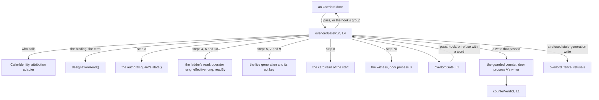
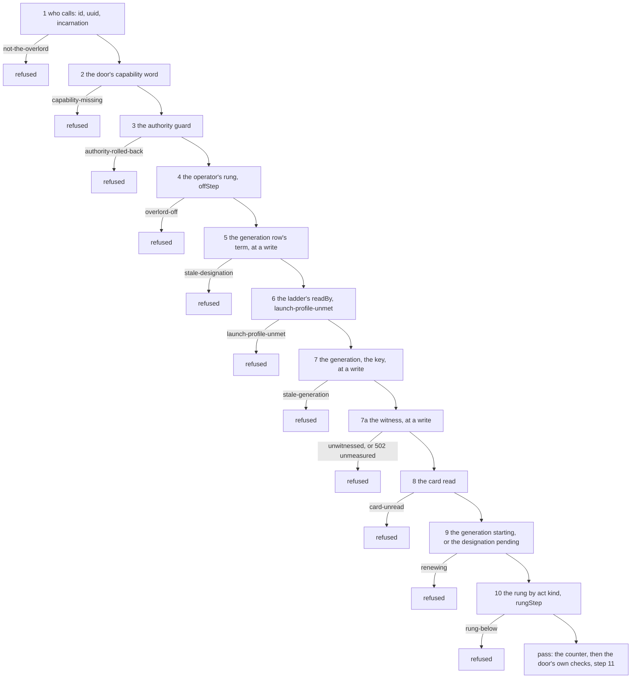

# Overlord W1: gates and identity Implementation Plan

> **For agentic workers:** REQUIRED SUB-SKILL: Use superpowers:subagent-driven-development (recommended) or
> superpowers:executing-plans to implement this plan task by task. Steps use checkbox (`- [ ]`) syntax for tracking.

**Goal:** every Overlord door asks one port who is calling, and one decider whether the call may pass, in one fixed
order, so the first refusal is the same on every door.

- **PR A, identity.**
  - The `CallerIdentity` port (C8, L2) and its one adapter, attribution (C8, L3). It answers who is calling and how
    strongly that is known: `attributed` for a box-token door, `operator` for an operator door that the account gate
    passed or a console with a verified device. No adapter mints `workload` yet.
  - The actor `{kind, subject, issuer}` and the strength as one L0 vocabulary.
  - The designation row's actor gains its kind, issuer and strength as columns, for the live binding's actor and for
    the pending attempt's.
  - The operator's Overlord doors record their actor through the port: designate, retire and the rank door today, and
    each later one as it lands.
  - The verb class of every Overlord route (H3, Table 3.6b), in one table that a census holds to the registrations.
- **PR B, the gate.**
  - The gate order of §11.2 as one L1 decider, `overlordGate`. Its caller check, `callerStandingOf`, refuses
    `not-the-overlord`. Its fence check, `fenceVerdict` with `counterVerdict`, refuses `stale-designation` and
    `stale-generation`. It composes the ladder's `offStep`, `rungStep` and `readBy`.
  - One L4 runner assembles the facts, asks the decider, refuses, advances the act counter through door process A's
    writer, and records a refused `stale-generation` write as a counted fact.
  - W1a's six start-door registrations (card, notes, handover and probe) call it. The timer doors are the Overlord
    timers piece's, which calls it from them.
  - A census reds a door that skips it or does not stop on its refusal.

**Why:** C27 and H28 (identity is attribution today, and says so), H3 (actors on the rows, a verb class on every route),
H12 (the term and the fence), and §11.2 (one gate order, one credential per group). Two facts make the order matter:
attribution can be forged by any process of the fleet user, and the Overlord's body changes with every renewal and
rebind. Today nothing tells the Overlord's call from a coordinator's. `shared/refusal.ts#OVERLORD_REFUSALS` already holds
`not-the-overlord`, `stale-designation`, `stale-generation`, `card-unread` and `unwitnessed` for "gates B", and no door
sends them.

**Architecture:** decide in L1, act in L4, and keep one writer per fact.

- **L0.** A new one-concern sibling, `shared/overlord-identity.ts` (the index's slug `wire-types-in-sibling-modules`).
  It holds the strengths, the actor kinds and issuers, the verb classes, the door groups and the actor's column codec.
  It imports nothing.
- **L2, C8.** `server/src/auth/callerIdentity.ts`: the port and its failure contract. It is declared beside the
  context the spec gives it (Table 11.1c: "C8, L2 and L3"). Its consumers are the gate runner and the operator doors.
- **L3, C8.** `server/src/auth/attributionIdentity.ts`: the attribution adapter. It composes the readers that already
  exist: the box-token lanes' `coord/attribution.ts#attributionVerdict`, the incarnation's double read
  (`coord/delegationLeaseDoor.ts#incarnationOf`), the account gate's minted actor (`accounts/audit.ts#actorOf`) and the
  console's `ccdargv.ts#deviceActor`. It mints the frozen, branded `RecordedActor`, which only it can make.
- **L1, C5.**
  - `server/src/coord/overlordDoors.ts`: the door table `OVERLORD_DOORS`, one row per Overlord route (PR A).
  - `server/src/coord/overlordGate.ts`: the deciders `callerStandingOf`, `fenceVerdict`, `counterVerdict` and
    `overlordGate`. It composes the ladder's `offStep`, `rungStep` and the `readBy` list (PR B).
- **L3, C5.** `server/src/coord/overlordGateStore.ts` (PR B): the counter's guarded adapter over door process A's
  `actKeyStore.ts#advanceActCounter`, and `overlord_fence_refusals` with its one writer and its count.
- **L4, C5.** `server/src/coord/overlordGateRun.ts`, the one runner every Overlord door calls (PR B). It reads each
  fact through a port, asks the deciders, refuses through `refuseRoute`, and records what they tell it to. It spells no
  gate word.
- **L5 and K.** `server/src/server.ts` builds the adapter and the runner once, and hands them to the routes files.


*Figure 1. One door call. The runner reads and records; the deciders decide. A fact whose producer has not landed is
read as its stated default, and every default that can refuse does.*


*Figure 2. The gate order this plan builds. The card, probe, note and handover doors skip steps 3, 4, 6, 8, 9 and 10
(`rungStep` passes them at every W1 rung). The witness sits right after the fence (question 1). `act-ceiling` and `overlordMayAct` arrive with
W2 (question 8).*

**Tech Stack:** TypeScript (ESM), `node:sqlite`, Fastify, vitest. No new dependency. No ccd change.

**Spec:** `docs/superpowers/specs/2026-11-09-overlord-design.md`:

- §3.1: "The row binds an incarnation and carries a term (H12)", and a recreated session with the same name getting
  nothing.
- §3.3.11: the fence (the term, the generation, its act key, the counter, and why), and "Where sessions share a UNIX
  user, the fence is an accident guard".
- §3.6 H2 (`CallerIdentity`) and H3 with Table 3.6b's rows "A credential per session", "Verified identity, and an actor
  on every action" and "A policy hook" (every route's verb class).
- §7.4 whole: C27, the three strengths, no second token, the actors, H28, "A box with sign-in dark has no Overlord",
  the unwitnessed write, and Table 7.4a, the blast radius of a forged Overlord.
- §7.5: the ladder's `effectiveRung` and Table 7.5a's `read-by` row for the launch profile.
- §11.2 whole: Table 11.2's five groups, the gate order, the card, probe and note skips, the timer doors, "After the
  gates", and "A door from a later wave refuses `capability-missing`".
- Table 11.1c (the port's row: C8, L2 and L3, W1), Table 11.1d (each door's capability word), Table 11.6
  (`not-the-overlord`, `stale-designation`, `stale-generation`, `card-unread`, `unwitnessed`, `capability-missing`,
  `authority-rolled-back`, `overlord-off`, `rung-below`, `launch-profile-unmet`, `renewing`).
- Table 13.1: H3 is a `shape` call of W1, so the actor columns and the verb classes ship with the table and the doors
  they shape.

**The index:** `docs/superpowers/plans/2026-11-14-overlord-w1.md`, row "Gates and identity", lane C, two pull requests,
six tasks. The coordinator's brief for this plan (run 2156) corrects the row: the message rows' actor is the private
store's, so PR A adds the actor to the designation row only. Fix round 1 (review 2161) ruled on F1 to F12, each marked
"(ruled, F<n>)" below. "Index changes" lists what the index should carry.

## Open questions

Each carries the answer this plan builds. The index's questions this piece builds on are restated at the end.

1. **Where the witness sits in the order** (slug `witness-after-the-fence`; ruled, F5). §11.2's step 1 says "At a write
   door the hook must also have reported a matching call before it (`unwitnessed`)". Its "After the gates" paragraph
   says "Write doors refuse `unwitnessed` once the fence passes". The place matters, because the third unwitnessed
   write in a day latches the ladder (Table 7.5a). At step 1, a reader started before a renewal, or a forked copy of an
   old body, would count against the Overlord's ladder, and those are the callers the fence refuses as
   `stale-generation`.
   - **Ruled:** the witness is step 7a, right after the fence, in door process B's shape (that plan's
     `witnessVerdict`): `witnessed` carries its `witnessId`, a missing operation key reads `none`, and an unreadable
     witness store answers 502 `unmeasured` and is not counted.
   - **The cost, and its addition (ruled, F5).** A forger without the act key is refused `stale-generation` and never
     reaches the witness, so the unwitnessed latch no longer sees it. So a refused `stale-generation` write at an
     Overlord door is recorded as a counted fact in `overlord_fence_refusals`, for a later cause row. The coordinator
     tells the operator about the weaker tripwire.
2. **The term is the server's to compare** (slug `fence-term-is-the-generation-rows`; ruled, F2). No term header is
   read. Step 5 refuses `stale-designation` unless the caller's live generation row's `term` equals
   `designationRead()`'s term. A missing term on either side refuses, with the detail naming which side:
   - no live generation for the identity;
   - a designation read with no term;
   - a generation row whose term does not read.

   `goLive` re-stamps the new body's live generation with the raised term (the designation plan's X5), so the
   legitimate body passes at once. Confirm the restore raises the term and keeps the body without a re-stamp, so that
   generation stays fenced until the hard renewal it makes due mints one with the raised term (§3.1). The coordinator
   gives door process A the same ruling: its `ACT_TERM_HEADER` is dropped.
3. **The counter has one owner** (slug `act-counter-is-door-process-as`; ruled, F3). Door process A ships
   `continuity_act_keys.counter` and its one writer `actKeyStore.ts#advanceActCounter(g, c)`, which changes the row
   only when `c` is above the stored counter and answers `{changed}`.
   - Gates B adds no column and no second writer. It reaches the writer through one L3 adapter,
     `overlordGateStore.ts#advanceCounterGuarded`. In one transaction, the adapter reads the generation's state and
     refuses an `ended` one, then calls `advanceActCounter`.
   - It answers `advanced`, `not-above`, `ended` or `unmeasured` (a thrown statement).
   - `counterVerdict` (L1, F4) maps each to the gate's answer (question 9's table).
   - The door process serialises its calls, sending one write at a time, so a lower counter that arrives late is a real
     fork and refuses `stale-generation`, detail `fork`. The coordinator gives door process A the same ruling.
4. **The incarnation is checked at step 1, at every door** (slug `incarnation-checked-at-step-one`; ruled, F1). Step 1
   names "its id and its current uuid". §3.1 also binds the registry generation: "A recreated session with the same
   name gets nothing". The designation row holds that incarnation as a string (`bound.generation` and
   `pending.generation`, the UUID ccd records in `$REG/<id>.generation`). The fence's "generation" is a different
   thing: the live generation's number with its act key.
   - **Ruled:** the bound id, or a pending `designate` attempt's id with a recorded incarnation, calling with an
     incarnation that differs is `not-the-overlord` at every door, read or write, the six start doors included. Such a
     caller is never served the hook's way, because the hook's way at a start door writes rows the identity
     `overlord` reads.
   - An incarnation measured absent (`incarnationOf`'s `absent`) is a measured difference, so `not-the-overlord` too
     (review M3).
   - Any other unmeasured incarnation is `registry-unmeasurable` (502), the box-token lanes' word for an unreadable
     registry.
5. **A pending body whose incarnation is not yet recorded** (slug `pending-unrecorded-reads-renewing`). The designate
   door writes the row `pending`, creates the session, then records the pending incarnation once `ws-add` answers. A
   SessionStart's anchor fetch can land in between.
   - Step 1 reads `row.pending.generation`, which designation A's view now carries (ruled, F7; this pull request adds
     it to `w1-designation.md`).
   - **Recommendation:** a caller that is the pending id of a `designate` attempt whose `pending.generation` is `null`
     answers `renewing` (409, retryable), at every door including the card. The start then carries no anchor. The
     first prompt, which the designation sends only after the record, has the body read its card.
   - A rebind's pending body is not the designated session: its identity stays its own until it goes live (the
     designation plan's X5). It reaches the start doors in the hook's group, as any session does, and every
     Overlord-only door refuses it `not-the-overlord`.
6. **The handover door joins the start doors** (slug `handover-is-a-note-door`). §11.2 lets the card, probe and note
   doors skip steps 3, 4, 6, 8 and 9 "so a generation can finish starting". W1a ships the handover note at its own
   door (`POST /api/sessions/:id/handover`), asked only in `checkpointed`. **Recommendation:** the handover door takes
   the same skips. Otherwise step 9 would refuse it `renewing` in the very state that asks for it, and the Overlord's
   renewal would always clear without its note. The door table marks it, with the other start doors.
7. **The operator's reads have the verb class `view`** (slug `operator-reads-are-view`). Table 11.2 gives the operator's
   doors `admin`, and Table 3.6b says "Reads are `view`". **Recommendation:** the class follows the call, not the
   group. A read is `view` in every group. An operator write is `admin`. An Overlord write and a coordinator-facing
   write are `operate`. A hook report is `view`. A spec fix says this in Table 11.2's verb-class column.
8. **The arms whose inputs come later** (slug `gate-arms-join-with-their-inputs`). The ladder ships `rungStep` with W1's
   rung cells (`read`, `write-note` and `acknowledge`), so step 10's rung half is composed here (ruled, F6). Four parts
   of the order read inputs no W1 piece produces:
   - step 4's `mail-disabled` at an answer door, because the answer doors are W3's;
   - step 9's "after a boot … until the boot pass has re-seeded the holds", because the holds are W3's (§6.7);
   - step 10's `act-ceiling`, because the act catalogue's ceilings are W2's;
   - step 11's `overlordMayAct`, with `identity-too-weak` and `server-not-isolated`, which is W2's.

   **Recommendation:** W1's decider has no input for any of them, and the wave that ships each input adds its arm at
   its place, with a case of `first-refusal` (Task 4). This follows the ladder's ruled rule for cause rows (the index's
   question 20). The four words stay on the vocabulary's wave map.
9. **What each fact refuses with** (slug `unmeasured-refuses-at-its-step`). No step reads an unmeasured fact as a pass,
   and none folds it into a value. Each refuses at its own step, with that step's own word or an existing word for an
   unreadable store, so Table 11.6 gains no word:

   | Fact | Refusal, when not passing | Why that word |
   |---|---|---|
   | The registry, for attribution or the incarnation | `registry-unmeasurable` (502); an absent incarnation is `not-the-overlord` | the box-token lanes' word (`coord/attribution.ts`); absence is measured (question 4) |
   | `designationRead()`'s third arm | `unavailable` (503), "the designation row could not be read", for every caller at every Overlord door, coordinators at the start doors included | the designation doors' word for the same arm (question 13) |
   | The authority guard, `unmeasured` | `authority-rolled-back` (503), its cause in the detail | the authority plan's rule: unmeasured refuses as rolled-back does |
   | The ladder | `unavailable` (503), "the ladder could not be read" | the ladder's own read door answers the same |
   | `readBy` naming `launch-profile-unmet`, `standing` or `unmeasured` | `launch-profile-unmet` (409), its reading in the detail | step 6's own word (ruled, F6) |
   | The generation rows, missing or with no term | `stale-designation` at step 5, `stale-generation` at step 7 | a missing side refuses (question 2) |
   | The generation rows or the act key, unreadable | `unavailable` (503) | an unreadable `coord.db`, never a stale generation (ruled, F12) |
   | The counter's compare-and-set | `not-above` and `ended`: `stale-generation`; `unmeasured`: `unavailable` | `counterVerdict` (ruled, F4) |
   | The card read | `unavailable` (503) | an unreadable `coord.db` |
   | The witness | `unwitnessed` (409) with its `why`; unreadable: `unmeasured` (502), not counted | door process B's shape (ruled, F5) |
10. **Who records what** (slug `the-runner-records-the-gates-facts`). The runner records two facts, each through its
    one writer:
    - the witness check, through door process B's `recordWitnessCheck`: `used` with its id on a pass, `unwitnessed`
      on a refusal, and nothing on `unmeasured`. Door process B binds it, with the latch that reads it;
    - a refused `stale-generation` write, through `recordFenceRefusal` (question 1).

    Gates B ships the call sites. Until door process B binds its reader and recorder, the witness reads `unmeasured`
    and nothing is counted.
11. **The rank door's dark actor** (slug `rank-door-dark-actor-stays-flag-off`). The portfolio's rank door confers no
    authority and works while sign-in is dark, recording `flag-off` (the portfolio's slug `rank-works-dark`). §7.4's
    strengths have no word for "nobody signed in". **Recommendation:** the port's console arm answers three kinds:
    - `signed-in`, with the device's actor at `operator` strength;
    - `device-unmeasured`, a session with no device label, recorded as `unmeasured` as today, with no strength
      (review M7);
    - `dark`, recorded as `flag-off`, with no strength.

    No fourth strength is added. The ladder's lowering doors (Rung down, Pause, `off`) work dark the same way and use
    this arm (review M2).
12. **A forged card read** (slug `card-record-is-fenced`; ruled, F9). A full read of every page of the card records
    `continuity_card_reads`, and `cardReadOfStart` joins it to the generation's start by session id and uuid. So a
    caller with the token and the uuid could set step 8's fact without the model having read anything.
    - **Ruled:** for the designated session, the page that would record the read goes through the gate as a write
      (row `card-record`: steps 5, 7, 7a and the counter) before `insertCardRead`. A refusal records nothing and
      answers the refusal.
    - The anchor form and the other pages stay reads (row `card`).
    - The door process must therefore present its key, counter and operation key on the card tool, the one `view`
      tool that does (Index changes).
13. **An unmeasured designation at the start doors** (slug `start-doors-fail-closed-on-an-unread-designation`; ruled,
    F10). The start doors cannot tell whether a caller is the Overlord while `designationRead()` answers `unmeasured`.
    **Ruled:** every caller is refused `unavailable` there, coordinators included, at all six registrations. The
    designation plan names `unmeasured` as a malformed row or an unreadable `coord.db`, which already fails the
    server's own lanes. The remedy signal is the designation's operator push from the mail pace, once per episode (the
    designation plan's fail-closed table). The characterization test covers the measured path. A separate test pins
    the unmeasured one.

The index's questions:

- **Q17** (`CallerIdentity` and the operator's doors): built as recommended. The port has one adapter, attribution.
  The operator's doors keep `server/src/accounts/gate.ts#createAccountGate` and record its actor through the port at
  `operator` strength. No second cookie reader: the port reads the gate's pass or the session gate's device, never the
  cookie. This also adopts the port half that the portfolio plan left to gates A (its slug
  `rank-door-ships-with-its-table`).
- **Q16** (a late or lost witness refuses `unwitnessed`): built, at the place of question 1.
- **Q19** (the rung door stops at `chat`): read as built by the ladder. `rungStep` allows every W1 cell at `chat`.
- **Q20** (the ladder's causes join with their inputs): this plan adds no cause row. It records the fence refusals a
  later cause row may count.
- **Q33** (no separate server-side `overlord-v1` gate for designate and rebind): unchanged. Those are operator doors,
  and step 2 binds only the Overlord's own doors (Table 11.2's first group).

## What exists today

Measured on `origin/main` at `f25c710e1` (2026-11-15). Portfolio A (#2842) and the journal kernel (#2848) are merged,
and so are the designation, private store and ccd arms plans. The ladder, authority journal and door process plans are
read from their branches (`ws/overlord-plan-w1-ladder`, `ws/overlord-plan-w1-authority`, `ws/overlord-plan-w1-door`).
None of their code is on `main`.

- **The account gate.** `server/src/accounts/gate.ts#createAccountGate` returns `gate(req, reply, { cap, stepUp })`.
  It refuses in order `auth-off`, `insecure-origin`, `unauthenticated`, `unsupported` and `step-up-required`, and a
  pass answers `{ pass: true, actor, sessionIdHash }` (`AccountGateAnswer`). The actor is
  `server/src/accounts/audit.ts#AccountActor`, frozen, minted only by `actorOf(device, idHash)` and checked by
  `isMintedActor`. Its text is `<label> <8 hex>`. The gate reads the cookie through `deps.sessionAuth`. Nothing else in
  the Overlord's doors needs to.
- **The console's device actor.** `server/src/ccdargv.ts#deviceActor(device)` answers `device:<label>`, or `unmeasured`
  for no device. The rank door, `POST /api/portfolio/rank` in `server/src/coord/ledgersRoutes.ts`, records
  `deps.authEnabled ? deviceActor(deps.sessionAuth(req).device) : 'flag-off'` into `portfolio_rank.setBy`.
- **Attribution.** `server/src/coord/attribution.ts#attributionVerdict(io, cfg, whoId, whoUuid, uuidField)` reads the
  sender's one registry row and answers `{ ok: true }`, or `registry-unmeasurable`, `unknown-sender` or `stale-uuid`
  with a detail (`server/src/coord/openRun.ts#AttributionRead`). It never folds an unreadable row into a stale uuid.
  `server/src/server.ts` builds the continuity routes' `attributeReader` over it.
- **The box token.** `server/src/coord/token.ts#checkMailToken(expected, presented, lane)` answers `ok`, `legacy`, `bad`
  or `unconfigured`. Every box-token door checks it in its `onRequest` hook and refuses `unauthenticated` with a
  detail. In `server/src/continuity/routes.ts` that detail is the file's `TOKEN_DETAIL` map.
- **The incarnation.** `server/src/coord/delegationLeaseDoor.ts#incarnationOf` reads `$REG/<id>.generation` twice and
  answers `{ kind: 'measured', incarnation }` or `{ kind: 'unmeasured', reason }`, where `reason` `absent` is a
  measured absence. Its answer type is named once, `server/src/continuity/timerLane.ts#IncarnationRead`, and this plan
  imports that name. The continuity routes take the reader as `ContinuityRouteDeps.setterStamp`.
- **The W1a doors a designated session calls**, all in `server/src/continuity/routes.ts#registerContinuityRoutes`, each
  a box-token door listed in `server/src/auth/gate.ts`'s `EXEMPT`:
  - `GET /api/sessions/:id/card` (and its `part=anchor` form, which records nothing);
  - `POST` and `GET /api/sessions/:id/notes`;
  - `POST /api/sessions/:id/handover`;
  - `GET` and `POST /api/sessions/:id/probe`.

  Each checks the token in `onRequest`, then that `byId` is the path's session (`not-owner`), then the body or query,
  then `deps.attributeReader(id, uuid)`. None reads the designation.
  - Notes are written and listed by the session id (`appendNote({ identity: id })`, `liveNotes(id)`). Designation A
    routes only `liveGenerationOf` and `anchorReads` through `identityOf`, so a rebind's new body does not see the old
    body's notes. That is not this piece's to change (Index changes, review M9).
  - The file's other registrations are the hook's start report, the timer doors (the Overlord timers piece's) and the
    operator's timer read and cancel (`CONTINUITY_SESSION_DOORS` in `box-token-census.test.ts`).
- **The generations.** `CoordStore.liveGenerations()` answers the live `continuity_generations` rows or a failure.
  `server/src/continuity/continuityStore.ts#GenRow` carries `identity`, `term`, `rowIncarnation`, `n`, `state`,
  `shadowState` and `startId`. `effectiveGeneration(row, live)` is the one accessor for a generation's state, shadow
  or live. `cardReadOfStart(db, startId)` answers a generation's newest full card read with `current`, whether its
  hash is the session's current card, or `read: null`, or a failure. `insertCardRead` is that table's one writer,
  called by the card door.
- **The capability words.** `shared/api.ts#SERVER_CAPS` derives from `SERVER_CAP_MAP` and holds `timers-v1` among
  others. It does not yet hold `continuity-v1` (W1a's last piece adds it) or `overlord-v1` (W1's last piece).
- **The refusal words.** `shared/refusal.ts#OVERLORD_REFUSALS` holds every gate word this plan sends except `renewing`,
  with its status: `not-the-overlord` and `rung-below` 403; `capability-missing` 501; `authority-rolled-back` 503;
  `overlord-off`, `stale-designation`, `stale-generation`, `card-unread`, `unwitnessed` and `launch-profile-unmet` 409.
  - `unavailable` (503), `registry-unmeasurable` (502) and `unmeasured` (502) are among `REFUSAL_STATUS`'s generic
    words.
  - `renewing` is on the vocabulary's wave map as a W1a word, and is not yet in `shared/refusal.ts`. W1a's renewal
    hand-offs adds it (409): `docs/superpowers/plans/2026-11-10-overlord/w1a-renewal-handoffs.md`, not yet built.
  - `stale-generation` is also the delegation lease's word, held on `main` by
    `server/src/coord/delegation-lease-state.ts#DELEGATION_LEASE_ACT_REFUSALS`, `server/src/coord/delegationLeaseDoor.ts`
    and `server/src/retire.ts`. One spelling, two doors, as `REFUSAL_STATUS` allows.
- **Roles.** `server/src/roleOf.ts#roleOf` answers `overlord` when `RoleFacts.designation` is `pending` or `live`.
  `roleFactsOf` fixes `designation: 'none'` until designation A passes its reader in.
- **What designation A ships** (`w1-designation.md`, on `main`):
  - `overlord_designation` with `actor TEXT NOT NULL` and `pendingActor TEXT`, each the account gate's actor text;
  - its writers `designatePending`, `bindPendingGeneration`, `goLive`, `failPending`, `retire` and `stopDone`;
  - `designationRead()`, answering exactly three arms (its X7): `{ kind: 'designated', sessionId, term, row }`,
    `{ kind: 'not-designated', row }` (no row, or no live binding, a pending-only row among them), or
    `{ kind: 'unmeasured', why }`. `row.bound` holds `sessionId` and `generation`, the incarnation string.
    `row.pending` holds `sessionId`, `kind` (`designate` or `rebind`), `deadlineAt` and, from this pull request's edit
    (F7), `generation`, `null` until the create answers;
  - `server/src/coord/overlordRoutes.ts`, registering designate (`POST /api/overlord/designate`), retire
    (`DELETE /api/overlord/designate`) and the read (`GET /api/overlord/designation`);
  - `identityOf(sessionId, designation)`, which answers `overlord` for the live bound id and for a pending `designate`
    attempt's id, and takes no incarnation;
  - a mail-pace operator push on an unmeasured designation, once per episode.
- **What the ladder ships** (its plan, on its branch):
  - `offStep(operatorRung, DoorClass)`, which refuses `overlord-off` only at `off` and only for `other`;
  - `rungStep(effective, DoorClass, act)`, with W1's cells `read`, `write-note` and `acknowledge`, each allowed at
    `chat`;
  - `EffectiveRung` with `rung`, `operatorRung` and `readBy`, whose W1 reader word is `launch-profile-unmet`, filled by
    sandbox B's condition row;
  - `DoorClass` (`card-probe-note` or `other`);
  - the lowering doors, which work dark with the actor `flag-off`.
- **What the authority journal ships** (its plan, PR A): `OverlordAuthorityGuard.state()`, answering `{ kind:
  'coherent' }`, `{ kind: 'rolled-back', cause }` or `{ kind: 'unmeasured', why }`. "Gates B: `state()` for step 3".
- **What door process A and B ship** (its plan):
  - **A:** `shared/continuity-door.ts`, with the headers `ACT_KEY_HEADER` (`x-ccrc-act-key`), `ACT_COUNTER_HEADER` and
    `ACT_GENERATION_HEADER`. `ACT_TERM_HEADER` is dropped by the coordinator's ruling on F2.
  - **A:** `continuity_act_keys` (`generationId`, `keySha256`, `counter`), with `actKeyStore.ts`'s writers `issueActKey`,
    `noteRefusedClaim` and `advanceActCounter(g, c)` ("gates B's fence step is its one writer"), and `actKeyOf`.
  - **B:** `continuity_witness_checks`, its writer `hookReportStore.ts#recordWitnessCheck`, and
    `hookReports.ts#witnessVerdict`, answering `{ witnessed, witnessId }`,
    `{ unwitnessed, why: 'none' | 'stale' | 'used' | 'reader-scope' | 'before-generation' }` or
    `{ unmeasured, why }`. The witness key is the `x-ccrc-witness-key` header (door process F20), and a missing one is
    `none`. `x-ccrc-op-key` is W2's operation key, never the witness. W2's act rows A adds the operation-key lookup to
    this runner, after the step-7 fence and before step 7a, scoped to the session and generation; a hit consumes no
    witness and counts toward no latch (the W2 index, question 3).
- **What the private store ships** (its plan): `operator_messages.actor` from its first migration, filled from the
  account gate's pass. `recordMessage` refuses an actor `isMintedActor` refuses.
- **The censuses this piece meets** (measured):
  - `server/test/rings/fastify-l4.data.ts#FASTIFY_L4_ALLOWLIST`: one entry for each new file that imports Fastify (the
    runner).
  - `server/test/single-definition/time-ports.test.ts`: its families cover every `server/src/**/overlord*.ts` and
    `shared/overlord*.ts`. The two new `server/src/auth/` files are outside them, so they join `TIME_PORT_FILES`.
  - `server/test/single-definition/writers-map.test.ts#TABLES`: `overlord_fence_refusals` joins with its one writer.
  - `server/test/rings/wire-totality.test.ts`: every exported literal union in `shared/*.ts` needs a sibling
    `Record<X, true>` map or an `is X` guard.
  - `server/test/rings/shared-imports.test.ts`: a `shared/*.ts` file imports only its `./` siblings.
  - `server/test/sim/mutation-floors.test.ts#MUTANT_SETS` and `server/test/sim/mutation-floors.json`.
  - `server/test/run-close-switch.test.ts` and `server/test/coord-db.test.ts`, for each migration.
  - `server/test/box-token-census.test.ts` holds `continuity/routes.ts`'s session-gated registrations to
    `CONTINUITY_SESSION_DOORS` in both directions.
  - No new route, so `auth/gate.ts`'s `EXEMPT`, `auth-gate.test.ts`, `secret-mask.test.ts`'s `MASKED_GET_ROUTES`,
    `coord-pause-route.test.ts` and `CLAUDE.md`'s box-token paragraph do not change.
- **The growth check.** `server/test/growthCheck.ts#GROWTH_FILES` lists `server/src/server.ts`,
  `server/src/coord/store.ts` and `server/src/coord/schema.ts` among this piece's files, at 40 net code lines each per
  pull request. `server/src/continuity/routes.ts`, `server/src/coord/ledgersRoutes.ts` and the plan files are not
  listed.
- **Migrations on `main`:** 76 (the portfolio) is the last. This plan takes no number. The builder takes the next one
  at build time.

## What the port proves, and what it does not

Identity on the fleet is attribution, not authentication (`CLAUDE.md`). The port says so in its answer: the strength
is part of every answer, and the adapter can mint only what it measured.

| Strength | What the server verified | What it proves | What it does not prove |
|---|---|---|---|
| `attributed` | The box token at the door's `onRequest`; a registry row for the id; the call's uuid equals that row's current `.uuid`; at an Overlord door, the incarnation equals the binding's | The caller can read files the fleet's one UNIX user can read: the token file, and that session's `.uuid` and `.generation` | That the caller is that session's process; that a model turn is behind the call (the witness's job, step 7a); that it is not another session or a stray process of the same user |
| `operator` | The console's sign-in cookie, through the session gate, and at a gated door the account gate (passkey sign-in) with its step-up where the door asks | A person holding a registered passkey acted from a console in the session's lifetime, or within five minutes with a step-up | Who the person is beyond the device label, and that the console was not left open |
| `workload` | Nothing yet: no adapter mints it in W1 | A credential only that session's sandbox can read (#273, #275), once an agent advertises one and the server verifies it | n/a until then |

**The fence on a shared user.** The fence adds the live generation's act key and its counter, and the key is held only by
that generation's door process (§3.6). On a box where every session runs as one user, the fence is an accident guard
(§3.3.11). It stops a reader started before a renewal, the old body after a rebind, and a forked copy. It does not stop
a deliberate process of the same user that can read the door process's memory, or that presents the launch nonce first.

**What a forged caller reaches** (Table 7.4a, read against W1; corrected, F9). A process of the fleet user can read the
box token and any session's `.uuid` and `.generation`, so it passes step 1 as the Overlord.

- Without the act key, it reaches the Overlord's reads.
  - The private store's read doors (the board, `messages`, the inbox and history) each leave a read-ledger line under
    the read ceilings. That ledger is the detector (§7.4).
  - The card, notes and probe reads leave no ledger line. They have no detector beyond their own stamps, as the
    spec's H10 already accepts.
  - Every write it tries is refused `stale-generation` and recorded in `overlord_fence_refusals` (question 1).
- It cannot set step 8's fact by reading the card, because the recording page is fenced (question 12).
- With the act key too, it passes every gate the real Overlord passes. In W1 the rung door caps the ladder at `chat`
  (the index's question 19), so it reaches the Overlord's own records: notes, probe answers, the handover note, a card
  read, and later its timers and `acknowledge`. A forged note feeds the next generation's card, which the card's
  untrusted-data framing and the probes are there to catch.

It does not reach:

- the operator's words, which only the console's prompt route writes;
- the designation and Confirm the restore, which are cookie doors behind the account gate's step-up, and a raise of the
  ladder, which takes the step-up too. A lowering of the ladder needs no gate, and lowering is always safe;
- anything above `chat`, which the rung door refuses in W1.

Once the isolation word lands, a `shared-user` box caps the ladder at `advise` (H28), so from W2 such a caller reaches
what `advise` allows (requests, relays, follow-ups and briefs), each an act row with its strength `attributed`,
overturnable (§10.3). It never reaches a grant, a command or learning, which `overlordMayAct` refuses
`server-not-isolated` there. That cap, not this port, is what bounds a forger. This port's part is to say on every row
how little `attributed` proves, so the cap can be computed and the operator can read it.

## Global Constraints

- **Architecture (`CLAUDE.md`).**
  - One writer per fact.
    - The designation row's actor columns are written only by designation A's writers, which take a `RecordedActor`.
    - The act counter is written only by door process A's `advanceActCounter`. Gates B reaches it through one guarded
      adapter and adds no column.
    - `overlord_fence_refusals` is written only by `recordFenceRefusal`.
    - The witness checks are written only by door process B's `recordWitnessCheck`.
    - `OVERLORD_DOORS` is one table, and each piece that adds an Overlord route adds its row.
    - The strength is minted only by the adapter.
  - Decide in L1, act in L4.
    - `overlordGate.ts` has runtime imports from L0 and the ladder's L1 deciders only, and type-only imports for the
      rest (`AuthorityState`, `IncarnationRead`, `WitnessVerdict`, `Rung`). It takes every fact as an argument: no
      `fs`, no Fastify, no clock.
    - `overlordGateRun.ts` reads, asks and records. It holds no `if` over a gate word and spells none.
    - The doors call the runner and act on its answer.
  - Ports at the edges, declared by their consumer. `CallerIdentity` sits in C8 by the spec's table. The runner's fact
    readers are an L2 interface in `overlordGateRun.ts`'s own deps, filled at L5. A reader whose producer has not
    landed is bound to a stated default that refuses, never to a stub that passes.
  - Consolidate, don't duplicate.
    - The adapter calls `attributionVerdict`, `incarnationOf`, the account gate's minted actor and `deviceActor`. No
      second registry reader, no second cookie reader and no second token check.
    - The W1a doors swap their `attributeReader` call for the runner's, which runs the same `attributionVerdict` once.
    - The gate's facts come from the owners' readers: `designationRead()`, `state()`, `effectiveGeneration`,
      `cardReadOfStart`, `actKeyOf`, the ladder's read and `witnessVerdict`.
    - Steps 4, 6 and 10 are the ladder's `offStep`, its `readBy` list and `rungStep`. There is no profile port of its
      own (ruled, F6).
  - No ceremony.
    - The port has one adapter because it is a port at an edge (H2, #273, #275).
    - No interface with one implementation inside the server.
    - The door table holds only the columns the gate and the census read.
- **Failure contracts (fail closed).**
  - The port never throws, except `operator()` on a look-alike actor, which is a programming error.
    - `session()` answers a caller, or `registry-unmeasurable`, `unknown-sender` or `stale-uuid` with a detail,
      exactly as `attributionVerdict` does.
    - `incarnation()` answers `IncarnationRead`, `absent` kept apart from every other reason.
    - `operator()` takes only a minted `AccountActor`, as `isMintedActor` refuses a look-alike today.
  - The runner never throws, and every fact it cannot read refuses at its step (question 9). No step reads
    `unmeasured` as a pass.
  - No overloaded null at a seam. `designationRead()`'s three arms stay three. `pending.generation: null` means only
    "not recorded yet". A caller that is not the Overlord at a start door is the hook's group (`{ kind: 'hook' }`),
    never "passed". `keyMatches` answers `match`, `mismatch`, `unissued` or `unmeasured` (ruled, F12).
  - An older peer. A door process that presents no key at a write door refuses `stale-generation`, with the detail "no
    act key presented". A row of `coord.db` written before PR A's migration reads its actor's kind, issuer and strength
    from the migration's defaults (Task 3).
- **What a merge arms.**
  - PR A: nothing a running session sees.
    - The migration's defaults describe every row designation A can have written: only the account gate's doors write
      it.
    - The designate, retire and rank doors record the same subject text as before.
  - PR B: nothing a running session sees while the designation reads, unless the operator has designated an Overlord,
    which the console offers only under `overlord-v1`.
    - A coordinator's card, notes, handover and probe calls answer byte for byte as before while the designation reads
      `designated` or `not-designated`. Task 6 pins this with a characterization test written green on `main` first.
    - While the designation reads `unmeasured`, every caller at the six start doors is refused `unavailable` (question
      13). On `main` today no designation row exists, and a missing row is `not-designated`, so this arms only on a
      malformed row or an unreadable `coord.db`.
    - A designated Overlord's calls run the gate from the merge. Its writes need the fence (door process A) and a
      witness, which reads `unmeasured` and refuses 502 until door process B binds its reader. So an Overlord
      designated before door process B cannot write its notes or probe answers, or record its card read, and its
      generations never prove. That is fail closed, and it is why `overlord-v1` waits for every W1 piece.
    - Before sandbox B adds its `read-by` row, `readBy` names no `launch-profile-unmet`, so step 6 passes. No body
      goes live before sandbox B, because `goLive` is called only from sandbox B's settle step.
- **SAFETY (`CLAUDE.md`).** No ccd verb, no file on a fleet host, no secret printed.
  - The act key is compared as a sha256 digest with `timingSafeEqual`, and is never logged or put in a refusal's
    detail.
  - Tests use `server/test/helpers.ts#testDeps` and fixture registries. No test runs ccd or reads the live `$HOME`.
- **Growth check.** Every growth-checked file stays within 40 net code lines per pull request, with no waiver. The
  estimates are in the PR split. A task that measures over its row stops and asks; it never plans a waiver.
- **Mutation floors.** New L1 deciders, each in `MUTANT_SETS` through a new `server/test/sim/gateSets.ts`, and in
  `mutation-floors.json` at floor 1, in its task's pull request:
  - `readActorColumns` (PR A);
  - `callerStandingOf`, `fenceVerdict`, `counterVerdict` and `overlordGate` (PR B).

  The door table is data, and its census is the guard. Each new arm ships a test that goes red when the arm is deleted,
  measured by hand with `mutation-run.py` (`../ccrc-coordinator/references/mutation-run.py`), as each task says.
- **Tests.** From `server/`: `ccrc test -- ./node_modules/.bin/vitest run test/<file>.test.ts`. A task's last run adds
  `ccrc test -- ./node_modules/.bin/tsc --noEmit -p tsconfig.json` and `-p test/tsconfig.tests.json`. For a `shared/`
  change, add `cd ../pwa && ccrc test -- ./node_modules/.bin/tsc --noEmit`.
- **Public repository.** Fixtures use `lane-a`, `lane-b`, `pool-a` and the `overlord` project. Device labels in tests
  are neutral (`device-a`). Cite by symbol or `@anchor`. No D-number is invented. A builder's new departures go in
  `docs/superpowers/plans/2026-11-14-overlord-w1/w1-gates/notes.md`.

## Review Focus

1. **One decider, every door, and the door stops.** No Overlord door decides a gate word itself.
   - The census reds a door whose registration does not call the runner with its own row's key before any store
     access, or does not return at once on `refused`.
   - The single-definition scan reds any other file under `server/src` that spells a gate word.
   - A planted door without the call, and one that goes on after `refused`, are red.
   - The doors suite asserts that a refused call wrote nothing, at `hook` rows too.
2. **A recreated body gets nothing.** The bound id, or a recorded pending `designate` id, with another incarnation is
   refused `not-the-overlord` at all six start doors, read and write, and never served the hook's way.
3. **The first refusal wins.** `overlordGate` is tested over its whole input domain against an oracle written in the
   test, so a swapped step is red. A behavioural test drives every door row and checks the first refusal there.
4. **Unmeasured never passes.** For each fact, replacing a passing value with its unmeasured arm never turns a refusal
   into a pass, and turns a pass into a refusal at that fact's step (a property over the generated domain).
5. **Coordinators are untouched while the designation reads.** At the six start-door registrations, a session that is
   not the Overlord goes the hook's way, and its answers are the characterization test's, byte for byte. An unmeasured
   designation refuses them, as question 13 rules.
6. **The port claims no more than it measured.**
   - The adapter mints `attributed` only after attribution passes, and `operator` only from a minted gate actor or a
     verified device.
   - Nothing mints `workload`.
   - `RecordedActor` is frozen and branded, so a store writer refuses a string or a raw `AccountActor` at compile time
     (`@ts-expect-error` lines that go red if the type widens). The designation writers also refuse an actor whose kind
     or strength is not `operator`.
7. **The fence.**
   - A rebind's old body, a generation ended by a renewal, a generation row whose term is not the designation's, a key
     that is not the live generation's, and a counter not above the stored one each refuse.
   - Two racing writes with one counter: one passes and one refuses `stale-generation`.
   - The act key never reaches a log or a refusal's detail.

## The PR split

Net code lines, as `server/test/growthCheck.ts` counts them (comments and blank lines dropped), estimated against
`origin/main` at `f25c710e1` plus designation A as its plan describes it.

| PR | Tasks | What it ships | Needs first | Growth-checked files, estimate |
|---|---|---|---|---|
| A | 1 to 3 | The identity vocabulary and the door table with its census; the `CallerIdentity` port and the attribution adapter; the designation row's actor columns; the designate, retire and rank doors recording through the port | designation A | `server/src/coord/schema.ts` about +14 (one migration: six `ADD COLUMN`s of two lines each, and its comment dropped); `server/src/server.ts` about +8 (the adapter's construction, and `identity` in two deps objects); `server/src/coord/store.ts` about +2 (the designation delegates' actor type); `shared/api.ts` 0 |
| B | 4 to 6 | `callerStandingOf`, `fenceVerdict`, `counterVerdict` and `overlordGate`; the runner, its fact ports, the guarded counter and the fence-refusal record; the W1a start doors wired, the card record fenced; the gate census | PR A, the ladder, door process A, W1a's renewal hand-offs (for `renewing`) | `server/src/coord/schema.ts` about +10 (one migration: `overlord_fence_refusals` and its index); `server/src/server.ts` about +18 (the runner, its fact readers and their defaults, and `gate` in two deps objects); `server/src/coord/store.ts` about +3 (two delegates) |

For scale, the files that are not growth-checked change by about:

- new files: `shared/overlord-identity.ts` +90, `server/src/auth/callerIdentity.ts` +60,
  `server/src/auth/attributionIdentity.ts` +100, `server/src/coord/overlordDoors.ts` +90 (PR A);
  `server/src/coord/overlordGate.ts` +230, `server/src/coord/overlordGateRun.ts` +190 and
  `server/src/coord/overlordGateStore.ts` +70 (PR B);
- `server/src/coord/overlordDesignationStore.ts` +40 and `shared/overlord-designation.ts` +4 (PR A, the actor columns
  and the four-column clears), `server/src/coord/overlordRoutes.ts` +4 (PR A), `server/src/coord/ledgersRoutes.ts` +3
  (PR A, the rank door);
- `server/src/continuity/routes.ts` +40 (PR B, six registrations at about five lines each, and the card record's
  gate).

## Index changes

The coordinator makes these in its own index edit. This plan edits one other plan, `w1-designation.md` (F7, ruled).

- **The row.**
  - A: "actor columns on the designation row" (the message rows' actor is the private store's, ruled). A also
    routes the operator doors' actor through the port: designate, retire, the rank door, and whichever of the
    following has landed. The pieces that land later call the port themselves.
    - the private store's prompt route, whose `recordMessage` then checks `isRecordedActor` in place of
      `isMintedActor` (review M1);
    - portfolio B's ratify door;
    - the ladder's operator doors: a raise through `identity.operator`, and the lowering doors through
      `identity.console` (review M2);
    - Confirm the restore.
  - B: "the gate order of §11.2 as one L1 decider, composing the ladder's `offStep`, `rungStep` and `readBy`; the
    fence check (`stale-designation`, `stale-generation`) with `counterVerdict`; `not-the-overlord` with the
    incarnation; `card-unread`; the witness's step in door process B's shape; the runner that every Overlord door
    calls, with the guarded counter and the fence-refusal record; W1a's card, notes, handover and probe doors wired
    for the designated session, the card's recording page fenced; and the census".
  - B's "Needs first" gains W1a's renewal hand-offs, for the word `renewing`, as a dashed arrow in Figure W1 (`RH -.->
    GB`).
- **Where lanes meet.**
  - `server/src/coord/overlordDoors.ts#OVERLORD_DOORS` is an append-only registry. Each piece that registers an
    Overlord route adds its row in the same pull request, and the census holds the table to the registrations in both
    directions, for every file a row names:
    - designation B and C, the ladder, portfolio B and Confirm the restore, for their operator doors;
    - the inbox, the board and history, the sequence's cursor read and the Overlord's timers, for the Overlord's own
      doors.
  - Every later Overlord door calls `overlordGateRun` with its row's key and returns on `refused`. Every later operator
    door records its actor through `CallerIdentity`.
  - The Overlord's timers piece adds the timer doors' rows (word `timers-v1`, the start-door skips not taken), calls
    the runner from them, and moves them off the census's not-an-Overlord-door list in `continuity/routes.ts`.
  - The runner's fact ports are bound in `server/src/server.ts`, one line each. Gates B binds every one whose producer
    has landed. Door process B binds the witness reader and `recordWitnessCheck`, and adds the unwitnessed latch where
    it records.
  - The counter: door process A's `continuity_act_keys.counter` and `actKeyStore.ts#advanceActCounter`, called only
    through gates B's guarded adapter. "The act-key columns of `continuity_generations`" in the lane B list becomes
    `continuity_act_keys` (ruled, F3).
  - The core-vocab scan's holder list (Task 6) gains door process A's claim door file (`stale-generation`) and door
    process B's `hookReports.ts` (`unwitnessed`) from whichever of those pieces lands after gates B, or gates B lists
    them if they landed first (review M5).
  - `server/src/auth/` (C8) gains the port and its adapter. No other lane edits them.
- **The ladder's row** says gates B composes `offStep`, `rungStep` and `readBy`. Sandbox B adds its `read-by` row and
  binds nothing in gates B (ruled, F6).
- **Door process A's plan:**
  - drops `ACT_TERM_HEADER` (ruled, F2);
  - serialises its calls, one write at a time (ruled, F3);
  - presents its key, counter and operation key on the card tool, the one `view` tool that does, because its recording
    page is fenced (F9).
- **Door process B's plan:** gates B ships step 7a and its arms in that plan's `WitnessVerdict` shape and the runner's
  call to `recordWitnessCheck`. Door process B binds the reader and the recorder and adds the latch, and needs gates B,
  as its own Figure W1 edge (`GB --> DPB`) says (ruled, F5).
- **The designation's view** gains `pending.generation: string | null` (this pull request edits `w1-designation.md`,
  ruled, F7). Every pending clear (`failPending`, `goLive`, retire's cancel and rebind's) nulls the four pending actor
  columns together (ruled, F11; Task 3).
- **An open item for the index:** after a rebind the new body does not see the old body's notes, because notes are
  keyed by session id (review M9). The designation piece or the private store's "message as a note key" may own keying
  the Overlord's notes by its identity. Gates changes nothing there.
- **Lane C's files** gain `shared/overlord-identity.ts`, `server/src/auth/callerIdentity.ts`,
  `server/src/auth/attributionIdentity.ts`, `server/src/coord/overlordDoors.ts`, `server/src/coord/overlordGate.ts`,
  `server/src/coord/overlordGateRun.ts` and `server/src/coord/overlordGateStore.ts`. Shared with other lanes:
  `server/src/continuity/routes.ts` (the start doors' runner calls and the card record's gate) and
  `server/src/coord/ledgersRoutes.ts` (one actor line).
- **The operator's sight:** the coordinator tells the operator that the witness after the fence weakens the unwitnessed
  tripwire against a forger without the key, and that the fence refusals are recorded for a later cause row (F5).
- **Spec fixes:**
  - §11.2's step 1 drops its `unwitnessed` sentence, and "After the gates" places the witness right after the fence
    (question 1);
  - §11.2's step 1 names the incarnation beside the id and uuid (question 4);
  - §11.2's start-door skips name the handover door (question 6);
  - Table 11.2's verb-class column: reads are `view` in every group (question 7);
  - §3.3.11's fence: the server compares the generation row's term, and the call presents none (question 2);
  - §3.3.5's card: the read that completes a card is fenced for the Overlord (question 12).

---

### Task 1: The identity vocabulary and the door table (PR A)

**Files:**
- Create: `shared/overlord-identity.ts` (L0, imports nothing)
- Create: `server/src/coord/overlordDoors.ts` (C5, L1, imports L0 only)
- Create: `server/test/overlord-identity-vocab.test.ts`, `server/test/overlord-doors-census.test.ts`
- Create: `server/test/sim/gateSets.ts` (the mutant sets of PR A and PR B)
- Modify: `server/test/sim/mutation-floors.test.ts` (imports `GATE_MUTANT_SETS`), `server/test/sim/mutation-floors.json`

**Interfaces:**

```ts
// shared/overlord-identity.ts
/** How strongly the server knows who is calling (§7.4). Only the attribution adapter mints one. */
export const CALLER_STRENGTH_MAP = { attributed: true, workload: true, operator: true } as const;
export type CallerStrength = keyof typeof CALLER_STRENGTH_MAP;
export const CALLER_STRENGTHS = Object.keys(CALLER_STRENGTH_MAP) as CallerStrength[];
/** Who the actor is: the operator at a console, a session, or the server's own lane. */
export const ACTOR_KIND_MAP = { operator: true, session: true, server: true } as const;
export type ActorKind = keyof typeof ACTOR_KIND_MAP;
/** What verified the subject: the account gate (cookie and passkey), the console's session cookie with no gate,
 *  attribution (box token, id and uuid), or the server itself. A verified credential later adds its issuer here. */
export const ACTOR_ISSUER_MAP = { 'account-gate': true, 'session-cookie': true, attribution: true, server: true } as const;
export type ActorIssuer = keyof typeof ACTOR_ISSUER_MAP;
/** The actor a row carries (H3, Table 3.6b; §7.4). `subject` is the text today's mechanism names. */
export interface ActorWire {
  readonly kind: ActorKind; readonly subject: string; readonly issuer: ActorIssuer; readonly strength: CallerStrength;
}
/** Table 3.6b's verb classes (#279). */
export const VERB_CLASS_MAP = { view: true, operate: true, admin: true } as const;
export type VerbClass = keyof typeof VERB_CLASS_MAP;
/** Table 11.2's five groups. */
export const DOOR_GROUP_MAP = {
  overlord: true, operator: true, 'coordinator-facing': true, hook: true, 'server-body': true,
} as const;
export type DoorGroup = keyof typeof DOOR_GROUP_MAP;
/** A row's actor, read back from its columns: an actor, or the first column that does not read. */
export type ActorColumnsRead =
  | { readonly kind: 'read'; readonly actor: ActorWire }
  | { readonly kind: 'unreadable'; readonly column: 'subject' | 'kind' | 'issuer' | 'strength' };
export function readActorColumns(subject: unknown, kind: unknown, issuer: unknown, strength: unknown): ActorColumnsRead;
```

```ts
// server/src/coord/overlordDoors.ts
export type HttpMethod = 'GET' | 'POST' | 'PUT' | 'DELETE';
interface DoorBase {
  readonly method: HttpMethod; readonly path: string;
  /** The repo-relative routes file that registers it. */
  readonly file: string;
  readonly verbClass: VerbClass;
}
/** An Overlord door (Table 11.2's first group): the gate order binds the designated session's calls. */
export interface OverlordDoorRow extends DoorBase {
  readonly group: 'overlord';
  /** A write runs the fence (steps 5 and 7), the witness (7a) and the counter. */
  readonly write: boolean;
  /** Step 2's word (Table 11.1d): `continuity-v1` for W1a's doors, `timers-v1` for the timers, `overlord-v1` for W1's. */
  readonly word: string;
  /** A caller that is not the Overlord: refused `not-the-overlord`, or served in the hook's group. */
  readonly others: 'refuse' | 'hook';
  /** The ladder's door class: `card-probe-note` skips steps 3, 4, 6, 8 and 9, and step 10 at `off` (question 6). */
  readonly ladderClass: DoorClass;
  /** Step 10's cell (the ladder's W1 act kinds). */
  readonly act: LadderActKind;
}
/** An operator door: the account gate, or a console that works dark, then the actor through the port. */
export interface OperatorDoorRow extends DoorBase { readonly group: 'operator' }
export type DoorRow = OverlordDoorRow | OperatorDoorRow;
export const OVERLORD_DOORS: Readonly<Record<string, DoorRow>>;
/** The row a registration names, by its key. A key the table lacks throws: a programming error the census catches. */
export function doorRow(key: string): DoorRow;
/** `continuity/routes.ts`'s registrations that are not Overlord doors, each with its reason (the census's other
 *  direction for that file, F8). */
export const NOT_OVERLORD_DOORS: Readonly<Record<string, { readonly file: string; readonly why: string }>>;
```

`DoorClass` and `LadderActKind` are the ladder's types, imported by type only. If PR A builds before the ladder lands,
the two columns are added by PR B, which needs the ladder.

The rows on landing (later pieces add theirs):

| Key | Method and path | File | Group | Verb class | Write | Word | Others | Ladder class | Act |
|---|---|---|---|---|---|---|---|---|---|
| `designate` | `POST /api/overlord/designate` | `coord/overlordRoutes.ts` | operator | admin | | | | | |
| `retire` | `DELETE /api/overlord/designate` | `coord/overlordRoutes.ts` | operator | admin | | | | | |
| `designation` | `GET /api/overlord/designation` | `coord/overlordRoutes.ts` | operator | view | | | | | |
| `portfolio-rank` | `POST /api/portfolio/rank` | `coord/ledgersRoutes.ts` | operator | admin | | | | | |
| `card` | `GET /api/sessions/:id/card` | `continuity/routes.ts` | overlord | view | no | `continuity-v1` | hook | card-probe-note | read |
| `card-record` | `GET /api/sessions/:id/card` (its recording page) | `continuity/routes.ts` | overlord | view | yes | `continuity-v1` | hook | card-probe-note | read |
| `notes-write` | `POST /api/sessions/:id/notes` | `continuity/routes.ts` | overlord | operate | yes | `continuity-v1` | hook | card-probe-note | write-note |
| `notes-read` | `GET /api/sessions/:id/notes` | `continuity/routes.ts` | overlord | view | no | `continuity-v1` | hook | card-probe-note | read |
| `handover` | `POST /api/sessions/:id/handover` | `continuity/routes.ts` | overlord | operate | yes | `continuity-v1` | hook | card-probe-note | write-note |
| `probe-read` | `GET /api/sessions/:id/probe` | `continuity/routes.ts` | overlord | view | no | `continuity-v1` | hook | card-probe-note | read |
| `probe-answer` | `POST /api/sessions/:id/probe` | `continuity/routes.ts` | overlord | operate | yes | `continuity-v1` | hook | card-probe-note | write-note |

Paths in the "File" column are under `server/src/`. `card-record` is the one row that names a registration another
row names: the census allows exactly this pair (question 12). A door that portfolio B's ratify door, the private
store's prompt route or the ladder adds before this task builds gets its row here too (Index changes).
`GET /api/portfolio` is the operator's read of the portfolio's own data, not an Overlord door, and takes no row. The
ledger operator doors keep their own census. `NOT_OVERLORD_DOORS` lists the rest of `continuity/routes.ts`:
- the start report (the hook's group);
- the three timer doors (the Overlord timers piece's, until it adds their rows);
- the operator's timer read and cancel (session-gated).

- [ ] **Step 1: Failing tests.**
  - `overlord-identity-vocab.test.ts`: each map's keys equal its list, and each list is written out in the test;
    `readActorColumns` on every column's good and bad values, answering the first unreadable column in the order
    subject, kind, issuer, strength; a subject that is empty, over 200 characters or carries a control character is
    unreadable.
  - `overlord-doors-census.test.ts`:
    - for every file a row names, `coord/overlordRoutes.ts`, `continuity/routes.ts` and `coord/ledgersRoutes.ts`, every
      row is registered there, found through `server/test/scan/parse.js`;
    - in `coord/overlordRoutes.ts` and `continuity/routes.ts`, every registration has a row or a `NOT_OVERLORD_DOORS`
      entry, and never both (F8);
    - keys are kebab and unique, and the only registration two rows share is `card` with `card-record`;
    - an `overlord` row's `word` is one of Table 11.1d's server words, written out in the test (`continuity-v1`,
      `timers-v1`, `overlord-v1`, and the later waves' words);
    - a `GET` row is `view`, a `DELETE` is never `view`, and an `operator` row is never `operate`;
    - a CONTROL with a planted registration and no row or entry is red, in each of the two files.
  - What the scan cannot see is stated in the test's header: a route registered through a helper, a loop or another
    registrar. The existing censuses share that limit (F8).
- [ ] **Step 2: Run.** Red. **Step 3: Implement** the two files, the mutant set for `readActorColumns` in
  `gateSets.ts`, and its floor.
- [ ] **Step 4: Run** both suites, `mutation-floors`, `wire-totality`, `shared-imports`, `time-ports` and both `tsc`
  runs. Green.
- [ ] **Step 5: Mutation, by hand.** Each of these reds a case, then restore:
  - drop the strength check from `readActorColumns`;
  - delete the `retire` row;
  - delete the start report's `NOT_OVERLORD_DOORS` entry;
  - mark `card` as `operate`.
- [ ] **Step 6: Commit.** `feat(overlord): the actor vocabulary and the verb class of every Overlord route (H3)`

### Task 2: The `CallerIdentity` port and the attribution adapter (PR A)

**Files:**
- Create: `server/src/auth/callerIdentity.ts` (C8, L2, type-only imports)
- Create: `server/src/auth/attributionIdentity.ts` (C8, L3)
- Modify: `server/src/server.ts` (builds the adapter once from the readers it already builds: `attributeReader`'s
  `attributionVerdict` and `setterStamp`'s `incarnationOf`)
- Modify: `server/test/single-definition/time-ports.test.ts` (`TIME_PORT_FILES` gains both files)
- Create: `server/test/caller-identity.test.ts`

**Interfaces:**

```ts
// server/src/auth/callerIdentity.ts
import type { IncarnationRead } from '../continuity/timerLane.js';   // the one name for incarnationOf's answer
declare const recordedActorBrand: unique symbol;
/** An actor the attribution adapter minted from what it verified, frozen. A store writer takes this, never a string. */
export type RecordedActor = ActorWire & { readonly [recordedActorBrand]: true };
/** A box-token door's caller, after attribution passed. The token was checked at the door's `onRequest`
 *  (the census in Task 6 holds every Overlord door to that form). */
export interface SessionCaller {
  readonly ok: true; readonly sessionId: string; readonly uuid: string;
  readonly actor: RecordedActor;            // { kind: 'session', subject: sessionId, issuer: 'attribution', strength: 'attributed' }
}
/** `attributionVerdict`'s refusals, unchanged: an unreadable registry is never a stale uuid or an absent row. */
export type SessionRefusal = { readonly ok: false; readonly error: AttributionRefusal; readonly detail: string };
export type ConsoleCaller =
  | { readonly kind: 'signed-in'; readonly actor: RecordedActor }  // session-cookie, operator strength
  | { readonly kind: 'device-unmeasured' }                          // armed, no device label: recorded `unmeasured`
  | { readonly kind: 'dark' };                                     // sign-in is dark: recorded `flag-off`
/** Who is calling, and how strongly that is known (§3.6 H2, §7.4). Never throws, but `operator` on a look-alike. */
export interface CallerIdentity {
  /** Attribution of `{sessionId, uuid}` against the registry. */
  session(sessionId: string, uuid: string, uuidField: 'byUuid' | 'fromUuid'): Promise<SessionCaller | SessionRefusal>;
  /** The session's incarnation, `$REG/<id>.generation` read twice and agreeing, `absent` kept apart. */
  incarnation(sessionId: string): Promise<IncarnationRead>;
  /** An operator door the account gate passed: its minted actor at `operator` strength, issuer `account-gate`. */
  operator(actor: AccountActor): RecordedActor;
  /** A console door that runs dark: the device's actor, `device-unmeasured`, or `dark`. */
  console(armed: boolean, device: string | null): ConsoleCaller;
}
```

`server/src/auth/attributionIdentity.ts` exports `attributionIdentity(deps: { attribute: (id, uuid, field) =>
Promise<AttributionRead>; incarnation: (id) => Promise<IncarnationRead> }): CallerIdentity`, and `isRecordedActor`, the
one check a writer can make at run time (a `WeakSet` of minted actors, as `audit.ts` does for `AccountActor`).

- Every minted actor is `Object.freeze`d (review M6).
- `operator(actor)` refuses (throws) an actor `isMintedActor` refuses. Its subject is `String(actor)`, the text the
  designation and message rows already store.
- `console(true, device)` with a label answers subject `deviceActor(device)`, the rank door's text today, with issuer
  `session-cookie` and strength `operator`. `console(true, null)` answers `device-unmeasured`. `console(false, …)`
  answers `dark` (question 11).
- The adapter answers `strength: 'attributed'` only on `attributionVerdict`'s `{ ok: true }`. It never answers
  `workload`.

- [ ] **Step 1: Failing tests** (`caller-identity.test.ts`, over fixture registries):
  - `session`: a current uuid answers the caller with actor `{ session, <id>, attribution, attributed }`. A stale uuid
    answers `stale-uuid`, no row answers `unknown-sender`, and an unlistable registry answers
    `registry-unmeasurable`. Each refusal's error and detail equal `attributionVerdict`'s for the same registry.
  - `incarnation`: a stable file answers it; a file that changes between the two reads and an unreadable one answer
    `unmeasured` with their reasons; an absent file answers `unmeasured` with `absent`.
  - `operator`: a gate-minted actor answers `{ operator, <label> <8 hex>, account-gate, operator }`. A look-alike
    object with the same text throws.
  - `console`: armed with a device, armed with none (`device-unmeasured`), and dark.
  - `isRecordedActor`: true for each minted actor, false for a structurally equal literal. Each minted actor is
    frozen.
  - The adapter imports neither Fastify nor the cookie parser (an import scan, so no second cookie reader appears).
- [ ] **Step 2: Run.** Red. **Step 3: Implement.** Wire it in `server.ts` as `identity`, built from the same two
  readers the continuity routes already take.
- [ ] **Step 4: Run** the suite, `time-ports`, `rings/*`, `growth-check` armed, and both `tsc` runs. Green.
- [ ] **Step 5: Mutation, by hand.** Each of these reds a case, then restore:
  - mint `attributed` on a `stale-uuid` answer;
  - let `operator` accept a look-alike;
  - answer `signed-in` for no device;
  - drop the freeze.
- [ ] **Step 6: Commit.** `feat(auth): the CallerIdentity port and its attribution adapter (C27, H2)`

### Task 3: The designation's actor columns, and the operator doors through the port (PR A)

**Files:**
- Modify: `server/src/coord/schema.ts` (one migration: six `ADD COLUMN`s)
- Modify: `server/src/coord/overlordDesignationStore.ts` (the writers take `RecordedActor`; every pending clear nulls the
  four pending actor columns; `designationRead()` reads the columns through `readActorColumns`)
- Modify: `shared/overlord-designation.ts` (`DesignationView` keeps `actor: string`, additively gains
  `actorDetail: ActorWire`, and `pending` gains `actorDetail` (review M4))
- Modify: `server/src/coord/store.ts` (the designation delegates' actor parameter type)
- Modify: `server/src/coord/overlordRoutes.ts` (designate and retire pass `identity.operator(pass.actor)`)
- Modify: `server/src/coord/ledgersRoutes.ts` (the rank door's actor line through `identity.console`)
- Modify: `server/src/server.ts` (`identity` in the Overlord routes' and the ledger operator routes' deps)
- Modify: `server/test/run-close-switch.test.ts` (its undo step drops the six columns), `server/test/coord-db.test.ts`
  (the count)
- Create: `server/test/designation-actor.test.ts`, `server/test/recorded-actor-types.test.ts`

**The migration:**

```sql
ALTER TABLE overlord_designation ADD COLUMN actorKind TEXT NOT NULL DEFAULT 'operator'
  CHECK (actorKind IN ('operator','session','server'));
ALTER TABLE overlord_designation ADD COLUMN actorIssuer TEXT NOT NULL DEFAULT 'account-gate'
  CHECK (actorIssuer IN ('account-gate','session-cookie','attribution','server'));
ALTER TABLE overlord_designation ADD COLUMN actorStrength TEXT NOT NULL DEFAULT 'operator'
  CHECK (actorStrength IN ('attributed','workload','operator'));
ALTER TABLE overlord_designation ADD COLUMN pendingActorKind TEXT
  CHECK (pendingActorKind IS NULL OR pendingActorKind IN ('operator','session','server'));
ALTER TABLE overlord_designation ADD COLUMN pendingActorIssuer TEXT
  CHECK (pendingActorIssuer IS NULL OR pendingActorIssuer IN ('account-gate','session-cookie','attribution','server'));
ALTER TABLE overlord_designation ADD COLUMN pendingActorStrength TEXT
  CHECK (pendingActorStrength IS NULL OR pendingActorStrength IN ('attributed','workload','operator'));
```

- The existing `actor` and `pendingActor` columns stay the subject. A column-level CHECK is all SQLite's `ADD COLUMN`
  accepts.
- The cross-column rule is that the three pending columns are set exactly when `pendingActor` is. It is held by the
  writers and by the reader:
  - each writer that sets the pending actor writes the four columns together, from one `RecordedActor`;
  - every pending clear nulls the four together: `failPending`, `goLive` (after copying them onto the binding),
    retire's cancel of an attempt, and rebind's (ruled, F11);
  - `designationRead()` answers `unmeasured` for a row whose pending columns are half set, never a view with a half
    actor.
- **Why the defaults are measured, not guessed:** designation A's only writers are the doors behind the account gate,
  so every row before this migration was written from a gate pass. `operator`, `account-gate` and `operator` describe
  each of them.
- The actor codec reads the same vocabulary (`readActorColumns`). The CHECK lists are written out once here, and the
  migration's test reads them against the L0 maps, so a fourth strength reds until the CHECK changes with it.

**The writers.**
- `designatePending` and `retire` take `actor: RecordedActor`, and so do designation B's `rebindPending` and
  designation C's two Settings writers when they land.
- Each checks `isRecordedActor`, and that the actor's kind is `operator` and its strength `operator` (review M6). It
  answers `{ ok: false, reason: 'actor' }` for anything else, so a door cannot forge a strength by building the object
  by hand, or pass a session's attributed actor.
- `goLive` takes no actor: it copies the attempt's four pending actor columns onto the binding's, so the live binding
  names the operator who started it (the designation plan's X2).
- `bindPendingGeneration` and `stopDone` write no actor.

**The doors.**
- Designate and retire pass `deps.identity.operator(pass.actor)`, where `pass` is the account gate's.
- The rank door's actor line becomes `const caller = deps.identity.console(deps.authEnabled,
  deps.authEnabled ? deps.sessionAuth(req).device : null)`. It records `flag-off` for `dark`, `unmeasured` for
  `device-unmeasured`, and `caller.actor.subject` for `signed-in`, the same text as before (question 11), so
  `portfolio_rank.setBy` does not change.
- If the private store's prompt route, portfolio B's ratify door, the ladder's operator doors or Confirm the restore
  are on `main` at build time, each gets the same one-line change, and its census row (Task 1). The prompt route's
  `recordMessage` then checks `isRecordedActor` in place of `isMintedActor`, and the table does not change (review M1).

- [ ] **Step 1: Failing tests.**
  - `designation-actor.test.ts`:
    - the migration on a database holding a designation row written before it reads `operator`, `account-gate` and
      `operator`;
    - designate writes all four columns from the gate's actor;
    - `goLive` writes the attempt's actor onto the binding and nulls the four pending columns;
    - `failPending`, retire's cancel and (in PR B of designation) rebind's each leave the four pending columns null;
    - retire records its own actor;
    - a writer given a structurally equal literal, or a session's `attributed` actor, refuses `actor`;
    - a hand-written half pending actor reads `unmeasured`;
    - each CHECK list equals its L0 map's keys.
  - `recorded-actor-types.test.ts`: `@ts-expect-error` lines that pass a string, an `AccountActor` and an `ActorWire`
    to `designatePending`. Each line goes red under `tsc -p test/tsconfig.tests.json` if the writer's type widens.
  - The rank door's existing tests stay green unchanged, dark, armed and armed with no device. They are the
    characterization.
  - `run-close-switch.test.ts` and `coord-db.test.ts` move with the migration.
- [ ] **Step 2: Run.** Red. **Step 3: Implement.**
- [ ] **Step 4: Run** the suite, the designation suites, the portfolio route suites, `coord-db`, `run-close-switch`,
  `writers-map`, `growth-check` armed, and both `tsc` runs (and pwa's, for the `shared/` change). Green.
- [ ] **Step 5: Mutation, by hand.** Each of these reds a case, then restore:
  - drop the `isRecordedActor` check;
  - drop the kind check;
  - default `actorStrength` to `attributed`;
  - leave `pendingActorKind` set in `failPending`;
  - let `designationRead()` read a half pending actor.
- [ ] **Step 6: Commit.** `feat(overlord): the designation row's actor columns, and the operator doors through CallerIdentity (H3, C27)`

### Task 4: The gate order as one decider (PR B)

**Files:**
- Create: `server/src/coord/overlordGate.ts` (C5, L1: runtime imports from L0 and the ladder's deciders only)
- Modify: `server/test/sim/gateSets.ts` (four sets), `server/test/sim/mutation-floors.json`
- Create: `server/test/overlord-gate.test.ts`

**Interfaces:**

```ts
// server/src/coord/overlordGate.ts
/** Step 1's answer: who the caller is to the designation. */
export type CallerStanding =
  | { readonly kind: 'designated' }                          // the live binding, incarnation agreeing
  | { readonly kind: 'designated-pending' }                  // a designate attempt's body, incarnation agreeing
  | { readonly kind: 'pending-unrecorded' }                  // that body before its incarnation is recorded (question 5)
  | { readonly kind: 'other-incarnation' }                   // the bound or recorded pending id, another incarnation (F1)
  | { readonly kind: 'other' }                               // any other session
  | { readonly kind: 'unmeasured'; readonly word: 'unavailable' | 'registry-unmeasurable'; readonly why: string };
export function callerStandingOf(
  caller: { sessionId: string; incarnation: IncarnationRead | 'not-asked' },
  designation: DesignationRead,
): CallerStanding;

/** What the server holds for a write: the identity's live generation and its act key (door process A's row). */
export type FenceFacts =
  | { readonly kind: 'read';
      readonly live: { readonly id: number; readonly n: number; readonly term: number | null;
                       readonly key: 'match' | 'mismatch' | 'unissued'; readonly counter: number } | null }
  | { readonly kind: 'unmeasured'; readonly why: string };      // the rows or the act key could not be read (F12)
/** What the call presents: the generation and the counter (door process A's headers); the key is matched by digest in
 *  the runner, so the decider never holds it. No term is presented (ruled, F2). */
export interface FencePresented { readonly generation: number | null; readonly counter: number | null; readonly key: boolean }
export type FenceVerdict =
  | { readonly kind: 'pass' }
  | { readonly kind: 'refuse'; readonly word: 'stale-designation' | 'stale-generation' | 'unavailable';
      readonly detail: string };
/** Step 5 (`term`: the live row's term against the designation's) and step 7 (`generation`: the row, the key, the
 *  counter), as two ordered halves; the gate calls each at its step. */
export function fenceVerdict(step: 'term' | 'generation', presented: FencePresented, designationTerm: number | null,
  facts: FenceFacts): FenceVerdict;
/** The guarded compare-and-set's answer, mapped (ruled, F4). */
export function counterVerdict(answer: 'advanced' | 'not-above' | 'ended' | 'unmeasured'): FenceVerdict;

/** Every fact the order reads, each with its unmeasured arm (question 9). */
export interface GateFacts {
  readonly door: OverlordDoorRow;
  readonly standing: CallerStanding;
  readonly serverWords: readonly string[];
  readonly authority: AuthorityState;
  readonly ladder: { readonly kind: 'read'; readonly rung: EffectiveRung } | { readonly kind: 'unmeasured'; readonly why: string }
    | 'start-door';                          // not read for a start door (steps 4, 6 and 10 skipped)
  readonly term: number | null;                // designationRead()'s, when standing is designated or designated-pending
  readonly fence: { readonly presented: FencePresented; readonly facts: FenceFacts } | 'read-door';
  readonly witness: WitnessVerdict | 'read-door';   // door process B's shape (ruled, F5)
  readonly card: 'read-current' | 'read-stale' | 'none' | { readonly kind: 'unmeasured'; readonly why: string };
  readonly generation: { readonly kind: 'state'; readonly state: GenerationState } | { readonly kind: 'none' }
    | { readonly kind: 'unmeasured'; readonly why: string };
}
export type GateVerdict =
  | { readonly kind: 'pass' }
  | { readonly kind: 'hook' }                  // a start door, and the caller is another session
  | { readonly kind: 'refuse'; readonly word: GateWord; readonly detail: string; readonly step: GateStep;
      readonly record: 'fence-refusal' | 'witness-unwitnessed' | null };   // what the runner records (question 10)
export function overlordGate(f: GateFacts): GateVerdict;
```

- `GateWord` is the union of the words above with `not-the-overlord`, `capability-missing`, `authority-rolled-back`,
  `overlord-off`, `launch-profile-unmet`, `unwitnessed`, `unmeasured`, `card-unread`, `renewing` and `rung-below`,
  each taken from `shared/refusal.ts`, never re-spelled. `overlordGate.ts` is the one `server/src` file that spells the
  Overlord-only ones.
- `GateStep` is `'1' | '2' | … | '7a' | '8' | '9' | '10'`, so a test can say which step refused.
- `EffectiveRung`, `offStep`, `rungStep`, `DoorClass` and `LadderActKind` are the ladder's. `AuthorityState` is the
  authority plan's. `WitnessVerdict` is door process B's. If door process B has not landed, PR B declares the same
  union in `overlordGate.ts`, and door process B imports it from there. `GenerationState` is `shared/continuity.ts`'s.

**`callerStandingOf`**, first match:
1. The designation is `unmeasured`: `unmeasured`, `unavailable`.
2. The caller is the bound id, or a pending `designate` attempt's id:
   - with `incarnation: 'not-asked'`: `unmeasured`, `unavailable`, "the incarnation was not read" (review M8);
   - a pending id whose `pending.generation` is `null`: `pending-unrecorded`;
   - the incarnation measured, equal to the binding's (or the pending one's): `designated` (or `designated-pending`);
   - measured and different, or `absent`: `other-incarnation`;
   - any other unmeasured reason: `unmeasured`, `registry-unmeasurable`.
3. Otherwise `other`. A rebind's pending id is `other` (question 5).

**The order, as `overlordGate` decides it** (first refusal wins):

- **Step 1,** `standing`:
  - `other` answers `hook` at a door whose `others` is `hook`, else `not-the-overlord`;
  - `other-incarnation` answers `not-the-overlord` at every door (ruled, F1);
  - `unmeasured` answers its own word, at every door (question 13);
  - `pending-unrecorded` answers `renewing`.
- **Step 2.** The door's `word` is not in `serverWords`: `capability-missing`, naming the word.
- **Step 3,** unless a start door: `authority` `rolled-back` or `unmeasured` answers `authority-rolled-back`, with the
  cause.
- **Step 4,** unless a start door: `ladder` `unmeasured` answers `unavailable`. Otherwise
  `offStep(ladder.rung.operatorRung, door.ladderClass)`, which refuses `overlord-off` at `off` (ruled, F6).
- **Step 5,** at a write: `fenceVerdict('term', …)`. It refuses `stale-designation` unless the live generation row's
  term equals the designation's term, a missing side refusing (ruled, F2). `unmeasured` facts answer `unavailable`.
- **Step 6,** unless a start door: an entry of `ladder.rung.readBy` whose reader is `launch-profile-unmet`, `standing`
  or `unmeasured`, answers `launch-profile-unmet`, with its reading in the detail.
- **Step 7,** at a write: `fenceVerdict('generation', …)`.
  - The presented generation is the live row's `n`. No live generation refuses.
  - A key matches (`unissued`, `mismatch` and no key presented each refuse).
  - The presented counter is above the stored one. One not above refuses with the detail `fork`.
  - Each refusal is `stale-generation`, with `record: 'fence-refusal'`. `unmeasured` facts answer `unavailable`.
- **Step 7a,** at a write: `witness` (ruled, F5).
  - `witnessed` passes.
  - `unwitnessed` answers `unwitnessed` with its `why`, `record: 'witness-unwitnessed'`.
  - `unmeasured` answers `unmeasured` (502) and records nothing.
- **Step 8,** unless a start door: `card` `read-current` passes. `read-stale` and `none` answer `card-unread`, and
  `unmeasured` answers `unavailable`.
- **Step 9,** unless a start door:
  - `standing` `designated-pending` answers `renewing`;
  - a generation in `draining`, `checkpointed`, `clearing`, `carded` or `probing`, or `none`, answers `renewing`;
  - `degraded` passes (the ladder reads it as the `chat` cap);
  - `unmeasured` answers `unavailable`.
- **Step 10,** unless a start door: `rungStep(ladder.rung.rung, door.ladderClass, door.act)`, which refuses
  `rung-below` with the rung it needs. In W1 every cell allows `chat`, so only an `other` door at `off` could reach it,
  and step 4 refuses that first. `rungStep` passes `card-probe-note` at every W1 rung, so the runner reads no ladder
  fact for a start door, and an unreadable ladder never stops a generation from starting.

Then `pass`. The counter and step 11 follow in the runner (Task 5).

- [ ] **Step 1: Failing tests** (`overlord-gate.test.ts`):
  - `callerStandingOf` over every arm of `designationRead()` × caller id (bound, pending designate with and without a
    recorded generation, pending rebind, other) × incarnation (agreeing, differing, `absent`, another unmeasured
    reason, `not-asked`).
    - A rebind's pending id is `other`.
    - A bound id with a differing or absent incarnation is `other-incarnation`.
    - `not-asked` for a bound or pending id is `unmeasured`.
    - The designation's `unmeasured` arm is `unavailable`.
  - `fenceVerdict`:
    - each refusal of Review Focus 7;
    - a missing side at step 5: no live generation, a `null` row term, a `null` designation term;
    - an `unmeasured` key read answers `unavailable`.
  - `counterVerdict`: each of its four answers.
  - `first-refusal`: an oracle written in the test (the list above, as data) against `overlordGate` over a generated
    domain, through `server/test/fakeTime.ts#mulberry32` with a fixed seed and 2,000 cases. Each fact takes one of its
    arms, and the door is each table row with `write` and `ladderClass` flipped.
  - `unmeasured-never-passes`: for each fact, replacing a passing value with its unmeasured arm turns `pass` into a
    refusal at that fact's step, and never turns a refusal into `pass`.
  - Start doors skip exactly steps 3, 4, 6, 8, 9 and 10. Read doors skip exactly 5, 7 and 7a. `other-incarnation`
    refuses at a start door.
- [ ] **Step 2: Run.** Red. **Step 3: Implement** the deciders, their four mutant sets and floors.
- [ ] **Step 4: Run** the suite, `mutation-floors`, `rings/*`, `refusal-status` and both `tsc` runs. Green.
- [ ] **Step 5: Mutation, by hand.** Each of these reds `first-refusal` or a named case, then restore:
  - swap steps 5 and 6;
  - read `effective` in place of `operatorRung` at step 4;
  - serve `other-incarnation` the hook's way;
  - let a start door skip step 7;
  - read `pending-unrecorded` as `designated-pending`;
  - map `not-above` to `pass` in `counterVerdict`.
- [ ] **Step 6: Commit.** `feat(overlord): the gate order of §11.2 as one decider, with the fence and not-the-overlord (H12, C27)`

### Task 5: The runner, the guarded counter and the fence-refusal record (PR B)

**Files:**
- Create: `server/src/coord/overlordGateRun.ts` (C5, L4: it imports Fastify's types and `refuseRoute`)
- Create: `server/src/coord/overlordGateStore.ts` (C5, L3): `advanceCounterGuarded`, `recordFenceRefusal`,
  `fenceRefusalsSince`
- Modify: `server/src/coord/schema.ts` (one migration: `overlord_fence_refusals`)
- Modify: `server/src/coord/store.ts` (two delegates)
- Modify: `server/src/server.ts` (builds the runner once and binds its fact readers)
- Modify: `server/test/rings/fastify-l4.data.ts` (`FASTIFY_L4_ALLOWLIST` gains the runner),
  `server/test/single-definition/writers-map.test.ts` (`overlord_fence_refusals: [recordFenceRefusal]`),
  `server/test/run-close-switch.test.ts`, `server/test/coord-db.test.ts`
- Create: `server/test/overlord-gate-run.test.ts`, `server/test/overlord-gate-store.test.ts`

**The table:**

```sql
CREATE TABLE overlord_fence_refusals (
  id INTEGER PRIMARY KEY,
  sessionId TEXT NOT NULL,
  generationId INTEGER,          -- the identity's live generation when one was read; NULL when none
  door TEXT NOT NULL,            -- the OVERLORD_DOORS key
  why TEXT NOT NULL,             -- the refusal's detail word: no-live-generation, generation-mismatch, key-unissued,
                                 -- key-mismatch, no-key, fork, ended
  at INTEGER NOT NULL
);
CREATE INDEX overlord_fence_refusals_by_session ON overlord_fence_refusals (sessionId, at);
```

`recordFenceRefusal` inserts one row and, in the same transaction, deletes the rows older than 30 days. That bound is a
starting value, read from the `Clock` port through the runner's `now`. It is the table's one writer.
`fenceRefusalsSince(sessionId, since)` is the read a later cause row counts (question 1). Each answers `{ ok: false }`
on a failed statement, never a throw.

**The guarded counter.** `advanceCounterGuarded(db, generationId, counter)` runs one transaction:
1. It reads `continuity_generations.state` for the row. A missing row or `ended` answers `ended`.
2. It calls door process A's `actKeyStore.ts#advanceActCounter(generationId, counter)`. `{changed: true}` answers
   `advanced`, and `{changed: false}` answers `not-above`.

A thrown statement answers `unmeasured`. It writes no column itself: the counter's one writer stays door process A's.

**Interfaces:**

```ts
// server/src/coord/overlordGateRun.ts
/** The facts the runner reads and records, each a port filled at L5. A port whose producer has not landed is bound to
 *  its stated default, which refuses (Global Constraints), never a stub that passes. */
export interface OverlordGateDeps {
  readonly identity: Pick<CallerIdentity, 'session' | 'incarnation'>;
  readonly designation: () => DesignationRead;
  readonly authority: () => AuthorityState;                       // OverlordAuthorityGuard.state()
  readonly ladder: () => GateFacts['ladder'];                     // the ladder's composed read
  readonly generations: () => GenerationsRead;                    // CoordStore.liveGenerations()
  readonly continuityLive: () => boolean;                         // for effectiveGeneration
  readonly cardRead: (startId: number) => CardReadRead;           // cardReadOfStart
  readonly actKey: (generationId: number, presentedKey: string | null) =>
    'match' | 'mismatch' | 'unissued' | 'unmeasured';             // door process A's actKeyOf, compared by digest (F12)
  readonly counter: (generationId: number, counter: number) => 'advanced' | 'not-above' | 'ended' | 'unmeasured';
  readonly witness: (sessionId: string, generationId: number, witnessKey: string | null) => WitnessVerdict;   // door process B
  readonly recordWitness: (check: WitnessCheck) => void;          // door process B's recordWitnessCheck
  readonly recordFenceRefusal: (row: FenceRefusalRow) => void;
  readonly serverWords: readonly string[];                        // SERVER_CAPS
  readonly now: () => number;                                     // the Clock port
}
export type GateRun =
  | { readonly kind: 'pass'; readonly caller: SessionCaller; readonly generation: { id: number; n: number; term: number } | null }
  | { readonly kind: 'hook'; readonly caller: SessionCaller }
  | { readonly kind: 'refused' };
/** Every Overlord door's one call, after its `onRequest` token check and its own body parse. */
export function overlordGateRun(deps: OverlordGateDeps): (req: FastifyRequest, reply: FastifyReply, key: string,
  claim: { sessionId: string; uuid: string; uuidField: 'byUuid' | 'fromUuid' }) => Promise<GateRun>;
```

**The runner's order**, each fact read once:
1. `identity.session(...)`. A refusal answers its word, and the door stops.
2. `designation()`. The incarnation is asked only when the caller's id is the bound id or a pending `designate` id, so
   a coordinator at a start door costs no extra registry read.
3. `callerStandingOf`. On `other` at a hook door, answer `hook` now, with nothing else read.
4. Otherwise read the remaining facts:
   - the identity's live row, through `effectiveGeneration`, and its start's card read;
   - for a write, the presented generation, counter, key and operation key from door process A's headers. The key is
     matched by `actKey`, so it never enters the decider;
   - then ask `overlordGate`.
5. On a refusal, record what `record` names (`recordFenceRefusal`, or `recordWitness` with `unwitnessed`), then
   `refuseRoute(reply, verdict.word, { detail, step })`.
6. On a pass at a write:
   - record the witness as `used`;
   - ask `counter(...)` and `counterVerdict(answer)`;
   - a refusal there records a fence refusal (`fork` or `ended`) and answers the decider's word;
   - this is a TOCTOU re-check, legitimately different from step 7's read.

**The default bindings in `server.ts`** for the ports whose producers are later:
- `witness: () => ({ kind: 'unmeasured', why: 'the witness report is not built' })`;
- `recordWitness: () => {}`, which records nothing, the right answer for an `unmeasured` witness.

Each is one line that door process B replaces (Index changes). The ladder, the guard and door process A's reads are
needs of PR B, so they have no default.

- [ ] **Step 1: Failing tests.**
  - `overlord-gate-store.test.ts`, on a fixture `coord.db` with door process A's table:
    - `advanceCounterGuarded` answers `advanced` once and `not-above` for the same counter;
    - it answers `ended` for an ended generation and leaves the counter unchanged;
    - it answers `unmeasured` when the table is missing;
    - `recordFenceRefusal` inserts and prunes rows older than 30 days in one transaction;
    - `writers-map` names it as the table's one writer.
  - `overlord-gate-run.test.ts`, with `testDeps`, a test `CoordStore` and fake ports:
    - a coordinator at a start door gets `hook`, and the incarnation reader is never called;
    - the designated session at a write gets `pass`, the counter advanced by one, and the witness recorded `used`;
    - two concurrent writes presenting one counter: one `pass`, and one `stale-generation` with the detail `fork` and
      one fence-refusal row;
    - a wrong key is refused `stale-generation` with one fence-refusal row, and no witness check is recorded;
    - a thrown generations read, a closed database, a failing card read and an `unmeasured` key read each refuse
      `unavailable` and never pass;
    - the default witness binding refuses 502 `unmeasured` and records nothing;
    - the act key's value is in no reply body, no fence-refusal row and no warn line (the test captures
      `console.warn`);
    - the runner's source spells no gate word (a scan in the test).
- [ ] **Step 2: Run.** Red. **Step 3: Implement.**
- [ ] **Step 4: Run** both suites, `writers-map`, `coord-db`, `run-close-switch`, `rings/*` (the allowlist),
  `time-ports`, `growth-check` armed, and both `tsc` runs. Green.
- [ ] **Step 5: Mutation, by hand.** Each of these reds a case, then restore:
  - drop the `ended` read from the guarded counter;
  - skip `recordFenceRefusal` on a `fork`;
  - bind the witness default to `witnessed`;
  - read the incarnation before the standing.
- [ ] **Step 6: Commit.** `feat(overlord): the gate runner, the guarded act counter and the fence-refusal record (H12)`

### Task 6: Every start door calls the runner, the card record is fenced, and the census (PR B)

**Files:**
- Modify: `server/src/continuity/routes.ts`:
  - in the six start-door registrations, `deps.attributeReader(...)` becomes
    `const g = await deps.gate(req, reply, '<key>', { sessionId: id, uuid, uuidField: 'byUuid' }); if (g.kind ===
    'refused') return;`, whose `hook` and `pass` both go on to the door's own work;
  - the card door asks `deps.gate(req, reply, 'card-record', …)` before `insertCardRead` when the first answer was
    `pass` and this page completes the read. A refusal records nothing.
- Modify: `server/src/server.ts` (`gate` in the continuity routes' deps)
- Create: `server/test/overlord-gate-census.test.ts`, `server/test/overlord-gate-doors.test.ts`,
  `server/test/start-doors-characterization.test.ts`
- Modify: `server/test/single-definition/core-vocab.test.ts` (the gate words' spelling sites)

**What each start door does with the answer.**
- `refused` returns at once.
- `hook` and `pass` both continue to the door's own work, unchanged.
- On `pass` the door also knows the caller is the Overlord, which only the card door uses (its recording page).

The rows a door writes stay keyed as they are on `main`: notes by the session id. The incarnation check is the gate's,
so a recreated body is refused before any of them (F1).

- [ ] **Step 1: The characterization, green on `main` first.** `start-doors-characterization.test.ts` drives the six
  doors as a coordinator would, with fixture registries, and pins status and body for each refusal and each success.
  Commit it before any change (`test(continuity): pin the start doors' answers before the gate`).
- [ ] **Step 2: Failing tests.**
  - `overlord-gate-census.test.ts`:
    - every `overlord` row's registration has the `onRequest` `checkMailToken` form;
    - every such handler calls `deps.gate(` with its row's key literal, before its first `coord` or `deps.coord`
      access, and the next statement is `if (g.kind === 'refused') return` (F8);
    - the card handler asks `card-record` before its `insertCardRead` call;
    - every registration in `server/src/coord/overlordRoutes.ts` whose row is `overlord` does the same;
    - CONTROLs, each red: a planted handler that skips the call, one that calls it with another row's key, one that
      goes on after `refused`, and a card handler that records before asking.
  - `core-vocab.test.ts`, a new scan, under `server/src`, comments excluded:
    - `not-the-overlord`, `stale-designation` and `card-unread` appear as string literals only in `overlordGate.ts`;
    - `stale-generation` and `unwitnessed` are pinned as holder lists:
      - `stale-generation`: `overlordGate.ts`, `coord/delegation-lease-state.ts`, `coord/delegationLeaseDoor.ts` and
        `retire.ts`, and door process A's claim door file if it has landed (review M5);
      - `unwitnessed`: `overlordGate.ts`, and door process B's `hookReports.ts` if it has landed;
    - a CONTROL with a planted `refuseRoute(reply, 'stale-designation')` in another file is red.
  - `overlord-gate-doors.test.ts`: for every `overlord` row, through Fastify's `inject` with fakes:
    - a session that is not the Overlord is served as before (`hook`) or refused `not-the-overlord` (`refuse`);
    - the bound id with another incarnation is refused `not-the-overlord` at each of the six registrations, read and
      write (F1);
    - with the designation `unmeasured`, every caller, a coordinator included, is refused `unavailable` at each of the
      six (question 13);
    - the Overlord with a live generation of an older term at a write row is refused `stale-designation`;
    - with the operator's rung `off`, a non-start row refuses `overlord-off` and a start row passes;
    - without the row's word, every row refuses `capability-missing`;
    - a forged card read, attributed but without the key, is served its pages and records no `continuity_card_reads`
      row (F9);
    - on every refusal, at `hook` rows too, the row counts of `continuity_notes`, `continuity_handovers`,
      `continuity_probes`, `continuity_card_reads` and `continuity_snapshots` are unchanged (F8).
- [ ] **Step 3: Run.** Red, except the characterization. **Step 4: Implement** the six calls, the card record's gate
  and the deps.
- [ ] **Step 5: Run** the three suites, the characterization (still green, unchanged), every existing
  `continuity-*` route suite, `auth-gate`, `box-token-census`, `secret-mask`, `growth-check` armed, and both `tsc`
  runs. Green.
- [ ] **Step 6: Mutation, by hand.** Each of these reds the census or the doors suite, then restore:
  - delete the gate call from the handover door;
  - pass `'card'` from the notes door;
  - drop the `return` after `refused` at the probe answer;
  - record the card read before asking `card-record`;
  - send `card-unread` from a door.
- [ ] **Step 7: Commit.** `feat(overlord): every start door calls the one gate, held by a census (§11.2)`

## Deviations found

Departures from the spec's text, and from the index, that this plan makes, by slug. The coordinator mints the numbers.

- **`witness-after-the-fence`**: §11.2 places the witness at step 1 and also "once the fence passes". It sits right
  after the fence, in door process B's shape, and refused `stale-generation` writes are recorded instead (question 1,
  ruled).
- **`fence-term-is-the-generation-rows`**: the call presents no term. The server compares the live generation row's
  term with the designation's (question 2, ruled).
- **`act-counter-is-door-process-as`**: the counter is door process A's column and writer, reached through gates B's
  guarded adapter, and the door process sends one write at a time (question 3, ruled).
- **`incarnation-checked-at-step-one`**: step 1 names the id and uuid only. It also checks the registry incarnation
  against the binding, at every door, start doors included (question 4, ruled).
- **`pending-unrecorded-reads-renewing`**: a designate attempt's body before its incarnation is recorded answers
  `renewing` at every door (question 5).
- **`handover-is-a-note-door`**: the handover door takes the start doors' skips (question 6).
- **`operator-reads-are-view`**: Table 11.2 gives the operator's doors `admin`. Their reads are `view` (question 7).
- **`gate-arms-join-with-their-inputs`**: `mail-disabled`, the boot pass's `renewing`, `act-ceiling` and
  `overlordMayAct` are added by the waves that produce their inputs (question 8).
- **`unmeasured-refuses-at-its-step`**: each unmeasured fact refuses at its own step with an existing word (question 9).
- **`the-runner-records-the-gates-facts`**: the runner records the witness check through door process B's writer and
  the fence refusals through its own (question 10).
- **`rank-door-dark-actor-stays-flag-off`**: a dark console's actor has no strength, and no fourth strength is added
  (question 11).
- **`card-record-is-fenced`**: the card read that completes a card is fenced for the Overlord, so the door process
  presents its key on the card tool (question 12, ruled).
- **`start-doors-fail-closed-on-an-unread-designation`**: an unmeasured designation refuses every caller at the start
  doors, coordinators included (question 13, ruled).
- **`gates-b-wires-the-w1a-start-doors`**: the index gives no piece the card, notes, handover and probe doors' gate for
  the designated session. Gates B takes it, because every Overlord door calls the one decider.

## Where things stand

**Agreed** (the brief's rulings and fix round 1's, built as stated):
- The message rows' actor is the private store's. Gates A adds the actor to the designation row only, and changes the
  prompt route's source and its writer's check if it has landed.
- The portfolio's port half of question 17 is adopted here: the rank door records through the port.
- Identity is attribution, and the port says so, with what a forged caller reaches.
- The fence reads the designation's term and the incarnation string through `designationRead()`'s three arms.
  `unmeasured` refuses, never passes.
- One decider for the order, every Overlord door calls it and stops on its refusal, and a census reds a door that does
  not.
- F1 to F12: a recreated body is `not-the-overlord` everywhere; the server compares the generation row's term; door
  process A's counter behind a guarded adapter, with `counterVerdict`; the witness in door process B's shape, with the
  fence refusals recorded; the ladder's `offStep`, `rungStep` and `readBy` composed; `pending.generation` added to the
  designation's view; the census in both directions with the stop-on-refusal shape; the forger statement corrected and
  the card record fenced; an unmeasured designation fails closed at the start doors; four-column pending clears; and
  `keyMatches`' unmeasured arm.
- Review 2161's minors M1 to M11 are adopted. None is declined.
- No D-number. Plan decisions are slugs.

**Waiting on the coordinator:** questions 5 to 8 and 11, which no ruling covered and each of which carries its
recommendation. The operator is told about the weaker tripwire (question 1).

**Later:**
- W2: `act-ceiling` at step 10, `overlordMayAct` with `identity-too-weak` and `server-not-isolated`, and
  `OverlordPolicy` asked by verb class after it.
- W3: `mail-disabled` at the answer doors, and step 9's boot-pass arm once holds exist.
- A cause row that counts `overlord_fence_refusals`, if the operator wants the tripwire back (question 1).
- The wave that ships the server's own bodies' per-run key: the `server-body` group's arm at step 1 (reads only).
- The `workload` adapter, when an agent advertises a session credential (#273, #275), and the act rows' strength
  column (W2's `overlord_acts`).
