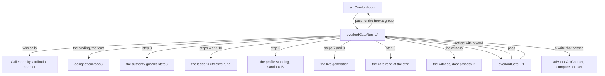
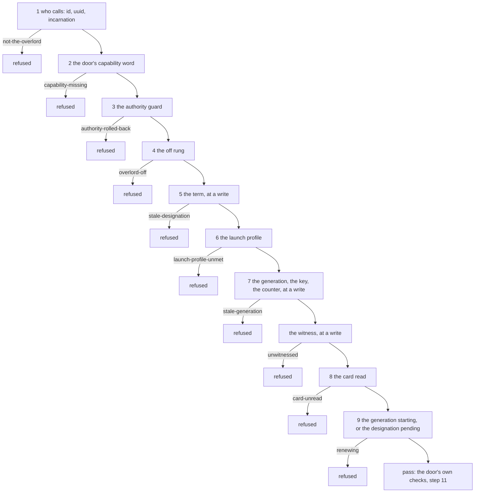

# Overlord W1: gates and identity Implementation Plan

> **For agentic workers:** REQUIRED SUB-SKILL: Use superpowers:subagent-driven-development (recommended) or
> superpowers:executing-plans to implement this plan task by task. Steps use checkbox (`- [ ]`) syntax for tracking.

**Goal:** every Overlord door asks one port who is calling, and one decider whether the call may pass, in one fixed
order, so the first refusal is the same on every door.

- **PR A, identity.**
  - The `CallerIdentity` port (C8, L2) and its one adapter, attribution (C8, L3). It answers who is calling and how
    strongly that is known: `attributed` for a box-token door, `operator` for an operator door that the account gate
    passed. No adapter mints `workload` yet.
  - The actor `{kind, subject, issuer}` and the strength as one L0 vocabulary.
  - The designation row's actor gains its kind, issuer and strength as columns, for the live binding's actor and for
    the pending attempt's.
  - The operator's Overlord doors record their actor through the port. Today those are designate, retire and the rank
    door, and later the rest of them.
  - The verb class of every Overlord route (H3, Table 3.6b), in one table that a census holds to the registrations.
- **PR B, the gate.**
  - The gate order of §11.2 as one L1 decider, `overlordGate`. Its fence check, `fenceVerdict`, refuses
    `stale-designation` and `stale-generation`. Its caller check, `callerStandingOf`, refuses `not-the-overlord`.
  - One L4 runner assembles the facts, asks the decider, refuses, and advances the act counter.
  - Every Overlord door on `main` calls it: W1a's card, notes, handover and probe doors, when the designated session
    calls them.
  - A census reds a door that skips it.

**Why:** C27 and H28 (identity is attribution today, and says so), H3 (actors on the rows, a verb class on every route),
H12 (the term and the fence), and §11.2 (one gate order, one credential per group). Two facts make the order matter:
attribution can be forged by any process of the fleet user, and the Overlord's body changes with every renewal and
rebind. Today nothing tells the Overlord's call from a coordinator's. `shared/refusal.ts#OVERLORD_REFUSALS` already holds
`not-the-overlord`, `stale-designation`, `stale-generation`, `card-unread` and `unwitnessed` for "gates B", and no door
sends them.

**Architecture:** decide in L1, act in L4, and keep one writer per fact.

- **L0.** A new one-concern sibling, `shared/overlord-identity.ts` (the index's slug `wire-types-in-sibling-modules`).
  It holds the strengths, the actor kinds and issuers, the verb classes, the door groups and the actor's column codec.
  It imports nothing.
- **L2, C8.** `server/src/auth/callerIdentity.ts`: the port and its failure contract. It is declared beside the
  context the spec gives it (Table 11.1c: "C8, L2 and L3"). Its consumers are the gate runner and the operator doors.
- **L3, C8.** `server/src/auth/attributionIdentity.ts`: the attribution adapter. It composes the readers that already
  exist: the box-token lanes' `coord/attribution.ts#attributionVerdict`, the incarnation's double read
  (`coord/delegationLeaseDoor.ts#incarnationOf`), and the account gate's minted actor (`accounts/audit.ts#actorOf`).
  It mints the branded `RecordedActor`, which only it can make.
- **L1, C5.**
  - `server/src/coord/overlordDoors.ts`: the door table `OVERLORD_DOORS`, one row per Overlord route (PR A).
  - `server/src/coord/overlordGate.ts`: the deciders `callerStandingOf`, `fenceVerdict` and `overlordGate` (PR B).
- **L4, C5.** `server/src/coord/overlordGateRun.ts`, the one runner every Overlord door calls (PR B). It reads each
  fact through a port, asks `overlordGate`, refuses through `refuseRoute`, and on a pass at a write door advances the
  act counter with a compare-and-set. It decides nothing.
- **L5 and K.** `server/src/server.ts` builds the adapter and the runner once, and hands them to the routes files.


*Figure 1. One door call. The runner reads; the decider decides. A fact whose producer has not landed is a port that
answers `unmeasured`, and `unmeasured` refuses.*


*Figure 2. The gate order this plan builds. The card, probe, note and handover doors skip steps 3, 4, 6, 8 and 9.
The witness sits right after the fence (question 1). Step 10 and `overlordMayAct` arrive with W2 (question 8).*

**Tech Stack:** TypeScript (ESM), `node:sqlite`, Fastify, vitest. No new dependency. No ccd change.

**Spec:** `docs/superpowers/specs/2026-11-09-overlord-design.md`:

- §3.1: "The row binds an incarnation and carries a term (H12)", and a recreated session with the same name getting
  nothing.
- §3.3.11: the fence (the term, the generation, its act key, the counter, and why), and "Where sessions share a UNIX
  user, the fence is an accident guard".
- §3.6 H2 (`CallerIdentity`) and H3 with Table 3.6b's rows "A credential per session", "Verified identity, and an actor
  on every action" and "A policy hook" (every route's verb class).
- §7.4 whole: C27, the three strengths, no second token, the actors, H28, "A box with sign-in dark has no Overlord",
  the unwitnessed write, and Table 7.4a, the blast radius of a forged Overlord.
- §11.2 whole: Table 11.2's five groups, the gate order, the card, probe and note skips, the timer doors, "After the
  gates", and "A door from a later wave refuses `capability-missing`".
- Table 11.1c (the port's row: C8, L2 and L3, W1), Table 11.1d (each door's capability word), Table 11.6
  (`not-the-overlord`, `stale-designation`, `stale-generation`, `card-unread`, `unwitnessed`, `capability-missing`,
  `authority-rolled-back`, `overlord-off`, `launch-profile-unmet`, `renewing`).
- Table 13.1: H3 is a `shape` call of W1, so the actor columns and the verb classes ship with the table and the doors
  they shape.

**The index:** `docs/superpowers/plans/2026-11-14-overlord-w1.md`, row "Gates and identity", lane C, two pull requests,
six tasks. The coordinator's brief for this plan (run 2156) corrects the row: the message rows' actor is the private
store's, so PR A adds the actor to the designation row only. "Index changes" lists what the index should carry.

## Open questions

Each carries the answer this plan builds. The index's questions this piece builds on are restated at the end.

1. **Where the witness sits in the order** (slug `witness-after-the-fence`). §11.2's step 1 says "At a write door the
   hook must also have reported a matching call before it (`unwitnessed`)". Its "After the gates" paragraph says
   "Write doors refuse `unwitnessed` once the fence passes". The two place one check differently. The place matters,
   because the third unwitnessed write in a day latches the ladder (Table 7.5a). At step 1, a reader started before a
   renewal, or a forked copy of an old body, would count against the Overlord's ladder. Those are the very callers the
   fence exists to refuse as `stale-generation`. **Recommendation:** the witness is checked right after the fence, at
   step 7a. Only a caller that holds the live generation's key can then be counted. A spec fix moves the sentence out
   of step 1.
2. **Which term a call presents** (slug `fence-term-follows-the-generation-row`). The fence compares "the term" the call
   carries with the designation's. Two moves raise the term. `goLive` re-stamps the new body's live generation with the
   raised term (the designation plan's X5), so that body must present the new term at once. Confirm the restore
   raises the term and keeps the body without re-stamping it, and the spec wants that generation fenced until the
   renewal it makes due (§3.1). **Recommendation:** the term a door process presents is the term on its own generation
   row, and the server tells it that term. Door process A names the carrier (the key's issue answer, and every Overlord
   door's answer to the designated session). So after `goLive` the next answer carries the raised term. After Confirm
   the row still carries the old term, every write refuses `stale-designation`, and the hard renewal mints a
   generation with the raised term. Step 5 compares the presented term with `designationRead()`'s term. A presented
   term above the row's refuses as well, with the detail `ahead`, because only a restored `coord.db` can produce one.
3. **Who owns the act counter** (slug `act-counter-rides-the-act-key`). §3.3.11 says "Each write carries a counter, so a
   copied key shows as a fork". The index gives door process A "the act-key columns of `continuity_generations`".
   **Recommendation:** the counter is one of those columns (`actCounter`, the highest counter accepted, 0 at issue),
   created by door process A's migration. Its one writer, `advanceActCounter`, is a compare-and-set that gates B adds
   to `server/src/continuity/continuityStore.ts`, the generation rows' owner. If door process A ships without the
   column, gates B adds it in one migration, and the PR split's estimate for `schema.ts` moves from 0 to about +4.
4. **The incarnation is checked at step 1** (slug `incarnation-checked-at-step-one`). Step 1 names "its id and its
   current uuid". §3.1 also binds the registry generation: "A recreated session with the same name gets nothing". The
   designation row holds that incarnation as a string (`bound.generation`, the UUID ccd records in
   `$REG/<id>.generation`), and the fence's "generation" is a different thing, the live generation's number with its
   act key. **Recommendation:** step 1 compares the caller's incarnation, read twice and agreeing, with the binding's.
   A mismatch is `not-the-overlord`, at read doors too, because a recreated session is not the designated session. An
   incarnation that cannot be read is `registry-unmeasurable` (502), the box-token lanes' existing word for an
   unreadable registry.
5. **A pending body whose incarnation is not yet recorded** (slug `pending-unrecorded-reads-renewing`). The designate
   door writes the row `pending`, creates the session, then records the pending incarnation once `ws-add` answers. A
   SessionStart's anchor fetch can land in between. **Recommendation:** step 1 answers `renewing` (409, retryable) for
   a caller that is the pending id of a `designate` attempt whose incarnation is still unrecorded, at every door,
   including the card. The start then carries no anchor. The first prompt, which the designation sends only after the
   record, has the body read its card. A rebind's pending body is not the designated session (its identity stays its
   own until it goes live, the designation plan's X5). It reaches the card, probe, note and handover doors in the
   hook's group, as any session does, and every Overlord-only door refuses it `not-the-overlord`.
6. **The handover door joins the start doors** (slug `handover-is-a-note-door`). §11.2 lets the card, probe and note
   doors skip steps 3, 4, 6, 8 and 9 "so a generation can finish starting". W1a ships the handover note at its own
   door (`POST /api/sessions/:id/handover`), asked only in `checkpointed`. **Recommendation:** the handover door takes
   the same skips. Otherwise step 9 would refuse it `renewing` in the very state that asks for it, and the Overlord's
   renewal would always clear without its note. The door table marks it, with the other four start doors.
7. **The operator's reads have the verb class `view`** (slug `operator-reads-are-view`). Table 11.2 gives the operator's
   doors `admin`, and Table 3.6b says "Reads are `view`". **Recommendation:** the class follows the call, not the
   group. A read is `view` in every group. An operator write is `admin`. An Overlord write and a coordinator-facing
   write are `operate`. A hook report is `view`. A spec fix says this in Table 11.2's verb-class column.
8. **The arms whose inputs come later** (slug `gate-arms-join-with-their-inputs`). Four parts of the order read inputs
   no W1 piece produces:
   - step 4's `mail-disabled` at an answer door, because the answer doors are W3's;
   - step 9's "after a boot … until the boot pass has re-seeded the holds", because the holds are W3's (§6.7);
   - step 10, the rung by act kind and `act-ceiling`, because the act catalogue is W2's. In W1 no Overlord door has
     an act kind, and the rung door caps at `chat`, so the only rung that refuses is `off`, at step 4;
   - step 11's `overlordMayAct`, with `identity-too-weak` and `server-not-isolated`, which is W2's.

   **Recommendation:** W1's decider has no input for any of them, and the wave that ships each input adds its arm at
   its place in the order, with a case of `first-refusal` (Task 4). This follows the ladder's ruled rule for cause rows
   (the index's question 20). `act-ceiling`, `identity-too-weak`, `server-not-isolated` and `mail-disabled` stay on the
   vocabulary's wave map.
9. **What each unmeasured fact refuses with** (slug `unmeasured-refuses-at-its-step`). No step reads an unmeasured
   fact as a pass, and none folds it into a value. **Recommendation:** each refuses at its own step. The word is that
   step's own, or an existing word for an unreadable store, so Table 11.6 gains no word:

   | Fact | Unmeasured answer | Why that word |
   |---|---|---|
   | The registry, for attribution or the incarnation | `registry-unmeasurable` (502) | the box-token lanes' word (`coord/attribution.ts`) |
   | `designationRead()`'s third arm | `unavailable` (503), "the designation row could not be read" | the designation doors' word for the same arm |
   | The authority guard, `unmeasured` | `authority-rolled-back` (503), its cause in the detail | the authority plan's rule: unmeasured refuses as rolled-back does |
   | The ladder | `unavailable` (503), "the ladder could not be read" | no rung can be assumed |
   | The profile standing | `launch-profile-unmet` (409), detail `unmeasured` | step 6's own word, as the sandbox piece's unmeasured digest reads |
   | The generations, the act key or the counter | `unavailable` (503) | an unreadable `coord.db`, never a stale generation |
   | The card read | `unavailable` (503) | the same |
   | The witness | `unwitnessed` (409), detail `unmeasured` | step 7a's own word, and counted by nobody (question 10) |
10. **Who counts an unwitnessed write** (slug `unwitnessed-counted-by-door-process-b`). The latch is door process B's
    cause row (the index's question 20). **Recommendation:** gates B refuses and counts nothing. The runner's refusal
    names its cause, `unwitnessed` or `unmeasured`, and door process B adds the one call that records a measured
    `unwitnessed` for its latch, where it binds the witness reader. An `unmeasured` witness, before door process B or
    on a failed read, is never counted, because it says nothing about the session.
11. **The rank door's dark actor** (slug `rank-door-dark-actor-stays-flag-off`). The portfolio's rank door confers no
    authority and works while sign-in is dark, recording `flag-off` (`server/src/coord/ledgersRoutes.ts`, the
    portfolio's slug `rank-works-dark`). §7.4's strengths have no word for "nobody signed in". **Recommendation:** the
    port's console arm answers `{kind: 'dark'}`, with no strength, and the door records `flag-off` as today. Armed, it
    answers the console's device actor at `operator` strength. No fourth strength is added.

The index's questions:

- **Q17** (`CallerIdentity` and the operator's doors): built as recommended. The port has one adapter, attribution.
  The operator's doors keep `server/src/accounts/gate.ts#createAccountGate` and record its actor through the port at
  `operator` strength. No second cookie reader: the port reads the gate's pass, never the cookie. This also adopts the
  port half that the portfolio plan left to gates A (its slug `rank-door-ships-with-its-table`).
- **Q16** (a late or lost witness refuses `unwitnessed`): built, at the place of question 1.
- **Q19** (the rung door stops at `chat`): read as built by the ladder. It is why step 10 has no W1 arm (question 8).
- **Q20** (the ladder's causes join with their inputs): this plan adds no cause row.
- **Q33** (no separate server-side `overlord-v1` gate for designate and rebind): unchanged. Those are operator doors,
  and step 2 binds only the Overlord's own doors (Table 11.2's first group).

## What exists today

Measured on `origin/main` at `f6ea95de5` (2026-11-15). Portfolio A (#2842) and the journal kernel (#2848) are merged.
Designation A, the ladder, the authority journal, door process A, sandbox B and the private store are plans, read
from their branches or from the index (designation `ws/overlord-plan-w1-designation`, authority journal
`ws/overlord-plan-w1-authority`, private store `ws/overlord-plan-w1-private-store`). The ladder and door process plans
are not yet written, so this plan takes their interfaces from the spec and says so where it does.

- **The account gate.** `server/src/accounts/gate.ts#createAccountGate` returns `gate(req, reply, { cap, stepUp })`.
  It refuses in order `auth-off`, `insecure-origin`, `unauthenticated`, `unsupported` and `step-up-required`, and a
  pass answers `{ pass: true, actor, sessionIdHash }` (`AccountGateAnswer`). The actor is
  `server/src/accounts/audit.ts#AccountActor`, minted only by `actorOf(device, idHash)` and checked by
  `isMintedActor`. Its text is `<label> <8 hex>`. The gate reads the cookie through `deps.sessionAuth`. Nothing else in
  the Overlord's doors needs to.
- **The console's device actor.** `server/src/ccdargv.ts#deviceActor(device)` answers `device:<label>`, or `unmeasured`
  for no device. The rank door, `POST /api/portfolio/rank` in `server/src/coord/ledgersRoutes.ts`, records
  `deps.authEnabled ? deviceActor(deps.sessionAuth(req).device) : 'flag-off'` into `portfolio_rank.setBy`.
- **Attribution.** `server/src/coord/attribution.ts#attributionVerdict(io, cfg, whoId, whoUuid, uuidField)` reads the
  sender's one registry row and answers `{ ok: true }`, or `registry-unmeasurable`, `unknown-sender` or `stale-uuid`
  with a detail (`server/src/coord/openRun.ts#AttributionRead`). It never folds an unreadable row into a stale uuid.
  `server/src/server.ts` builds the continuity routes' `attributeReader` over it.
- **The box token.** `server/src/coord/token.ts#checkMailToken(expected, presented, lane)` answers `ok`, `legacy`, `bad`
  or `unconfigured`. Every box-token door checks it in its `onRequest` hook and refuses `unauthenticated` with a
  detail. In `server/src/continuity/routes.ts` that detail is the file's `TOKEN_DETAIL` map.
- **The incarnation.** `server/src/coord/delegationLeaseDoor.ts#incarnationOf` reads `$REG/<id>.generation` twice and
  answers `{ kind: 'measured', incarnation }` or `{ kind: 'unmeasured', reason }`. The continuity routes take it as
  `ContinuityRouteDeps.setterStamp`.
- **The W1a doors a designated session calls**, all in `server/src/continuity/routes.ts#registerContinuityRoutes`, each
  a box-token door listed in `server/src/auth/gate.ts`'s `EXEMPT`:
  - `GET /api/sessions/:id/card` (and its `part=anchor` form);
  - `POST` and `GET /api/sessions/:id/notes`;
  - `POST /api/sessions/:id/handover`;
  - `GET` and `POST /api/sessions/:id/probe`.

  Each checks the token in `onRequest`, then that `byId` is the path's session (`not-owner`), then the body or query,
  then `deps.attributeReader(id, uuid)`. None reads the designation. The timer doors in the same file are the
  Overlord timers piece's.
- **The generations.** `CoordStore.liveGenerations()` answers the live `continuity_generations` rows or a failure.
  `server/src/continuity/continuityStore.ts#GenRow` carries `identity`, `term`, `rowIncarnation`, `n`, `state`,
  `shadowState` and `startId`. `effectiveGeneration(row, live)` is the one accessor for a generation's state, shadow
  or live. `cardReadOfStart(db, startId)` answers a generation's newest full card read with `current`, whether its
  hash is the session's current card, or `read: null`, or a failure.
- **The capability words.** `shared/api.ts#SERVER_CAPS` derives from `SERVER_CAP_MAP` and holds `timers-v1` among
  others. It does not yet hold `continuity-v1` (W1a's last piece adds it) or `overlord-v1` (W1's last piece).
- **The refusal words.** `shared/refusal.ts#OVERLORD_REFUSALS` holds every gate word this plan sends except `renewing`,
  with its status: `not-the-overlord` 403; `capability-missing` 501; `authority-rolled-back` 503; `overlord-off`,
  `stale-designation`, `stale-generation`, `card-unread`, `unwitnessed` and `launch-profile-unmet` 409.
  `unavailable` (503) and `registry-unmeasurable` (502) are in `REFUSAL_STATUS`'s generic words. `stale-generation`
  is also a word of the delegation lease's (`server/src/coord/delegation-lease-state.ts#DELEGATION_LEASE_ACT_REFUSALS`,
  and `server/src/retire.ts`), for a lease's generation. One spelling, two doors, as `REFUSAL_STATUS` allows. `renewing` is on the
  vocabulary's wave map as a W1a word, and W1a's
  renewal hand-offs adds it (409) to `shared/refusal.ts` (`w1a-renewal-handoffs.md`).
- **Roles.** `server/src/roleOf.ts#roleOf` answers `overlord` when `RoleFacts.designation` is `pending` or `live`.
  `roleFactsOf` fixes `designation: 'none'` until designation A passes its reader in.
- **What designation A ships** (its plan, in its fix round): `overlord_designation` with `actor TEXT NOT NULL` and
  `pendingActor TEXT`, each the account gate's actor text; its writers `designatePending`, `goLive`, `retire` and the
  rest; and `designationRead()`. That reader answers exactly three arms (the designation plan's X7):
  `{ kind: 'designated', sessionId, term, row }`, `{ kind: 'not-designated', row }` (no row, or no live binding, a
  pending-only row among them), or `{ kind: 'unmeasured', why }`. `row.bound` holds `sessionId` and `generation`, the
  incarnation string. `row.pending` holds `sessionId`, `kind` (`designate` or `rebind`) and its generation, set once
  the create answers. `server/src/coord/overlordRoutes.ts` registers designate (`POST /api/overlord/designate`), retire
  (`DELETE /api/overlord/designate`) and the read (`GET /api/overlord/designation`). `identityOf(sessionId,
  designation)` answers `overlord` for the live bound id and for a pending `designate` attempt's id.
- **What the authority journal ships** (its plan, PR A): `OverlordAuthorityGuard.state()`, answering `{ kind:
  'coherent' }`, `{ kind: 'rolled-back', cause }` or `{ kind: 'unmeasured', why }`. "Gates B: `state()` for step 3".
  Its record carries no actor kind: "every W1 kind is an operator door's".
- **What the private store ships** (its plan, ruled): `operator_messages.actor` from its first migration, filled from
  the account gate's pass and checked by `isMintedActor`. "Gates A then supplies the same value through
  `CallerIdentity` at `operator` strength, and changes the writer's source, never the table."
- **The censuses this piece meets** (measured):
  - `server/test/rings/fastify-l4.data.ts#FASTIFY_L4_ALLOWLIST`: one entry for each new file that imports Fastify (the
    runner).
  - `server/test/single-definition/time-ports.test.ts`: its families cover every `server/src/**/overlord*.ts` and
    `shared/overlord*.ts`. The two new `server/src/auth/` files are outside them, so they join `TIME_PORT_FILES`.
  - `server/test/single-definition/writers-map.test.ts#TABLES`: the generations table gains `advanceActCounter`.
  - `server/test/rings/wire-totality.test.ts`: every exported literal union in `shared/*.ts` needs a sibling
    `Record<X, true>` map or an `is X` guard.
  - `server/test/rings/shared-imports.test.ts`: a `shared/*.ts` file imports only its `./` siblings.
  - `server/test/sim/mutation-floors.test.ts#MUTANT_SETS` and `server/test/sim/mutation-floors.json`.
  - `server/test/run-close-switch.test.ts` and `server/test/coord-db.test.ts` for PR A's migration.
  - No new route, so `auth/gate.ts`'s `EXEMPT`, `auth-gate.test.ts`, `box-token-census.test.ts`,
    `secret-mask.test.ts`'s `MASKED_GET_ROUTES`, `coord-pause-route.test.ts` and `CLAUDE.md`'s box-token paragraph do
    not change.
- **The growth check.** `server/test/growthCheck.ts#GROWTH_FILES` lists `server/src/server.ts`,
  `server/src/coord/store.ts` and `server/src/coord/schema.ts` among this piece's files, at 40 net code lines each per
  pull request. `server/src/continuity/routes.ts`, `server/src/coord/ledgersRoutes.ts` and
  `server/src/continuity/continuityStore.ts` are not listed.
- **Migrations on `main`:** 75 is the last. This plan takes no number. The builder takes the next one at build time.

## What the port proves, and what it does not

Identity on the fleet is attribution, not authentication (`CLAUDE.md`). The port says so in its answer: the strength
is part of every answer, and the adapter can mint only what it measured.

| Strength | What the server verified | What it proves | What it does not prove |
|---|---|---|---|
| `attributed` | The box token at the door's `onRequest`; a registry row for the id; the call's uuid equals that row's current `.uuid`; at an Overlord door, the incarnation equals the binding's | The caller can read files the fleet's one UNIX user can read: the token file, and that session's `.uuid` and `.generation` | That the caller is that session's process; that a model turn is behind the call (the witness's job, step 7a); that it is not another session or a stray process of the same user |
| `operator` | The console's sign-in cookie, through the session gate and the account gate (passkey sign-in), and the step-up where the door asks for one | A person holding a registered passkey acted from a console in the last session lifetime, or the last five minutes with a step-up | Who the person is beyond the device label, and that the console was not left open |
| `workload` | Nothing yet: no adapter mints it in W1 | A credential only that session's sandbox can read (#273, #275), once an agent advertises one and the server verifies it | n/a until then |

**The fence on a shared user.** The fence adds the live generation's act key and its counter, and the key is held only by
that generation's door process (§3.6). On a box where every session runs as one user, the fence is an accident guard
(§3.3.11). It stops a reader started before a renewal, the old body after a rebind, and a forked copy. It does not stop
a deliberate process of the same user that can read the door process's memory, or that presents the launch nonce first.

**What a forged caller reaches** (Table 7.4a, read against W1). A process of the fleet user can read the box token and
any session's `.uuid` and `.generation`, so it passes step 1 as the Overlord. With the fence too, it passes every gate
the real Overlord passes. In W1 the rung door caps the ladder at `chat` (the index's question 19), so it reaches:

- every Overlord read, each leaving a read-ledger line under the read ceilings, which is the detector (§7.4);
- the Overlord's own records: notes, probe answers, the handover note, and later its timers and `acknowledge`. A forged
  note feeds the next generation's card, which the card's untrusted-data framing and the probes are there to catch.

It does not reach:

- the operator's words, which only the console's prompt route writes;
- the designation, the ladder and Confirm the restore, which are cookie doors behind the account gate's step-up;
- anything above `chat`, which the rung door refuses in W1.

Once the isolation word lands, a `shared-user` box caps the ladder at `advise` (H28), so from W2 such a caller reaches
what `advise` allows (requests, relays, follow-ups and briefs), each an act row with its strength `attributed`,
overturnable (§10.3). It never reaches a grant, a command or learning, which `overlordMayAct` refuses
`server-not-isolated` there. That cap, not this port, is what bounds a forger. This port's part is to say on every row
how little `attributed` proves, so the cap can be computed and the operator can read it.

## Global Constraints

- **Architecture (`CLAUDE.md`).**
  - One writer per fact.
    - The designation row's actor columns are written only by designation A's writers (`designatePending`, `goLive`,
      `retire` and, in PR B and C, theirs), which take a `RecordedActor`.
    - The act counter is written only by `advanceActCounter`, in the generation rows' owner.
    - `OVERLORD_DOORS` is one table, and each piece that adds an Overlord route adds its row.
    - The strength is minted only by the adapter.
  - Decide in L1, act in L4.
    - `overlordGate.ts` imports L0 only and takes every fact as an argument: no `fs`, no Fastify, no clock.
    - `overlordGateRun.ts` reads, asks and acts. It holds no `if` over a gate word.
    - The doors call the runner and act on its answer.
  - Ports at the edges, declared by their consumer. `CallerIdentity` sits in C8 by the spec's table. The runner's fact
    readers are an L2 interface in `overlordGateRun.ts`'s own deps, filled at L5. A reader whose producer has not
    landed is bound to a stated default that answers `unmeasured`, never to a stub that passes.
  - Consolidate, don't duplicate.
    - The adapter calls `attributionVerdict`, `incarnationOf` and the account gate's minted actor. No second registry
      reader, no second cookie reader and no second token check.
    - The W1a doors swap their `attributeReader` call for the port's `session` call, which runs the same
      `attributionVerdict` once.
    - The gate's facts come from the owners' readers: `designationRead()`, `state()`, `effectiveGeneration`,
      `cardReadOfStart` and the ladder's read.
  - No ceremony.
    - The port has one adapter because it is a port at an edge (H2, #273, #275).
    - No interface with one implementation inside the server.
    - The door table holds only the columns the gate and the census read.
- **Failure contracts (fail closed).**
  - The port never throws.
    - `session()` answers a caller, or `registry-unmeasurable`, `unknown-sender` or `stale-uuid` with a detail,
      exactly as `attributionVerdict` does.
    - `incarnation()` answers measured or `unmeasured`.
    - `operator()` takes only a minted `AccountActor`, and throws on a look-alike: a programming error, as
      `isMintedActor` refuses one today.
  - The runner never throws, and every fact it cannot read refuses at its step (question 9). No step reads
    `unmeasured` as a pass.
  - No overloaded null at a seam. `designationRead()`'s three arms stay three. A caller that is not the designated
    session at a start door is the hook's group (`{ kind: 'hook' }`), never "passed".
  - An older peer. A door process that presents no fence at a write door refuses `stale-generation`, with the detail
    "no act key presented". A row of `coord.db` written before PR A's migration reads its actor's kind, issuer and
    strength from the migration's defaults (Task 3).
- **What a merge arms.**
  - PR A: nothing a running session sees.
    - The migration's defaults describe every row designation A can have written: only the account gate's doors write
      it.
    - The designate, retire and rank doors record the same subject text as before.
  - PR B: nothing a running session sees, unless the operator has designated an Overlord, which the console offers
    only under `overlord-v1`.
    - A coordinator's card, notes, handover and probe calls answer byte for byte as before. Task 6 pins this with a
      characterization test written green on `main` first.
    - A designated Overlord's calls run the gate from the merge. Its writes need the fence (door process A) and a
      witness, which reads `unmeasured` and refuses `unwitnessed` until door process B wires its reader. So an Overlord
      designated before door process B cannot write its notes or probe answers, and its generations never prove.
      That is fail closed, and it is why `overlord-v1` waits for every W1 piece.
- **SAFETY (`CLAUDE.md`).** No ccd verb, no file on a fleet host, no secret printed.
  - The act key is compared as a sha256 digest with `timingSafeEqual`, and is never logged or put in a refusal's
    detail.
  - Tests use `server/test/helpers.ts#testDeps` and fixture registries. No test runs ccd or reads the live `$HOME`.
- **Growth check.** Every growth-checked file stays within 40 net code lines per pull request, with no waiver. The
  estimates are in the PR split. A task that measures over its row stops and asks; it never plans a waiver.
- **Mutation floors.** New L1 deciders, each in `MUTANT_SETS` through a new `server/test/sim/gateSets.ts`, and in
  `mutation-floors.json` at floor 1, in its task's pull request:
  - `readActorColumns` (PR A);
  - `callerStandingOf`, `fenceVerdict` and `overlordGate` (PR B).

  The door table is data, and its census is the guard. Each new arm ships a test that goes red when the arm is deleted,
  measured by hand with `mutation-run.py` (`../ccrc-coordinator/references/mutation-run.py`), as each task says.
- **Tests.** From `server/`: `ccrc test -- ./node_modules/.bin/vitest run test/<file>.test.ts`. A task's last run adds
  `ccrc test -- ./node_modules/.bin/tsc --noEmit -p tsconfig.json` and `-p test/tsconfig.tests.json`. For a `shared/`
  change, add `cd ../pwa && ccrc test -- ./node_modules/.bin/tsc --noEmit`.
- **Public repository.** Fixtures use `lane-a`, `lane-b`, `pool-a` and the `overlord` project. Device labels in tests
  are neutral (`device-a`). Cite by symbol or `@anchor`. No D-number is invented. A builder's new departures go in
  `docs/superpowers/plans/2026-11-14-overlord-w1/w1-gates/notes.md`.

## Review Focus

1. **One decider, every door.** No Overlord door decides a gate word itself.
   - The census reds a door whose registration does not call the runner with its own row's key before any store
     access.
   - The single-definition scan reds any other file under `server/src` that spells a gate word.
   - A planted door without the call is red.
2. **The first refusal wins.** `overlordGate` is tested over its whole input domain against an oracle written in the
   test, so a swapped step is red. A behavioural test drives every door row and checks the first refusal there.
3. **Unmeasured never passes.** For each fact, replacing a passing value with `unmeasured` never turns a refusal into a
   pass, and turns a pass into a refusal at that fact's step (a property over the generated domain).
4. **Coordinators are untouched.** At the six start-door registrations, a session that is not the designated one goes
   the hook's way, and its answers are the characterization test's, byte for byte. The gate binds only the designated
   session.
5. **The port claims no more than it measured.**
   - The adapter mints `attributed` only after attribution passes, and `operator` only from a minted gate actor.
   - Nothing mints `workload`.
   - `RecordedActor` is branded, so a store writer refuses a string or a raw `AccountActor` at compile time
     (`@ts-expect-error` lines that go red if the type widens).
6. **The fence.**
   - A rebind's old body, a generation ended by a renewal, a presented term below or above the row's, a key that is not
     the live generation's, and a repeated counter each refuse.
   - Two racing writes with one counter: one passes and one refuses `stale-generation`.
   - The act key never reaches a log or a refusal's detail.

## The PR split

Net code lines, as `server/test/growthCheck.ts` counts them (comments and blank lines dropped), estimated against
`origin/main` at `f6ea95de5` plus designation A as its plan describes it.

| PR | Tasks | What it ships | Needs first | Growth-checked files, estimate |
|---|---|---|---|---|
| A | 1 to 3 | The identity vocabulary and the door table with its census; the `CallerIdentity` port and the attribution adapter; the designation row's actor columns; the designate, retire and rank doors recording through the port | designation A | `server/src/coord/schema.ts` about +10 (one migration of six `ADD COLUMN`s); `server/src/server.ts` about +8 (the adapter's construction, and `identity` in two deps objects); `server/src/coord/store.ts` about +2 (the designation delegates' actor type); `shared/api.ts` 0 |
| B | 4 to 6 | `callerStandingOf`, `fenceVerdict` and `overlordGate`; the runner with its fact ports and the counter's compare-and-set; the W1a start doors wired for the designated session; the gate census | PR A, the ladder, door process A, W1a's renewal hand-offs (for `renewing`) | `server/src/server.ts` about +16 (the runner and its fact readers, and `gate` in two deps objects); `server/src/coord/store.ts` about +2 (`advanceActCounter`'s delegate); `server/src/coord/schema.ts` 0 (about +4 only if door process A ships no counter column, question 3) |

For scale, the files that are not growth-checked change by about:

- new files: `shared/overlord-identity.ts` +90, `server/src/auth/callerIdentity.ts` +60,
  `server/src/auth/attributionIdentity.ts` +90, `server/src/coord/overlordDoors.ts` +80 (PR A),
  `server/src/coord/overlordGate.ts` +200 and `server/src/coord/overlordGateRun.ts` +170 (PR B);
- `server/src/coord/overlordDesignationStore.ts` +30 and `shared/overlord-designation.ts` +4 (PR A, the actor
  columns), `server/src/coord/overlordRoutes.ts` +4 (PR A), `server/src/coord/ledgersRoutes.ts` +2 (PR A, the rank
  door);
- `server/src/continuity/routes.ts` +30 (PR B, six registrations, about five lines each) and
  `server/src/continuity/continuityStore.ts` +20 (PR B, `advanceActCounter`).

## Index changes

The coordinator makes these in its own index edit. This plan edits no other plan.

- **The row.**
  - A: "actor columns on the designation row" (the message rows' actor is the private store's, ruled). A also
    routes the operator doors' actor through the port: designate, retire, the rank door, and whichever of the private
    store's prompt route, portfolio B's ratify door, the ladder's operator doors and Confirm the restore has landed.
    The pieces that land later call the port themselves.
  - B: "the gate order of §11.2 as one L1 decider, the fence check (`stale-designation`, `stale-generation`),
    `not-the-overlord`, `card-unread` and the witness's place (`unwitnessed`), the runner that every Overlord door calls,
    W1a's card, notes, handover and probe doors wired for the designated session, and the census".
  - B's "Needs first" gains W1a's renewal hand-offs, for the word `renewing`, as a dashed arrow in Figure W1 (`RH -.->
    GB`).
- **Where lanes meet.**
  - `server/src/coord/overlordDoors.ts#OVERLORD_DOORS` is an append-only registry. Each piece that registers an
    Overlord route adds its row in the same pull request, and the census holds the table to the registrations in both
    directions:
    - designation B and C, the ladder, portfolio B and Confirm the restore, for their operator doors;
    - the inbox, the board and history, the sequence's cursor read and the Overlord's timers, for the Overlord's own
      doors.
  - Every later Overlord door calls `overlordGateRun` with its row's key, and every later operator door records its
    actor through `CallerIdentity.operator`.
  - The Overlord's timers piece adds the timer doors' rows (word `timers-v1`, the start-door skips not taken) and calls
    the runner from them.
  - The runner's fact ports are bound in `server/src/server.ts`, one line each.
    - Gates B binds the ones whose producers have landed: the designation, the guard, the ladder, the generations and
      the card read.
    - Sandbox B binds the profile standing, and door process B the witness, whichever of the pair lands second.
    - Door process B also adds the unwitnessed count (question 10).
  - `server/src/continuity/continuityStore.ts`: gates B adds `advanceActCounter`. Door process A's act-key columns
    include `actCounter` (question 3).
  - `server/src/auth/` (C8) gains the port and its adapter. No other lane edits them.
- **Lane C's files** gain `shared/overlord-identity.ts`, `server/src/auth/callerIdentity.ts`,
  `server/src/auth/attributionIdentity.ts`, `server/src/coord/overlordDoors.ts`, `server/src/coord/overlordGate.ts` and
  `server/src/coord/overlordGateRun.ts`. Shared with other lanes: `server/src/continuity/routes.ts` (the start doors'
  attribution line and gate call) and `server/src/coord/ledgersRoutes.ts` (the rank door's actor line).
- **The door process piece's plan** names the fence's carrier (the presented term, generation, key and counter) and
  how the door process learns its generation row's term (question 2). It ships `actCounter` with the act-key columns
  (question 3).
- **The private store's plan:** if private store B lands after gates A, its prompt route takes its actor from
  `CallerIdentity.operator` from the start. If it lands first, gates A changes that one line. Either way the table does
  not change (its question 4).
- **Spec fixes:**
  - §11.2's step 1 drops its `unwitnessed` sentence, and "After the gates" places the witness right after the fence
    (question 1);
  - §11.2's step 1 names the incarnation beside the id and uuid (question 4);
  - §11.2's start-door skips name the handover door (question 6);
  - Table 11.2's verb-class column: reads are `view` in every group (question 7);
  - §3.3.11's fence: the term a call presents is its generation row's term (question 2).

---

### Task 1: The identity vocabulary and the door table (PR A)

**Files:**
- Create: `shared/overlord-identity.ts` (L0, imports nothing)
- Create: `server/src/coord/overlordDoors.ts` (C5, L1, imports L0 only)
- Create: `server/test/overlord-identity-vocab.test.ts`, `server/test/overlord-doors-census.test.ts`
- Create: `server/test/sim/gateSets.ts` (the mutant sets of PR A and PR B)
- Modify: `server/test/sim/mutation-floors.test.ts` (imports `GATE_MUTANT_SETS`), `server/test/sim/mutation-floors.json`

**Interfaces:**

```ts
// shared/overlord-identity.ts
/** How strongly the server knows who is calling (§7.4). Only the attribution adapter mints one. */
export const CALLER_STRENGTH_MAP = { attributed: true, workload: true, operator: true } as const;
export type CallerStrength = keyof typeof CALLER_STRENGTH_MAP;
export const CALLER_STRENGTHS = Object.keys(CALLER_STRENGTH_MAP) as CallerStrength[];
/** Who the actor is: the operator at a console, a session, or the server's own lane. */
export const ACTOR_KIND_MAP = { operator: true, session: true, server: true } as const;
export type ActorKind = keyof typeof ACTOR_KIND_MAP;
/** What verified the subject: the account gate (cookie and passkey), the console's session cookie with no gate,
 *  attribution (box token, id and uuid), or the server itself. A verified credential later adds its issuer here. */
export const ACTOR_ISSUER_MAP = { 'account-gate': true, 'session-cookie': true, attribution: true, server: true } as const;
export type ActorIssuer = keyof typeof ACTOR_ISSUER_MAP;
/** The actor a row carries (H3, Table 3.6b; §7.4). `subject` is the text today's mechanism names. */
export interface ActorWire {
  readonly kind: ActorKind; readonly subject: string; readonly issuer: ActorIssuer; readonly strength: CallerStrength;
}
/** Table 3.6b's verb classes (#279). */
export const VERB_CLASS_MAP = { view: true, operate: true, admin: true } as const;
export type VerbClass = keyof typeof VERB_CLASS_MAP;
/** Table 11.2's five groups. */
export const DOOR_GROUP_MAP = {
  overlord: true, operator: true, 'coordinator-facing': true, hook: true, 'server-body': true,
} as const;
export type DoorGroup = keyof typeof DOOR_GROUP_MAP;
/** A row's actor, read back from its columns: an actor, or the first column that does not read. */
export type ActorColumnsRead =
  | { readonly kind: 'read'; readonly actor: ActorWire }
  | { readonly kind: 'unreadable'; readonly column: 'subject' | 'kind' | 'issuer' | 'strength' };
export function readActorColumns(subject: unknown, kind: unknown, issuer: unknown, strength: unknown): ActorColumnsRead;
```

```ts
// server/src/coord/overlordDoors.ts
export type HttpMethod = 'GET' | 'POST' | 'PUT' | 'DELETE';
interface DoorBase {
  readonly method: HttpMethod; readonly path: string;
  /** The repo-relative routes file that registers it. */
  readonly file: string;
  readonly verbClass: VerbClass;
}
/** An Overlord door (Table 11.2's first group): the gate order binds the designated session's calls. */
export interface OverlordDoorRow extends DoorBase {
  readonly group: 'overlord';
  /** A write runs the fence (steps 5 and 7) and the witness (7a). */
  readonly write: boolean;
  /** Step 2's word (Table 11.1d): `continuity-v1` for W1a's doors, `timers-v1` for the timers, `overlord-v1` for W1's. */
  readonly word: string;
  /** A caller that is not the designated session: refused `not-the-overlord`, or served in the hook's group. */
  readonly others: 'refuse' | 'hook';
  /** The card, probe, note and handover doors: steps 3, 4, 6, 8 and 9 are skipped (§11.2; question 6). */
  readonly startDoor: boolean;
}
/** An operator door: the account gate, then the actor through the port. */
export interface OperatorDoorRow extends DoorBase { readonly group: 'operator' }
export type DoorRow = OverlordDoorRow | OperatorDoorRow;
export const OVERLORD_DOORS: Readonly<Record<string, DoorRow>>;
/** The row a registration names, by its key. A key the table lacks throws: a programming error the census catches. */
export function doorRow(key: string): DoorRow;
```

The rows on landing (later pieces add theirs):

| Key | Method and path | File | Group | Verb class | Write | Word | Others | Start door |
|---|---|---|---|---|---|---|---|---|
| `designate` | `POST /api/overlord/designate` | `coord/overlordRoutes.ts` | operator | admin | | | | |
| `retire` | `DELETE /api/overlord/designate` | `coord/overlordRoutes.ts` | operator | admin | | | | |
| `designation` | `GET /api/overlord/designation` | `coord/overlordRoutes.ts` | operator | view | | | | |
| `portfolio-rank` | `POST /api/portfolio/rank` | `coord/ledgersRoutes.ts` | operator | admin | | | | |
| `card` | `GET /api/sessions/:id/card` | `continuity/routes.ts` | overlord | view | no | `continuity-v1` | hook | yes |
| `notes-write` | `POST /api/sessions/:id/notes` | `continuity/routes.ts` | overlord | operate | yes | `continuity-v1` | hook | yes |
| `notes-read` | `GET /api/sessions/:id/notes` | `continuity/routes.ts` | overlord | view | no | `continuity-v1` | hook | yes |
| `handover` | `POST /api/sessions/:id/handover` | `continuity/routes.ts` | overlord | operate | yes | `continuity-v1` | hook | yes |
| `probe-read` | `GET /api/sessions/:id/probe` | `continuity/routes.ts` | overlord | view | no | `continuity-v1` | hook | yes |
| `probe-answer` | `POST /api/sessions/:id/probe` | `continuity/routes.ts` | overlord | operate | yes | `continuity-v1` | hook | yes |

Paths in the "File" column are under `server/src/`. A door that portfolio B's ratify door, the private store's prompt
route or the ladder adds before this task builds gets its row here too (Index changes). `GET /api/portfolio` is the
operator's read of the portfolio's own data, not an Overlord door, and takes no row. The ledger operator doors keep
their own census.

- [ ] **Step 1: Failing tests.**
  - `overlord-identity-vocab.test.ts`: each map's keys equal its list, and each list is written out in the test;
    `readActorColumns` on every column's good and bad values, answering the first unreadable column in the order
    subject, kind, issuer, strength; a subject that is empty, over 200 characters or carries a control character is
    unreadable.
  - `overlord-doors-census.test.ts`:
    - every registration in `server/src/coord/overlordRoutes.ts` has a row naming that file, and every such row is
      registered there;
    - every row naming another file is registered there, found through `server/test/scan/parse.js`;
    - keys are kebab and unique;
    - an `overlord` row's `word` is one of Table 11.1d's server words, written out in the test (`continuity-v1`,
      `timers-v1`, `overlord-v1`, and the later waves' words);
    - a `GET` row is `view`, a `DELETE` is never `view`, and an `operator` row is never `operate`;
    - a CONTROL with a planted registration and no row is red.
- [ ] **Step 2: Run.** Red. **Step 3: Implement** the two files, the mutant set for `readActorColumns` in
  `gateSets.ts`, and its floor.
- [ ] **Step 4: Run** both suites, `mutation-floors`, `wire-totality`, `shared-imports`, `time-ports` and both `tsc`
  runs. Green.
- [ ] **Step 5: Mutation, by hand.** Each of these reds a case, then restore:
  - drop the strength check from `readActorColumns`;
  - delete the `retire` row;
  - mark `card` as `operate`.
- [ ] **Step 6: Commit.** `feat(overlord): the actor vocabulary and the verb class of every Overlord route (H3)`

### Task 2: The `CallerIdentity` port and the attribution adapter (PR A)

**Files:**
- Create: `server/src/auth/callerIdentity.ts` (C8, L2, type-only imports)
- Create: `server/src/auth/attributionIdentity.ts` (C8, L3)
- Modify: `server/src/server.ts` (builds the adapter once from the readers it already builds: `attributeReader`'s
  `attributionVerdict` and `setterStamp`'s `incarnationOf`)
- Modify: `server/test/single-definition/time-ports.test.ts` (`TIME_PORT_FILES` gains both files)
- Create: `server/test/caller-identity.test.ts`

**Interfaces:**

```ts
// server/src/auth/callerIdentity.ts
declare const recordedActorBrand: unique symbol;
/** An actor the attribution adapter minted from what it verified. A store writer takes this, never a string. */
export type RecordedActor = ActorWire & { readonly [recordedActorBrand]: true };
/** A box-token door's caller, after attribution passed. The token was checked at the door's `onRequest`
 *  (the census in Task 6 holds every Overlord door to that form). */
export interface SessionCaller {
  readonly ok: true; readonly sessionId: string; readonly uuid: string;
  readonly actor: RecordedActor;            // { kind: 'session', subject: sessionId, issuer: 'attribution', strength: 'attributed' }
}
/** `attributionVerdict`'s refusals, unchanged: an unreadable registry is never a stale uuid or an absent row. */
export type SessionRefusal = { readonly ok: false; readonly error: AttributionRefusal; readonly detail: string };
export type IncarnationRead =
  | { readonly kind: 'measured'; readonly incarnation: string }
  | { readonly kind: 'unmeasured'; readonly reason: string };
export type ConsoleCaller =
  | { readonly kind: 'signed-in'; readonly actor: RecordedActor }  // session-cookie, operator strength
  | { readonly kind: 'dark' };                                     // sign-in is dark: no actor (question 11)
/** Who is calling, and how strongly that is known (§3.6 H2, §7.4). Never throws, but `operator` on a look-alike. */
export interface CallerIdentity {
  /** Attribution of `{sessionId, uuid}` against the registry. */
  session(sessionId: string, uuid: string, uuidField: 'byUuid' | 'fromUuid'): Promise<SessionCaller | SessionRefusal>;
  /** The session's incarnation, `$REG/<id>.generation` read twice and agreeing. */
  incarnation(sessionId: string): Promise<IncarnationRead>;
  /** An operator door the account gate passed: its minted actor at `operator` strength, issuer `account-gate`. */
  operator(actor: AccountActor): RecordedActor;
  /** An operator door that runs dark (the rank door): the console's device actor, or `dark`. */
  console(armed: boolean, device: string | null): ConsoleCaller;
}
```

`server/src/auth/attributionIdentity.ts` exports `attributionIdentity(deps: { attribute: (id, uuid, field) =>
Promise<AttributionRead>; incarnation: (id) => Promise<IncarnationRead> }): CallerIdentity`, and `isRecordedActor`, the
one check a writer can make at run time (a `WeakSet` of minted actors, as `audit.ts` does for `AccountActor`).

- `operator(actor)` refuses (throws) an actor `isMintedActor` refuses. Its subject is `String(actor)`, the text the
  designation and message rows already store.
- `console(true, device)` answers subject `deviceActor(device)`, the rank door's text today, with issuer
  `session-cookie` and strength `operator`. `console(false, …)` answers `dark`.
- The adapter answers `strength: 'attributed'` only on `attributionVerdict`'s `{ ok: true }`. It never answers
  `workload`.

- [ ] **Step 1: Failing tests** (`caller-identity.test.ts`, over fixture registries):
  - `session`: a current uuid answers the caller with actor `{ session, <id>, attribution, attributed }`. A stale uuid
    answers `stale-uuid`, no row answers `unknown-sender`, and an unlistable registry answers
    `registry-unmeasurable`. Each refusal's error and detail equal `attributionVerdict`'s for the same registry.
  - `incarnation`: a stable file answers it; a file that changes between the two reads, an absent file and an
    unreadable one answer `unmeasured`.
  - `operator`: a gate-minted actor answers `{ operator, <label> <8 hex>, account-gate, operator }`. A look-alike
    object with the same text throws.
  - `console`: armed with a device, armed with none (`unmeasured`, as `deviceActor` answers), and dark.
  - `isRecordedActor`: true for each minted actor, false for a structurally equal literal.
  - The adapter imports neither Fastify nor the cookie parser (an import scan, so no second cookie reader appears).
- [ ] **Step 2: Run.** Red. **Step 3: Implement.** Wire it in `server.ts` as `identity`, built from the same two
  readers the continuity routes already take.
- [ ] **Step 4: Run** the suite, `time-ports`, `rings/*`, `growth-check` armed, and both `tsc` runs. Green.
- [ ] **Step 5: Mutation, by hand.** Each of these reds a case, then restore:
  - mint `attributed` on a `stale-uuid` answer;
  - let `operator` accept a look-alike;
  - answer `measured` from one read.
- [ ] **Step 6: Commit.** `feat(auth): the CallerIdentity port and its attribution adapter (C27, H2)`

### Task 3: The designation's actor columns, and the operator doors through the port (PR A)

**Files:**
- Modify: `server/src/coord/schema.ts` (one migration: six `ADD COLUMN`s)
- Modify: `server/src/coord/overlordDesignationStore.ts` (the writers take `RecordedActor`; `designationRead()` reads
  the columns through `readActorColumns`)
- Modify: `shared/overlord-designation.ts` (`DesignationView.actor` becomes `ActorWire`, and the view carries the
  pending attempt's actor)
- Modify: `server/src/coord/store.ts` (the designation delegates' actor parameter type)
- Modify: `server/src/coord/overlordRoutes.ts` (designate and retire pass `identity.operator(pass.actor)`)
- Modify: `server/src/coord/ledgersRoutes.ts` (the rank door's actor line through `identity.console`)
- Modify: `server/src/server.ts` (`identity` in the Overlord routes' and the ledger operator routes' deps)
- Modify: `server/test/run-close-switch.test.ts` (its undo step drops the six columns), `server/test/coord-db.test.ts`
  (the count)
- Create: `server/test/designation-actor.test.ts`, `server/test/recorded-actor-types.test.ts`

**The migration:**

```sql
ALTER TABLE overlord_designation ADD COLUMN actorKind TEXT NOT NULL DEFAULT 'operator'
  CHECK (actorKind IN ('operator','session','server'));
ALTER TABLE overlord_designation ADD COLUMN actorIssuer TEXT NOT NULL DEFAULT 'account-gate'
  CHECK (actorIssuer IN ('account-gate','session-cookie','attribution','server'));
ALTER TABLE overlord_designation ADD COLUMN actorStrength TEXT NOT NULL DEFAULT 'operator'
  CHECK (actorStrength IN ('attributed','workload','operator'));
ALTER TABLE overlord_designation ADD COLUMN pendingActorKind TEXT
  CHECK (pendingActorKind IS NULL OR pendingActorKind IN ('operator','session','server'));
ALTER TABLE overlord_designation ADD COLUMN pendingActorIssuer TEXT
  CHECK (pendingActorIssuer IS NULL OR pendingActorIssuer IN ('account-gate','session-cookie','attribution','server'));
ALTER TABLE overlord_designation ADD COLUMN pendingActorStrength TEXT
  CHECK (pendingActorStrength IS NULL OR pendingActorStrength IN ('attributed','workload','operator'));
```

- The existing `actor` and `pendingActor` columns stay the subject. A column-level CHECK is all SQLite's `ADD COLUMN`
  accepts.
- The cross-column rule is that the three pending columns are set exactly when `pendingActor` is. It is held by the
  writers (each writes the four together, from one `RecordedActor`) and by the reader: `designationRead()` answers
  `unmeasured` for a row whose pending columns are half set, never a view with a half actor.
- **Why the defaults are measured, not guessed:** designation A's only writers are the doors behind the account gate,
  so every row before this migration was written from a gate pass. `operator`, `account-gate` and `operator` describe
  each of them.
- The actor codec reads the same vocabulary (`readActorColumns`). The CHECK lists are written out once here, and the
  migration's test reads them against the L0 maps, so a fourth strength reds until the CHECK changes with it.

**The writers.** `designatePending` and `retire` take `actor: RecordedActor`, and so do designation B's `rebindPending`
and designation C's two Settings writers when they land. Each checks `isRecordedActor` and answers `{ ok: false,
reason: 'actor' }` for anything else, so a door cannot forge a strength by building the object by hand. `goLive` takes
no actor: it copies the attempt's four pending actor columns onto the binding's, so the live binding names the operator
who started it (the designation plan's X2). `failPending`, `bindPendingGeneration` and `stopDone` write no actor.

**The doors.**
- Designate and retire pass `deps.identity.operator(pass.actor)`, where `pass` is the account gate's.
- The rank door's actor line becomes `const caller = deps.identity.console(deps.authEnabled,
  deps.authEnabled ? deps.sessionAuth(req).device : null)`. It records `caller.kind === 'dark' ? 'flag-off' :
  caller.actor.subject`, the same text as before (question 11), so `portfolio_rank.setBy` does not change.
- If the private store's prompt route, portfolio B's ratify door, the ladder's operator doors or Confirm the restore
  are on `main` at build time, each gets the same one-line change, and its census row (Task 1).

- [ ] **Step 1: Failing tests.**
  - `designation-actor.test.ts`:
    - the migration on a database holding a designation row written before it reads `operator`, `account-gate` and
      `operator`;
    - designate writes all four columns from the gate's actor;
    - `goLive` writes the attempt's actor onto the binding;
    - retire records its own actor;
    - a writer given a structurally equal literal refuses `actor`;
    - a hand-written half pending actor reads `unmeasured`;
    - each CHECK list equals its L0 map's keys.
  - `recorded-actor-types.test.ts`: `@ts-expect-error` lines that pass a string, an `AccountActor` and an `ActorWire`
    to `designatePending`. Each line goes red under `tsc -p test/tsconfig.tests.json` if the writer's type widens.
  - The rank door's existing tests stay green unchanged, both dark and armed. They are the characterization.
  - `run-close-switch.test.ts` and `coord-db.test.ts` move with the migration.
- [ ] **Step 2: Run.** Red. **Step 3: Implement.**
- [ ] **Step 4: Run** the suite, the designation suites, the portfolio route suites, `coord-db`, `run-close-switch`,
  `writers-map`, `growth-check` armed, and both `tsc` runs (and pwa's, for the `shared/` change). Green.
- [ ] **Step 5: Mutation, by hand.** Each of these reds a case, then restore:
  - drop the `isRecordedActor` check;
  - default `actorStrength` to `attributed`;
  - let `designationRead()` read a half pending actor.
- [ ] **Step 6: Commit.** `feat(overlord): the designation row's actor columns, and the operator doors through CallerIdentity (H3, C27)`

### Task 4: The gate order as one decider (PR B)

**Files:**
- Create: `server/src/coord/overlordGate.ts` (C5, L1, imports L0 only)
- Modify: `server/test/sim/gateSets.ts` (three sets), `server/test/sim/mutation-floors.json`
- Create: `server/test/overlord-gate.test.ts`

**Interfaces:**

```ts
// server/src/coord/overlordGate.ts
/** Step 1's answer: who the caller is to the designation. */
export type CallerStanding =
  | { readonly kind: 'designated' }                          // the live binding, incarnation agreeing
  | { readonly kind: 'designated-pending' }                  // a designate attempt's body, incarnation agreeing
  | { readonly kind: 'pending-unrecorded' }                  // that body before its incarnation is recorded (question 5)
  | { readonly kind: 'other' }                               // anyone else, a recreated session of the same name included
  | { readonly kind: 'unmeasured'; readonly word: 'unavailable' | 'registry-unmeasurable'; readonly why: string };
export function callerStandingOf(
  caller: { sessionId: string; incarnation: IncarnationRead | 'not-asked' },
  designation: DesignationRead,
): CallerStanding;

/** What a write presents (door process A's carrier), and what the server holds for it. */
export interface FencePresented {
  readonly term: number | null; readonly generation: number | null; readonly key: string | null; readonly counter: number | null;
}
export type FenceFacts =
  | { readonly kind: 'read';
      readonly live: { readonly n: number; readonly term: number; readonly keyMatches: boolean | 'unissued';
                       readonly lastCounter: number } | null }   // null: the identity has no live generation
  | { readonly kind: 'unmeasured'; readonly why: string };
export type FenceVerdict =
  | { readonly kind: 'pass' }
  | { readonly kind: 'refuse'; readonly word: 'stale-designation' | 'stale-generation' | 'unavailable';
      readonly detail: string };
/** Steps 5 and 7, as two ordered halves; the gate calls each at its step. */
export function fenceVerdict(step: 'term' | 'generation', presented: FencePresented, designationTerm: number,
  facts: FenceFacts): FenceVerdict;

/** Every fact the order reads, each with its unmeasured arm (question 9). */
export interface GateFacts {
  readonly door: OverlordDoorRow;
  readonly standing: CallerStanding;
  readonly serverWords: readonly string[];
  readonly authority: AuthorityState;
  readonly rung: { readonly kind: 'read'; readonly effective: Rung } | { readonly kind: 'unmeasured'; readonly why: string };
  readonly term: number;                       // designationRead()'s, when standing is designated or designated-pending
  readonly fence: { presented: FencePresented; facts: FenceFacts } | 'read-door';
  readonly profile: 'engaged' | 'unmet' | { readonly kind: 'unmeasured'; readonly why: string };
  readonly witness: 'witnessed' | 'unwitnessed' | { readonly kind: 'unmeasured'; readonly why: string } | 'read-door';
  readonly card: 'read-current' | 'read-stale' | 'none' | { readonly kind: 'unmeasured'; readonly why: string };
  readonly generation: { readonly kind: 'state'; readonly state: GenerationState } | { readonly kind: 'none' }
    | { readonly kind: 'unmeasured'; readonly why: string };
}
export type GateVerdict =
  | { readonly kind: 'pass' }
  | { readonly kind: 'hook' }                  // a start door, and the caller is not the designated session
  | { readonly kind: 'refuse'; readonly word: GateWord; readonly detail: string; readonly step: GateStep };
export function overlordGate(f: GateFacts): GateVerdict;
```

`GateWord` is the union of the words above with `not-the-overlord`, `capability-missing`, `authority-rolled-back`,
`overlord-off`, `launch-profile-unmet`, `unwitnessed`, `card-unread` and `renewing`, each taken from
`shared/refusal.ts`, never re-spelled. `GateStep` is `'1' | '2' | … | '7a' | '8' | '9'`, so a test can say which step
refused. `Rung` is the ladder's vocabulary. `AuthorityState` is the authority plan's. `GenerationState` is
`shared/continuity.ts`'s.

**The order, as `overlordGate` decides it** (first refusal wins):

- **Step 1,** `standing`:
  - `other` answers `hook` at a door whose `others` is `hook`, else `not-the-overlord`;
  - `unmeasured` answers its own word;
  - `pending-unrecorded` answers `renewing`.
- **Step 2.** The door's `word` is not in `serverWords`: `capability-missing`, naming the word.
- **Step 3,** unless a start door: `authority` `rolled-back` or `unmeasured` answers `authority-rolled-back`, with the
  cause.
- **Step 4,** unless a start door: `rung` `unmeasured` answers `unavailable`, and `off` answers `overlord-off`.
- **Step 5,** at a write: `fenceVerdict('term', …)`.
- **Step 6,** unless a start door: `profile` `unmet` or `unmeasured` answers `launch-profile-unmet`.
- **Step 7,** at a write: `fenceVerdict('generation', …)`.
  - The live generation is the identity's.
  - The presented generation is its `n`.
  - The key matches (an unissued key or no key presented answers `stale-generation`).
  - The counter is above `lastCounter`. A replayed counter answers `stale-generation` with the detail `fork`.
  - No live generation answers `stale-generation`.
  - `unmeasured` answers `unavailable`.
- **Step 7a,** at a write: `witness`. `unwitnessed` and `unmeasured` both answer `unwitnessed`, with the cause in the
  detail.
- **Step 8,** unless a start door: `card` `read-current` passes. `read-stale` and `none` answer `card-unread`, and
  `unmeasured` answers `unavailable`.
- **Step 9,** unless a start door:
  - `standing` `designated-pending` answers `renewing`;
  - a generation in `draining`, `checkpointed`, `clearing`, `carded` or `probing`, or `none`, answers `renewing`;
  - `degraded` passes (the ladder reads it as the `chat` cap);
  - `unmeasured` answers `unavailable`.

Then `pass`. Steps 10 and 11 are question 8's.

- [ ] **Step 1: Failing tests** (`overlord-gate.test.ts`):
  - `callerStandingOf` over every arm of `designationRead()` × caller id (bound, pending designate, pending rebind,
    other) × incarnation (agreeing, differing, unmeasured, unrecorded).
    - A rebind's pending id is `other`.
    - A bound id with a differing incarnation is `other`.
    - The designation's `unmeasured` arm is `unavailable`, and the incarnation's is `registry-unmeasurable`.
  - `fenceVerdict` on each refusal of Review Focus 6, and `ahead` for a presented term above the row's. The act key's
    value appears in no `detail`.
  - `first-refusal`: an oracle written in the test (the list above, as data) against `overlordGate` over a generated
    domain, through `server/test/fakeTime.ts#mulberry32` with a fixed seed and 2,000 cases. Each fact takes one of its arms,
    and the door is each table row with `write` and `startDoor` flipped.
  - `unmeasured-never-passes`: for each fact, replacing a passing value with its `unmeasured` arm turns `pass` into a
    refusal at that fact's step, and never turns a refusal into `pass`.
  - Start doors skip exactly steps 3, 4, 6, 8 and 9, and read doors skip exactly 5, 7 and 7a.
- [ ] **Step 2: Run.** Red. **Step 3: Implement** the deciders, their three mutant sets and floors.
- [ ] **Step 4: Run** the suite, `mutation-floors`, `rings/*`, `refusal-status` and both `tsc` runs. Green.
- [ ] **Step 5: Mutation, by hand.** Each of these reds `first-refusal` or a named case, then restore:
  - swap steps 5 and 6;
  - let `unmeasured` profile pass;
  - let a start door skip step 7;
  - read `pending-unrecorded` as `designated-pending`.
- [ ] **Step 6: Commit.** `feat(overlord): the gate order of §11.2 as one decider, with the fence and not-the-overlord (H12, C27)`

### Task 5: The runner, its fact ports and the act counter (PR B)

**Files:**
- Create: `server/src/coord/overlordGateRun.ts` (C5, L4: it imports Fastify's types and `refuseRoute`)
- Modify: `server/src/continuity/continuityStore.ts` (`advanceActCounter`), `server/src/coord/store.ts` (its delegate)
- Modify: `server/src/server.ts` (builds the runner once and binds its fact readers)
- Modify: `server/test/rings/fastify-l4.data.ts` (`FASTIFY_L4_ALLOWLIST` gains the runner),
  `server/test/single-definition/writers-map.test.ts` (the generations table gains `advanceActCounter`)
- Create: `server/test/overlord-gate-run.test.ts`

**Interfaces:**

```ts
// server/src/coord/overlordGateRun.ts
/** The facts the runner reads, each a port filled at L5. A port whose producer has not landed is bound to its stated
 *  default, which answers `unmeasured` (Global Constraints), never a stub that passes. */
export interface OverlordGateDeps {
  readonly identity: Pick<CallerIdentity, 'session' | 'incarnation'>;
  readonly designation: () => DesignationRead;
  readonly authority: () => AuthorityState;            // OverlordAuthorityGuard.state()
  readonly rung: () => GateFacts['rung'];              // the ladder's effective rung, read as the ladder plan names it
  readonly profile: (sessionId: string) => GateFacts['profile'];         // sandbox B; default unmeasured
  readonly witness: (sessionId: string, op: string) => GateFacts['witness']; // door process B; default unmeasured
  readonly generations: () => GenerationsRead;         // CoordStore.liveGenerations()
  readonly continuityLive: () => boolean;              // for effectiveGeneration
  readonly cardRead: (startId: number) => CardReadRead; // cardReadOfStart
  readonly fence: (req: FastifyRequest) => FencePresented; // door process A's carrier, parsed once
  readonly keyMatches: (generationId: number, presented: string) => boolean | 'unissued'; // digest compare, door process A's columns
  readonly advanceActCounter: (generationId: number, from: number, to: number) => 'advanced' | 'raced' | 'unmeasured';
  readonly serverWords: readonly string[];             // SERVER_CAPS
}
export type GateRun =
  | { readonly kind: 'pass'; readonly caller: SessionCaller; readonly generation: { id: number; n: number; term: number } | null }
  | { readonly kind: 'hook'; readonly caller: SessionCaller }
  | { readonly kind: 'refused' };
/** Every Overlord door's one call, after its `onRequest` token check and its own body parse. */
export function overlordGateRun(deps: OverlordGateDeps): (req: FastifyRequest, reply: FastifyReply, key: string,
  claim: { sessionId: string; uuid: string; uuidField: 'byUuid' | 'fromUuid' }) => Promise<GateRun>;
```

**The runner's order of reads**, each read once:
1. `identity.session(...)`. A refusal answers its word, and the door stops.
2. `designation()`. The incarnation is asked only when the caller's id is the bound or pending id, so a coordinator at
   a start door costs no extra registry read.
3. `callerStandingOf`. On `other` at a hook door, answer `hook` now, with nothing else read.
4. Otherwise read the remaining facts, through `effectiveGeneration` for the identity's live row and its start's card
   read, and ask `overlordGate`.
5. On a refusal: `refuseRoute(reply, word, { detail, step })`.
6. On a pass at a write: `advanceActCounter(id, lastCounter, presented)`.
   - `raced` refuses `stale-generation` with the detail `fork`: the compare-and-set lost, so a second holder of the
     key wrote first. It is a TOCTOU re-check, legitimately different from step 7's read.
   - `unmeasured` refuses `unavailable`.

**`advanceActCounter`** is `UPDATE continuity_generations SET actCounter = ? WHERE id = ? AND actCounter = ? AND state
<> 'ended'`, answering `advanced` on one changed row and `raced` on none. A thrown statement answers `unmeasured`. It
is the column's one writer. Door process A's key issue sets the column's first value, 0, inside the same insert that
issues the key, as its writer.

**The default bindings in `server.ts`** for the ports whose producers are later: `profile: () => ({ kind:
'unmeasured', why: 'the sandbox check is not built' })` and `witness: () => ({ kind: 'unmeasured', why: 'the witness
report is not built' })`, each one line that sandbox B and door process B replace (Index changes).

- [ ] **Step 1: Failing tests** (`overlord-gate-run.test.ts`, with `testDeps`, a test `CoordStore` and fake ports):
  - A coordinator at a start door: `hook`, and the incarnation reader is never called.
  - The designated session at a write: `pass`, and the counter advanced by one.
  - Two concurrent writes presenting one counter: one `pass` and one `stale-generation`, with the detail `fork`.
  - A thrown generations read, a closed database and a failing card read each refuse `unavailable`, and never pass.
  - The default `profile` and `witness` bindings refuse `launch-profile-unmet` and `unwitnessed`.
  - The act key's value is in no reply body and no warn line (the test captures `console.warn`).
  - `advanceActCounter` on an ended generation answers `raced`.
- [ ] **Step 2: Run.** Red. **Step 3: Implement.**
- [ ] **Step 4: Run** the suite, `writers-map`, `rings/*` (the allowlist), `growth-check` armed, and both `tsc` runs.
  Green.
- [ ] **Step 5: Mutation, by hand.** Each of these reds a case, then restore:
  - drop the `AND actCounter = ?` from the compare-and-set;
  - bind the witness default to `witnessed`;
  - read the incarnation before the standing.
- [ ] **Step 6: Commit.** `feat(overlord): the gate runner, its fact ports and the act counter (H12)`

### Task 6: Every Overlord door calls the runner, and the census (PR B)

**Files:**
- Modify: `server/src/continuity/routes.ts` (the six start-door registrations: `deps.attributeReader(...)` becomes
  `deps.gate(req, reply, '<key>', { sessionId: id, uuid, uuidField: 'byUuid' })`, whose `hook` and `pass` answers
  both go on to the door's own work)
- Modify: `server/src/server.ts` (`gate` in the continuity routes' deps)
- Create: `server/test/overlord-gate-census.test.ts`, `server/test/overlord-gate-doors.test.ts`,
  `server/test/start-doors-characterization.test.ts`
- Modify: `server/test/single-definition/core-vocab.test.ts` (the gate words' one sender)

**What each start door does with the answer.** `refused` returns. `hook` and `pass` both continue to the door's own
work, unchanged. On `pass` the door also knows the caller is the Overlord, which none of the six uses yet. The
identity of the rows a door writes stays `identityOf`'s (designation A), so a note the Overlord writes is keyed
`overlord` whether or not the gate ran.

- [ ] **Step 1: The characterization, green on `main` first.** `start-doors-characterization.test.ts` drives the six
  doors as a coordinator would, with fixture registries, and pins status and body for each refusal and each success.
  Commit it before any change (`test(continuity): pin the start doors' answers before the gate`).
- [ ] **Step 2: Failing tests.**
  - `overlord-gate-census.test.ts`:
    - every `overlord` row's registration has the `onRequest` `checkMailToken` form;
    - every such handler calls `deps.gate(` with its row's key literal, before its first `coord` or `deps.coord`
      access;
    - every registration in `server/src/coord/overlordRoutes.ts` whose row is `overlord` does the same;
    - a CONTROL with a planted handler that skips the call is red, and so is one that calls it with another row's key.
  - `core-vocab.test.ts`, a new scan: under `server/src`, `not-the-overlord`, `stale-designation`, `card-unread` and
    `unwitnessed` appear as string literals only in `overlordGate.ts`. `stale-generation` is also the delegation
    lease's own word, so its holders are pinned as a list: `overlordGate.ts` beside the three lease and retire files
    that hold it today. The runner sends the decider's word and never spells one. `shared/refusal.ts` defines them,
    and comments do not count. A CONTROL with a planted `refuseRoute(reply, 'stale-designation')` in another file is
    red.
  - `overlord-gate-doors.test.ts`: for every `overlord` row, through Fastify's `inject` with fakes:
    - a non-designated caller is served as before (`hook`) or refused `not-the-overlord` (`refuse`);
    - the designated session with a stale term at a write row is refused `stale-designation`;
    - with the `off` rung, a non-start row refuses `overlord-off` and a start row passes;
    - without the row's word, every row refuses `capability-missing`.
- [ ] **Step 3: Run.** Red, except the characterization. **Step 4: Implement** the six lines and the deps.
- [ ] **Step 5: Run** the three suites, the characterization (still green, unchanged), every existing
  `continuity-*` route suite, `auth-gate`, `box-token-census`, `secret-mask`, `growth-check` armed, and both `tsc`
  runs. Green.
- [ ] **Step 6: Mutation, by hand.** Each of these reds the census or the doors suite, then restore:
  - delete the gate call from the handover door;
  - pass `'card'` from the notes door;
  - send `card-unread` from a door.
- [ ] **Step 7: Commit.** `feat(overlord): every Overlord door calls the one gate, held by a census (§11.2)`

## Deviations found

Departures from the spec's text, and from the index, that this plan makes, by slug. The coordinator mints the numbers.

- **`witness-after-the-fence`**: §11.2 places the witness at step 1 and also "once the fence passes". It sits right
  after the fence, so only the live generation's key holder can be counted (question 1).
- **`fence-term-follows-the-generation-row`**: the term a call presents is its generation row's, which `goLive`
  re-stamps and Confirm the restore does not (question 2).
- **`act-counter-rides-the-act-key`**: the counter is a column of door process A's act-key columns, and its writer is
  gates B's compare-and-set (question 3).
- **`incarnation-checked-at-step-one`**: step 1 names the id and uuid only. It also checks the registry incarnation
  against the binding, at every door (question 4).
- **`pending-unrecorded-reads-renewing`**: a designate attempt's body before its incarnation is recorded answers
  `renewing` at every door (question 5).
- **`handover-is-a-note-door`**: the handover door takes the start doors' skips (question 6).
- **`operator-reads-are-view`**: Table 11.2 gives the operator's doors `admin`. Their reads are `view` (question 7).
- **`gate-arms-join-with-their-inputs`**: `mail-disabled`, the boot pass's `renewing`, step 10 and `overlordMayAct`
  are added by the waves that produce their inputs (question 8).
- **`unmeasured-refuses-at-its-step`**: each unmeasured fact refuses at its own step with an existing word (question 9).
- **`rank-door-dark-actor-stays-flag-off`**: the rank door's dark actor has no strength, and no fourth strength is
  added (question 11).
- **`gates-b-wires-the-w1a-start-doors`**: the index gives no piece the card, notes, handover and probe doors' gate for
  the designated session. Gates B takes it, because "every Overlord door" calls the one decider.

## Where things stand

**Agreed** (the brief's rulings, built as stated):
- The message rows' actor is the private store's. Gates A adds the actor to the designation row only, and changes the
  prompt route's source if it has landed.
- The portfolio's port half of question 17 is adopted here: the rank door records through the port.
- Identity is attribution, and the port says so, with what a forged caller reaches.
- The fence reads the designation's term and the incarnation string through `designationRead()`'s three arms.
  `unmeasured` refuses, never passes.
- One decider for the order, every Overlord door calls it, and a census reds a door that skips it.
- No D-number. Plan decisions are slugs.

**Waiting on the coordinator** (open, with a recommendation): questions 1 to 11 above, and above all:
- question 1, the witness's place;
- question 2, which term a call presents, with door process A's plan;
- question 3, who owns the counter, with door process A's plan.

**Later:**
- W2: step 10 (the rung by act kind and `act-ceiling`), `overlordMayAct` with `identity-too-weak` and
  `server-not-isolated`, and `OverlordPolicy` asked by verb class after it.
- W3: `mail-disabled` at the answer doors, and step 9's boot-pass arm once holds exist.
- The wave that ships the server's own bodies' per-run key: the `server-body` group's arm at step 1 (reads only).
- The `workload` adapter, when an agent advertises a session credential (#273, #275), and the act rows' strength
  column (W2's `overlord_acts`).
