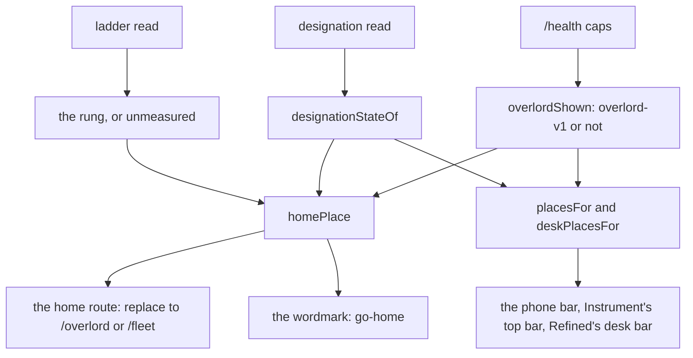
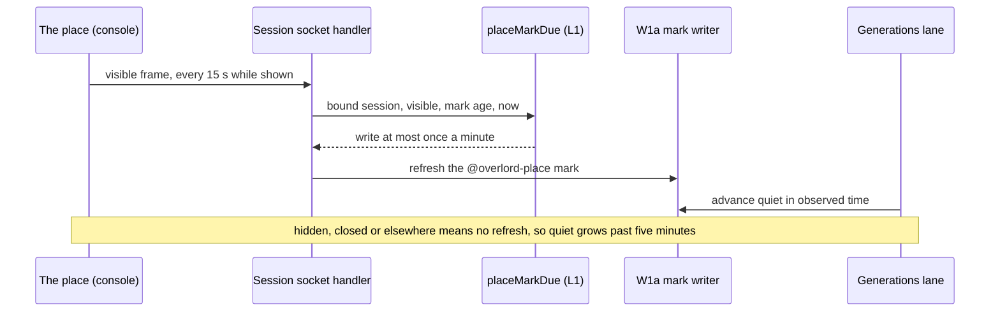
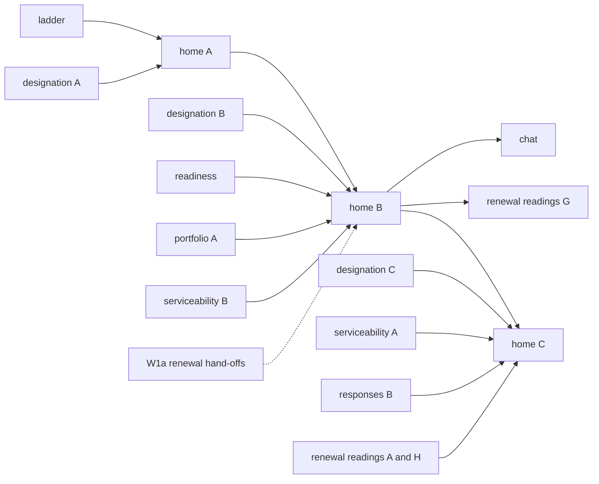

# Overlord W1: Home and Settings, the Overlord place as the console's home Implementation Plan

> **For agentic workers:** REQUIRED SUB-SKILL: Use superpowers:subagent-driven-development (recommended) or
> superpowers:executing-plans to implement this plan task-by-task. Steps use checkbox (`- [ ]`) syntax for tracking.

**Goal:** the console opens on the Overlord when one is designated, and the operator runs it from there and from
Settings.

- **The home is decided once.** An L1 `homePlace` answers the Overlord place while an Overlord is designated and the
  operator's rung is not `off`, and the Fleet otherwise. The console's root, `/`, renders what it answers.
- **The Fleet keeps a path of its own**, `/fleet`. Every go-fleet door, the page backs, the session header's back, the
  reap's and the render boundary's navigation all go there, so they land where they land today.
- **The places list is derived.** `PLACES` becomes a pure function of the designation's state. The Overlord's door is
  first on every bar while one is designated, and while a failed first start stands.
- **Nothing of the Overlord's is drawn without `overlord-v1`** (index question 33, ruled F4): no door, no palette row,
  no Start and no Settings section, and a direct `/overlord` goes to `/fleet`.
- **The wordmark goes home.** It runs a new "Go home" command that asks `homePlace`. A desk gains a Fleet door only
  while the Overlord's door is drawn and the home is not the Fleet (D25 stands otherwise).
- **The Overlord place** (Table 4a's W1 parts):
  - the readiness word with its since and where questions go, also on the Fleet's health row and on Waiting on you;
  - Pause and its "taking effect" line, beside the ladder's controls;
  - Start, Open, Rebind and Restart;
  - "Since you were last here";
  - the portfolio strip with its rank control;
  - the capacity line;
  - the face.
- **The place-visible report (R19).** The place opens the bound Overlord's session stream. The session store's
  existing visibility frame then tells the server every 15 s that the place is on display. The server turns that
  report into the `@overlord-place` operator mark, which the renewal readings read as "five minutes with no visible
  Overlord place".
- **Settings gains an Overlord section** with the W1 rows: the model class, the account set, each account's billing
  fact and continuity record, the response rows' retention, and the renewal backstop's hour and time zone. Each row
  writes through a door its own piece already planned. This piece adds no server door.

**Why:** R9 makes the Overlord the console's home (C8, H20). The home must never hide the Fleet, never strand a link
that pointed at `/`, and never offer a control that a server row does not back (H9). Every Setting the Overlord's
pieces planned has a server door but no console row, and the operator sets the account facts only from Settings
(index question 34).

**Architecture:** three pull requests in lane F, all in the console except one server edit in PR B.

- **PR A, the home and the places (Tasks 1 to 3).**
  - New L1 modules: `pwa/src/overlord/homePlace.ts` (`designationStateOf`, `homePlace`, `overlordShown`), and
    `placesFor`, `deskPlacesFor` and `phoneDoorsFit` in `pwa/src/lib/places.ts`.
  - One L4 store, `pwa/src/stores/overlord.ts`, the console's one reader of the designation, the ladder, the
    readiness word and the server's capability words.
  - The route table gains `home` (`/`), moves `fleet` to `/fleet` and adds `overlord` (`/overlord`).
  - `PLACES` and `DESK_PLACES` become functions, read by the three bars.
  - Every go-fleet door takes the Fleet's path. The wordmark runs `go-home`.
- **PR B, the Overlord place (Tasks 4 to 7).**
  - `pwa/src/overlord/OverlordPlace.tsx` and its parts, with their `*Words.ts` modules.
  - The ladder's controls and Pause, and the doors Start, Open, Rebind and Restart, all on the doors their pieces own.
  - The readiness line on the Fleet's health row and on Waiting on you.
  - `useOverlordSessionStream`, which opens the bound session's store while the place is mounted.
  - The server's one edit: the session socket's visibility frame, for the bound Overlord, refreshes the
    `@overlord-place` mark through W1a's exported mark writer, behind an L1 decider.
- **PR C, the Settings rows (Tasks 8 and 9).**
  - A sixth Settings section, `overlord`, with Retire, the model class, the account set, the backstop and the
    retention.
  - Each roster account's billing fact and continuity record, and the account-hold Clear control.

**Tech Stack:** TypeScript (ESM), React, the `@ccrc/ui` design system, vitest (jsdom), the browser suite, and one
Fastify socket handler. No new dependency.

**Spec:** `docs/superpowers/specs/2026-11-09-overlord-design.md`:

- §4 (C8 and its bullets, Table 4a, the chat bullets that name the place's state, "Pause sits on the Overlord place",
  "Nothing held is hidden");
- §4.1 ("Since you were last here", Table 4.1b, "An unmeasured reader says so");
- §6.4 (Table 6.4a, "The place shows it", a dead Overlord's Restart);
- §7.5 (Pause, the rungs, "lowering never needs a step-up");
- §5.6 (the portfolio strip and the capacity line), §3.1 ("No second start", Rebind), §3.3.11 (R19's break, "a
  console that reports the place hidden"), §3.4 (the model class and the account set);
- Table 11.1d's Settings row (the backstop, the model class, the account set, the retention), Table 11.1a's account
  facts ("the operator, from Settings"), §11.2 ("Lowering never needs a step-up");
- Table 13.1 for which calls are `shape` (none of this piece's: it creates no table and no door).

The index is `docs/superpowers/plans/2026-11-14-overlord-w1.md` (Table W1's "Home and Settings" row, lane F, "Where lanes
meet" for `pwa/src/lib/api.ts` and `DigestScreen.tsx`, "What a merge arms", "Where things stand"). The face is built
(`docs/superpowers/plans/2026-11-10-overlord/w1-face.md`), and this piece only reads it.

## Open questions

The index's questions are cited as "index question N". This plan's own questions are numbered below. Each has a
recommendation, and the tasks build the recommendation unless the coordinator rules otherwise. Fix round 1 (review
2195) ruled several of them, and those are marked "(ruled)".

**Bound by the brief (ruled):**

- The PWA rings: `*Words.ts` and the pure modules are L1, `lib/api.ts` is L3, and stores, hooks, components and
  screens are L4.
- The ladder's controls (the operator's rung, the standing latches with Clear, the conditions and the effective rung)
  are drawn here from `GET /api/overlord/ladder` (the ladder plan's question 14).
- Lowering never asks a step-up, and raising does. A latch's Clear is a raise (ruled, F1). Lowering the response
  retention asks the step-up (the responses plan).
- Every server door this piece calls is planned by its owner. This piece adds no server door, only console rows.
- Contrast and themes go through `@ccrc/ui`, and its generated palettes are never hand-edited.
- Phone first: every screen at 360 px with no horizontal scroll, with browser tests at every width.

**Open, with a recommendation, or ruled:**

1. **How `/` renders the home** (slug `home-root-replaces-to-the-place`). The spec says `/` "renders what `homePlace`
   answers". Every other reader of the path is pure and reads the path alone: `topRouteOf` (the current door),
   `shellViewOf` (the phone's fleet or detail view) and `phoneBarShown`. If `/` drew the Fleet or the place in place,
   each of those would need the designation as an input.
   **Recommendation:**
   - `/` is a route of its own, `home`, whose screen asks `homePlace` and then replaces the address with the answered
     place's path (`navigate(path, { replace: true })`). So `/` never stays in history, a back never returns to it, and
     every path reader keeps reading the path alone.
   - Until the store's first answer, a desk's detail pane shows the shell's "Loading…" status. On a phone,
     `shellViewOf('/')` answers `fleet`, so the Fleet view shows under `/` until the address is replaced (review 2195
     F9). That is intended: the Fleet is the safe thing to see while the home is decided.
   - The read's deadline is the store's (`READ_TIMEOUT_MS`), and a read that fails or times out answers the Fleet
     (question 3).
2. **The Fleet's path and the place's path** (slug `fleet-and-place-take-paths`). **Recommendation:**
   - The Fleet is `/fleet` and the place is `/overlord`. Both are `top` rows of `ROUTES`, so "Go to Fleet" and "Go to
     the Overlord" come from `GO_TO` with no second list.
   - The chords are `g f` (kept) and `g o` (the place, through `CHORDS`). "Go home" is not a `GO_TO` row, so its
     registry entry carries its own `keys: ['g', 'h']` (F19).
3. **What the home and the rows read when a read fails** (slug `home-unmeasured-rules`; ruled, F11). `homePlace` must
   not fold "unmeasured" into a value. The store holds each read as one of five states (Global Constraints):
   `loading`, `answered`, `stale`, `unmeasured` and `absent`.
   - **Absent** (a 404 from a read's own path on an older server) means "this server has no Overlord". It is not
     unmeasured.
   - **Unmeasured:** a 401, any 5xx, a timeout or a network failure.
   - **Stale:** a refresh that fails after an answer keeps the last answer, and the place shows "last read hh:mm".
   - **The Settings rows are gated on the store's state.**
     - `absent` reads "this server has no Overlord".
     - `answered` with `designation: null` reads "Start the Overlord first".
     - A door's `not-found` is read only after the store has `answered`. Any unknown `/api` route also answers 404
       `not-found`, so before an answer the console cannot tell an older server from a missing row.
   - **The home:**
     - Designation unmeasured: the Fleet, with the reason `designation-unmeasured`. No Overlord door is drawn before
       the first answer, so the bars do not shift on a failed read.
     - Designated, with the rung unmeasured: the Overlord place, with the reason `rung-unmeasured`. Pause and the
       ladder's controls live on the place, so sending the operator to the Fleet would hide the brake.
     - The rung `off`: the Fleet, with the reason `rung-off`. The place's door stays, so the operator can raise it
       again.
4. **The place-visible report** (slug `place-visible-rides-the-session-socket`; the renewal-readings plan's question
   7 and its slug `place-hidden-is-a-mark`; ruled, F3).
   - **What exists:** the spec says the console reports a hidden place "over its live socket". Today the session
     store's socket sends `{ type: 'visible', visible }` every `VIEWER_REFRESH_MS` (15 s) once `connect()` has run,
     and the server keeps it as the `Viewers` visible claim (`server/src/viewer.ts#Viewers`,
     `server/src/server.ts#asSessionClientMsg`). The renewal readings plan recommends the W1a operator mark under the
     key `@overlord-place`, refreshed while the place is visible, at a cadence under five minutes.
   - **Ruled (F3):**
     - Home B opens the bound session's store. A small L4 hook, `useOverlordSessionStream`, calls the session store's
       `connect()` on mount and `disconnect()` on unmount. A test holds that a mounted place sends a visibility frame
       every 15 s.
     - The chat piece's PR A reuses that handle and opens no second stream.
   - **On the server:** a `visible: true` frame for the session that the designation binds refreshes the
     `@overlord-place` mark through the mark-writer function W1a exports (an index change, F8).
     - An L1 decider, `placeMarkDue`, rules on each frame: only the bound session, only `visible: true`, and at most
       once a minute (`PLACE_MARK_EVERY_MS`, 60 s, under `BREAK_PLACE_HIDDEN_MS`'s five minutes).
     - A closed socket, a hidden tab or a place the operator left sends no refresh, so the mark's `quiet` grows. The
       generations lane advances `quiet` in observed time, and a server restart advances nothing, as for every mark.
   - **`/s/<id>` counts too** (slug `session-screen-counts-as-the-place-visible`, F18). The operator's own session
     screen for the Overlord sends the same frames. That departs from R19's "no visible Overlord place", in the safe
     direction: an operator watching the Overlord's pane is not away, so no early renewal is spent.
   - **What a forged frame can do.** With sign-in armed, `/ws/session/:id` needs the operator's cookie and passes the
     origin check. The box token does not open it. So a forged or replayed `visible` frame needs the operator's own
     credential, and all it does is defer a soft renewal: the hard rows still bound the context.
   - This edit needs W1a's renewal hand-offs (the `operator_marks` table and its exported writer).
5. **The readiness word** (ruled, F2; the readiness plan's slug `readiness-has-one-read-door`).
   - The readiness plan, in its own fix round on `ws/overlord-plan-w1-ready`, ships `GET /api/overlord/readiness`. It
     is session-gated and masked, and it answers `ReadinessWire`:
     - `word`, `since`, `why` and `until`;
     - `questionsGo` (`'operator'` in W1);
     - `restartable`;
     - `strandCause`.

     There is no `ok` field. A 503 `unavailable` reads as unmeasured, and `absent` with `since: 0` comes before the
     first pass.
   - This plan adopts that shape exactly. The place renders `questionsGo` and never decides it: W1 always answers
     `operator`, and W3 adds `overlord` for `ready`. Restart is drawn from `restartable`, never from the word.
   - **Home B builds the word on three rows (ruled):**
     - the Overlord place;
     - the Fleet's health row, a one-line part in the Fleet's banner stack;
     - Waiting on you, in its head.

     Each shows the word, its since and where questions go, and only while the console reads `overlord-v1` (question
     9) and the word is not `absent`.
   - The texts per word are this plan's (the readiness plan's Table 3 names the states, not the copy).
6. **The capacity line's read** (slug `runway-read-is-serviceabilitys`). Serviceability B ships `poolRunway` in L1 and
   names no route for it.
   - **Recommendation:** serviceability B, which owns the decider, adds the operator's read,
     `GET /api/pools/runway`, session-gated and masked, answering `PoolRunwayAnswer` per pool.
   - Home B draws the line from that read. Until it exists, the part is not drawn, as Table 4a draws no part a later
     piece supplies. It is never drawn as "no runway".
7. **The standing account holds' read** (slug `account-holds-read-is-the-readings`). The renewal readings plan's PR H
   ships `POST /api/continuity/account-holds/:lane/clear` and the store's `accountHolds` reader, but no route to read
   them. Home C must draw Clear beside a held account.
   - **Recommendation:** the renewal readings PR H adds `GET /api/continuity/account-holds`, session-gated, answering
     the standing holds, or 503 `unmeasured`.
   - Home C draws Clear beside each held account's row, and on the readiness item's detail where the item names the
     lane. Without the read, the Clear control is drawn only on the item.
8. **"Since you were last here", composed where** (slug `since-block-reads-server-rows`). The spec says each part is
   composed by the server from rows, so that a quiet Overlord cannot make the operator's view quiet. W1's three lines
   (items waiting, runs closed, programmes stalled) are all in reads the console already makes: `GET /api/waiting`
   and `GET /api/programmes?since=`.
   - **Recommendation:** an L1 decider in the console, `sinceLines`, composes the W1 lines from those two server
     reads. That is the spec's intent: the rows are the server's, and nothing the Overlord says enters them. W3's
     Overlord lines move the block to a server composition, beside the decision queue.
   - "Last here" is a per-device fact: the time this device last showed the place, kept in `localStorage` and read
     through an L3 module. That is a per-viewer convenience, and a device with no stamp shows the last 24 hours.
   - A line whose read failed prints "unmeasured", never "quiet".
9. **Nothing of the Overlord's is drawn without `overlord-v1`** (ruled, F4; index question 33).
   - The console reads the server's capability words from `GET /health`'s `caps`, through the same store. The PWA
     does not read them today.
   - **While the word is absent, or the read is not answered:**
     - no Overlord door is drawn;
     - no palette row "Go to the Overlord" is offered;
     - no Overlord section is drawn in Settings;
     - no Start and no readiness line is drawn anywhere;
     - a direct `/overlord` replaces to `/fleet`;
     - `homePlace` answers the Fleet.

     Each has its own test.
   - The word is compared as the string `'overlord-v1'`, held once in `pwa/src/overlord/homePlace.ts` as
     `OVERLORD_CAP`, because `SERVER_CAP_MAP` gains its row only in the `overlord-v1` piece. That piece then points
     `OVERLORD_CAP` at its typed constant.
   - With the word, Start lives on the place (slug `start-on-the-place`). It is reached from the palette and from
     Settings' Overlord section, which links to it, while no Overlord is designated.
10. **Witness exchange after a narrowing door** (authority journal B's `pwa/src/lib/witness.ts`; ruled, F1). That plan
    exchanges the witness "when another piece calls it after a narrowing door". The narrowing doors are Pause and a
    rung lowered. A latch's Clear is a raise: it has no `narrowing` field, no "taking effect" line and no exchange, and
    the store is refreshed after it. **Recommendation:** whichever of home B and authority journal B lands second adds
    the call after Pause and after a rung lowered, one line each, mirroring the `RestoreBanner` rule (authority journal
    C mounts the banner if home B has landed first).
11. **The face on the place** (the face plan's slug `mood-plays-five-seconds`). **Recommendation:** the place draws
    `Character` at scale 4 with `useMood()`'s mood. It plays for `MOOD_PLAY_MS` after a change, then holds still,
    exactly as the bar does, so it needs no pause control (WCAG 2.2.2). Looping with a pause control is not built.
12. **A sessionless push still opens `/`** (`pwa/public/push-sw.js`, whose fallback is `'/'`). **Recommendation:** leave
    it. `/` is now the home, which is the right landing for a push that names no session and no path. Every push that
    names a session or a path is unchanged. The spec's "push addresses keep working" holds, because no push names the
    Fleet's path, and `/` still resolves.
13. **The phone bar at 320 px** (slug `phone-bar-sheds-doors-to-search`, F15). With the Overlord's door the phone bar
    has eight doors (seven places and Search). At 320 px, eight doors are 40 px wide, under the 44 px tap minimum. No
    More sheet exists, and one would be a second navigation mechanism.
    **Recommendation:**
    - an L1 rule, `phoneDoorsFit(widthPx, places)`, keeps as many places as fit at 44 px each beside Search, dropping
      from the end of the list (Docs first);
    - a dropped place stays reachable through Search, whose palette lists every "Go to" command;
    - the browser suite pins 44 px doors at 320, 360 and 390 px, and which doors a 320 px bar keeps.
14. **The desk's Fleet door** (ruled, F5; slug `desk-fleet-door-only-with-the-overlord`). D25 (the operator's ruling of
    2026-11-04, `pwa/src/lib/places.ts`'s header) leaves the Fleet out of a desk's bars, because the wordmark leads to
    it and the sessions sit beside every page.
    - `deskPlacesFor` adds the Fleet door only when the Overlord's door is drawn and `homePlace` does not answer the
      Fleet, which is when the wordmark no longer leads to the Fleet. D25 stands otherwise.
    - **The wordmark's current rule:** the wordmark is current only where no other door is.
      - While no Fleet door is drawn, the wordmark is current on `/fleet` and on a session, as today.
      - With the Fleet door drawn, the Fleet door is current on `/fleet` and on a session, the Overlord's door on
        `/overlord`, and the wordmark nowhere.

      So every path marks at most one door, and a test holds that `/fleet` marks exactly one.

## What exists today

Measured on `main` at `d440a7f41` (2026-11-16).

| Fact | Where |
|---|---|
| The one places list, fleet first, six places, with `DESK_PLACES` (every place but the fleet) and `FLEET_PLACE` | `pwa/src/lib/places.ts#PLACES`, `#DESK_PLACES`, `#FLEET_PLACE` |
| The phone bar draws the six places and then Search: seven doors today. The Overlord's door makes eight | `pwa/src/skins/PhoneBar.tsx`, `pwa/test/phone-bar.test.tsx` (widths 360, 390, 899) |
| Instrument's top bar: the wordmark door runs `go-fleet` (`HOME_DOOR_NAME`), then `DESK_DOORS` (`DESK_PLACES` plus Archive and a reserved door) | `pwa/src/skins/instrument/TopBar.tsx#DESK_DOORS`, `#HOME_DOOR_NAME` |
| Refined's desk bar draws `DESK_PLACES` | `pwa/src/skins/refined/AppBar.tsx` |
| The route table: `fleet` is `/` and `top`; Settings has five sections; `GO_TO` derives a "Go to" command per `top` row, with chords `f i r a s` | `pwa/src/lib/routes.ts#ROUTES`, `#SETTINGS_SECTIONS`; `pwa/src/command/commands.ts#GO_TO` |
| Path readers that read the path alone: the current door, the phone's view, the phone bar's presence | `pwa/src/lib/routes.ts#topRouteOf`, `#shellViewOf`; `pwa/src/lib/places.ts#phoneBarShown` |
| Go-fleet doors that navigate to `/`: the page back, the digest's back, the session header's back, the Docs index's up door | `pwa/src/command/door.ts#backToFleet`; `pwa/src/screens/DigestScreen.tsx`; `pwa/src/screens/SessionScreen.tsx` (`onBack`); `pwa/src/docs/DocsHead.tsx` (`up === '/'`) |
| Two `navigate('/')` calls with no `go-fleet` mark: after a reap, and in the render boundary | `pwa/src/screens/SessionScreen.tsx` (`onReaped`); `pwa/src/components/RenderBoundary.tsx` |
| The Waiting on you path's fallback is `/` | `pwa/src/lib/routes.ts#waitingPath` |
| The app's ladder: a path outside the table, or `/` on a desk, draws "Select a session" | `pwa/src/app.tsx` |
| The installed app starts at `/`; a push with no session or path opens `/` | `pwa/vite.config.ts` (`start_url`); `pwa/public/push-sw.js` |
| The session socket's visibility frame, re-sent every 15 s, kept as the visible claim | `server/src/server.ts#asSessionClientMsg`; `server/src/viewer.ts#Viewers`; `shared/api.ts#VIEWER_REFRESH_MS` |
| The face: `Character`, the mood decider and its hook, the bar's mark | `ui/src/characters/character.tsx#Character`; `pwa/src/face/mood.ts#moodOf`; `pwa/src/face/useMood.ts#useMood`; `pwa/src/face/FaceMark.tsx#MOOD_PLAY_MS` |
| One rule for "heard": a reader never hand-writes a frame-seen ternary | `pwa/src/fleet/useHeard.ts`; `pwa/test/use-heard.test.tsx` |
| The step-up: one hook and one sheet per session | `pwa/src/accounts/useStepUp.ts#useStepUp`; `pwa/src/accounts/ConfirmItsYou.tsx` |
| Pool names derived from the roster, never a list in source | `pwa/src/lib/pools.ts#poolOptions` |
| The portfolio's server doors (portfolio A, merged) with no console call yet | `server/src/coord/ledgersRoutes.ts` (`GET /api/portfolio`, `POST /api/portfolio/rank`); no `portfolio` in `pwa/src/lib/api.ts` |
| The reads the "since" block uses | `server/src/coord/ledgersRoutes.ts` (`GET /api/waiting`); `server/src/coord/routes.ts` (`GET /api/programmes`, `since` in ms); `pwa/src/lib/api.ts` (`waiting`, `programmes`) |
| The server's capability words, on `GET /health`'s `caps`; the console does not read them today | `server/src/server.ts` (`/health`); `shared/api.ts#SERVER_CAPS` |
| A single-definition pin on the places: `PLACES`, `DESK_PLACES` and `phoneBarShown` are declared in `places.ts` alone | `server/test/single-definition/ledgers-console.test.ts` |
| Tests that pin the desk doors and the wordmark's name (`DESK_DOORS`, `HOME_DOOR_NAME === 'ccrc, Fleet'`) | `pwa/test/instrument-shell.test.tsx`; `pwa/test/primitives.test.tsx` |
| A second spelling of the Fleet's path, with no `go-fleet` mark | `pwa/src/ledgers/ProgrammeScreen.tsx` (its own `FLEET_PATH`) |
| The session store's 15 s visibility beat starts in `connect()`, which only the session screen calls today | `pwa/src/stores/session.ts`; `pwa/src/screens/SessionScreen.tsx` |
| The Fleet's banner stack and Waiting on you's head, where the readiness line goes | `pwa/src/fleet/BannerStack.tsx`, `pwa/src/screens/FleetScreen.tsx`; `pwa/src/ledgers/WaitingScreen.tsx` |
| A console decider becomes a mutant target only through a sets file that restates its cases over the loaded module | `server/test/sim/faceSets.ts` (the precedent), `server/test/sim/mutation-floors.test.ts` |
| The browser suite's answer for an unrouted `/api` call | `pwa/browser/app.ts#unroutedAnswer` |
| `getJson` throws on every non-2xx, and no helper answers a 404 as a value | `pwa/src/lib/api.ts#createApi` |
| Growth-checked files this piece touches | `pwa/src/lib/api.ts`, `server/src/server.ts` (`server/test/growthCheck.ts#growthFiles`). `pwa/src/fleet/fleet.css` is avoided: the place's styles go in a new stylesheet |

**Not on `main` yet** (each is a "needs first", taken from its merged plan):

- `GET /api/overlord/designation`, `POST`/`DELETE /api/overlord/designate` (designation A);
  `POST /api/overlord/rebind` and `POST /api/overlord/restart` (designation B); `POST /api/overlord/model` and
  `POST /api/overlord/account-set` (designation C).
- `GET /api/overlord/ladder`, `POST /api/overlord/rung`, `POST /api/overlord/pause` and
  `POST /api/overlord/latches/:cause/clear` (the ladder).
- `GET /api/overlord/readiness` and `ReadinessWire` (the readiness plan, in its fix round on `ws/overlord-plan-w1-ready`), the runway read (question 6) and the account holds' read (question 7).
- The widened `POST /api/accounts/:id/set` with `fableBilling` and `continuity`, and `RosterWire`'s two optional fields
  (serviceability A).
- `GET`/`POST /api/responses/retention` with `responseRetention()` and `setResponseRetention(days)` in
  `pwa/src/lib/api.ts` (responses B).
- `GET`/`POST /api/continuity/renewal-backstop` (renewal readings A) and the account-hold clear door (renewal readings
  H).
- W1a's `operator_marks` table, its exported writer function and its reader (`w1a-renewal-handoffs.md`, Task 3; the exported function is an index change, F8).
- `RestoreBanner` and `confirmRestore` (authority journal C), and `pwa/src/lib/witness.ts` (authority journal B).

## Global Constraints

- **Architecture (`CLAUDE.md`, the PWA rings).**
  - L1, pure, with no store, no DOM, no clock and no `lib/api.ts`:
    - `pwa/src/overlord/homePlace.ts`: `designationStateOf`, `homePlace`, `overlordShown` and `OVERLORD_CAP`;
    - `pwa/src/lib/places.ts`: `placesFor`, `deskPlacesFor` and `phoneDoorsFit`, beside `phoneBarShown`, so the places
      stay declared in one file;
    - `placeWords.ts`, `readinessWords.ts`, `ladderWords.ts`, `sinceWords.ts`, `portfolioWords.ts`, `runwayWords.ts`
      and `overlordSettingsWords.ts`, all in `pwa/src/overlord/`;
    - `server/src/continuity/placeMark.ts` (`placeMarkDue`).

    `now` is always an argument. `pwa-rings.test.ts` holds that no L1 module loads a `.tsx`, a store or `lib/api.ts`.
  - L2: `pwa/src/overlord/readState.ts`, types only.
  - L3:
    - `pwa/src/lib/api.ts`, which gains this piece's calls (the PR split counts them) and one shared helper,
      `getJsonOrAbsent`, which answers a 404 as `{ absent: true }` and throws everything else as today;
    - `pwa/src/overlord/lastHere.ts`, the one reader and writer of the "last here" stamp in `localStorage`. Every access
      is wrapped, and an absent or throwing storage reads as "no stamp".
  - L4:
    - `pwa/src/stores/overlord.ts` (the poll) and the hooks over it;
    - `useOverlordSessionStream`;
    - `OverlordPlace.tsx` and its parts, `HomeRoute.tsx`, the readiness line, and the Settings section and cards.

    They decide nothing: every verdict is an L1 call.
  - The server's one edit is L4 delivery code in `server/src/server.ts`'s session socket. It asks `placeMarkDue` (L1)
    and acts through W1a's exported mark writer (L3). It makes no decision of its own.
  - **Ring and context rows.** Every new `pwa/src` file has one ring and one context under the architecture spec's
    "Deciding a file's ring and context" rules. PR A adds:
    - a directory row for `pwa/src/overlord/`;
    - a file row for `pwa/src/stores/overlord.ts` (F7). Only `stores/fleet.ts` and `stores/session.ts` have rows
      today, and `rings/totality.test.ts` reds on a file no row reaches.
- **One reader per fact. Consolidate, don't duplicate.**
  - **One console reader each:** the designation, the ladder, the readiness word and the server's capability words
    are read only by `stores/overlord.ts`. The bars, the home route, the place, the readiness lines and the Settings
    rows all read the store, and none fetches on its own.
  - **One decision each:** the home by `homePlace` and the places by `placesFor`. `PLACES` stops being a constant, so
    no second list can drift from it.
  - **One Fleet path:** `FLEET_PATH`, exported from `pwa/src/lib/routes.ts`. `ProgrammeScreen.tsx`'s own definition is
    replaced by the import, and a single-definition scan holds it (F7).
  - **Pool names** come from `poolOptions` over the roster, never from a list in source (`topology-clean`).
  - **"Heard"** goes through `useHeard`.
  - **The step-up** goes through `useStepUp` and `ConfirmItsYou`, one instance per page (the hook's one-instance rule,
    F16). The place mounts one for the body part and the ladder part together. `RestoreBanner` is self-contained (the
    authority journal plan's question 14). Settings' Overlord section mounts one for its cards.
  - **Refusal sentences** join the existing refusal-word tables in `pwa/src/lib/refusalWords.ts`, keyed by the words in
    `shared/refusal.ts`. No screen carries its own copy of a refusal sentence.
  - **The place-visible report** reuses the session store's socket, the visibility frame, `Viewers`' transport and
    W1a's exported mark writer. It adds no frame type, no door, no second socket and no second writer of
    `operator_marks`.
- **Failure contracts. Nothing unmeasured reads as a value (ruled, F11).**
  - Each read's answer is a tagged union in the store, and every L1 reader takes that union, never a `null`:
    - `{ state: 'loading' }`;
    - `{ state: 'answered', value, at }`;
    - `{ state: 'stale', value, at, error }`;
    - `{ state: 'unmeasured', error }`;
    - `{ state: 'absent' }`, a 404 from an older server.
  - A 401 and every 5xx are `unmeasured`. A 401 also raises the sign-in screen through `request()`, as today.
  - **Designation:** 404 is `absent`, read as "this server has no Overlord". 503 `unavailable`, a timeout and a network
    failure are `unmeasured`. `{ designation: null }` is `none`.
  - **Ladder:** 503 `unavailable` is unmeasured, and the place says "the ladder could not be read". A cause the console
    does not know (`known: false`) is drawn by its key, with Clear.
  - **Readiness:** 503 `unavailable` reads unmeasured, and `absent` (the word) means no Overlord. A word the console does
    not know is drawn raw.
  - **Portfolio:** 404 reads "no portfolio on this server", and 503 `runs-unreadable` reads unmeasured with its detail.
    A measure with `n: 0` reads "no data", never 0. `rankUnreadable` is drawn as "rank unreadable".
  - **Runway:** a read not yet on the server (404) leaves the line undrawn. A 503 reads unmeasured.
  - **Settings rows:** gated on the store's state (question 3). A door's `not-found` is read as "no designation row"
    only after the store has answered. An older roster that lacks `fableBilling` or `continuity` reads "not set",
    which is the serviceability plan's absence rule.
  - **Refusals:** every door's refusal is drawn by its word's sentence, and a word the console does not know is drawn
    raw (the vocabulary plan's rule for an older console).
- **Authority (ruled, F1).**
  - **Lowering never asks a step-up:**
    - Pause, and the rung lowered to `off` or `chat`;
    - the model class set to `opus`, and a narrower account set;
    - an account's billing fact set to `credits`, and the continuity record set to `off`;
    - Restart and Retire, as their doors say.
  - **Raising always does:**
    - Start, Rebind, and a rung raised;
    - a latch's Clear, which is a widening (the ladder plan; spec §11.2): it answers `{ ok, changed }` with no
      `narrowing`, so no "taking effect" line and no witness exchange follow it, and the store is refreshed;
    - the model class set to `fable`, and a wider account set;
    - `included`, `on`, and the retention lowered.
  - The console never decides the direction. It sends the act, and on `step-up-required` it shows the step and waits
    for the operator to press the act again (`useStepUp`'s rule). The server's gate is the authority.
  - A control that changes authority is drawn only from a server row (H9). The rung, latch and condition controls come
    from `GET /api/overlord/ladder`'s rows, never from a list in the console.
- **Wire: additive.** This piece adds no field to any wire. It reads fields its owners add, each through one reader,
  and an absent field reads as its owner's plan says. `FLEET_PROTO` is not bumped.
- **What a merge arms.** Nothing of the Overlord's is drawn until the server advertises `overlord-v1` (question 9),
  which comes last in W1.
  - **PR A:** the root becomes a redirect. `/` replaces to `/fleet`, which draws exactly today's Fleet. The bars draw
    today's doors, with no desk Fleet door (D25 stands while no Overlord door is drawn). The wordmark lands on the
    Fleet. The one visible change is the address `/fleet`.
  - **PR B:** the place, Start and the readiness lines are drawn only under `overlord-v1`. A direct `/overlord` replaces
    to `/fleet` without it. The session socket's mark refresh writes only while a bound Overlord exists.
  - **PR C:** the Overlord section is drawn only under `overlord-v1`, and each row writes only on the operator's tap.
- **Phone first.**
  - Every new screen and card is laid out for 360 px with no horizontal scroll.
  - The browser suite measures each one at 320, 360, 390, 899 and 1280 px, in both skins and in a light and a dark
    palette.
  - Every tap target is at least 44 px at 320 px, the phone bar's doors included (question 13).
- **Design system.** Colours, spacing and type come from `@ccrc/ui`'s tokens. No hex value is written, and no generated
  palette is edited. Status words use the design system's status label.
- **SAFETY (`CLAUDE.md`).** No ccd verb, no fleet act and no live `~/.ccrc`. The server test builds `coord.db` in memory.
- **Tests.**
  - From `pwa/`: `ccrc test -- ./node_modules/.bin/vitest run test/<file>.test.ts` and
    `ccrc test -- ./node_modules/.bin/vitest run --config vitest.browser.config.ts browser/<file>.browser.test.ts`.
  - From `server/`: `ccrc test -- ./node_modules/.bin/vitest run test/<file>.test.ts`.
  - Each task ends with pwa's `ccrc test -- npx tsc --noEmit`. PR B's server task adds both server `tsc` runs.
- **The browser suite in full.**
  - A new door can overflow a bar in ways only the whole suite sees (§4).
  - PR A carries the `full-ci` label, and each PR's last step runs the whole browser suite locally before the push.
  - PR A's churn is large. The lens counted about 65 `goto(origin + '/')` calls in 33 browser files and about 146
    jsdom history writes to `/`. Each one that means the Fleet moves to `/fleet`, and each one that means the home stays
    on `/`.
  - The browser suite's stubbed reads go through `pwa/browser/app.ts#unroutedAnswer`: an unrouted designation read
    answers 404, so every existing browser test sees "no Overlord" with no edit.
- **Growth check.** Every growth-checked file stays within 40 net lines in each pull request, with no waiver (the PR
  split below has the estimates). No touched file has a cap.
- **Mutation floors (F13).**
  - The console's deciders are mutant targets through a new sets file, `server/test/sim/homeSets.ts`. It restates
    each decider's cases over the module loaded by `modulePath`, as `server/test/sim/faceSets.ts` does, and it is
    imported by `mutation-floors.test.ts`. PR A adds `designationStateOf`, `homePlace`, `placesFor`, `deskPlacesFor`
    and `phoneDoorsFit`, and PR B adds `sinceLines`.
  - `placeMarkDue` is a server decider. It joins `MUTANT_SETS` directly in PR B.
  - Each set's measured floor goes in `server/test/sim/mutation-floors.json`, in the pull request that creates the
    decider.
  - `readinessWords` and `ladderWords` hold tables, not decisions. Each gets a totality test over its vocabulary in
    place of a mutant set.
- **Censuses** are named in each task. Every guard ships with the test that goes red without it.
- **Public repository.** No private names. Fixtures use `lane-a`, `lane-b`, `pool-a`, `pool-b`, `prog-a` and the
  session id `lane-a-overlord`. Cite by symbol or `@anchor`. No D-number is invented: departures are slugs under
  "Deviations found", and the coordinator mints numbers.

## Review Focus

1. **The home never hides the Fleet, and never strands a link.**
   - `/fleet` draws today's Fleet, at every width and in both skins.
   - Every go-fleet door and every `navigate('/')` that meant the Fleet now names `FLEET_PATH`. A census proves that
     no `navigate('/')` and no `'/'` target is left in `pwa/src` outside the route table.
   - `/` never stays in history.
2. **One decision for the home and one for the places.**
   - `homePlace` and `placesFor` are total over their inputs, and unmeasured never folds into a value.
   - The bars, the wordmark, the root and the palette all read them.
   - Without `overlord-v1`, nothing of the Overlord's is drawn.
3. **No control without a row (H9), and the step-up follows direction.**
   - The ladder's controls are the read's rows.
   - Lowering acts in one tap, and raising, a latch's Clear included, goes through the step-up.
   - A refusal is shown as its word's sentence, never swallowed.
4. **The place states its own health.**
   - The readiness word, its since and `questionsGo` are always shown, as the read answers them.
   - "Taking effect" is shown after a narrowing until a witness holds it.
   - An unreadable part says "unmeasured", never "quiet" or zero.
5. **The place-visible report has one transport and one writer.**
   - The place opens the session store's socket, with no new frame and no new door.
   - The refresh happens only for the bound session while visible, and a restart advances nothing.
6. **Phone first.** 44 px targets at 320 px, no horizontal scroll at 360 px, and the phone bar's doors measured in
   the browser.

## The PR split

| PR | Tasks | What it ships | Needs first | Growth-checked files, estimate (net lines) |
|---|---|---|---|---|
| A | 1 to 3 | **Deciders:** `designationStateOf`, `homePlace`, `placesFor`, `deskPlacesFor`, `phoneDoorsFit`. **Routes:** `home`, `fleet` (`/fleet`) and `overlord`, with the one `FLEET_PATH`. **The store:** designation, ladder and capability reads, and the home route. **The bars:** derived places, the desk Fleet door only with the Overlord's door, and every go-fleet door on `FLEET_PATH`. **The wordmark:** `go-home` | designation A, ladder | `pwa/src/lib/api.ts` +16 (`getJsonOrAbsent`, about 8, and three reads: designation, ladder and `/health`'s caps) |
| B | 4 to 7 | **The Overlord place:** the readiness part, Pause with its "taking effect" line, the ladder's controls, Start, Open, Rebind and Restart, "Since you were last here", the portfolio strip with its rank control, the capacity line, the face and the `RestoreBanner` mount. **Elsewhere:** the readiness line on the Fleet's health row and on Waiting on you, the session-stream hook, and the place-visible mark refresh on the server | PR A, designation B, readiness, portfolio A, serviceability B (with question 6's read), W1a renewal hand-offs | `pwa/src/lib/api.ts` +30 (ten calls: rung, pause, latch clear, designate, rebind, restart, portfolio read, rank, readiness read and runway read); `server/src/server.ts` +8 (the handler's call and two deps) |
| C | 8 and 9 | **Settings › Overlord:** Retire, the model class, the account set, the backstop's hour and zone, and the response retention. **Per account:** the billing fact and the continuity record. **And** the account-hold Clear | PR B, designation C, serviceability A, responses B, renewal readings A and H (with question 7's read) | `pwa/src/lib/api.ts` +18 (seven calls: retire, model, account set, backstop read and write, account holds read and clear; and the account set's widened body type) |

Each pull request merges `main` once before merge (worker clause 16) and re-runs the censuses it touches.

**If a PR cannot fit.** PR B's `api.ts` estimate is the tightest. If it passes 40 at build time, the portfolio and
runway calls move to a fourth pull request, B2, after B, with the strip and the capacity line. No waiver is planned.

For scale, the files that are not growth-checked change by about this much:

| File | PR A | PR B | PR C |
|---|---|---|---|
| `pwa/src/overlord/homePlace.ts` | +120, new | | |
| `pwa/src/stores/overlord.ts` | +170, new | +30 | |
| `pwa/src/overlord/HomeRoute.tsx` | +50, new | | |
| `pwa/src/lib/routes.ts` | +25 | | +2 |
| `pwa/src/lib/places.ts` | +60, −15 | | |
| The three bars, `door.ts`, `commands.ts`, `app.tsx`, `ProgrammeScreen.tsx` and the five go-fleet sites | +70, −35 | | |
| The PWA tests and browser tests that navigate to `/` meaning the Fleet | about +200, −200 | | |
| `server/test/sim/homeSets.ts` | +160, new | +40 | |
| `pwa/src/overlord/OverlordPlace.tsx`, its parts and the two readiness lines | | +560, new | |
| The place's `*Words.ts` modules | | +360, new | +120, new |
| `pwa/src/overlord/overlord.css` | | +160, new | +40 |
| `server/src/continuity/placeMark.ts` | | +50, new | |
| `pwa/src/screens/settings/OverlordSection.tsx` and its cards | | | +400, new |
| `pwa/src/lib/refusalWords.ts` | | +30 | +12 |

---


### Task 1: The home and the places, decided once (PR A, L1)

**Files:**

- Create: `pwa/src/overlord/homePlace.ts` (L1): `designationStateOf`, `homePlace`, `overlordShown` and
  `OVERLORD_CAP`.
- Create: `pwa/src/overlord/readState.ts` (L2, types only).
- Modify: `pwa/src/lib/places.ts` (L1). The constants `PLACES` and `DESK_PLACES` become the functions `placesFor` and
  `deskPlacesFor`, declared here beside `phoneBarShown`. `phoneDoorsFit` is added.
- Create: `pwa/test/overlord-home-place.test.ts` and `pwa/test/places.test.ts`.
- Create: `server/test/sim/homeSets.ts`. Modify: `server/test/sim/mutation-floors.test.ts` (it imports the new sets)
  and `server/test/sim/mutation-floors.json`.
- Modify: `server/test/single-definition/ledgers-console.test.ts`. Its places pin names `placesFor`, `deskPlacesFor`
  and `phoneBarShown` in `pwa/src/lib/places.ts`, and `PLACES` and `DESK_PLACES` are pinned as declared nowhere (F7).
- Modify: `docs/superpowers/specs/2026-08-10-architecture-ddd-clean-solid.md`'s path table. It gains a directory row
  for `pwa/src/overlord/` and a file row for `pwa/src/stores/overlord.ts`. Each file's ring follows its imports, and
  its context is the designation's, decided by the table's rules.

**The interface:**

```ts
/** What the console knows of the designation, from one read (`stores/overlord.ts`). */
export type DesignationState =
  | { kind: 'unmeasured'; why: string }          // loading, 401, 5xx, timeout, network
  | { kind: 'none' }                             // no row, a retired row, or an older server (absent)
  | { kind: 'failed-start'; outcome: string }    // no binding, and the last attempt failed (§5.2)
  | { kind: 'pending'; sessionId: string }       // a designate or rebind awaiting its start
  | { kind: 'bound'; sessionId: string };

export type RungRead = { kind: 'unmeasured' } | { kind: 'rung'; rung: string };   // the ladder's operatorRung
export type CapRead = { kind: 'unmeasured' } | { kind: 'caps'; caps: readonly string[] };

export type HomeAnswer =
  | { place: 'overlord'; why: 'designated' | 'rung-unmeasured' }
  | { place: 'fleet'; why: 'not-advertised' | 'none' | 'failed-start' | 'designation-unmeasured' | 'rung-off' };

export const OVERLORD_CAP = 'overlord-v1';
export function overlordShown(caps: CapRead): boolean;      // true only for an answered read naming OVERLORD_CAP
export function designationStateOf(read: ReadState<DesignationWire | null>): DesignationState;
export function homePlace(caps: CapRead, d: DesignationState, rung: RungRead): HomeAnswer;

// pwa/src/lib/places.ts
export function placesFor(shown: boolean, d: DesignationState): readonly Place[];             // the phone's order
export function deskPlacesFor(shown: boolean, d: DesignationState, home: HomeAnswer): readonly Place[];
export function phoneDoorsFit(widthPx: number, places: readonly Place[]): readonly Place[];
```

`ReadState<T>` is the store's tagged union (Global Constraints). `DesignationWire` is designation A's
`DesignationView`, imported as a type from its `shared/` sibling.

**The rules, as tables the tests read:**

| `DesignationView` read | `designationStateOf` |
|---|---|
| loading, 401, 5xx, timeout, network failure | `unmeasured` (with the reason) |
| absent (a 404 from an older server) | `none` |
| `designation: null` | `none` |
| `bound` set | `bound` |
| `pending` set, `bound` null | `pending` |
| neither, `lastAttempt` set with an outcome other than `retired` | `failed-start` |
| neither, `lastAttempt.outcome` is `retired`, or no `lastAttempt` | `none` |
| stale (a failed refresh after an answer) | the last answer's state |

The `failed-start` row trusts `lastAttempt` to mean a failure that still stands. Designation's `goLive` clears the
last attempt in the transaction that clears the pending slot (ruled, F6; slug `golive-clears-last-attempt`, carried to
`w1-designation.md`'s Task 1 in this plan's fix round). So a failed start, then a good start, then a retire reads
`none`, not a stale failure.

| `overlordShown` | `DesignationState` | rung | `homePlace` |
|---|---|---|---|
| false | any | any | Fleet, `not-advertised` |
| true | `bound` or `pending` | `off` | Fleet, `rung-off` |
| true | `bound` or `pending` | `unmeasured` | Overlord, `rung-unmeasured` |
| true | `bound` or `pending` | any other word | Overlord, `designated` |
| true | `failed-start` | any | Fleet, `failed-start` |
| true | `none` | any | Fleet, `none` |
| true | `unmeasured` | any | Fleet, `designation-unmeasured` |

- **`placesFor`** answers today's six places in today's order. When `shown` is true and the state is `bound`, `pending`
  or `failed-start` (the spec's "while a failed first start stands"), the `overlord` place is first.
- **`deskPlacesFor`** answers today's desk places, with the Overlord's door first when `placesFor` draws it. The Fleet
  door is added second only when the Overlord's door is drawn and `home.place` is not `fleet` (ruled, F5; question 14).
  D25 stands otherwise.
- **`phoneDoorsFit`** keeps as many places as fit at 44 px each beside the Search door, dropping from the end of the
  list (question 13). The Overlord and the Fleet are never dropped.

- [ ] **Step 1: Write the failing tests.**
  - `designationStateOf`: one case per row of the first table, a stale read keeping its last answer's state, and the
    F6 sequence's read (`lastAttempt: null` after a retire) reading `none`.
  - `homePlace`: every row of the second table, taken from the table literal, so a new state or rung without a row
    fails the totality check.
  - The monotone property: no `unmeasured` input and no absent `overlord-v1` ever answers `overlord` with `designated`.
  - `placesFor`: today's six places, in today's order, after the Overlord's door when one is drawn; no Overlord door
    when `shown` is false, or for `none` and `unmeasured`.
  - `deskPlacesFor`: no Fleet door with no Overlord door (D25); the Fleet door with the Overlord's door while the home
    is the Overlord; no Fleet door while the rung is `off`, because the home is then the Fleet.
  - `phoneDoorsFit`: at 320 px with eight doors, seven fit (Docs drops); at 360 and 390 px all eight fit. Every kept
    door is at least 44 px.
  - Every place id is a `top` row of `ROUTES`, so the bars' throw stays unreachable.
- [ ] **Step 2: Run.** `cd pwa && ccrc test -- ./node_modules/.bin/vitest run test/overlord-home-place.test.ts test/places.test.ts`.
  Red: the functions do not exist.
- [ ] **Step 3: Implement.** The tables are literals the functions read, not branches, so the tests read the same
  tables.
- [ ] **Step 4: Run.** Green, then pwa's `tsc`, then
  `cd server && ccrc test -- ./node_modules/.bin/vitest run test/single-definition/ledgers-console.test.ts`.
- [ ] **Step 5: Mutation floors.**
  - Write `homeSets.ts` with the cases restated over the loaded modules. It declares the modules' shapes locally, with
    no type edge into `pwa/`, as `faceSets.ts` does.
  - Its mutants:
    - **H1:** `homePlace` answers `overlord` for `rung-off`.
    - **H2:** `homePlace` ignores `overlordShown`.
    - **H3:** `designationStateOf` reads `retired` as `failed-start`.
    - **H4:** `designationStateOf` reads absent as `unmeasured`.
    - **H5:** `placesFor` draws the door for `none`.
    - **H6:** `deskPlacesFor` adds the Fleet door with no Overlord door.
    - **H7:** `phoneDoorsFit` keeps a door under 44 px.
    - **H8:** `phoneDoorsFit` drops the Overlord.
  - Run `cd server && ccrc test -- ./node_modules/.bin/vitest run test/sim/mutation-floors.test.ts` and record the
    measured floors in `mutation-floors.json`. Each mutant goes red.
- [ ] **Step 6: Commit.** `feat(pwa): the home and the places, decided once (Overlord W1 home A)`

### Task 2: The route table, one reader of the Overlord's reads, and the home route (PR A, L3 and L4)

**Files:**

- Modify: `pwa/src/lib/routes.ts`:
  - `fleet` becomes `/fleet` (pattern `^\/fleet\/?$`);
  - a new `home` row (`^\/$`, `top: false`, path `/`, title "Home");
  - a new `overlord` row (`^\/overlord\/?$`, `top: true`, path `/overlord`, title "Overlord");
  - one exported `FLEET_PATH`, read off the `fleet` row: the only spelling of the Fleet's path in `pwa/src`;
  - `waitingPath`'s fallback becomes `FLEET_PATH`.

  `shellViewOf` answers `fleet` for `fleet`, `home` and a path outside the table. `topRouteOf` answers the Fleet for a
  session, as today, and nothing for `home`.
- Modify: `pwa/src/ledgers/ProgrammeScreen.tsx`, which imports `FLEET_PATH` in place of its own definition (F7).
- Modify: `pwa/src/lib/api.ts`:
  - `getJsonOrAbsent`, the one helper that answers a 404 as `{ absent: true }` and throws everything else, as
    `getJson` does;
  - `overlordDesignation()` (`GET /api/overlord/designation`) and `overlordLadder()` (`GET /api/overlord/ladder`);
  - `serverCaps()`, which reads `GET /health`'s `caps`.
- Create: `pwa/src/stores/overlord.ts` (L4), the one store.
  - **When it reads:** at start, when the page comes back to the front, every 60 s while visible (`OVERLORD_POLL_MS`),
    and at once after any of this piece's doors answers. The capability read happens at start and on the page coming
    back to the front. A hidden page does not poll.
  - **What it keeps:** `ReadState<DesignationWire | null>`, `ReadState<LadderWire>` and `ReadState<readonly string[]>`
    (the caps). PR B adds `ReadState<ReadinessWire>`.
  - **What it exports:** `useOverlordShown()`, `useDesignationState()`, `useRungRead()`, `useLadder()`, `useHome()`
    (`homePlace` over all three) and `refreshOverlord()`.
  - **No designation read without the word:** while `overlordShown` is false, it reads only the caps, so a server
    without the word sees none of the Overlord's reads.
- Create: `pwa/src/overlord/HomeRoute.tsx` (L4).
  - While the reads are loading, a desk's pane shows the shell's "Loading…" status. A phone shows the Fleet view under
    `/`, because `shellViewOf('/')` answers `fleet` (question 1).
  - Then it calls `navigate(pathOf(useHome().place), { replace: true })`, once per visit to `/`.
- Create: `pwa/src/overlord/OverlordRoute.tsx` (L4). Without `overlord-v1` it replaces to `FLEET_PATH`. With the word
  it draws the place: a heading and its state word in PR A, and the whole place from PR B.
- Modify: `pwa/src/app.tsx`'s ladder:
  - `home` renders `HomeRoute`;
  - `overlord` renders `OverlordRoute`;
  - `fleet` renders today's placeholder on a desk and today's Fleet on a phone.
- Create: `pwa/test/overlord-store.test.ts` and `pwa/test/home-route.test.tsx`.
- Modify: `pwa/test/app.test.tsx` and `pwa/test/router-location.test.tsx` (`/fleet`, the redirect, `/overlord` without
  the word).

**Failure contract, held by tests:**

- A 404 is `absent`, meaning no Overlord. A 401, a 5xx, a timeout and a network failure are `unmeasured`.
- A failure after an answer is `stale`, with its last value.
- `useHome()` answers from those through `homePlace` alone.

- [ ] **Step 1: Write the failing tests.**
  - **The store:**
    - the cadence: at start, on focus, every 60 s, after a door; no poll while hidden;
    - each read state, including a 401 and a 503;
    - no designation read while the caps lack the word.
  - **The routes:** `/fleet` matches `fleet`, `/` matches `home` and `/overlord` matches `overlord`.
    `shellViewOf('/fleet')` is `fleet`. `topRouteOf('/s/x')` answers the Fleet.
  - **The home route:**
    - `/` with no word, or with no designation, replaces to `/fleet` and leaves no `/` entry in history;
    - `/` with the word and a bound Overlord replaces to `/overlord`;
    - `/` while loading shows the status on a desk, and after a 503 it lands on `/fleet`.
  - **`/overlord` without the word** replaces to `/fleet`.
  - **The app:** the Fleet renders at `/fleet` exactly as at today's `/`. This is the characterization: a snapshot of
    the Fleet's header and list, taken from today's `/` on `main` before the change.
- [ ] **Step 2: Run.** Red.
- [ ] **Step 3: Implement.**
- [ ] **Step 4: Run** the new suites, `app.test.tsx`, `router-location.test.tsx` and pwa's `tsc`. Green.
- [ ] **Step 5: Mutation, by hand.**
  - Read a 404 as `unmeasured`: the "no Overlord on an older server" case goes red.
  - Read the designation without the word: the "no read without the word" case goes red.

  Revert each.
- [ ] **Step 6: Commit.** `feat(pwa): the Fleet's own path, one reader of the Overlord's reads and the home route (Overlord W1 home A)`

### Task 3: The derived bars, every go-fleet door and the wordmark going home (PR A, L4)

**Files:**

- **The three bars**, each reading `useOverlordShown()`, `useDesignationState()` and `useHome()` from Task 2:
  - `pwa/src/skins/PhoneBar.tsx` draws `phoneDoorsFit(width, placesFor(...))` before Search.
  - `pwa/src/skins/refined/AppBar.tsx` draws `deskPlacesFor(...)`.
  - `pwa/src/skins/instrument/TopBar.tsx`:
    - `DESK_DOORS` becomes `deskDoorsFor(places)`, with Archive and the reserved door kept where they are;
    - `HOME_DOOR_NAME` becomes "ccrc, Home";
    - the wordmark door runs `commandDoor('go-home')`, and is current only where no other door is (question 14).
  - Refined's `AppBar` and `PhoneHeader` wordmarks run `go-home` where they are doors today.
- **`pwa/src/command/commands.ts`:**
  - `CHORDS` gains `overlord: 'o'`;
  - a new `go-home` registry entry with `keys: ['g', 'h']`, which asks `homePlace` over the store's state and
    navigates to the answer's path;
  - `GO_TO` drops `go-overlord` while `overlordShown` is false, so the palette offers no "Go to the Overlord" without
    the word;
  - `parentOf` keeps its `p.path !== '/'` guard, which now excludes `home`.
- **The go-fleet doors**, each navigating to `FLEET_PATH`:
  - `pwa/src/command/door.ts#backToFleet`;
  - `pwa/src/screens/DigestScreen.tsx`, its back;
  - `pwa/src/screens/SessionScreen.tsx`, `onBack` and `onReaped`;
  - `pwa/src/components/RenderBoundary.tsx`;
  - `pwa/src/docs/DocsHead.tsx`: the up door's `go-fleet` mark follows `docsUpHref` answering `FLEET_PATH`.
- **The guard,** `pwa/test/go-fleet-census.test.ts`. It scans `pwa/src` for:
  - `navigate('/')` and `navigate("/")`;
  - an `href` of `/`;
  - a back whose target is the literal `'/'`;
  - a `go-fleet` mark on a control whose target is not `FLEET_PATH`.

  It fails on any of these outside `lib/routes.ts`. Its single-definition arm fails on a second declaration of
  `FLEET_PATH` anywhere in `pwa/src` (F7).
- **The tests that pin today's doors and paths:**
  - `pwa/test/phone-bar.test.tsx`: `PHONE_DOORS` with and without the Overlord's door;
  - `pwa/test/instrument-shell.test.tsx`: `DESK_DOORS` and `HOME_DOOR_NAME`;
  - `pwa/test/primitives.test.tsx`;
  - `pwa/test/command-registry.test.ts`: `go-overlord` only under the word, `go-home` and its keys, the chords;
  - `pwa/test/wordmark.test.tsx`;
  - every test that navigates to `/` meaning the Fleet. Step 1 lists them with `git grep -n "'/'" pwa/test pwa/browser`.
- **The browser suite:**
  - `pwa/browser/phone-bar.browser.test.ts`, `instrument-bar.browser.test.ts`, `refined-bar.browser.test.ts` and
    `refined-phone.browser.test.ts`;
  - they cover the phone bar with and without the Overlord's door, and the desk bars with the Overlord's and Fleet's
    doors, at 320, 360, 390, 899 and 1280 px;
  - each door is at least 44 px at 320 px, with no door clipped and no horizontal scroll;
  - the designation and caps reads are stubbed through `pwa/browser/app.ts#unroutedAnswer`'s routing, an Overlord
    case added beside it.

- [ ] **Step 1: Write the failing tests.**
  - The census, with its own planted cases: a planted `navigate('/')` is found, and `navigate(FLEET_PATH)` is not. A
    planted second `FLEET_PATH` is found.
  - **The bars:** with and without the word, and with and without an Overlord, in both skins.
    - The desk has no Fleet door without the Overlord's door (D25).
    - `/fleet` marks exactly one door current in each state.
  - **The wordmark:** `go-home` lands on `/overlord` when the home is the Overlord, and on `/fleet` otherwise. `g h`
    runs it.
  - **The doors:** each go-fleet door lands on `/fleet`. A reap and the render boundary land on `/fleet`.
  - **The palette:** no "Go to the Overlord" without the word.
  - **The phone bar at 320 px:** seven doors of at least 44 px, with Docs reached through Search.
- [ ] **Step 2: Run** the pwa suites named above. Red.
- [ ] **Step 3: Implement.**
- [ ] **Step 4: Run** the named suites and pwa's `tsc`, then the whole pwa suite once
  (`ccrc test -- ./node_modules/.bin/vitest run`), then the whole browser suite once
  (`ccrc test -- ./node_modules/.bin/vitest run --config vitest.browser.config.ts`). Green.
- [ ] **Step 5: Mutation, by hand.** Each of these turns a case red:
  - put back one `navigate('/')` in `RenderBoundary.tsx`: the census;
  - return the constant `PLACES` to `PhoneBar.tsx`: the bar's Overlord case;
  - leave the wordmark current beside the Fleet door: the one-current-door case.

  Revert each.
- [ ] **Step 6: Commit.** `feat(pwa): derived bars, every go-fleet door on the Fleet's path and the wordmark going home (Overlord W1 home A)`
- [ ] **Step 7: Before the push.** Run the whole browser suite and the whole pwa suite once more on the tip, and run
  `growth-check` for `pwa/src/lib/api.ts`. Push once (clause 20) with the `full-ci` label set before the push.

### Task 4: The place's frame, the readiness word on three rows, Pause, the ladder and the session stream (PR B)

**Files:**

- Create: `pwa/src/overlord/OverlordPlace.tsx` (L4). It is one column in Table 4a's order: the readiness part, "Since
  you were last here", the portfolio strip and the capacity line. Parts 3, 6 and 7 are not drawn: W3, W2, and the chat
  piece, which mounts below them. It mounts one `useStepUp` instance and one `ConfirmItsYou` for the body part and the
  ladder part together (F16). `RestoreBanner` keeps its own.
- Create: `pwa/src/overlord/useOverlordSessionStream.ts` (L4, ruled F3). It calls the session store's `connect()` for
  the bound session on mount and `disconnect()` on unmount, or when the binding changes. The store's existing beat then
  sends the visibility frame every 15 s while the page is visible. The chat piece's PR A reuses this handle.
- Modify: `pwa/src/stores/overlord.ts` (+`ReadState<ReadinessWire>`) and `pwa/src/lib/api.ts`
  (`overlordReadiness()`, `GET /api/overlord/readiness`).
- **The readiness word (ruled, F2):**
  - Create `pwa/src/overlord/readinessWords.ts` (L1), one row per Table 6.4a word with its sentence and its status
    tone. The sentences follow the readiness plan's Table 3 states.
  - Create `pwa/src/overlord/ReadinessPart.tsx` (the place) and `pwa/src/overlord/ReadinessLine.tsx` (the one-line
    form), each drawing `ReadinessWire` as answered:
    - the word and `since`;
    - `until` for `renewing` and `restarting`, as the time left;
    - `why` for `unmeasured` and `dead`, and `strandCause` for `stranded`;
    - "Questions go to you" for `questionsGo: 'operator'`, rendered from the field and never decided. A value the
      console does not know is drawn raw.
  - A word the console does not know is drawn raw, with "unknown word".
  - Modify `pwa/src/screens/FleetScreen.tsx`, which mounts `ReadinessLine` in the Fleet's banner stack beside
    `BuildLine`. Modify `pwa/src/ledgers/WaitingScreen.tsx`, which mounts it in its head. Each is drawn only under
    `overlord-v1` and when the word is not `absent`. Each is one line in its file.
- **The ladder:** create `pwa/src/overlord/LadderPart.tsx` and `pwa/src/overlord/ladderWords.ts` (L1). They draw from
  `LadderWire`:
  - the operator's rung with Off and Chat. A rung above `chat` is drawn from `rungs[]`, disabled, with the word it
    `needs`;
  - the effective rung and what binds it;
  - each standing latch with its cause sentence, its cap, its time and Clear;
  - each condition with its reading (`standing`, `lifted` or `unmeasured`) and its effect.

  Every control comes from a row of the read (H9). A cause with `known: false` is drawn by its key.
- **Pause** sits on the readiness part. One tap, no step-up: `POST /api/overlord/pause`.
- **The "taking effect" line (F1, F14).** It follows only the two narrowing doors, Pause and a rung lowered.
  - It is keyed on the door's `narrowing` being present, never on `changed`. Pause from `chat` answers
    `changed: false` with a narrowing state.
  - It then reads the ladder's `lastChange.narrowing` and keeps the line until the read says `done`:
    - `taking-effect` with `no-witness-yet`: "Taking effect: no witness has held it yet";
    - `witness-unmeasured`: "Taking effect: the witness could not be measured";
    - `not-journalled`: "Taking effect: not recorded in the journal yet".
- **A latch's Clear is a raise (ruled, F1).**
  - It asks the step-up.
  - The door answers `{ ok, changed }` with no `narrowing`, so no line is drawn and no witness exchange follows.
  - The store is refreshed after it.
- **The doors' calls** in `pwa/src/lib/api.ts`: `overlordRung(rung)`, `overlordPause()` and `clearLatch(cause)`.
  - A raise above `chat` is refused `capability-missing`, and its sentence names the word.
  - `step-up-required` opens `ConfirmItsYou`, and the act runs once after it.
  - `authority-rolled-back` and `journal-unreadable` are drawn with their detail.
  - After Pause and after a rung lowered, the witness exchange is called (question 10). After every door,
    `refreshOverlord()` runs.
- **`RestoreBanner`** is mounted at the top of the place if authority journal C has landed. Otherwise that piece mounts
  it (its plan's rule).
- Create: `pwa/src/overlord/overlord.css`, design-system tokens only, laid out for 360 px first.
- Modify: `pwa/src/lib/refusalWords.ts`, with sentences for `capability-missing`, `authority-rolled-back`,
  `journal-unreadable` and `unavailable` on the ladder's doors.
- Create these tests:
  - `pwa/test/overlord-readiness-part.test.tsx`;
  - `pwa/test/overlord-ladder-part.test.tsx`;
  - `pwa/test/overlord-session-stream.test.tsx`;
  - `pwa/test/overlord-words.test.ts`: the totality of `readinessWords` over Table 6.4a's words, and of `ladderWords`
    over the ladder's cause keys and readings.
- Create: `pwa/browser/overlord-place.browser.test.ts`:
  - the place at 320, 360, 390, 899 and 1280 px, in both skins and in a light and a dark palette;
  - no horizontal scroll, and every button at least 44 px at 320 px;
  - the status label's contrast, through the design system's gate.

- [ ] **Step 1: Write the failing tests.**
  - **Readiness:**
    - each word renders its sentence; `questionsGo` is rendered from the field;
    - an unknown word renders raw;
    - a 503 renders "unmeasured", and `absent` renders no line on the Fleet and Waiting on you;
    - no line is drawn without `overlord-v1`.
  - **The session stream:** a mounted place connects the bound session's stream and sends a visibility frame every
    15 s (on fake timers). Unmounting disconnects it. A rebind moves it to the new session.
  - **Pause and the rung:**
    - Pause sends one request with no step-up, and draws "taking effect" until the read says `done`, also when it
      answers `changed: false`;
    - Off sends the rung `off` with no step-up;
    - a raise is disabled with its needed word, and a forced call's `capability-missing` renders the sentence.
  - **Clear:**
    - it opens the step-up on `step-up-required` and acts once after it;
    - it draws no "taking effect" line and calls no witness exchange;
    - the store is refreshed after it.
  - **Rows:** an unknown cause is drawn and clearable. Nothing is drawn that is not a row of the read.
- [ ] **Step 2: Run.** Red.
- [ ] **Step 3: Implement.**
- [ ] **Step 4: Run** the new suites, the browser file, `phone-bar.test.tsx`, the Fleet and Waiting on you suites, and
  pwa's `tsc`. Green.
- [ ] **Step 5: Mutation, by hand.** Each of these turns a case red:
  - draw a hard-coded rung list in place of `rungs[]`: the "no control without a row" case;
  - drop the "taking effect" line on `not-journalled`: its case;
  - draw a line after Clear: the Clear case;
  - decide `questionsGo` from the word: the `ready` case, which still says "to you" in W1.
- [ ] **Step 6: Commit.** `feat(pwa): the Overlord place, its readiness word on three rows, Pause and the ladder (Overlord W1 home B)`

### Task 5: Start, Open, Rebind and Restart (PR B)

**Files:**

- Create: `pwa/src/overlord/BodyPart.tsx` and `pwa/src/overlord/placeWords.ts` (L1). Everything here is drawn only under
  `overlord-v1`. The part's state is `designationStateOf`'s:
  - **`none`: Start the Overlord.**
    - Its two inputs are the model class (`opus` by default, `fable` offered) and the account set (the pools
      `poolOptions` derives from the roster, and "untagged accounts").
    - It calls `POST /api/overlord/designate` with `{ model, accountPools }` behind the step-up.
    - The answer's `warnings` (the list, the count, `unknown-pool`) are drawn, and `pending` with its deadline is drawn
      until the read binds.
  - **`pending`:** the session, the kind (designate or rebind) and the deadline, from the read.
  - **`bound`:**
    - Open navigates to the session's path (`sessionPath`).
    - Restart (`POST /api/overlord/restart`, no step-up) is drawn from the readiness read's `restartable`, never from
      the word (F2).
    - Rebind (`POST /api/overlord/rebind`) goes behind the step-up. It answers `overlord-body-alive` while the old
      session does not measure dead. The part then offers "Rebind anyway" (`force: true`), behind the step-up, with
      the spec's sentence that the old session is stopped.
  - **`failed-start`:** the outcome's sentence (`overlord-sandbox-unmet`, `create-failed`, `deadline-passed`,
    `authority-unrecorded`), and Start again.
- The calls in `pwa/src/lib/api.ts`: `overlordDesignate(body)`, `overlordRebind(force)` and `overlordRestart()`. Retire
  is PR C's, in Settings (F10).
- The sentences in `pwa/src/lib/refusalWords.ts`:
  - `overlord-exists`, `overlord-single-account` (with the count), `launch-profile-unmet`, `overlord-sandbox-unmet`;
  - `overlord-body-alive` (and its `unmeasured` detail), `overlord-attempt-pending`;
  - `auth-off`, which says that sign-in must be on to start the Overlord.
- Create: `pwa/test/overlord-body-part.test.tsx`.

- [ ] **Step 1: Write the failing tests.**
  - Each state draws its controls and only those. Nothing is drawn without `overlord-v1`.
  - Start sends the designate body, and it is not offered while a session is bound (the spec's "no second start").
  - A step-up refusal opens the step, and the act runs once after it.
  - Each refusal word renders its sentence.
  - Restart is offered only while `restartable` is true, also for a `dead` word with `restartable: false`, which offers
    none. It sends no step-up.
  - Rebind's `overlord-body-alive` offers "Rebind anyway", and the forced call goes through the step-up.
  - Open lands on `/s/<id>`.
- [ ] **Step 2: Run.** Red. **Step 3: Implement.** **Step 4: Run.** Green, and pwa's `tsc`.
- [ ] **Step 5: Mutation, by hand.** Offer Start while `bound`: the "no second start" case goes red. Key Restart on the
  word: the `restartable: false` case goes red.
- [ ] **Step 6: Commit.** `feat(pwa): start, open, rebind and restart the Overlord from its place (Overlord W1 home B)`

### Task 6: "Since you were last here", the portfolio strip, the capacity line and the face (PR B)

**Files:**

- Create: `pwa/src/overlord/sinceWords.ts` (L1), with `sinceLines(facts, lastHereMs, nowMs)`. It answers at most seven
  lines in Table 4.1b's order, of which W1 fills these:
  - **Needs you:** the items waiting, from `GET /api/waiting`'s count;
  - **Changed that matters:** the runs closed and the programmes stalled since `lastHereMs`, from
    `GET /api/programmes?since=<lastHereMs>`'s waves and `stuck` verdicts.

  A line whose read failed says "unmeasured", never "quiet" (§4.1). A device with no stamp reads the last 24 hours.
- Create: `pwa/src/overlord/lastHere.ts` (L3), the one reader and writer of the stamp. It is written when the place is
  shown and read before the block renders.
- Create: `pwa/src/overlord/SincePart.tsx`.
- **The portfolio strip.** Create `pwa/src/overlord/PortfolioStrip.tsx` and `pwa/src/overlord/portfolioWords.ts` (L1),
  from `GET /api/portfolio`:
  - each programme in rank order, with its class and its fixed date;
  - W1 has no health word and no 85% date (Table 4a: W2), and none is drawn.
  - The rank control reorders the strip and changes a class. It writes `POST /api/portfolio/rank` with:
    - `basedOn`, the read's `revision`;
    - `seen`, every slug the strip drew;
    - `order`.
  - `rank-changed` re-reads, says that the order moved meanwhile and shows the new order. It never retries.
  - A 404 says "no portfolio on this server", and `rankUnreadable` is drawn as "rank unreadable".
- **The capacity line.** Create `pwa/src/overlord/CapacityLine.tsx` and `pwa/src/overlord/runwayWords.ts` (L1), from
  question 6's read:
  - each pool's runway and its earliest reset;
  - `EarliestReset`'s `none-exhausted`, the reset at `atS` (seconds) and `unmeasured` with its `why` each have their
    own sentence;
  - the line is not drawn while the read is absent (404).
- **The face:** `Character` at scale 4 with `useMood()`'s mood and its cause as the label. It plays for `MOOD_PLAY_MS`
  and then holds still (question 11).
- The calls in `pwa/src/lib/api.ts`: `portfolio()`, `rankPortfolio(body)` and `poolRunway()`.
- Modify: `server/test/sim/homeSets.ts` and `mutation-floors.json`, adding `sinceLines`. Its mutants:
  - **S1:** a failed read answers "quiet";
  - **S2:** the cap of seven is lifted;
  - **S3:** the lines leave Table 4.1b's order.
- Create these tests:
  - `pwa/test/overlord-since.test.ts`;
  - `pwa/test/overlord-portfolio-strip.test.tsx`;
  - `pwa/test/overlord-capacity-line.test.tsx`.
- Modify: `pwa/browser/overlord-place.browser.test.ts`, adding the strip's reorder at 320 and 360 px with no
  horizontal scroll, and the rank control reachable by keyboard.

- [ ] **Step 1: Write the failing tests.**
  - `sinceLines`: the order, the cap of seven, "unmeasured" for a failed read and never "quiet", and the 24-hour
    default.
  - The strip:
    - rank order, with `seen` carrying every drawn slug;
    - `rank-changed` re-reads and never retries;
    - the 404 sentence;
    - `n: 0` reads as "no data", never 0.
  - The capacity line: each `EarliestReset` arm, and no line for a 404.
  - The face: the mood's label is the cause.
- [ ] **Step 2: Run.** Red. **Step 3: Implement.** **Step 4: Run.** Green, and pwa's `tsc`.
- [ ] **Step 5: Mutation floors** for `sinceLines` (S1 to S3). By hand: send `seen` as only the moved rows, and the
  merge case goes red.
- [ ] **Step 6: Commit.** `feat(pwa): since you were last here, the portfolio strip and the capacity line (Overlord W1 home B)`

### Task 7: The place-visible report, as the `@overlord-place` mark (PR B, server)

**Files:**

- Create: `server/src/continuity/placeMark.ts` (L1), with
  `placeMarkDue({ frameSessionId, visible, boundSessionId, markAtMs, nowMs }): 'write' | 'skip'`.
  - It answers `write` only for `visible: true`, for a frame of the session the designation binds, and for a mark
    older than `PLACE_MARK_EVERY_MS` or absent.
  - A designation that cannot be read is `skip`. The mark then ages, so a renewal may treat the place as hidden. That
    is the safe direction: a renewal at a break is the spec's design, and the hard rows still bound the context.
  - `PLACE_MARK_EVERY_MS = 60_000` lives in `shared/continuity.ts`, beside `BREAK_PLACE_HIDDEN_MS`, with a test that it
    is below it.
- Modify: `server/src/server.ts`, in `/ws/session/:id`'s message handler, beside `viewers.setVisible`. After a parsed
  frame, one call:
  - reads the designation's bound session (designation A's reader) and the mark's `at` (W1a's reader);
  - reads `Date.now()` itself (F8). The handler reads no clock today, and `server.ts` is outside `TIME_PORT_SCOPE`, so
    `time-ports.test.ts` does not change;
  - asks `placeMarkDue`, and on `write` calls the mark-writer function W1a exports, with the key `@overlord-place`.

  A throw from either read is caught and logged once (`console.warn('ccrc-server: …')`), and the frame's visibility
  still lands. Two deps reach the handler: the designation reader and the mark port.
- **The writers census (F8).** `operator_marks` joins `server/test/single-definition/writers-map.test.ts`'s `TABLES` in
  W1a's PR, with its one writer method (an index change). This task adds no row to the census: the handler calls that
  same method, so the table keeps one writer.
- Modify: `server/test/sim/mutation-floors.test.ts`'s `MUTANT_SETS` and `mutation-floors.json`, adding `placeMarkDue`.
  Its mutants:
  - **P1:** write on `visible: false`;
  - **P2:** write for another session;
  - **P3:** write when the designation is unread;
  - **P4:** ignore the minute.
- Create: `server/test/continuity-place-mark.test.ts` (the decider) and `server/test/session-ws-place-mark.test.ts` (the
  handler, with a stubbed designation reader and mark port).

- [ ] **Step 1: Write the failing tests.**
  - **The decider:**
    - the bound session and a visible frame give `write`;
    - a hidden frame, another session, an unread designation, or a mark younger than 60 s gives `skip`;
    - the constant is below five minutes.
  - **The handler:**
    - a visible frame of the bound session refreshes the mark once in a minute, however many frames come;
    - a hidden frame or another session's frame writes nothing;
    - a throwing reader still records the frame's visibility;
    - no frame type is added: `asSessionClientMsg` is unchanged.
- [ ] **Step 2: Run** from `server/`. Red.
- [ ] **Step 3: Implement.**
- [ ] **Step 4: Run** the two suites, `viewer.test.ts`, the writers census, both server `tsc` runs and `growth-check`
  for `server/src/server.ts`. Green.
- [ ] **Step 5: Mutation floors** for `placeMarkDue` (P1 to P4). Each goes red.
- [ ] **Step 6: Commit.** `feat(continuity): the console's place-visible report becomes the @overlord-place mark (R19, Overlord W1 home B)`
- [ ] **Step 7: Before the push.** Run the whole pwa suite, the whole browser suite, the server suites named here, and
  `growth-check` for both growth-checked files. Push once (clause 20).

### Task 8: Settings › Overlord: Retire, the model class, the account set, the backstop and the retention (PR C)

**Files:**

- Modify: `pwa/src/lib/routes.ts#SETTINGS_SECTIONS`, which gains `{ id: 'overlord', title: 'Overlord' }` last. The
  route rows and the index row follow from the one list. The section, its index row and its "Go to" entry are drawn
  only under `overlord-v1`. Without the word, `/settings/overlord` draws Settings' index.
- Modify: `pwa/src/screens/settings/SettingsFrame.tsx` and `pwa/src/screens/settings/sectionStatus.ts`, with the new
  section's case and its index status line:
  - "This server has no Overlord" (`absent`);
  - "No Overlord" (`none`);
  - "Bound to `<session>`, `<model>`";
  - "unmeasured".
- Create: `pwa/src/screens/settings/OverlordSection.tsx`, its cards, and `pwa/src/overlord/overlordSettingsWords.ts`
  (L1).
  - Every card is gated on the store's state (ruled, F11; question 3):
    - `absent` says "this server has no Overlord" and draws no control;
    - `none` says "Start the Overlord first";
    - a door's `not-found` is read only after the store has answered.
  - Each card is a `Section` with its scope and purpose line, read from the store's designation (one reader):
  - **The Overlord.**
    - The designation's state, and a link to the place.
    - With no designation: "Start it on the Overlord place".
    - With one: Retire (`DELETE /api/overlord/designate`, as the door asks), with its answer's `stopped` and `owed`
      drawn.
    - The pool-set plan's sentences send the operator here to "retire or rebind the Overlord in Settings", so Rebind
      links to the place's Rebind.
  - **Model class.** `opus` or `fable`, through `POST /api/overlord/model`.
    - `opus` sends with no step-up. `fable` sends, and on `step-up-required` shows the step.
    - The card says the change takes effect at the next renewal (C44).
  - **Account set.** One checkbox per pool `poolOptions` derives from the roster, and "untagged accounts", with the
    saved order. It saves through `POST /api/overlord/account-set` with `{ accountPools }`.
    - The console sends. The door decides whether the change widens and asks the step-up. A narrowing or a reorder
      lands in one tap.
    - The answer's list, count and `unknown-pool` warnings are drawn.
    - `overlord-single-account` shows the count and the sentence. While nothing is bound, the door saves and only warns,
      and the card shows the warning.
    - "Save again" re-sends the stored set unchanged, the act the pool-set plan's sentences ask for.
  - **Renewal backstop.** The hour (0 to 23) and the time zone. It is read from
    `GET /api/continuity/renewal-backstop` and saved through its `POST` with `{ hour, zone }`, with no step-up.
    - The zone field offers the browser's `Intl.supportedValuesOf('timeZone')` list where the browser has it, and a
      free field otherwise. The server's `Intl` check is the authority, and its `bad-request` detail is drawn.
    - `isDefault: true` is drawn as "the default" beside the read's own hour and zone, never a hard-coded value.
  - **Response retention.** The days, read from `responseRetention()` and saved through `setResponseRetention(days)`
    (responses B's calls), within `min` and `max` from the read.
    - Raising, or saving the same value, needs no step-up.
    - Lowering, and any save over an unreadable stored value, asks the step-up, as the door rules. The console follows
      the door's `step-up-required` and never decides the direction itself.
- One `useStepUp` instance for the section, and one `ConfirmItsYou` for its cards (the hook's one-instance rule).
- The calls in `pwa/src/lib/api.ts`: `overlordRetire()`, `overlordModel(model)`, `overlordAccountSet(set)`,
  `renewalBackstop()` and `setRenewalBackstop(body)`.
- The sentences in `pwa/src/lib/refusalWords.ts`: `not-found` on these doors, and `bad-request` with its detail.
- Create: `pwa/test/settings-overlord.test.tsx`.
- Modify: `pwa/test/settings-frame.test.tsx`, `pwa/test/section-status.test.ts`, `pwa/test/settings-screen.test.tsx`
  and `pwa/test/command-registry.test.ts` ("Go to Settings › Overlord" only under the word).
- Create: `pwa/browser/settings-overlord.browser.test.ts`. It runs the section at 320, 360, 390, 899 and 1280 px in
  both skins, with no horizontal scroll and every control, the account set's checkboxes included, at least 44 px.

- [ ] **Step 1: Write the failing tests.**
  - Each card in each store state: `absent`, `none`, `answered`, `unmeasured` and `stale`. Nothing is drawn without the
    word.
  - Retire draws `stopped` and `owed`.
  - The model class: `opus` with no step-up, `fable` through it, and `not-found` after an answer.
  - The account set:
    - a narrowing lands in one tap;
    - a widening is refused `step-up-required`, then acts once after the step;
    - each warning is drawn, and "Save again" re-sends the stored set.
  - The backstop: a bad hour or zone shows the server's detail. The default is drawn from the read.
  - Retention: raising lands in one tap, lowering goes through the step-up, and the bounds come from the read.
  - No pool name in source (`topology-clean` runs in the server suite).
- [ ] **Step 2: Run.** Red. **Step 3: Implement.** **Step 4: Run.** Green, and pwa's `tsc`.
- [ ] **Step 5: Mutation, by hand.** Ask the step-up in the console for an `opus` save: the "lowering in one tap" case
  goes red, because the console must not add a step the door does not ask. Read `not-found` before an answer: the
  `absent` case goes red.
- [ ] **Step 6: Commit.** `feat(pwa): Settings › Overlord, retire, the model class, the account set, the backstop and retention (Overlord W1 home C)`

### Task 9: Each account's billing fact and continuity record, and the account-hold Clear (PR C)

**Files:**

- Create: `pwa/src/screens/settings/AccountFactsCard.tsx`, in the Overlord section. It has one row per roster account
  (`GET /api/accounts`, the existing read), with:
  - **Billing fact:** "Fable is included" or "Fable bills credits", from `RosterWire.fableBilling`. An absent field
    reads "not set". The row saves through the existing `POST /api/accounts/:id/set` with `{ fableBilling }`, and
    `included` goes through the step-up the door asks.
  - **Continuity record:** "Continuity recorded" (with its date) or "not recorded", from `RosterWire.continuity`. An
    absent field reads "not set". The row saves with `{ continuity: 'on' | 'off' }`, and `on` goes through the step-up.
  - **Held for the Overlord:** when question 7's read lists the lane, a "Held: launch profile unmet" line with Clear
    (`POST /api/continuity/account-holds/:lane/clear`, session-gated, no step-up).
- Each row draws the door's own answer:
  - `unknown-argument` from an older fleet node says "this fleet node is older: update it to set this", and nothing was
    written;
  - `outcome-unknown` says the result was not measured, and re-reads the roster.
- **The item detail (F17).** Modify `pwa/src/ledgers/ItemView.tsx`: the readiness hold item's detail carries the same
  Clear when the item names a lane. It is one line that mounts the card's `AccountHoldClear` control. It is the only
  place Clear is drawn if question 7's read is not built. Lane E's response controls sit on the same detail, on other
  lines: a "Where lanes meet" entry (the index changes below).
- The calls in `pwa/src/lib/api.ts`: the account set call's body type widened with the two optional keys, plus
  `accountHolds()` and `clearAccountHold(lane)`.
- Create: `pwa/test/settings-account-facts.test.tsx` and `pwa/test/item-account-hold.test.tsx`.

- [ ] **Step 1: Write the failing tests.**
  - An absent field reads "not set".
  - `credits` and `off` save in one tap. `included` and `on` go through the step-up, even when the stored value already
    matches (the door's rule).
  - `unknown-argument` and `outcome-unknown` render their sentences.
  - Clear appears only for a held lane, on the card and on the item's detail, and calls the door once.
  - No account name appears in source: rows come from the roster.
- [ ] **Step 2: Run.** Red. **Step 3: Implement.** **Step 4: Run.** Green, and pwa's `tsc`.
- [ ] **Step 5: Mutation, by hand.** Read an absent `fableBilling` as `credits`: the "not set" case goes red.
- [ ] **Step 6: Commit.** `feat(pwa): each account's billing fact and continuity record in Settings (Overlord W1 home C)`
- [ ] **Step 7: Before the push.** Run the whole pwa suite, the whole browser suite, `growth-check` for
  `pwa/src/lib/api.ts`, and the server's `topology-clean`. Push once (clause 20).

## Figures



*Figure 1. One store reads the capability words, the designation and the ladder. Two L1 deciders turn them into the
home and the places, and every bar, the root and the wordmark read only those.*



*Figure 2. The place-visible report rides the existing visibility frame. The renewal readings read the mark's quiet as
"five minutes with no visible Overlord place".*



*Figure 3. This piece's three pull requests and what each waits for. The dashed arrow is W1a's work.*

## Deviations found

Each entry is a departure from the spec's text or from the index, by slug. The coordinator mints numbers.

- **`home-root-replaces-to-the-place`** (question 1): §4 says `/` renders what `homePlace` answers. It is built as a
  replace to the place's own path, so every path reader stays pure. On a phone the Fleet view shows under `/` until
  the replace.
- **`fleet-and-place-take-paths`** (question 2): the Fleet moves to `/fleet` and the place takes `/overlord`.
- **`home-unmeasured-rules`** (question 3): the spec does not say what the home is while the designation or the rung
  cannot be read. An unmeasured designation goes to the Fleet, and an unmeasured rung keeps the place, so the brake
  stays in reach.
- **`place-visible-rides-the-session-socket`** (question 4): R19's "reports over its live socket" is the session
  store's existing visibility frame. The place opens the store, and the server turns the frame into the
  `@overlord-place` mark for the bound session.
- **`session-screen-counts-as-the-place-visible`** (question 4, F18): the operator's own session screen for the
  Overlord (`/s/<id>`) sends the same frames, so it counts as the place visible. That is a departure from R19's "no
  visible Overlord place", in the safe direction.
- **`home-draws-the-readiness-word-on-three-rows`** (question 5, ruled F2): §6.4's three rows (the place, Fleet health
  and Waiting on you) are all lane F's in W1, drawn from the readiness piece's one read.
- **`runway-read-is-serviceabilitys`** (question 6): the capacity line has no read. Serviceability B adds it, and the
  line is not drawn without it.
- **`account-holds-read-is-the-readings`** (question 7): the account holds have no read. The renewal readings' PR H adds
  it.
- **`since-block-reads-server-rows`** (question 8): §4.1's "composed by the server" is met in W1 by a console decider
  over server rows. "Last here" is per device.
- **`start-on-the-place`** (question 9): the spec does not place Start while no Overlord exists. It is on the place,
  under `overlord-v1` only, reached from the palette and Settings.
- **`phone-bar-sheds-doors-to-search`** (question 13, F15): §4 counts "a seventh door". With Search the phone bar draws
  eight. Below eight 44 px doors, the last places drop from the bar and stay reachable through Search.
- **`desk-fleet-door-only-with-the-overlord`** (question 14, ruled F5): §4's "the desk keeps a Fleet door" applies only
  while the wordmark does not lead to the Fleet. D25 stands otherwise.
- **`settings-gains-an-overlord-section`**: Table 11.1d lists the W1 Settings without a place. They go in a sixth
  section, `overlord`, drawn only under `overlord-v1`.
- **`golive-clears-last-attempt`** (ruled F6): the designation plan's `goLive` clears the last attempt in the
  transaction that clears the pending slot. This plan carries that edit to `w1-designation.md`'s Task 1, kept to its
  `goLive` text and its test list, with a `Ledger-Edit` trailer on the head commit.

## Where things stand

**Agreed:**

- **From the brief:** the rings; the ladder's controls from `GET /api/overlord/ladder`; the step-up's direction; no
  server door of this piece's own; the design system and its generated palettes; phone first with browser tests at
  every width.
- **Fix round 1's rulings** (review 2195), each applied above:
  - **F1:** a latch's Clear is a raise.
  - **F2:** home B draws the readiness word on the place, Fleet health and Waiting on you, from `ReadinessWire` as
    shipped.
  - **F3:** home B opens the bound session's store.
  - **F4:** nothing of the Overlord's is drawn without `overlord-v1`.
  - **F5:** the desk Fleet door appears only with the Overlord's door.
  - **F6:** `goLive` clears the last attempt.
  - **F8:** W1a exports the mark writer, and `operator_marks` joins the writers census.
  - **F11:** the rows read the store's tri-state.
  - **F13:** `homeSets.ts` with named mutants.
  - **F15:** 44 px at 320 px.
  - **F18:** the `/s/<id>` slug.
  - **The rest:** F7, F9, F10, F12, F14, F16, F17, F19 and the nits, as the report says.

**Waiting on the coordinator** (open questions with recommendations):

- Questions 1 to 4, 8 and 11 to 13: this plan's own shapes.
- Questions 6 and 7: a read each from serviceability B and from the renewal readings' PR H. Each is an index change,
  and each part that needs one is drawn only once its read exists.

**Waiting on the operator:** nothing. No question here is the operator's: each is a shape inside rulings already made.

**Index changes** (the index is the coordinator's to edit):

- **Table W1, "Home and Settings":**
  - **What it ships.**
    - **A adds:**
      - "the `home` route's redirect, `/fleet` and `/overlord`";
      - "the console's one reader of the designation, the ladder and the server's capability words";
      - "nothing of the Overlord's drawn without `overlord-v1`";
      - "the desk Fleet door only with the Overlord's door".
    - **B adds:**
      - "the readiness word on the place, on Fleet health and on Waiting on you, from `GET /api/overlord/readiness`"
        (ruled F2);
      - "the ladder's controls from `GET /api/overlord/ladder`" (the ladder plan's question 14);
      - "Restart from `restartable`";
      - "the portfolio strip's rank control";
      - "`RestoreBanner`'s mount";
      - "the session-stream hook, and the place-visible report as the `@overlord-place` mark, refreshed from the
        session store's visibility frame, at most once a minute, for the bound session only".
    - **C adds:** "Retire, and the account-hold Clear on the account rows and on the hold item's detail".
  - **Needs first.**
    - B: "PR A, designation B, readiness, portfolio A, serviceability B, W1a renewal hand-offs". Portfolio A replaces
      portfolio B, as the portfolio plan asks.
    - C: "PR B, designation C, serviceability A, responses B, renewal readings A and H".
- **Figure W1:**
  - `PFB --> HMB` becomes `PFA --> HMB`;
  - add a dashed `RH -.-> HMB` (the mark table and its writer);
  - `RR --> HMC` stays, through the readings' PRs A and H.
- **The chat row and "Where lanes meet":** chat A reuses home B's `useOverlordSessionStream` handle and opens no
  second stream (ruled F3).
- **Readiness's row:** its read is `GET /api/overlord/readiness` with `ReadinessWire` as shipped. The word on Fleet
  health and Waiting on you is lane F's, home B's (ruled F2).
- **Serviceability's row, PR B:** add the operator's runway read, `GET /api/pools/runway` (question 6).
- **The renewal readings' row, PR H:** add the standing holds' read, `GET /api/continuity/account-holds` (question 7).
- **W1a's renewal hand-offs (Task 3):** export a mark-writer function, and add `operator_marks` to
  `writers-map.test.ts`'s `TABLES` with that one writer (F8).
- **Designation's row, PR A:** `goLive` clears the last attempt (ruled F6). This plan's PR carries the edit to
  `w1-designation.md`.
- **Lane F's file list:**
  - `pwa/src/stores/overlord.ts`, `pwa/src/overlord/**` and `pwa/src/ledgers/ProgrammeScreen.tsx`;
  - `pwa/src/docs/DocsHead.tsx`, the three bars, `pwa/src/command/commands.ts` and `pwa/src/app.tsx`;
  - `pwa/src/screens/FleetScreen.tsx`, `pwa/src/ledgers/WaitingScreen.tsx` and `pwa/src/ledgers/ItemView.tsx`;
  - `server/test/sim/homeSets.ts`;
  - the tests `ledgers-console.test.ts`, `instrument-shell.test.tsx` and `primitives.test.tsx`.
- **"Where lanes meet":**
  - `server/src/server.ts` gains lane F's one edit, in the session socket's message handler (home B).
  - `pwa/src/lib/refusalWords.ts` gains lane F's sentences for the designation and ladder doors' words.
  - `pwa/src/ledgers/ItemView.tsx`, the item detail: lane F's account-hold Clear and lane E's response controls, on
    different lines.
  - The architecture spec's path table gains a directory row for `pwa/src/overlord/` and a file row for
    `pwa/src/stores/overlord.ts` (home A).
- **The spec-fixes list:**
  - §4's "The phone bar gains a seventh door" counts places only. With Search, the bar draws eight doors, and a 320 px
    bar sheds the last places to Search.
  - §4's "`/` renders what `homePlace` answers" is built as a replace to the place's path (question 1).
  - §4's "The desk keeps a Fleet door" applies only while the wordmark does not lead to the Fleet (question 14).
  - §4.1's "composed by the server" for the "since" block is met in W1 by a console composition over server rows
    (question 8).
  - §3.3.11's "reports over its live socket" is the session store's existing visibility frame (question 4).
  - Table 4a's capacity line names no read (question 6).

**Later:**

- W2: the Overlord's own spend, the requests, and the portfolio's health words and 85% dates.
- W3: the decision queue, the Overlord's "since" lines, the push budget's Settings, `lambda` and `operatorProfile`.
- The `overlord-v1` piece adds the word to `SERVER_CAP_MAP` and points `OVERLORD_CAP` at it, which turns on everything
  this piece draws.
- The chat piece mounts below the capacity line and renders from the session stream that Task 4's hook opens.
- The Week page and the delegation marks' display (the delegation-marks plan's "home C or W4").
