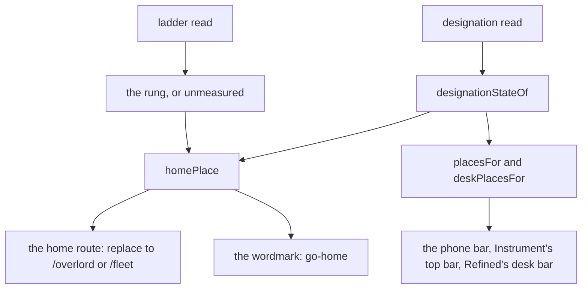
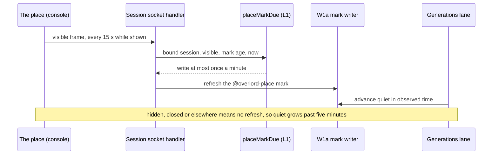
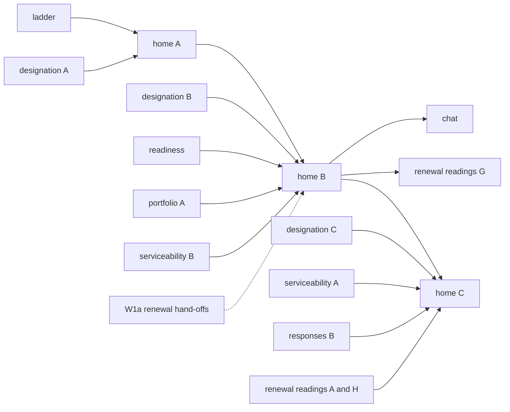

# Overlord W1: Home and Settings, the Overlord place as the console's home Implementation Plan

> **For agentic workers:** REQUIRED SUB-SKILL: Use superpowers:subagent-driven-development (recommended) or
> superpowers:executing-plans to implement this plan task-by-task. Steps use checkbox (`- [ ]`) syntax for tracking.

**Goal:** the console opens on the Overlord when one is designated, and the operator runs it from there and from
Settings.

- **The home is decided once.** An L1 `homePlace` answers the Overlord place while an Overlord is designated and the
  operator's rung is not `off`, and the Fleet otherwise. The console's root, `/`, renders what it answers.
- **The Fleet keeps a path of its own**, `/fleet`. Every go-fleet door, the page backs, the session header's back, the
  reap's and the render boundary's navigation all go there, so they land where they land today.
- **The places list is derived.** `PLACES` becomes a pure function of the designation's state. The Overlord's door is
  first on every bar while one is designated, and while a failed first start stands.
- **The wordmark goes home.** It runs a new "Go home" command that asks `homePlace`. A desk keeps a Fleet door.
- **The Overlord place** (Table 4a's W1 parts): the readiness word with its since and where questions go meanwhile;
  Pause and its "taking effect" line, beside the ladder's controls; Start, Open and Rebind; "Since you were last
  here"; the portfolio strip with its rank control; the capacity line; and the face.
- **The place-visible report (R19).** The console already tells the server, over the session's live socket, that a
  screen is on display. While the place shows the bound Overlord, that report becomes the `@overlord-place` operator
  mark, which the renewal readings turn into "five minutes with no visible Overlord place".
- **Settings gains an Overlord section** with the W1 rows: the model class, the account set, each account's billing
  fact and continuity record, the response rows' retention, and the renewal backstop's hour and time zone. Each row
  writes through a door its own piece already planned. This piece adds no server door.

**Why:** R9 makes the Overlord the console's home (C8, H20). The home must never hide the Fleet, never strand a link
that pointed at `/`, and never offer a control that a server row does not back (H9). Every Setting the Overlord's
pieces planned has a server door but no console row, and the operator sets the account facts only from Settings
(index question 34).

**Architecture:** three pull requests in lane F, all in the console except one server edit in PR B.

- **PR A, the home and the places (Tasks 1 to 3).**
  - New L1 modules under `pwa/src/overlord/`: `homePlace.ts` (`designationStateOf`, `homePlace`, `placesFor`).
  - One L4 store, `pwa/src/stores/overlord.ts`, the console's one reader of the designation and the ladder.
  - The route table gains `home` (`/`), moves `fleet` to `/fleet` and adds `overlord` (`/overlord`).
  - `PLACES` and `DESK_PLACES` become functions, read by the three bars.
  - Every go-fleet door takes the Fleet's path. The wordmark runs `go-home`.
- **PR B, the Overlord place (Tasks 4 to 7).**
  - `pwa/src/overlord/OverlordPlace.tsx` and its parts, with their `*Words.ts` modules.
  - The ladder's controls and Pause, and the doors Start, Open, Rebind and Restart, all on the doors their pieces own.
  - The server's one edit: the session socket's visibility frame, for the bound Overlord, refreshes the
    `@overlord-place` mark through W1a's one mark writer, behind an L1 decider.
- **PR C, the Settings rows (Tasks 8 and 9).**
  - A sixth Settings section, `overlord`, with the model class, the account set, the backstop and the retention.
  - Each roster account's billing fact and continuity record, and the account-hold Clear control.

**Tech Stack:** TypeScript (ESM), React, the `@ccrc/ui` design system, vitest (jsdom), the browser suite, and one
Fastify socket handler. No new dependency.

**Spec:** `docs/superpowers/specs/2026-11-09-overlord-design.md`:

- §4 (C8 and its bullets, Table 4a, the chat bullets that name the place's state, "Pause sits on the Overlord place",
  "Nothing held is hidden");
- §4.1 ("Since you were last here", Table 4.1b, "An unmeasured reader says so");
- §6.4 (Table 6.4a, "The place shows it", a dead Overlord's Restart);
- §7.5 (Pause, the rungs, "lowering never needs a step-up");
- §5.6 (the portfolio strip and the capacity line), §3.1 ("No second start", Rebind), §3.3.11 (R19's break, "a
  console that reports the place hidden"), §3.4 (the model class and the account set);
- Table 11.1d's Settings row (the backstop, the model class, the account set, the retention), Table 11.1a's account
  facts ("the operator, from Settings"), §11.2 ("Lowering never needs a step-up");
- Table 13.1 for which calls are `shape` (none of this piece's: it creates no table and no door).

The index is `docs/superpowers/plans/2026-11-14-overlord-w1.md` (Table W1's "Home and Settings" row, lane F, "Where lanes
meet" for `pwa/src/lib/api.ts` and `DigestScreen.tsx`, "What a merge arms", "Where things stand"). The face is built
(`docs/superpowers/plans/2026-11-10-overlord/w1-face.md`), and this piece only reads it.

## Open questions

The index's questions are cited as "index question N". This plan's own questions are numbered below. Each has a
recommendation, and the tasks build the recommendation unless the coordinator rules otherwise.

**Bound by the brief (ruled):**

- The PWA rings: `*Words.ts` and the pure modules are L1, `lib/api.ts` is L3, and stores, hooks, components and
  screens are L4.
- The ladder's controls (the operator's rung, the standing latches with Clear, the conditions and the effective rung)
  are drawn here from `GET /api/overlord/ladder` (the ladder plan's question 14).
- Lowering never asks a step-up, and raising does. Lowering the response retention asks the step-up (the responses
  plan).
- Every server door this piece calls is planned by its owner. This piece adds no server door, only console rows.
- Contrast and themes go through `@ccrc/ui`, and its generated palettes are never hand-edited.
- Phone first: every screen at 360 px with no horizontal scroll, with browser tests at every width.

**Open, with a recommendation:**

1. **How `/` renders the home** (slug `home-root-replaces-to-the-place`). The spec says `/` "renders what `homePlace`
   answers". Every other reader of the path is pure and reads the path alone: `topRouteOf` (the current door),
   `shellViewOf` (the phone's fleet or detail view), `phoneBarShown`. If `/` drew the Fleet or the place in place,
   each of those would need the designation as an input.
   **Recommendation:** `/` is a route of its own, `home`, whose screen asks `homePlace` and then replaces the address
   with the answered place's path (`navigate(path, { replace: true })`). So `/` never stays in history, a back never
   returns to it, and every path reader keeps reading the path alone. Until the store's first answer, the route shows
   the shell's "Loading…" status. The read's deadline is the store's (`READ_TIMEOUT_MS`), and a read that fails or
   times out answers the Fleet (question 3).
2. **The Fleet's path and the place's path** (slug `fleet-and-place-take-paths`). **Recommendation:** the Fleet is
   `/fleet` and the place is `/overlord`. Both are `top` rows of `ROUTES`, so "Go to Fleet" and "Go to the Overlord"
   come from `GO_TO` with no second list. The chords are `g f` (kept), `g o` (the place) and `g h` (home).
3. **What the home answers while the designation or the rung is unmeasured** (slug `home-unmeasured-rules`).
   `homePlace` must not fold "unmeasured" into a value. **Recommendation:**
   - **Designation unmeasured** (no answer yet, 503 `unavailable`, a timeout or a network failure): the home is the
     Fleet, with the reason `designation-unmeasured`. No Overlord door is drawn before the first answer, so the bars do
     not shift on every failed refresh.
   - **A refresh that fails after a first answer** keeps the last answer and marks the store `stale` with its time.
     The place shows "last read hh:mm".
   - **A 404 from an older server** is `none`, not unmeasured: that server has no Overlord.
   - **Designated, with the rung unmeasured:** the home is the Overlord place, with the reason `rung-unmeasured`.
     Pause and the ladder's controls live on the place, so sending the operator to the Fleet would hide the brake. The
     place states that the ladder could not be read.
   - **The rung `off`:** the Fleet, with the reason `rung-off`. The place's door stays, so the operator can raise it
     again.
4. **The place-visible report** (slug `place-visible-rides-the-session-socket`; the renewal-readings plan's question
   7 and its slug `place-hidden-is-a-mark`).
   - What exists: the spec says the console reports a hidden place "over its live socket". Today the console's
     session socket already sends `{ type: 'visible', visible }` every `VIEWER_REFRESH_MS` (15 s) while a session's
     screen is open, and the server keeps it as the `Viewers` visible claim (`server/src/viewer.ts#Viewers`,
     `server/src/server.ts#asSessionClientMsg`). The renewal readings plan recommends the W1a operator mark under the
     key `@overlord-place`, refreshed while the place is visible, at a cadence under five minutes.
   - **Recommendation:** no new door and no new frame.
     - The place opens the bound Overlord's session socket, the one the chat piece renders from. The session store's
       beat already says whether the page is visible.
     - In the socket's message handler, a `visible: true` frame for the session that the designation binds refreshes
       the `@overlord-place` mark through W1a's one mark writer (`w1a-renewal-handoffs.md`, Task 3). An L1 decider,
       `placeMarkDue`, rules on each frame: only the bound session, only `visible: true`, and at most once a minute
       (`PLACE_MARK_EVERY_MS`, 60 s, under `BREAK_PLACE_HIDDEN_MS`'s five minutes).
     - A closed socket, a hidden tab or a place the operator left sends no refresh, so the mark's `quiet`, which the
       generations lane advances in observed time, grows. A server restart advances nothing, as for every mark.
   - **Consequence, stated:** the operator's own session screen for the Overlord (`/s/<id>`) sends the same frames,
     so it also counts as the place visible. That is the safe direction: an operator watching the Overlord's pane is
     not away, so no early renewal is spent.
   - This edit needs W1a's renewal hand-offs (the `operator_marks` table and its writer), which home B's "needs first"
     already reaches through readiness.
5. **The readiness word's read** (slug `readiness-read-is-the-readiness-pieces`). No readiness plan is on `main`, and
   no plan names a read of the word. Table 6.4a gives the words, and "the place shows it" gives the since and where
   questions go.
   - **Recommendation:** the readiness piece ships `GET /api/overlord/readiness`, session-gated, answering
     `{ ok: true, word, since, cause? }`. 503 `unavailable` reads as unmeasured, and a 404 from an older server reads
     as "no readiness on this server".
   - This plan takes that shape from the spec. Home B renders whatever single read the readiness piece ships, and the
     mapping to words stays this plan's (`readinessWords.ts`).
   - "Where questions go meanwhile" is this plan's L1 sentence: `ready` says "to the Overlord first", and every other
     word says "to you".
   - Fleet health and Waiting on you also show the word (§6.4). Those two are not lane F's files, so the index should
     give them to the readiness piece (index changes).
6. **The capacity line's read** (slug `runway-read-is-serviceabilitys`). Serviceability B ships `poolRunway` in L1 and
   names no route for it.
   - **Recommendation:** serviceability B, which owns the decider, adds the operator's read,
     `GET /api/pools/runway`, session-gated and masked, answering `PoolRunwayAnswer` per pool.
   - Home B draws the line from that read. Until it exists, the part is not drawn, as Table 4a draws no part a later
     piece supplies. It is never drawn as "no runway".
7. **The standing account holds' read** (slug `account-holds-read-is-the-readings`). The renewal readings plan's PR H
   ships `POST /api/continuity/account-holds/:lane/clear` and the store's `accountHolds` reader, but no route to read
   them. Home C must draw Clear beside a held account.
   - **Recommendation:** the renewal readings PR H adds `GET /api/continuity/account-holds`, session-gated, answering
     the standing holds, or `{ ok: false }` as 503 `unmeasured`.
   - Home C draws Clear beside each held account's row, and on the readiness item's detail where the item names the
     lane. Without the read, the Clear control is drawn only on the item.
8. **"Since you were last here", composed where** (slug `since-block-reads-server-rows`). The spec says each part is
   composed by the server from rows, so that a quiet Overlord cannot make the operator's view quiet. W1's three lines
   (items waiting, runs closed, programmes stalled) are all in reads the console already makes: `GET /api/waiting`
   and `GET /api/programmes?since=`.
   - **Recommendation:** an L1 decider in the console, `sinceLines`, composes the W1 lines from those two server
     reads. That is the spec's intent: the rows are the server's, and nothing the Overlord says enters them. W3's
     Overlord lines move the block to a server composition, beside the decision queue.
   - "Last here" is a per-device fact: the time this device last showed the place, kept in `localStorage` and read
     through an L3 module. That is a per-viewer convenience, and a device with no stamp shows the last 24 hours.
   - A line whose read failed prints "unmeasured", never "quiet".
9. **Where the Start control lives while no Overlord exists** (slug `start-on-the-place`). The place's door is drawn
   only while one is designated, and the spec offers "Start the Overlord" only while no session is bound.
   **Recommendation:**
   - The place route always exists, reached from the palette's "Go to the Overlord" and from Settings' Overlord
     section, which links to it.
   - With no designation, the place shows Start with its two inputs (the model class and the account set, the
     designate body) behind the step-up.
   - The `overlord-v1` piece later hides the route's door and the palette entry until its word (index question 33).
10. **Witness exchange after a narrowing door** (authority journal B's `pwa/src/lib/witness.ts`). That plan exchanges the
    witness "when another piece calls it after a narrowing door". **Recommendation:** whichever of home B and
    authority journal B lands second adds the call after Pause, a rung lowered and a latch cleared, as one line each,
    mirroring the `RestoreBanner` rule (authority journal C mounts it if home B has landed first).
11. **The face on the place** (the face plan's slug `mood-plays-five-seconds`). **Recommendation:** the place draws
    `Character` at scale 4 with `useMood()`'s mood. It plays for `MOOD_PLAY_MS` after a change, then holds still,
    exactly as the bar does, so it needs no pause control (WCAG 2.2.2). Looping with a pause control is not built.
12. **A sessionless push still opens `/`** (`pwa/public/push-sw.js`, whose fallback is `'/'`). **Recommendation:** leave
    it. `/` is now the home, which is the right landing for a push that names no session and no path. Every push that
    names a session or a path is unchanged. The spec's "push addresses keep working" holds, because no push names the
    Fleet's path, and `/` still resolves.

## What exists today

Measured on `main` at `d440a7f41` (2026-11-16).

| Fact | Where |
|---|---|
| The one places list, fleet first, six places, with `DESK_PLACES` (every place but the fleet) and `FLEET_PLACE` | `pwa/src/lib/places.ts#PLACES`, `#DESK_PLACES`, `#FLEET_PLACE` |
| The phone bar draws the six places and then Search: seven doors today. The Overlord's door makes eight | `pwa/src/skins/PhoneBar.tsx`, `pwa/test/phone-bar.test.tsx` (widths 360, 390, 899) |
| Instrument's top bar: the wordmark door runs `go-fleet` (`HOME_DOOR_NAME`), then `DESK_DOORS` (`DESK_PLACES` plus Archive and a reserved door) | `pwa/src/skins/instrument/TopBar.tsx#DESK_DOORS`, `#HOME_DOOR_NAME` |
| Refined's desk bar draws `DESK_PLACES` | `pwa/src/skins/refined/AppBar.tsx` |
| The route table: `fleet` is `/` and `top`; Settings has five sections; `GO_TO` derives a "Go to" command per `top` row, with chords `f i r a s` | `pwa/src/lib/routes.ts#ROUTES`, `#SETTINGS_SECTIONS`; `pwa/src/command/commands.ts#GO_TO` |
| Path readers that read the path alone: the current door, the phone's view, the phone bar's presence | `pwa/src/lib/routes.ts#topRouteOf`, `#shellViewOf`; `pwa/src/lib/places.ts#phoneBarShown` |
| Go-fleet doors that navigate to `/`: the page back, the digest's back, the session header's back, the Docs index's up door | `pwa/src/command/door.ts#backToFleet`; `pwa/src/screens/DigestScreen.tsx`; `pwa/src/screens/SessionScreen.tsx` (`onBack`); `pwa/src/docs/DocsHead.tsx` (`up === '/'`) |
| Two `navigate('/')` calls with no `go-fleet` mark: after a reap, and in the render boundary | `pwa/src/screens/SessionScreen.tsx` (`onReaped`); `pwa/src/components/RenderBoundary.tsx` |
| The Waiting on you path's fallback is `/` | `pwa/src/lib/routes.ts#waitingPath` |
| The app's ladder: a path outside the table, or `/` on a desk, draws "Select a session" | `pwa/src/app.tsx` |
| The installed app starts at `/`; a push with no session or path opens `/` | `pwa/vite.config.ts` (`start_url`); `pwa/public/push-sw.js` |
| The session socket's visibility frame, re-sent every 15 s, kept as the visible claim | `server/src/server.ts#asSessionClientMsg`; `server/src/viewer.ts#Viewers`; `shared/api.ts#VIEWER_REFRESH_MS` |
| The face: `Character`, the mood decider and its hook, the bar's mark | `ui/src/characters/character.tsx#Character`; `pwa/src/face/mood.ts#moodOf`; `pwa/src/face/useMood.ts#useMood`; `pwa/src/face/FaceMark.tsx#MOOD_PLAY_MS` |
| One rule for "heard": a reader never hand-writes a frame-seen ternary | `pwa/src/fleet/useHeard.ts`; `pwa/test/use-heard.test.tsx` |
| The step-up: one hook and one sheet per session | `pwa/src/accounts/useStepUp.ts#useStepUp`; `pwa/src/accounts/ConfirmItsYou.tsx` |
| Pool names derived from the roster, never a list in source | `pwa/src/lib/pools.ts#poolOptions` |
| The portfolio's server doors (portfolio A, merged) with no console call yet | `server/src/coord/ledgersRoutes.ts` (`GET /api/portfolio`, `POST /api/portfolio/rank`); no `portfolio` in `pwa/src/lib/api.ts` |
| The reads the "since" block uses | `server/src/coord/ledgersRoutes.ts` (`GET /api/waiting`); `server/src/coord/routes.ts` (`GET /api/programmes`, `since` in ms); `pwa/src/lib/api.ts` (`waiting`, `programmes`) |
| Growth-checked files this piece touches | `pwa/src/lib/api.ts`, `server/src/server.ts` (`server/test/growthCheck.ts#growthFiles`). `pwa/src/fleet/fleet.css` is avoided: the place's styles go in a new stylesheet |

**Not on `main` yet** (each is a "needs first", taken from its merged plan):

- `GET /api/overlord/designation`, `POST`/`DELETE /api/overlord/designate` (designation A);
  `POST /api/overlord/rebind` and `POST /api/overlord/restart` (designation B); `POST /api/overlord/model` and
  `POST /api/overlord/account-set` (designation C).
- `GET /api/overlord/ladder`, `POST /api/overlord/rung`, `POST /api/overlord/pause` and
  `POST /api/overlord/latches/:cause/clear` (the ladder).
- The readiness read (question 5), the runway read (question 6) and the account holds' read (question 7).
- The widened `POST /api/accounts/:id/set` with `fableBilling` and `continuity`, and `RosterWire`'s two optional fields
  (serviceability A).
- `GET`/`POST /api/responses/retention` with `responseRetention()` and `setResponseRetention(days)` in
  `pwa/src/lib/api.ts` (responses B).
- `GET`/`POST /api/continuity/renewal-backstop` (renewal readings A) and the account-hold clear door (renewal readings
  H).
- W1a's `operator_marks` table, its one writer and its reader (`w1a-renewal-handoffs.md`, Task 3).
- `RestoreBanner` and `confirmRestore` (authority journal C), and `pwa/src/lib/witness.ts` (authority journal B).

## Global Constraints

- **Architecture (`CLAUDE.md`, the PWA rings).**
  - L1, pure, with no store, no DOM, no clock and no `lib/api.ts`:
    - `pwa/src/overlord/homePlace.ts`: `designationStateOf`, `homePlace`, `placesFor`, `deskPlacesFor`.
    - `placeWords.ts`, `readinessWords.ts`, `ladderWords.ts`, `sinceWords.ts`, `portfolioWords.ts`, `runwayWords.ts`
      and `overlordSettingsWords.ts`, all in `pwa/src/overlord/`.
    - `server/src/continuity/placeMark.ts` (`placeMarkDue`).
    - `now` is always an argument. `pwa-rings.test.ts` holds that no L1 module loads a `.tsx`, a store or `lib/api.ts`.
  - L3: `pwa/src/lib/api.ts`, which gains this piece's calls (the PR split counts them), and
    `pwa/src/overlord/lastHere.ts`, the one reader and writer of the "last here" stamp in `localStorage`. Every access
    is wrapped, and an absent or throwing storage reads as "no stamp".
  - L4: `pwa/src/stores/overlord.ts` (the poll), the hooks over it, `OverlordPlace.tsx` and its parts, `HomeRoute.tsx`,
    and the Settings section and cards. They decide nothing. Every verdict is an L1 call.
  - The server's one edit is L4 delivery code in `server/src/server.ts`'s session socket. It asks `placeMarkDue` (L1)
    and acts through the mark's one writer (L3, W1a's). It makes no decision of its own.
  - Every new `pwa/src` file has one ring and one context under the architecture spec's "Deciding a file's ring and
    context" rules. The `overlord/` directory is the console's half of the Overlord's contexts, and its path-table row
    is added in PR A (the index's "a file in a new directory adds its row").
- **One reader per fact. Consolidate, don't duplicate.**
  - The designation and the ladder each have one console reader, `stores/overlord.ts`. The bars, the home route, the
    place and the Settings rows all read it, and none fetches on its own.
  - The home and the places are decided once, by `homePlace` and `placesFor`. `PLACES` stops being a constant, so no
    second list can drift from it.
  - Pool names come from `poolOptions` over the roster, never from a list in source (`topology-clean`).
  - "Heard" goes through `useHeard`. The step-up goes through `useStepUp` and `ConfirmItsYou`, with one instance
    mounted on each page that needs one.
  - Refusal sentences join the existing refusal-word tables in `pwa/src/lib/refusalWords.ts`, keyed by the words in
    `shared/refusal.ts`. No screen carries its own copy of a refusal sentence.
  - The place-visible report reuses the session socket's visibility frame and `Viewers`' transport, and W1a's mark
    writer. It adds no frame type, no door and no second writer of `operator_marks`.
- **Failure contracts. Nothing unmeasured reads as a value.**
  - Each read's answer is a tagged union in the store: `{ state: 'loading' }`, `{ state: 'answered', value, at }`,
    `{ state: 'stale', value, at, error }`, `{ state: 'unmeasured', error }` or `{ state: 'absent' }` (a 404 from an
    older server). Every L1 reader takes that union, never a `null`.
  - Designation: 404 is `absent`, read as no Overlord. 503 `unavailable`, a timeout and a network failure are
    `unmeasured`. `{ designation: null }` is `none`.
  - Ladder: 503 `unavailable` is unmeasured, and the place says "the ladder could not be read". A cause the console does
    not know (`known: false`) is drawn by its key, with Clear.
  - Portfolio: 404 reads "no portfolio on this server", and 503 `runs-unreadable` reads unmeasured with its detail. A
    measure with `n: 0` reads "no data", never 0. `rankUnreadable` is drawn as "rank unreadable".
  - Readiness and runway: a read that is not yet on the server (404) leaves its part undrawn. A 503 reads unmeasured.
  - Settings rows: a door's 404 (`not-found`, no designation row) disables the row and says why. An older roster that
    lacks `fableBilling` or `continuity` reads "not set", which is the serviceability plan's absence rule.
  - Every door's refusal is drawn by its word's sentence, and a word the console does not know is drawn raw (the
    vocabulary plan's rule for an older console).
- **Authority.**
  - Lowering never asks a step-up: Pause, the rung lowered to `off` or `chat`, the model class set to `opus`, a narrower
    account set, an account's billing fact set to `credits`, the continuity record set to `off`, and a latch's Clear
    (the latch door itself asks one, and the console follows the door).
  - Raising always does: Start, Rebind, a rung raised, the model class set to `fable`, a wider account set, `included`,
    `on`, and the retention lowered.
  - The console never decides the direction. It sends the act, and on `step-up-required` it shows the step and waits
    for the operator to press the act again (`useStepUp`'s rule). The server's gate is the authority.
  - A control that changes authority is drawn only from a server row (H9). The rung, latch and condition controls come
    from `GET /api/overlord/ladder`'s rows, never from a list in the console.
- **Wire: additive.** This piece adds no field to any wire. It reads fields its owners add, each through one reader,
  and an absent field reads as its owner's plan says. `FLEET_PROTO` is not bumped.
- **What a merge arms.**
  - **PR A:** the root becomes a redirect. With no designation (every box until the operator's first Start), `/`
    replaces to `/fleet`, which draws exactly today's Fleet. The bars draw today's doors, and the wordmark lands on the
    Fleet. The one visible change is the address `/fleet`.
  - **PR B:** the place exists and is reachable from the palette. Its Start is the only new path to a designation, and
    it is refused by the server's own gates until the pieces it needs have landed (`capability-missing`,
    `continuity-v1`, sign-in). The mark refresh writes only while a bound Overlord exists.
  - **PR C:** each row writes only on the operator's tap.
  - The `overlord-v1` piece later hides the place's door, the palette entry and Start until its word (index question
    33).
- **Phone first.** Every new screen and card is laid out for 360 px with no horizontal scroll. The browser suite
  measures each one at 360, 390, 899 and 1280 px, in both skins and in a light and a dark palette.
- **Design system.** Colours, spacing and type come from `@ccrc/ui`'s tokens. No hex value is written, and no generated
  palette is edited. Status words in the place use the design system's status label.
- **SAFETY (`CLAUDE.md`).** No ccd verb, no fleet act and no live `~/.ccrc`. The server test builds `coord.db` in memory.
- **Tests.**
  - From `pwa/`: `ccrc test -- ./node_modules/.bin/vitest run test/<file>.test.ts` and
    `ccrc test -- ./node_modules/.bin/vitest run --config vitest.browser.config.ts browser/<file>.browser.test.ts`.
  - From `server/`: `ccrc test -- ./node_modules/.bin/vitest run test/<file>.test.ts`.
  - Each task ends with pwa's `ccrc test -- npx tsc --noEmit`. PR B's server task adds both server `tsc` runs.
- **The browser suite in full.** A new door can overflow a bar in ways only the whole suite sees (§4, "The phone bar
  gains a seventh door"). PR A carries the `full-ci` label, and each PR's last step runs the whole browser suite
  locally before the push.
- **Growth check.** Every growth-checked file stays within 40 net lines in each pull request, with no waiver (the PR
  split below has the estimates). No touched file has a cap.
- **Mutation floors.** `homePlace`, `placesFor`, `designationStateOf`, `sinceLines` and `placeMarkDue` each join
  `MUTANT_SETS` (`server/test/sim/mutation-floors.test.ts`) and `server/test/sim/mutation-floors.json` in the pull
  request that creates them. `readinessWords` and `ladderWords` hold tables, not decisions, so each gets a totality
  test over its vocabulary in place of a mutant set.
- **Censuses** are named in each task. Every guard ships with the test that goes red without it.
- **Public repository.** No private names. Fixtures use `lane-a`, `lane-b`, `pool-a`, `pool-b`, `prog-a` and the
  session id `lane-a-overlord`. Cite by symbol or `@anchor`. No D-number is invented: departures are slugs under
  "Deviations found", and the coordinator mints numbers.

## Review Focus

1. **The home never hides the Fleet, and never strands a link.**
   - `/fleet` draws today's Fleet, at every width and in both skins.
   - Every go-fleet door and every `navigate('/')` that meant the Fleet now names the Fleet's path. A census proves
     that no `navigate('/')` and no `'/'` target is left in `pwa/src` outside the route table.
   - `/` never stays in history.
2. **One decision for the home and one for the places.**
   - `homePlace` and `placesFor` are total over their inputs, and unmeasured never folds into a value.
   - The bars, the wordmark, the root and the palette all read them.
3. **No control without a row (H9), and the step-up follows direction.**
   - The ladder's controls are the read's rows.
   - Lowering acts in one tap, and raising goes through the step-up.
   - A refusal is shown as its word's sentence, never swallowed.
4. **The place states its own health.**
   - The readiness word, its since and where questions go are always shown.
   - "Taking effect" is shown until a witness holds the narrowing.
   - An unreadable part says "unmeasured", never "quiet" or zero.
5. **The place-visible report has one transport and one writer.** No new frame, no new door, and a refresh only for
   the bound session while visible. A restart advances nothing.
6. **Phone first.** 360 px with no horizontal scroll, and the eight-door phone bar, measured in the browser.

## The PR split

| PR | Tasks | What it ships | Needs first | Growth-checked files, estimate (net lines) |
|---|---|---|---|---|
| A | 1 to 3 | `designationStateOf`, `homePlace`, `placesFor`; the `home`, `fleet` (`/fleet`) and `overlord` routes; derived places on the three bars with the desk's Fleet door; every go-fleet door on the Fleet's path; `go-home` on the wordmark; the overlord store over the designation and ladder reads; the home route | designation A, ladder | `pwa/src/lib/api.ts` +8 (two reads, each with its 404 arm) |
| B | 4 to 7 | The Overlord place: the readiness part, Pause with its "taking effect" line and the ladder's controls, Start, Open, Rebind and Restart, "Since you were last here", the portfolio strip with its rank control, the capacity line, the face, the `RestoreBanner` mount; the place-visible mark refresh on the server | PR A, designation B, readiness (question 5), portfolio A, serviceability B (with question 6's read), W1a renewal hand-offs | `pwa/src/lib/api.ts` +30 (designate, retire, rebind, restart, rung, pause, latch clear, portfolio read and rank, readiness and runway reads); `server/src/server.ts` +8 (the handler's call and two deps) |
| C | 8 and 9 | The Settings section `overlord`: the model class, the account set, the backstop's hour and zone, the response retention; each account's billing fact and continuity record; the account-hold Clear | PR B, designation C, serviceability A, responses B, renewal readings A and H (with question 7's read) | `pwa/src/lib/api.ts` +14 (model, account set, backstop read and write, account holds read and clear, the account set's widened body type) |

Each pull request merges `main` once before merge (worker clause 16) and re-runs the censuses it touches.

**If a PR cannot fit.** PR B's `api.ts` estimate is the tightest. If it passes 40 at build time, the portfolio and
runway calls move to a fourth pull request, B2, after B, with the strip and the capacity line. No waiver is planned.

For scale, the files that are not growth-checked change by about this much:

| File | PR A | PR B | PR C |
|---|---|---|---|
| `pwa/src/overlord/homePlace.ts` | +140, new | | |
| `pwa/src/stores/overlord.ts` | +150, new | +20 | |
| `pwa/src/overlord/HomeRoute.tsx` | +50, new | | |
| `pwa/src/lib/routes.ts` | +20 | | +2 |
| `pwa/src/lib/places.ts` | +30, −15 | | |
| The three bars, `door.ts`, `commands.ts`, `app.tsx` and the five go-fleet sites | +60, −30 | | |
| `pwa/src/overlord/OverlordPlace.tsx` and its parts | | +520, new | |
| The place's `*Words.ts` modules | | +360, new | +120, new |
| `pwa/src/overlord/overlord.css` | | +160, new | +40 |
| `server/src/continuity/placeMark.ts` | | +50, new | |
| `pwa/src/screens/settings/OverlordSection.tsx` and its cards | | | +380, new |
| `pwa/src/lib/refusalWords.ts` | | +30 | +12 |

## Index changes

The index's own fix round should carry these.

- **Table W1, "Home and Settings":**
  - **What it ships.**
    - A adds "the `home` route's redirect, `/fleet` and `/overlord`, and the console's one reader of the designation
      and the ladder".
    - B adds:
      - "the ladder's controls from `GET /api/overlord/ladder`" (the ladder plan's question 14);
      - "Restart beside Rebind";
      - "the portfolio strip's rank control" (the portfolio plan);
      - "`RestoreBanner`'s mount";
      - "the place-visible report as the `@overlord-place` mark, refreshed from the session socket's visibility frame,
        at most once a minute, for the bound session only" (question 4; the renewal readings' question 7).
    - C adds "the account-hold Clear control" (the renewal readings' question 6).
  - **Needs first.**
    - B: "PR A, designation B, readiness, portfolio A, serviceability B, W1a renewal hand-offs" (portfolio A replaces
      portfolio B, as the portfolio plan asks).
    - C: "PR B, designation C, serviceability A, responses B, renewal readings A and H".
- **Figure W1:**
  - `PFB --> HMB` becomes `PFA --> HMB`;
  - a dashed `RH -.-> HMB` (the mark table and its writer);
  - `RR --> HMC` stays, through the readings' PRs A and H.
- **Readiness's row:**
  - add its operator read, `GET /api/overlord/readiness` (question 5);
  - add the word on Fleet health and on Waiting on you (§6.4), which are not lane F's files.
- **Serviceability's row, PR B:** add the operator's runway read, `GET /api/pools/runway` (question 6).
- **The renewal readings' row, PR H:** add the standing holds' read, `GET /api/continuity/account-holds` (question 7).
- **"Where lanes meet":**
  - `server/src/server.ts` gains lane F's one edit, in the session socket's message handler (home B).
  - `pwa/src/lib/refusalWords.ts` gains lane F's sentences for the designation and ladder doors' words.
  - The architecture spec's path table gains `pwa/src/overlord/` (home A).
- **The spec-fixes list:**
  - §4's "The phone bar gains a seventh door" counts places only. With Search, the bar draws eight doors.
  - §4's "`/` renders what `homePlace` answers" is built as a replace to the place's path (question 1).
  - §4.1's "composed by the server" for the "since" block is met in W1 by a console composition over server rows
    (question 8).
  - §3.3.11's "reports over its live socket" is the session socket's existing visibility frame (question 4).
  - Table 4a's capacity line and readiness word name no read (questions 5 and 6).

---

### Task 1: The home and the places, decided once (PR A, L1)

**Files:**

- Create: `pwa/src/overlord/homePlace.ts` (L1).
- Create: `pwa/test/overlord-home-place.test.ts`.
- Modify: `server/test/sim/mutation-floors.test.ts` (`MUTANT_SETS`) and `server/test/sim/mutation-floors.json`.
- Modify: `docs/superpowers/specs/2026-08-10-architecture-ddd-clean-solid.md`, the path table's row for
  `pwa/src/overlord/`. Its ring follows each file's imports, and its context is decided by the table's rules: the
  designation's console reads, under the designation's context.

**The interface:**

```ts
/** What the console knows of the designation, from one read (`stores/overlord.ts`). */
export type DesignationState =
  | { kind: 'unmeasured'; why: string }          // no answer yet, 503, timeout, network
  | { kind: 'none' }                             // no row, a retired row, or an older server (404)
  | { kind: 'failed-start'; outcome: string }    // no binding, and the last attempt failed (§5.2)
  | { kind: 'pending'; sessionId: string }       // a designate or rebind awaiting its start
  | { kind: 'bound'; sessionId: string };

export type RungRead = { kind: 'unmeasured' } | { kind: 'rung'; rung: string };   // the ladder's operatorRung

export type HomeAnswer =
  | { place: 'overlord'; why: 'designated' | 'rung-unmeasured' }
  | { place: 'fleet'; why: 'none' | 'failed-start' | 'designation-unmeasured' | 'rung-off' };

export function designationStateOf(read: ReadState<DesignationWire | null>): DesignationState;
export function homePlace(d: DesignationState, rung: RungRead): HomeAnswer;
export function placesFor(d: DesignationState): readonly Place[];      // phone order: overlord first, then today's
export function deskPlacesFor(d: DesignationState): readonly Place[];   // desk: overlord, then fleet, then the rest
```

`ReadState<T>` is the store's tagged union (Global Constraints), declared types-only in `pwa/src/overlord/readState.ts`
(L2). `DesignationWire` is designation A's `DesignationView`, imported as a type from its `shared/` sibling.

**The rules, as tables the tests read:**

| `DesignationView` read | `designationStateOf` |
|---|---|
| loading, 503, timeout, network failure | `unmeasured` (with the reason) |
| 404 (an older server) | `none` |
| `designation: null` | `none` |
| `bound` set | `bound` |
| `pending` set, `bound` null | `pending` |
| neither, `lastAttempt.outcome` is `retired` | `none` |
| neither, `lastAttempt.outcome` is any other word | `failed-start` |
| neither, no `lastAttempt` | `none` |
| stale (a failed refresh after an answer) | the last answer's state |

| `DesignationState` | rung | `homePlace` |
|---|---|---|
| `bound` or `pending` | `off` | Fleet, `rung-off` |
| `bound` or `pending` | `unmeasured` | Overlord, `rung-unmeasured` |
| `bound` or `pending` | any other word | Overlord, `designated` |
| `failed-start` | any | Fleet, `failed-start` |
| `none` | any | Fleet, `none` |
| `unmeasured` | any | Fleet, `designation-unmeasured` |

`placesFor` adds the `overlord` place first for `bound`, `pending` and `failed-start` (the spec's "while a failed
first start stands"), and for nothing else.

`deskPlacesFor` answers the Overlord (when drawn), then the Fleet, then today's desk places. Once the wordmark goes
home, a desk needs its own Fleet door (§4). So a desk with no Overlord gains one door, the Fleet, beside the wordmark
that used to lead there.

- [ ] **Step 1: Write the failing tests.**
  - `designationStateOf`: one case per row of the first table, plus a stale read keeping its last answer's state.
  - `homePlace`: every pair of the second table, taken from the table literal, so a new state or rung without a row
    fails the totality check.
  - The monotone property: no input that is `unmeasured` ever answers `overlord` with `designated`.
  - `placesFor`: the six places of today, in today's order, after the Overlord's door when one is drawn; no Overlord
    door for `none` and `unmeasured`.
  - `deskPlacesFor`: the Fleet is present in every state, and the Overlord is first when drawn.
  - Every place id is a `top` row of `ROUTES` (the bars' throw stays unreachable).
- [ ] **Step 2: Run.** `cd pwa && ccrc test -- ./node_modules/.bin/vitest run test/overlord-home-place.test.ts`. Red:
  the module does not exist.
- [ ] **Step 3: Implement** `homePlace.ts` and `readState.ts`. The tables are literals the functions read, not
  branches, so the tests read the same tables.
- [ ] **Step 4: Run.** Green, then pwa's `tsc`.
- [ ] **Step 5: Mutation floors.** Add `designationStateOf`, `homePlace` and `placesFor` to `MUTANT_SETS` and their
  measured floors to `mutation-floors.json`. Run
  `cd server && ccrc test -- ./node_modules/.bin/vitest run test/sim/mutation-floors.test.ts`. Check by hand that
  answering `overlord` for `rung-off`, or `failed-start` without its door, turns the suite red.
- [ ] **Step 6: Commit.** `feat(pwa): the home and the places, decided once (Overlord W1 home A)`

### Task 2: The Fleet's path, the root, the derived bars and every go-fleet door (PR A, L4)

**Files:**

- Modify: `pwa/src/lib/routes.ts`:
  - `fleet` becomes `/fleet` (pattern `^\/fleet\/?$`);
  - a new `home` row (`^\/$`, `top: false`, path `/`, title "Home");
  - a new `overlord` row (`^\/overlord\/?$`, `top: true`, path `/overlord`, title "Overlord");
  - `waitingPath`'s fallback becomes the Fleet's path;
  - one exported `FLEET_PATH`, read off the `fleet` row, the only spelling of the Fleet's path in `pwa/src`.

  `shellViewOf` answers `fleet` for `fleet`, `home` and a path outside the table. `topRouteOf` answers the Fleet for a
  session, as today, and nothing for `home`.
- Modify: `pwa/src/lib/places.ts`. `PLACES` and `DESK_PLACES` are removed as constants. The module keeps `Place`,
  `FLEET_PLACE` and `phoneBarShown`, and re-exports `placesFor` and `deskPlacesFor`.
- Modify: the three bars, each reading the store's designation state through `useDesignationState()` (Task 3) and
  `placesFor` or `deskPlacesFor`:
  - `pwa/src/skins/PhoneBar.tsx`;
  - `pwa/src/skins/refined/AppBar.tsx`;
  - `pwa/src/skins/instrument/TopBar.tsx`. `DESK_DOORS` becomes a function of the desk places, with Archive and the
    reserved door kept where they are. `HOME_DOOR_NAME` becomes "ccrc, Home".
- Modify: `pwa/src/command/commands.ts`:
  - `CHORDS` gains `overlord: 'o'`;
  - a new `go-home` command, which asks `homePlace` over the store's state and navigates to the answer's path;
  - `parentOf` keeps its `p.path !== '/'` guard, which now excludes `home`.
- Modify: the go-fleet doors, each navigating to `FLEET_PATH`:
  - `pwa/src/command/door.ts#backToFleet`;
  - `pwa/src/screens/DigestScreen.tsx` (its back);
  - `pwa/src/screens/SessionScreen.tsx` (`onBack` and `onReaped`);
  - `pwa/src/components/RenderBoundary.tsx`;
  - `pwa/src/docs/DocsHead.tsx` (the up door's `go-fleet` mark follows `docsUpHref` answering `FLEET_PATH`).
- Modify: the wordmark door in `TopBar.tsx` runs `commandDoor('go-home')`, and is current on the home place's path.
  Refined's `AppBar` and `PhoneHeader` wordmarks run the same command where they are doors today.
- Modify: `pwa/src/app.tsx`'s ladder: `home` renders `HomeRoute` (Task 3), `overlord` renders the place (a "The
  Overlord place" heading and its state word in PR A, the whole place from PR B), and `fleet` renders today's
  placeholder on a desk and today's Fleet on a phone.
- Create: `pwa/test/go-fleet-census.test.ts`, the guard. It scans `pwa/src` for `navigate('/')`, `navigate("/")`, an
  `href` of `/` and a back whose target is the literal `'/'`, and fails on any outside `lib/routes.ts`. It also fails
  when a `go-fleet` mark sits on a control whose target is not `FLEET_PATH`.
- Modify: the tests that pin today's doors and paths:
  - `pwa/test/phone-bar.test.tsx` (`PHONE_DOORS` with and without the Overlord door);
  - `pwa/test/command-registry.test.ts` (`go-overlord`, `go-home`, the chords);
  - `pwa/test/wordmark.test.tsx`;
  - `pwa/test/app.test.tsx` (`/fleet`, the redirect);
  - `pwa/test/router-location.test.tsx`;
  - every test that navigates to `/` meaning the Fleet. Step 1 lists them with `git grep -n "'/'" pwa/test`.
- Modify: the browser suite, `pwa/browser/phone-bar.browser.test.ts`, `instrument-bar.browser.test.ts`,
  `refined-bar.browser.test.ts` and `refined-phone.browser.test.ts`: the eight-door phone bar and the desk bars with
  the Overlord's and the Fleet's doors, at 320, 360, 390, 899 and 1280 px, with no door clipped and no horizontal
  scroll. The bars' state comes from a stubbed designation read in `pwa/browser/harness.ts`.

**The phone bar's eighth door.** At 360 px each door is 45 px wide. The Overlord's door takes the `short` word
"Overlord" only if the browser measure shows it fits at 360. Otherwise every door's word is dropped below a width the
measure sets, the name stays in each door's `aria-label`, and the test pins that width. The measure decides, never a
guess.

- [ ] **Step 1: Write the failing tests.**
  - The census, with its own planted cases: a planted `navigate('/')` is found, and `navigate(FLEET_PATH)` is not.
  - `routes`: `/fleet` matches `fleet`, `/` matches `home`, `/overlord` matches `overlord`, and
    `shellViewOf('/fleet') === 'fleet'`.
  - `topRouteOf('/s/x')` answers the Fleet.
  - The bars, with and without an Overlord, in both skins. The Fleet's door is present on a desk in every state.
  - `go-home` lands on `/overlord` when designated and on `/fleet` otherwise.
  - Each go-fleet door lands on `/fleet`. A reap and the render boundary land on `/fleet`.
- [ ] **Step 2: Run** the pwa suites named above. Red.
- [ ] **Step 3: Implement.**
- [ ] **Step 4: Run** the named suites and pwa's `tsc`, then the whole pwa suite once
  (`ccrc test -- ./node_modules/.bin/vitest run`), then the whole browser suite once
  (`ccrc test -- ./node_modules/.bin/vitest run --config vitest.browser.config.ts`). Green.
- [ ] **Step 5: Mutation, by hand.** Put back one `navigate('/')` in `RenderBoundary.tsx`: the census goes red.
  Return the constant `PLACES` to `PhoneBar.tsx`: the bar's Overlord case goes red. Revert each.
- [ ] **Step 6: Commit.** `feat(pwa): the Fleet's own path, derived bars and the wordmark going home (Overlord W1 home A)`

### Task 3: One reader of the designation and the ladder, and the home route (PR A, L3 and L4)

**Files:**

- Modify: `pwa/src/lib/api.ts`. Two reads, each returning the read as a tagged result, with a 404 answered as
  `absent`, never thrown:
  - `overlordDesignation()` → `GET /api/overlord/designation`;
  - `overlordLadder()` → `GET /api/overlord/ladder`.
- Create: `pwa/src/stores/overlord.ts` (L4), the one store:
  - it reads both at start, on the page coming back to the front, every 60 s while visible (`OVERLORD_POLL_MS`), and
    at once after any of this piece's doors answers;
  - it keeps `ReadState<DesignationWire | null>` and `ReadState<LadderWire>`;
  - it exports `useDesignationState()` (`designationStateOf` over the read), `useRungRead()`, `useLadder()` and
    `useHome()` (`homePlace` over both), and `refreshOverlord()`.

  A hidden page does not poll, so a background tab never hammers the doors.
- Create: `pwa/src/overlord/HomeRoute.tsx` (L4):
  - while both reads are `loading`, the shell's "Loading…" status;
  - then `navigate(pathOf(useHome().place), { replace: true })`, once per visit to `/`.
- Create: `pwa/test/overlord-store.test.ts` and `pwa/test/home-route.test.tsx`.
- Modify: `pwa/test/fleetFixture.ts` (or the app test harness the bar tests mount), so every existing test that mounts
  the shell answers the designation read with `designation: null` by default. Today's Fleet then renders in every
  existing test with no change to the test.

**Failure contract, held by tests:** a 404 is `absent` (no Overlord), a 503 is `unmeasured`, a network failure is
`unmeasured`, and a failure after an answer is `stale` with its last value. `useHome()` answers from those through
`homePlace` alone.

- [ ] **Step 1: Write the failing tests.**
  - The store: the cadence (start, focus, 60 s, after a door), no poll while hidden, and each read state.
  - The home route: `/` with no designation replaces to `/fleet` and leaves no `/` entry in history. `/` with a bound
    Overlord replaces to `/overlord`. `/` while loading shows the status, and after a 503 it lands on `/fleet`.
  - The app: the Fleet renders at `/fleet` exactly as at today's `/` (a snapshot of the Fleet's header and list,
    taken from today's `/` on `main` before the change, which is the characterization).
- [ ] **Step 2: Run.** Red.
- [ ] **Step 3: Implement.**
- [ ] **Step 4: Run** the new suites, `app.test.tsx`, the bars' suites and pwa's `tsc`. Green.
- [ ] **Step 5: Mutation, by hand.** Read a 404 as `unmeasured`: the "no Overlord on an older server" case goes red,
  because the root would wait. Revert.
- [ ] **Step 6: Commit.** `feat(pwa): one reader of the designation and the ladder, and the home route (Overlord W1 home A)`
- [ ] **Step 7: Before the push.** Run the whole browser suite and the whole pwa suite once more on the tip, and run
  `growth-check` for `pwa/src/lib/api.ts`. Push once (clause 20) with the `full-ci` label set before the push.

### Task 4: The place's frame, the readiness part, Pause and the ladder's controls (PR B)

**Files:**

- Create: `pwa/src/overlord/OverlordPlace.tsx` (L4), one column in Table 4a's order: the readiness part, "Since you
  were last here", the portfolio strip and the capacity line. Parts 3, 6 and 7 are not drawn (W3, W2, and the chat
  piece, which mounts below them).
- Create: `pwa/src/overlord/ReadinessPart.tsx` and `pwa/src/overlord/readinessWords.ts` (L1):
  - one row per Table 6.4a word, with its sentence and its status tone;
  - "since" from the read's `since`;
  - where questions go meanwhile (question 5).
  - A word the console does not know is drawn raw, with "unknown word", and questions read as going to the operator.
- Create: `pwa/src/overlord/LadderPart.tsx` and `pwa/src/overlord/ladderWords.ts` (L1), drawing from `LadderWire`:
  - the operator's rung with Off and Chat. A rung above `chat` is drawn from `rungs[]`, disabled, with the word it
    `needs`;
  - the effective rung and what binds it;
  - each standing latch with its cause sentence, its cap, its time and Clear;
  - each condition with its reading (`standing`, `lifted`, `unmeasured`) and effect.
  - Every control comes from a row of the read (H9). A cause with `known: false` is drawn by its key.
- Pause, on the readiness part. One tap, no step-up, `POST /api/overlord/pause`.
- The "taking effect" line. After Pause, a rung lowered or a latch cleared, the part shows the door's `narrowing`, and
  then the ladder read's `lastChange.narrowing`:
  - `done`: nothing more;
  - `taking-effect` with `no-witness-yet`: "Taking effect: no witness has held it yet";
  - `witness-unmeasured`: "Taking effect: the witness could not be measured";
  - `not-journalled`: "Taking effect: not recorded in the journal yet".

  The part keeps the line until the read says `done`.
- The doors' calls in `pwa/src/lib/api.ts`: `overlordRung(rung)`, `overlordPause()` and `clearLatch(cause)`.
  - A raise above `chat` is refused `capability-missing`, and its sentence names the word.
  - A latch Clear that answers `step-up-required` opens `ConfirmItsYou`.
  - `authority-rolled-back` and `journal-unreadable` are drawn with their detail.
  - After each narrowing door, the witness exchange is called (question 10) and `refreshOverlord()` runs.
- Mount `RestoreBanner` at the top of the place, if authority journal C has landed. Otherwise that piece mounts it
  (its plan's rule).
- Create: `pwa/src/overlord/overlord.css`, design-system tokens only, laid out for 360 px first.
- Modify: `pwa/src/lib/refusalWords.ts`, the sentences for these words: `capability-missing`,
  `authority-rolled-back`, `journal-unreadable` and `unavailable`, on the ladder's doors.
- Create: `pwa/test/overlord-readiness-part.test.tsx`, `pwa/test/overlord-ladder-part.test.tsx` and
  `pwa/test/overlord-words.test.ts` (the totality of `readinessWords` over Table 6.4a's words, and of `ladderWords`
  over the ladder's cause keys and readings).
- Create: `pwa/browser/overlord-place.browser.test.ts`: the place at 320, 360, 390, 899 and 1280 px in both skins and
  in a light and a dark palette, with no horizontal scroll, the Pause button at least 44 px tall, and the status label's
  contrast through the design system's gate.

- [ ] **Step 1: Write the failing tests.**
  - Each readiness word renders its sentence and where questions go. An unknown word renders raw.
  - A 503 renders "unmeasured", and a 404 renders no part.
  - Pause sends one request with no step-up and draws "taking effect" until the read says `done`.
  - Off sends the rung `off` with no step-up.
  - A raise is disabled with its needed word, and a forced call's `capability-missing` renders the sentence.
  - Clear opens the step-up on `step-up-required`, and acts once after it.
  - An unknown cause is drawn and clearable. Nothing is drawn that is not a row of the read.
- [ ] **Step 2: Run.** Red.
- [ ] **Step 3: Implement.**
- [ ] **Step 4: Run** the new suites, the browser file and pwa's `tsc`. Green.
- [ ] **Step 5: Mutation, by hand.** Draw a hard-coded rung list in place of `rungs[]`: the "no control without a row"
  case goes red. Drop the "taking effect" line on `not-journalled`: its case goes red.
- [ ] **Step 6: Commit.** `feat(pwa): the Overlord place, its readiness word, Pause and the ladder (Overlord W1 home B)`

### Task 5: Start, Open, Rebind and Restart (PR B)

**Files:**

- Create: `pwa/src/overlord/BodyPart.tsx` and `pwa/src/overlord/placeWords.ts` (L1). The part's state is
  `designationStateOf`'s:
  - **`none`:** Start the Overlord, with the model class (`opus` by default, `fable` offered) and the account set (the
    pools `poolOptions` derives from the roster, and "untagged accounts"). It calls `POST /api/overlord/designate`
    with `{ model, accountPools }` behind the step-up. Its answer's `warnings` (the list, the count, `unknown-pool`)
    are drawn, and `pending` with its deadline is drawn until the read binds.
  - **`pending`:** the session, the kind (designate or rebind) and the deadline, from the read.
  - **`bound`:** Open, which navigates to the session's path (`sessionPath`). Restart and Rebind are offered by
    readiness:
    - Restart, `POST /api/overlord/restart`, no step-up, while the word is `dead`;
    - Rebind, `POST /api/overlord/rebind`, behind the step-up. It answers `overlord-body-alive` while the old session
      does not measure dead, and offers "Rebind anyway" (`force: true`) behind the step-up, with the spec's sentence
      that the old session is stopped.
  - **`failed-start`:** the outcome's sentence (`overlord-sandbox-unmet`, `create-failed`, `deadline-passed`,
    `authority-unrecorded`), and Start again.
- The calls in `pwa/src/lib/api.ts`: `overlordDesignate(body)`, `overlordRebind(force)` and `overlordRestart()`.
- The sentences in `pwa/src/lib/refusalWords.ts`:
  - `overlord-exists`, `overlord-single-account` (with the count), `launch-profile-unmet`, `overlord-sandbox-unmet`;
  - `overlord-body-alive` (and its `unmeasured` detail), `overlord-attempt-pending`;
  - `auth-off`, which says that sign-in must be on to start the Overlord.
- Create: `pwa/test/overlord-body-part.test.tsx`.

- [ ] **Step 1: Write the failing tests.**
  - Each state draws its controls and only those.
  - Start sends the designate body, and it does not send while a session is bound (the spec's "no second start").
  - A step-up refusal opens the step and acts once after it.
  - Each refusal word renders its sentence.
  - Restart is offered only for `dead` and sends no step-up.
  - Rebind's `overlord-body-alive` offers "Rebind anyway", and the forced call goes through the step-up.
  - Open lands on `/s/<id>`.
- [ ] **Step 2: Run.** Red. **Step 3: Implement.** **Step 4: Run.** Green, and pwa's `tsc`.
- [ ] **Step 5: Mutation, by hand.** Offer Start while `bound`: the "no second start" case goes red.
- [ ] **Step 6: Commit.** `feat(pwa): start, open, rebind and restart the Overlord from its place (Overlord W1 home B)`

### Task 6: "Since you were last here", the portfolio strip, the capacity line and the face (PR B)

**Files:**

- Create: `pwa/src/overlord/sinceWords.ts` (L1), with `sinceLines(facts, lastHereMs, nowMs)`. It answers at most seven
  lines in Table 4.1b's order, of which W1 fills three:
  - **Needs you:** the items waiting, from `GET /api/waiting`'s count;
  - **Changed that matters:** the runs closed and the programmes stalled since `lastHereMs`, from
    `GET /api/programmes?since=<lastHereMs>`'s waves and `stuck` verdicts.

  A line whose read failed says "unmeasured", never "quiet" (§4.1). A device with no stamp reads the last 24 hours.
- Create: `pwa/src/overlord/lastHere.ts` (L3), the one reader and writer of the stamp. It is written when the place is
  shown and read before the block renders.
- Create: `pwa/src/overlord/SincePart.tsx`.
- Create: `pwa/src/overlord/PortfolioStrip.tsx` and `pwa/src/overlord/portfolioWords.ts` (L1), from
  `GET /api/portfolio`:
  - each programme in rank order, with its class and its fixed date;
  - W1 has no health word and no 85% date (Table 4a: W2), and none is drawn.
  - The rank control reorders the strip and changes a class. It writes `POST /api/portfolio/rank` with `basedOn` (the
    read's `revision`), `seen` (every slug the strip drew) and `order`.
  - `rank-changed` re-reads and says that the order moved meanwhile, and shows the new order. It never retries.
  - A 404 says "no portfolio on this server", and `rankUnreadable` is drawn as "rank unreadable".
- Create: `pwa/src/overlord/CapacityLine.tsx` and `pwa/src/overlord/runwayWords.ts` (L1), from question 6's read:
  - each pool's runway and its earliest reset;
  - `EarliestReset`'s `none-exhausted`, `{ at }` and `unmeasured { why }` each have their own sentence;
  - the line is not drawn while the read is absent (404).
- The face: `Character` at scale 4 with `useMood()`'s mood and its cause as the label. It plays for `MOOD_PLAY_MS` and
  then holds still (question 11).
- The calls in `pwa/src/lib/api.ts`: `portfolio()`, `rankPortfolio(body)`, `overlordReadiness()` (Task 4's read) and
  `poolRunway()`.
- Modify: `server/test/sim/mutation-floors.test.ts` and `mutation-floors.json` (`sinceLines`).
- Create: `pwa/test/overlord-since.test.ts`, `pwa/test/overlord-portfolio-strip.test.tsx` and
  `pwa/test/overlord-capacity-line.test.tsx`.
- Modify: `pwa/browser/overlord-place.browser.test.ts`, the strip's reorder at 360 px with no horizontal scroll, and the
  rank control reachable by keyboard.

- [ ] **Step 1: Write the failing tests.**
  - `sinceLines`: the order, the cap of seven, "unmeasured" for a failed read, never "quiet", the 24-hour default.
  - The strip: rank order, `seen` carrying every drawn slug, `rank-changed` re-reading and never retrying, the 404
    sentence, `n: 0` read as "no data" and never 0.
  - The capacity line: each `EarliestReset` arm, and no line for a 404.
  - The face: the mood's label is the cause.
- [ ] **Step 2: Run.** Red. **Step 3: Implement.** **Step 4: Run.** Green, and pwa's `tsc`.
- [ ] **Step 5: Mutation floors** for `sinceLines`. By hand: send `seen` as only the moved rows, and the merge case
  goes red.
- [ ] **Step 6: Commit.** `feat(pwa): since you were last here, the portfolio strip and the capacity line (Overlord W1 home B)`

### Task 7: The place-visible report, as the `@overlord-place` mark (PR B, server)

**Files:**

- Create: `server/src/continuity/placeMark.ts` (L1):
  `placeMarkDue({ frameSessionId, visible, boundSessionId, markAtMs, nowMs }): 'write' | 'skip'`.
  - It answers `write` only for `visible: true`, a frame of the session the designation binds, and a mark older than
    `PLACE_MARK_EVERY_MS` or absent.
  - A designation that cannot be read is `skip`. The mark then ages, which lets a renewal treat the place as hidden.
    That is the safe direction for the operator's view, because a renewal at a break is the spec's design, and the
    hard rows still bound the context.
  - `PLACE_MARK_EVERY_MS = 60_000` lives in `shared/continuity.ts`, beside `BREAK_PLACE_HIDDEN_MS`, with a test that it
    is below it.
- Modify: `server/src/server.ts`, in `/ws/session/:id`'s message handler, beside `viewers.setVisible`. After a parsed
  frame, one call reads the designation's bound session (designation A's reader) and the mark's `at` (W1a's reader),
  asks `placeMarkDue`, and on `write` calls W1a's one mark writer with the key `@overlord-place`. A throw from either
  read is caught and logged once (`console.warn('ccrc-server: …')`), and the frame's visibility still lands. Two
  deps reach the handler: the designation reader and the mark port.
- Modify: `server/test/single-definition/writers-map.test.ts`: `operator_marks` keeps one writer function, now with
  two callers, the prompt route and the socket handler. The census names both callers.
- Modify: `server/test/sim/mutation-floors.test.ts` and `mutation-floors.json` (`placeMarkDue`).
- No edit to `server/test/single-definition/time-ports.test.ts`: the handler passes the wall time it already reads,
  and `placeMarkDue` takes `nowMs` as an argument. If the build finds the handler must read a time port, that file's
  `TIME_PORT_FILES` gains it in the same commit.
- Create: `server/test/continuity-place-mark.test.ts` (the decider) and
  `server/test/session-ws-place-mark.test.ts` (the handler, with a stubbed designation reader and mark port).

- [ ] **Step 1: Write the failing tests.**
  - The decider: the bound session and visible gives `write`; hidden, another session, an unread designation, or a
    mark younger than 60 s gives `skip`. The constant is below five minutes.
  - The handler: a visible frame of the bound session refreshes the mark once in a minute, however many frames come.
    A hidden frame or another session's frame writes nothing. A throwing reader still records the frame's visibility.
    No frame type is added: `asSessionClientMsg` is unchanged.
- [ ] **Step 2: Run** from `server/`. Red.
- [ ] **Step 3: Implement.**
- [ ] **Step 4: Run** the two suites, `viewer.test.ts`, the writers census, both server `tsc` runs and
  `growth-check` for `server/src/server.ts`. Green.
- [ ] **Step 5: Mutation floors** for `placeMarkDue`. By hand: write on `visible: false`, and the hidden case goes red.
- [ ] **Step 6: Commit.** `feat(continuity): the console's place-visible report becomes the @overlord-place mark (R19, Overlord W1 home B)`
- [ ] **Step 7: Before the push.** Run the whole pwa suite, the whole browser suite, the server suites named here, and
  `growth-check` for both growth-checked files. Push once (clause 20).

### Task 8: Settings › Overlord: the model class, the account set, the backstop and the retention (PR C)

**Files:**

- Modify: `pwa/src/lib/routes.ts#SETTINGS_SECTIONS`, which gains `{ id: 'overlord', title: 'Overlord' }` last. The
  route rows and the index row follow from the one list.
- Modify: `pwa/src/screens/settings/SettingsFrame.tsx` and `pwa/src/screens/settings/sectionStatus.ts`, with the new
  section's case and its index status line:
  - "No Overlord", or "Bound to `<session>`, `<model>`";
  - "unmeasured" when the designation cannot be read.
- Create: `pwa/src/screens/settings/OverlordSection.tsx`, its cards, and `pwa/src/overlord/overlordSettingsWords.ts`
  (L1). Each card is a `Section` with its scope and purpose line, read from the store's designation (one reader):
  - **The Overlord.** The designation's state and a link to the place. With no designation, "Start it on the Overlord
    place". With one, Retire (`DELETE /api/overlord/designate`, behind the step-up as the door asks), with its answer's
    `stopped` and `owed` drawn. The pool-set plan's sentences send the operator here to "retire or rebind the
    Overlord in Settings", so Rebind links to the place's Rebind.
  - **Model class.** `opus` or `fable`, through `POST /api/overlord/model`.
    - `opus` sends with no step-up. `fable` sends, and on `step-up-required` shows the step.
    - It says the change takes effect at the next renewal (C44).
    - `not-found` (no row) disables the card with "Start the Overlord first".
  - **Account set.** One checkbox per pool `poolOptions` derives from the roster, and "untagged accounts", with the
    saved order. It saves through `POST /api/overlord/account-set` with `{ accountPools }`.
    - The console sends. The door decides whether the change widens and asks the step-up. A narrowing or a reorder
      lands in one tap.
    - The answer's list, count and `unknown-pool` warnings are drawn.
    - `overlord-single-account` shows the count and the sentence. While nothing is bound, the door saves and only warns,
      and the card shows the warning.
    - "Save again" re-sends the stored set unchanged, the act the pool-set plan's sentences ask for.
  - **Renewal backstop.** The hour (0 to 23) and the time zone, read from `GET /api/continuity/renewal-backstop` and
    saved through its `POST` with `{ hour, zone }`. No step-up.
    - The zone field offers the browser's `Intl.supportedValuesOf('timeZone')` list where the browser has it, and a
      free field otherwise. The server's `Intl` check is the authority, and its `bad-request` detail is drawn.
    - `isDefault: true` says "the default, 04:00 UTC".
  - **Response retention.** The days, read from `responseRetention()` and saved through `setResponseRetention(days)`
    (responses B's calls), within `min` and `max` from the read.
    - Raising, or saving the same value, needs no step-up.
    - Lowering, and any save over an unreadable stored value, asks the step-up, as the door rules. The console follows
      the door's `step-up-required` and never decides the direction itself.
- One `useStepUp` instance for the section, one `ConfirmItsYou` for its cards (the hook's one-instance rule).
- The calls in `pwa/src/lib/api.ts`: `overlordRetire()`, `overlordModel(model)`, `overlordAccountSet(set)`,
  `renewalBackstop()` and `setRenewalBackstop(body)`.
- The sentences in `pwa/src/lib/refusalWords.ts`: `not-found` on these doors, `overlord-single-account` (from PR B)
  and `bad-request` with its detail.
- Create: `pwa/test/settings-overlord.test.tsx`.
- Modify: `pwa/test/settings-frame.test.tsx`, `pwa/test/section-status.test.ts`,
  `pwa/test/settings-screen.test.tsx` and `pwa/test/command-registry.test.ts` ("Go to Settings › Overlord").
- Create: `pwa/browser/settings-overlord.browser.test.ts`: the section at 320, 360, 390, 899 and 1280 px in both skins,
  with no horizontal scroll and the account set's checkboxes at least 44 px tall.

- [ ] **Step 1: Write the failing tests.**
  - Each card in each designation state, including unmeasured and stale.
  - The model class: `opus` with no step-up, `fable` through it, and `not-found`.
  - The account set: a narrowing in one tap; a widening refused `step-up-required`, then acting once after the step;
    each warning; "Save again".
  - The backstop: a bad hour or zone shows the server's detail. The default reads as the default.
  - Retention: raising in one tap, lowering through the step-up, and the bounds from the read.
  - No pool name in source (`topology-clean` runs in the server suite).
- [ ] **Step 2: Run.** Red. **Step 3: Implement.** **Step 4: Run.** Green, and pwa's `tsc`.
- [ ] **Step 5: Mutation, by hand.** Ask the step-up in the console for an `opus` save: the "lowering in one tap" case
  goes red, because the console must not add a step the door does not ask.
- [ ] **Step 6: Commit.** `feat(pwa): Settings › Overlord, the model class, the account set, the backstop and retention (Overlord W1 home C)`

### Task 9: Each account's billing fact and continuity record, and the account-hold Clear (PR C)

**Files:**

- Create: `pwa/src/screens/settings/AccountFactsCard.tsx`, in the Overlord section. It has one row per roster account
  (`GET /api/accounts`, the existing read), with:
  - **Billing fact:** "Fable is included" or "Fable bills credits", from `RosterWire.fableBilling`. An absent field
    reads "not set". The row saves through the existing `POST /api/accounts/:id/set` with `{ fableBilling }`, and
    `included` goes through the step-up the door asks.
  - **Continuity record:** "Continuity recorded" (with its date) or "not recorded", from `RosterWire.continuity`. An
    absent field reads "not set". The row saves with `{ continuity: 'on' | 'off' }`, and `on` goes through the step-up.
  - **Held for the Overlord:** when question 7's read lists the lane, a "Held: launch profile unmet" line with Clear
    (`POST /api/continuity/account-holds/:lane/clear`, session-gated, no step-up).
- Each row draws the door's own answer:
  - `unknown-argument` from an older fleet node says "this fleet node is older: update it to set this", and nothing was
    written;
  - `outcome-unknown` says the result was not measured and re-reads the roster.
- Modify: the readiness item's detail on Waiting on you, which carries the same Clear when the item names a lane. It
  is the only place Clear is drawn if question 7's read is not built. This is one line in the item's detail, calling the
  same control.
- The calls in `pwa/src/lib/api.ts`: the account set call's body type widened with the two optional keys, and
  `accountHolds()` and `clearAccountHold(lane)`.
- Create: `pwa/test/settings-account-facts.test.tsx`.

- [ ] **Step 1: Write the failing tests.**
  - An absent field reads "not set".
  - `credits` and `off` save in one tap. `included` and `on` go through the step-up, even when the stored value already
    matches (the door's rule).
  - `unknown-argument` and `outcome-unknown` render their sentences.
  - Clear appears only for a held lane and calls the door once.
  - No account name appears in source: rows come from the roster.
- [ ] **Step 2: Run.** Red. **Step 3: Implement.** **Step 4: Run.** Green, and pwa's `tsc`.
- [ ] **Step 5: Mutation, by hand.** Read an absent `fableBilling` as `credits`: the "not set" case goes red.
- [ ] **Step 6: Commit.** `feat(pwa): each account's billing fact and continuity record in Settings (Overlord W1 home C)`
- [ ] **Step 7: Before the push.** The whole pwa suite, the whole browser suite, `growth-check` for
  `pwa/src/lib/api.ts`, and the server's `topology-clean`. Push once (clause 20).

## Figures



*Figure 1. One store reads the designation and the ladder. Two L1 deciders turn them into the home and the places, and
every bar, the root and the wordmark read only those.*



*Figure 2. The place-visible report rides the existing visibility frame. The renewal readings read the mark's quiet as
"five minutes with no visible Overlord place".*



*Figure 3. This piece's three pull requests and what each waits for. The dashed arrow is W1a's work.*

## Deviations found

Each entry is a departure from the spec's text or from the index, by slug. The coordinator mints numbers.

- **`home-root-replaces-to-the-place`**: §4 says `/` renders what `homePlace` answers. It is built as a replace to the
  place's own path, so every path reader stays pure (question 1).
- **`fleet-and-place-take-paths`**: the Fleet moves to `/fleet` and the place takes `/overlord` (question 2).
- **`home-unmeasured-rules`**: the spec does not say what the home is while the designation or the rung cannot be read.
  An unmeasured designation goes to the Fleet, and an unmeasured rung keeps the place, so the brake stays in reach
  (question 3).
- **`place-visible-rides-the-session-socket`**: R19's "reports over its live socket" is the session socket's existing
  visibility frame, turned into the `@overlord-place` mark for the bound session (question 4).
- **`readiness-read-is-the-readiness-pieces`**: no plan names a read of the readiness word. This plan takes its shape
  from the spec, and the readiness piece ships it (question 5).
- **`runway-read-is-serviceabilitys`**: the capacity line has no read. Serviceability B adds it, and the line is not
  drawn without it (question 6).
- **`account-holds-read-is-the-readings`**: the account holds have no read. The renewal readings' PR H adds it (question
  7).
- **`since-block-reads-server-rows`**: §4.1's "composed by the server" is met in W1 by a console decider over server
  rows. "Last here" is per device (question 8).
- **`start-on-the-place`**: the spec does not place Start while no Overlord exists. It is on the place, which the
  palette and Settings reach (question 9).
- **`phone-bar-draws-eight-doors`**: §4 counts "a seventh door". With Search the phone bar draws eight, and the browser
  measure decides the words at 360 px.
- **`settings-gains-an-overlord-section`**: Table 11.1d lists the W1 Settings without a place. They go in a sixth
  section, `overlord`.

## Where things stand

**Agreed** (from the brief):

- The rings, the ladder's controls from `GET /api/overlord/ladder`, the step-up's direction, and no server door of
  this piece's own.
- The design system and its generated palettes, and phone first at 360 px with browser tests at every width.

**Waiting on the coordinator** (open questions with recommendations):

- Questions 1 to 4 and 8 to 12: this plan's own shapes.
- Questions 5 to 7: a read each from the readiness, serviceability and renewal readings pieces. Each is an index
  change, and each part that needs one is drawn only once its read exists.

**Waiting on the operator:** nothing. No question here is the operator's: each is a shape inside rulings already made.

**Later:**

- W2: the Overlord's own spend, the requests, the portfolio's health words and 85% dates.
- W3: the decision queue, the Overlord's "since" lines, the push budget's Settings, `lambda` and `operatorProfile`.
- The `overlord-v1` piece hides the place's door, the palette entry and Start until its word.
- The chat piece mounts below the capacity line and renders from the session socket that Task 7's report already rides.
- The Week page and the delegation marks' display (the delegation-marks plan's "home C or W4").
