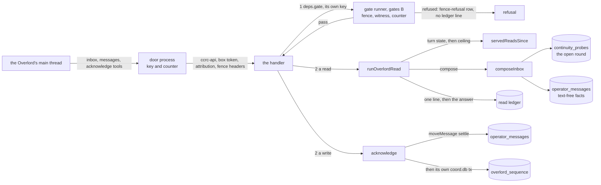
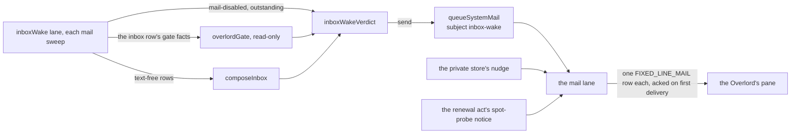

# Overlord W1: the inbox and its reads Implementation Plan

> **For agentic workers:** REQUIRED SUB-SKILL: Use superpowers:subagent-driven-development (recommended) or
> superpowers:executing-plans to implement this plan task by task. Steps use checkbox (`- [ ]`) syntax for tracking.

**Goal:** the Overlord takes its work from one door, in one order, and is woken once for it. Three new Overlord doors
ship, and one lane:

- **`inbox`** (`GET /api/overlord/inbox`): every row waiting for the Overlord, in the order of §6.8. In W1 that is an
  open probe round while the generation is `active`, then band 1, the operator's unsettled messages, oldest first. A
  row carries ids and server words, never words a person or a session wrote. Its row shape and its order are the
  contract W2 and W3 extend and never change (Table 11.1e).
- **`messages`** (`GET /api/overlord/messages/:id`): one of the operator's messages, words included, read from the
  private store. It is the only door through which a session reads them.
- **`acknowledge`** (`POST /api/overlord/messages/:id/acknowledge`): settles one message through the private store's
  one writer, and stamps its sequence line. Act rows start in W2.
- **The coalesced wake:** one lane, `inboxWake`, sends the Overlord one fixed line when rows that have no nudge of their
  own are waiting: "2 waiting in your inbox: read it with your inbox door". It rides the mail lane, through one table
  of fixed-line mail that also types the private store's message nudge and the renewal act's spot-probe notice.

All three doors are fenced: each call presents the live generation's act key and counter, as the card's recording page
does (gates B, `card-record-is-fenced`). Every read past the fence leaves one line in the read ledger, under a rate
ceiling per door. This piece owns the ceilings, their counter and the one read runner, which the board, the history
door and the sequence's cursor reuse.

**Why:** H19, "an inbox, not a mailbox" (§6.8): one mail per row, oldest first, one nudge a sweep, lapses the second
row of any burst. H7: the operator's words reach the Overlord as tool output through `messages`, never typed. H10: any
process of the fleet user can forge the Overlord's attribution, so a read door must leave a line, and the doors that
serve the operator's words also ask for the key a forger does not hold. §3.3.5: probes arrive as tool output, never
typed text.

**Architecture:** decide in L1, act in L4, one writer per fact.

- **L0, `shared/overlordInbox.ts`** (new, a one-concern sibling, the index's slug `wire-types-in-sibling-modules`): the
  bands and their order, the row kinds and which have a nudge of their own, the row and answer shapes, the page bound,
  the read ceilings (`READ_CEILINGS`, total over the read ledger's doors), the served outcome word, the wake's subject,
  body codec and line, and the id parser. `shared/operatorMessages.ts` (the private store's) gains `sequence` in
  `READ_DOOR_MAP`.
- **L1, `server/src/coord/overlordInbox.ts`** (new, C5): `composeInbox` and `inboxOrder`, `readCeilingVerdict`,
  `acknowledgeVerdict` and `inboxWakeVerdict`.
- **L3, C11:** three readers on the private store, which stays the one owner of `operator-model.db`'s SQL: the ceiling's
  counter `servedReadsSince`, and two text-free readers, `unsettledFacts` and `messageFactsById`.
- **L4, C5:**
  - `server/src/coord/overlordRead.ts` (new): `runOverlordRead`, the one read runner. It takes the gate's pass from the
    handler, reads the turn state, asks the ceiling, composes, writes the ledger line, and only then answers.
  - `server/src/coord/overlordRoutes.ts` (designation A creates it): the three handlers, each calling the gate itself.
  - `server/src/coord/overlordInboxWake.ts` (new): the wake lane's pass and its memory of the rows it woke for.
  - `server/src/watch.ts`: the lane's `runLane` call, and the fixed-line branch read from one table.
- **L1, `server/src/coord/envelope.ts`:** `FIXED_LINE_MAIL`, one row per kind of mail the mail lane types as a fixed
  line to the designated session.
- **The client:** `ccd/ccrc-api`'s three `ROUTES` rows, and the door process's three `DOOR_TOOLS` rows, each fenced.


*Figure 1. The three doors. Each handler asks the gate with its own row's key and returns on a refusal. A caller
without the live key stops at the fence, which records a fence refusal and writes no ledger line. A read goes on to the
one runner, which counts only lines that passed the fence, writes one line and only then answers. `acknowledge` is a
write: it settles the message, then stamps its sequence line in a transaction of its own.*


*Figure 2. One wake. The lane wakes only for rows that have no nudge of their own: in W1, a compaction round opened
while `active`. A message keeps the private store's nudge, and a spot round the renewal act's notice. All three are
typed through one table to the designated session.*

**Tech Stack:** TypeScript (ESM), `node:sqlite`, Fastify, bash (`ccd/ccrc-api`), Node (`ccd/door-process.mjs`),
vitest. No new dependency.

**Spec:** `docs/superpowers/specs/2026-11-09-overlord-design.md`:

- §6.8, H19: "The inbox", "Never typed", "One wake", "What ships when", "The read's contract is fixed in W1", "The
  inbox's order", "Probes come before everything".
- §3.8, H7: "Delivery is like mail", "A message has four states" (settled by `acknowledge`), "No message is lost";
  H10: "The read ledger", "Reads have ceilings".
- §3.2: "Every read leaves a ledger line (H10)", "Reads are not acts", "Why reads leave a trace".
- §3.3.5 C41: "Never typed", "Closed-book".
- §10.4: one sequence, one writer, a line inside each stamped transaction.
- §11.1: Table 11.1e's rows "The Overlord's reads" and "`acknowledge`"; Table 11.5b's "Set by the plan before W1: the
  read rate ceilings per door".
- §11.2: the gate order for the Overlord's doors, `view` for reads and `operate` for acts.
- Table 11.6: `said-not-operator`, `not-the-overlord`, `capability-missing`, and the index's `read-ceiling`.
- Table 13.1: H19 a `shape` call of W1 (the inbox ships its row shape and order with its door); H10 a `tightening`
  call of W1; H7 a `shape` call of W1 (the private store's).

**The index:** `docs/superpowers/plans/2026-11-14-overlord-w1.md`, row "Inbox and reads", lane D, one pull request,
five tasks. It needs private store B and gates B first, and through this plan's fix round also the renewal act and
door process B1. This plan builds on the index's questions 25 (the ceilings are this plan's), 26 (the nudge rides the
mail lane), 31 (no transaction spans the two files) and 32 (`read-ceiling`). The coordinator's brief (run 2166) binds:
the private store owns `operator-model.db`, the message moves table, the read ledger with its nullable `turnState` and
the settlement rules, and this piece calls their writers; the nudge names the message id and points at `messages`;
"picked up" is the hook's report through door process B's report door; no session but the designated Overlord, through
the gate, reads a message's words; probes are served first, through the probe door; every Overlord door has a row in
`OVERLORD_DOORS` and calls its runner. Fix round 1 (review 2169) adds the rulings marked "(ruled)".

## Open questions

Each carries the answer this plan builds. The plan builds every recommendation unless the coordinator or the operator
rules otherwise.

1. **The read ceilings' values** (the index's question 25; slug `read-ceilings-from-cadence`). The index asks this plan
   to measure a week of the console's own read rates. No record of them exists: the server runs
   `Fastify({ logger: false })` (`server/src/server.ts`), and the Caddyfile `ccrc expose` writes has no `log`
   directive, so neither box keeps a request log (measured on `main`). What can be measured is the cadence the code
   sets:

   | Measured on `main` | Value | Reads an hour at most |
   |---|---|---|
   | The Overlord's `MAIL_PACE` row (`server/src/coord/mailPace.ts`): quiet, then the gap between nudges | 15 s, 30 s | 120 deliveries |
   | The mail lane's sweep (`laneSchedule.ts#MAIL_SWEEP_MS`) | 10 s | 360 looks |
   | The console's fastest steady poll (`pwa/src/fleet/FleetHostBanner.tsx`, `POLL_MS`) | 15 s | 240 |
   | The console's claims strip (`HotFilesStrip.tsx#CLAIMS_POLL_MS`) | 30 s | 120 |
   | Most console panels (`STALL_WATCH_POLL_MS`, `UPDATES_POLL_MS` and eight more) | 60 s | 60 |

   **Recommendation:** these per-door ceilings, each over a rolling hour, in one L0 table `READ_CEILINGS`, total over
   the read ledger's doors:

   | Door | Ceiling an hour | Why |
   |---|---|---|
   | `inbox` | 240 | Two reads for each delivery slot at the Overlord's pace (one on the nudge, one after it settles), equal to the console's own fastest poll |
   | `messages` | 120 | One read for each delivery slot. A read takes one id (question 13), and each message has its own nudge |
   | `board` | 120 | Board and history's ruled value (its question 8) |
   | `history` | 60 | The same. It bounds the verbatim cross-project text a forgeable door yields in an hour |
   | `sequence` | 120 | One page of up to `SEQUENCE_PAGE_MAX` lines for each delivery slot; the cursor is read on demand, never polled (question 18) |

   A hit on a ceiling refuses that read with `read-ceiling` (429) and `retryAfterS`, and steps nothing down: the
   ladder has no ceiling cause row (the index's question 20). The ledger records every line, so once an Overlord runs,
   its real rates are in the store: the coordinator re-fits the values after its first week in a values-only pull
   request, against M32's 28-day median. The spec-fixes run puts the five values into Table 11.5b.
2. **`read-ceiling` is in the vocabulary** (the index's question 32). `shared/refusal.ts#OVERLORD_REFUSALS` holds it
   (429), and `server/test/single-definition/refusal-table.data.json`'s `codeOnly` names it until the spec-fixes run
   adds its row to Table 11.6. This piece is its first sender, and changes neither file.
3. **One read runner and one counter for every Overlord read door, and the handler calls the gate** (slug
   `one-runner-for-every-read-door`; ruled, F2). Board and history B plan the ledger line and the ceiling at each door,
   with "the ceiling's counter is the inbox piece's". **Ruled:** this piece ships the counter and the runner. Each
   handler calls `deps.gate(` with its own row's key literal and returns on `refused`, exactly as gates B's census
   requires; it then hands the pass to `runOverlordRead`, which never calls the gate itself. Board and history B and
   the sequence's cursor call the runner the same way, and add no ledger or ceiling code. Two copies of "count, then
   record, then answer" would be a parallel mechanism for one job.
4. **No line, no read** (slug `no-line-no-read`). H10's reason is that a silent read is a leak, so a read whose line
   could not be written is not served. **Recommendation, with the rulings F10 and F11:**
   - the runner reads the turn state first, before any line, so every line it writes carries one (ruled, F11: the
     private store's `CHECK ((caller = 'operator') = (turnState IS NULL))` refuses an `overlord` line without one);
   - a counter that cannot be read refuses 502 `unmeasured` before anything is read, and writes no line: a ceiling that
     cannot count cannot allow;
   - a ceiling refusal writes one `read-ceiling` line per door per window, not one a call (the counter answers the
     newest such line), so a caller held at the ceiling cannot grow the store, and then refuses whether or not that line
     landed;
   - a served read composes, writes its line, and sends only when the line landed. A failed write answers 503
     `write-failed` and sends nothing;
   - every refusal goes through `refuseRoute` with its word's own status: compose answers rows or a refusal word, never
     a status (ruled, F10; `unmeasured` is 502 in `shared/refusal.ts`).
5. **The inbox carries ids, never words** (slug `inbox-carries-ids-not-words`). §6.8 lists "unsettled operator
   messages" and "probe rounds" among the inbox's rows; §3.8 says the words are read through `messages`; §3.3.5 says
   probes are served through the probe door. **Recommendation:** an inbox row names its kind, its key, its band, when
   it arrived, its deadline (none in W1) and the door that serves its content, and carries no free text: a message
   row carries the id, term, state and `cut`, and a probe row the round id, its kind and its question count, never a
   question or what it expects. So the probe door stays the one renderer of probe text (`probeDoor.ts`'s masking and
   pages), `messages` the one door for the operator's words, and the inbox read is the narrowest read the Overlord
   makes. The contract holds this for later kinds too: a W3 packet is served by its own door.
6. **A probe round is served alone, and the inbox read does not open its book** (slug `probe-round-served-alone`;
   ruled, F5). "Probes come before everything" (§6.8), and a probe grades closed-book only when no read door was
   called between the ask and the answer (§3.3.5). Door process B1's closed-book rule now reads the server's read
   ledger: `readsBetween(sessionId, from, to)` counts the session's ledger lines between the ask and the answer
   (`w1-door-process.md`, "Closed-book reads the server's read ledger"). Every inbox read writes a line, so as written
   the inbox read that tells the Overlord a round is open would grade every `active` round `open`. **Recommendation:**
   - while a round is open, the inbox answers that round's row alone, with `behind: { kind: 'probe-first', count }`
     naming how many rows wait behind it, so its line carries nothing but the round's id;
   - `readsBetween` leaves out lines whose door is `inbox`, and lines whose outcome is not `rows` (a refused or
     unmeasured read served nothing), a change to its count (Index changes). The `messages`, `board`, `history` and
     `sequence` lines still open the book.
7. **The wake covers only rows with no nudge of their own** (slug `wake-covers-unnudged-rows`; ruled, F4). §6.8: "A
   single coalesced nudge … replaces a mail for each row". The private store sends one nudge for each message, naming
   its id. The renewal act (#2852, in its fix round, landing before this piece) announces every spot round opened while
   live with system mail, subject `probe` (`renewalFeed.ts#SPOT_PROBE_SUBJECT`), and a start round is fed by the
   renewal act's ordered feed while the generation is `probing`. A compaction round opened while `active` has no notice
   (`generationsLane.ts`, the round is announced only when `spot && live`). **Ruled:** each row's nudge is declared in L0:
   a message has its own; a probe round's depends on the round's kind (`PROBE_ROUND_NUDGE`: `start` the renewal feed,
   `spot` the spot-probe notice, `compaction` none). The wake fires only for rows with none: in W1, a compaction round
   in `active`. W2's band 3 and W3's band 2 join the wake by declaring none. The wake's line still counts every
   waiting row, messages included.
8. **One table of fixed-line mail to the designated session** (slug `fixed-line-mail-is-one-table`). The Overlord has no
   mail verb and no shell (`ccd/overlord-skill/references/starting.md`, "You have no mail verb"), so the generic mail
   nudge, which tells a session to run the mail client, is useless to it, and so is the spot-probe notice's body, which
   names `ccrc-api probe`. The private store adds a dedicated operator-message branch to `FleetWatcher.sweepMail`.
   **Recommendation:** that branch reads one L1 table, `FIXED_LINE_MAIL` in `server/src/coord/envelope.ts`, with three
   rows: `operator-message` (the private store's), `spot-probe` (the renewal act's notice, only when its recipient is
   the designated session: a coordinator keeps the notice's own text) and `inbox-wake` (this piece's). Each row names
   its matcher, whether it binds only the designated session, its line and what its first delivery moves (the message's
   `delivered`, or nothing). If private store B lands its branch as a plain test on `isOperatorMessageMail`, this piece
   turns it into the table first, in a move-only commit behind private store B's own cases. A second branch beside it
   would be a parallel mechanism for one job.
9. **The wake's memory is the lane's** (slug `wake-memory-in-the-lane`). **Recommendation:** the lane keeps, in memory,
   the keys of the rows its last wake covered, and asks `CoordStore.hasOutstandingMail` (which `queueSystemMail`
   already asks) whether a wake is still undelivered. A server restart forgets the keys, so the first pass after a
   boot wakes once for whatever is waiting. One extra nudge costs one inbox read, which is less than a table to
   remember it in.
10. **The inbox and `acknowledge` cover every unsettled message** (slug `inbox-is-the-roles`). A message row names the
    session it was sent to and the term. After a rebind or a renewal the body changes and the role does not, and "No
    message is lost … offered again after every renewal" (§3.8). **Recommendation:** band 1 serves every unsettled
    message whatever its `sessionId`, with its `term`, so the Overlord sees that a message came under an older term.
    `acknowledge` settles any of them. Door process B's pick-up stays bound to the session the nudge was typed into,
    because it reports what that pane saw.
11. **`acknowledge` of an id that is no message answers `said-not-operator`** (slug
    `acknowledge-absent-is-said-not-operator`). Table 11.6's `said-not-operator` means "a cited id is not a row of
    `operator_messages`", and §3.8 counts `acknowledge` among the doors that cite a message. Door process B plans a new
    word, `unknown-message` (404), for the same cause at the pick-up report. **Recommendation:** one word for one cause.
    `acknowledge` answers `said-not-operator` (409), which moves from the vocabulary's W2 wave map into
    `OVERLORD_REFUSALS` in this pull request, and door process B uses it too (Index changes). Table 11.6's row gains
    `acknowledge` in its door column (a spec fix). An id already settled or spent answers 200 with `changed: false`, so
    a retried call is harmless.
12. **One id per `acknowledge` call** (slug `acknowledge-one-id`). Each write takes the act counter once (gates B), and
    a refusal must name one cause. **Recommendation:** the path carries one id. The Overlord settles several in one turn
    with several calls (skill clause 7).
13. **One id per `messages` call** (slug `messages-one-id`; ruled, F6). `ccrc-api` refuses a query value that is not
    a plain value (its `SAFE_RE`, `^[A-Za-z0-9_-]+$`), so a comma-separated list is unreachable, and widening that rule
    is a security change this piece does not make. **Ruled:** the id rides the path, `GET /api/overlord/messages/:id`,
    and the answer is the private store's wire row, `OperatorMessageRow`, in any state, or 409 `said-not-operator` for
    an id that is no message. A malformed id answers 400 `bad-request` after the gate and writes no line.
14. **An unmeasured source fails the whole inbox** (slug `inbox-fails-whole`). **Recommendation:** when the open round or
    the unsettled messages cannot be read, the inbox refuses 502 `unmeasured` naming the source, and writes its line
    with the outcome `unmeasured`. An inbox that served band 1 without the probe row, or nothing for band 1, would read
    as "nothing waiting".
15. **The privacy boundary, and what is left** (the brief's ruling; ruled, F1). Only the designated session reads a
    message's words, and only through the fence. What holds:
    - **Step 1 of the gate order,** gates B's `callerStandingOf`, on the `inbox`, `messages` and `acknowledge` rows of
      `OVERLORD_DOORS`, each `others: 'refuse'`: any session that is not the designated one, or the designated id under
      another incarnation, is refused `not-the-overlord` before anything is read.
    - **The fence,** steps 5, 7 and 7a with the counter, on all three rows (`write: true`): a caller that forges the
      Overlord's attribution but does not hold the live generation's act key is refused `stale-generation` (or
      `unwitnessed`), recorded as a fence refusal (`overlord_fence_refusals`), and reaches no word and writes no ledger
      line, so it cannot spend the ceiling either (question 18).
    - **Its censuses:** gates B's `overlord-gate-census.test.ts` and `overlord-gate-doors.test.ts` (a handler calls the
      gate with its own key before any store access and returns on `refused`; a non-designated caller at a `refuse` row
      is refused), and this piece's `operator-message-readers.test.ts` (question 20).
    - **What is left:** a holder of the live key reads the words. The key lives only in the door process's memory, so
      that is the Overlord itself, or a process of the fleet user that reads the door process's memory or its stdio
      channel, which on a `shared-user` box any such process can (§7.4). Its reads are ledgered and ceilinged. This is
      H10's accepted residual, narrowed from "any attributed caller" to "a holder of the live key".
16. **The wake holds when the gate would refuse the read, and when mail is stopped** (slug `wake-holds-with-the-gate`;
    ruled, F15). **Recommendation:** the lane asks gates B's own decider, `overlordGate`, for the `inbox` row as a read
    (no fence, no witness: the lane presents no call), with the designated standing and the facts the runner's ports
    read, so every gate word is a hold: `capability-missing`, `authority-rolled-back`, `overlord-off`, `unavailable`,
    `launch-profile-unmet`, `card-unread` and `renewing` among them. Its own holds follow: no designation, `mail-disabled`
    standing or unreadable, a wake undelivered, the rows unreadable, and nothing new. Each hold is a word, and the lane
    logs one `ccrc-server:` line when the hold word changes, never one a pass (it runs every ten seconds).
17. **The index's questions 10 and 27** (the Overlord's replies). Nothing here waits on them: the inbox serves the
    operator's words and the probe rounds, and records no reply.
18. **The ceiling counts fenced reads only** (slug `ceiling-counts-fenced-reads`; ruled, F8). Before this round the
    counter counted every attributed caller, so a forger could spend the hour's `messages` reads and hold the real
    Overlord out of the operator's words. **Ruled:** `inbox` and `messages` are fenced (question 15), so every line they
    write passed the fence, and their ceiling counts fenced reads only. A line is written only after the handler's gate
    passed, and the runner refuses to run for a row whose `write` is false unless the caller says `unfenced`, so a door
    that has not fenced its reads cannot use the runner without saying so. **Recommendation for the other read doors:**
    board, history and the sequence's cursor are planned as unfenced reads (`write: no`), so a forger can still spend
    their ceilings. They fence their reads too, as these two do, and their door process rows become fenced; until then
    their plans call the runner with `unfenced: true`, which counts every attributed line and says so in their review
    (Index changes).
19. **`acknowledge`'s sequence line** (slug `acknowledge-stamps-after-the-store`; ruled, F13). §10.4 has one writer add
    a line inside each stamped transaction, and `acknowledge` moves a message in the private store, which is a second
    file behind the privacy boundary, so no transaction spans both (the index's question 31). **Ruled:** after the
    private store commits, `acknowledge` writes its line in a `coord.db` transaction of its own, through the sequence's
    one writer, `stampSequenceInTx`, with kind `message`, the message id, state `settled` and actor `acknowledge`. This is
    the one named exception to "inside the stamped transaction". A crash between the two commits loses the line; the
    boot pass re-derives the private store's state (I8), and the monitor reads a message with no line as `unmeasured`
    for that message, never as a violation. The sequence plan names the same exception (its question 17).
20. **Text-free readers, and a census that reds a words reader anywhere else** (slug `text-free-readers-outside-messages`;
    ruled, F3). The inbox, the wake, `acknowledge` and the card need a message's id, time, term, state and `cut`, never
    its text. **Ruled:** the private store gains two text-free readers, `unsettledFacts()` and `messageFactsById(id)`.
    Outside `server/src/operatorModel/`, a reader that returns text (`messageById`, `unsettledMessages`, `settledRows`,
    `unnudged`) may be called only in a route handler whose `OVERLORD_DOORS` row is `others: 'refuse'`: in W1, the
    `messages` handler alone. `operator-message-readers.test.ts` reds any other call, and any SQL text naming
    `operator_messages` outside `server/src/operatorModel/`, and any `openOperatorModelDb(` call outside
    `server/src/index.ts`. Lane F's chat and the card add their own entries to its operator list when they ship.
21. **Who adds the routes file's lane source to the box-token census** (slug `overlord-src-in-the-census`; ruled, F9).
    `box-token-census.test.ts` spreads ten lane sources into `ALL_LANES`, none of them `overlordRoutes.ts`, so a box-token
    door there is counted nowhere. **Ruled, by the review's fix direction:** this pull request adds `OVERLORD_SRC`, its
    `lanesIn(OVERLORD_SRC)` and the `ALL_LANES` term, because these are the first box-token doors of that file to build
    (board and history B and the sequence's doors build after). If one of those merges first, this pull request only
    grows the count, and the README's and `CLAUDE.md`'s count words follow `word(ALL_LANES.length)` after merging
    `main`.

## What exists today

Measured on `main` at `4b5ae49d5`, and the siblings at the heads named.

- **None of this piece's files.** `shared/overlordInbox.ts`, `server/src/coord/overlordInbox.ts`,
  `server/src/coord/overlordRead.ts` and `server/src/coord/overlordInboxWake.ts` are absent. So are those it builds on:
  `server/src/coord/overlordRoutes.ts` (designation A), `server/src/coord/overlordDoors.ts` and the gate runner (gates A
  and B), `server/src/operatorModel/` and `shared/operatorMessages.ts` (private store A), and `ccd/door-process.mjs`
  (door process A2). Each is cited by its plan's contract, not by a symbol.
- **The private store** (`w1-private-store.md`, merged as a plan): `OperatorModelStore.moveMessage(id, event, actor,
  at)`, the one writer, by `MESSAGE_MOVES`, whose actor `acknowledge` may send `settle`; `recordRead(line)`, the read
  ledger's one writer, which validates the door, the caller, the turn word and the `CHECK`s; the readers `messageById`,
  `unsettledMessages` (both return the text), `lastOperatorMessage`, each answering measured or `unmeasured`. The ledger's
  columns are `at`, `door`, `caller`, `scope`, `count`, `outcome`, `generation`, `generationRead` and `turnState`, with
  `CHECK ((caller = 'operator') = (turnState IS NULL))` and the index `read_ledger_door_at`. `READ_DOOR_MAP` holds
  `board`, `messages`, `inbox` and `history`; `READ_TURN_STATES` the turn marker's eight words. The nudge is system mail
  from `operator`, subject `operator-message:<id>`, typed by `renderOperatorMessageNudge(id)` in `sweepMail`'s
  operator-message branch. The boot pass lives in `server/src/operatorModel/bootPass.ts`.
- **The gates** (`w1-gates.md`, merged as a plan at #2863): `OverlordDoorRow` is `{ method, path, file, verbClass,
  group, write, word, others, ladderClass, act }`; a `write` row runs the fence (steps 5 and 7), the witness (7a) and the
  counter, whatever its verb class: the card's recording page is the precedent, row `card-record`, `view` and
  `write: yes`. `deps.gate(req, reply, key, claim)` answers `pass` (with the caller and the live generation), `hook` or
  `refused`, and records a fence refusal in `overlord_fence_refusals`. Gates B's census requires each `overlord` row's
  handler to call `deps.gate(` with its row's key literal before any store access, followed by `if (g.kind ===
  'refused') return`. `overlordGate(f: GateFacts)` is the pure decider, and its witness port reads `unmeasured`, which
  refuses 502, until door process B1 binds it. The ladder's `DoorClass` is `'card-probe-note' | 'other'`, and its W1 act
  kinds are `read`, `write-note` and `acknowledge` (`w1-ladder.md`, in review).
- **The door process** (`w1-door-process.md` at `944452e63`, in review): `DOOR_TOOLS` rows are `{ name, verb, class,
  fenced, reader, input, argv }`; a fenced call carries the key, the counter and the witness key. Its plan says each
  later piece adds its row beside its `ccrc-api` row, naming `inbox`, `messages` and `acknowledge` for this piece, and
  that `messages` is never a reader's tool. Its `door-tools-argv.test.ts` today allows exactly one fenced `view` row,
  `card`. Its closed-book rule reads the ledger through `readsBetween`, which the private store adds.
- **The renewal act** (#2852 at `c9de813e0`, in review): a spot round opened while live gets a `spot-probe` act, system
  mail with subject `probe` and body "A probe round is open for you. Answer it with `ccrc-api probe`."
  (`server/src/continuity/renewalFeed.ts`); a compaction round gets none.
- **The sequence** (`w1-sequence-monitor.md` at `836d5faa1`, in review): `stampSequenceInTx(db, line)`, the one writer,
  answering `{ ok: false, … }` and never throwing; `SEQUENCE_KIND_MAP` has `generation` and `designation`; the stamp
  census's `STAMPED_TABLES` lists each kind's stampers; its question 17 leaves `acknowledge`'s line to this plan. Its
  cursor door `GET /api/overlord/sequence` writes a ledger line with door `sequence`, which `READ_DOOR_MAP` lacks.
- **The skill's doors.** `ccd/overlord-skill/references/starting.md` names `inbox` ("Your work, in its order"),
  `messages` and `acknowledge`, each under `overlord-v1`, and step 5 says the coalesced wake is the Overlord's nudge.
- **The probe door:** `GET /api/sessions/:id/probe` reads `CoordStore.openProbeRound(sessionId)`, the newest
  unanswered round of the session's live generation (`continuityStore.ts#openProbeRound`), each row with `roundId`,
  `kind`, `askedAt` and the question's text and what it expects; a failed read answers `{ ok: false, detail }`.
  `PROBE_ROUND_KIND_MAP` (`shared/continuity.ts`) holds `start`, `compaction` and `spot`.
- **The mail lane.** `queueSystemMail` refuses a second outstanding system mail with the same sender, run, recipient and
  subject (`CoordStore.hasOutstandingMail`). `FleetWatcher.pushNewMail`'s record-only test holds `isAskNudgeMail`,
  `isApprovalNudgeMail`, the stall subjects, `isUntoldNotice`, `isRunCloseWarning` and the timer sender.
  `INJECTED_PROMPTS['mail-nudge']` is `ccrc-mail: you have new mail.` (match `head`).
- **The pace.** `MAIL_PACE`'s row `overlord: { quietMs: 15_000, cooldownMs: 30_000 }`.
- **The lanes.** `LANE_SCHEDULE` and its `LaneName` union (`server/src/laneSchedule.ts`); `MAIL_SWEEP_MS` is 10 s; the
  timers lane reads `mail-disabled` from the tick's registry listing (`sweepTimers`), where a failed listing is "can't
  tell". `WatcherCoordMember` (`server/src/coord/ports.ts`) has `liveGenerations` and `hasOutstandingMail`, not
  `openProbeRound`.
- **The guard suites this piece meets.** `server/test/mail-routes.test.ts` scans every quoted kebab word under
  `server/src/coord/*.ts` and accepts it only as a mail or run code, a `NOT_CODES` entry or through a named recognizer
  (`isStallKebab`, `isDelegationJournalKebab` and others). `server/test/rings/fastify-l4.data.ts#FASTIFY_L4_ALLOWLIST`
  holds its set exactly. `server/test/box-token-census.test.ts`'s `ALL_LANES` spreads ten lane sources, none of them
  the Overlord's routes file. `server/src/server.ts#MASKED_GET_ROUTES` names the masked `GET` routes, and
  `secret-mask.test.ts` requires every `GET` to be masked or exempt.
- **Refusal words on `main`:** `read-ceiling` (429), `not-the-overlord` and the gate's words in `OVERLORD_REFUSALS`;
  `bad-request` (400), `unmeasured` (502), `unavailable` and `write-failed` (503) in the generic group.
  `said-not-operator` is in `refusal-table.data.json`'s `waveMap` under W2, not in `shared/refusal.ts`.
- **Time ports and growth.** `time-ports.test.ts#TIME_PORT_FAMILIES` scopes every `server/src/**/overlord*.ts` and
  `shared/overlord*.ts`. `server/src/watch.ts`, `server/src/server.ts` and `server/src/coord/store.ts` are
  growth-checked (40 net lines a pull request); `ccd/ccrc-api` and `server/src/coord/overlordRoutes.ts` are not.

## Global Constraints

- **Architecture (`CLAUDE.md`).** `composeInbox`, `readCeilingVerdict`, `acknowledgeVerdict`, `inboxWakeVerdict` and
  the L0 codecs are pure. `runOverlordRead`, the handlers and the wake lane read facts, ask a decider and act; they
  decide nothing. L1 imports L0 only. The handlers and the lane reach the private store through ports their own file
  declares (`Pick<OperatorModelStore, …>`), and nothing below L4 imports `server.ts` or `watch.ts`.
- **Contexts.** The doors, the runner, the deciders and the lane are C5 (Table 11.1e). The counter and the text-free
  readers are C11 readers, because only the private store holds `operator-model.db`'s SQL. The inbox reads the probe
  round through C3's existing `CoordStore.openProbeRound`.
- **One writer per fact.**
  - A message's state: only `OperatorModelStore.moveMessage`, which `acknowledge` calls with `('settle',
    'acknowledge')`. No new writer.
  - A read-ledger line: only `recordRead`, which only `runOverlordRead` calls among this piece's files.
  - A sequence line: only `stampSequenceInTx`, which `acknowledge` calls in its own `coord.db` transaction (question 19).
  - The wake's mail row: only `queueSystemMail`. Its delivery row: only `CoordStore`'s delivery writer.
  - `READ_CEILINGS`: one L0 table. No other piece adds a second.
- **No words in `coord.db`.** The wake's subject is `inbox-wake` and its body holds row keys and counts only. No log
  line, refusal, sequence line or feed row carries a message's text or a probe's question.
- **Unmeasured is never a value.** Every source answers measured or `unmeasured`; an unmeasured source refuses
  (question 14) or holds the wake (question 16). A row's deadline is a union, `{ kind: 'none' }` or `{ kind: 'by', at }`,
  never a null.
- **Wire discipline.** The inbox's answer is additive-only from W1: later waves add bands, kinds and fields, never
  change or remove one. A W1 reader orders by `band`, and a kind it does not know is still ordered by its band.
- **Time through ports.** Every handler, the runner and the lane read time through their injected clock; SQL never
  reads the clock.
- **Growth check.** Each growth-checked file stays within 40 net lines in this pull request (The PR split). No waiver.
- **Mutation floors.** Every new L1 decider and L0 codec joins `MUTANT_SETS` through a new
  `server/test/sim/overlordInboxSets.ts`, and `server/test/sim/mutation-floors.json`, in the task that creates it.
- **Tests.** From `server/`: `ccrc test -- ./node_modules/.bin/vitest run test/<file>.test.ts`. Each task's last run
  adds both `tsc` runs (`ccrc test -- npx tsc --noEmit -p tsconfig.json` and `-p test/tsconfig.tests.json`),
  `test/typecheck-tests.test.ts`, `test/rings/*.test.ts`, `test/mail-routes.test.ts`, and pwa's `tsc` when `shared/`
  changed. Fixture HOMEs only, neutral names (`lane-a`, `project-a`, `prog-a`).
- Cite by symbol or `@anchor`, and a sibling's unbuilt symbol by its plan's contract. No private names. No D-number:
  the builder's departures go in `docs/superpowers/plans/2026-11-14-overlord-w1/w1-inbox/departures.md`.

## Review Focus

1. **The words stay behind the gate and the fence.** Only the `messages` handler returns a message's text, only after
   step 1 passed the designated session and the fence passed the live key, and only after its ledger line landed. The
   inbox, the wake, `acknowledge` and every lane read text-free facts. What is left is stated (question 15).
2. **The order is the contract.** A probe round is served alone while open; then live commands (none in W1), then
   unsettled messages, oldest first. A later band or kind changes nothing a W1 caller reads.
3. **No line, no read.** The turn state is read first; every served read wrote its line before it was sent; a failed
   write sent nothing; a ceiling that cannot count refuses; the ceiling counts fenced reads only.
4. **One wake, never two.** The wake fires for new rows with no nudge of their own, at most one undelivered at a time,
   holds wherever the gate would refuse, and the mail lane types it, the message nudge and the spot-probe notice through
   one table, acking each on first delivery.
5. **`acknowledge` writes only the state, then its sequence line,** and a retry or a race reads as `changed: false`,
   never as a refusal; an id that is no message reads `said-not-operator`, whether found absent before or after the move.

## The PR split

| PR | Tasks | What it ships | Needs first | Growth-checked files, estimate |
|---|---|---|---|---|
| The inbox and its reads | 1 to 5 | The vocabulary and deciders; the counter, the text-free readers and the read runner; `inbox`, `messages` and `acknowledge` with every census; the fixed-line table and the wake lane; the `ccrc-api` and door-tool rows | private store B (the store, its readers, the nudge's branch); gates B (`OVERLORD_DOORS`, the runner, its census); the renewal act (#2852, the spot-probe notice); door process A2 (`DOOR_TOOLS`); and through them designation A (`overlordRoutes.ts`, `designationRead()`) and the ladder. Door process B1 (the witness port): until it lands, every fenced call refuses 502 `unmeasured` at step 7a, so the three doors are reachable end to end only after it; this pull request's tests bind the witness port's test double to `witnessed` | `server/src/watch.ts` about +16 (the lane's method and `runLane` call, the table lookup, the record-only test); `server/src/server.ts` about +10 (two `MASKED_GET_ROUTES` entries, the routes' new deps); `server/src/coord/store.ts` 0 |

**Order inside the pull request:** Task 1, then Tasks 2 and 3 (the doors need the runner), Task 4, then Task 5.

**Sequence A.** If sequence A has merged when this builds, `acknowledge` stamps its line (question 19), `SEQUENCE_KIND_MAP`
gains `message` if no earlier piece added it, and the stamp census's row for it lists the exception. If it has not,
`acknowledge` stamps nothing, and sequence A, merging second, adds the call beside its census row.

**Not growth-checked:** `server/src/coord/overlordRoutes.ts` about +160; `ccd/ccrc-api` about +6;
`ccd/door-process.mjs` about +24. If the builder measures `watch.ts` past 40, the lane's method moves into
`overlordInboxWake.ts` as a function the tick calls in one line.

**What later pieces read** (the states this piece exposes):

- Board and history B, and sequence C: `runOverlordRead(deps)(req, reply, { door, pass, row, compose, unfenced })` after
  their own gate call, and their rows of `READ_CEILINGS` (already in this table).
- Readiness: `unsettledFacts()` for `deaf`, and `composeInbox` if it wants the order.
- The card (`overlord-v1`): `unsettledFacts()`, text-free.
- W2 (band 3, follow-ups, request moves, read-back flags, fired timers): a row kind each in `INBOX_KIND_MAP` with its
  nudge declared, a source in `composeInbox`'s input, and `moves` in `INBOX_SERVED_BANDS`.
- W3 (band 2, admission, packets, drills, background): the same, with `due: { kind: 'by', at }`, and the wake line's
  "the first lapses in N s" clause, which this piece already renders when a deadline exists.
- The chat (lane F): its operator read of the words is its own door, added to `operator-message-readers.test.ts`'s
  operator list.

## Index changes

The index (`docs/superpowers/plans/2026-11-14-overlord-w1.md`) should carry these:

1. **The row's needs:** private store B, gates B, the renewal act and door process A2 first; door process B1 before
   the doors are reachable end to end (the witness).
2. **The row's files** (lane D): `shared/overlordInbox.ts`; `server/src/coord/overlordInbox.ts`, `overlordRead.ts` and
   `overlordInboxWake.ts`; three readers on `server/src/operatorModel/store.ts`; `sequence` in `READ_DOOR_MAP`;
   `server/src/coord/envelope.ts#FIXED_LINE_MAIL`; the `inboxWake` row in `LANE_SCHEDULE`; `openProbeRound` on
   `WatcherCoordMember`; three rows in `ccd/ccrc-api`'s `ROUTES` and three in `ccd/door-process.mjs`'s `DOOR_TOOLS`;
   `OVERLORD_SRC` in the box-token census.
3. **"Where lanes meet" adds:**
   - `server/src/coord/envelope.ts` and `sweepMail`'s fixed-line branch: private store B creates the branch, this piece
     makes it a table of three rows, and any later fixed line to the Overlord is a row of it;
   - `LANE_SCHEDULE`: the `inboxWake` row, beside readiness's `overlord-readiness`;
   - `READ_CEILINGS` and `runOverlordRead`, shared with board and history B and sequence C, which add no ceiling row (the
     table is total over the ledger's doors, `sequence` included);
   - the private store's text-free readers, which the inbox, the wake, readiness and the card read;
   - `OVERLORD_REFUSALS` gains `said-not-operator`, leaving the refusal table's `waveMap`;
   - the box-token census's `OVERLORD_SRC`, added here, which board and history B and sequence C grow.
4. **Board and history B, and sequence C:** each handler calls the gate and then `runOverlordRead`, and drops its own
   ledger and ceiling steps; each fences its read, with a fenced door process row (`read` included for the readers'
   tool), or calls the runner with `unfenced: true` and states that a forger can spend its ceiling (question 18).
5. **Door process B1:** `readsBetween` leaves out `inbox` lines and lines whose outcome is not `rows` (question 6); its
   pick-up report answers `said-not-operator`, not a new `unknown-message` (question 11). **Door process A2:**
   `door-tools-argv.test.ts`'s fenced `view` rows are those whose door row is `write: yes` (`card`, `inbox`, `messages`),
   not exactly one.
6. **The renewal act:** its spot-probe notice to the designated session is typed as a fixed line through
   `FIXED_LINE_MAIL` (question 8); its body is unchanged for every other session.
7. **The sequence:** `acknowledge` writes its `message` line in its own `coord.db` transaction after the private store
   commits, the one named exception (question 19); index question 31 records it.
8. **The Overlord's timers:** the Overlord has no mail verb, so in W1 a fired timer's mail reaches its pane as the
   generic nudge. That piece adds a `FIXED_LINE_MAIL` row, or says why none is needed.
9. **Q25:** the ceilings' values and the rule that they count fenced reads only (questions 1 and 18).

**Spec fixes for the spec-fixes run:**
- Table 11.5b: the five read ceilings (question 1).
- Table 11.6: `read-ceiling`'s row (with the index's question 32), and `acknowledge` in `said-not-operator`'s door column
  (question 11).
- §3.2 "Reads are not acts": the inbox and `messages` reads are fenced, as the card's recording page is (question 15).
- §6.8 "One wake": the coalesced wake covers the rows with no nudge of their own; a message and a spot round keep
  theirs (question 7).
- §6.8 "Probes come before everything": while a round is open the inbox serves it alone (question 6).
- §10.4: `acknowledge`'s line is stamped after the private store commits, the one exception (question 19).

---

### Task 1: The vocabulary and the deciders

**Files:**
- Create: `shared/overlordInbox.ts` (L0; type-only imports from `./operatorMessages.js` and `./continuity.js`)
- Modify: `shared/operatorMessages.ts` (`READ_DOOR_MAP` gains `sequence`)
- Create: `server/src/coord/overlordInbox.ts` (C5, L1; imports L0 only, and gates B's types by type)
- Create: `server/test/overlord-inbox-vocab.test.ts`, `server/test/overlord-inbox-deciders.test.ts`
- Create: `server/test/sim/overlordInboxSets.ts`; Modify: `server/test/sim/mutation-floors.test.ts`,
  `server/test/sim/mutation-floors.json`
- Modify: `server/test/mail-routes.test.ts` (one recognizer, `isOverlordInboxKebab`, exported from
  `server/src/coord/overlordInbox.ts`, for the words this piece spells under `server/src/coord`: the wake's holds, the
  outcome words, `inbox-wake`; precedent: `isDelegationJournalKebab`)

**Interfaces** (`shared/overlordInbox.ts`):

```ts
import type { MessageState, ReadDoor } from './operatorMessages.js';
import type { ProbeRoundKind } from './continuity.js';

/** The inbox's bands, by their rank (§6.8): a probe round ahead of band 1, then the four bands. */
const INBOX_BAND_MAP = { probe: 0, operator: 1, deadline: 2, moves: 3, background: 4 } as const;
export type InboxBand = keyof typeof INBOX_BAND_MAP;
export const INBOX_BANDS = Object.keys(INBOX_BAND_MAP) as InboxBand[];
export function bandRank(b: InboxBand): number;
/** The bands this build serves. W2 adds `moves`; W3 adds `deadline`, then `background`. */
export const INBOX_SERVED_BANDS: readonly InboxBand[];   // ['probe', 'operator']

/** Each row kind: its band and the door that serves its content. W2 and W3 add rows; none changes. */
const INBOX_KIND_MAP = {
  'probe-round': { band: 'probe', door: 'probe' },
  'operator-message': { band: 'operator', door: 'messages' },
} as const;
export type InboxKind = keyof typeof INBOX_KIND_MAP;
export const INBOX_KINDS = Object.keys(INBOX_KIND_MAP) as InboxKind[];
/** What nudges a row of each kind besides the wake (question 7). `none` is what the wake covers. */
export type RowNudge = 'message-nudge' | 'renewal-feed' | 'spot-probe-notice' | 'none';
export const MESSAGE_NUDGE: RowNudge;                                        // 'message-nudge'
export const PROBE_ROUND_NUDGE: Readonly<Record<ProbeRoundKind, RowNudge>>;  // start, spot, compaction: 'none'

export type InboxDue = { readonly kind: 'none' } | { readonly kind: 'by'; readonly at: number };
interface InboxRowBase {
  readonly key: string;       // `<kind>:<id>`, stable across reads: `probe-round:<roundId>`, `operator-message:<id>`
  readonly band: InboxBand; readonly at: number; readonly due: InboxDue; readonly door: string;
}
export interface ProbeRoundRow extends InboxRowBase {
  readonly kind: 'probe-round'; readonly roundId: string; readonly roundKind: ProbeRoundKind; readonly questions: number;
}
export interface MessageInboxRow extends InboxRowBase {
  readonly kind: 'operator-message'; readonly messageId: number; readonly term: number;
  readonly state: MessageState | 'unknown'; readonly cut: boolean;
}
export type InboxRow = ProbeRoundRow | MessageInboxRow;
export type InboxBehind = { readonly kind: 'none' } | { readonly kind: 'probe-first' | 'page'; readonly count: number };
export interface InboxAnswer {
  readonly ok: true; readonly at: number; readonly servedBands: readonly InboxBand[];
  readonly rows: readonly InboxRow[]; readonly behind: InboxBehind;
}
export const INBOX_PAGE_ROWS = 100;

/** The read ledger's served outcome: the one outcome a ceiling counts (board and history's ruling R8). */
export const READ_SERVED_OUTCOME = 'rows';
export const READ_CEILING_WINDOW_MS = 3_600_000;
/** Every read door's ceiling over a rolling hour (question 1), total over the ledger's doors. */
export const READ_CEILINGS: Readonly<Record<ReadDoor, { readonly perHour: number }>>;
// { inbox: 240, messages: 120, board: 120, history: 60, sequence: 120 }

/** A path id: a positive safe integer, no sign, no leading zero. */
export function parseMessageId(raw: unknown): { ok: true; id: number } | { ok: false; detail: string };

/** The coalesced wake. Its subject is fixed, so `queueSystemMail`'s dedupe keeps one undelivered. */
export const INBOX_WAKE_SUBJECT = 'inbox-wake';
export function isInboxWakeMail(m: { readonly fromId: string; readonly subject: string }): boolean; // from `operator` only
export interface InboxWakeBody {
  readonly keys: readonly string[]; readonly waiting: number; readonly firstDue: InboxDue;
}
export function renderInboxWakeBody(b: InboxWakeBody): string;      // `inbox-wake v1` then one `key: value` line each
export function readInboxWakeBody(s: string): { ok: true; body: InboxWakeBody } | { ok: false };
/** The line the mail lane types: the mail nudge's head, the count, the first deadline's time left when one exists,
 *  and the door. Given the codec's refusal, it still names the door, without a count. */
export function renderInboxWakeLine(b: { ok: true; body: InboxWakeBody } | { ok: false }, now: number): string;
/** The spot-probe notice's line for the designated session: the head, then the probe door. */
export function renderSpotProbeLine(): string;
```

Every line's head is `INJECTED_PROMPTS['mail-nudge'].text`, imported from `shared/injected-prompts.mjs` as the private
store's line does, so `sendPrompt`'s 24-character echo needle and the injected-prompt census do not change. The wake's
line with no deadline: `ccrc-mail: you have new mail. 2 waiting in your inbox: read it with your inbox door.`; with
one: `… 3 waiting in your inbox, the first lapses in 140 s: read it with your inbox door.` The spot-probe line: `…
A probe round is open: answer it with your probe door.`

**Interfaces** (`server/src/coord/overlordInbox.ts`):

```ts
export type Source<T> = { readonly kind: 'measured'; readonly value: T } | { readonly kind: 'unmeasured'; readonly why: string };
export interface OpenRound { readonly roundId: string; readonly kind: ProbeRoundKind; readonly questions: number; readonly askedAt: number }
/** The private store's `unsettledFacts()` row: no text. */
export interface MessageFacts { readonly id: number; readonly at: number; readonly term: number;
  readonly state: MessageState | 'unknown'; readonly cut: boolean }
export interface InboxSources {
  /** The live generation's open round, or 'none'. Read only while the generation is `active`; else 'none'. */
  readonly probe: Source<OpenRound | 'none'>;
  readonly messages: Source<readonly MessageFacts[]>;
}
export type InboxComposed =
  | { readonly kind: 'served'; readonly rows: readonly InboxRow[]; readonly behind: InboxBehind }
  | { readonly kind: 'unmeasured'; readonly source: 'probe' | 'messages'; readonly why: string };
/** The one order: band rank; in `probe`, the one round; in `operator`, commands (none in W1) then messages by `at`, then
 *  id; in `deadline`, `due.at` then `at`; in `moves` and `background`, `at` then key. A probe round is served alone. */
export function composeInbox(s: InboxSources): InboxComposed;
export function inboxOrder(a: InboxRow, b: InboxRow): number;
/** The nudge a row has besides the wake. */
export function rowNudgeOf(r: InboxRow): RowNudge;

export interface CeilingCount { readonly count: number; readonly oldestAt: number | 'none'; readonly lastRefusalAt: number | 'none' }
export type CeilingVerdict =
  | { readonly kind: 'allow' } | { readonly kind: 'refuse'; readonly retryAfterS: number; readonly writeLine: boolean };
/** `count` is the door's `rows` lines in the window by any caller but the console; `writeLine` is false when a
 *  `read-ceiling` line of the door already stands in the window. */
export function readCeilingVerdict(door: ReadDoor, c: CeilingCount, now: number): CeilingVerdict;

export type AckVerdict =
  | { readonly kind: 'settle' } | { readonly kind: 'already'; readonly state: MessageState | 'unknown' } | { readonly kind: 'absent' };
export function acknowledgeVerdict(row: { state: MessageState | 'unknown' } | 'absent'): AckVerdict;

export type WakeHold = GateWord | 'not-designated' | 'mail-disabled' | 'mail-disabled-unmeasured' | 'outstanding'
  | 'rows-unmeasured' | 'nothing-new';
export interface WakeInput {
  readonly designated: boolean;                         // designationRead() answered `designated`
  readonly gate: GateVerdict | 'not-asked';             // overlordGate for the `inbox` row as a read; 'not-asked' when not designated
  readonly mailDisabled: 'standing' | 'absent' | 'unmeasured';
  readonly outstanding: boolean;                        // an `inbox-wake` mail to the session not yet delivered
  readonly composed: InboxComposed;
  readonly woken: ReadonlySet<string>;                  // the keys the last wake covered (the lane's memory)
}
export type WakeVerdict = { readonly kind: 'send'; readonly body: InboxWakeBody } | { readonly kind: 'hold'; readonly why: WakeHold };
/** First match: not designated; the gate's refusal word; mail-disabled; outstanding; rows unmeasured; then send when
 *  some row whose nudge is `none` is not in `woken` (the body counts every row), else nothing-new. */
export function inboxWakeVerdict(i: WakeInput): WakeVerdict;
export function isOverlordInboxKebab(word: string): boolean;
```

`readCeilingVerdict` refuses when `count >= READ_CEILINGS[door].perHour`, with `retryAfterS` the seconds until the oldest
counted line leaves the window, at least 1, and `writeLine` true only when `lastRefusalAt` is `'none'` or older than the
window's start. `oldestAt: 'none'` with a count above zero is a reader fault: it refuses with `retryAfterS` of the whole
window, never allows. `GateWord` and `GateVerdict` are gates B's, imported by type.

- [ ] **Step 1: Failing tests.**
  - `overlord-inbox-vocab.test.ts`: each map's keys equal its list, written out in the test; `bandRank` is strictly
    increasing in `INBOX_BANDS`' order; every kind's band is a band and its `door` a door the skill's table names;
    `PROBE_ROUND_NUDGE` is total over `PROBE_ROUND_KINDS` and answers `none` for `compaction` alone; `READ_CEILINGS` has
    a row for exactly `READ_DOORS`, `sequence` included, each a positive integer; `parseMessageId` on `3` (allowed),
    `0`, `-1`, `07`, `0x3`, `3,7`, an id past `Number.MAX_SAFE_INTEGER`, the empty string and a non-string (refused);
    the wake body round-trips, and `readInboxWakeBody` refuses a missing header, an unknown line, a bad count and a key
    with a control character; every line starts with `INJECTED_PROMPTS['mail-nudge'].text` and names no `ccrc-api` and
    no mail verb; the wake's line carries the time-left clause only for `{ kind: 'by' }`, and on the codec's refusal
    names the door and no count; `isInboxWakeMail` refuses the subject from any sender but `operator`. A test holds that
    no field of `ProbeRoundRow`, `MessageInboxRow`, `MessageFacts` or `InboxAnswer` is named `text`, `question`,
    `expected` or `words` (a key list the compiler makes exhaustive).
  - `overlord-inbox-deciders.test.ts`:
    - `composeInbox`: no rows; messages only, oldest first by `at`, ties by id; an open round with messages behind it,
      served alone with `behind: probe-first` and the count; more than `INBOX_PAGE_ROWS` messages, cut with `behind:
      page`; each source `unmeasured` answers `unmeasured` naming it, never a partial list; a state read as `unknown` is
      still served in band 1.
    - `inboxOrder`: a table of pairs across every band, and a row of a kind W1 does not know (built by casting) still
      sorts by its band.
    - `rowNudgeOf`: a message, and a round of each kind.
    - `readCeilingVerdict`: under, at and over each door's ceiling; `retryAfterS` at the window's edge; `writeLine` with
      no refusal, one inside the window and one before it; `oldestAt: 'none'` with a count refuses.
    - `acknowledgeVerdict`: each `MessageState`, `unknown` and `absent`.
    - `inboxWakeVerdict`: each hold in its order (a fixture with every hold standing answers `not-designated`, then each
      is lifted in turn); each of the gate's refusal words is a hold of that word; a compaction round not in `woken`
      sends; the same round in `woken` holds `nothing-new`; a spot round alone, a start round alone and a message alone
      each hold `nothing-new`; the body's `waiting` counts the messages too.
- [ ] **Step 2: Run.** Red.
- [ ] **Step 3: Implement.** Register `parseMessageId`, `readInboxWakeBody`, `renderInboxWakeLine`, `composeInbox`,
  `inboxOrder`, `rowNudgeOf`, `readCeilingVerdict`, `acknowledgeVerdict` and `inboxWakeVerdict` in
  `overlordInboxSets.ts`, with their floors.
- [ ] **Step 4: Run** both suites, `mail-routes.test.ts`, `sim/mutation-floors.test.ts`, `rings/wire-totality.test.ts`,
  `rings/shared-imports.test.ts`, `single-definition/time-ports.test.ts`, `single-definition/*.test.ts` and both `tsc`
  runs. Green.
- [ ] **Step 5: Mutation, by hand.** Each reds a case, then restore: serve band 1 behind an open round; sort messages by
  id alone; read `count > perHour` for `>=`; allow on `oldestAt: 'none'`; write the ceiling line inside the window again;
  let `inboxWakeVerdict` wake for a spot round; drop the gate word from the holds.
- [ ] **Step 6: Commit.** `feat(overlord): the inbox's vocabulary, its order, the read ceilings and the wake's verdict (H19)`

### Task 2: The counter, the text-free readers and the one read runner

**Files:**
- Modify: `server/src/operatorModel/store.ts` (`servedReadsSince`, `unsettledFacts`, `messageFactsById`)
- Create: `server/src/coord/overlordRead.ts` (C5, L4)
- Modify: `server/test/rings/fastify-l4.data.ts` (`FASTIFY_L4_ALLOWLIST` gains `coord/overlordRead.ts`, with its reason:
  it takes Fastify's request and reply and answers through `refuseRoute`)
- Create: `server/test/overlord-read-runner.test.ts`; Modify: `server/test/operator-model-store.test.ts`

**Interfaces:**

```ts
// server/src/operatorModel/store.ts, beside the other readers
/** The `rows` lines of a door since `sinceMs` by any caller but the console, the oldest one's time, and the newest
 *  `read-ceiling` line's time. */
servedReadsSince(door: ReadDoor, sinceMs: number): Read<CeilingCount>;
/** Every unsettled message as facts, never text: id order, never trimmed. */
unsettledFacts(): Read<readonly MessageFacts[]>;
/** One message's facts, never text, or 'absent'. */
messageFactsById(id: number): Read<MessageFacts | 'absent'>;
```

`servedReadsSince` is two statements over `read_ledger_door_at`: `SELECT count(*), min(at) … WHERE door = ? AND at > ?
AND outcome = ? AND caller <> 'operator'`, bound to `READ_SERVED_OUTCOME`, and `SELECT max(at) … WHERE door = ? AND
outcome = 'read-ceiling'`. A null `min` with a count of zero reads `'none'`; with a count above zero, `unmeasured`. The
two facts readers select every column but `text` and `sha256`. None writes, so the writers-map pin does not move.

```ts
// server/src/coord/overlordRead.ts
export interface OverlordReadDeps {
  readonly ledger: Pick<OperatorModelStore, 'servedReadsSince' | 'recordRead'> | undefined;
  readonly turn: (sessionId: string, uuid: string) => Promise<ReadTurnState>;   // readTurnMarkMeasured, one word a state
  readonly now: () => number;
}
/** What a door's compose answers: rows to send, or a refusal word; either way its line's scope, count and outcome. */
export type ReadComposed =
  | { readonly kind: 'rows'; readonly body: unknown; readonly scope: string; readonly count: number }
  | { readonly kind: 'refuse'; readonly word: RouteRefusal; readonly detail: string; readonly scope: string;
      readonly outcome: string };
export function runOverlordRead(deps: OverlordReadDeps): (req: FastifyRequest, reply: FastifyReply, a: {
  readonly door: ReadDoor;
  readonly pass: Extract<GateRun, { kind: 'pass' }>;   // the handler's own gate call
  readonly row: OverlordDoorRow;                        // its `write` must be true, unless `unfenced`
  readonly unfenced?: true;                             // question 18: a door not yet fenced, said so
  readonly compose: () => ReadComposed | Promise<ReadComposed>;
}) => Promise<FastifyReply>;
```

**The runner's order**, each step once:

1. A row with `write: false` and no `unfenced` is a programming error: the runner throws, and the census test catches it.
2. No `ledger`: `refuseRoute(reply, 'unavailable')`, nothing read.
3. The turn state: `turn(pass.caller.sessionId, pass.caller.uuid)`, each reader state its own word of
   `READ_TURN_STATES` (ruled, F11).
4. `servedReadsSince(door, now - READ_CEILING_WINDOW_MS)`. `unmeasured`: `refuseRoute(reply, 'unmeasured')`, nothing
   read, no line.
5. `readCeilingVerdict`. `refuse`: when `writeLine`, `recordRead` with `count: 0`, `outcome: 'read-ceiling'`; then
   `refuseRoute(reply, 'read-ceiling', { retryAfterS })`, whatever the line's answer (a failed line is logged by door,
   never by scope).
6. `compose()`.
7. `recordRead({ at, door, caller: 'overlord', scope, count, outcome, generation, generationRead, turnState })`, where
   `generation` is the pass's live generation number and `generationRead` `measured`; a pass without one is recorded
   `unmeasured`, never as a number. A `rows` compose records outcome `rows`; a `refuse` compose its `outcome` and
   count 0.
8. The line refused: `refuseRoute(reply, 'write-failed')`, and the composed body is dropped. The line landed: a `rows`
   compose sends 200 with its body; a `refuse` compose answers `refuseRoute(reply, word, { detail })`.

`caller` is always `overlord`: readers never reach these doors (door process B's tool table gives no reader `inbox` or
`messages`). Board and history B pass `reader` when their plan names how the door process tells a reader's call apart.

- [ ] **Step 1: Failing tests.**
  - `operator-model-store.test.ts`: `servedReadsSince` counts `rows` lines of one door inside the window, leaves out
    the console's lines, other outcomes, other doors and lines at the window's edge, and answers the newest
    `read-ceiling` line's time; answers `none` with no line; `unmeasured` on a closed handle. `unsettledFacts` and
    `messageFactsById` answer every fact and no `text` or `sha256` key; `absent` for an unknown id; `unmeasured` on a
    closed handle.
  - `overlord-read-runner.test.ts`, with fake ports and a store on a fixture file:
    - the order: an unmeasured counter reads nothing and records nothing; a ceiling refusal records one `read-ceiling`
      line with a turn state, which lands (the real `CHECK`), and calls no compose; a second refusal in the window
      records no line; a pass reads the turn state before the counter, then composes, then records, then sends;
    - no line, no read: `recordRead` answering `write-failed` answers 503 and not the composed body (the body's marker
      string is absent from the reply);
    - each `READ_TURN_STATES` word reaches the line unchanged, and the pass's generation as `measured`, a pass without
      one as `unmeasured`;
    - a `refuse` compose writes its line with its outcome and answers its word's status through `refuseRoute`
      (`unmeasured` is 502);
    - a row with `write: false` throws without `unfenced`, and runs with it.
- [ ] **Step 2: Run.** Red. **Step 3: Implement.**
- [ ] **Step 4: Run** both suites, `single-definition/writers-map.test.ts` (unchanged), `rings/*.test.ts` (the
  allowlist), `refusal-status.test.ts` (no computed status added), `single-definition/time-ports.test.ts` and both `tsc`
  runs. Green.
- [ ] **Step 5: Mutation, by hand.** Each reds a case, then restore: send before `recordRead`; record the ceiling line
  before the turn state is read; write a ceiling line on every refusal; count the console's lines; fold the `unmeasured`
  counter into a count of 0; select `text` in `unsettledFacts`.
- [ ] **Step 6: Commit.** `feat(overlord): the one read runner, its ledger line, the read ceiling and the text-free readers (H10)`

### Task 3: The three doors, and every census

**Files:**
- Modify: `server/src/coord/overlordRoutes.ts` (three handlers, and the routes' deps: `readRunner`, `inboxStore`,
  `probeRound`, `generationState`, `sequenceStamp`)
- Modify: `server/src/coord/overlordDoors.ts` (`OVERLORD_DOORS` gains three rows)
- Modify: `server/src/server.ts` (the routes' new deps; `MASKED_GET_ROUTES` gains `/api/overlord/inbox` and
  `/api/overlord/messages/:id`)
- Modify: `shared/refusal.ts` (`OVERLORD_REFUSALS` gains `'said-not-operator': 409`, with its comment)
- Modify: `server/test/single-definition/refusal-table.data.json` (`said-not-operator` leaves `waveMap`)
- Modify, if sequence A has merged: the sequence's L0 `SEQUENCE_KIND_MAP` gains `message` (states: `MESSAGE_STATES`,
  id: the message id) unless an earlier piece added it, and `sequence-stamp-census.test.ts` names `overlordRoutes.ts`'s
  acknowledge handler as the one cross-file stamper of kind `message` (question 19)
- Modify (censuses):
  - `server/src/auth/gate.ts#EXEMPT` (three entries, each with its reason) and its "all N routes" sentence;
  - `server/test/auth-gate.test.ts` (the count, its comment and the `httpCount` sentences);
  - `server/test/box-token-census.test.ts`: `OVERLORD_SRC`, `lanesIn(OVERLORD_SRC)` and its `ALL_LANES` term, unless
    an earlier piece added them (question 21), and `WORDS`' number word;
  - `server/test/secret-mask.test.ts` (the two `GET`s are masked; the `POST` by the write-answer rule);
  - `README.md`'s auth paragraph and `CLAUDE.md`'s box-token paragraph (the doors with their verbs, and the count words,
    each re-derived from `word(ALL_LANES.length)` after merging `main`)
- Create: `server/test/overlord-inbox-routes.test.ts`, `server/test/operator-message-readers.test.ts`

**The rows** (`OVERLORD_DOORS`, in gates B's columns; File under `server/src/`):

| Key | Method and path | File | Group | Verb class | Write | Word | Others | Ladder class | Act |
|---|---|---|---|---|---|---|---|---|---|
| `inbox` | `GET /api/overlord/inbox` | `coord/overlordRoutes.ts` | overlord | view | yes | `overlord-v1` | refuse | other | read |
| `messages` | `GET /api/overlord/messages/:id` | `coord/overlordRoutes.ts` | overlord | view | yes | `overlord-v1` | refuse | other | read |
| `acknowledge` | `POST /api/overlord/messages/:id/acknowledge` | `coord/overlordRoutes.ts` | overlord | operate | yes | `overlord-v1` | refuse | other | acknowledge |

`write: yes` on the two reads is the fence (question 15), as on `card-record`; their verb class stays `view`.

**The handlers.** Each is registered with the `onRequest` `checkMailToken` form, parses `byId` and `byUuid` (the query
on a `GET`, the body on the `POST`), and then, before any store access: `const g = await deps.gate(req, reply, '<its
key>', { sessionId, uuid, uuidField: 'byUuid' }); if (g.kind === 'refused') return;`. A `hook` answer cannot occur on a
`refuse` row; the handler refuses it `not-the-overlord`.

- **`inbox`:** `readRunner(req, reply, { door: 'inbox', pass: g, row: doorRow('inbox'), compose })`, where compose:
  - reads the live generation's effective state; `active` reads `CoordStore.openProbeRound(sessionId)` and maps it to
    `OpenRound` (the round id, its kind, the number of rows, the first row's `askedAt`), dropping every text field at
    the map; any other state reads `none` (the gate has already refused `renewing` outside `active` and `degraded`);
  - reads `unsettledFacts()`;
  - asks `composeInbox`: `served` answers `{ kind: 'rows', body: InboxAnswer, scope: 'inbox', count: rows.length }`
    with `servedBands: INBOX_SERVED_BANDS`; `unmeasured` answers `{ kind: 'refuse', word: 'unmeasured', detail: <the
    source>, scope: 'inbox', outcome: 'unmeasured' }`.
- **`messages`:** `parseMessageId(params.id)` after the gate; a refusal answers 400 `bad-request` and writes no line.
  Then the runner with door `messages` and a compose that reads `messageById(id)`: a measured row answers `{ kind:
  'rows', body: { ok: true, message: OperatorMessageRow }, scope: 'id:<id>', count: 1 }`; `absent` answers `{ kind:
  'refuse', word: 'said-not-operator', outcome: 'absent' }`; `unmeasured` answers `unmeasured`. This handler is the one
  place outside the private store that reads a message's text (question 20).
- **`acknowledge`:** `parseMessageId(params.id)` after the gate (400 `bad-request`); `messageFactsById(id)`: `unmeasured`
  answers 502 `unmeasured`; `acknowledgeVerdict`:
  - `absent`: 409 `said-not-operator`;
  - `already`: 200 `{ ok: true, changed: false, state }`;
  - `settle`: `moveMessage(id, 'settle', 'acknowledge', now)`. `ok` answers 200 `{ ok: true, changed, state }` after the
    sequence line (below). A `refused` re-reads `messageFactsById`: a settled or spent row answers `already`'s 200, an
    `absent` one 409 `said-not-operator`. Any other error answers 503 `write-failed`.
  - The sequence line, after a move that changed the row: `tx(coord.db, () => stampSequenceInTx(db, { kind: 'message',
    id: String(id), state: 'settled', actor: 'acknowledge', at: now }))`. Its answer is read: a refusal or a throw logs
    one `ccrc-server:` line naming the id and changes nothing in the answer, because the message is settled (question
    19). Without sequence A, no line.

  It writes no ledger line: it is not a read.

**The `EXEMPT` reasons:**
- `GET /api/overlord/inbox`: "the Overlord's work, in its order, ids and server words only: the box token and
  attribution, then the gate order with the fence";
- `GET /api/overlord/messages/:id`: "one of the operator's messages, served only to the designated session that holds
  the live key: the box token and attribution, then the gate order with the fence, then one read-ledger line";
- `POST /api/overlord/messages/:id/acknowledge`: "the Overlord settles an operator message: the box token and
  attribution, then the gate order with the fence and the witness".

**`operator-message-readers.test.ts`** (question 20). It scans `server/src` with `server/test/scan/parse.ts`:
- every call of `messageById`, `unsettledMessages`, `settledRows` or `unnudged` outside `server/src/operatorModel/` is
  inside a route handler whose registration names an `OVERLORD_DOORS` key with `group: 'overlord'` and `others:
  'refuse'`, or whose path is in the hand-kept `OPERATOR_MESSAGE_DOORS` (empty in W1);
- both ways: every handler found is listed in `TEXT_READING_DOORS` (`['messages']` in W1), and every listed key reads;
- no file outside `server/src/operatorModel/` holds SQL text naming `operator_messages` or `read_ledger`, and
  `openOperatorModelDb(` is called only in `server/src/index.ts`;
- CONTROLs, each red: a planted `deps.inboxStore.messageById(1)` in a lane function; one in a handler of a `hook` row;
  a planted `SELECT text FROM operator_messages` in a `coord/` file; a second `openOperatorModelDb(` call.

- [ ] **Step 1: Failing tests** (`overlord-inbox-routes.test.ts`, `buildServer` with `testDeps`, a fixture private
  store, gates B's runner with fake ports (the witness port bound to `witnessed`) and a test `CoordStore`):
  - **Gate and fence first:** a session that is not the designated one gets `not-the-overlord`; the designated id
    without the act key gets `stale-generation`, one fence-refusal row, no ledger line, and no store method called;
    without `overlord-v1`, `capability-missing`; a malformed `messages` id is reached only after the gate (a
    non-designated caller with a malformed id still reads `not-the-overlord`).
  - **The inbox:** an `active` generation with an open round and two messages answers the round alone with
    `probe-first: 2`; after the round is answered, the two messages oldest first; a generation in `degraded` serves
    band 1; no row answers `rows: []` with `servedBands: ['probe', 'operator']`; the answer holds no question text, no
    expected answer and no word of any message (marker strings planted in both); an unreadable `continuity_probes`
    answers 502 naming `probe`, with its `unmeasured` line; one line a read, scope `inbox`, the served count.
  - **`messages`:** an id answers its row, text included and masked (`MASKED_GET_ROUTES`); an absent id answers 409
    `said-not-operator` with an `absent` line; one line a read, scope `id:7`; the 121st fenced read in an hour answers
    429 `read-ceiling` with `retryAfterS`, with one `read-ceiling` line, and the 122nd adds none; refused fence calls
    write no line and do not count; the console's lines do not count.
  - **`acknowledge`:** a `queued` message moves to `settled` with `settledBy: 'acknowledge'` and (with sequence A) one
    `message` line, `settled`, actor `acknowledge`; a second call answers 200 `changed: false` and writes no second
    line; a `spent` message answers `changed: false`; an absent id answers 409 `said-not-operator`; a stamp that throws
    still answers 200 and logs the id; a stale term answers `stale-designation`; no ledger line is written; the boot
    pass's `bootSettlement` keeps the row settled.
  - **Censuses:** `auth-gate`, `box-token-census` (with `OVERLORD_SRC` its count reds until the doors are counted),
    `secret-mask`, gates B's `overlord-doors-census`, `overlord-gate-census` and `overlord-gate-doors`, and
    `operator-message-readers`.
- [ ] **Step 2: Run.** Red.
- [ ] **Step 3: Implement** the handlers, the rows, the word, the deps in `server.ts`, and every census entry.
- [ ] **Step 4: Run** the two new suites, gates B's three suites, `auth-gate`, `box-token-census`, `secret-mask`,
  `mail-routes`, `single-definition/refusal-table.test.ts`, `refusal-status.test.ts`, the sequence's stamp census (if
  present), `growth-check.test.ts` armed for `server.ts`, `rings/*.test.ts` and both `tsc` runs. Green.
- [ ] **Step 5: Mutation, by hand.** Each reds a case, then restore: serve the inbox's message rows with their text; call
  `unsettledMessages` in the `inbox` compose; mark `messages`' row `write: no` or `others: 'hook'`; parse the id before
  the gate; answer 200 when the re-read after a refused move finds the id absent; let `acknowledge` call `recordRead`.
- [ ] **Step 6: Commit.** `feat(overlord): the inbox, messages and acknowledge doors, behind the gate, the fence and the ledger (H19, H7, H10)`

### Task 4: The fixed-line table and the coalesced wake

**Files:**
- Modify: `server/src/coord/envelope.ts` (`FIXED_LINE_MAIL`, and `fixedLineMailOf(mail, designated)`)
- Modify: `server/src/watch.ts` (`sweepMail`'s fixed-line branch reads the table, with the designation read once a sweep;
  `pushNewMail`'s record-only test gains `isInboxWakeMail`; `sweepInboxWake` and its `runLane('inboxWake', …)` call)
- Create: `server/src/coord/overlordInboxWake.ts` (C5, L4: `createInboxWakeLane`)
- Modify: `server/src/laneSchedule.ts` (`LaneName` gains `'inboxWake'`; the row)
- Modify: `server/src/deps.ts` (`WatcherDeps` gains the wake's ports, each `Pick<…>`), `server/src/index.ts` (wiring)
- Modify: `server/src/coord/ports.ts` (`WatcherCoordMember` gains `openProbeRound`) and
  `server/test/rings/watcher-store-port.data.ts` (its row)
- Create: `server/test/fixed-line-mail.test.ts`, `server/test/overlord-inbox-wake.test.ts`
- Modify: `server/test/lane-schedule.test.ts` (the row), and `server/test/laneQuiet.ts` if its row list is hand-kept
  (measured at build time)

**Step 0, the characterization** (question 8). If private store B's branch is a plain `isOperatorMessageMail` test,
commit first a move-only change that reads it from `FIXED_LINE_MAIL` with one row, `operator-message`, with every case
of private store B's mail-lane suite green and unchanged (`refactor(mail): the fixed-line mail is one table`).

**The table:**

```ts
// server/src/coord/envelope.ts
export interface FixedLineMailRow {
  readonly name: 'operator-message' | 'spot-probe' | 'inbox-wake';
  readonly matches: (m: { fromId: string; subject: string }) => boolean;
  /** True when the row types its line only to the designated session; any other recipient gets the generic nudge. */
  readonly designatedOnly: boolean;
  /** The line typed with `resumeIfOwn: 'whole'`, from the mail and the lane's clock. */
  readonly line: (m: { subject: string; body: string }, now: number) => string;
  /** What the first delivery moves besides the ack: the message's `delivered`, or nothing. */
  readonly firstDelivery: 'message-delivered' | 'none';
}
export const FIXED_LINE_MAIL: readonly FixedLineMailRow[];
/** The row for a mail to `toId`, or 'generic'. `designated` is the sweep's one designation read; `unmeasured` makes
 *  every `designatedOnly` row answer 'generic'. */
export function fixedLineMailOf(m: { fromId: string; subject: string; toId: string },
  designated: { kind: 'designated'; sessionId: string } | { kind: 'not-designated' } | { kind: 'unmeasured' }):
  FixedLineMailRow | 'generic';
```

| Row | Matches | Designated only | Line | First delivery |
|---|---|---|---|---|
| `operator-message` | `isOperatorMessageMail` | no (only the designated session is ever sent one) | `renderOperatorMessageNudge(id)` | `message-delivered`, then the ack |
| `spot-probe` | subject `SPOT_PROBE_SUBJECT` from the renewal act's sender | yes | `renderSpotProbeLine()` | the ack |
| `inbox-wake` | `isInboxWakeMail` | yes | `renderInboxWakeLine(readInboxWakeBody(body), now)` | the ack |

The time left is measured at typing, never at queueing. The spot-probe row acks only for the designated session: a
coordinator's notice keeps the generic path and its own ack, as the renewal act builds it.

**The lane** (`createInboxWakeLane(ports)` answers `{ pass(listing, now) }`, and holds `woken`, the keys its last
`send` covered, and `lastHold`, the last hold word it logged):

1. Read the facts: designation A's `designationRead()`; for a designated session, the gate facts of the `inbox` row
   through the same readers gates B's runner binds in `server.ts` (`SERVER_CAPS`, the authority guard, the ladder, the
   profile standing, the live generation through `effectiveGeneration`, its card read), with standing `designated`,
   `fence: 'read-door'` and `witness: 'read-door'`, and `overlordGate` asked for the row with `write: false`;
   `mail-disabled` from the tick's registry listing (a failed listing reads `unmeasured`);
   `CoordStore.hasOutstandingMail('operator', null, sessionId, INBOX_WAKE_SUBJECT)`; and the inbox's sources, through
   `openProbeRound` and `unsettledFacts()`, into `composeInbox`.
2. Ask `inboxWakeVerdict`. `hold`: log one `ccrc-server: the inbox wake holds: <word>` line when the word differs from
   `lastHold`, and return.
3. `send`: `queueSystemMail(coord, null, { fromId: 'operator', toId: sessionId, runId: null, kind: 'status', subject:
   INBOX_WAKE_SUBJECT, body: renderInboxWakeBody(body) })`. On `queued: true`, `woken` becomes `body.keys` and
   `lastHold` clears; on `queued: false`, nothing changes. A throw is caught by the row's `warnKey` sentence.

The lane reads no read door and writes no ledger line: it is the server's own lane, not a caller. Its keys and counts
are ids and numbers only.

**The row:** `{ name: 'inboxWake', cadenceMs: MAIL_SWEEP_MS, clock: 'mono', flight: 'skip', warnKey: 'ccrc-server: the
inbox wake lane failed', derivedFrom: { name: 'MAIL_SWEEP_MS', reason: 'the wake rides the mail lane, so looking more
often than the mail lane delivers buys nothing' } }`.

- [ ] **Step 1: Failing tests.**
  - `fixed-line-mail.test.ts`: `fixedLineMailOf` answers each row for its mail to the designated session; `generic` for
    the spot-probe notice and the wake to any other session, for either subject from any other sender, and for every
    other mail; every `designatedOnly` row answers `generic` under an `unmeasured` designation; the wake's line with a
    body naming a deadline 140 s ahead reads "the first lapses in 140 s", and typed at a later `now` reads less; an
    unreadable body types the door and no count.
  - The mail-lane suites as private store B pins them, extended: a delivered wake and a delivered spot-probe notice to
    the designated session each type their line with `resumeIfOwn: 'whole'`, are acked on first delivery, move nothing
    in the private store, and are never replayed; a box holding the wake's own line is resumed and one holding a
    message's line is a draft; a coordinator's spot-probe notice keeps its generic nudge; `pushNewMail` records the
    wake and pushes nothing.
  - `overlord-inbox-wake.test.ts`, with a test `CoordStore`, a fixture private store and fake gate-fact ports:
    - an `active` Overlord with a new compaction round queues one `inbox-wake` mail whose body names the round's key
      and counts the messages too; the next pass queues nothing (`outstanding`, then `nothing-new` once delivered);
    - a new compaction round after that wakes once more;
    - a spot round alone, and two unsettled messages and no round, queue nothing (each has its own nudge);
    - each gate refusal holds with its word (no `overlord-v1`, the `off` rung, `authority-rolled-back`,
      `launch-profile-unmet`, `card-unread`, `renewing`), and so do no designation, an unmeasured designation,
      `mail-disabled` standing and a failed listing; each logs once, and a second pass with the same hold logs nothing;
    - an unreadable private store holds `rows-unmeasured` and logs it once;
    - a fresh lane (a restart) over a round already woken for wakes once;
    - the body and the subject hold no message text and no question text (marker strings).
  - `lane-schedule.test.ts`: the row and its derivation; `laneQuiet.ts`' guard sees the row.
- [ ] **Step 2: Run.** Red. **Step 3: Implement.**
- [ ] **Step 4: Run** the three suites, the mail-lane suites, `injected-prompts`, `lane-schedule`,
  `watcher-quiet-census`, `rings/watcher-store-port.test.ts` (with its data row), `mail-routes`, `growth-check.test.ts`
  armed for `watch.ts`, `rings/*.test.ts` and both `tsc` runs. Green.
- [ ] **Step 5: Mutation, by hand.** Each reds a case, then restore: render the time left at queue time; drop the ack
  from the wake row; type the spot-probe line to a coordinator; drop `isInboxWakeMail` from the record-only test; set
  `woken` on `queued: false`; log every held pass; let the lane run without asking the gate.
- [ ] **Step 6: Commit.** `feat(overlord): one coalesced wake for the rows with no nudge of their own, typed through the fixed-line table (H19)`

### Task 5: The client and the door tools

**Files:**
- Modify: `ccd/ccrc-api` (`ROUTES` gains three rows; the identity block puts `byId` and `byUuid` in the query of the two
  `GET`s and in the `--json` body of the `POST`, as `timer.set` does)
- Modify: `ccd/door-process.mjs` (`DOOR_TOOLS` gains `inbox`, `messages` and `acknowledge`, each with its argv builder)
- Modify: `server/test/ccrc-api.test.ts` (its row count, `WORDS`' number word and the new rows),
  `server/test/door-tools-argv.test.ts` (the fenced `view` rows are those whose door row is `write: yes`, read from
  `OVERLORD_DOORS`, not exactly one; a tool whose door has an `OVERLORD_DOORS` row carries that row's verb class and its
  `write` as `fenced`; `messages` is never `reader: true`)

**The routes:**

```bash
[overlord.inbox]='GET|/api/overlord/inbox|no|-'
[overlord.messages]='GET|/api/overlord/messages/{id}|yes|-'
[overlord.acknowledge]='POST|/api/overlord/messages/{id}/acknowledge|yes|-'
```

**The tools** (in door process A2's columns):

| Tool | `ccrc-api` argv | Body on stdin | Class | Fenced | Reader |
|---|---|---|---|---|---|
| `inbox` | `overlord inbox` | none | `view` | yes: the read is fenced (question 15) | no |
| `messages` | `overlord messages <id>` | none | `view` | yes | no, never |
| `acknowledge` | `overlord acknowledge <id>` | none | `operate` | yes | no |

Each input schema holds only what the argv needs: `{}` for `inbox`, `{ id: integer }` for the other two; the argv
builder checks the id is a positive safe integer before it runs anything. No schema names `fromId`, `fromUuid`, `byId`
or `byUuid`: the client fills attribution from the pane (door process A2).

- [ ] **Step 1: Failing tests.** `ccrc-api.test.ts`: the three rows, the route count and its word; a call of each
  sends its method and path, carries `byId` and `byUuid` where its rows say, and never a token on argv.
  `door-tools-argv.test.ts`: each new row's argv run through the real `ccrc-api` against the recording curl stub
  reaches its route; the derived fenced-view rule reds until the two read rows are fenced; the skill-name cross-check
  finds the three doors.
- [ ] **Step 2: Run.** Red. **Step 3: Implement.**
- [ ] **Step 4: Run** `ccrc-api.test.ts`, `ccrc-api-closed.test.ts`, `door-tools-argv.test.ts`, `door-process.test.ts`,
  `overlord-skill.test.ts` and both `tsc` runs. Green.
- [ ] **Step 5: Mutation, by hand.** Mark the `inbox` tool unfenced; mark the `acknowledge` tool `view`; mark `messages`
  `reader: true`. Each reds the derived assertion, then restore.
- [ ] **Step 6: Commit.** `feat(overlord): ccrc-api and the door process carry the inbox, messages and acknowledge, fenced`

Last, the whole pull request: `deviation-refs` (after `git fetch origin main`), `anchors`, `citations`,
`topology-clean`, `docs-grammar`, the private-name scan, then push once and measure the fast run.

## Rollback and older builds

- **An older server** has none of the three doors: `ccrc-api` answers its 404, and the door process passes it on. It
  sends no wake. A wake mail left queued by a newer build is typed by the older mail lane as the generic nudge, which
  the Overlord cannot act on (it has no mail verb), and replays until it parks undeliverable, as the private store's
  rollback note says for its own nudge. Nothing is lost: the inbox's rows are re-derived from the rows they stand for.
- **No persisted word is new** but the sequence's `message` kind, which an older build's monitor reads as an unknown
  kind, as the sequence plan states for every later kind. The inbox writes nothing; `acknowledge` writes a state and
  `settledBy` the private store already defines; the ledger lines use the private store's columns.
- **`said-not-operator`** moves from the wave map into `OVERLORD_REFUSALS`. An older client prints it as any refusal word.

## Deviations found

Departures from the spec's text, and from sibling plans, that this plan makes, by slug. The coordinator mints numbers.

- **`read-ceilings-from-cadence`**: the index asks for a week of the console's measured read rates. No request log
  exists on either box, so the ceilings come from the code's cadences, re-fitted from the ledger after the first
  Overlord week (question 1).
- **`one-runner-for-every-read-door`**: the board and history plan puts the line and the ceiling at each door. One
  runner does both for every read door, after the handler's own gate call (question 3).
- **`no-line-no-read`**: a read whose line could not be written is not served (question 4).
- **`inbox-carries-ids-not-words`**: §6.8 lists messages and probes as inbox rows. The rows carry ids, and the words and
  questions stay behind their own doors (question 5).
- **`probe-round-served-alone`**: while a round is open the inbox serves it alone, and `readsBetween` leaves inbox lines
  out of closed-book (question 6).
- **`wake-covers-unnudged-rows`**: §6.8 says one coalesced nudge replaces a mail for each row. A message and a spot round
  keep their own nudges; the wake covers the rest (question 7).
- **`fixed-line-mail-is-one-table`**: the private store's dedicated branch becomes one table of fixed-line mail to the
  designated session, the spot-probe notice included (question 8).
- **`inbox-is-the-roles`**: band 1 and `acknowledge` cover every unsettled message, whatever body it was sent to
  (question 10).
- **`acknowledge-absent-is-said-not-operator`**: an id that is no message answers Table 11.6's `said-not-operator`, in
  W1, at `acknowledge` and `messages` (questions 11 and 13).
- **`messages-one-id`**: one id a `messages` call, on the path (question 13).
- **`inbox-fails-whole`**: an unmeasured source refuses, never a partial inbox (question 14).
- **`fenced-reads`**: §3.2 says reads are not acts and take no act key. The inbox and `messages` reads present the key,
  as the card's recording page does (questions 15 and 18).
- **`ceiling-counts-fenced-reads`**: the ceiling counts only reads that passed the fence (question 18).
- **`acknowledge-stamps-after-the-store`**: §10.4 stamps inside the transaction. `acknowledge` stamps in its own
  `coord.db` transaction after the private store commits (question 19).
- **`wake-holds-with-the-gate`**: the wake holds wherever the gate would refuse the read (question 16).

## Where things stand

**Agreed** (the brief's and fix round 1's rulings, built as stated):
- The private store owns `operator-model.db`, the message moves table, the read ledger with its nullable `turnState`,
  and the settlement rules. This piece calls `moveMessage` and `recordRead` and adds three readers, never a writer.
- The private store's nudge names the message id and points at `messages`; "picked up" is the hook's report through
  door process B's report door.
- Only the designated session reads a message's words, through gate step 1 and the fence, held by gates B's two
  censuses and this piece's reader census. What is left is a holder of the live key, ledgered and ceilinged.
- Probes are served first, through the probe door; the inbox names the round and serves no question.
- Every door here has its `OVERLORD_DOORS` row, and its handler calls the gate with its own key.
- `inbox` and `messages` are fenced; the ceiling counts fenced reads only (F1, F8).
- One id a `messages` call (F6); `unmeasured` is 502 through `refuseRoute` (F10); the turn state is read before any
  line (F11); `sequence` joins the ledger's doors (F12); `acknowledge` stamps after the store (F13).
- No D-number. Plan decisions are slugs.

**Waiting on the coordinator** (open, with a recommendation): questions 1, 5, 9 to 12, 14 and 16 above, and the index
changes for board and history B and sequence C (fence their reads, or say they do not) and for door process B1
(`readsBetween` and `said-not-operator`).

**Later:**
- W2: band 3 and its kinds join the inbox and the wake; `acknowledge` writes its act row once `overlord_acts` exists.
- W3: band 2, admission, packets, drills and background work; the wake's time-left clause first carries a value.
- The re-fit of the read ceilings from the first Overlord week's ledger, and the spec-fixes run's rows.
