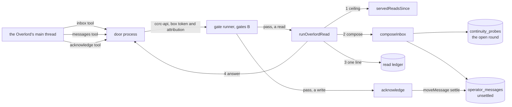
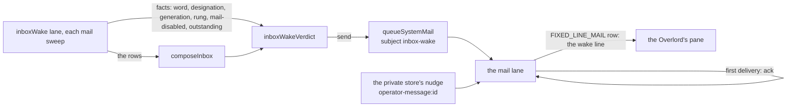

# Overlord W1: the inbox and its reads Implementation Plan

> **For agentic workers:** REQUIRED SUB-SKILL: Use superpowers:subagent-driven-development (recommended) or
> superpowers:executing-plans to implement this plan task by task. Steps use checkbox (`- [ ]`) syntax for tracking.

**Goal:** the Overlord takes its work from one door, in one order, and is woken once for it. Three new Overlord doors
ship, and one lane:

- **`inbox`** (`GET /api/overlord/inbox`): every row waiting for the Overlord, in the order of §6.8. In W1 that is an
  open probe round while the generation is `active`, then band 1, the operator's unsettled messages, oldest first. A
  row carries ids and server words, never words a person or a session wrote. Its row shape and its order are the
  contract W2 and W3 extend and never change (Table 11.1e).
- **`messages`** (`GET /api/overlord/messages?ids=…`): the operator's words, read from the private store by id. This is
  the only door through which a session reads them, and only the designated session passes its gate.
- **`acknowledge`** (`POST /api/overlord/messages/:id/acknowledge`): settles one message through the private store's
  one writer. In W1 it writes nothing else; act rows start in W2.
- **The coalesced wake:** one lane, `inboxWake`, sends the Overlord one fixed line when rows that have no nudge of their
  own are waiting: "2 waiting in your inbox: read it with your inbox door". It rides the mail lane, through the same
  fixed-line branch as the private store's message nudge.

Every read leaves one line in the read ledger, under a rate ceiling per door. This piece owns the ceilings, their
counter and the one read runner every Overlord read door calls, so the board and the history door reuse it.

**Why:** H19, "an inbox, not a mailbox" (§6.8). One mail per row, oldest first, one nudge a sweep, lapses the second
row of any burst. H7: the operator's words reach the Overlord as tool output through `messages`, never typed. H10:
any process of the fleet user can forge the Overlord's attribution and call its read doors, so a read door that leaves
no line would be a silent leak, and a ceiling bounds what a forger reads in an hour. §3.3.5: probes arrive as tool
output, never typed text.

**Architecture:** decide in L1, act in L4, one writer per fact.

- **L0, `shared/overlordInbox.ts`** (new, a one-concern sibling, the index's slug `wire-types-in-sibling-modules`): the
  bands and their order, the row kinds with their band and nudge, the row and answer shapes, the page and per-read
  bounds, the read ceilings (`READ_CEILINGS`, total over the read ledger's doors), the served outcome word, the wake's
  subject, body codec and line, and the ids parser.
- **L1, `server/src/coord/overlordInbox.ts`** (new, C5): `composeInbox` (the order), `readCeilingVerdict`,
  `acknowledgeVerdict` and `inboxWakeVerdict`.
- **L3, C11:** one new reader on the private store, `OperatorModelStore.servedReadsSince`, the ceiling's counter. The
  private store stays the one owner of `operator-model.db`'s SQL.
- **L4, C5:**
  - `server/src/coord/overlordRead.ts` (new): `runOverlordRead`, the one read runner. It asks the gate, then the
    ceiling, composes the door's answer, writes the ledger line, and only then answers.
  - `server/src/coord/overlordRoutes.ts` (designation A creates it): the three handlers.
  - `server/src/coord/overlordInboxWake.ts` (new): the wake lane's pass, with its memory of the rows it woke for.
  - `server/src/watch.ts`: the lane's `runLane` call, and the private store's fixed-line branch read from a table.
- **L1, `server/src/coord/envelope.ts`:** `FIXED_LINE_MAIL`, one row per kind of mail the mail lane types as a fixed line
  (the private store's message nudge, and the wake).
- **The client:** `ccd/ccrc-api`'s three `ROUTES` rows, and the door process's three `DOOR_TOOLS` rows.


*Figure 1. The three doors. Every Overlord read goes through the gate and then the one read runner, which counts
against the ceiling, writes one line and only then answers. `acknowledge` is a write: it takes the gate's fence and
witness, and writes only the message's state.*


*Figure 2. One wake. The lane wakes only for rows that have no nudge of their own (a probe round in W1). A message keeps
the private store's own nudge. Both lines are typed by one table in the mail lane, and each is acked on its first
delivery.*

**Tech Stack:** TypeScript (ESM), `node:sqlite`, Fastify, bash (`ccd/ccrc-api`), Node (`ccd/door-process.mjs`),
vitest. No new dependency.

**Spec:** `docs/superpowers/specs/2026-11-09-overlord-design.md`:

- §6.8, H19: "The inbox", "Never typed", "One wake", "What ships when", "The read's contract is fixed in W1", "The
  inbox's order", "Probes come before everything".
- §3.8, H7: "Delivery is like mail", "A message has four states" (settled by `acknowledge`), "No message is lost";
  H10: "The read ledger", "Reads have ceilings".
- §3.2: "Every read leaves a ledger line (H10)", "Reads are not acts".
- §3.3.5 C41: "Never typed", "Closed-book".
- §3.3.12: "For the Overlord, a fired timer is also a row of band 3 of its inbox from W2" (W1: mail only).
- §11.1: Table 11.1e's rows "The Overlord's reads" and "`acknowledge`"; Table 11.5b's "Set by the plan before W1: the
  read rate ceilings per door".
- §11.2: the gate order for the Overlord's doors, `view` for reads and `operate` for acts.
- Table 11.6: `said-not-operator`, `not-the-overlord`, `capability-missing`, and the index's `read-ceiling`.
- Table 13.1: H19 is a `shape` call of W1 (the inbox ships its row shape and order with its door); H10 a
  `tightening` call of W1; H7 a `shape` call of W1 (the private store's).

**The index:** `docs/superpowers/plans/2026-11-14-overlord-w1.md`, row "Inbox and reads", lane D, one pull request,
five tasks. It needs private store B and gates B first. This plan builds on the index's questions 25 (the ceilings are
this plan's), 26 (the nudge rides the mail lane), 31 (no transaction spans the two files) and 32 (`read-ceiling`).
The coordinator's brief for this plan (run 2166) binds: the private store owns `operator-model.db`, the message moves
table, the read ledger with its nullable `turnState` and the settlement rules, and this piece calls their writers; the
nudge names the message id and points at `messages`; "picked up" is the hook's report through door process B's report
door; no session but the designated Overlord, through the gate, reads a message's words; probes are served first,
through the probe door; every Overlord door has a row in `OVERLORD_DOORS` and calls its runner.

## Open questions

Each carries the answer this plan builds. The plan builds every recommendation unless the coordinator or the operator
rules otherwise.

1. **The read ceilings' values** (the index's question 25; slug `read-ceilings-from-cadence`). The index asks this plan
   to measure a week of the console's own read rates. No record of them exists: the server runs
   `Fastify({ logger: false })` (`server/src/server.ts`), and the Caddyfile `ccrc expose` writes has no `log`
   directive, so neither box keeps a request log (measured on `main`). What can be measured is the cadence the code
   sets:

   | Measured on `main` | Value | Reads an hour at most |
   |---|---|---|
   | The Overlord's `MAIL_PACE` row (`server/src/coord/mailPace.ts`): quiet, then the gap between nudges | 15 s, 30 s | 120 deliveries |
   | The mail lane's sweep (`laneSchedule.ts#MAIL_SWEEP_MS`) | 10 s | 360 looks |
   | The console's fastest steady poll (`pwa/src/fleet/FleetHostBanner.tsx`, `POLL_MS`) | 15 s | 240 |
   | The console's claims strip (`HotFilesStrip.tsx#CLAIMS_POLL_MS`) | 30 s | 120 |
   | Most console panels (`STALL_WATCH_POLL_MS`, `UPDATES_POLL_MS` and eight more) | 60 s | 60 |

   **Recommendation:** these per-door ceilings, each over a rolling hour, in one L0 table `READ_CEILINGS`, total over
   the read ledger's doors:

   | Door | Ceiling an hour | Why |
   |---|---|---|
   | `inbox` | 240 | Two reads for each delivery slot at the Overlord's pace (one on the nudge, one after it settles), equal to the console's own fastest poll |
   | `messages` | 120 | One read for each delivery slot. A read takes up to ten ids |
   | `board` | 120 | Board and history's ruled value (its question 8) |
   | `history` | 60 | The same. It bounds the verbatim cross-project text a forgeable door yields in an hour |

   A hit on a ceiling does not step the ladder down (§6.8, "A noisy source is shed alone"): it refuses that read with
   `read-ceiling` (429) and `retryAfterS`. The ledger records every line, so once an Overlord runs, its real rates are
   in the store: the coordinator re-fits the values after its first week in a values-only pull request, against M32's
   28-day median. The spec-fixes run puts the four values into Table 11.5b.
2. **`read-ceiling` is in the vocabulary** (the index's question 32). `shared/refusal.ts#OVERLORD_REFUSALS` holds it
   (429), and `server/test/single-definition/refusal-table.data.json`'s `codeOnly` names it until the spec-fixes run
   adds its row to Table 11.6. This piece is its first sender, and changes neither file.
3. **One read runner and one counter for every Overlord read door** (slug `one-runner-for-every-read-door`). Board and
   history B plan the ledger line and the ceiling at each door, with "the ceiling's counter is the inbox piece's".
   **Recommendation:** this piece ships the counter and the runner both: `runOverlordRead` (L4) runs the gate, the
   ceiling, the door's compose, the turn state, the line, and the answer, in that order. Board and history B call it
   with their door's key and compose function, and add no ledger or ceiling code. Two copies of "count, then record,
   then answer" would be a parallel mechanism for one job.
4. **No line, no read** (slug `no-line-no-read`). H10's reason is that a silent read is a leak, so a read whose line
   could not be written must not be served. **Recommendation:** the runner composes, writes the line, and sends the
   answer only when the line landed. A failed write answers 503 `write-failed` and sends nothing. The ceiling's own
   refusal also writes its line (outcome `read-ceiling`, not counted), and refuses whether or not that line landed. A
   call refused at the gate reads nothing and writes no line, as board and history rule. A counter that cannot be
   read refuses 503 `unmeasured`, before anything is read: a ceiling that cannot count cannot allow.
5. **The inbox carries ids, never words** (slug `inbox-carries-ids-not-words`). §6.8 lists "unsettled operator
   messages" and "probe rounds" among the inbox's rows; §3.8 says the words are read through `messages`; §3.3.5 says
   probes are served through the probe door. **Recommendation:** an inbox row names its kind, its key, its band, when
   it arrived, its deadline (none in W1) and the door that serves its content, and carries no free text: a message
   row carries the id, term, state and `cut`, and a probe row the round id, its kind and its question count, never a
   question or what it expects. So the probe door stays the one renderer of probe text (`probeDoor.ts`'s masking and
   pages), `messages` the one door for the operator's words, and the inbox read is the narrowest read the Overlord
   makes. The contract holds this for later kinds too: a W3 packet is served by its own door.
6. **A probe round is served alone** (slug `probe-round-served-alone`). "Probes come before everything" (§6.8), and a
   probe is graded closed-book only when no read door was called between the ask and the answer (§3.3.5). Door process
   B's closed-book count is "the witness reports of door tools other than `probe` and `probe_answer`" between the ask
   and the answer (`w1-door-process.md`, Task 8). So the inbox read that tells the Overlord a round is open would
   itself make every `active` round `open`, never `closed`. **Recommendation:** while a round is open, the inbox
   answers that round's row alone, with `behind: { kind: 'probe-first', count }` naming how many rows wait behind it.
   That answer tells the Overlord nothing but the round's id, so door process B's count leaves out `inbox` beside
   `probe` and `probe_answer` (Index changes). Once the round is answered, the next read serves band 1.
7. **Band 1 keeps its own nudge, and the wake covers the rest** (slug `wake-covers-unnudged-rows`). §6.8: "A single
   coalesced nudge … replaces a mail for each row". The private store, merged as a plan and binding, sends one nudge for
   each message, naming its id, because "picked up" is the hook's report of that id (§3.8). **Recommendation:** each
   row kind declares in L0 whether it has a nudge of its own (`ownNudge`). The wake fires only for rows whose kind has
   none: in W1, a probe round in `active`, which the generations lane records without any announcement
   (`server/src/continuity/generationsLane.ts`, "A spot round is RECORDED ONLY"). W2's band 3 and W3's band 2 join the
   wake by declaring `ownNudge: false`. The wake's line still counts every waiting row, messages included.
8. **The wake rides the mail lane through one fixed-line table** (slug `fixed-line-mail-is-one-table`). The Overlord
   has no mail verb and no shell (`ccd/overlord-skill/references/starting.md`, "You have no mail verb"), so the generic
   mail nudge, which tells a session to run the mail client, is useless to it. The private store adds a dedicated
   operator-message branch to `FleetWatcher.sweepMail` that types one fixed line and acks on first delivery.
   **Recommendation:** that branch reads one L1 table, `FIXED_LINE_MAIL` in `server/src/coord/envelope.ts`, whose rows
   are the kinds of mail typed as a fixed line: `operator-message` (the private store's) and `inbox-wake` (this
   piece's). Each row names its matcher, its line and what its first delivery moves (the message's `delivered`, or
   nothing). If private store B lands its branch as a plain test on `isOperatorMessageMail`, this piece turns it into
   the table first, in a move-only commit behind private store B's own cases. A second branch beside it would be a
   parallel mechanism for one job.
9. **The wake's memory is the lane's** (slug `wake-memory-in-the-lane`). The wake must not fire twice for the same rows.
   **Recommendation:** the lane keeps, in memory, the keys of the rows its last wake covered, and asks
   `CoordStore.hasOutstandingMail` (which `queueSystemMail` already asks) whether a wake is still undelivered. A server
   restart forgets the keys, so the first pass after a boot wakes once for whatever is waiting. One extra nudge costs one
   inbox read, which is less than a table to remember it in.
10. **The inbox and `acknowledge` cover every unsettled message** (slug `inbox-is-the-roles`). A message row names the
    session it was sent to and the term. After a rebind or a renewal the body changes and the role does not, and "No
    message is lost … offered again after every renewal" (§3.8). **Recommendation:** band 1 serves every unsettled
    message whatever its `sessionId`, with its `term`, so the Overlord sees that a message came under an older term.
    `acknowledge` settles any of them. Door process B's pick-up stays bound to the session the nudge was typed into,
    because it reports what that pane saw.
11. **`acknowledge` of an id that is no message answers `said-not-operator`** (slug
    `acknowledge-absent-is-said-not-operator`). Table 11.6's `said-not-operator` means "a cited id is not a row of
    `operator_messages`", and §3.8 counts `acknowledge` among the doors that cite a message. Door process B plans a new
    word, `unknown-message` (404), for the same cause at the pick-up report. **Recommendation:** one word for one cause.
    `acknowledge` answers `said-not-operator` (409), which moves from the vocabulary's W2 wave map into
    `OVERLORD_REFUSALS` in this pull request, and door process B uses it too (Index changes). Table 11.6's row gains
    `acknowledge` in its door column (a spec fix). An id already settled or spent answers 200 with `changed: false`, so
    a retried call is harmless.
12. **One id per `acknowledge` call** (slug `acknowledge-one-id`). Each write takes the act counter once (gates B), and
    a refusal must name one cause. **Recommendation:** the path carries one id. The Overlord settles several in one turn
    with several calls (skill clause 7).
13. **What `messages` serves** (slug `messages-by-id`). **Recommendation:** up to `MESSAGES_PER_READ` (10) ids a call,
    each answered as the private store's wire row, `OperatorMessageRow`, in any state, or `{ id, absent: true }`. At the
    text cap of 16,384 bytes that is under 170 KiB an answer. A call with no id, a malformed id or more than ten answers
    `bad-request` before anything is read, and writes no line.
14. **An unmeasured source fails the whole inbox** (slug `inbox-fails-whole`). **Recommendation:** when the open round or
    the unsettled messages cannot be read, the inbox answers 503 `unmeasured` naming the source, and writes its line
    with the outcome `unmeasured`. An inbox that served band 1 without the probe row, or nothing for band 1, would read
    as "nothing waiting".
15. **The privacy boundary, named** (the brief's ruling). The designated session is the only session that reads a
    message's words. **The gate arm:** step 1 of the gate order, gates B's `callerStandingOf`, on the `messages`,
    `inbox` and `acknowledge` rows of `OVERLORD_DOORS`, each `others: 'refuse'`: any other caller is refused
    `not-the-overlord` before anything is read. **Its censuses:** gates B's `overlord-gate-census.test.ts` (every
    `overlord` row's handler calls `deps.gate(` with its own key before any store access) and
    `overlord-gate-doors.test.ts` (a non-designated caller at a `refuse` row is refused), and this piece's new
    `operator-message-readers.test.ts`: outside `server/src/operatorModel/`, every call of a private-store reader that
    returns a message's text sits in a handler whose row is `others: 'refuse'`, or in a hand-kept list of operator
    doors (empty in W1; lane F's chat adds its own).
16. **When the wake holds** (slug `wake-holds-with-the-doors`). **Recommendation:** the wake holds when the inbox would
    refuse the read it asks for, and when mail is stopped: without `overlord-v1`, with no designation or an unmeasured
    one, outside `active`, at the `off` rung or an unmeasured rung, while `mail-disabled` stands or cannot be read, while
    a wake is undelivered, and when no row is new. Each hold is a word, never a silent skip, and the lane logs nothing on
    a hold (it runs every ten seconds).
17. **The index's questions 10 and 27** (the Overlord's replies). Nothing here waits on them: the inbox serves the
    operator's words and the probe rounds, and records no reply.

## What exists today

Measured on `main` at `f25c710e1`.

- **None of this piece's files.** `shared/overlordInbox.ts`, `server/src/coord/overlordInbox.ts`,
  `server/src/coord/overlordRead.ts` and `server/src/coord/overlordInboxWake.ts` are absent. So are those it builds on:
  `server/src/coord/overlordRoutes.ts` (designation A creates it), `server/src/coord/overlordDoors.ts` and the gate runner
  (gates A and B), `server/src/operatorModel/` and `shared/operatorMessages.ts` (private store A), and
  `ccd/door-process.mjs` (door process A). Each is cited below by its merged plan's contract, not by a symbol.
- **The private store's interfaces** (`w1-private-store.md`, merged as a plan): `OperatorModelStore` with
  `moveMessage(id, event, actor, at)` (the one writer, by `MESSAGE_MOVES`, whose actor `acknowledge` may send
  `settle`), `recordRead(line)` (the read ledger's one writer, which validates `door`, `caller`, `turnState` and the
  `CHECK`s), and the readers `messageById`, `unsettledMessages` (every state before `settled`, id order, never
  trimmed) and `lastOperatorMessage`. Each reader answers `Read<T>`, measured or `unmeasured`. The read ledger's
  columns are `at`, `door`, `caller`, `scope` (at most 200 characters), `count`, `outcome` (kebab, at most 40),
  `generation`, `generationRead` and `turnState`, with the index `read_ledger_door_at`. `READ_DOOR_MAP` holds `board`,
  `messages`, `inbox` and `history`. `READ_TURN_STATES` holds the turn marker's eight words. The nudge is system mail
  from `operator`, subject `operator-message:<id>`, typed by `renderOperatorMessageNudge(id)` in `sweepMail`'s
  operator-message branch.
- **The gate's interfaces** (`w1-gates.md`, in review as #2863): `OVERLORD_DOORS`, one row a door, with `group`,
  `verbClass`, `write`, `word`, `others` and `startDoor`; and `deps.gate(req, reply, key, claim)` answering `pass` (with
  the caller and the live generation), `hook` or `refused`. Gates B's two censuses hold every `overlord` row's handler
  to that call.
- **The door process's tool table** (`w1-door-process.md`, in review as #2864): `DOOR_TOOLS` in `ccd/door-process.mjs`,
  each row `{ name, verb, class, reader, input }`, where `verb` is a key of `ccd/ccrc-api`'s `ROUTES`. Its plan says
  each later piece adds its row beside its `ccrc-api` row, naming `inbox`, `messages` and `acknowledge` for this piece,
  and that `messages` is never a reader's tool.
- **The skill's doors.** `ccd/overlord-skill/references/starting.md`'s door table names `inbox` ("Your work, in its
  order"), `messages` and `acknowledge`, each under `overlord-v1`, and step 5 says the coalesced wake is the Overlord's
  nudge. Clause 7: "Never poll: take your work from the inbox, in its order."
- **The probe door** (merged with probes B): `GET /api/sessions/:id/probe` reads `CoordStore.openProbeRound(sessionId)`,
  the questions of the newest unanswered round of the session's live generation
  (`server/src/continuity/continuityStore.ts#openProbeRound`), each a `ProbeRow` with `roundId`, `kind`, `askedAt` and
  the question's text and what it expects. The read answers `{ ok: false, detail }` when the table cannot be read.
  `server/src/continuity/probeDoor.ts` masks and pages the questions. A spot round is recorded and announced to nobody
  (`generationsLane.ts`, the probes section).
- **The mail lane.** `queueSystemMail` (`server/src/coord/rundefsTx.ts`) refuses to queue a second outstanding system
  mail with the same sender, run, recipient and subject (`CoordStore.hasOutstandingMail`). `FleetWatcher.pushNewMail`'s
  record-only test holds `isAskNudgeMail`, `isApprovalNudgeMail`, the stall subjects and the timer sender.
  `INJECTED_PROMPTS['mail-nudge']` is `ccrc-mail: you have new mail.` (`shared/injected-prompts.mjs`, match `head`).
  `SYSTEM_MAIL_SENDER_MAP` (`server/src/coord/rundefs.ts`) has `coordinator`, `operator` and the timer sender.
- **The pace.** `server/src/coord/mailPace.ts#MAIL_PACE` has the row `overlord: { quietMs: 15_000, cooldownMs:
  30_000 }`.
- **The lanes.** `server/src/laneSchedule.ts#LANE_SCHEDULE` is the one cadence table, and `LaneName` its union. Each row
  is `{ name, cadenceMs, derivedFrom, clock, flight, warnKey }`. `MAIL_SWEEP_MS` is 10 s. The timers lane runs as
  `sweepTimers`, which passes the tick's registry listing to its pass, so the `mail-disabled` marker is read by listing
  (`watch.ts`'s note on the fleet kill-switch: a listing that fails reads "can't tell", never "not disabled").
  `server/test/laneQuiet.ts` sees every row through `FleetWatcher.inFlight(name)`.
- **Masking.** `server/src/server.ts#MASKED_GET_ROUTES` names the `GET` routes whose answers are masked;
  `server/test/secret-mask.test.ts` requires every `GET` route to be masked or exempt with a reason.
- **The turn marker.** `server/src/turnmark.ts#readTurnMarkMeasured(io, registryDir, id, currentUuid)`.
- **Refusal words on `main`:** `read-ceiling` (429), `not-the-overlord`, `capability-missing` and the gate's words in
  `OVERLORD_REFUSALS`; `bad-request`, `unmeasured`, `unavailable` and `write-failed` in the generic group.
  `said-not-operator` is not in `shared/refusal.ts`: `refusal-table.data.json`'s `waveMap` lists it under W2.
- **Time ports.** `server/test/single-definition/time-ports.test.ts#TIME_PORT_FAMILIES` already scopes every
  `server/src/**/overlord*.ts` and `shared/overlord*.ts`, so every new file this plan names is in scope by its name.
- **Growth.** `server/src/watch.ts`, `server/src/server.ts` and `server/src/coord/store.ts` are growth-checked
  (`server/test/growthCheck.ts#GROWTH_FILES`), each 40 net lines a pull request. `ccd/ccrc-api` and
  `server/src/coord/overlordRoutes.ts` are not.

## Global Constraints

- **Architecture (`CLAUDE.md`).** `composeInbox`, `readCeilingVerdict`, `acknowledgeVerdict`, `inboxWakeVerdict` and
  the L0 codecs are pure. `runOverlordRead`, the handlers and the wake lane read facts, ask a decider and act; they
  decide nothing. L1 imports L0 only; the handlers and the lane reach the private store through ports their own file
  declares (`Pick<OperatorModelStore, …>`), and nothing below L4 imports `server.ts` or `watch.ts`.
- **Contexts.** The doors, the runner, the deciders and the lane are C5 (the Overlord's reads, Table 11.1e). The
  ceiling's counter is a C11 reader, because only the private store holds `operator-model.db`'s SQL. The inbox reads
  the probe round through `CoordStore.openProbeRound`, C3's existing reader.
- **One writer per fact.**
  - A message's state: only `OperatorModelStore.moveMessage`, which `acknowledge` calls with `('settle',
    'acknowledge')`. No new writer.
  - A read-ledger line: only `OperatorModelStore.recordRead`, which only `runOverlordRead` calls among this piece's
    files.
  - The wake's mail row: only `queueSystemMail`, through the lane. Its delivery row: only `CoordStore`'s delivery
    writer, as every delivery row.
  - `READ_CEILINGS`: one L0 table. Board and history B do not add a second.
- **No words in `coord.db`.** The wake's subject is `inbox-wake` and its body holds row keys and counts only. No log
  line, refusal or feed row carries a message's text or a probe's question.
- **Unmeasured is never a value.** Every source answers measured or `unmeasured`; an unmeasured source refuses
  (question 14) or holds the wake (question 16). A row's deadline is a union, `{ kind: 'none' }` or `{ kind: 'by', at }`,
  never a null.
- **Wire discipline.** The inbox's answer is additive-only from W1: later waves add bands, kinds and fields, never
  change or remove one. A W1 reader orders by `band`, and a kind it does not know is still ordered by its band.
- **Time through ports.** Every handler, the runner and the lane read time through their injected clock; SQL never
  reads the clock.
- **Growth check.** Each growth-checked file stays within 40 net lines in this pull request (The PR split). No waiver.
- **Mutation floors.** Every new L1 decider and L0 codec joins `MUTANT_SETS` through a new
  `server/test/sim/overlordInboxSets.ts`, and `server/test/sim/mutation-floors.json`, in the task that creates it.
- **Tests.** From `server/`: `ccrc test -- ./node_modules/.bin/vitest run test/<file>.test.ts`. Each task's last run
  adds both `tsc` runs (`ccrc test -- npx tsc --noEmit -p tsconfig.json` and `-p test/tsconfig.tests.json`),
  `test/typecheck-tests.test.ts`, `test/rings/*.test.ts`, and pwa's `tsc` when `shared/` changed. Fixture HOMEs only,
  neutral names (`lane-a`, `project-a`, `prog-a`).
- Cite by symbol or `@anchor`. No private names. No D-number: the builder's departures go in
  `docs/superpowers/plans/2026-11-14-overlord-w1/w1-inbox/departures.md`.

## Review Focus

1. **The words stay behind the gate.** Only the `messages` handler returns a message's text, only after the gate's step 1
   passed the designated session, and only after its ledger line landed. The inbox carries no text of any kind.
2. **The order is the contract.** A probe round is served alone while open; then live commands (none in W1), then
   unsettled messages, oldest first. A later band or kind changes nothing a W1 caller reads.
3. **No line, no read.** Every served read wrote its line first; a failed write sent nothing; a ceiling that cannot
   count refuses.
4. **One wake, never two.** The wake fires for new unnudged rows only, at most one undelivered at a time, holds on every
   brake, and the mail lane types it through the same table as the message nudge, acking it on first delivery.
5. **`acknowledge` writes only the state,** through `moveMessage`, and a retry or a race reads as `changed: false`,
   never as a refusal.

## The PR split

| PR | Tasks | What it ships | Needs first | Growth-checked files, estimate |
|---|---|---|---|---|
| The inbox and its reads | 1 to 5 | The vocabulary and deciders; the ceiling's counter and the read runner; `inbox`, `messages` and `acknowledge` with every census; the fixed-line table and the wake lane; the `ccrc-api` and door-tool rows | private store B (the store, its readers, the nudge's branch); gates B (`OVERLORD_DOORS`, the runner); and through them designation A (`overlordRoutes.ts`, `designationRead()`), the ladder (the rung read) and door process A (`DOOR_TOOLS`) | `server/src/watch.ts` about +14 (the lane's method and `runLane` call, the table lookup in the fixed-line branch, the record-only test); `server/src/server.ts` about +8 (two `MASKED_GET_ROUTES` entries, the routes' new deps); `server/src/coord/store.ts` 0 |

**Order inside the pull request:** Task 1, then Tasks 2 and 3 (the doors need the runner), Task 4, then Task 5.

**One pull request, measured.** `server/src/coord/overlordRoutes.ts` grows about +140 and is not growth-checked;
`ccd/ccrc-api` about +6; `ccd/door-process.mjs` about +20. If the builder measures `watch.ts` past 40, the lane's
method moves into `overlordInboxWake.ts` as a function the tick calls in one line.

**What later pieces read** (the states this piece exposes):

- Board and history B: `runOverlordRead(deps)(req, reply, key, door, compose)` and the `board` and `history` rows of
  `READ_CEILINGS` (already in this table).
- Readiness: the inbox's composition, `composeInbox`, for "a message neither picked up nor settled within 2 minutes of
  `ready`" (`deaf`, §3.8): the readiness piece reads the private store's rows itself, and may reuse the order.
- W2 (band 3, follow-ups, request moves, read-back flags, fired timers): a row kind each in `INBOX_KIND_MAP` with
  `ownNudge: false`, a source in `composeInbox`'s input, and `moves` in `INBOX_SERVED_BANDS`.
- W3 (band 2, admission, packets, drills, background): the same, with `due: { kind: 'by', at }`, and the wake line's
  "the first lapses in N s" clause, which this piece already renders when a deadline exists.
- The chat (lane F): nothing of this piece; its operator read of the messages is its own door, added to
  `operator-message-readers.test.ts`'s operator list.

## Index changes

The index (`docs/superpowers/plans/2026-11-14-overlord-w1.md`) should carry these:

1. **The row's files** (lane D): `shared/overlordInbox.ts`; `server/src/coord/overlordInbox.ts`, `overlordRead.ts`
   and `overlordInboxWake.ts`; one reader on `server/src/operatorModel/store.ts` (`servedReadsSince`);
   `server/src/coord/envelope.ts#FIXED_LINE_MAIL`; the `inboxWake` row in `LANE_SCHEDULE`; three rows in `ccd/ccrc-api`'s
   `ROUTES` and three in `ccd/door-process.mjs`'s `DOOR_TOOLS`.
2. **"Where lanes meet" adds:**
   - `server/src/coord/envelope.ts` and `sweepMail`'s fixed-line branch: private store B creates the branch, and this
     piece makes it a table (question 8);
   - `LANE_SCHEDULE`: the `inboxWake` row, beside readiness's `overlord-readiness`;
   - `READ_CEILINGS` and `runOverlordRead`: board and history B calls the runner and adds no row (its question 8's "one
     row a door to the inbox piece's table" is already met, because the table is total over the read ledger's doors);
   - `OVERLORD_REFUSALS` gains `said-not-operator`, which leaves the refusal table test's `waveMap`.
3. **Board and history B**: its door calls `runOverlordRead`, and so takes "no line, no read" (question 4). Its Task 5
   and Task 6 drop their own ledger and ceiling steps.
4. **Door process B**:
   - its closed-book count leaves out `inbox` beside `probe` and `probe_answer` (question 6);
   - its pick-up report answers `said-not-operator` for an id that is no message, instead of a new `unknown-message`
     (question 11).
5. **The Overlord's timers**: the Overlord has no mail verb, so in W1 a fired timer's mail reaches its pane as the
   generic nudge, which names the mail client it cannot run. That piece should either type a fixed line through
   `FIXED_LINE_MAIL` (a row of its own) or say why the Overlord needs none in W1.
6. **Readiness** reads the private store's rows for `deaf`, and may call `composeInbox`; it adds no inbox source.

**Spec fixes for the spec-fixes run:**
- Table 11.5b: the four read ceilings (question 1).
- Table 11.6: `read-ceiling`'s row (with the index's question 32), and `acknowledge` in `said-not-operator`'s door column
  (question 11).
- §6.8 "One wake": the coalesced wake covers the rows that have no nudge of their own; an operator message keeps its
  own nudge, which names its id (question 7).
- §6.8 "Probes come before everything": while a round is open the inbox serves it alone (question 6).

---

### Task 1: The vocabulary and the deciders

**Files:**
- Create: `shared/overlordInbox.ts` (L0; imports types only from `./operatorMessages.js` and `./continuity.js`)
- Create: `server/src/coord/overlordInbox.ts` (C5, L1; imports L0 only)
- Create: `server/test/overlord-inbox-vocab.test.ts`, `server/test/overlord-inbox-deciders.test.ts`
- Create: `server/test/sim/overlordInboxSets.ts`; Modify: `server/test/sim/mutation-floors.test.ts`,
  `server/test/sim/mutation-floors.json`

**Interfaces** (`shared/overlordInbox.ts`):

```ts
import type { MessageState, ReadDoor } from './operatorMessages.js';
import type { ProbeRoundKind } from './continuity.js';

/** The inbox's bands, by their rank (§6.8): a probe round ahead of band 1, then the four bands. */
const INBOX_BAND_MAP = { probe: 0, operator: 1, deadline: 2, moves: 3, background: 4 } as const;
export type InboxBand = keyof typeof INBOX_BAND_MAP;
export const INBOX_BANDS = Object.keys(INBOX_BAND_MAP) as InboxBand[];
export function bandRank(b: InboxBand): number;
/** The bands this build serves. W2 adds `moves`; W3 adds `deadline`, then `background`. */
export const INBOX_SERVED_BANDS: readonly InboxBand[];   // ['probe', 'operator']

/** Each row kind: its band, whether it has a nudge of its own (the wake covers the others), and the door that serves
 *  its content. W2 and W3 add rows; none changes. */
const INBOX_KIND_MAP = {
  'probe-round': { band: 'probe', ownNudge: false, door: 'probe' },
  'operator-message': { band: 'operator', ownNudge: true, door: 'messages' },
} as const;
export type InboxKind = keyof typeof INBOX_KIND_MAP;
export const INBOX_KINDS = Object.keys(INBOX_KIND_MAP) as InboxKind[];

export type InboxDue = { readonly kind: 'none' } | { readonly kind: 'by'; readonly at: number };
interface InboxRowBase {
  readonly key: string;       // `<kind>:<id>`, stable across reads: `probe-round:<roundId>`, `operator-message:<id>`
  readonly band: InboxBand; readonly at: number; readonly due: InboxDue; readonly door: string;
}
export interface ProbeRoundRow extends InboxRowBase {
  readonly kind: 'probe-round'; readonly roundId: string; readonly roundKind: ProbeRoundKind; readonly questions: number;
}
export interface MessageInboxRow extends InboxRowBase {
  readonly kind: 'operator-message'; readonly messageId: number; readonly term: number;
  readonly state: MessageState | 'unknown'; readonly cut: boolean;
}
export type InboxRow = ProbeRoundRow | MessageInboxRow;
export type InboxBehind = { readonly kind: 'none' } | { readonly kind: 'probe-first' | 'page'; readonly count: number };
export interface InboxAnswer {
  readonly ok: true; readonly at: number; readonly servedBands: readonly InboxBand[];
  readonly rows: readonly InboxRow[]; readonly behind: InboxBehind;
}
export const INBOX_PAGE_ROWS = 100;
export const MESSAGES_PER_READ = 10;

/** The read ledger's served outcome: the one outcome a ceiling counts (board and history's ruling R8). */
export const READ_SERVED_OUTCOME = 'rows';
export const READ_CEILING_WINDOW_MS = 3_600_000;
/** Every read door's ceiling over a rolling hour (question 1), total over the ledger's doors. */
export const READ_CEILINGS: Readonly<Record<ReadDoor, { readonly perHour: number }>>;
// { inbox: 240, messages: 120, board: 120, history: 60 }

/** `?ids=3,7,12`: one to MESSAGES_PER_READ positive safe integers, no repeats, no leading zero. */
export function parseMessageIds(raw: unknown): { ok: true; ids: readonly number[] } | { ok: false; detail: string };

/** The coalesced wake. Its subject is fixed, so `queueSystemMail`'s dedupe keeps one undelivered. */
export const INBOX_WAKE_SUBJECT = 'inbox-wake';
export function isInboxWakeMail(m: { readonly fromId: string; readonly subject: string }): boolean; // from `operator` only
export interface InboxWakeBody {
  readonly keys: readonly string[]; readonly waiting: number; readonly firstDue: InboxDue;
}
export function renderInboxWakeBody(b: InboxWakeBody): string;      // `inbox-wake v1` then one `key: value` line each
export function readInboxWakeBody(s: string): { ok: true; body: InboxWakeBody } | { ok: false };
/** The line the mail lane types: the mail nudge's head, then the count, the first deadline's time left when one
 *  exists, and the door. With an unreadable body it still names the door, without a count. */
export function renderInboxWakeLine(b: InboxWakeBody | null, now: number): string;
```

The head is `INJECTED_PROMPTS['mail-nudge'].text`, imported from `shared/injected-prompts.mjs` as the private store's line
does, so `sendPrompt`'s 24-character echo needle and the injected-prompt census do not change. The line, with no
deadline: `ccrc-mail: you have new mail. 2 waiting in your inbox: read it with your inbox door.` With one: `… 3 waiting
in your inbox, the first lapses in 140 s: read it with your inbox door.` The `null` parameter is the codec's refusal,
not a value: `renderInboxWakeLine` is only called with `null` after `readInboxWakeBody` answered `ok: false`.

**Interfaces** (`server/src/coord/overlordInbox.ts`):

```ts
export type Source<T> = { readonly kind: 'measured'; readonly value: T } | { readonly kind: 'unmeasured'; readonly why: string };
export interface OpenRound { readonly roundId: string; readonly kind: ProbeRoundKind; readonly questions: number; readonly askedAt: number }
export interface InboxSources {
  /** The live generation's open round, or 'none'. Read only while the generation is `active`; else 'none'. */
  readonly probe: Source<OpenRound | 'none'>;
  /** `OperatorModelStore.unsettledMessages()`, mapped by the caller to text-free facts. */
  readonly messages: Source<readonly { id: number; at: number; term: number; state: MessageState | 'unknown'; cut: boolean }[]>;
}
export type InboxComposed =
  | { readonly kind: 'served'; readonly rows: readonly InboxRow[]; readonly behind: InboxBehind }
  | { readonly kind: 'unmeasured'; readonly source: 'probe' | 'messages'; readonly why: string };
/** The one order: band rank; in `probe`, the one round; in `operator`, commands (none in W1) then messages by `at`, then
 *  id; in `deadline`, `due.at` then `at`; in `moves` and `background`, `at` then key. A probe round is served alone. */
export function composeInbox(s: InboxSources): InboxComposed;
export function inboxOrder(a: InboxRow, b: InboxRow): number;

export type CeilingVerdict = { readonly kind: 'allow' } | { readonly kind: 'refuse'; readonly retryAfterS: number };
/** `served` is the count of `rows` lines of the door in the window, by any caller but the console, and the oldest's time. */
export function readCeilingVerdict(door: ReadDoor, served: { count: number; oldestAt: number | 'none' }, now: number): CeilingVerdict;

export type AckVerdict =
  | { readonly kind: 'settle' } | { readonly kind: 'already'; readonly state: MessageState | 'unknown' } | { readonly kind: 'absent' };
export function acknowledgeVerdict(row: { state: MessageState | 'unknown' } | 'absent'): AckVerdict;

export type WakeHold = 'no-word' | 'not-designated' | 'designation-unmeasured' | 'not-active' | 'rung-off'
  | 'rung-unmeasured' | 'mail-disabled' | 'mail-disabled-unmeasured' | 'outstanding' | 'rows-unmeasured' | 'nothing-new';
export interface WakeInput {
  readonly word: boolean;                               // `overlord-v1` among the server's words
  readonly designation: 'designated' | 'not-designated' | 'unmeasured';
  readonly generation: 'active' | 'other' | 'unmeasured';
  readonly rung: 'off' | 'on' | 'unmeasured';           // the ladder's effective rung, `off` or not
  readonly mailDisabled: 'standing' | 'absent' | 'unmeasured';
  readonly outstanding: boolean;                        // an `inbox-wake` mail to the session not yet delivered
  readonly composed: InboxComposed;
  readonly woken: ReadonlySet<string>;                  // the keys the last wake covered (the lane's memory)
}
export type WakeVerdict = { readonly kind: 'send'; readonly body: InboxWakeBody } | { readonly kind: 'hold'; readonly why: WakeHold };
/** Send when some row whose kind has no nudge of its own is not in `woken`; the body counts every row. Holds in the
 *  order of `WakeHold`, the first one winning. */
export function inboxWakeVerdict(i: WakeInput): WakeVerdict;
```

`readCeilingVerdict` refuses when `count >= READ_CEILINGS[door].perHour`, with `retryAfterS` the seconds until the oldest
counted line leaves the window, at least 1. `oldestAt: 'none'` with a count above zero is a reader fault: the decider
refuses with `retryAfterS` of the whole window, never allows.

- [ ] **Step 1: Failing tests.**
  - `overlord-inbox-vocab.test.ts`: each map's keys equal its list, written out in the test; `bandRank` is strictly
    increasing in `INBOX_BANDS`' order; every kind's band is a band and its `door` a door the skill's table names;
    `READ_CEILINGS` has a row for exactly `READ_DOORS`, each a positive integer; `parseMessageIds` on `3`, `3,7`, ten ids
    (allowed), eleven, `0`, `-1`, `07`, `3,3`, `3,,7`, `0x3`, an id past `Number.MAX_SAFE_INTEGER`, the empty string and
    a non-string (each refused but the first three); the wake body round-trips, and `readInboxWakeBody` refuses a
    missing header, an unknown line, a bad count and a key with a control character; `renderInboxWakeLine` starts
    with `INJECTED_PROMPTS['mail-nudge'].text`, names no `ccrc-api` and no mail verb, carries the time-left clause only
    for `{ kind: 'by' }`, and with `null` names the door and no count; `isInboxWakeMail` refuses the subject from any
    sender but `operator`. A test holds that no field of `ProbeRoundRow`, `MessageInboxRow` or `InboxAnswer` is named
    `text`, `question`, `expected` or `words` (a key list the compiler makes exhaustive).
  - `overlord-inbox-deciders.test.ts`:
    - `composeInbox`: no rows; messages only, served oldest first by `at`, ties by id; an open round with messages
      behind it, served alone with `behind: probe-first` and the count; more than `INBOX_PAGE_ROWS` messages, cut with
      `behind: page`; each source `unmeasured` answers `unmeasured` naming it, never a partial list; a message state
      read as `unknown` is still served in band 1.
    - `inboxOrder`: a table of pairs across every band, and a row of a kind W1 does not know (built by casting) still
      sorts by its band.
    - `readCeilingVerdict`: under, at and over each door's ceiling; `retryAfterS` at the window's edge; `oldestAt:
      'none'` with a count refuses.
    - `acknowledgeVerdict`: each `MessageState`, `unknown` and `absent`.
    - `inboxWakeVerdict`: each hold in its order (a fixture with every hold standing answers `no-word`, then each is
      lifted in turn); a probe round not in `woken` sends; the same round in `woken` holds `nothing-new`; a message alone
      holds `nothing-new` (it has its own nudge); the body's `waiting` counts the messages too.
- [ ] **Step 2: Run.** Red.
- [ ] **Step 3: Implement.** Register `parseMessageIds`, `readInboxWakeBody`, `composeInbox`, `inboxOrder`,
  `readCeilingVerdict`, `acknowledgeVerdict` and `inboxWakeVerdict` in `overlordInboxSets.ts`, with their floors.
- [ ] **Step 4: Run** both suites, `sim/mutation-floors.test.ts`, `rings/wire-totality.test.ts`,
  `rings/shared-imports.test.ts`, `single-definition/time-ports.test.ts`, `single-definition/*.test.ts` and both `tsc`
  runs. Green.
- [ ] **Step 5: Mutation, by hand.** Each reds a case, then restore: serve band 1 behind an open round; sort messages by
  id alone; read `count > perHour` for `>=`; allow on `oldestAt: 'none'`; let `inboxWakeVerdict` wake for a message;
  swap `mail-disabled` and `outstanding` in the hold order.
- [ ] **Step 6: Commit.** `feat(overlord): the inbox's vocabulary, its order, the read ceilings and the wake's verdict (H19)`

### Task 2: The ceiling's counter and the one read runner

**Files:**
- Modify: `server/src/operatorModel/store.ts` (`servedReadsSince`)
- Create: `server/src/coord/overlordRead.ts` (C5, L4)
- Create: `server/test/overlord-read-runner.test.ts`; Modify: `server/test/operator-model-store.test.ts`

**Interfaces:**

```ts
// server/src/operatorModel/store.ts, beside the other readers
/** The `rows` lines of a door since `sinceMs`, by any caller but the console, and the oldest one's time. */
servedReadsSince(door: ReadDoor, sinceMs: number): Read<{ count: number; oldestAt: number | 'none' }>;
```

Its SQL is one statement over `read_ledger_door_at`: `SELECT count(*) AS n, min(at) AS oldest FROM read_ledger WHERE
door = ? AND at > ? AND outcome = ? AND caller <> 'operator'`, bound to `READ_SERVED_OUTCOME`. `oldest` null with `n`
zero reads `'none'`; with `n` above zero it reads `unmeasured`. It writes nothing, so the writers-map pin does not
move.

```ts
// server/src/coord/overlordRead.ts
export interface OverlordReadDeps {
  readonly gate: (req: FastifyRequest, reply: FastifyReply, key: string, claim: GateClaim) => Promise<GateRun>;
  readonly ledger: Pick<OperatorModelStore, 'servedReadsSince' | 'recordRead'> | undefined;
  readonly turn: (sessionId: string, uuid: string) => Promise<ReadTurnState>;   // readTurnMarkMeasured, one word a state
  readonly now: () => number;
}
/** What a door's compose answers: the status and body to send, and its line's scope, count and outcome. */
export interface ReadComposed {
  readonly status: 200 | 503; readonly body: unknown;
  readonly scope: string; readonly count: number; readonly outcome: string;
}
export function runOverlordRead(deps: OverlordReadDeps): (req: FastifyRequest, reply: FastifyReply, a: {
  key: string; door: ReadDoor; claim: GateClaim; compose: (caller: SessionCaller) => ReadComposed | Promise<ReadComposed>;
}) => Promise<FastifyReply>;
```

**The runner's order**, each step once:

1. `gate(…)`. `refused` returns its reply. `hook` cannot occur on a `refuse` row; if it does, the runner refuses
   `not-the-overlord` (a row misconfigured is never served).
2. No `ledger`: 503 `unavailable`, nothing read.
3. `servedReadsSince(door, now - READ_CEILING_WINDOW_MS)`. `unmeasured`: 503 `unmeasured`, nothing read, no line.
4. `readCeilingVerdict`. `refuse`: `recordRead` with `count: 0`, `outcome: 'read-ceiling'`, then 429 `read-ceiling`
   with `retryAfterS`, whatever the line's answer (a failed line is logged by id and door, never by scope).
5. `compose(caller)`.
6. The turn state: `turn(sessionId, uuid)`, each reader state its own word of `READ_TURN_STATES`.
7. `recordRead({ at, door, caller: 'overlord', scope, count, outcome, generation, generationRead, turnState })`, where
   `generation` is the gate's pass's live generation number and `generationRead` `measured`; a pass without one is
   recorded `unmeasured`, never as a number.
8. The line refused: 503 `write-failed`, and the composed body is dropped. The line landed: send `status` and `body`.

`caller` is always `overlord` here: readers never reach these doors (door process B's tool table gives no reader
`inbox` or `messages`), and the console's reads have their own doors. Board and history B pass `reader` when their
plan names how the door process tells a reader's call apart.

- [ ] **Step 1: Failing tests.**
  - `operator-model-store.test.ts`: `servedReadsSince` counts `rows` lines of one door inside the window, leaves out
    the console's lines, other outcomes, other doors and lines at the window's edge; answers `none` with no line;
    answers `unmeasured` on a closed handle.
  - `overlord-read-runner.test.ts`, with fake ports:
    - the order: a gate refusal calls nothing else; an unmeasured counter reads nothing and records nothing; a ceiling
      refusal records one `read-ceiling` line with count 0 and calls no compose; a pass calls compose once, then the
      turn reader, then `recordRead`, then sends;
    - no line, no read: `recordRead` answering `write-failed` sends 503 and not the composed body (the test asserts
      the body's marker string is absent from the reply);
    - each `READ_TURN_STATES` word reaches the line unchanged, and the gate's generation reaches it as `measured`, a
      pass without one as `unmeasured`;
    - a 503 compose still writes its line with its outcome, and sends 503;
    - a `hook` answer refuses `not-the-overlord`.
- [ ] **Step 2: Run.** Red. **Step 3: Implement.**
- [ ] **Step 4: Run** both suites, `single-definition/writers-map.test.ts` (unchanged), `rings/*.test.ts`,
  `single-definition/time-ports.test.ts` and both `tsc` runs. Green.
- [ ] **Step 5: Mutation, by hand.** Each reds a case, then restore: send before `recordRead`; skip the line on a ceiling
  refusal; count the console's lines; fold the `unmeasured` counter into a count of 0.
- [ ] **Step 6: Commit.** `feat(overlord): the one read runner, its ledger line and the read ceiling (H10)`

### Task 3: The three doors, and every census

**Files:**
- Modify: `server/src/coord/overlordRoutes.ts` (three handlers, and the routes' deps: `readRunner`, `inboxStore`,
  `probeRound`, `generationActive`)
- Modify: `server/src/coord/overlordDoors.ts` (`OVERLORD_DOORS` gains three rows)
- Modify: `server/src/server.ts` (the routes' new deps; `MASKED_GET_ROUTES` gains `/api/overlord/inbox` and
  `/api/overlord/messages`)
- Modify: `shared/refusal.ts` (`OVERLORD_REFUSALS` gains `'said-not-operator': 409`, with its comment)
- Modify: `server/test/single-definition/refusal-table.data.json` (`said-not-operator` leaves `waveMap`)
- Modify (censuses): `server/src/auth/gate.ts#EXEMPT` (three entries, each with its reason) and its "all N routes"
  sentence; `server/test/auth-gate.test.ts` (the count, its comment and the `httpCount` sentences);
  `server/test/box-token-census.test.ts` (the routes file's lanes grow by three, `ALL_LANES`, and `WORDS`' number
  word); `server/test/secret-mask.test.ts` (the two `GET`s are masked; the `POST` by the write-answer rule);
  `README.md`'s auth paragraph and `CLAUDE.md`'s box-token paragraph (the doors with their verbs, and the count words,
  each re-derived from `word(ALL_LANES.length)` after merging `main`)
- Create: `server/test/overlord-inbox-routes.test.ts`, `server/test/operator-message-readers.test.ts`

**The rows** (`OVERLORD_DOORS`):

| Key | Method and path | Group | Verb class | Write | Word | Others | Start door |
|---|---|---|---|---|---|---|---|
| `inbox` | `GET /api/overlord/inbox` | overlord | view | no | `overlord-v1` | refuse | no |
| `messages` | `GET /api/overlord/messages` | overlord | view | no | `overlord-v1` | refuse | no |
| `acknowledge` | `POST /api/overlord/messages/:id/acknowledge` | overlord | operate | yes | `overlord-v1` | refuse | no |

**The handlers.** Each is registered with the `onRequest` `checkMailToken` form gates B's census requires, parses
`byId` and `byUuid` (the query on a `GET`, the body on the `POST`), and calls the gate with its own key before any
store access.

- **`inbox`:** `runOverlordRead` with door `inbox`, scope `inbox`, and a compose that:
  - reads the live generation's effective state; `active` reads `CoordStore.openProbeRound(sessionId)` and maps it to
    `OpenRound` (the round id, its kind, the number of rows, the first row's `askedAt`), dropping every text field at
    the map; any other state reads `none` (the gate has already refused `renewing` outside `active` and `degraded`);
  - reads `unsettledMessages()` and maps each row to text-free facts;
  - asks `composeInbox`, and answers 200 `InboxAnswer` with `servedBands: INBOX_SERVED_BANDS`, count = rows served and
    outcome `rows`; or 503 `unmeasured` naming the source, count 0, outcome `unmeasured`.
- **`messages`:** `parseMessageIds(query.ids)` first; a refusal answers 400 `bad-request` and calls the runner not at
  all, so it writes no line. Then `runOverlordRead` with door `messages`, scope `ids:` and the ids joined by commas,
  and a compose that reads `messageById` for each id: each measured row is served as `OperatorMessageRow`, each
  absent id as `{ id, absent: true }`, count = rows served, outcome `rows` when any row was served and `absent`
  otherwise; any unmeasured read answers 503 `unmeasured`, count 0, outcome `unmeasured`. The answer is `{ ok: true,
  messages: [...] }` in the order the ids were asked.
- **`acknowledge`:** the path id must be a positive safe integer (else 400 `bad-request`); the gate (a write: the fence
  and the witness); `messageById(id)`: `unmeasured` answers 503 `unmeasured`; `acknowledgeVerdict`:
  - `absent`: 409 `said-not-operator`;
  - `already`: 200 `{ ok: true, changed: false, state }`;
  - `settle`: `moveMessage(id, 'settle', 'acknowledge', now)`. `ok` answers 200 `{ ok: true, changed, state }`. A
    `refused` (a race with another settle) re-reads the row and answers `already`'s 200. Any other error answers 503
    `write-failed`.

  It writes no ledger line: it is not a read.

**The `EXEMPT` reasons:**
- `GET /api/overlord/inbox`: "the Overlord's work, in its order, ids and server words only: the box token and
  attribution, then the gate order";
- `GET /api/overlord/messages`: "the operator's words, served only to the designated session: the box token and
  attribution, then the gate order, then one read-ledger line";
- `POST /api/overlord/messages/:id/acknowledge`: "the Overlord settles an operator message: the box token and
  attribution, then the gate order with the fence and the witness".

**`operator-message-readers.test.ts`** (question 15). It scans `server/src` with `server/test/scan/parse.ts`:
- every call of `messageById`, `unsettledMessages`, `settledRows` or `unnudged` on a private-store value, outside
  `server/src/operatorModel/`, is inside a route handler;
- that handler's registration names an `OVERLORD_DOORS` key whose row is `group: 'overlord'` and `others: 'refuse'`, or
  its path is in the hand-kept `OPERATOR_MESSAGE_DOORS` (empty in W1);
- both ways: every `refuse` row whose handler reads a message is found, and every name in `OPERATOR_MESSAGE_DOORS` is
  registered;
- a CONTROL with a planted `deps.inboxStore.messageById(1)` in a lane function, and one in a handler of a `hook` row,
  are each red.

- [ ] **Step 1: Failing tests** (`overlord-inbox-routes.test.ts`, `buildServer` with `testDeps`, a fixture private
  store, a fake gate and a test `CoordStore`):
  - **Gate first:** at each door, a caller the fake gate refuses gets its word and no store method is called; a
    caller that is not the designated session, through gates B's real decider, gets `not-the-overlord`; without
    `overlord-v1`, `capability-missing`.
  - **The inbox:** an `active` generation with an open round and two messages answers the round alone with
    `probe-first: 2`; after the round is answered, the two messages oldest first; a generation in `degraded` serves
    band 1; no row answers `rows: []` with `servedBands: ['probe', 'operator']`; the answer holds no question text,
    no expected answer and no word of any message (the test plants marker strings in both); an unreadable
    `continuity_probes` answers 503 naming `probe`; one line a read, with scope `inbox` and the served count.
  - **`messages`:** two ids answer their rows in the asked order; an absent id answers `absent: true`; eleven ids, `0`
    and `3,3` answer 400 and write no line; one line a read with scope `ids:3,7`; the text is masked
    (`MASKED_GET_ROUTES`); the 121st call in an hour answers 429 `read-ceiling` with `retryAfterS`, and its line has
    outcome `read-ceiling`; the console's lines do not count.
  - **`acknowledge`:** a `queued` message moves to `settled` with `settledBy: 'acknowledge'`; a second call answers 200
    `changed: false`; a `spent` message answers `changed: false`; an absent id answers 409 `said-not-operator`; a stale
    term answers `stale-designation` (gates B); no ledger line is written; the boot pass's `bootSettlement` keeps the
    row settled (the row records `acknowledge`).
  - **Censuses:** `auth-gate`, `box-token-census` and `secret-mask` red until their entries are added, and
    `operator-message-readers` holds.
- [ ] **Step 2: Run.** Red.
- [ ] **Step 3: Implement** the handlers, the rows, the word, the deps in `server.ts`, and every census entry.
- [ ] **Step 4: Run** the two new suites, gates B's `overlord-doors-census`, `overlord-gate-census` and
  `overlord-gate-doors`, `auth-gate`, `box-token-census`, `secret-mask`, `single-definition/refusal-table.test.ts`,
  `refusal-status.test.ts`, `growth-check.test.ts` armed for `server.ts`, `rings/*.test.ts` and both `tsc` runs. Green.
- [ ] **Step 5: Mutation, by hand.** Each reds a case, then restore: serve the inbox's message rows with their text;
  read a message in the `inbox` compose through `messageById`; mark `messages`' row `others: 'hook'`; answer 404 for an
  absent `acknowledge`; let `acknowledge` call `recordRead`.
- [ ] **Step 6: Commit.** `feat(overlord): the inbox, messages and acknowledge doors, behind the gate and the ledger (H19, H7, H10)`

### Task 4: The fixed-line table and the coalesced wake

**Files:**
- Modify: `server/src/coord/envelope.ts` (`FIXED_LINE_MAIL`, and `fixedLineMailOf(mail)`)
- Modify: `server/src/watch.ts` (`sweepMail`'s fixed-line branch reads the table; `pushNewMail`'s record-only test gains
  `isInboxWakeMail`; `sweepInboxWake` and its `runLane('inboxWake', …)` call in the tick)
- Create: `server/src/coord/overlordInboxWake.ts` (C5, L4: `createInboxWakeLane`)
- Modify: `server/src/laneSchedule.ts` (`LaneName` gains `'inboxWake'`; the row)
- Modify: `server/src/deps.ts` (`WatcherDeps` gains the wake's ports, each `Pick<…>`), `server/src/index.ts` (wiring)
- Modify: `server/src/coord/ports.ts` (`WatcherCoordMember` gains `openProbeRound`; `liveGenerations` and
  `hasOutstandingMail` are members already) and `server/test/rings/watcher-store-port.data.ts` (its row)
- Create: `server/test/fixed-line-mail.test.ts`, `server/test/overlord-inbox-wake.test.ts`
- Modify: `server/test/lane-schedule.test.ts` (the row), and `server/test/laneQuiet.ts` if its row list is hand-kept
  (measured at build time)

**Step 0, the characterization** (question 8). If private store B's branch is a plain `isOperatorMessageMail` test,
commit first a move-only change that reads it from `FIXED_LINE_MAIL` with one row, `operator-message`, with every case
of private store B's mail-lane suite green and unchanged (`refactor(mail): the fixed-line mail is one table`).

**The table:**

```ts
// server/src/coord/envelope.ts
export interface FixedLineMailRow {
  readonly name: 'operator-message' | 'inbox-wake';
  readonly matches: (m: { fromId: string; subject: string }) => boolean;
  /** The line typed with `resumeIfOwn: 'whole'`, from the mail and the lane's clock. */
  readonly line: (m: { subject: string; body: string }, now: number) => string;
  /** What the first delivery moves besides the ack: the message's `delivered`, or nothing. */
  readonly firstDelivery: 'message-delivered' | 'none';
}
export const FIXED_LINE_MAIL: readonly FixedLineMailRow[];
export function fixedLineMailOf(m: { fromId: string; subject: string }): FixedLineMailRow | 'generic';
```

The `inbox-wake` row: `matches` is `isInboxWakeMail`; `line` reads the body with `readInboxWakeBody` and renders
`renderInboxWakeLine(body, now)`, so the time left is measured at typing, never at queueing; `firstDelivery` is `none`.
The branch acks every row's first delivery, as the private store's does, so neither is ever replayed or parked.

**The lane** (`createInboxWakeLane(ports)` answers `{ pass(listing, now) }`, and holds `woken`, the keys its last
`send` covered):

1. Read the facts: `overlord-v1` among `SERVER_CAPS`; designation A's `designationRead()`; for a designated session,
   its live generation through `effectiveGeneration` (`active`, other, or `unmeasured`); the ladder's effective rung
   (`off` or not, as gates B reads it); `mail-disabled` from the tick's registry listing (a failed listing reads
   `unmeasured`); `CoordStore.hasOutstandingMail('operator', null, sessionId, INBOX_WAKE_SUBJECT)`; and the same sources
   as the inbox door, through `composeInbox`.
2. Ask `inboxWakeVerdict`. `hold`: return, logging nothing.
3. `send`: `queueSystemMail(coord, null, { fromId: 'operator', toId: sessionId, runId: null, kind: 'status', subject:
   INBOX_WAKE_SUBJECT, body: renderInboxWakeBody(body) })`. On `queued: true`, `woken` becomes `body.keys`; on
   `queued: false`, nothing changes. A throw is caught by the row's `warnKey` sentence.

The lane reads no read door and writes no ledger line: it is the server's own lane, not a caller. Its keys and counts
are ids and numbers only.

**The row:** `{ name: 'inboxWake', cadenceMs: MAIL_SWEEP_MS, clock: 'mono', flight: 'skip', warnKey: 'ccrc-server: the
inbox wake lane failed', derivedFrom: { name: 'MAIL_SWEEP_MS', reason: 'the wake rides the mail lane, so looking more
often than the mail lane delivers buys nothing' } }`.

- [ ] **Step 1: Failing tests.**
  - `fixed-line-mail.test.ts`: `fixedLineMailOf` answers `operator-message` for the private store's subject from
    `operator`, `inbox-wake` for the wake from `operator`, and `generic` for either subject from any other sender and
    for every other mail; the wake row's line with a body naming a deadline 140 s ahead reads "the first lapses in
    140 s", typed at a later `now` reads less; an unreadable body types the door and no count.
  - The mail-lane suites as private store B pins them, extended: a delivered wake types its line with `resumeIfOwn:
    'whole'`, is acked on first delivery, moves nothing in the private store, and is never replayed; a box holding the
    wake's own line is resumed and one holding a message's line is a draft; `pushNewMail` records the wake and
    pushes nothing.
  - `overlord-inbox-wake.test.ts`, with a test `CoordStore`, a fixture private store and fake ports:
    - an `active` Overlord with a new open round queues one `inbox-wake` mail whose body names the round's key and
      counts the messages too, and the next pass queues nothing (`outstanding`, then `nothing-new` once delivered);
    - a new round after that wakes once more;
    - two unsettled messages and no round queue nothing (each has its own nudge);
    - each hold of `WakeHold` queues nothing: no `overlord-v1`, no designation, an unmeasured designation, a
      generation in `probing`, the `off` rung, `mail-disabled` standing, a failed listing;
    - a fresh lane (a restart) over a round already woken for wakes once;
    - the body and the subject hold no message text and no question text (marker strings).
  - `lane-schedule.test.ts`: the row and its derivation; `laneQuiet.ts`' guard sees the row.
- [ ] **Step 2: Run.** Red. **Step 3: Implement.**
- [ ] **Step 4: Run** the three suites, the mail-lane suites, `injected-prompts`, `lane-schedule`,
  `watcher-quiet-census`, `rings/watcher-store-port.test.ts` (with its data row), `growth-check.test.ts` armed for `watch.ts`,
  `rings/*.test.ts` and both `tsc` runs. Green.
- [ ] **Step 5: Mutation, by hand.** Each reds a case, then restore: render the time left at queue time; drop the ack
  from the wake row's branch; drop `isInboxWakeMail` from the record-only test; set `woken` on `queued: false`; let the
  lane run without `overlord-v1`.
- [ ] **Step 6: Commit.** `feat(overlord): one coalesced wake for the rows with no nudge of their own, typed through the fixed-line table (H19)`

### Task 5: The client and the door tools

**Files:**
- Modify: `ccd/ccrc-api` (`ROUTES` gains three rows; the identity block puts `byId` and `byUuid` in the query of the two
  `GET`s and in the `--json` body of the `POST`, as `timer.set` does)
- Modify: `ccd/door-process.mjs` (`DOOR_TOOLS` gains `inbox`, `messages` and `acknowledge`)
- Modify: `server/test/ccrc-api.test.ts` (its row count, `WORDS`' number word and the new rows),
  `server/test/door-tools.test.ts` (one new assertion: a tool whose door has an `OVERLORD_DOORS` row carries that row's
  verb class, `view` or `operate`, and `messages` is never `reader: true`)

**The rows:**

```bash
[overlord.inbox]='GET|/api/overlord/inbox|no|-'
[overlord.messages]='GET|/api/overlord/messages|no|ids'
[overlord.acknowledge]='POST|/api/overlord/messages/{id}/acknowledge|yes|-'
```

| Tool | Verb | Class | Reader | Input |
|---|---|---|---|---|
| `inbox` | `overlord.inbox` | view | no | `{}` |
| `messages` | `overlord.messages` | view | no | `{ ids: string }`, one to ten ids, comma-separated |
| `acknowledge` | `overlord.acknowledge` | operate | no | `{ id: integer }` |

No schema names `fromId`, `fromUuid`, `byId` or `byUuid`: the door process fills attribution itself (door process A).
`messages` is never a reader's tool (door process A's question 9).

- [ ] **Step 1: Failing tests.** `ccrc-api.test.ts`: the three rows, the route count and its word; a call of each
  sends its method and path, carries `byId` and `byUuid` where its rows say, and never a token on argv.
  `door-tools.test.ts` reds until the three tool rows exist, because the skill's table names the three doors and their
  `ccrc-api` rows now exist; its new assertion reds on a class that differs from the door's row.
- [ ] **Step 2: Run.** Red. **Step 3: Implement.**
- [ ] **Step 4: Run** `ccrc-api.test.ts`, `ccrc-api-closed.test.ts`, `door-tools.test.ts`, `door-process.test.ts`,
  `overlord-skill.test.ts` and both `tsc` runs. Green.
- [ ] **Step 5: Mutation, by hand.** Mark the `acknowledge` tool `view`; mark `messages` `reader: true`. Each reds the
  new assertion, then restore.
- [ ] **Step 6: Commit.** `feat(overlord): ccrc-api and the door process carry the inbox, messages and acknowledge`

Last, the whole pull request: `deviation-refs` (after `git fetch origin main`), `anchors`, `citations`,
`topology-clean`, `docs-grammar`, the private-name scan, then push once and measure the fast run.

## Rollback and older builds

- **An older server** has none of the three doors: `ccrc-api` answers its 404, and the door process passes it on. It
  sends no wake. A wake mail left queued by a newer build is typed by the older mail lane as the generic nudge, which
  the Overlord cannot act on (it has no mail verb), and replays until it parks undeliverable, as the private store's
  rollback note says for its own nudge. Nothing is lost: the inbox's rows are re-derived from the rows they stand for.
- **No persisted word is new.** The inbox writes nothing; `acknowledge` writes a state and `settledBy` the private
  store already defines; the ledger lines use the private store's columns, and `read-ceiling` and `unmeasured` are
  outcome words an older build never reads.
- **`said-not-operator`** moves from the wave map into `OVERLORD_REFUSALS`. An older client prints it as any refusal word.

## Deviations found

Departures from the spec's text, and from sibling plans, that this plan makes, by slug. The coordinator mints numbers.

- **`read-ceilings-from-cadence`**: the index asks for a week of the console's measured read rates. No request log
  exists on either box, so the ceilings are derived from the code's cadences, and re-fitted from the ledger after the
  first Overlord week (question 1).
- **`one-runner-for-every-read-door`**: the board and history plan puts the line and the ceiling at each door. One
  runner does both for every read door (question 3).
- **`no-line-no-read`**: a read whose line could not be written is not served (question 4).
- **`inbox-carries-ids-not-words`**: §6.8 lists messages and probes as inbox rows. The rows carry ids, and the words
  and questions stay behind their own doors (question 5).
- **`probe-round-served-alone`**: while a round is open the inbox serves it alone, so the inbox read does not open the
  round's book (question 6).
- **`wake-covers-unnudged-rows`**: §6.8 says one coalesced nudge replaces a mail for each row. A message keeps its own
  nudge, and the wake covers the rows that have none (question 7).
- **`fixed-line-mail-is-one-table`**: the private store's dedicated branch becomes one table of fixed-line mail
  (question 8).
- **`inbox-is-the-roles`**: band 1 and `acknowledge` cover every unsettled message, whatever body it was sent to
  (question 10).
- **`acknowledge-absent-is-said-not-operator`**: an id that is no message answers Table 11.6's `said-not-operator`, in
  W1, at `acknowledge` (question 11).
- **`inbox-fails-whole`**: an unmeasured source answers 503, never a partial inbox (question 14).

## Where things stand

**Agreed** (the brief's rulings, built as stated):
- The private store owns `operator-model.db`, the message moves table, the read ledger with its nullable `turnState`,
  and the settlement rules. This piece calls `moveMessage` and `recordRead` and adds one reader, never a writer.
- The private store's nudge names the message id and points at `messages`; "picked up" is the hook's report through
  door process B's report door.
- No session but the designated Overlord, through the gate's step 1, reads a message's words, held by gates B's two
  censuses and this piece's reader census.
- Probes are served first, through the probe door; the inbox names the round and serves no question.
- Every door here has its `OVERLORD_DOORS` row and calls the gate runner.
- No D-number. Plan decisions are slugs.

**Waiting on the coordinator** (open, with a recommendation): questions 1 and 3 to 16 above, and above all:
- question 1, the ceilings' values, approved at this plan's review (the index's question 25);
- question 6, the probe round served alone, with door process B's closed-book count;
- question 8, the fixed-line table, with private store B's branch;
- question 11, one word for an id that is no message, with door process B.

**Later:**
- W2: band 3 and its kinds, each with `ownNudge: false`, joins the inbox and the wake; `acknowledge` writes its act row
  once `overlord_acts` exists.
- W3: band 2, admission, packets, drills and background work; the wake's time-left clause first carries a value.
- The re-fit of the read ceilings from the first Overlord week's ledger, and the spec-fixes run's rows.
