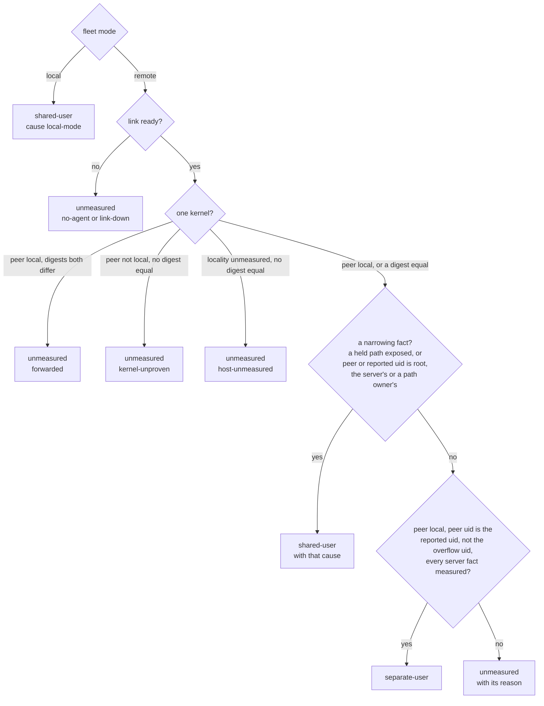
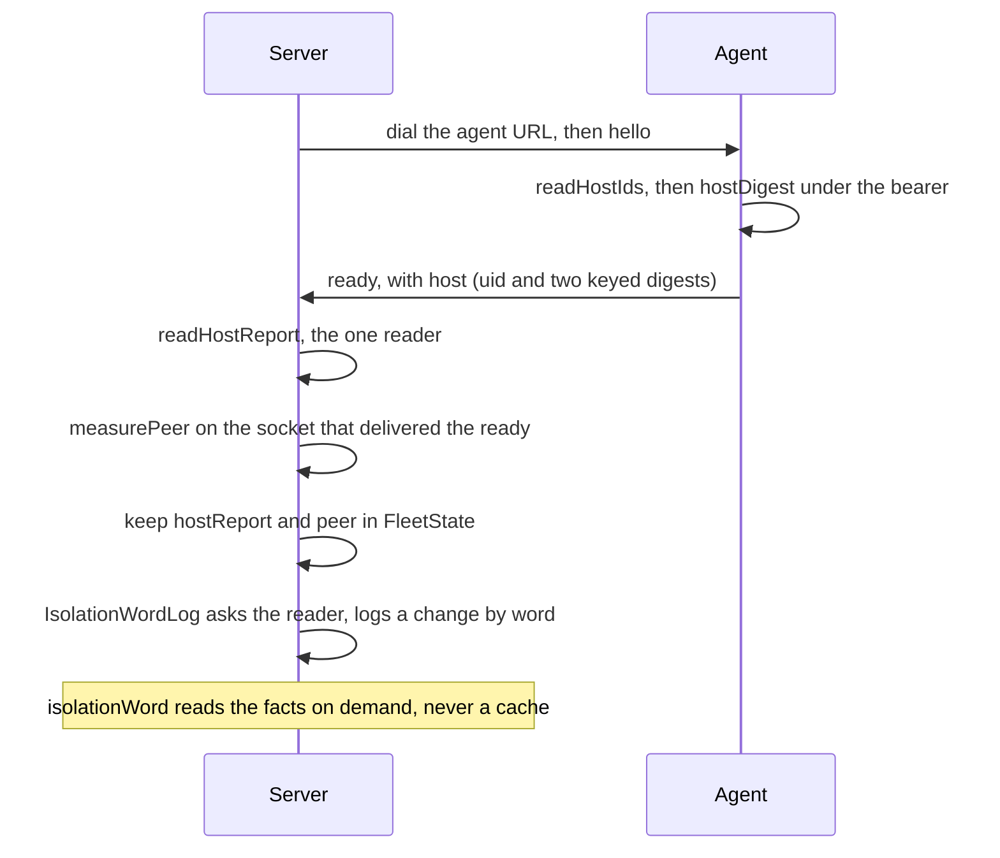
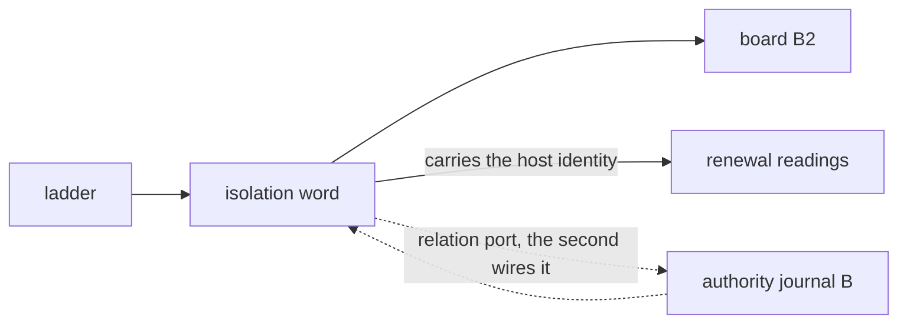

# Overlord W1: the isolation word Implementation Plan

> **For agentic workers:** REQUIRED SUB-SKILL: Use superpowers:subagent-driven-development (recommended) or
> superpowers:executing-plans to implement this plan task by task. Steps use checkbox (`- [ ]`) syntax for tracking.

**Goal:** the server measures, and never assumes, whether the sessions it drives can reach what it holds.

- `server-isolation` is one of three words, `shared-user`, `separate-user` or `separate-host` (§7.4, H28), or the
  reading `unmeasured` with its reason. An unmeasured reading caps the ladder exactly as `shared-user` does, and is
  reported as `unmeasured`, never as a word it did not measure.
- Each agent reports, on connect, its uid and two host digests: keyed hashes of the machine id and of the kernel's
  boot id. The field is additive on the ready frame. An older agent sends none, and reads `unmeasured`, never isolated.
- The server measures its own side: its uid and its user namespace, every file and directory that holds its secrets
  or controls what it runs (each store the configuration can place, its code tree, its unit and its environment
  files), and two facts about the agent link's own socket: whether the peer is on this host's own addresses, and,
  when it is, the uid the kernel records for the peer's socket.
- **Either side may narrow, and only the two sides together widen.** A report never makes a box read isolated on its
  own, because the sessions the word guards against run as the user that could forge the report.
- **In W1 the server can prove no other kernel** (ruled, F1). A peer at an address that is not this host's own reads
  `unmeasured: kernel-unproven`, so no install reads `separate-host` in W1, and no agent counts as a witness off the
  server's volume. The only widening W1 can measure is `separate-user`, on one kernel, behind a local socket the
  kernel attributes to the agent's own uid.
- The ladder gains its `shared-user` condition, one row and one input, capping `advise` (Table 7.5a).
- The board reads the word through one reader. Authority journal B reads, through the same facts and a per-link port,
  each agent's host relation, which in W1 is never `other-host`. The renewal readings' `notLocal` report carries the
  waking host's identity from the same reader, compared in memory only.

**Why:** H28 (§7.4): "A measured isolation word". On `shared-user`, "nothing the server holds is beyond a session's
reach", so the ladder is capped at `advise` and grants, commands and learning are refused `server-not-isolated`, with
no opt-in (the operator's ruling of 2026-11-10). The default install is one box, so the default reading must be the
safe one, and it must be measured, because the same word lifts the cap on a box that really is split.

**Architecture:** one pull request in lane H, after the ladder.

- `shared/isolation.ts` (L0, K) holds the words, the causes, the unmeasured reasons, the host relation words, the
  report's wire shape and its one reader, `readHostReport`, and the read's wire, `IsolationRead`.
- `shared/host-identity.mjs` with `shared/host-identity.d.mts` (L0 `.mjs`, K) is the one measurer of a host's
  identity, used by the agent and the server alike: `readHostIds` and `hostDigest`. It imports `node:crypto` and
  `node:fs` only (the `.mjs` carve-out).
- `server/src/isolationWord.ts` (C1, L1) holds the pure deciders: `holdingExposure`, `linkKernel`, `linkIsolation`,
  `isolationWord`, `hostRelation`, `isolationCondition` and `wakingHostKey`.
- `server/src/isolationFacts.ts` (C1, L3) measures the server's own facts at boot (`measureServerFacts`, over the one
  list `serverHoldings`) and the agent link's peer at each ready (`measurePeer`), and builds the reader that composes
  them.
- `server/src/isolationLog.ts` (C1, L4) is the one holder of the last logged word, and logs a change by word and cause.
- `agent/src/server.ts` sends `host` on every ready. `server/src/remote/client.ts#FleetClient`'s ready handler is the
  one reader of it, and measures the peer on the socket that delivered the ready.
- The ladder's `LADDER_CAUSE_MAP` gains the `shared-user` row, and `ladderConditionInputs` its input.

**Tech Stack:** TypeScript (ESM), Node's `node:fs`, `node:crypto` and `node:os` (the last in the L3 file only), the
`ws` client's public `upgrade` event, vitest. No new dependency. No migration, no door, no lane, no PWA code.

**Spec:** `docs/superpowers/specs/2026-11-09-overlord-design.md`:

- §7.4, whole: C27's three strengths and "No second token is minted today. All fleet sessions run as one UNIX user";
  H28's three words and their definitions; "On `shared-user`, nothing the server holds is beyond a session's reach"
  with its cap and its refusals; "The way to more is a split install"; "The most sensitive read"; Table 7.4a.
- §7.5, Table 7.5a, the row "`server-isolation` is `shared-user` | condition | cap `advise`", and "A one-box install
  stays at `advise` until the split install exists".
- §7.6, as authority journal B reads it: a witness counts only off the server's volume.
- Table 5.2a, the board's row "Itself": "The `server-isolation` word (§7.4)".
- The act rows' column "actor, identity strength, isolation" (the act row table, W2), which reads this piece's reader
  when W2 writes act rows.
- Table 11.6, the row `server-not-isolated` (H28), whose refusing doors are W2's (the vocabulary's wave map).
- Table 13.1, row H28: `tightening`, W1. No table and no door of this piece is a `shape` call.
- Table 13a's C10 (the board carries "the readiness and isolation words") and C27 ("a `shared-user` server caps the
  ladder at `advise`").
- "Later": "The split install", and "A session credential behind the identity port".

The index is `docs/superpowers/plans/2026-11-14-overlord-w1.md` (on `main`). This plan builds on:

- its row "Isolation word" (lane H, one pull request, four tasks, after the ladder);
- its questions 15 (`isolation-from-reported-uids`) and 20 (`ladder-causes-join-with-their-inputs`, the
  `shared-user` row's owner);
- its "Where lanes meet" bullet for `shared/agent-protocol.ts` and `agent/src/server.ts` ("lane H's uid and host
  report"), and the bullet "The ladder's cause and condition tables";
- Figure W1's edge from the ladder, and its labelled carrier edge into the renewal readings;
- the renewal readings' row: "`notLocal` is this piece's own report … the isolation word supplies only the host
  identity that report carries".

The coordinator's brief for this plan (run 2164) binds over the index's text: additive wire, `FLEET_PROTO`
unchanged, one reader per field; an older agent reads `unmeasured`, never isolated; a measured identity is never folded
into a guess; no host name or address is ever logged, shipped in a fixture or committed; the `shared-user` condition
is one row in the ladder's table; authority journal plan question 10 and its PR B keep their seam exactly; and the
plan says what a single-box install reads. The coordinator's rulings on review 2168 (fix round 1) bind too, and are
marked "(ruled, F<n>)". The sibling plans' rulings that bind (the ladder, #2861; the authority journal, on `main`)
are restated under "Open questions".

## Open questions

One numbering runs through this section. Questions 1 to 6 restate the index's questions and the rulings this plan
builds on. Questions 7 to 22 are this piece's own. The plan builds every recommendation unless the coordinator or the
operator rules otherwise.

1. **How the isolation word is measured** (index question 15, slug `isolation-from-reported-uids`). The index's
   recommendation: "each agent reports its uid and host identity on connect, an additive agent-wire field. The server
   compares them with its own. Any agent that shares both reads `shared-user`, and an unmeasured answer reads
   `shared-user`, the safe word." **Built here, with three refinements**, each its own question:
   - an unmeasured answer is **reported** `unmeasured` and **acts** as `shared-user` (question 7);
   - the server does not take the report alone to widen: it measures the link itself, so only the two sides together
     can make the word `separate-user` (question 8);
   - no install reads `separate-host` in W1, because the server can prove no other kernel (question 9, ruled F1).
2. **The `shared-user` row is this piece's** (index question 20, ruled; the ladder's question 6 and Table 2). The
   ladder ships `LADDER_CAUSE_MAP` with one row and the mapped input type. This piece adds one row, `shared-user`
   (condition, cap `advise`, notice `none`), and one input. Nothing else in the ladder changes, and nothing here is a
   parallel mechanism: no second cap, no second table, no rung written.
3. **An unmeasured input caps** (the ladder's question 17, ruled with that plan). `effectiveRung` applies an
   `unmeasured` condition's effect as if it stood. This piece's input answers `unmeasured` for every `unmeasured`
   reading, so the ladder caps at `advise` there too, and lists the condition as `unmeasured`, never `standing`.
4. **An agent counts as a witness only once this word reports it on another host** (the authority journal plan's
   question 10, slug `agent-witness-waits-for-host-report`: keep the seam exactly). Authority journal B does not wait
   for this piece. **Built here (ruled, F4):** the relation port, per link, answering `same-host` or `unmeasured`, and
   never `other-host` in W1 (question 9). So the witness counts no agent in W1, as before this piece, and the
   authority plan's residual ("every agent reads `unmeasured` until the isolation word lands … so a forged file lifts
   nothing") stays true with this piece wired. The wiring touches authority journal B's exchange, its deps and
   `server/src/index.ts`, whichever pull request lands second (question 17). A later piece that makes `other-host`
   reachable must re-argue that residual first (question 18).
5. **The board composes the word from this piece's reader** (the board plan's question 9). Board PR B2 needs this
   piece, and reads `IsolationRead` through `deps.isolation`. This piece ships no route of its own (question 19).
6. **`notLocal` is the renewal readings' own report** (index, ruled, review 2088 F9b). That piece asks ccd on the
   waking host whether the conversation is present there. This piece supplies only the identity that report carries,
   `wakingHostKey` (question 16): a label, never a measurement of presence and never an input to authority.

The questions this piece raises:

7. **`unmeasured` is a reading of its own, which acts as `shared-user`** (slug `isolation-unmeasured-reads-unmeasured`).
   H28 names three words. An older agent, a link that is down, an unreadable fact, an unproven kernel and a
   disagreement between the two sides are none of them. **Recommendation:** `IsolationRead` is
   `{ kind: 'measured', word, cause }` or `{ kind: 'unmeasured', why }`. Every reader that acts treats `unmeasured` as
   `shared-user`: the ladder caps it (question 3), and W2's `server-not-isolated` refuses on it. Every reader that
   reports shows `unmeasured` with its reason. Folding it into `shared-user` would report a guess as a measurement,
   which the brief forbids; folding it into a widening word would be fail-open.
8. **Either side narrows, and only both sides widen** (slug `widening-needs-both-sides`). On a one-box install the
   sessions run as the user that runs the agent, and can read the agent's own bearer. Such a session can stop the
   agent and answer the server's next dial itself, with any report it likes. A word decided from the report alone could
   then be widened by the very caller H28 caps. **Recommendation:**
   - The server measures the link itself, at each ready, from its own client socket (the server dials the agent):
     whether the peer address is this host's own (a loopback address, or an address of one of this host's interfaces),
     and, when it is, the uid the kernel records for the peer's socket (Linux's TCP socket tables under `/proc/net`).
   - A narrowing fact needs only one side: a peer uid, or a reported uid, that is root, the server's, or an owner of a
     held path, or a held path exposed by its mode.
   - The one widening, `separate-user`, needs both sides and every server fact measured (question 10).
   - So a forged report on a one-box install moves nothing: the server sees its own peer, local, with the session
     user's uid, and reads `shared-user`.
   - **The alternative**, the index's recommendation as written (compare reports only), is simpler and fail-open
     against exactly Table 7.4a's forger.
9. **No other kernel is proven in W1** (ruled, F1; slug `separate-host-needs-a-kernel-proof`). A report's digests are
   the agent's own claim, and `/etc/machine-id` and the boot id are readable by every user, so a forger knows the true
   values and can send others. A non-local address is no proof either: a container at its bridge address, a NAT or
   hairpin route, an address routed to this host without sitting on an interface (AnyIP), and a proxy or tunnel each
   put a same-kernel peer at an address that is not this host's own. **Built here:** a peer that is not local, whose
   report shows no digest equal to the server's, reads `unmeasured: kernel-unproven`. Nothing in W1 answers
   `separate-host` or the relation `other-host`. The words stay in the vocabulary, total, for the piece that brings
   the proof. Tests pin the bridge, NAT, AnyIP and proxy cases red (Task 3). **What would prove another kernel** is a
   question for the spec-fixes run, listed under Later:
   - a key provisioned on the fleet box only, never present on the server's host, signing each report (the split
     install's attestation);
   - a server-side probe that the connection's peer socket exists in no network namespace of this kernel (it needs
     privileges the server does not hold);
   - an operator's declaration is not one: H28 says "measured".
10. **`separate-user` is narrow** (ruled, F2; slug `separate-user-needs-the-agents-own-socket`). **Built here:**
    `separate-user` needs all of:
    - the peer is local, and the report shows no forward (question 12);
    - the kernel's uid for the peer socket is measured, and is the agent's reported uid;
    - that uid is none of root, the overflow uid (`/proc/sys/kernel/overflowuid`, 65534 by default, which is what an
      unmapped uid reads as inside a user namespace), the server's uid, or the owner of any element of any held path's
      chain (question 11);
    - the server runs in the initial user namespace (its `/proc/self/uid_map` is the identity map), and every held
      path is measured and not exposed.

    **What the word measures, stated:** the agent's uid, from which it infers the sessions' uid, because ccd starts the
    sessions under the agent user's own service manager. **The residuals, stated:** a forwarder run by a third user
    (a reverse proxy, `socat`, a local port forward) in front of an honest agent reads `unmeasured: report-disagrees`,
    because the agent reports its own uid and the socket is the forwarder's. A forwarder run by a third user in front
    of an agent whose report is forged to that third user's uid reads `separate-user`: it needs the operator to have
    built that forwarder and a session to forge the report, and a test pins the case by name so any change is seen.
    A peer uid whose groups grant root (`docker`, `sudo`, `wheel`, `lxd`) is not measured in W1: a stated residual,
    and a Later doctor line.
11. **What the server holds** (ruled, F3; slug `server-holdings-from-the-config`). H28 defines `shared-user` by the
    stores: they "belong to a user that fleet sessions run as". **Built here:** one list, `serverHoldings(cfg,
    codeRoot)`, derived from `CcrcConfig` in one place, of every path the server holds, each with its concern:
    - `secret` (read or write reaches it): `ccrcDir`, `coordDbPath`, `mailTokenPath` (`CCRC_MAIL_TOKEN_PATH`),
      `authSecretPath` (`CCRC_AUTH_SECRET_PATH`), `sessionsPath` (`CCRC_SESSIONS_PATH`, the cookie store),
      `passkeysPath` (`CCRC_PASSKEYS_PATH`) and `accountsPath` (`CCRC_ACCOUNTS`), each as the configuration resolved it
      from its environment override or its default;
    - `control` (write reaches it): the server's code tree (the root the running entry was loaded from, never a
      guess), the server's unit (`ccrc.service` in the user unit directory, and its drop-in directory) and its two
      environment files (`~/.ccrc/ccrc.env`, and `CCRC_EXPOSURE_FILE` as the server's environment names it).

    A test reads every field of `CcrcConfig` whose name ends `Path`, `Dir`, `Root` or `Bin`, and fails unless each is
    in the list or in a named exception list with its reason (the registry, limits, clips, uploads and projects
    directories and `ccdBin` are the sessions' own side or the fleet's, not the server's). So a later secret store
    joins the list in the pull request that adds its field, or that pull request is red. The unit and environment
    file names are spelled once in this list and held equal to `ccd/ccrc`'s spellings by a parity test.

    **The exposure rule** (`holdingExposure`, L1, over measured stats), for each held path:
    - the chain is the path as resolved (or its nearest existing ancestor, for a store not yet created) and every
      directory above it to the root, and, for a path that is a symbolic link, the link's own location and its chain
      too (whoever can rewrite the link redirects the store). A symbolic link is followed, never refused;
    - **write exposure:** any directory of the chain writable by group or others without the sticky bit, or the leaf
      writable by group or others;
    - **read exposure** (`secret` only): no element of the chain is owner-only (`(mode & 0o077) === 0`) and owned by
      the server's uid or root;
    - **owners:** every uid that owns an element of the chain, other than root and the server's uid;
    - any element unreadable reads that holding `unmeasured`.
12. **A forward reads `unmeasured`** (ruled, F9; slug `local-forward-reads-unmeasured`). Behind a same-user forward
    (`ssh -L`, `socat`) to a genuinely remote agent, the peer is local and its socket uid is the forwarder's. Calling
    that `shared-user, same-user` would report a guess. **Built here:** a local peer whose report's two digests are
    both measured and both differ from the server's reads `unmeasured: forwarded`, before any uid narrowing.
13. **What "host identity" is** (ruled, F10; slug `host-identity-is-two-keyed-digests`). **Built here:** two keyed
    digests, HMAC-SHA-256 under the agent link's bearer (which both sides already hold), of a kind tag and the value:
    the machine id (`/etc/machine-id`, stable across reboots) and the boot id (`/proc/sys/kernel/random/boot_id`, one
    per kernel boot, shared by every container on that kernel).
    - The key makes the digest install-scoped: the same machine id gives unrelated digests on two installs, as the
      machine-id manual recommends for an application.
    - The server keeps its own raw ids in memory only (read once at boot) and computes its digests under the bearer it
      holds. Nothing logs or serves either value (question 20).
    - Equal boot digests mean one kernel. Equal machine digests catch a host cloned from one image. Either one makes
      the link same-kernel, which is the safe direction for both the word and the witness.
    - A value the reader cannot parse (a machine id that is not 32 lowercase hex, a boot id that is not a UUID)
      reads `unmeasured`. Off Linux both read `unmeasured` (question 14).
14. **Off Linux the host reads `unmeasured`** (slug `host-digests-are-linux-only`). macOS has no `/etc/machine-id`, no
    boot id file and no `/proc/net`. **Recommendation:** W1 measures nothing there beyond the uid and the held paths'
    modes, so a macOS agent's digests and a macOS server's peer uid read `unmeasured`. In local mode that changes
    nothing (question 21). In remote mode a macOS side reads `unmeasured`, which caps as `shared-user`. A reader that
    asks the system for its boot session id is Later; W1 runs no program to measure.
15. **One representation per fact** (ruled, F8; slug `isolation-facts-measured-one-by-one`). Every fact the deciders
    read is a value or `'unmeasured'`, field by field: the server's uid, its namespace, the overflow uid, each held
    path's owners and exposure, the peer's locality and uid, and the report's three fields. No fact makes a whole
    object `unmeasured`, so the failure-contract table and the first-match rules read the same facts, and Task 3 tests
    each row of that table against the rules.
16. **The carrier for `notLocal` is the machine digest, compared in memory only** (ruled, F10; slug
    `waking-host-key-in-memory-only`). The renewal readings compare the host a report came from across renewals, and a
    boot digest changes at every reboot. **Built here:** `wakingHostKey()` answers `{ digest, keyEpoch }` or
    `unmeasured`: in local mode the server's own machine id under a key minted at boot and kept in memory; in remote
    mode the agent's reported machine digest while the link is ready. `keyEpoch` counts the readies of the link (and is
    `0` in local mode), so two carriers compare only under one key. The renewal readings compare carriers in memory
    only: never stored in a table, a file or a log, never served. A server restart or a key change makes the next
    comparison read `unmeasured`.
17. **The relation port, per link, and its wiring** (ruled, F4; slug `host-relation-port-per-link`). The authority plan
    types the relation as `HostRelation = 'other-host' | 'same-host' | 'unmeasured' | 'console'` inside its L1 file,
    and names no port. **Built here:**
    - `shared/isolation.ts` owns the three agent words as `AGENT_HOST_RELATIONS`, and authority B's type becomes
      `AgentHostRelation | 'console'`, one spelling;
    - the port is per link, the link that delivered the tuple: `relationOf(link: LinkFacts): AgentHostRelation`,
      exposed on the reader;
    - the wiring edits authority B's exchange (`server/src/coord/overlordAuthorityExchange.ts`, which asks the relation
      for the agent's answer), its deps, and `server/src/index.ts`. It is done by whichever pull request lands second,
      and both orders are written into Task 4. It is not "one line".
18. **What a later piece must re-argue** (ruled, F4; slug `other-host-reopens-the-witness-residual`). The piece that
    makes `other-host` reachable (the split install's proof, question 9) must, in its own plan, re-argue the authority
    plan's residual on the witness file before the relation can answer `other-host`: once an agent counts, a forged
    `authority-witness.json` on a same-kernel agent's box could lift `no-witness-since-boot` and hold narrowings. A
    test here pins that no W1 input yields `other-host`, so that piece meets a red suite first.
19. **No door of its own in W1** (slug `isolation-has-no-door-of-its-own`). **Recommendation:** the word is visible in
    W1 through the ladder's read (`GET /api/overlord/ladder` lists the `shared-user` condition with its reading) and
    through the board (PR B2). A route of its own would add census rows in eight files for a fact two reads already
    carry. W2's act rows read the same reader.
20. **Nothing logs a host value, and one holder logs the word** (ruled, F12; slug `host-values-never-logged`).
    **Built here:** no line names an address, a digest, a machine id, a boot id or a uid. `IsolationWordLog`
    (`server/src/isolationLog.ts`, L4) is the one holder of the last logged reading: it is asked at boot and after each
    change of the fleet link's state, reads the reader, and logs `ccrc-server: isolation: <word or unmeasured> (<cause
    or reason>)` only when that differs from what it holds. The client logs "the agent's host report is malformed"
    once per change. A test spies on every console method across the decider's, the reader's, the log's and the
    client's cases and fails on any 64-hex run, any fixture id and any address.
21. **What a single-box install reads** (ruled, F13; slug `local-mode-is-shared-user`, the brief). `ccrc install`
    writes `CCRC_FLEET=local` on a fresh box (the board plan's question 10), so the default install has no agent link.
    The server then runs ccd itself, as its own user, on its own host. **Built here:**
    - **the default install (local mode)** reads `{ kind: 'measured', word: 'shared-user', cause: 'local-mode' }`,
      measured from the configuration's code path, not guessed: there is no second process to ask;
    - **a single box run in remote mode**, with its agent on the same host, reads `shared-user` too. `ccrc install`
      creates `~/.ccrc` with a plain `mkdir -p`, so under a normal umask the directory admits its group or others, and
      the first cause is `store-mode`; behind it stands `same-user` when the agent runs as the server's user. A box
      that wants `separate-user` must run the agent as another user and make every held path owner-only (the Later
      doctor line names the `chmod 700 ~/.ccrc` and each exposed holding);
    - either way the ladder is capped at `advise`, which changes nothing a W1 operator sees, because the rung door
      stops at `chat` in W1 (the ladder's question 1). From W2 a single box only advises, as §7.5 says.
22. **Same kernel, other network namespace** (ruled, F14; slug `split-install-brings-its-own-measurement`). §7.4 says a
    split install "measures `separate-user` or better … with no new rule". A container that shares the kernel but not
    the network namespace is not local to the server's addresses, and its peer socket is not in the server's socket
    tables, so the server cannot measure its uid. **Built here:** it reads `unmeasured: other-namespace` unless a
    narrowing fact stands. The split install is a design of its own (Later), and it brings the server-side measurement
    it needs, for example the peer credentials of a local socket. The coordinator ruled the change to §7.4's sentence
    (it only tightens what an install measures, and keeps the operator's mechanism: a split install earns more), and
    the spec-fixes run lists it so the operator sees it.

## Cross-plan seams

What this plan gives, and takes, by name. Each name not on `main` is marked with the plan that ships it.

| Seam | Owner | This plan's use |
|---|---|---|
| `LADDER_CAUSE_MAP`, `LadderConditionCause`, `ConditionReading` (`shared/overlord-ladder.ts`) | the ladder | One row, `shared-user` (question 2) |
| `ladderConditionInputs(deps)` and its mapped `LadderConditionInputs` (`server/src/coord/overlordLadderRead.ts`) | the ladder | One input, `'shared-user'` |
| The ladder's deps into `registerOverlordRoutes` (`server/src/server.ts`) | the ladder | Gains `isolation` |
| The witness's relation, asked per agent answer by authority B's exchange | authority journal B; the port implemented here | Question 17. In W1 it answers `same-host` or `unmeasured`, so no agent counts |
| `HostRelation` (authority journal B's L1 file) | authority journal B | Re-pointed to `AgentHostRelation \| 'console'` by whichever lands second |
| `IsolationRead` and `deps.isolation.read()` | shipped here | Board PR B2's "Itself" part (question 5); W2's act rows and `overlordMayAct` |
| `wakingHostKey()` | shipped here | The renewal readings' `notLocal` report carries it, compared in memory only (question 16) |
| `AgentReady.host` and `readHostReport` | shipped here | No other piece reads the report: its one reader is the client's ready handler |
| `FleetClient`'s ready handler and `FleetState` | K and C1, on `main` | Authority journal B adds `authorityWitness` beside this piece's `hostReport` and `peer`, different lines |
| `server/test/overlord-ladder.test.ts`'s one-row pin | the ladder | Rewritten to assert each row's presence and value, never a count (Task 4) |

*Table 1. The seams.*


*Figure 1. One link's verdict in W1. No branch reaches `separate-host`: the server proves no other kernel (question
9). A report can add a narrowing fact, or agree with a socket the kernel attributes, and nothing more. Every
unmeasured leaf caps the ladder as `shared-user` does.*


*Figure 2. The report and the measurement, at each ready. An older agent sends no `host`, so its link reads
`unmeasured` until it is upgraded.*

## What exists today

Measured on `origin/main` at `4b5ae49d5` (2026-11-15).

- **The ready frame.** `shared/agent-protocol.ts#AgentReady` carries `ccdVerbs`, `rosterFp`, `build`,
  `observedEpoch` and `ops`, each optional and additive, and no host or uid field. `FLEET_PROTO` is not involved: the
  agent pair negotiates by capability (`AgentReady`'s own comment on `v`).
- **The agent's side.** `agent/src/server.ts` builds the ready frame once per connection, after the hello is
  authenticated against the bearer it holds (`AgentOpts.token`). Its type `ReadyFrame` narrows `observedEpoch` and `ops`
  to required, so this build can never drop them; `rosterFp` and `build` are added only when there is something to
  send. `AgentOpts.historySeams` is the precedent for a test seam over a host measurement.
- **The server's side.** `server/src/remote/client.ts#FleetClient` holds the one agent link. Its ready handler is the
  single reader of each ready field and resets every field on every ready, so a reconnect to a downgraded agent keeps
  nothing from before (its comments on `rosterFp`, `observedEpoch` and `ops`). `readReadyOps` is the pattern for a
  validated list. The server is the WebSocket client: `connect()` dials the agent's URL (`new WebSocket(this.cfg.url)`)
  and routes each frame through `onMessage(ws, raw)`, whose `ws` argument already carries the stale-socket guard. The
  ready handler takes the frame only, not the socket. `RemoteFleetConfig.connectTimeoutMs` is the precedent for a test
  seam on the client's config, and `server/test/remoteHelpers.ts`'s `bootAgent` boots a real agent with
  `historySeams: { platform: 'linux' }`.
- **Fleet state.** `server/src/fleetstate.ts#FleetState` holds what the ready frame said. `observedEpoch` is optional,
  `undefined` meaning "no evidence", which every fixture that predates it reads honestly.
  `server/test/remote-connect.test.ts` pins the whole object after a good handshake with a real agent from
  `bootAgent`, so a new field on the state is a red test until that literal names it. `FleetState` is never serialized:
  no route returns it and the state cache holds sessions only.
- **One link, or none.** `server/src/index.ts` calls `connectFleet` once, in remote mode. In local mode it builds a
  literal fleet state with `connected: true` and no agent, and the server runs ccd itself.
- **No host comparison.** `server/src/fleetidentity.ts` keys the agent by its node id only. Nothing in `server/src`,
  `agent/src` or `shared/` reads a machine id or a boot id, or compares the agent's host with the server's. The one
  boot-id reader in the tree is ccd's history library (`ccd/history/lib.mjs`), which stamps its op markers with the
  boot id to identify a process across a reboot: another package, run by ccd, with another job.
- **The paths the server holds.** `server/src/config.ts#CcrcConfig` resolves `ccrcDir` (`<home>/.ccrc`),
  `coordDbPath` (default inside it, `server/src/coord/db.ts#defaultCoordDbPath`), `mailTokenPath`
  (`CCRC_MAIL_TOKEN_PATH`), `authSecretPath` (`CCRC_AUTH_SECRET_PATH`), `sessionsPath` (`CCRC_SESSIONS_PATH`),
  `passkeysPath` (`CCRC_PASSKEYS_PATH`) and `accountsPath` (`CCRC_ACCOUNTS`), each from its environment override or its
  default, and `agentToken` (`CCRC_AGENT_TOKEN`). The registry, limits, clips, uploads and projects fields and `ccdBin`
  name the sessions' side. `ccd/ccrc` names the server's unit `ccrc.service` (its `role_unit`), installs it under the
  user unit directory (`BOX_UNIT_DIR`), and gives it two environment files, `ccrc.env` and `CCRC_EXPOSURE_FILE`
  (`~/.ccrc/exposure.env` by default). `ccrc install` creates `~/.ccrc` with `mkdir -p`, under the umask.
- **The ladder is not on `main`.** Its plan (#2861) ships `shared/overlord-ladder.ts` with `LADDER_CAUSE_MAP`,
  `ConditionReading` (`standing`, `lifted`, `unmeasured`) and the mapped input type, lists `shared-user` in its Table 2
  as this piece's row, and pins its one W1 row in `server/test/overlord-ladder.test.ts`.
- **The authority journal's witness** (its plan, on `main`). Its PR B's exchange (`overlordAuthorityExchange.ts`) asks a
  `HostRelation` for each agent's answer, and every agent reads `unmeasured` until this piece lands. Its residual on
  the witness file rests on that.
- **The refusal word.** `server-not-isolated` is in Table 11.6 and on the vocabulary piece's wave map as W2
  (`server/test/single-definition/refusal-table.data.json`). No W1 door refuses with it, and this piece adds no word.
- **The `.mjs` carve-out.** `server/test/rings/mjs-node.data.ts#MJS_CARVE_OUT` lets a `shared/*.mjs` file import
  `node:crypto`, `node:fs` and `node:url`, and nothing else from Node. The agent already imports `shared/*.mjs` files
  (`shared/mark.mjs`, `shared/spawn.mjs`).
- **Censuses a new file touches.** The architecture spec's context table (the `ring-context-map` block of
  `docs/superpowers/specs/2026-08-10-architecture-ddd-clean-solid.md`, read by `server/test/rings/ringContextMap.ts`):
  C1's row names its files one by one, so each new `server/src` root file needs its row. `server/test/rings/wire-totality.data.ts`
  holds the exported literal unions in `shared/*.ts` to runtime lists. `MUTANT_SETS` and
  `server/test/sim/mutation-floors.json` take a new L1 decider through a sets file imported by
  `server/test/sim/mutation-floors.test.ts`. `server/test/growthCheck.ts#GROWTH_FILES` names `server/src/server.ts`,
  which this piece touches by one line.

## Global Constraints

- **Architecture (`CLAUDE.md`).**
  - **One writer per fact.** The report has one writer, the agent's ready frame, and one reader, `readHostReport`,
    called only by the client's ready handler. The peer facts have one writer, `measurePeer`, called only there. The
    server's facts are measured once, at boot, by `measureServerFacts`, over the one list `serverHoldings`. The word
    has one decider, `isolationWord`, and the last logged word one holder, `IsolationWordLog`. A scan in
    `server/test/single-definition/vocabularies.test.ts`, built on `server/test/scan`, pins each home.
  - **Decide in L1, act in L4.** `isolationWord.ts` imports L0 only: no `fs`, no `os`, no clock. The client's ready
    handler measures and stores, and decides nothing. The log holder compares and logs, and decides no word.
  - **Consolidate.** The cap is the ladder's row, the witness relation is the same kernel classification the word
    uses, and the board reads the one reader. One measurer of a host's identity serves the agent and the server. One
    list names what the server holds.
  - **No overloaded null at a seam.** The report reads `HostReport`, `'absent'` (an older agent) or `'malformed'`.
    Each measured fact is a value or `'unmeasured'`. `FleetState`'s new fields are `undefined` only before any ready.
    Nothing answers `null` for two conditions.
- **Failure contracts (fail closed).** Each row is a row of Task 3's table test.

  | Case | What it reads as |
  |---|---|
  | An older agent (no `host`) at a local peer | A narrowing fact from the server's side reads `shared-user`; otherwise `unmeasured: agent-older` |
  | An older agent at a peer that is not local | `unmeasured: agent-older`: one kernel is not shown, so no narrowing applies |
  | A malformed `host` | As an older agent, with the reason `report-malformed`, and one warn line per change |
  | A field of the report unmeasured on the agent | That fact is missing: it narrows nothing and widens nothing |
  | A local peer whose report's digests both differ | `unmeasured: forwarded` |
  | A peer that is not local, no digest equal | `unmeasured: kernel-unproven` |
  | A peer that is not local, a digest equal | One kernel in another namespace: a narrowing fact reads `shared-user`, else `unmeasured: other-namespace` |
  | The link down, or no ready since boot | `unmeasured: link-down`, or `no-agent` before any ready |
  | The peer's uid unreadable (no `/proc/net`, a table too large, no single match) | `unmeasured: peer-uid-unmeasured` unless a narrowing fact stands |
  | The peer's uid is the overflow uid | `unmeasured: peer-uid-overflow` unless a narrowing fact stands |
  | The server not in the initial user namespace, or its uid unreadable | `unmeasured: server-namespace` or `server-facts` unless a narrowing fact stands |
  | A held path unreadable | That holding is `unmeasured`: it blocks `separate-user` (`server-facts`) and narrows nothing |
  | The reader not wired (a test's deps) | `unmeasured: not-wired` |
  | A newer agent's report with extra keys | The three known keys are read, and the rest ignored (additive) |
  | An older server, a newer agent | The older server's ready handler ignores `host` |

  Every `unmeasured` reading caps the ladder as `shared-user` does, and is never reported as a word.
- **What a merge arms.** The agent sends one more ready field, which an older server ignores. The ladder's
  `shared-user` condition stands on every single-box install (question 21), and the ladder reads `unmeasured` on every
  two-box install (no kernel is proven in W1) and behind any older agent. None of it changes what an operator sees in
  W1, because the rung door stops at `chat`. No agent counts as a witness, as before. Nothing a running session sees
  changes. No row, file or marker is written.
- **SAFETY (`CLAUDE.md`).** No ccd verb, no argv, no marker. Tests read synthetic `/proc` and `/etc` trees under the
  run's temp root (`server/test/tmpHelpers.ts`), never the live host's values, and never print them. The real agent
  that `bootAgent` boots reads synthetic roots through its `hostRoots` seam, and the client's peer measurement reads
  synthetic tables through its seam (Task 2).
- **Public repository.** Fixtures use synthetic ids only: a machine id of 32 repeated hex letters (`a` for the
  server, `b` for another host), boot ids built the same way in the UUID layout, uids `1000`, `2000` and `3000`, the
  overflow uid `65534`, and addresses only from the documentation ranges, written in a test as values and never in this
  plan. No host name, no address, no real id, no account or lane name. Cite by symbol or `@anchor`. No D-number is
  invented: a builder's new departure goes in `docs/superpowers/plans/2026-11-14-overlord-w1/w1-isolation/notes.md`.
- **Growth check.** `server/src/server.ts` grows by about one line, the only growth-checked file touched. A task that
  measures over its row stops and asks.
- **Mutation floors.** `readHostReport`, `holdingExposure`, `linkKernel`, `linkIsolation`, `isolationWord`,
  `hostRelation`, `isolationCondition` and `wakingHostKey` are new deciders. Each joins `MUTANT_SETS` through a new
  `server/test/sim/isolationSets.ts`, with its floor in `mutation-floors.json` at its measured score, in this pull
  request. Each guard ships with a test that goes red when it is deleted, measured with `mutation-run.py`.
- **Tests.** From `server/`: `ccrc test -- ./node_modules/.bin/vitest run test/<file>.test.ts`. From `agent/` the same
  for its files. Each task's last run adds `ccrc test -- npx tsc --noEmit -p tsconfig.json` and
  `-p test/tsconfig.tests.json` in `server/`, the agent's `tsc`, and, for the `shared/` files, `cd ../pwa && ccrc test
  -- ./node_modules/.bin/tsc --noEmit`. A source-text guard over a new `server/src` file is built on
  `server/test/scan`, never `readFileSync` and a regex, and every task that adds one runs
  `test/single-definition/advance-switches.test.ts`.

## Review Focus

1. **Nothing a peer controls widens alone.** Over the generated domain of peer locality, peer uid and report (Task 3),
   only the cells question 10 names read `separate-user`, and no cell reads `separate-host`.
2. **The F1 and F2 cases are red tests by name:** the bridge, NAT, AnyIP and proxy peers; the third-user forwarder
   with an honest agent; the overflow uid; and the stated residual (a third-user forwarder with a forged report), pinned
   so any change is seen.
3. **Monotonic in every fact.** Replacing any measured fact with `unmeasured`, or the report with `absent`, never moves
   the word from `shared-user` or `unmeasured` to `separate-user`, and never moves the relation to `other-host`.
4. **`unmeasured` is reported as itself and acts as `shared-user`.**
5. **Every path the server holds is measured,** and a new path field of `CcrcConfig` cannot land unclassified.
6. **One reader per field, reset on every ready,** measured on the socket that delivered it.
7. **No host value reaches a log, a wire to the console or a fixture,** and the carrier stays in memory.
8. **The ladder gains one row and one input, and nothing else.**

## The PR split

| PR | Tasks | What it ships | Needs first | Growth-checked files, estimate |
|---|---|---|---|---|
| The isolation word | 1 to 4 | The vocabulary, the report's wire and its one reader; the one host measurer; the agent's `host` field and its test seam; the client's single reader, the peer measurement on the delivering socket and its seam; the held paths and their exposure; the server's boot facts; the deciders, the reader and the log holder; the ladder's `shared-user` row and input; the per-link relation port, wired into authority journal B when it has landed; the carrier for `notLocal`; every census | the ladder | `server/src/server.ts` about +1 (`isolation` in the ladder's deps); `shared/api.ts` 0; `server/src/coord/routes.ts` 0; `server/src/coord/schema.ts` 0; `server/src/coord/store.ts` 0; `server/src/watch.ts` 0; `pwa/src/lib/api.ts` 0 |

**Order.** After the ladder has merged. Board PR B2 needs this piece (its question 9). Authority journal B and this
piece meet at its exchange, its deps and `index.ts`, wired by whichever is second. The renewal readings need this
piece for the carrier.


*Figure 3. Where this piece sits. The dashed pair is the relation's wiring, done by whichever lands second. In W1 the
relation counts no agent.*

## Index changes

What the index (`docs/superpowers/plans/2026-11-14-overlord-w1.md`) should change, for the coordinator to fold in:

- **Question 15:** restate it as built here: the report plus the server's own measurement of the link; either side
  narrows, both widen (question 8); no kernel proven in W1, so no `separate-host` (question 9, ruled F1);
  `separate-user` narrow (question 10, ruled F2); `unmeasured` reported as itself and acting as `shared-user`
  (question 7). Slugs `widening-needs-both-sides`, `separate-host-needs-a-kernel-proof`,
  `separate-user-needs-the-agents-own-socket` and `isolation-unmeasured-reads-unmeasured`.
- **Table W1, the row "Isolation word":** "Each agent's uid and host identity (two digests keyed by the agent bearer:
  machine id and boot id) on connect, an additive agent-wire field, with its test seams in the agent and the client;
  the server's own measurement of the link's peer (locality and the kernel's peer uid) and of every path it holds,
  from one list derived from `CcrcConfig`; `server-isolation` measured, `unmeasured` acting as `shared-user`, and no
  `separate-host` in W1; the ladder's `shared-user` condition row; the reader the board and W2's act rows read; the
  per-link relation authority journal B asks, which counts no agent in W1; the host identity that the renewal
  readings' `notLocal` report carries, in memory only". Size unchanged: 1 PR, 4 tasks. Needs first: the ladder.
- **Figure W1:** add `ISO --> HB2` (the board plan asks for the same), and a dashed edge between `ISO` and `AJB`
  labelled "relation port, the second wires it".
- **"Where lanes meet":**
  - the bullet for `shared/agent-protocol.ts` and `agent/src/server.ts` adds `server/src/remote/client.ts`'s connect
    and ready handler, `server/src/fleetstate.ts` and `server/test/remoteHelpers.ts`: authority journal B's
    `authorityWitness` and this piece's `hostReport` and `peer`, each a field of its own;
  - authority journal B's exchange, its deps and `server/src/index.ts`: the relation port's wiring;
  - the ladder's `server/test/overlord-ladder.test.ts`: its row pin becomes presence and value, never a count;
  - the architecture spec's path table: C1's row gains `isolationWord.ts`, `isolationFacts.ts` and `isolationLog.ts`.
- **"What a merge arms":** "The agent sends its host report on every ready. The ladder's `shared-user` condition stands
  on every single-box install, and reads `unmeasured` on every two-box install and behind an older agent; in W1 the
  rung door stops at `chat`, so none of it is visible as a change, and no agent counts as a witness."
- **"States W2 may read":** `IsolationRead` and its reader, which W2's act rows and `overlordMayAct` read for
  `server-not-isolated`.
- **The authority journal's residual on the witness file** stays true with this piece wired (question 4); a later
  piece that makes `other-host` reachable re-argues it first (question 18).
- **Spec fixes:**
  - §7.4's three words gain the reading `unmeasured`, acting as `shared-user`;
  - §7.4's "Such an install measures `separate-user` or better … with no new rule" becomes "brings the server-side
    measurement it needs" (question 22, ruled by the coordinator, F14; listed so the operator sees it);
  - H28 gains how the word is measured (questions 8 to 13), and that W1 proves no other kernel;
  - a question for the run: what proves another kernel (question 9's list);
  - Table 11.1b gains the isolation decider's row (L1, W1);
  - a single-box install, local or remote mode, reads `shared-user` (question 21).

### Task 1: The vocabulary, the report's wire and its reader, and the one host measurer (L0)

**Files:**
- Create: `shared/isolation.ts` (L0, K; imports nothing)
- Create: `shared/host-identity.mjs` and `shared/host-identity.d.mts` (L0 `.mjs`, K)
- Modify: `server/test/single-definition/vocabularies.test.ts` (the homes: the report reader, the two id paths)
- Test: `server/test/isolation-vocabulary.test.ts` (new), `server/test/host-identity.test.ts` (new)

**Interfaces:**

```ts
// shared/isolation.ts (L0)
const ISOLATION_WORD_MAP = {
  'shared-user': "the server's stores belong to, or can be reached by, the user fleet sessions run as (§7.4)",
  'separate-user': 'the sessions run on this kernel as another user, who cannot reach what the server holds',
  'separate-host': 'the sessions run on another kernel, proven by the server; never measured in W1',
} as const;
export type IsolationWord = keyof typeof ISOLATION_WORD_MAP;
export const ISOLATION_WORDS = Object.keys(ISOLATION_WORD_MAP) as IsolationWord[];

const ISOLATION_CAUSE_MAP = {
  'local-mode': 'no agent link: the server runs ccd itself, as its own user',
  'store-mode': 'a path the server holds is exposed to its group or others',
  'root-agent': 'the agent on this kernel runs as root',
  'same-user': "the agent on this kernel runs as the server's user",
  'store-owner': 'the agent on this kernel owns part of a path the server holds',
  'other-user': "the agent's own socket shows another user, and every held path is owner-only",
  'other-host': 'the agent runs on another kernel, proven by the server',
} as const;
export type IsolationCause = keyof typeof ISOLATION_CAUSE_MAP;
export const ISOLATION_CAUSES = Object.keys(ISOLATION_CAUSE_MAP) as IsolationCause[];

const ISOLATION_UNMEASURED_MAP = {
  'no-agent': 'remote mode, and no agent link has gone ready since boot',
  'link-down': 'the agent link is down',
  'agent-older': 'the agent sent no host report',
  'report-malformed': "the agent's host report could not be read",
  'kernel-unproven': 'the peer is not on this host, and nothing proves another kernel',
  'forwarded': 'the peer is local, but the agent reports another kernel: a forward',
  'host-unmeasured': 'neither side could measure whether the agent is on this kernel',
  'other-namespace': "the agent shares this kernel from another network namespace",
  'peer-uid-unmeasured': "the uid of the link's peer socket could not be read",
  'peer-uid-overflow': "the peer socket's uid is the overflow uid, an unmapped user",
  'report-disagrees': "the agent's reported uid is not its socket's uid",
  'server-namespace': 'the server runs inside a user namespace',
  'server-facts': "the server's uid or a path it holds could not be measured",
  'not-wired': 'the reader is not wired',
} as const;
export type IsolationUnmeasured = keyof typeof ISOLATION_UNMEASURED_MAP;
export const ISOLATION_UNMEASURED = Object.keys(ISOLATION_UNMEASURED_MAP) as IsolationUnmeasured[];

export type IsolationRead =
  | { readonly kind: 'measured'; readonly word: IsolationWord; readonly cause: IsolationCause }
  | { readonly kind: 'unmeasured'; readonly why: IsolationUnmeasured };

const AGENT_HOST_RELATION_MAP = {
  'same-host': 'the agent shares this kernel, by a local peer or an equal digest',
  'other-host': 'another kernel, proven by the server; never answered in W1',
  unmeasured: 'neither holds',
} as const;
export type AgentHostRelation = keyof typeof AGENT_HOST_RELATION_MAP;
export const AGENT_HOST_RELATIONS = Object.keys(AGENT_HOST_RELATION_MAP) as AgentHostRelation[];

/** A host digest: HMAC-SHA-256 under the link's bearer, of a kind tag and the value, as 64 lowercase hex. */
export const HOST_DIGEST_RE: RegExp;   // /^[0-9a-f]{64}$/
export type Measured<T> = T | 'unmeasured';
/** `AgentReady.host`: what an agent measured of itself on connect. */
export interface HostReport {
  readonly uid: Measured<number>;       // the agent process's own uid
  readonly machine: Measured<string>;   // hostDigest(bearer, 'machine', the machine id)
  readonly boot: Measured<string>;      // hostDigest(bearer, 'boot', the kernel's boot id)
}
/** THE ONE READER of `AgentReady.host`. Absent: an older agent. Malformed: a known key missing or of the wrong type,
 *  a uid that is not a non-negative safe integer, or a digest off `HOST_DIGEST_RE`. Extra keys are ignored. */
export function readHostReport(raw: unknown): HostReport | 'absent' | 'malformed';
```

```ts
// shared/host-identity.d.mts (the .mjs's types)
export interface HostRoots { readonly procRoot: string; readonly etcRoot: string; readonly platform: string }
/** The raw ids, for the measuring process's memory only: never logged, never sent. */
export interface HostIds { readonly machine: string | 'unmeasured'; readonly boot: string | 'unmeasured' }
/** Reads `<etcRoot>/machine-id` (32 lowercase hex) and `<procRoot>/sys/kernel/random/boot_id` (a UUID). Off Linux, or
 *  on any read or parse failure, that id is 'unmeasured'. Never throws, never logs. */
export function readHostIds(roots?: Partial<HostRoots>): HostIds;
/** HMAC-SHA-256 under `key` of `ccrc-host-<kind>-v1`, a newline and the value, as lowercase hex. */
export function hostDigest(key: string, kind: 'machine' | 'boot', value: string): string;
/** The report an agent sends: its uid, and each id digested under the bearer, or 'unmeasured'. */
export function hostReportOf(ids: HostIds, uid: number | undefined, key: string): import('./isolation.js').HostReport;
```

The `.mjs` defaults `procRoot` to `/proc`, `etcRoot` to `/etc` and `platform` to `process.platform`. Its only imports
are `node:crypto` and `node:fs`.

- [ ] **Step 1: Failing tests:**
  - the maps: every word, cause, reason and relation listed once; `ISOLATION_WORDS` is exactly H28's three;
  - `readHostReport`: absent (`undefined`); malformed for a non-object, an array, a missing key, a negative or
    fractional uid, a digest of 63 or 65 characters or in upper case, and a string uid; `unmeasured` accepted in each
    field; an extra key ignored;
  - `hostDigest`: two kinds of one value differ; two keys of one value differ; the same key, kind and value agree; the
    output matches `HOST_DIGEST_RE`;
  - `readHostIds` over synthetic trees under the run's temp root: both files present and well formed; each one missing,
    empty, malformed or unreadable (mode `000`, skipped when the run is root) reads `unmeasured` for that id only;
    `platform: 'darwin'` reads both `unmeasured`;
  - `hostReportOf`: an `undefined` uid reads `unmeasured`; an `unmeasured` id stays `unmeasured`; the JSON of the report
    never holds a fixture id;
  - the homes, in `vocabularies.test.ts` on `server/test/scan`: `readHostReport` is defined only in
    `shared/isolation.ts`; the machine-id and boot-id paths are spelled only in `shared/host-identity.mjs` among the
    TypeScript and `.mjs` sources of `server/src`, `agent/src` and `shared/`, with ccd's history library outside that
    scan's roots and named in the test's comment as the other job it is.
- [ ] **Step 2: Run.** Red.
- [ ] **Step 3: Implement.**
- [ ] **Step 4: Mutation.** The set for `readHostReport`. By hand: accept a 63-character digest; read a missing key as
  `unmeasured`; digest without the key. Each reds a case. Restore from the saved copy.
- [ ] **Step 5: Run** these suites, `test/rings/*.test.ts` (shared-imports, mjs-node, wire-totality),
  `test/single-definition/*.test.ts`, and every `tsc`. Green.
- [ ] **Step 6: Commit.** `feat(shared): the isolation words, the host report's one reader, and the one host measurer (Overlord W1, §7.4)`

### Task 2: The report on the ready frame, and the server's measurement of its own link (L3, L4)

**Files:**
- Modify: `shared/agent-protocol.ts` (`AgentReady.host?: HostReport`, additive, its comment naming its one reader)
- Modify: `agent/src/server.ts` (`AgentOpts.hostRoots?: Partial<HostRoots>`, the test seam, default the real roots;
  `ReadyFrame` narrows `host` to required; each ready carries `hostReportOf(readHostIds(opts.hostRoots), uid,
  opts.token)`)
- Create: `server/src/isolationFacts.ts` (C1, L3): `measurePeer`
- Modify: `server/src/remote/client.ts`:
  - `RemoteFleetConfig.peerSeams?` (the test seam: `interfaceAddresses` and `tables`, default the real readers), as
    `connectTimeoutMs` is a seam today;
  - `connect()` keeps the `upgrade` event's response socket in a closure local to that attempt, and passes it through
    `onMessage(ws, raw, sock)` to the ready handler, beside the stale-socket guard's `ws`;
  - the ready handler reads the report and measures the peer on that socket, on every `ready`, a re-sent one included
- Modify: `server/src/fleetstate.ts` (`hostReport?` and `peer?`, optional, each with its comment)
- Modify: `server/test/remoteHelpers.ts` (`bootAgent` passes synthetic `hostRoots`; the client it connects passes
  synthetic `peerSeams`)
- Modify: `docs/superpowers/specs/2026-08-10-architecture-ddd-clean-solid.md` (C1's row gains `isolationFacts.ts`)
- Modify: `README.md` (the agent link's paragraph: the ready frame now carries the host report, keyed digests only)
- Test: `agent/test/host-report.test.ts` (new), `server/test/isolation-peer.test.ts` (new),
  `server/test/remote-connect.test.ts` (the whole-state literal gains the two keys with the synthetic values, and
  the cases below)

**Interfaces:**

```ts
// server/src/isolationFacts.ts (L3)
export interface PeerFacts {
  readonly locality: Measured<'local' | 'not-local'>;
  readonly uid: Measured<number>;   // the kernel's uid for the peer's socket, measured only when local
}
export interface PeerSeams {
  interfaceAddresses(): readonly string[];
  tables(): readonly string[] | 'unmeasured';   // Linux's TCP socket tables, each bounded at 4 MiB
}
/** Measured on the socket that delivered the ready. The address is compared and dropped: it is never stored,
 *  returned or logged. */
export function measurePeer(sock: { remoteAddress?: string; remotePort?: number; localPort?: number },
  seams?: PeerSeams): PeerFacts;
```

`measurePeer`, in order:
1. No remote address or port: both facts `unmeasured`.
2. The address is a loopback address (the IPv4 loopback block or the IPv6 loopback, including its IPv4-mapped
   spelling) or one of this host's interface addresses: `local`. Otherwise `not-local`, and the uid is `unmeasured`.
3. For a local peer, the uid is the uid column of the one row, across the tables, in state established, whose local
   port is the server's remote port and whose remote port is the server's local port. Zero rows, two or more, a table
   unreadable or over its bound: `unmeasured`. Ports are compared, addresses are not printed.

**The ready handler** (one more stanza, beside `ops`): `this.state.hostReport = readHostReport(frame.host)`, and
`this.state.peer = measurePeer(sock, this.cfg.peerSeams)`. Both are reset on every ready, as every field there is. A
`malformed` report logs `ccrc-server: agent link: the agent's host report is malformed` once per change.

**`FleetState`:** `hostReport?: HostReport | 'absent' | 'malformed'` and `peer?: PeerFacts`, optional for
`observedEpoch`'s reason: an omitted field reads "no ready yet", which the decider reads as `no-agent`, the honest
answer for every fixture that predates it.

- [ ] **Step 1: Failing tests:**
  - the agent: the ready frame carries `host`, which `readHostReport` accepts; with synthetic roots through
    `hostRoots`, the frame carries their digests under the test's bearer; a second bearer gives other digests; the
    test prints nothing;
  - `measurePeer`: each row above, with documentation-range addresses and a synthetic table; a table with the matching
    row twice reads `unmeasured`; a table over its bound reads `unmeasured`; an IPv4-mapped loopback is `local`;
  - the client (`remote-connect.test.ts`, with `bootAgent` on synthetic roots and seams): the whole-state literal names
    the synthetic report and peer; a ready without `host` stores `'absent'`; a malformed one stores `'malformed'` and
    logs one line with no digest in it; a reconnect to an agent that omits the field resets it to `'absent'`; a second
    `ready` on one socket re-measures the peer;
  - the console spy (question 20): across these cases no console line holds a 64-hex run, a fixture id or an address.
- [ ] **Step 2: Run.** Red.
- [ ] **Step 3: Implement.**
- [ ] **Step 4: Mutation, by hand.** Keep the last report across a reconnect; read the uid from the first matching row
  when there are two; treat an unreadable table as no match; measure the peer on the first socket instead of the one
  that delivered the ready. Each reds a case. Restore from the saved copy.
- [ ] **Step 5: Run** these suites, the agent's suite (`ccrc test -- ./node_modules/.bin/vitest run` from `agent/`),
  the agent's `deploy-verify` and the server's `build-release` (the agent build ships one more `shared/*.mjs`, as it
  ships `shared/spawn.mjs`; measured, not assumed), every server suite that boots an agent through `bootAgent`,
  `test/rings/*.test.ts`, `test/typecheck-tests.test.ts` and every `tsc`. Green.
- [ ] **Step 6: Commit.** `feat(agent-link): the agent reports its host on ready, and the server measures its own link (Overlord W1, §7.4)`

### Task 3: The held paths, the deciders, the reader and the log (L1, L3, L4, L5)

**Files:**
- Create: `server/src/isolationWord.ts` (C1, L1; imports `shared/isolation.ts` only)
- Modify: `server/src/isolationFacts.ts` (`serverHoldings`, `measureServerFacts`, `makeIsolationReader`)
- Create: `server/src/isolationLog.ts` (C1, L4): `IsolationWordLog`
- Modify: `server/src/deps.ts` (`isolation?: IsolationReader`), `server/test/helpers.ts` (`testDeps` leaves it unset,
  which reads `not-wired`)
- Modify: `server/src/index.ts` (measure the server's facts once at boot, build the reader over `fleet.state` or the
  local literal, pass it in `deps`, and ask `IsolationWordLog` at boot and on each fleet state change)
- Modify: `docs/superpowers/specs/2026-08-10-architecture-ddd-clean-solid.md` (C1's row gains `isolationWord.ts` and
  `isolationLog.ts`)
- Create: `server/test/sim/isolationSets.ts`; modify `server/test/sim/mutation-floors.test.ts` (one import, one
  spread) and `server/test/sim/mutation-floors.json` (eight floors)
- Test: `server/test/isolation-word.test.ts` (new), `server/test/isolation-facts.test.ts` (new),
  `server/test/isolation-holdings.test.ts` (new: the `CcrcConfig` classification and the `ccd/ccrc` parity),
  `server/test/isolation-log.test.ts` (new)

**Interfaces:**

```ts
// server/src/isolationWord.ts (L1)
export interface PathStat { readonly uid: number; readonly mode: number; readonly dir: boolean }
export interface HoldingChain { readonly name: string; readonly concern: 'secret' | 'control';
  readonly elements: Measured<readonly PathStat[]> }   // the resolved chain, and a link's own chain, leaf first
export interface Holding { readonly name: string;
  readonly owners: Measured<readonly number[]>; readonly exposure: Measured<'owner-only' | 'exposed'> }
/** Question 11's rule. Pure: the stats were taken by the caller. */
export function holdingExposure(chain: HoldingChain, serverUid: Measured<number>): Holding;
export interface ServerFacts {
  readonly uid: Measured<number>;
  readonly initialNamespace: Measured<boolean>;   // `/proc/self/uid_map` is the identity map
  readonly overflowUid: Measured<number>;
  readonly ids: HostIds;                          // in memory only, digested under the bearer at each comparison
  readonly holdings: readonly Holding[];
}
export type LinkFacts =
  | { readonly link: 'none' }                     // no ready since boot
  | { readonly link: 'down' }
  | { readonly link: 'ready'; readonly report: HostReport | 'absent' | 'malformed'; readonly peer: PeerFacts;
      readonly bearer: string; readonly readySerial: number };
export type LinkKernel = 'same' | 'forwarded' | 'unproven' | 'unmeasured';
export function linkKernel(server: ServerFacts, link: LinkFacts & { link: 'ready' }): LinkKernel;
export function linkIsolation(server: ServerFacts, link: LinkFacts): IsolationRead;
/** The fleet-wide word: local mode reads shared-user, cause local-mode (question 21); remote mode folds the links. */
export function isolationWord(mode: 'local' | 'remote', server: ServerFacts, links: readonly LinkFacts[]): IsolationRead;
/** The witness's relation, per link. Never 'other-host' in W1 (question 9). */
export function hostRelation(server: ServerFacts, link: LinkFacts): AgentHostRelation;
/** The ladder's input: shared-user is standing, a separate word lifted, unmeasured unmeasured. */
export function isolationCondition(read: IsolationRead): ConditionReading;
/** The carrier for the renewal readings' notLocal report (question 16). */
export function wakingHostKey(mode: 'local' | 'remote', server: ServerFacts, bootKey: string,
  link: LinkFacts | null): { readonly digest: string; readonly keyEpoch: number } | 'unmeasured';

// server/src/isolationFacts.ts (L3), added
/** Every path the server holds, from the configuration, in one place (question 11). */
export function serverHoldings(cfg: CcrcConfig, codeRoot: string, env: NodeJS.ProcessEnv):
  readonly { readonly name: string; readonly path: string; readonly concern: 'secret' | 'control' }[];
export function measureServerFacts(cfg: CcrcConfig, codeRoot: string, seams?: ServerSeams): ServerFacts;
export interface IsolationReader {
  read(): IsolationRead;
  relationOf(link: LinkFacts): AgentHostRelation;
  linkOf(state: Pick<FleetState, 'connected' | 'hostReport' | 'peer'>): LinkFacts;
  wakingHostKey(): { readonly digest: string; readonly keyEpoch: number } | 'unmeasured';
}
export function makeIsolationReader(mode: 'local' | 'remote', server: ServerFacts, bearer: string | null,
  state: Pick<FleetState, 'connected' | 'hostReport' | 'peer'> | null): IsolationReader;

// server/src/isolationLog.ts (L4)
/** The one holder of the last logged reading (question 20). */
export class IsolationWordLog {
  constructor(reader: IsolationReader, warn: (line: string) => void);
  note(): void;   // reads the reader; logs only a change, by word and cause or by reason
}
```

`codeRoot` is the tree the running entry was loaded from, derived in `index.ts` from its own module path. `ServerSeams`
reads stats with `lstat`, resolves links with `realpath`, and reads `/proc/self/uid_map` and the overflow uid; tests
pass synthetic trees. The reader holds the server's facts and a reference to the live fleet state, reads them on each
call, and caches nothing. Digests are computed under the link's bearer at each comparison, from the server's ids in
memory.

**`linkKernel`**, first match:
1. The peer is `local`: `forwarded` when the report is present and both its digests are measured and both differ from
   the server's (both measured); otherwise `same`.
2. A report is present and its machine digest or boot digest is measured and equals the server's: `same`.
3. The peer is `not-local`: `unproven`.
4. Otherwise `unmeasured`.

**`linkIsolation`**, first match:
1. `link: 'none'`: `unmeasured: no-agent`. `link: 'down'`: `unmeasured: link-down`.
2. The kernel is `forwarded`: `unmeasured: forwarded`.
3. The kernel is `unproven` or `unmeasured`: `agent-older` for an absent report, `report-malformed` for a malformed one,
   else `kernel-unproven` or `host-unmeasured`.
4. The kernel is `same`, and a narrowing fact is measured, in this order: a holding `exposed` (`store-mode`); the
   peer's uid (when local) or the reported uid is `0` (`root-agent`), the server's uid (`same-user`), or in a holding's
   owners (`store-owner`): `shared-user` with that cause.
5. The kernel is `same` and the peer is not `local`: `unmeasured: other-namespace`.
6. The kernel is `same` and the peer is `local`, first missing fact:
   - the peer's uid `unmeasured`: `peer-uid-unmeasured`; the overflow uid: `peer-uid-overflow`;
   - the report `absent` or `malformed`: `agent-older` or `report-malformed`;
   - the reported uid `unmeasured` or not the peer's uid: `report-disagrees`;
   - the server not in the initial namespace: `server-namespace`;
   - the server's uid, the overflow uid, or any holding `unmeasured`: `server-facts`;
   - otherwise `separate-user`, cause `other-user`.

**`isolationWord`**: local mode answers `shared-user`, cause `local-mode`, whatever else it is given. Remote mode folds
the links: any `shared-user` link makes the word `shared-user` (the first such cause, in link order); else any
`unmeasured` link makes it `unmeasured` (the first reason); else `separate-user`. An empty list reads
`unmeasured: no-agent`. No arm answers `separate-host` in W1.

**`hostRelation`**: `same-host` when the link is ready and its kernel is `same`; otherwise `unmeasured`.

**`wakingHostKey`**: local mode, the server's machine id digested under `bootKey` (minted at boot, in memory), with
`keyEpoch: 0`; remote mode with a ready link and a present report, its machine digest with `keyEpoch` the link's ready
serial; otherwise `unmeasured`.

- [ ] **Step 1: Failing tests:**
  - each row of each table above, and each row of the failure-contract table (Global Constraints) as a case;
  - `holdingExposure`: owner-only leaf; owner-only ancestor owned by the server and by root; a `0755` chain (read
    exposure); a group-writable directory with and without the sticky bit; a leaf writable by others; a third-user
    ancestor in `owners`; a link whose own directory is writable by others; an absent store measured at its nearest
    ancestor; an unreadable element reads `unmeasured`;
  - **the attacker's domain (ruled, F5):** generated over peer locality (`local`, `not-local`, `unmeasured`) × peer uid
    (the server's, a holding owner's, `0`, a third uid, `65534`, `unmeasured`) × the report (absent, malformed, each
    uid of that set, each digest equal, different or `unmeasured`) × the holdings (all owner-only, one exposed, one
    `unmeasured`). Assert: no cell reads `separate-host`, no cell's relation is `other-host`, and the cells that read
    `separate-user` are exactly those with a local peer, peer uid the third uid, reported uid the third uid, no
    forward, every holding owner-only and every server fact measured;
  - **F1 red cases, by name:** a container at its bridge address with a report forging both digests different; a NAT
    or hairpin peer; an AnyIP address routed to this host but on no interface; a proxy at a non-local address in front
    of a local agent. Each reads `unmeasured: kernel-unproven`, and its relation `unmeasured`;
  - **F2 red cases, by name:** a third-user forwarder in front of an honest agent reads `report-disagrees`; a peer uid
    `65534` reads `peer-uid-overflow`; a reported `65534` with a real peer uid `0` reads `shared-user, root-agent`; a
    server in a user namespace reads `server-namespace`; and the stated residual, a third-user forwarder with a report
    forged to its uid, reads `separate-user`, pinned by name in a case whose title says it is the residual of question
    10;
  - **F9:** a same-user forward to an agent reporting another kernel reads `unmeasured: forwarded`, never `same-user`;
  - monotonicity (Review Focus 3): over the generated domain, replacing any fact with `unmeasured`, or the report with
    `absent`, never moves a `shared-user` or `unmeasured` answer to `separate-user`, and never moves the relation away
    from `unmeasured` towards `other-host`;
  - the fold: one `shared-user` link of two wins; one `unmeasured` of two `separate-user` links wins; none in remote
    mode reads `no-agent`;
  - local mode reads `shared-user`, `local-mode`, with no agent and with garbage links;
  - `isolationCondition` over all three shapes; `wakingHostKey` over each arm, and two ready serials never compare;
  - `serverHoldings` (`isolation-holdings.test.ts`): every `CcrcConfig` field whose name ends `Path`, `Dir`, `Root` or
    `Bin` is in the list or in the named exception list with its reason; each environment override moves its path;
    the unit name, the unit directory and the two environment files equal `ccd/ccrc`'s spellings (`role_unit`,
    `BOX_UNIT_DIR`, `CCRC_EXPOSURE_FILE`), read by a text scan of `ccd/ccrc`;
  - `measureServerFacts` over synthetic trees: an identity `uid_map` and a mapped one; the overflow uid read and
    unreadable; a symbolic `~/.ccrc` followed, with its link's chain measured;
  - the reader over a live `FleetState` object: a ready, then a close, then a ready from an older agent read in turn;
    with `deps.isolation` unset, the read is `not-wired`;
  - the log (`isolation-log.test.ts`): logs at boot, logs a change once, logs nothing for an unchanged reading, and no
    line holds a uid, a digest, an id or an address.
- [ ] **Step 2: Run.** Red.
- [ ] **Step 3: Implement.**
- [ ] **Step 4: Mutation.** The eight sets in `isolationSets.ts`, floors at their measured scores. By hand: let a
  non-local peer with differing digests read `separate-host`; drop the overflow check; run the narrowing step before
  the forward check; read an exposed holding as owner-only; fold `unmeasured` links as lifted. Each reds a case.
  Restore from the saved copy.
- [ ] **Step 5: Run** these suites, `test/sim/mutation-floors.test.ts`, `test/rings/*.test.ts` (the context map reads
  the spec's C1 row), `test/single-definition/*.test.ts`, `test/typecheck-tests.test.ts` and every `tsc`. Green.
- [ ] **Step 6: Commit.** `feat(isolation): the isolation word, measured by both sides, with every path the server holds (Overlord W1, H28)`

### Task 4: The ladder's `shared-user` row, the witness relation and the carrier

**Files:**
- Modify: `shared/overlord-ladder.ts` (`LADDER_CAUSE_MAP` gains one row)
- Modify: `server/src/coord/overlordLadderRead.ts` (`ladderConditionInputs` gains one input; its deps gain
  `isolation`)
- Modify: `server/src/server.ts` (the ladder's deps into `registerOverlordRoutes` gain `isolation: deps.isolation`,
  about one line)
- Modify: `server/test/overlord-ladder.test.ts` (the ladder's pin of its one W1 row becomes presence and value, never a
  count, so authority journal B's two rows and this one land in either order)
- Modify, **only if authority journal B has merged**: `server/src/coord/overlordAuthorityExchange.ts` (each agent answer
  asks `relationOf(<that link>)` instead of `unmeasured`), its deps where they are declared, `server/src/index.ts`
  (the reader passed to the exchange), and B's L1 file (`HostRelation` becomes `AgentHostRelation | 'console'`)
- Test: `server/test/overlord-ladder-read.test.ts` (the ladder's suite: cases for the row),
  `server/test/overlord-ladder-seams.test.ts` (one case), and, only if B has merged,
  `server/test/overlord-authority-exchange.test.ts` (the cases below)

**The row:**

```ts
'shared-user': {
  kind: 'condition', effect: { kind: 'cap', cap: 'advise' }, notice: 'none',
  spec: '`server-isolation` is `shared-user` (Table 7.5a, §7.4)',
},
```

**The input:** `'shared-user': () => isolationCondition(deps.isolation?.read() ?? { kind: 'unmeasured', why: 'not-wired' })`.
The mapped type makes the input required, so the row cannot land without it.

**The witness relation** (ruled, F4). If authority journal B has merged, this task edits B's exchange, its deps,
`index.ts` and B's type as listed, and B's suite gains cases: a local agent of the server's user reads `same-host` and
does not count; a non-local agent with a report forging other digests reads `unmeasured` and does not count; no agent
counts in any case, so `no-witness-since-boot` lifts only by the console, as before. If B has not merged, this task
adds nothing to B's files, and the pull request body says that B's pull request carries those edits, which is the
authority plan's own order ("B lands without it, and agents count once it lands"). Either way the pull request body
states that in W1 the relation counts no agent, that the authority plan's residual on the witness file stays true, and
that a later piece making `other-host` reachable re-argues it first (question 18).

**The carrier.** `IsolationReader.wakingHostKey` ships here, read by no one until the renewal readings. Its seam is
pinned by Task 3's tests; the renewal readings' plan names it and compares it in memory only.

- [ ] **Step 1: Failing tests:**
  - the ladder's read: a `shared-user` reading binds `effectiveRung` at `advise` with the condition `standing`; a
    `separate-user` reading lifts it; an `unmeasured` reading binds `advise` and lists the condition `unmeasured`;
    `not-wired` likewise; in W1 the effective rung is `chat` either way, because the operator's rung cannot pass
    `chat`, which a case pins so the cap is seen to bind only from W2;
  - the ladder's pin: the `shared-user` row is present with its kind, effect and notice, and the `generation-degraded`
    row is unchanged, with no count asserted;
  - the seams: the row is a condition capping `advise` with notice `none`;
  - the witness, when B has merged: the cases above.
- [ ] **Step 2: Run.** Red.
- [ ] **Step 3: Implement.**
- [ ] **Step 4: Mutation, by hand.** Map `unmeasured` to `lifted` in `isolationCondition`: the ladder case reds. Let
  `relationOf` answer `other-host` for a non-local peer: the witness case reds (when B has merged) and Task 3's domain
  test reds either way. Restore from the saved copy.
- [ ] **Step 5: Run** every suite this plan names, the ladder's suites, authority journal B's suites if it has merged,
  `test/sim/mutation-floors.test.ts`, `test/single-definition/*.test.ts`, `test/rings/*.test.ts`, the growth check armed
  (`server.ts`), every `tsc`, and `docs-grammar`, `anchors`, `citations`, `topology-clean` and `deviation-refs` for the
  docs edits. Green.
- [ ] **Step 6: Commit.** `feat(ladder): the shared-user condition, read from the isolation word (Overlord W1, Table 7.5a)`

**The pull request ends here.** Its body states:

- what a merge arms: one more ready field; the `shared-user` condition standing on a single box and `unmeasured` on a
  two-box install and behind an older agent, invisible in W1 because the rung door stops at `chat`;
- what a single-box install reads, local or remote mode (question 21);
- that a report never widens alone, that no install reads `separate-host` in W1, and the residuals of question 10;
- whether the witness relation's wiring is in this pull request or left to authority journal B's, and that it counts no
  agent in W1;
- the growth figure measured against the estimate.

## Deviations found

Each entry is a departure from the spec's text, or from the index, that this plan makes, by slug. The coordinator
mints numbers.

- **`isolation-unmeasured-reads-unmeasured`**: H28 names three words. This plan adds the reading `unmeasured`, which
  acts as `shared-user` everywhere and is reported as itself (question 7).
- **`widening-needs-both-sides`**: the index's question 15 compares reports only. This plan adds the server's own
  measurement of the link, so a report narrows alone and widens only with it (question 8).
- **`separate-host-needs-a-kernel-proof`**: H28 lists `separate-host` as measurable. In W1 the server proves no other
  kernel, so nothing reads it, and a non-local peer reads `unmeasured: kernel-unproven` (question 9, ruled F1).
- **`separate-user-needs-the-agents-own-socket`**: `separate-user` needs the kernel's peer uid to be the agent's
  reported uid, outside root, the overflow uid, the server's uid and every held path's owners, with the residuals
  stated (question 10, ruled F2).
- **`server-holdings-from-the-config`**: the spec names "the server's stores" without a list. The list is derived from
  `CcrcConfig`, with the code tree, the unit and the environment files, and a new path field must be classified
  (question 11, ruled F3).
- **`host-identity-is-two-keyed-digests`**: the spec names no host identity. It is two digests keyed by the agent
  bearer, of the machine id and the boot id, and neither value leaves the host (question 13, ruled F10).
- **`host-digests-are-linux-only`**: off Linux the digests and the peer's uid read `unmeasured` (question 14).
- **`waking-host-key-in-memory-only`**: the carrier is compared in memory only (question 16, ruled F10).
- **`host-relation-port-per-link`**: the witness's relation is a per-link port that counts no agent in W1 (question 17,
  ruled F4).
- **`local-mode-is-shared-user`**: the spec does not say what an install with no agent link reads. It reads
  `shared-user`, cause `local-mode`, measured from the configuration (question 21).
- **`split-install-brings-its-own-measurement`**: §7.4 says a split install measures `separate-user` "with no new
  rule". A peer on this kernel in another network namespace reads `unmeasured`, and the split install's design brings
  the measurement (question 22; the coordinator ruled the sentence's change, F14, and the spec-fixes run lists it).
- **`isolation-has-no-door-of-its-own`**: the word is read through the ladder's read and the board in W1, and needs no
  route (question 19).
- **`act-rows-carry-it-in-w2`**: H28 puts the word "on every act row". W1 has no act rows; W2 reads this piece's reader
  when it writes them (H28 is `tightening`, Table 13.1).

## Where things stand

**Agreed:**
- From the brief and the index: lane H, one pull request, four tasks, after the ladder; an additive agent-wire field
  with one reader and `FLEET_PROTO` unchanged; an older agent reads `unmeasured`, never isolated; no host name or
  address logged, shipped in a fixture or committed; the `shared-user` condition as one row of the ladder's table;
  the authority journal's question 10 and its PR B's seam kept exactly; `notLocal` the renewal readings' own report,
  with this piece supplying only the host identity it carries.
- From fix round 1 (review 2168), the coordinator's rulings: no `other-host` or `separate-host` from a report and a
  non-local address, `kernel-unproven` instead, the proof listed as Later and as a spec-fixes question, and the bridge,
  NAT, AnyIP and proxy cases as red tests (F1); `separate-user` only behind the agent's own socket, outside root, the
  overflow uid, the server's uid and every store owner, with the forwarder residual stated (F2); every store the
  configuration can place, the code tree, the unit and the environment files measured (F3); the relation port shipped
  per link, counting no agent in W1, the authority residual kept true, and the later re-argument named (F4); the
  attacker's domain generated, with F1 and F2 as red cases (F5); the agent and client test seams (F6); the ladder pin by
  presence and value (F7); one representation per fact and a table that matches the rules (F8); a forward reads
  `unmeasured` (F9); digests keyed by the bearer and the carrier in memory only (F10); the socket captured per attempt
  and re-measured on every ready (F11); one L4 holder of the last logged word (F12); the default install's reading and
  the chmod in the Later doctor line (F13); §7.4's sentence changed by the coordinator's ruling and listed for the
  spec-fixes run (F14).

**Waiting on the coordinator:** questions 7, 8 and 11 to 22 stand as recommendations or as built under the rulings
above, and the index changes above.

**Waiting on the operator:** nothing. The spec-fixes run shows the operator the §7.4 change (question 22).

**Needs before it starts:** the ladder (#2861) merged.

**What depends on it:** board PR B2 (the "Itself" part), the renewal readings (the carrier), authority journal B's
relation (wired by whichever is second, counting no agent in W1), and W2's act rows and `server-not-isolated`.

**Later:**
- **The proof of another kernel** (question 9): a key provisioned on the fleet box only, signing each report, or a
  server-side probe that the peer socket exists in no namespace of this kernel. The piece that brings it makes
  `separate-host` and `other-host` reachable, and re-argues the authority plan's witness-file residual first
  (question 18). Also a question for the spec-fixes run.
- The split install, which brings the server-side measurement a same-kernel peer in another namespace needs, for
  example the peer credentials of a local socket (question 22).
- A macOS measurement of the boot session and the host, which W1 reads `unmeasured` (question 14).
- A doctor line naming the isolation word, its cause and each exposed holding with its remedy (`chmod 700 ~/.ccrc` on
  a default install, and the same for each exposed store, unit or environment file), seeing a mode change without a
  restart, and naming a peer uid whose groups grant root (`docker`, `sudo`, `wheel`, `lxd`), a residual of question 10.
- A session credential behind the identity port (§7.4), which lifts `identity-too-weak`, not this word.
