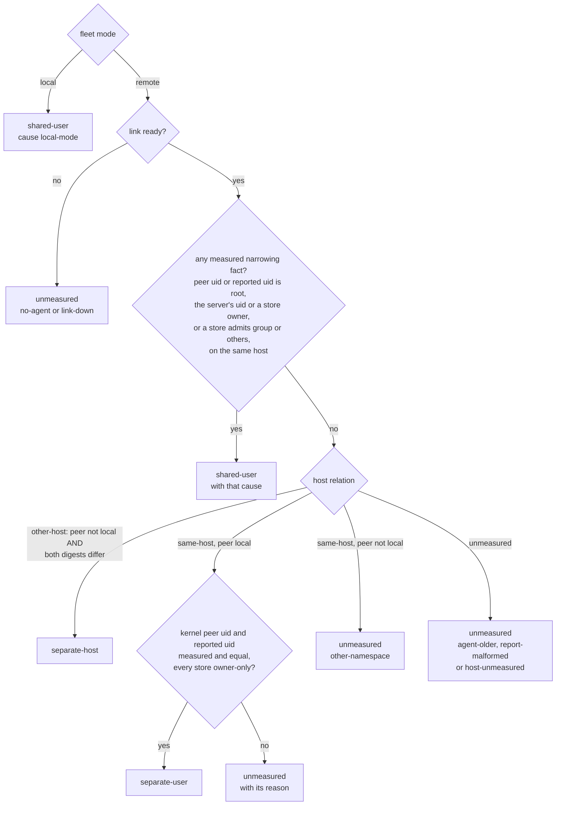
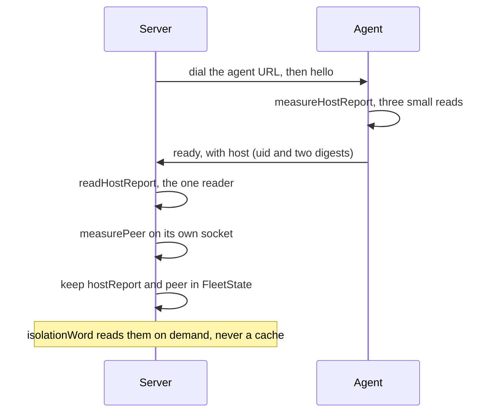
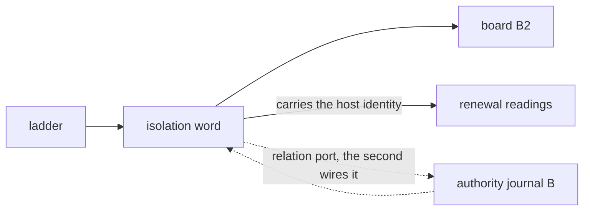

# Overlord W1: the isolation word Implementation Plan

> **For agentic workers:** REQUIRED SUB-SKILL: Use superpowers:subagent-driven-development (recommended) or
> superpowers:executing-plans to implement this plan task by task. Steps use checkbox (`- [ ]`) syntax for tracking.

**Goal:** the server measures, and never assumes, whether the sessions it drives can reach what it holds.

- `server-isolation` is one of three words, `shared-user`, `separate-user` or `separate-host` (§7.4, H28), or the
  reading `unmeasured` with its reason. An unmeasured reading caps the ladder exactly as `shared-user` does, and is
  reported as `unmeasured`, never as a word it did not measure.
- Each agent reports, on connect, its uid and two host digests: one of the machine id, and one of the kernel's boot
  id. The field is additive on the ready frame. An older agent sends none, and reads `unmeasured`, never isolated.
- The server measures its own side: its uid, the owner and mode of its state directories, and two facts about the
  agent link's own socket: whether the peer is on this host's own addresses, and, when it is, the uid the kernel
  records for the peer's socket.
- **Either side may narrow, and only both sides together widen.** A report alone never makes a box read isolated,
  because the sessions the word guards against run as the user that could forge the report.
- The ladder gains its `shared-user` condition, one row and one input, capping `advise` (Table 7.5a).
- The board reads the word through one reader. Authority journal B reads, through the same facts, whether an agent is
  on another host, which is what makes an agent count as a witness off the server's volume. The renewal readings'
  `notLocal` report carries the waking host's identity from the same reader.

**Why:** H28 (§7.4): "A measured isolation word". On `shared-user`, "nothing the server holds is beyond a session's
reach", so the ladder is capped at `advise` and grants, commands and learning are refused `server-not-isolated`, with
no opt-in (the operator's ruling of 2026-11-10). The default install is one box, so the default reading must be the
safe one, and it must be measured, because the same word lifts the cap on a box that really is split.

**Architecture:** one pull request in lane H, after the ladder.

- `shared/isolation.ts` (L0, K) holds the words, the causes, the unmeasured reasons, the host relation words, the
  report's wire shape and its one reader, `readHostReport`, and the read's wire, `IsolationRead`.
- `shared/host-identity.mjs` with `shared/host-identity.d.mts` (L0 `.mjs`, K) is the one measurer of a host's
  identity, used by the agent and the server alike: `measureHostReport` and `hostDigest`. It imports `node:crypto` and
  `node:fs` only (the `.mjs` carve-out).
- `server/src/isolationFacts.ts` (C1, L3) measures the server's own facts at boot and the agent link's peer at each
  ready, and builds the reader that composes them.
- `server/src/isolationWord.ts` (C1, L1) holds the pure deciders: `hostRelation`, `linkIsolation`, `isolationWord`,
  `isolationCondition` and `wakingHostKey`.
- `agent/src/server.ts` sends `host` on every ready. `server/src/remote/client.ts#FleetClient`'s ready handler is the
  one reader of it, and measures the peer.
- The ladder's `LADDER_CAUSE_MAP` gains the `shared-user` row, and `ladderConditionInputs` its input.

**Tech Stack:** TypeScript (ESM), Node's `node:fs`, `node:crypto` and `node:os` (the last in the L3 file only), the
`ws` client's public `upgrade` event, vitest. No new dependency. No migration, no door, no lane, no PWA code.

**Spec:** `docs/superpowers/specs/2026-11-09-overlord-design.md`:

- §7.4, whole: C27's three strengths and "No second token is minted today. All fleet sessions run as one UNIX user";
  H28's three words and their definitions; "On `shared-user`, nothing the server holds is beyond a session's reach"
  with its cap and its refusals; "The way to more is a split install"; "The most sensitive read"; Table 7.4a.
- §7.5, Table 7.5a, the row "`server-isolation` is `shared-user` | condition | cap `advise`", and "A one-box install
  stays at `advise` until the split install exists".
- §7.6, as authority journal B reads it: a witness counts only off the server's volume.
- Table 5.2a, the board's row "Itself": "The `server-isolation` word (§7.4)".
- The act rows' column "actor, identity strength, isolation" (the act row table, W2), which reads this piece's reader
  when W2 writes act rows.
- Table 11.6, the row `server-not-isolated` (H28), whose refusing doors are W2's (the vocabulary's wave map).
- Table 13.1, row H28: `tightening`, W1. No table and no door of this piece is a `shape` call.
- Table 13a's C10 (the board carries "the readiness and isolation words") and C27 ("a `shared-user` server caps the
  ladder at `advise`").
- "Later": "The split install", and "A session credential behind the identity port".

The index is `docs/superpowers/plans/2026-11-14-overlord-w1.md` (on `main`). This plan builds on:

- its row "Isolation word" (lane H, one pull request, four tasks, after the ladder);
- its questions 15 (`isolation-from-reported-uids`) and 20 (`ladder-causes-join-with-their-inputs`, the
  `shared-user` row's owner);
- its "Where lanes meet" bullet for `shared/agent-protocol.ts` and `agent/src/server.ts` ("lane H's uid and host
  report"), and the bullet "The ladder's cause and condition tables";
- Figure W1's edge from the ladder, and its labelled carrier edge into the renewal readings;
- the renewal readings' row: "`notLocal` is this piece's own report … the isolation word supplies only the host
  identity that report carries".

The coordinator's brief for this plan (run 2164) binds over the index's text: additive wire, `FLEET_PROTO`
unchanged, one reader per field; an older agent reads `unmeasured`, never isolated; a measured identity is never folded
into a guess; no host name or address is ever logged, shipped in a fixture or committed; the `shared-user` condition
is one row in the ladder's table; authority journal plan question 10 and its PR B keep their seam exactly; and the
plan says what a single-box install reads. The sibling plans' rulings that bind too (the ladder, #2861; the authority
journal, #2853) are restated under "Open questions" and marked "(ruled)".

## Open questions

One numbering runs through this section. Questions 1 to 6 restate the index's questions and the rulings this plan
builds on. Questions 7 to 18 are this piece's own. The plan builds every recommendation unless the coordinator or the
operator rules otherwise.

1. **How the isolation word is measured** (index question 15, slug `isolation-from-reported-uids`). The index's
   recommendation: "each agent reports its uid and host identity on connect, an additive agent-wire field. The server
   compares them with its own. Any agent that shares both reads `shared-user`, and an unmeasured answer reads
   `shared-user`, the safe word." **Built here, with two refinements**, each its own question:
   - an unmeasured answer is **reported** `unmeasured` and **acts** as `shared-user` (question 7);
   - the server does not take the report alone to widen: it measures the link itself, so only the two sides together
     can make the word `separate-user` or `separate-host` (question 8).
2. **The `shared-user` row is this piece's** (index question 20, ruled; the ladder's question 6 and Table 2). The
   ladder ships `LADDER_CAUSE_MAP` with one row and the mapped input type. This piece adds one row, `shared-user`
   (condition, cap `advise`, notice `none`), and one input. Nothing else in the ladder changes, and nothing here is a
   parallel mechanism: no second cap, no second table, no rung written.
3. **An unmeasured input caps** (the ladder's question 17, ruled with that plan). `effectiveRung` applies an
   `unmeasured` condition's effect as if it stood. This piece's input answers `unmeasured` for every `unmeasured`
   reading, so the ladder caps at `advise` there too, and lists the condition as `unmeasured`, never `standing`.
4. **An agent counts as a witness only once this word reports it on another host** (the authority journal plan's
   question 10, slug `agent-witness-waits-for-host-report`, ruled: keep the seam exactly). Its PR B does not wait for
   this piece. Until this piece lands, every agent's host relation reads `unmeasured`: its tuple is still compared, so
   a higher epoch still refuses, but it lifts no condition and holds no narrowing. **Built here:** `agentHostRelation`
   answers `other-host`, `same-host` or `unmeasured` by question 8's rule, and the one wiring line is added by
   whichever of the two pull requests lands second (question 13). The relation never says `other-host` on a report
   alone.
5. **The board composes the word from this piece's reader** (the board plan's question 9). Board PR B2 needs this
   piece, and reads `IsolationRead` through `deps.isolation`. This piece ships no route of its own (question 14).
6. **`notLocal` is the renewal readings' own report** (index, ruled, review 2088 F9b). That piece asks ccd on the
   waking host whether the conversation is present there. This piece supplies only the identity that report carries,
   `wakingHostKey` (question 12): a label, never a measurement of presence and never an input to authority.

The questions this piece raises:

7. **`unmeasured` is a reading of its own, which acts as `shared-user`** (slug `isolation-unmeasured-reads-unmeasured`).
   H28 names three words. An older agent, a link that is down, an unreadable fact and a disagreement between the two
   sides are none of them. **Recommendation:** `IsolationRead` is `{ kind: 'measured', word, cause }` or
   `{ kind: 'unmeasured', why }`. Every reader that acts treats `unmeasured` as `shared-user`: the ladder caps it
   (question 3), and W2's `server-not-isolated` refuses on it. Every reader that reports shows `unmeasured` with its
   reason. Folding it into `shared-user` would report a guess as a measurement, which the brief forbids; folding it
   into a widening word would be fail-open.
8. **Either side narrows, and only both sides widen** (slug `widening-needs-both-sides`). On a one-box install the
   sessions run as the user that runs the agent, and can read the agent's own bearer. Such a session can stop the
   agent and answer the server's next dial itself, with any report it likes. A word decided from the report alone could
   then be widened by the very caller H28 caps. **Recommendation:**
   - The server measures the link itself, at each ready, from its own client socket (the server dials the agent):
     whether the peer address is this host's own (a loopback address, or an address of one of this host's interfaces),
     and, when it is, the uid the kernel records for the peer's socket (Linux's TCP socket tables under `/proc/net`).
   - `same-host` holds when the peer is local, **or** when the report's machine digest or boot digest equals the
     server's. `other-host` holds only when the peer is not local **and** the report's two digests are both measured
     and both differ from the server's. Anything else is `unmeasured`.
   - `separate-user` needs the peer local, the kernel's peer uid and the report's uid both measured and equal, and
     neither of them root, nor the server's uid, nor the owner of a state directory, with every state directory
     admitting its owner only. `shared-user` needs only one measured narrowing fact, from either side.
   - So a forged report on a one-box install moves nothing: the server sees its own peer, local, with the session
     user's uid, and reads `shared-user`. On a real two-box install the peer is another host's address, and the fleet
     box's own report confirms another kernel, so it reads `separate-host`.
   - **The alternative**, the index's recommendation as written (compare reports only), is simpler and fail-open
     against exactly Table 7.4a's forger. This is the coordinator's call, because the index's question 15 reads
     otherwise.
9. **What "host identity" is** (slug `host-identity-is-two-digests`). **Recommendation:** two SHA-256 digests, each of a
   kind tag and the value: the machine id (`/etc/machine-id`, stable across reboots) and the boot id
   (`/proc/sys/kernel/random/boot_id`, one per kernel boot, shared by every container on that kernel).
   - Equal boot digests prove one kernel, whatever the containers. Equal machine digests catch a host cloned from one
     image. Either one makes `same-host`, which is the safe direction for both the word and the witness.
   - Only digests cross the wire, and nothing logs even those (question 15). A value the reader cannot parse (a
     machine id that is not 32 lowercase hex, a boot id that is not a UUID) reads `unmeasured`.
   - Off Linux both read `unmeasured` (question 11).
10. **The server's side is its process and its stores** (slug `server-side-is-process-and-stores`). H28 defines
    `shared-user` by the stores: they "belong to a user that fleet sessions run as". **Recommendation:** the server
    measures at boot its own uid, and the owner and mode of each state directory: `cfg.ccrcDir` (`~/.ccrc`, which holds
    `coord.db` by default, the box token, and the cookie and passkey stores), and `coord.db`'s own directory when
    `CcrcConfig` places it elsewhere. A peer of the server's uid can read the server's memory; a peer that owns a state
    directory can read what is in it; a state directory whose mode admits its group or others is reachable by a user
    the server cannot enumerate; root reaches everything. Each is a measured narrowing cause. A directory that is a
    symbolic link, or that cannot be read, reads `unmeasured`. The facts are measured once, at boot: a `chmod` while
    the server runs is seen at its next start (Later: a doctor line).
11. **Off Linux the host reads `unmeasured`** (slug `host-digests-are-linux-only`). macOS has no `/etc/machine-id`, no
    boot id file and no `/proc/net`. **Recommendation:** W1 measures nothing there beyond the uid, so a macOS agent's
    digests and a macOS server's peer uid read `unmeasured`. In local mode that changes nothing (question 16). In
    remote mode a macOS side reads `unmeasured`, which caps as `shared-user`. A reader that asks the system for its
    boot session id is Later; W1 runs no program to measure.
12. **The carrier for `notLocal` is the machine digest** (slug `waking-host-key-is-the-machine-digest`). The renewal
    readings compare the host a report came from across renewals, and a boot digest changes at every reboot.
    **Recommendation:** `wakingHostKey()` answers the machine digest of the host that would wake the Overlord: the
    server's own in local mode, the agent's reported one in remote mode while the link is ready, and `unmeasured`
    otherwise. It is a label for the renewal readings' own report and grants nothing.
13. **The relation port and its wiring** (slug `host-relation-port-wired-by-the-second`). The authority plan types the
    relation as `HostRelation = 'other-host' | 'same-host' | 'unmeasured' | 'console'` inside its L1 file, and names
    no port. **Recommendation:**
    - `shared/isolation.ts` owns the three agent words as `AGENT_HOST_RELATIONS`, and authority B's type becomes
      `AgentHostRelation | 'console'`, one spelling.
    - Authority B, the consumer, declares the port as a function, `agentHostRelation: () => AgentHostRelation`, with a
      W1 adapter answering `unmeasured`.
    - Whichever pull request lands second wires this piece's `agentHostRelation` in `server/src/index.ts`, in one line,
      and re-points the type if B landed first. Both orders are written into the task (Task 4).
    - The relation is read at each verdict, never cached across a ready: a reconnect may reach another process.
14. **No door of its own in W1** (slug `isolation-has-no-door-of-its-own`). **Recommendation:** the word is visible in
    W1 through the ladder's read (`GET /api/overlord/ladder` lists the `shared-user` condition with its reading) and
    through the board (PR B2). A route of its own would add a census row in eight files for a fact two existing reads
    already carry. W2's act rows read the same reader.
15. **Nothing logs a host value** (slug `host-values-never-logged`). **Recommendation:** no line names an address, a
    digest, a machine id or a boot id. The only log lines are the word's changes, by word and cause, at most one per
    change, and "the agent's host report is malformed", once per change. A test spies on every console method across
    the decider's, the reader's and the client's cases and fails on any 64-hex run, any fixture id and any address.
    Fixtures use synthetic values only (Global Constraints).
16. **What a single-box install reads** (slug `local-mode-is-shared-user`, the brief). `ccrc install` writes
    `CCRC_FLEET=local` on a fresh box (the board plan's question 10), so the default install has no agent link. The
    server then runs ccd itself, as its own user, on its own host. **Recommendation:** local mode reads
    `{ kind: 'measured', word: 'shared-user', cause: 'local-mode' }`. That is measured from the configuration's code
    path, not guessed: there is no second process to ask. A single box run in remote mode, with its agent on the same
    host, reads `shared-user` too, by question 8's rule (cause `same-user` when the agent runs as the server's user).
    Either way the ladder is capped at `advise`, which changes nothing a W1 operator sees, because the rung door stops
    at `chat` in W1 (the ladder's question 1). From W2 a single box only advises, as §7.5 says.
17. **Same kernel, other network namespace** (slug `split-install-brings-its-own-measurement`). §7.4 says a split
    install "measures `separate-user` or better … with no new rule". A container that shares the kernel but not the
    network namespace is not local to the server's addresses, and its peer socket is not in the server's socket
    tables, so the server cannot measure its uid. **Recommendation:** W1 reads it `unmeasured`, reason
    `other-namespace`, unless a narrowing fact stands. The split install is a design of its own (Later), and it brings
    the server-side measurement it needs, for example the peer credentials of a local socket. This is a spec fix to
    §7.4's sentence.
18. **Many agents** (slug `isolation-folds-every-link`). The server holds one agent link today (`connectFleet` once).
    **Recommendation:** the decider takes a list of links and folds them: any `shared-user` link makes the word
    `shared-user`; else any `unmeasured` link makes it `unmeasured`; else all `separate-host` reads `separate-host`;
    else `separate-user`. An empty list in remote mode reads `unmeasured: no-agent`. A second link needs no new rule.

## Cross-plan seams

What this plan gives, and takes, by name. Each name not on `main` is marked with the plan that ships it.

| Seam | Owner | This plan's use |
|---|---|---|
| `LADDER_CAUSE_MAP`, `LadderConditionCause`, `ConditionReading` (`shared/overlord-ladder.ts`) | the ladder | One row, `shared-user` (question 2) |
| `ladderConditionInputs(deps)` and its mapped `LadderConditionInputs` (`server/src/coord/overlordLadderRead.ts`) | the ladder | One input, `'shared-user': () => isolationCondition(deps.isolation.read())` |
| The ladder's deps into `registerOverlordRoutes` (`server/src/server.ts`) | the ladder | Gains `isolation` |
| `agentHostRelation: () => AgentHostRelation`, the witness's relation port | declared by authority journal B; implemented here | Question 13. B lands without it, and its agents count once this piece wires it |
| `HostRelation` (authority journal B's L1 file) | authority journal B | Re-pointed to `AgentHostRelation \| 'console'` by whichever lands second |
| `IsolationRead` and `deps.isolation.read()` | shipped here | Board PR B2's "Itself" part (question 5); W2's act rows and `overlordMayAct` |
| `wakingHostKey()` | shipped here | The renewal readings' `notLocal` report carries it (question 12) |
| `AgentReady.host` and `readHostReport` | shipped here | No other piece reads the report: its one reader is the client's ready handler |
| `FleetClient`'s ready handler and `FleetState` | K and C1, on `main` | Authority journal B adds `authorityWitness` beside this piece's `hostReport` and `peer`, different lines |

*Table 1. The seams.*


*Figure 1. One link's verdict. A report can only add a narrowing fact or confirm a widening the server measured
itself. Every unmeasured leaf caps the ladder as `shared-user` does.*


*Figure 2. The report and the measurement, at each ready. An older agent sends no `host`, so its link reads
`unmeasured` until it is upgraded.*

## What exists today

Measured on `origin/main` at `f25c710e1` (2026-11-15).

- **The ready frame.** `shared/agent-protocol.ts#AgentReady` carries `ccdVerbs`, `rosterFp`, `build`,
  `observedEpoch` and `ops`, each optional and additive, and no host or uid field. `FLEET_PROTO` is not involved: the
  agent pair negotiates by capability (`AgentReady`'s own comment on `v`).
- **The agent's side.** `agent/src/server.ts` builds the ready frame once per connection, after the hello is
  authenticated. Its type `ReadyFrame` narrows `observedEpoch` and `ops` to required, so this build can never drop
  them; `rosterFp` and `build` are added only when there is something to send. Each field has one small reader of its
  own (`readObservedEpoch`, and the `readRosterFp` and build-stamp readers).
- **The server's side.** `server/src/remote/client.ts#FleetClient` holds the one agent link. Its ready handler is the
  single reader of each ready field and resets every field on every ready, so a reconnect to a downgraded agent keeps
  nothing from before (its comments on `rosterFp`, `observedEpoch` and `ops`). `readReadyOps` is the pattern for a
  validated list. The server is the WebSocket client: it dials the agent's URL (`new WebSocket(this.cfg.url)`), so the
  link's socket is the server's own.
- **Fleet state.** `server/src/fleetstate.ts#FleetState` holds what the ready frame said. `observedEpoch` is optional,
  `undefined` meaning "no evidence", which every fixture that predates it reads honestly.
  `server/test/remote-connect.test.ts` pins the whole object after a good handshake (its "reaches connected:true with
  downSince:null" case), so a new field on the state is a red test until that literal names it.
- **One link, or none.** `server/src/index.ts` calls `connectFleet` once, in remote mode. In local mode it builds a
  literal fleet state with `connected: true` and no agent, and the server runs ccd itself.
- **No host comparison.** `server/src/fleetidentity.ts` keys the agent by its node id only. Nothing in `server/src`,
  `agent/src` or `shared/` reads a machine id or a boot id, or compares the agent's host with the server's. The one
  boot-id reader in the tree is ccd's history library (`ccd/history/lib.mjs`), which stamps its op markers with the
  boot id to identify a process across a reboot: another package, run by ccd, with another job.
- **The state directory.** `server/src/config.ts#CcrcConfig` carries `ccrcDir` (`<home>/.ccrc`), and the default
  `coord.db` path is inside it (`server/src/coord/db.ts#defaultCoordDbPath`).
- **The ladder is not on `main`.** Its plan (#2861) ships `shared/overlord-ladder.ts` with `LADDER_CAUSE_MAP`,
  `ConditionReading` (`standing`, `lifted`, `unmeasured`) and the mapped input type, and lists `shared-user` in its
  Table 2 as this piece's row.
- **The refusal word.** `server-not-isolated` is in Table 11.6 and on the vocabulary piece's wave map as W2
  (`server/test/single-definition/refusal-table.data.json`). No W1 door refuses with it, and this piece adds no word.
- **The `.mjs` carve-out.** `server/test/rings/mjs-node.data.ts#MJS_CARVE_OUT` lets a `shared/*.mjs` file import
  `node:crypto`, `node:fs` and `node:url`, and nothing else from Node. The agent already imports `shared/*.mjs` files
  (`shared/mark.mjs`, `shared/spawn.mjs`).
- **Censuses a new file touches.** The architecture spec's context table (the `ring-context-map` block of
  `docs/superpowers/specs/2026-08-10-architecture-ddd-clean-solid.md`, read by `server/test/rings/ringContextMap.ts`):
  C1's row names its files one by one, so each new `server/src` root file needs its row. `server/test/rings/wire-totality.data.ts`
  holds every exported literal union in `shared/*.ts` to a runtime list. `MUTANT_SETS` and
  `server/test/sim/mutation-floors.json` take a new L1 decider through a sets file imported by
  `server/test/sim/mutation-floors.test.ts`. `server/test/growthCheck.ts#GROWTH_FILES` names `server/src/server.ts`,
  which this piece touches by one line.

## Global Constraints

- **Architecture (`CLAUDE.md`).**
  - **One writer per fact.** The report has one writer, the agent's ready frame, and one reader, `readHostReport`,
    called only by the client's ready handler. The peer facts have one writer, `measurePeer`, called only there. The
    server's facts are measured once, at boot, by `measureServerFacts`. The word has one decider, `isolationWord`. A
    scan in `server/test/single-definition/vocabularies.test.ts`, built on `server/test/scan`, pins each home.
  - **Decide in L1, act in L4.** `isolationWord.ts` imports L0 only: no `fs`, no `os`, no clock. The client's ready
    handler measures and stores, and decides nothing.
  - **Consolidate.** The cap is the ladder's row, the witness relation is the same relation the word uses, and the
    board reads the one reader. One measurer of a host's identity serves the agent and the server.
  - **No overloaded null at a seam.** The report reads `HostReport`, `'absent'` (an older agent) or `'malformed'`.
    Each measured fact is a value or `'unmeasured'`. `FleetState`'s new fields are `undefined` only before any ready.
    Nothing answers `null` for two conditions.
- **Failure contracts (fail closed).**

  | Case | What it reads as |
  |---|---|
  | An older agent: no `host` field | `unmeasured: agent-older`, unless a server-side narrowing fact stands, which reads `shared-user` |
  | A malformed `host` field | `unmeasured: report-malformed`, one warn line per change, and narrowing facts still apply |
  | A field of the report unmeasured on the agent | That fact is missing: it narrows nothing and widens nothing |
  | The link down, or no ready since boot | `unmeasured: link-down`, or `no-agent` before any ready |
  | The peer's uid unreadable (no `/proc/net`, a socket table too large, no single match) | `unmeasured: peer-uid-unmeasured` on a local peer |
  | The server's uid or a state directory unreadable at boot | `unmeasured: server-facts`, unless a narrowing fact stands |
  | The reader not wired (a test's deps) | `unmeasured: not-wired` |
  | A newer agent's report with extra keys | The three known keys are read, and the rest ignored (additive) |
  | An older server, a newer agent | The older server's ready handler ignores `host` |

  Every `unmeasured` reading caps the ladder as `shared-user` does, and is never reported as a word.
- **What a merge arms.** The agent sends one more ready field, which an older server ignores. The ladder's
  `shared-user` condition stands on every single-box install (question 16) and reads `unmeasured` on any box whose
  agent is older. Neither changes what an operator sees in W1, because the rung door stops at `chat`. Nothing a
  running session sees changes. No row, file or marker is written.
- **SAFETY (`CLAUDE.md`).** No ccd verb, no argv, no marker. Tests read synthetic `/proc` and `/etc` trees under the
  run's temp root (`server/test/tmpHelpers.ts`), never the live host's values, and never print them. The agent test
  that runs the real measurer asserts only the shape (64 lowercase hex or `unmeasured`) and prints nothing.
- **Public repository.** Fixtures use synthetic ids only: a machine id of 32 repeated hex letters (`a` for the
  server, `b` for another host), boot ids built the same way in the UUID layout, uids `1000` and `2000`, and addresses
  only from the documentation ranges, written in a test as values and never in this plan. No host name, no address,
  no real id, no account or lane name. Cite by symbol or `@anchor`. No D-number is invented: a builder's new departure
  goes in `docs/superpowers/plans/2026-11-14-overlord-w1/w1-isolation/notes.md`.
- **Growth check.** `server/src/server.ts` grows by about one line, the only growth-checked file touched. A task that
  measures over its row stops and asks.
- **Mutation floors.** `readHostReport`, `hostRelation`, `linkIsolation`, `isolationWord`, `isolationCondition` and
  `wakingHostKey` are new deciders. Each joins `MUTANT_SETS` through a new `server/test/sim/isolationSets.ts`, with
  its floor in `mutation-floors.json` at its measured score, in this pull request. Each guard ships with a test that
  goes red when it is deleted, measured with `mutation-run.py`.
- **Tests.** From `server/`: `ccrc test -- ./node_modules/.bin/vitest run test/<file>.test.ts`. From `agent/` the same
  for its files. Each task's last run adds `ccrc test -- npx tsc --noEmit -p tsconfig.json` and
  `-p test/tsconfig.tests.json` in `server/`, the agent's `tsc`, and, for the `shared/` files, `cd ../pwa && ccrc test
  -- ./node_modules/.bin/tsc --noEmit`. A source-text guard over a new `server/src` file is built on
  `server/test/scan`, never `readFileSync` and a regex, and every task that adds one runs
  `test/single-definition/advance-switches.test.ts`.

## Review Focus

1. **A report never widens alone.** For every report a forger could send over a local peer, the word is
   `shared-user` or `unmeasured`, never `separate-user` or `separate-host`. A property test enumerates the reports.
2. **Monotonic in every fact.** Replacing any measured fact with `unmeasured`, or the report with `absent`, never moves
   the word from `shared-user` or `unmeasured` to a widening word, and never moves the relation to `other-host`.
3. **`unmeasured` is reported as itself and acts as `shared-user`.** The ladder's input maps it to `unmeasured`, and
   the read never names a word it did not measure.
4. **One reader per field, reset on every ready.** A reconnect to an older agent reads `agent-older`, not the last
   report.
5. **No host value reaches a log, a wire to the console or a fixture.**
6. **Local mode reads `shared-user`, measured.**
7. **The ladder gains one row and one input, and nothing else.**

## The PR split

| PR | Tasks | What it ships | Needs first | Growth-checked files, estimate |
|---|---|---|---|---|
| The isolation word | 1 to 4 | The vocabulary, the report's wire and its one reader; the one host measurer; the agent's `host` field; the client's single reader and the peer measurement; the server's boot facts; the deciders and the reader; the ladder's `shared-user` row and input; the witness relation's wiring when authority journal B has landed; the carrier for `notLocal`; every census | the ladder | `server/src/server.ts` about +1 (`isolation` in the ladder's deps); `shared/api.ts` 0; `server/src/coord/routes.ts` 0; `server/src/coord/schema.ts` 0; `server/src/coord/store.ts` 0; `server/src/watch.ts` 0; `pwa/src/lib/api.ts` 0 |

**Order.** After the ladder has merged. Board PR B2 needs this piece (its question 9). Authority journal B and this
piece meet at one wiring line, whichever is second. The renewal readings need this piece for the carrier.


*Figure 3. Where this piece sits. The dashed pair is one wiring line, added by whichever lands second.*

## Index changes

What the index (`docs/superpowers/plans/2026-11-14-overlord-w1.md`) should change, for the coordinator to fold in:

- **Question 15:** restate it as built here: the report plus the server's own measurement of the link; either side
  narrows, both widen (question 8); `unmeasured` reported as itself and acting as `shared-user` (question 7). Slugs
  `widening-needs-both-sides` and `isolation-unmeasured-reads-unmeasured`.
- **Table W1, the row "Isolation word":** "Each agent's uid and host identity (two digests: machine id and boot id) on
  connect, an additive agent-wire field; the server's own measurement of the link's peer (locality and the kernel's
  peer uid) and of its state directories; `server-isolation` measured, `unmeasured` acting as `shared-user`; the
  ladder's `shared-user` condition row; the reader the board and W2's act rows read; the relation authority journal B
  counts witnesses by; the host identity that the renewal readings' `notLocal` report carries". Size unchanged: 1 PR,
  4 tasks. Needs first: the ladder.
- **Figure W1:** add `ISO --> HB2` (the board plan asks for the same), and a dashed edge between `ISO` and `AJB`
  labelled "relation port, the second wires it".
- **"Where lanes meet":**
  - the bullet for `shared/agent-protocol.ts` and `agent/src/server.ts` adds `server/src/remote/client.ts`'s ready
    handler and `server/src/fleetstate.ts`: authority journal B's `authorityWitness` and this piece's `hostReport` and
    `peer`, each a field of its own;
  - `server/src/index.ts`'s wiring: the relation port's one line;
  - the architecture spec's path table: C1's row gains `isolationWord.ts` and `isolationFacts.ts`.
- **"What a merge arms":** "The agent sends its host report on every ready. The ladder's `shared-user` condition stands
  on every single-box install and reads `unmeasured` behind an older agent; in W1 the rung door stops at `chat`, so
  neither is visible as a change."
- **"States W2 may read":** `IsolationRead` and its reader, which W2's act rows and `overlordMayAct` read for
  `server-not-isolated`.
- **Spec fixes:** §7.4's three words gain the reading `unmeasured`, acting as `shared-user`; §7.4's "Such an install
  measures `separate-user` or better … with no new rule" becomes "brings the server-side measurement it needs"
  (question 17); H28 gains how the word is measured (questions 8 to 10); Table 11.1b gains the isolation decider's row
  (L1, W1); a single-box install, local or remote mode, reads `shared-user` (question 16).

### Task 1: The vocabulary, the report's wire and its reader, and the one host measurer (L0)

**Files:**
- Create: `shared/isolation.ts` (L0, K; imports nothing)
- Create: `shared/host-identity.mjs` and `shared/host-identity.d.mts` (L0 `.mjs`, K)
- Modify: `server/test/single-definition/vocabularies.test.ts` (the homes: the report reader, the two paths)
- Test: `server/test/isolation-vocabulary.test.ts` (new), `server/test/host-identity.test.ts` (new)

**Interfaces:**

```ts
// shared/isolation.ts (L0)
const ISOLATION_WORD_MAP = {
  'shared-user': "the server's stores belong to, or can be reached by, the user fleet sessions run as (§7.4)",
  'separate-user': 'the sessions run on this host as another user, who cannot reach the stores',
  'separate-host': 'the sessions run on another host',
} as const;
export type IsolationWord = keyof typeof ISOLATION_WORD_MAP;
export const ISOLATION_WORDS = Object.keys(ISOLATION_WORD_MAP) as IsolationWord[];

const ISOLATION_CAUSE_MAP = {
  'local-mode': 'no agent link: the server runs ccd itself, as its own user',
  'same-user': "an agent on this host runs as the server's user",
  'store-owner': "an agent on this host runs as the owner of a state directory",
  'store-mode': 'a state directory admits its group or others',
  'root-agent': 'an agent on this host runs as root',
  'other-user': 'every agent on this host runs as another user, and every state directory admits its owner only',
  'other-host': 'every agent runs on another host, measured by both sides',
} as const;
export type IsolationCause = keyof typeof ISOLATION_CAUSE_MAP;
export const ISOLATION_CAUSES = Object.keys(ISOLATION_CAUSE_MAP) as IsolationCause[];

const ISOLATION_UNMEASURED_MAP = {
  'no-agent': 'remote mode, and no agent link has gone ready since boot',
  'link-down': 'the agent link is down',
  'agent-older': 'the agent sent no host report',
  'report-malformed': "the agent's host report could not be read",
  'host-unmeasured': 'neither side could measure whether the agent is on this host',
  'other-namespace': "the agent shares this host's kernel from another network namespace",
  'peer-uid-unmeasured': "the uid of the link's peer socket could not be read",
  'report-disagrees': "the agent's reported uid differs from its socket's uid",
  'server-facts': "the server's own uid or a state directory could not be read at boot",
  'not-wired': 'the reader is not wired',
} as const;
export type IsolationUnmeasured = keyof typeof ISOLATION_UNMEASURED_MAP;
export const ISOLATION_UNMEASURED = Object.keys(ISOLATION_UNMEASURED_MAP) as IsolationUnmeasured[];

export type IsolationRead =
  | { readonly kind: 'measured'; readonly word: IsolationWord; readonly cause: IsolationCause }
  | { readonly kind: 'unmeasured'; readonly why: IsolationUnmeasured };

const AGENT_HOST_RELATION_MAP = {
  'same-host': 'the agent shares this host, by the peer address or a digest',
  'other-host': 'the peer is not local and both digests differ',
  unmeasured: 'neither holds',
} as const;
export type AgentHostRelation = keyof typeof AGENT_HOST_RELATION_MAP;
export const AGENT_HOST_RELATIONS = Object.keys(AGENT_HOST_RELATION_MAP) as AgentHostRelation[];

/** A host digest: SHA-256 of a kind tag and the value, as 64 lowercase hex. Never the value itself. */
export const HOST_DIGEST_RE: RegExp;   // /^[0-9a-f]{64}$/
export type Measured<T> = T | 'unmeasured';
/** `AgentReady.host`: what an agent measured of itself on connect. */
export interface HostReport {
  readonly uid: Measured<number>;       // the agent process's own uid
  readonly machine: Measured<string>;   // hostDigest('machine', the machine id)
  readonly boot: Measured<string>;      // hostDigest('boot', the kernel's boot id)
}
/** THE ONE READER of `AgentReady.host`. Absent: an older agent. Malformed: a known key missing or of the wrong type,
 *  a uid that is not a non-negative safe integer, or a digest off `HOST_DIGEST_RE`. Extra keys are ignored. */
export function readHostReport(raw: unknown): HostReport | 'absent' | 'malformed';
```

```ts
// shared/host-identity.d.mts (the .mjs's types)
export interface HostRoots { readonly procRoot: string; readonly etcRoot: string;
  readonly platform: string; readonly uid: number | undefined }
/** SHA-256 of `ccrc-host-<kind>-v1`, a newline and the value, as lowercase hex. */
export function hostDigest(kind: 'machine' | 'boot', value: string): string;
/** Reads `<etcRoot>/machine-id` (32 lowercase hex) and `<procRoot>/sys/kernel/random/boot_id` (a UUID). Off Linux, or
 *  on any read or parse failure, that fact is 'unmeasured'. Never throws, never logs. */
export function measureHostReport(roots?: Partial<HostRoots>): import('./isolation.js').HostReport;
```

The `.mjs` defaults `procRoot` to `/proc`, `etcRoot` to `/etc`, `platform` to `process.platform` and `uid` to
`process.getuid?.()`. Its only imports are `node:crypto` and `node:fs`.

- [ ] **Step 1: Failing tests:**
  - the maps: every word, cause, reason and relation listed once; `ISOLATION_WORDS` is exactly H28's three;
  - `readHostReport`: absent (`undefined`); malformed for a non-object, an array, a missing key, a negative or
    fractional uid, a digest of 63 or 65 characters or in upper case, and a string uid; `unmeasured` accepted in each
    field; an extra key ignored;
  - `hostDigest`: two kinds of one value differ; the same value and kind agree; the output matches `HOST_DIGEST_RE`;
  - `measureHostReport` over synthetic trees under the run's temp root: both files present and well formed; each one
    missing, empty, malformed or unreadable (mode `000`, skipped when the run is root) reads `unmeasured` for that
    fact only; `platform: 'darwin'` reads both digests `unmeasured` and keeps the uid; `uid: undefined` reads
    `unmeasured`;
  - the report never carries the raw id: a test that searches the returned object's JSON for the fixture id;
  - the homes, in `vocabularies.test.ts` on `server/test/scan`: `readHostReport` is defined only in
    `shared/isolation.ts`; the machine-id and boot-id paths are spelled only in `shared/host-identity.mjs` among the
    TypeScript and `.mjs` sources of `server/src`, `agent/src` and `shared/`, with ccd's history library outside that
    scan's roots and named in the test's comment as the other job it is.
- [ ] **Step 2: Run.** Red.
- [ ] **Step 3: Implement.**
- [ ] **Step 4: Mutation.** The set for `readHostReport`. By hand: accept a 63-character digest; read a missing key as
  `unmeasured`; drop the parse of the machine id. Each reds a case. Restore from the saved copy.
- [ ] **Step 5: Run** these suites, `test/rings/*.test.ts` (shared-imports, mjs-node, wire-totality),
  `test/single-definition/*.test.ts`, and every `tsc`. Green.
- [ ] **Step 6: Commit.** `feat(shared): the isolation words, the host report's one reader, and the one host measurer (Overlord W1, §7.4)`

### Task 2: The report on the ready frame, and the server's measurement of its own link (L3, L4)

**Files:**
- Modify: `shared/agent-protocol.ts` (`AgentReady.host?: HostReport`, additive, its comment naming its one reader)
- Modify: `agent/src/server.ts` (`ReadyFrame` narrows `host` to required; the frame carries `measureHostReport()`)
- Create: `server/src/isolationFacts.ts` (C1, L3): `measurePeer`
- Modify: `server/src/remote/client.ts` (the `upgrade` event keeps the response's socket for this attempt; the ready
  handler reads the report and measures the peer)
- Modify: `server/src/fleetstate.ts` (`hostReport?` and `peer?`, optional, each with its comment)
- Modify: `docs/superpowers/specs/2026-08-10-architecture-ddd-clean-solid.md` (C1's row gains `isolationFacts.ts`)
- Modify: `README.md` (the agent link's paragraph: the ready frame now carries the host report, digests only)
- Test: `agent/test/host-report.test.ts` (new), `server/test/isolation-peer.test.ts` (new),
  `server/test/remote-connect.test.ts` (the whole-state literal gains the two keys, and one case for the field)

**Interfaces:**

```ts
// server/src/isolationFacts.ts (L3)
export interface PeerFacts {
  readonly locality: 'local' | 'not-local' | 'unmeasured';
  readonly uid: number | 'unmeasured';   // the kernel's uid for the peer's socket, measured only when local
}
/** Measured once per ready from the server's own client socket. The address is compared and dropped: it is never
 *  stored, returned or logged. `tables` reads Linux's TCP socket tables, bounded at 4 MiB each. */
export function measurePeer(sock: { remoteAddress?: string; remotePort?: number; localPort?: number },
  env?: { interfaceAddresses(): readonly string[]; tables(): readonly string[] | 'unmeasured' }): PeerFacts;
```

`measurePeer`, in order:
1. No remote address or port: `{ locality: 'unmeasured', uid: 'unmeasured' }`.
2. The address is a loopback address (the IPv4 loopback block or the IPv6 loopback, including its IPv4-mapped
   spelling) or one of this host's interface addresses: `local`. Otherwise `not-local`, and the uid is `unmeasured`.
3. For a local peer, the uid is the uid column of the one row, across the tables, in state established, whose local
   port is the server's remote port and whose remote port is the server's local port. Zero rows, two or more, a table
   unreadable or over its bound: `unmeasured`. Ports are compared, addresses are not printed.

**The ready handler** (one more stanza, beside `ops`): `this.state.hostReport = readHostReport(frame.host)`, and
`this.state.peer = measurePeer(<this attempt's socket>)`. Both are reset on every ready, as every field there is. A
`malformed` report logs `ccrc-server: agent link: the agent's host report is malformed` once per change.

**`FleetState`:** `hostReport?: HostReport | 'absent' | 'malformed'` and `peer?: PeerFacts`, optional for
`observedEpoch`'s reason: an omitted field reads "no ready yet", which the decider reads as `no-agent`, the honest
answer for every fixture that predates it. The client's own state is pinned whole by `remote-connect.test.ts`.

- [ ] **Step 1: Failing tests:**
  - the agent: the ready frame carries `host`, which `readHostReport` accepts; with synthetic roots injected through
    the measurer's parameters, the frame carries their digests; the test prints nothing;
  - `measurePeer`: each row above, with documentation-range addresses and a synthetic table; a table with the matching
    row twice reads `unmeasured`; a table over its bound reads `unmeasured`; an IPv4-mapped loopback is `local`;
  - the client (`remote-connect.test.ts`, its fake agent): a ready with a well-formed `host` stores it; a ready without
    one stores `'absent'`; a malformed one stores `'malformed'` and logs one line with no digest in it; a reconnect to a
    fake agent that omits the field resets it to `'absent'`; the peer over the test's loopback socket reads `local`;
  - the console spy (question 15): across these cases no console line holds a 64-hex run, a fixture id or an address.
- [ ] **Step 2: Run.** Red.
- [ ] **Step 3: Implement.**
- [ ] **Step 4: Mutation, by hand.** Keep the last report across a reconnect; read the uid from the first matching row
  when there are two; treat an unreadable table as no match. Each reds a case. Restore from the saved copy.
- [ ] **Step 5: Run** these suites, the agent's suite (`ccrc test -- ./node_modules/.bin/vitest run` from `agent/`),
  the agent's `deploy-verify` and the server's `build-release` (the agent build ships one more `shared/*.mjs`, as it
  ships `shared/spawn.mjs`; measured, not assumed), `test/rings/*.test.ts`, `test/typecheck-tests.test.ts` and every
  `tsc`. Green.
- [ ] **Step 6: Commit.** `feat(agent-link): the agent reports its host on ready, and the server measures its own link (Overlord W1, §7.4)`

### Task 3: The deciders, the server's boot facts and the reader (L1, L3, L5)

**Files:**
- Create: `server/src/isolationWord.ts` (C1, L1; imports `shared/isolation.ts` only)
- Modify: `server/src/isolationFacts.ts` (`measureServerFacts`, `makeIsolationReader`)
- Modify: `server/src/deps.ts` (`isolation?: IsolationReader`), `server/test/helpers.ts` (`testDeps` leaves it unset,
  which reads `not-wired`)
- Modify: `server/src/index.ts` (measure the server's facts once at boot, build the reader over `fleet.state` or the
  local literal, and pass it in `deps`)
- Modify: `docs/superpowers/specs/2026-08-10-architecture-ddd-clean-solid.md` (C1's row gains `isolationWord.ts`)
- Create: `server/test/sim/isolationSets.ts`; modify `server/test/sim/mutation-floors.test.ts` (one import, one
  spread) and `server/test/sim/mutation-floors.json` (six floors)
- Test: `server/test/isolation-word.test.ts` (new), `server/test/isolation-facts.test.ts` (new)

**Interfaces:**

```ts
// server/src/isolationWord.ts (L1)
export interface ServerFacts {
  readonly report: HostReport;                       // the server's own, from measureHostReport at boot
  readonly stores: readonly { readonly owner: Measured<number>;
                              readonly mode: Measured<'owner-only' | 'group-or-other'> }[];
}
export type LinkFacts =
  | { readonly link: 'none' }                         // no ready since boot
  | { readonly link: 'down' }
  | { readonly link: 'ready'; readonly report: HostReport | 'absent' | 'malformed'; readonly peer: PeerFacts };
export function hostRelation(server: ServerFacts, link: LinkFacts): AgentHostRelation;
export function linkIsolation(server: ServerFacts, link: LinkFacts): IsolationRead;
/** The fleet-wide word (question 18). Local mode reads shared-user, cause local-mode (question 16). */
export function isolationWord(mode: 'local' | 'remote', server: ServerFacts | 'unmeasured',
  links: readonly LinkFacts[]): IsolationRead;
/** The ladder's input: shared-user is standing, a separate word lifted, unmeasured unmeasured. */
export function isolationCondition(read: IsolationRead): ConditionReading;
/** The carrier for the renewal readings' notLocal report (question 12). */
export function wakingHostKey(mode: 'local' | 'remote', server: ServerFacts | 'unmeasured',
  link: LinkFacts | null): Measured<string>;

// server/src/isolationFacts.ts (L3), added
export function measureServerFacts(cfg: Pick<CcrcConfig, 'ccrcDir' | 'coordDbPath'>,
  env?: { report(): HostReport; statDir(p: string): { uid: number; mode: number; dir: boolean; link: boolean } | 'unreadable' }
): ServerFacts | 'unmeasured';
export interface IsolationReader {
  read(): IsolationRead;
  agentHostRelation(): AgentHostRelation;
  wakingHostKey(): Measured<string>;
}
export function makeIsolationReader(mode: 'local' | 'remote', server: ServerFacts | 'unmeasured',
  state: Pick<FleetState, 'connected' | 'hostReport' | 'peer'> | null): IsolationReader;
```

The state directories are `cfg.ccrcDir` and the directory of `cfg.coordDbPath`. `statDir` uses
`lstat`, so a symbolic link reads `link: true`, which `measureServerFacts` reads as `unmeasured`. The server's uid is
`report.uid`. Two state directories that are one directory are measured once. The reader holds the server's facts and
a reference to the live fleet state, reads them on each call, and caches nothing.

**`hostRelation`**, first match:
1. The link is not `ready`: `unmeasured`.
2. The peer is `local`: `same-host`.
3. A report is present, and its machine digest or its boot digest is measured and equals the server's: `same-host`.
4. The peer is `not-local`, a report is present, and both its digests are measured and both differ from the
   server's, both of which are measured: `other-host`.
5. Otherwise `unmeasured`.

**`linkIsolation`**, first match:
1. `link: 'none'`: `unmeasured: no-agent`. `link: 'down'`: `unmeasured: link-down`.
2. The relation is `same-host`, and a narrowing fact is measured: the peer's uid or the reported uid is `0`
   (`root-agent`), equals the server's uid (`same-user`) or equals a state directory's owner (`store-owner`), or a
   state directory's mode is `group-or-other` (`store-mode`): `shared-user` with the first cause in that order.
3. The relation is `other-host`: `separate-host`, cause `other-host`.
4. The relation is `same-host` and the peer is `local`:
   - the peer's uid, the server's uid, or any state directory's owner or mode is `unmeasured`:
     `unmeasured: peer-uid-unmeasured` for the peer's, else `server-facts`;
   - the report is `absent` or `malformed`: `unmeasured: agent-older` or `report-malformed`;
   - the reported uid is `unmeasured` or differs from the peer's uid: `unmeasured: report-disagrees`;
   - otherwise `separate-user`, cause `other-user`.
5. The relation is `same-host` and the peer is not `local`: `unmeasured: other-namespace` (question 17).
6. The relation is `unmeasured`: `agent-older` for an absent report, `report-malformed` for a malformed one, else
   `host-unmeasured`.

**`isolationWord`**: local mode answers `shared-user`, cause `local-mode`, whatever else it is given. In remote mode,
the server's facts `unmeasured` make each link's narrowing step read only the link's own facts, and every widening
`unmeasured: server-facts`. Then the fold of question 18.

**`wakingHostKey`**: local mode, the server's machine digest; remote mode with a `ready` link and a present report,
its machine digest; otherwise `unmeasured`.

- [ ] **Step 1: Failing tests:**
  - each row of each table, with synthetic facts;
  - the forger property (Review Focus 1): over a local peer whose kernel uid is the server's, every report in a
    generated domain (each field measured or not, every digest equal or not, any uid) reads `shared-user`;
  - monotonicity (Review Focus 2): over the generated domain, replacing any fact with `unmeasured`, or the report with
    `absent`, never moves a `shared-user` or `unmeasured` answer to a separate word, and never moves the relation to
    `other-host`;
  - the fold: one `shared-user` link of two wins; one `unmeasured` of two separate links wins; two `separate-host`
    read `separate-host`; one `separate-user` and one `separate-host` read `separate-user`; none in remote mode reads
    `no-agent`;
  - local mode reads `shared-user`, `local-mode`, with no agent and with garbage links;
  - `isolationCondition` over all three shapes; `wakingHostKey` over each arm;
  - `measureServerFacts`: owner-only and group-or-other modes from synthetic directories; a symbolic link, an
    unreadable directory and a missing one read `unmeasured`; one directory named twice is measured once;
  - the reader over a live `FleetState` object: a ready, then a close, then a ready from an older agent read
    `separate-host`, `link-down` and `agent-older` in turn; with `deps.isolation` unset, the read is `not-wired`.
- [ ] **Step 2: Run.** Red.
- [ ] **Step 3: Implement.**
- [ ] **Step 4: Mutation.** The six sets in `isolationSets.ts`, floors at their measured scores. By hand: let the
  report's digests alone make `other-host`; drop the store-mode cause; fold `unmeasured` links as lifted. Each reds a
  case. Restore from the saved copy.
- [ ] **Step 5: Run** these suites, `test/sim/mutation-floors.test.ts`, `test/rings/*.test.ts` (the context map reads
  the spec's C1 row), `test/single-definition/*.test.ts`, `test/typecheck-tests.test.ts` and every `tsc`. Green.
- [ ] **Step 6: Commit.** `feat(isolation): the isolation word, measured by both sides, with the server's own facts (Overlord W1, H28)`

### Task 4: The ladder's `shared-user` row, the witness relation and the carrier

**Files:**
- Modify: `shared/overlord-ladder.ts` (`LADDER_CAUSE_MAP` gains one row)
- Modify: `server/src/coord/overlordLadderRead.ts` (`ladderConditionInputs` gains one input; its deps gain
  `isolation`)
- Modify: `server/src/server.ts` (the ladder's deps into `registerOverlordRoutes` gain `isolation: deps.isolation`,
  about one line)
- Modify, **only if authority journal B has merged**: `server/src/index.ts` (one line: B's exchange takes
  `isolation.agentHostRelation`), and B's L1 file (`HostRelation` becomes `AgentHostRelation | 'console'`)
- Test: `server/test/overlord-ladder-read.test.ts` (the ladder's suite: cases for the row),
  `server/test/overlord-ladder-seams.test.ts` (one case), and, only if B has merged,
  `server/test/overlord-authority-exchange.test.ts` (two cases)

**The row:**

```ts
'shared-user': {
  kind: 'condition', effect: { kind: 'cap', cap: 'advise' }, notice: 'none',
  spec: '`server-isolation` is `shared-user` (Table 7.5a, §7.4)',
},
```

**The input:** `'shared-user': () => isolationCondition(deps.isolation?.read() ?? { kind: 'unmeasured', why: 'not-wired' })`.
The mapped type makes the input required, so the row cannot land without it.

**The witness relation.** If authority journal B has merged, this task adds the one wiring line and re-points B's
type, and B's suite gains two cases: an agent this piece reads `other-host` counts, and a local peer with a report
claiming another host does not. If B has not merged, this task adds nothing to B's files, and the pull request body
says that B's pull request carries the line and the re-point, which is the authority plan's own order ("B lands
without it, and agents count once it lands").

**The carrier.** `IsolationReader.wakingHostKey` ships here, read by no one until the renewal readings. Its seam is
pinned by Task 3's tests; the renewal readings' plan names it.

- [ ] **Step 1: Failing tests:**
  - the ladder's read: a `shared-user` reading binds `effectiveRung` at `advise` with the condition `standing`; a
    `separate-host` reading lifts it; an `unmeasured` reading binds `advise` and lists the condition `unmeasured`;
    `not-wired` likewise; in W1 the effective rung is `chat` either way, because the operator's rung cannot pass
    `chat`, which a case pins so the cap is seen to bind only from W2;
  - the seams: the row is a condition capping `advise` with notice `none`, and the table has exactly one more row
    than the ladder's merged table;
  - the witness, when B has merged: the two cases above.
- [ ] **Step 2: Run.** Red.
- [ ] **Step 3: Implement.**
- [ ] **Step 4: Mutation, by hand.** Map `unmeasured` to `lifted` in `isolationCondition`: the ladder case reds.
  Restore from the saved copy.
- [ ] **Step 5: Run** every suite this plan names, the ladder's suites, `test/sim/mutation-floors.test.ts`,
  `test/single-definition/*.test.ts`, `test/rings/*.test.ts`, the growth check armed (`server.ts`), every `tsc`, and
  `docs-grammar`, `anchors`, `citations`, `topology-clean` and `deviation-refs` for the two docs edits. Green.
- [ ] **Step 6: Commit.** `feat(ladder): the shared-user condition, read from the isolation word (Overlord W1, Table 7.5a)`

**The pull request ends here.** Its body states:

- what a merge arms: one more ready field; the `shared-user` condition standing on a single box and `unmeasured`
  behind an older agent, invisible in W1 because the rung door stops at `chat`;
- what a single-box install reads, local or remote mode (question 16);
- that a report never widens alone, and why (question 8);
- whether the witness relation's line is in this pull request or left to authority journal B's;
- the growth figure measured against the estimate.

## Deviations found

Each entry is a departure from the spec's text, or from the index, that this plan makes, by slug. The coordinator
mints numbers.

- **`isolation-unmeasured-reads-unmeasured`**: H28 names three words. This plan adds the reading `unmeasured`, which
  acts as `shared-user` everywhere and is reported as itself (question 7).
- **`widening-needs-both-sides`**: the index's question 15 compares reports only. This plan adds the server's own
  measurement of the link, so a report narrows alone and widens only with it (question 8).
- **`host-identity-is-two-digests`**: the spec names no host identity. It is two digests, of the machine id and the
  boot id, and neither value leaves the host (question 9).
- **`server-side-is-process-and-stores`**: the server's side is its uid and its state directories' owner and mode,
  measured at boot (question 10).
- **`host-digests-are-linux-only`**: off Linux the digests and the peer's uid read `unmeasured` (question 11).
- **`local-mode-is-shared-user`**: the spec does not say what an install with no agent link reads. It reads
  `shared-user`, cause `local-mode`, measured from the configuration (question 16).
- **`split-install-brings-its-own-measurement`**: §7.4 says a split install measures `separate-user` "with no new
  rule". In W1 a peer on this kernel in another network namespace reads `unmeasured`, and the split install's design
  brings the measurement (question 17).
- **`isolation-has-no-door-of-its-own`**: the word is read through the ladder's read and the board in W1, and needs no
  route (question 14).
- **`act-rows-carry-it-in-w2`**: H28 puts the word "on every act row". W1 has no act rows; W2 reads this piece's reader
  when it writes them (H28 is `tightening`, Table 13.1).

## Where things stand

**Agreed:**
- From the brief and the index: lane H, one pull request, four tasks, after the ladder; an additive agent-wire field
  with one reader and `FLEET_PROTO` unchanged; an older agent reads `unmeasured`, never isolated; no host name or
  address logged, shipped in a fixture or committed; the `shared-user` condition as one row of the ladder's table;
  the authority journal's question 10 and its PR B's seam kept exactly; `notLocal` the renewal readings' own report,
  with this piece supplying only the host identity it carries.

**Waiting on the coordinator:**
- Question 8 (`widening-needs-both-sides`), which refines the index's question 15. Its alternative is fail-open
  against Table 7.4a's forger.
- Question 7, the reading `unmeasured` reported as itself.
- Questions 9 to 18 stand as recommendations, and the index changes above.

**Waiting on the operator:** nothing.

**Needs before it starts:** the ladder (#2861) merged.

**What depends on it:** board PR B2 (the "Itself" part), the renewal readings (the carrier), authority journal B's
witnesses counting agents (one wiring line, whichever is second), and W2's act rows and `server-not-isolated`.

**Later:**
- The split install, which brings the server-side measurement a same-kernel peer in another namespace needs, for
  example the peer credentials of a local socket (question 17).
- A macOS measurement of the boot session and the host, which W1 reads `unmeasured` (question 11).
- A doctor line naming the isolation word and its cause, and seeing a state directory's mode change without a restart.
- A session credential behind the identity port (§7.4), which lifts `identity-too-weak`, not this word.
