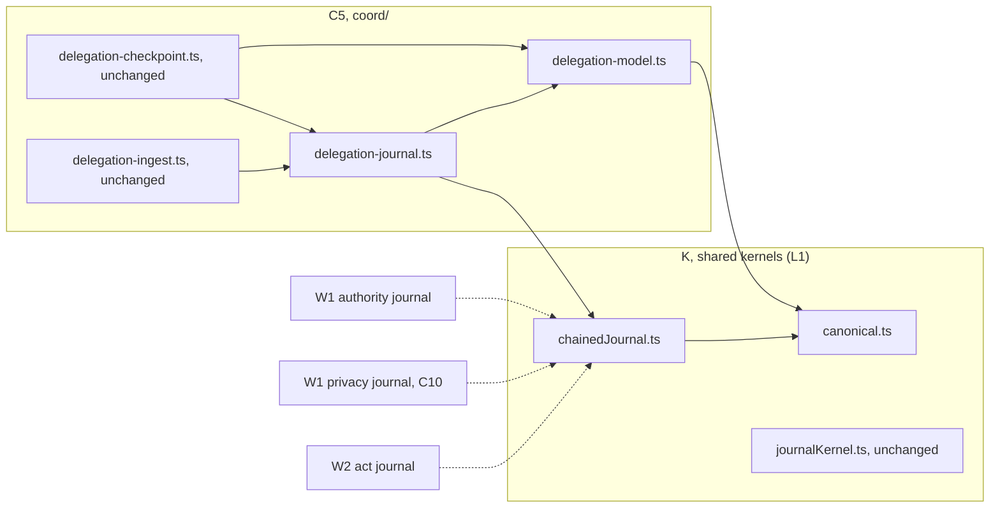

# Overlord W1: the chained-journal kernel, moved out of the delegation journal Implementation Plan

> **For agentic workers:** REQUIRED SUB-SKILL: Use superpowers:subagent-driven-development (recommended) or
> superpowers:executing-plans to implement this plan task-by-task. Steps use checkbox (`- [ ]`) syntax for tracking.

**Goal:** one shared kernel holds the hash-chained journal's codec, chain verifier and torn-tail rule, and knows no
record grammar. The delegation journal becomes the first journal on it. The canonical encodings the codec hashes and
checks move with it: the RFC 8785 writer, the text hash, the hash-shape predicate and the canonical instant. Nothing
changes in behaviour. Every byte the delegation journal writes stays the same, and so do every hash, every refusal's
class, code and message, and every exported name. W1's authority journal and privacy journal then sit on the kernel,
and so does W2's act journal, without importing the delegation context.

**Why:** H27 ("three journals on one kernel", §7.6). The tree has one chained journal, the delegation journal, and its
codec is written for its own grammar. Without this move, a second and a third journal would copy that codec, or import
the delegation model from another context. The extraction is move-only, with characterization tests first. The
delegation journal is an authority whose bytes cannot change, and it must still read every file it wrote.

**Architecture:** two new shared-kernel files (context K, ring L1):

- `server/src/canonical.ts` holds `rfc8785Json`, `sha256HexOfText`, `isLowerHex64`, `LONE_SURROGATE`,
  `CANONICAL_INSTANT` and `parseCanonicalInstant`. It imports `node:crypto` only.
- `server/src/chainedJournal.ts` holds the record envelope, its two preimages, the strict line codec and its field
  checks, the JSON defect scanner, the line splitter, the torn-tail classification and heal rule, the chain verifier
  and the whole-bytes verifier and parser. It is generic over a `ChainedJournalFormat<E, X>`, which a journal supplies:
  its entry kinds, its entry grammar and its error classes. It imports `./canonical.js` only.

`server/src/coord/delegation-journal.ts` keeps its entry grammar, its append and retention planning, its event row and
its whole impure shell: the file port, the readers, the retained-set reader and the writer. It binds the kernel to its
grammar under its existing names. One pull request, four tasks.

**Tech Stack:** TypeScript (ESM), vitest. No new dependency.

**Spec:** `docs/superpowers/specs/2026-11-09-overlord-design.md`:

- §7.6, H27: "A generic chained-journal kernel (codec, verifier, tail heal) is extracted from the delegation journal …
  The extraction is a move-only pull request with characterization tests". Also "Three record grammars sit on it" and
  "Each is a new file that no snapshot carries".
- §10.1, H27: the act journal is chained, and its head is signed under a domain-separated preimage.
- Table 13.1, row H27 (`shape`, waves W1, W2 and W4), and Table 14, row W1 ("the journal kernel").
- §14: "A shape call cannot trail".

The index is `docs/superpowers/plans/2026-11-14-overlord-w1.md` (in #2814): its row "Journal kernel" (lane C, first)
and its open question 3. The consolidation design's K17 and §3.19
(`docs/superpowers/specs/2026-10-19-ccrc-consolidation-wave-design.md`) bear on where the kernel may go (question 2).

## Open questions

Each is a place where the spec is silent or does not match the tree. Where the coordinator has ruled (fix round 1,
review 2082), the ruling is stated. The plan builds the recommendation everywhere else.

1. **The kernel is W1's first piece in lane C** (the index's question 3, slug `journal-kernel-is-the-first-w1-piece`).
   §7.6 says the extraction comes "before W1", and also that "W1 ships the kernel". **Recommendation (the index's):**
   it is W1's first lane-C piece, move-only and ready to build now. This plan builds it that way.
2. **The tree already has a "journal kernel", and a census pins that the delegation journal never imports it** (slug
   `chained-kernel-beside-the-log-first-kernel`).
   - `server/src/journalKernel.ts` (K, L1) holds the log-first journals' shared steps: `maxJournalEpoch`,
     `journalFloor`, `appendThenApply` and `splitJournalRecords`.
   - Its header says "The delegation journal (authority, not a projection; spec §3.19) never imports this file".
     `server/test/single-definition/kernel-tail-journal.test.ts` pins that no `coord/delegation-*.ts` file imports it
     (`server/test/census-w8/journal.ts#delegationKernelImports`, 0).
   - K17's "authority against projection" is not the dividing line on its own: `landing.log` is also called an
     authority journal, and its policy uses `journalKernel.ts`. The property that divides the two kernels is this. A
     chained journal is hash-chained over exact bytes and decoded strictly: one canonical encoding per record, with
     every defect refused. A log-first journal is framed tolerantly as text: blank lines and tails are left to each
     caller, there are no hashes, and an epoch is read out of a fragment. That property also explains the second
     NDJSON framer in K: a byte splitter with a streaming leftover, against `splitJournalRecords`' whole text.

   **Recommendation:** the chained kernel goes in a new file, `server/src/chainedJournal.ts`, beside
   `journalKernel.ts`, which this piece does not touch. Its header and the pull request body give that dividing
   property as the "legitimately different" reason. The spec's words "the journal kernel" mean this file.
3. **The canonical encodings live in the delegation model** (slug `canonical-writer-moves-to-k`). The codec hashes,
   checks and stamps records through `server/src/coord/delegation-model.ts#canonicalDelegationJson`,
   `#delegationSha256Hex` and `#parseDelegationInstant`, all in context C5. A K kernel that imported them would point
   a shared kernel at a bounded context, and the privacy journal (C10) would import the delegation model.
   **Ruled (F1, F8):** in this pull request, the writer, the text hash, the hash predicate, the lone-surrogate pattern
   and the canonical instant move to `server/src/canonical.ts`, as Task 2. The writer is renamed `rfc8785Json`, so it
   cannot be mistaken for `shared/api.ts#canonicalJson`, and `server/test/single-definition/ask-digest.test.ts` keeps
   seeing one `canonicalJson`. That one is a different encoder: integer-only, returning `string | null`. The
   delegation model keeps `canonicalDelegationJson`, `delegationSha256Hex`, `parseDelegationInstant` and
   `DelegationJsonError` under their names. Each is a binding that hands the moved function the model's own error, so
   every class and message stays. **Ruled (F2, F3):** the model keeps a one-line re-export of `isLowerHex64` (slug
   `model-re-exports-the-predicate`), so Task 1's file and the checkpoint keep their imports.
4. **What the kernel is** (slug `kernel-is-pure-the-writer-stays`). H27 names "codec, verifier, tail heal". The
   delegation journal also has an asynchronous file port, a chunked reader, a retained-set reader over its carried
   file, and an `O_APPEND` writer. The authority journal is appended "inside the store's transaction, before the row"
   (§7.6). But `CoordStore` is synchronous (`DatabaseSync`), and the tree's log-first writers append inside `tx()`
   through `appendThenApply`, while the delegation writer returns a `Promise` through `DelegationFilePort`.
   **Recommendation:** the kernel is the pure part only: the codec, the verifier, the heal rule
   (`chainedTailHealPlan`), and the whole-bytes verifier and parser. The port, the readers, the writer, compaction,
   retention and the heal's act (`server/src/coord/delegation-checkpoint.ts#DelegationDurability`) stay the delegation
   journal's. The authority journal's plan decides its synchronous writer, after the pattern of
   `server/src/coord/landingJournal.ts`, and says whether `appendThenApply` carries it. Its first call is "the next
   record from the head" (`sequence + 1`, `previousDigest = head.digest`). Today that arithmetic sits inline in the
   delegation-only `planDelegationJournalAppend`. That plan either moves it into the kernel as a `chainNext` helper,
   in a behaviour-neutral commit of its own with this file's characterization still green, or reuses the planner. It
   does not copy the arithmetic. If two synchronous writers then exist, the second piece moves them into the kernel.
5. **The delegation journal keeps every exported name** (slug `delegation-names-kept`). Its names are imported by
   four source files and 20 test files (19 test files and the helper `server/test/delegationCarrierCheckpoints.ts`).
   **Recommendation:** the move commit changes no caller and no test outside the pins named in Task 3.
   - Each grammar-bound function keeps its name, as a binding over the kernel with the delegation format.
   - Each generic piece keeps its name as a one-line alias of the kernel's, listed in the pull request body: the
     splitter, the defect scanner, the heal plan, and the position, coverage, tail and options types.
   - Retiring the aliases is "Later": an imports-and-names-only commit that re-points callers to the kernel's names.
6. **One envelope for every chained journal, and no domain tag in the record** (slug `one-envelope-no-record-domain`).
   §10.1 asks for a domain-separated preimage for the act journal's signed head, not for each record. The delegation
   record's preimages cannot change: `{v, sequence, acceptedAt, previousDigest, entry}`, and the same with
   `journalId`. A record from journal A verifies in journal B exactly when B's grammar accepts A's entry.
   **Ruled (F9), a mechanism:** every journal uses this one envelope, and its record kind lives in `entry.kind`. Each
   format declares its entry kinds in a `kinds` table. One census test over every registered format asserts that the
   tables are pairwise disjoint, and that each format's grammar refuses every other format's kinds (Task 4). A later
   journal joins by adding its format to the census. The census also finds every `ChainedJournalFormat` value under
   `server/src` and refuses one that is not registered. The act journal's head signature (W2) carries its domain at
   signing.
7. **The moved code is in no mutant set** (slug `kernel-mutant-sets`). Moved code adds no decider, so the index's rule
   ("every new L1 decider joins `MUTANT_SETS`") does not reach it. But the boot coherence of three journals will rest
   on the chain verifier and the heal rule. **Recommendation:** Task 4 adds `server/test/sim/chainedJournalSets.ts`,
   with `decodeChainedLine`, `ChainVerifier` and `chainedTailHealPlan` as sets and the floors measured. It changes
   tests only.

## What exists today

Measured on `main` at `416b8f942` (2026-11-14). Every symbol below was re-read at `2126f46db` (2026-11-15) for fix
round 1.

- **`server/src/coord/delegation-journal.ts`** (1,076 lines). Its context is C5, by the `coord/**` row. Its ring is L1
  by its imports (`shared/api.ts`, `delegation-lease-state.ts` and `delegation-model.ts`), and it does its I/O only
  through the injected port. Above its `IMPURE SHELL` banner, all pure:
  - the refusal union `DelegationJournalErrorCode`: 31 words, 24 of the codec and chain and 7 of its own;
  - `DelegationJournalError`, whose message is `delegation journal <code>: <detail>`, with ` (line N)` when it has a
    line;
  - the total table `DELEGATION_JOURNAL_ERROR_CODES`, and `isDelegationJournalKebab` for
    `server/test/mail-routes.test.ts`'s scan of `server/src/coord`;
  - the preimages `delegationJournalId` and `delegationJournalDigest`, and `buildDelegationJournalRecord`;
  - the record checks shared by the codec and the grammar: `exactKeys`, `isRecord`, `hex64` and `assertInstant`
    (`assertInstant` catches only `DelegationModelError`). `assertSequence` is used by the codec and the chain only;
  - the entry grammar: the private `validateEntry`, with the lease kinds' total key tables and its field helpers;
  - `findDelegationJsonDefect` (the duplicate-key scanner), `encodeDelegationJournalRecord`,
    `decodeDelegationJournalLine`, `DelegationJournalLineSplitter` and `delegationTornTailError`;
  - the heal rule (D-4655): `DelegationJournalTail`, `DelegationTailHealPlan` and `delegationTailHealPlan`, with the
    quarantine directory's name `DELEGATION_TORN_DIR`;
  - the chain: `DelegationJournalPosition`, `DelegationJournalCoverage`, `DelegationJournalChainOptions`,
    `DelegationJournalChain`, `validateDelegationJournalBytes` and `parseDelegationJournal`.
    `validateDelegationJournalBytes` keeps no records, and checks the pruning holds' `held-evidence-missing` after the
    chain's `finish()`;
  - delegation's own planning: `delegationEventRowOfRecord`, `delegationLeaseIdentityKey`,
    `planDelegationJournalAppend` (which holds the "next record from the head" arithmetic), the retention view and
    collector, `planDelegationPruning` and `DELEGATION_RETENTION_FLOOR_MS`.

  Below the banner:
  - the port: `DelegationFilePort`, `DelegationFileHandle` and `DelegationReadHandle`;
  - `delegationBytesSha256`, the one Web Crypto use;
  - the readers `readDelegationJournalLines`, `readDelegationJournalRecords` and `readDelegationRetainedRecords` (the
    carried file, D-7021);
  - `DelegationJournalWriter`.

  The decoder passes `where` to some refusals and not others. With `where`: BOM, blank line, CR, invalid UTF-8,
  malformed JSON, not an object, `v`, `previousDigest`, `invalid-domain`, `duplicate-key`, `noncanonical`, and the
  two hash mismatches. Without it: the record keys (`exactKeys`), `sequence`, `acceptedAt`, `journalId` and `digest`
  (`hex64`), and every entry refusal. No refusal of the chain carries it. The decoder's `invalid-domain` branch catches
  only `DelegationJsonError`, refuses with that error's `.message`, and rethrows anything else.
- **The canonical encodings**, in `server/src/coord/delegation-model.ts` (1,813 lines, C5, L1). It imports
  `node:crypto` for `delegationSha256Hex` alone.
  - `canonicalDelegationJson` is RFC 8785 over a closed domain, built from the private `canon`, `wellFormed`,
    `ownKeysOf` and `byCodeUnits`.
  - `LONE_SURROGATE` is used by the writer and also by the model's natural-key and row checks.
  - `DelegationJsonError`'s message is `delegation canonical JSON: <detail>`. `delegationSha256Hex` is built on
    `createHash`.
  - `isLowerHex64` is exported from here only.
  - `CANONICAL_INSTANT` and `parseDelegationInstant` throw `DelegationModelError` with `bad-instant`.
    `formatDelegationInstant`, which stays in the model, uses the same pattern.
  - The model also owns `DelegationJournalRecordV1`, `DelegationJournalEntryV1` and
    `DELEGATION_JOURNAL_ENTRY_KINDS`, which stay.
- **Two near-twins that are not moved here.** `server/src/coord/delegation-ingest.ts` declares its own
  `LONE_SURROGATE`, byte-identical to the model's. `shared/api.ts#canonicalJson` is the approvals' digest encoder: it
  is integer-only, returns `string | null`, and is not RFC 8785. `server/test/single-definition/ask-digest.test.ts`
  pins it as the only `canonicalJson` declaration under its roots.
- **Every caller.**
  - Of the journal module, in `server/src`: `delegation-checkpoint.ts` (its codec, chain, heal, planning, readers,
    writer and port types), `delegation-ingest.ts` (`findDelegationJsonDefect`), `delegation-file-port.ts` (the port's
    types) and `watch.ts` (`DELEGATION_RETENTION_FLOOR_MS`).
  - In `server/test`, 22 files name the journal module: 20 import it (19 test files and the helper
    `delegationCarrierCheckpoints.ts`), `delegation-ingest.test.ts` names it in an import-list pin, and
    `single-definition/advance-switches.test.ts` names it in a ceiling row.
  - Of the moved encodings:
    - `canonicalDelegationJson`: `delegation-checkpoint.ts`, `delegation-journal.ts`, `delegation-model.ts`,
      `delegation-policy.ts` and `watch.ts`;
    - `delegationSha256Hex`: `delegation-conflicts.ts`, `delegation-journal.ts`, `delegation-model.ts` and
      `delegation-policy.ts`;
    - `isLowerHex64`: `delegation-checkpoint.ts`, `delegation-journal.ts` and `delegation-model.ts`;
    - `parseDelegationInstant`: 14 files under `server/src/coord` and `watch.ts`;
    - `DelegationJsonError`: the checkpoint, the journal, the model and `server/test/delegation-model.test.ts`.

    Every one of them keeps its import.
- **Pins that read these files' text or imports** (each re-measured in its task):
  - `server/test/delegation-recovery.test.ts`:
    - the row "the journal module has no method that could rewrite it" and the row "no other production source names
      the journal file", which read `delegation-journal.ts`;
    - the pure/impure split rows. They pin the pure import list above the banner of each of two files. For
      `delegation-journal.ts` it is exactly `shared/api.js`, `./delegation-lease-state.js` and
      `./delegation-model.js`. For `delegation-checkpoint.ts` it is exactly `shared/api.js`,
      `./delegation-compaction.js`, `./delegation-journal.js`, `./delegation-lease-state.js`, `./delegation-model.js`
      and `node:path`. They also pin the journal's one Web Crypto line;
    - the row titled "only the model is imported for canonical JSON: neither module defines a second canonical
      writer".
  - `server/test/delegation-wave3.integration.test.ts`: the journal module's `fsp` calls, and the closed list of files
    that name the journal.
  - `server/test/delegation-model.test.ts`: the row "the model is L1", which pins its imports to exactly
    `shared/agent-protocol.js`, `shared/api.js`, `./delegation-lease-state.js` and `node:crypto`.
  - `server/test/single-definition/advance-switches.test.ts`: the ARCH-06 ceilings, 10 for `delegation-journal.ts`
    and 5 for `delegation-model.ts`. A file with no row has ceiling 0, so a new literal source pin over either new file
    is red. Their pins go through `server/test/scan/symbols.ts`' `parsedFile` instead.
  - `server/test/single-definition/ask-digest.test.ts`: one `canonicalJson` declaration, in `shared/api.ts`.
  - `server/test/mail-routes.test.ts`: every kebab word spelled under `server/src/coord` must be in one of the named
    tables, `isDelegationJournalKebab` among them.
- **The log-first kernel** (`server/src/journalKernel.ts`) is pinned as above (question 2), and
  `kernel-tail-journal.test.ts` also pins that it imports nothing.
- **The other journals in the tree are not hash-chained:**
  - `landing.log` (C4, "the landing authority journal"), with its own synchronous adapter
    `server/src/coord/landingJournal.ts`;
  - the collector switch's generation log (`server/src/coord/collectLaneJournal.ts`), the restore-detection pattern
    §7.6 cites;
  - the pool edges (`server/src/coord/pooledgelog.ts`), the update intent (`server/src/coord/updateintentlog.ts`) and
    the deviation ledger's log.

  None of them moves onto this kernel here.
- **The architecture spec** (`docs/superpowers/specs/2026-08-10-architecture-ddd-clean-solid.md`):
  - The K row of its "Deciding a file's ring and context" table already lists `journalKernel.ts`.
    `server/test/rings/totality.test.ts` refuses an unmapped file, so each new file adds its row in the commit that
    creates it.
  - The server ring rule's `node:crypto` sentence cites "`coord/delegation-model.ts`'s hashing" as its example. Task 2
    makes that example stale.
- **Growth.** `server/test/growthCheck.ts#GROWTH_FILES` lists `server/src/coord/delegation-checkpoint.ts`, which this
  piece no longer touches. It touches no listed file.
- **In flight beside it.** The large-file programme
  (`docs/superpowers/specs/2026-11-13-large-file-programme-design.md`) pilots on `delegation-checkpoint.ts`, by pure
  moves, and may edit `delegation-recovery.test.ts`'s loops over that file. This piece leaves the checkpoint as it is,
  and edits one literal and one row title in that test. The second of the two to land merges `main` once (worker
  clause 16) and re-runs the delegation suites.



*Figure 1. The imports after the move. The solid edges are this piece's. The dotted edges are the later journals,
which import the kernel and never the delegation model. No delegation file imports `journalKernel.ts`.*

## Global Constraints

- **Move only (`CLAUDE.md`, "Characterization tests first when moving code").** Task 1's tests are green on `main`
  against the old code, and no later task edits them. A move commit may change only these:
  - the moved code's home;
  - the moved files' own imports and bindings;
  - the callers' import lines;
  - the test pins that name a moved file's path or import list, and the one row title this plan names.

  It changes no test assertion about behaviour. Any intended behaviour change is a commit of its own, and this plan
  has none.
- **Byte identity.** For every input Task 1 pins, these are identical before and after: the bytes written, both
  hashes, the decoded record, and every thrown error's class, `code`, `message` and `where`. The check order inside
  the decoder and the verifier is kept, so a line with two defects reports the same one. The memory profile is kept
  too: what kept no records before keeps none after.
- **Architecture.**
  - Both new files are ring L1 and context K, and each says so in its header, with its reason for being separate
    (question 2, and question 3 for `canonical.ts` against `shared/api.ts#canonicalJson`).
  - Neither imports anything under `server/src/coord/`, `continuity/` or any other context directory.
    `chainedJournal.ts` imports `./canonical.js` only, and `canonical.ts` imports `node:crypto` only.
  - The delegation journal's split stays: everything above its banner is pure.
  - After Task 2, `server/src` has one RFC 8785 writer, `canonical.ts#rfc8785Json`, and `canon` is declared nowhere
    else. `shared/api.ts#canonicalJson` is the approvals' encoder, a different encoding, and is left as it is.
- **SAFETY (`CLAUDE.md`).** No ccd verb, no fleet act and no live `~/.ccrc`. Every test uses fixture directories under
  the per-run temp root, as the delegation suites do.
- **Tests.** Run from `server/` as `ccrc test -- ./node_modules/.bin/vitest run test/<file>.test.ts`. The last run of
  each task adds both `tsc` runs: `ccrc test -- npx tsc --noEmit -p tsconfig.json` and `-p test/tsconfig.tests.json`.
  No `shared/` file changes, so pwa's `tsc` is not needed.
- **Source pins.** A new pin over `canonical.ts` or `chainedJournal.ts` reads them through
  `server/test/scan/symbols.ts`' `parsedFile` (its imports, symbols, bindings and calls), never through
  `readFileSync` and a string method: that is the ARCH-06 ratchet. The existing literal pins over the delegation files
  keep their counts.
- **Census.** The architecture spec's K row gains `canonical.ts` (Task 2) and `chainedJournal.ts` (Task 3). This piece
  adds no door, table, lane, refusal word, wire field or capability word.
- **Public repository.** No private names: fixtures use `project-a` and `lane-a-project-a`. Cite by symbol or
  `@anchor`. No D-number is invented: this plan's slugs are under "Deviations found", and the coordinator mints
  numbers.

## Review Focus

1. **Nothing moved changed.** Tasks 2 to 4 leave Task 1's file untouched, and it is green after each of them. Read
   each move commit's diff with `git diff --color-moved=dimmed-zebra`: it is moved blocks, the format and its bindings,
   import lines, and the named pins.
2. **The kernel is generic.** It spells no delegation word, it imports nothing from a context, and a second format
   with a toy grammar runs every kernel path (Task 4).
3. **The delegation journal's guarantees hold.** Its writer still cannot cut the journal, and the heal is still its
   one cut. The retained-set reader is still the one reader, and the pure/impure split still holds, under the same
   pins.
4. **Errors keep their class.** For the delegation journal, every refusal the kernel throws is a
   `DelegationJournalError`, every canonical-domain refusal is a `DelegationJsonError`, and every instant refusal of
   the model is a `DelegationModelError`, each with the message Task 1 pins. The `instanceof` branches in
   `delegation-checkpoint.ts` see the same classes. An error that is not the kernel's own marked refusal is rethrown
   unchanged.

## The PR split

| PR | Tasks | What it ships | Needs first | Growth-checked files, estimate |
|---|---|---|---|---|
| One | 1 to 4 | The characterization tests; the canonical encodings in K; the chained kernel in K, with the delegation journal bound to it; the kernel's own tests, its format census and its mutant sets | nothing: **ready to build** | none touched |

For scale, the files that are not growth-checked change by about:

| File | Change |
|---|---|
| `delegation-journal.ts` | −430 net |
| `delegation-model.ts` | −105 net |
| `chainedJournal.ts` | +490, new |
| `canonical.ts` | +130, new |

The four commits land in order: the tests, the encodings, the kernel, then the kernel's own tests. W1's authority
journal A and private store A need this pull request merged (the index's order).

## Index changes

The index (#2814) should carry these. The coordinator is passing them to the index's own fix round.

- The "Journal kernel" row reads "1 PR, 4 tasks". It ships `server/src/chainedJournal.ts` and `server/src/canonical.ts`
  (context K, not `server/src/coord/`), and leaves `server/src/journalKernel.ts` untouched.
- Lane C's file list names those two K files. The authority journal stays under `server/src/coord/` and imports the
  kernel.
- The "Authority journal and restore" row decides its synchronous writer and its first call, the next record from the
  head (question 4). It names its file and class so that neither is confused with `landing.log`, which its own adapter
  calls "the landing authority journal".
- Every chained journal registers its format in the kinds census (question 6): the authority journal, the privacy
  journal, and the act journal in W2.
- The index says piece plans live in `docs/superpowers/plans/2026-11-10-overlord/`, but this plan sits in
  `docs/superpowers/plans/2026-11-14-overlord-w1/`, as the brief directed.

---

### Task 1: Characterization tests, green on `main`

**Files:**
- Create: `server/test/chained-journal-characterization.test.ts`

The file imports only `../src/coord/delegation-journal.js` and `../src/coord/delegation-model.js`, so the move commits
leave it untouched. The model's re-export keeps `isLowerHex64` importable from there. Every expected value is a literal
measured once on `main` and pasted in, never computed in the test from the code under test. The measuring script lives
under the session's temp root, never in the tree.

Cases:
- **Golden records.** One record of each entry kind (`evidence-accepted`, `lease-created`, `lease-transition`,
  `lease-released` and `lease-carrier-seen`) at fixed fields: the exact bytes of `encodeDelegationJournalRecord`, and
  `journalId` and `digest` as hex literals. Then a three-record chain from `planDelegationJournalAppend`, with one item
  skipped as `duplicate-event`: each record's hashes and the skip list.
- **The canonical encodings.**
  - `canonicalDelegationJson` of values that test the key order by UTF-16 code units (an astral key beside a BMP key
    above `U+D800`), string escapes, `-0`, `1e21`, `0.1`, and nested arrays and objects.
  - Each refused domain value throws `DelegationJsonError` with its exact message: an unsafe integer, `NaN`, a lone
    surrogate in a value and in a key, a sparse array, `undefined`, a class instance and a cycle.
  - `delegationSha256Hex` of a fixed text, and its refusal of a lone surrogate.
  - `isLowerHex64` on a valid value, an uppercase value and a 63-character value.
  - `parseDelegationInstant` accepts a canonical instant (its epoch milliseconds as a literal). It refuses each of
    these with `DelegationModelError`, code `bad-instant` and its exact message: no milliseconds, an offset, February
    30, hour 24, a year before 1970, and a non-string.
- **Every refusal site of the codec and the chain**, not only every code: one crafted input per site, asserting the
  class, the `code`, the exact `message` and the exact `where` (absent where the site passes none). The sites are
  those listed under "What exists today", across `decodeDelegationJournalLine`, `DelegationJournalChain`,
  `delegationTornTailError`, `validateDelegationJournalBytes` and `parseDelegationJournal`. That way a builder who
  adds `where` to a site that has none goes red.
- **Order rows.**
  - A BOM and a CR on one line.
  - A repeated key that also makes the text noncanonical.
  - A bad `journalId` together with a bad `digest`.
  - A journal with a torn tail and an anchor that no record satisfies: `torn-tail` wins.
  - An unsatisfied anchor and a held journal ID that is not retained: `anchor-missing` wins, then
    `held-evidence-missing` once the anchor is satisfied.
- **The chain.** A table of record sequences against `completeFromStart` and an anchor gives each verdict. For each
  accepted sequence, it records `head()`, `recordCount()`, `firstRecord()`, `anchorWasSeen()` and the coverage
  `finish()` returns.
- **The splitter.** A three-record journal cut into two chunks, at every byte offset, gives the same lines and the
  same `leftover()`.
- **The tail.** `delegationTornTailError` on a complete record with no LF gives `missing-final-lf`, and on a fragment
  gives `torn-tail` with its byte count in the message. `delegationTailHealPlan` over a null tail, over an unsound
  prefix and over each code gives the exact plan, its `name` included.
- **The words.** `Object.keys(DELEGATION_JOURNAL_ERROR_CODES)`, sorted, as a literal list. `isDelegationJournalKebab`
  is true for each code, each skip reason, each entry kind and `bad-event`, and false for `not-a-word`.

- [ ] **Step 1: Measure** the literals on `main`. Write the cases.
- [ ] **Step 2: Run** the file. It is green on `main`: it is a characterization, not a red-first test.
- [ ] **Step 3: Bite check** with the coordinator skill's `references/mutation-run.py`, which builds mutants in memory
  and removes its temp tree. Three mutants:
  - swap `byCodeUnits`' result;
  - drop `previousDigest` from the digest preimage;
  - move the decoder's CR check before its BOM check.

  Each one must red at least one case. Record the table for the pull request body.
- [ ] **Step 4: Commit.** `test(journal): characterize the delegation journal's codec, chain and canonical encodings before the kernel move (Overlord W1)`

### Task 2: The canonical encodings move to K

**Files:**
- Create: `server/src/canonical.ts` (K, L1; it imports `node:crypto` only).
- Modify: `server/src/coord/delegation-model.ts`. The writer family, `CANONICAL_INSTANT` and the instant parser move
  out, and the model binds them under its old names (below). It imports `LONE_SURROGATE` and `CANONICAL_INSTANT` for
  its other uses, and re-exports `isLowerHex64`. Its `node:crypto` import goes.
- Modify: `docs/superpowers/specs/2026-08-10-architecture-ddd-clean-solid.md`. The K row gains `canonical.ts`, after
  `journalKernel.ts`, and the ring rule's `node:crypto` example names `canonical.ts`'s hashing.
- Test:
  - `server/test/delegation-model.test.ts`: in its import-list pin, `node:crypto` becomes `../canonical.js`;
  - `server/test/delegation-recovery.test.ts`: only the title of the row "only the model is imported for canonical
    JSON …", which becomes "the delegation modules import the one RFC 8785 writer: neither defines a second canonical
    writer". Its assertions are unchanged;
  - `server/test/rings/*.test.ts` and `server/test/single-definition/*.test.ts`.

  No other file changes. The journal's and the checkpoint's import lists stay as they are.

**Interfaces:**

```ts
// server/src/canonical.ts
/** RFC 8785 over the closed JSON domain. A value outside it throws `fail(detail)`, the caller's own error. Not
 *  `shared/api.ts#canonicalJson`, which is the approvals' integer-only encoder and answers `null` instead of throwing. */
export function rfc8785Json(value: unknown, fail: (detail: string) => Error): string;
/** Lowercase SHA-256 of the text's UTF-8 bytes. A lone surrogate throws `fail(detail)`. */
export function sha256HexOfText(text: string, fail: (detail: string) => Error): string;
/** A lowercase 64-hex SHA-256. */
export const isLowerHex64: (v: unknown) => v is string;
export const LONE_SURROGATE: RegExp;
export const CANONICAL_INSTANT: RegExp;
/** A canonical UTC millisecond instant as epoch milliseconds, between 1970 and year 9999; anything else throws `fail(detail)`. */
export function parseCanonicalInstant(iso: string, fail: (detail: string) => Error): number;

// server/src/coord/delegation-model.ts keeps, under the same names and messages:
export class DelegationJsonError extends Error { /* unchanged */ }
export const canonicalDelegationJson = (value: unknown): string => rfc8785Json(value, (d) => new DelegationJsonError(d));
export const delegationSha256Hex = (text: string): string => sha256HexOfText(text, (d) => new DelegationJsonError(d));
export const parseDelegationInstant = (iso: string): number =>
  parseCanonicalInstant(iso, (d) => new DelegationModelError('bad-instant', d));
export { isLowerHex64 } from '../canonical.js';
```

Each `detail` is the text the model passes to its error today, so every message is unchanged.
`formatDelegationInstant` stays in the model and reads `CANONICAL_INSTANT` from K. The model's natural-key and row
checks read `LONE_SURROGATE` from K. `delegation-ingest.ts`'s own copy of `LONE_SURROGATE` is left as it is (see
"Later").

- [ ] **Step 1: Measure** the model's `node:crypto` uses (one on `main`, `delegationSha256Hex`), every use of
  `LONE_SURROGATE` and `CANONICAL_INSTANT`, and that no declaration of `rfc8785Json`, `sha256HexOfText`,
  `parseCanonicalInstant` or `CANONICAL_INSTANT` exists under the single-definition roots outside the model.
- [ ] **Step 2: Move.** Cut the family into `canonical.ts`. Write the bindings and the re-export, re-point the model's
  own uses, and edit the spec's K row and example.
- [ ] **Step 3: Run** these, all green:
  - Task 1's file and `test/delegation-model.test.ts`;
  - every `test/delegation-*.test.ts`, `test/coordination-snapshot.test.ts` and `test/mail-routes.test.ts`;
  - `test/rings/*.test.ts` and `test/single-definition/*.test.ts`, with `ask-digest` among them;
  - both `tsc` runs.
- [ ] **Step 4: Commit.** `refactor(journal): the canonical encodings move to a shared kernel, which the delegation model binds (Overlord W1)`

### Task 3: The chained kernel moves to K

**Files:**
- Create: `server/src/chainedJournal.ts` (K, L1; it imports `./canonical.js` only).
- Modify: `server/src/coord/delegation-journal.ts`. The generic code moves out. The delegation format, the bindings
  and the aliases below are written. The grammar's lines, the planning, the event row and the shell are untouched.
- Modify: `docs/superpowers/specs/2026-08-10-architecture-ddd-clean-solid.md`. The K row gains `chainedJournal.ts`.
- Test: `server/test/delegation-recovery.test.ts`, only the import-list literal for `delegation-journal.ts` above its
  banner, which gains `../chainedJournal.js`.

**What moves:**
- the record envelope and its preimages, and record building;
- the record keys and the shared field checks (`exactKeys`, `isRecord`, `hex64`, `assertInstant`), and
  `assertSequence`;
- the defect scanner, encode and decode, and the splitter;
- the torn-tail error and its types, and the heal rule;
- the position, coverage and options types, the chain verifier, and the whole-bytes verifier and parser.

**What stays in `delegation-journal.ts`:**
- the file names;
- `DelegationJournalError`, with its seven own codes: `held-evidence-missing`, `short-write`, `writer-unusable`,
  `short-copy`, `carried-order`, `carried-past-journal` and `carried-past-applied`;
- the private `refuse`, the entry grammar and its field helpers, and `isEventEnvelope`;
- the event row, the lease identity key, the append and pruning planning, and the retention floor;
- everything below the banner.

**Interfaces:**

```ts
// server/src/chainedJournal.ts
export type ChainedJournalErrorCode =
  | 'bom' | 'crlf' | 'blank-line' | 'torn-tail' | 'missing-final-lf' | 'invalid-utf8' | 'malformed-json'
  | 'duplicate-key' | 'unknown-key' | 'bad-field' | 'invalid-domain' | 'noncanonical' | 'sequence-domain'
  | 'sequence-start' | 'sequence-duplicate' | 'sequence-descent' | 'sequence-gap' | 'previous-digest'
  | 'journal-id-mismatch' | 'digest-mismatch' | 'anchor-sequence' | 'anchor-journal-id' | 'anchor-digest'
  | 'anchor-missing';
export const CHAINED_JOURNAL_ERROR_CODES: Readonly<Record<ChainedJournalErrorCode, true>>;
export interface JournalWhere { line?: number; offset?: number }
/** A journal's refusal class: an `Error` with its `code`. */
export type ChainedRefusal = Error & { readonly code: string };

/** What a journal hands the kernel. `X` is its refusal class, so callers keep reading `.code` and `instanceof`. */
export interface ChainedJournalFormat<E, X extends ChainedRefusal> {
  /** Every `entry.kind` this journal's grammar accepts. The kinds census holds these tables pairwise disjoint. */
  readonly kinds: readonly string[];
  /** The entry rebuilt field by field, or a refusal thrown through `fail`. */
  entry(raw: unknown): E;
  /** Every refusal of the kernel is thrown as this. */
  fail(code: ChainedJournalErrorCode, detail: string, where?: JournalWhere): X;
  /** The canonical writer's refusal, as the journal's own class (`rfc8785Json`'s and `sha256HexOfText`'s `fail`). */
  jsonError(detail: string): Error;
}

export interface ChainedJournalRecord<E> {
  v: 1; sequence: number; journalId: string; acceptedAt: string; previousDigest: string | null; entry: E; digest: string;
}
export interface ChainedRecordFields<E> { sequence: number; acceptedAt: string; previousDigest: string | null; entry: E }
type Fmt<E, X extends ChainedRefusal> = ChainedJournalFormat<E, X>;

export function chainedRecordId<E, X extends ChainedRefusal>(fmt: Fmt<E, X>, f: ChainedRecordFields<E>): string;
export function chainedRecordDigest<E, X extends ChainedRefusal>(fmt: Fmt<E, X>, f: ChainedRecordFields<E> & { journalId: string }): string;
export function buildChainedRecord<E, X extends ChainedRefusal>(fmt: Fmt<E, X>, f: ChainedRecordFields<E>): ChainedJournalRecord<E>;
export const isRecord: (v: unknown) => v is Record<string, unknown>;
export function chainedExactKeys<E, X extends ChainedRefusal>(fmt: Fmt<E, X>, o: Record<string, unknown>, keys: readonly string[], what: string): void;
export function chainedHex64<E, X extends ChainedRefusal>(fmt: Fmt<E, X>, v: unknown, what: string): string;
export function chainedAssertInstant<E, X extends ChainedRefusal>(fmt: Fmt<E, X>, v: unknown, what: string): asserts v is string;
export function findJsonDefect(text: string): 'duplicate-key' | 'malformed-json' | null;
export function encodeChainedRecord<E, X extends ChainedRefusal>(fmt: Fmt<E, X>, r: ChainedJournalRecord<E>): Uint8Array;
export function decodeChainedLine<E, X extends ChainedRefusal>(fmt: Fmt<E, X>, line: Uint8Array, where?: JournalWhere): ChainedJournalRecord<E>;
export class ChainedLineSplitter { push(chunk: Uint8Array): Uint8Array[]; leftover(): Uint8Array }
export function chainedTornTailError<E, X extends ChainedRefusal>(fmt: Fmt<E, X>, leftover: Uint8Array, where?: JournalWhere): X;
export interface ChainedTail { offset: number; bytes: Uint8Array; sha256: string; code: 'torn-tail' | 'missing-final-lf' }
export interface ChainedTailHealPlan { offset: number; bytes: number; sha256: string; code: ChainedTail['code']; name: string }
export function chainedTailHealPlan(tail: ChainedTail | null, prefixSound: boolean): ChainedTailHealPlan | null;
export interface ChainedPosition { sequence: number; journalId: string; digest: string }
export interface ChainedCoverage {
  firstSequence: number | null; lastSequence: number | null; recordCount: number;
  firstPreviousDigest: string | null; copiedEof: ChainedPosition | null;
}
export interface ChainOptions { completeFromStart?: boolean; anchor?: ChainedPosition | null }
export class ChainVerifier<E, X extends ChainedRefusal> {
  constructor(fmt: Fmt<E, X>, opts?: ChainOptions);
  accept(r: ChainedJournalRecord<E>): void;
  head(): ChainedPosition | null; recordCount(): number;
  firstRecord(): { sequence: number; previousDigest: string | null } | null;
  anchorWasSeen(): boolean; finish(): ChainedCoverage;
}
/** Every complete line decoded and chained in order, each passed to `visit` and none kept. Bytes after the last LF
 *  throw (as `chainedTornTailError`), then `finish()` runs. */
export function verifyChainedBytes<E, X extends ChainedRefusal>(fmt: Fmt<E, X>, bytes: Uint8Array, opts?: ChainOptions,
  visit?: (r: ChainedJournalRecord<E>) => void): ChainedCoverage;
/** `verifyChainedBytes`, keeping every record. */
export function parseChainedBytes<E, X extends ChainedRefusal>(fmt: Fmt<E, X>, bytes: Uint8Array, opts?: ChainOptions): ChainedJournalRecord<E>[];
```

**How the kernel tells its own refusals from anything else.** When the kernel calls `rfc8785Json`,
`sha256HexOfText` or `parseCanonicalInstant` and must map the refusal, it passes a `fail` closure that makes the
error and adds it to a `WeakSet` local to that call. Its `catch` maps only an error in that set, and rethrows anything
else unchanged.
- In `decodeChainedLine`'s canonical re-encoding, the closure makes `fmt.jsonError(detail)`. The mapped refusal is
  `fmt.fail('invalid-domain', thatError.message, where)`, so the message keeps the model's
  `delegation canonical JSON: ` prefix, as today.
- In `chainedAssertInstant`, the closure makes a private kernel error. The mapped refusal is
  `fmt.fail('bad-field', '<what> is not a canonical UTC millisecond instant')`, with no `where`, as today.
- Where today's code lets a `DelegationJsonError` escape unmapped (`buildDelegationJournalRecord` and encode), the
  kernel passes `fmt.jsonError` itself and maps nothing.

**The delegation journal binds it.** An exported `DELEGATION_JOURNAL_FORMAT` (exported for the census in Task 4)
supplies these:
- `kinds`: `Object.keys(DELEGATION_JOURNAL_ENTRY_KINDS)`;
- `entry`: `validateEntry`;
- `fail`: `new DelegationJournalError(code, detail, where)`;
- `jsonError`: `new DelegationJsonError(detail)`.

The staying grammar keeps its call sites unchanged through four private one-line bindings:
- `function exactKeys(o, keys, what): void` over `chainedExactKeys`;
- `function hex64(v, what): string` over `chainedHex64`;
- `function assertInstant(v, what): asserts v is string` over `chainedAssertInstant`, each with the delegation format;
- `isRecord`, imported from the kernel in place of its local declaration.

The bindings under the old names:
- `delegationJournalId`, `delegationJournalDigest`, `buildDelegationJournalRecord`, `encodeDelegationJournalRecord`,
  `decodeDelegationJournalLine` and `delegationTornTailError`;
- `validateDelegationJournalBytes`: the kernel's `verifyChainedBytes`, whose `visit` deletes held IDs, followed by its
  own `held-evidence-missing` check after `finish()`, keeping no records, as today;
- `parseDelegationJournal`: the kernel's `parseChainedBytes`;
- `class DelegationJournalChain extends ChainVerifier<DelegationJournalEntryV1, DelegationJournalError>`, with the
  format fixed.

The aliases for the generic pieces:
- `findDelegationJsonDefect`, `DelegationJournalLineSplitter` and `delegationTailHealPlan`;
- the types `DelegationJournalTail`, `DelegationTailHealPlan`, `DelegationJournalPosition`,
  `DelegationJournalCoverage`, `DelegationJournalChainOptions` and `DelegationJournalRecordFields`.

`DelegationJournalErrorCode` becomes `ChainedJournalErrorCode` plus its seven own codes. `DELEGATION_JOURNAL_ERROR_CODES`
spreads `CHAINED_JOURNAL_ERROR_CODES` and adds the seven, so it stays total and `isDelegationJournalKebab` answers the
same words. `DelegationJournalRecordV1` stays declared in the model.

- [ ] **Step 1: Measure.**
  - Every name listed in "What exists today" still has the one definition listed.
  - Every refusal site and its `where` is as listed.
  - No test outside the pins named here reads `delegation-journal.ts`' text in a way the move changes. To check,
    search `server/test` for the file's name and for `IMPURE SHELL`.
- [ ] **Step 2: Move.** Cut the generic code into `chainedJournal.ts` with the format parameter. Write the format, the
  four private bindings, the exported bindings and the aliases. Edit the spec's K row and the import-list pin.
- [ ] **Step 3: Run** these, all green:
  - Task 1's file;
  - the 20 test files and the helper that import `delegation-journal.js` (`git grep -l` lists them). Among them are
    every `test/delegation-*.test.ts`, `test/coordination-snapshot.test.ts`, `test/lease-routes.test.ts`,
    `test/fleet-health.test.ts`, `test/ccrc-update-flip-backups.test.ts` and `test/mail-routes.test.ts`;
  - `test/delegation-ingest.test.ts` and `test/census-w8/journal.test.ts`;
  - `test/single-definition/*.test.ts` and `test/rings/*.test.ts`;
  - both `tsc` runs.
- [ ] **Step 4: Commit.** `refactor(journal): the chained-journal kernel moves out of the delegation journal, which binds its grammar to it (Overlord W1)`

### Task 4: The kernel stands alone

**Files:**
- Create: `server/test/chained-journal.test.ts`
- Create: `server/test/chained-journal-formats.test.ts` (the kinds census)
- Create: `server/test/sim/chainedJournalSets.ts`
- Modify: `server/test/sim/mutation-floors.test.ts` (`MUTANT_SETS`) and `server/test/sim/mutation-floors.json`

This task changes tests only. Its cases are new tests of moved code, so they are written after the move, as the
contract the next journals rely on.

Cases in `chained-journal.test.ts`, each taking the kernel as a module, so the mutant sets can run them:
- **A second format.** A fixture format whose `kinds` is `['probe']` and whose entry is `{ kind: 'probe', n: number }`
  (exact keys, `n` a positive safe integer), with its own error class. With it:
  - the kernel builds, encodes, decodes and chains records;
  - every `ChainedJournalErrorCode` can be reached, and is thrown as the fixture's class, never as
    `DelegationJournalError`;
  - an error that is not the kernel's own is rethrown unchanged: when the fixture's `entry` returns a `Proxy` whose
    `ownKeys` trap throws a `TypeError`, the decoder rethrows that `TypeError`, never `invalid-domain`;
  - a tail heals by the same rule;
  - `verifyChainedBytes` keeps no records, and calls `visit` once per record, in order.
- **Structure, by `parsedFile`.**
  - `chainedJournal.ts` imports exactly `./canonical.js`, and `canonical.ts` imports exactly `node:crypto`.
  - Neither file's code spells `delegation`, in any case, comments excluded.
  - `canon` is declared in `canonical.ts` and nowhere else under `server/src`.
  - `journalKernel.ts` still imports nothing, and neither new file imports it or is imported by it.
- **One record type.** A type-level case (`expectTypeOf`): `DelegationJournalRecordV1` equals
  `ChainedJournalRecord<DelegationJournalEntryV1>`.

The kinds census, `chained-journal-formats.test.ts`:
- `FORMATS` registers each format by name: `DELEGATION_JOURNAL_FORMAT` and the fixture format. A later journal's
  piece adds its own.
- The `kinds` tables are pairwise disjoint.
- For every pair of formats, A's `entry` refuses `{ kind: k }` for each of B's kinds with A's own refusal class. This
  is the property that stops a record of one journal verifying in another.
- Discovery, in both directions: every binding under `server/src` whose declared type names `ChainedJournalFormat`
  (read with `parsedFile`) is registered, and every registered production format is such a binding. A fixture case
  proves that the discovery sees a planted binding and reds when it is not registered.

The mutant sets: `decodeChainedLine`, `ChainVerifier` and `chainedTailHealPlan`, on the shape of
`server/test/sim/cardMutants.ts`. They run `chained-journal.test.ts`'s own cases only, because those take the mutated
module. Task 1's cases import the delegation journal, which loads the real kernel, so they never see a mutant.

- [ ] **Step 1: Write** the cases, the census and the sets.
- [ ] **Step 2: Run** both files. They are green, because they test moved code.
- [ ] **Step 3: Red check.** Try each change below, confirm it reds a case, and revert it:
  - make `chainedTailHealPlan` heal an unsound prefix;
  - make `decodeChainedLine` call `fail` with `bad-field` where it calls `noncanonical`;
  - make its `invalid-domain` catch map every error;
  - give the fixture format a kind of the delegation format's.
- [ ] **Step 4: Measure the floors** with `test/sim/mutation-floors.test.ts`, and record them in
  `mutation-floors.json`. Run it, both `tsc` runs and `test/single-definition/*.test.ts`. All green.
- [ ] **Step 5: Commit.** `test(journal): the chained-journal kernel stands alone: a second format, the kinds census, its imports and its mutant sets (Overlord W1)`

**The pull request ends here.** Its body lists:
- every caller;
- the aliases kept, and why;
- the dividing property that makes a second kernel beside `journalKernel.ts` "legitimately different" (question 2);
- why `rfc8785Json` is not `shared/api.ts#canonicalJson`;
- Task 1's bite table and Task 4's floors.

## Deviations found

These are the departures from the spec's text that this plan makes, by slug. The coordinator mints the numbers.

- **`chained-kernel-beside-the-log-first-kernel`**: the spec's "journal kernel" is a new file,
  `server/src/chainedJournal.ts`. It is not the tree's existing `journalKernel.ts`, which a pinned census keeps apart
  from the delegation journal. The dividing property is strict, hash-chained exact bytes, against tolerant text
  framing (question 2).
- **`canonical-writer-moves-to-k`**: the spec names the codec, the verifier and the tail heal. This plan also moves the
  canonical encodings to K: the writer (renamed `rfc8785Json`), the text hash, the hash predicate, the lone-surrogate
  pattern and the canonical instant. That way no later journal imports the delegation model (question 3, ruled).
- **`model-re-exports-the-predicate`**: the delegation model keeps a one-line re-export of `isLowerHex64`, so its
  importers and Task 1's file are untouched (question 3, ruled).
- **`kernel-is-pure-the-writer-stays`**: the delegation journal's port, readers and writer stay out of the kernel. The
  authority journal's own piece decides its synchronous writer and its "next record from the head" (question 4).
- **`delegation-names-kept`**: for this pull request, the delegation journal keeps every exported name, as bindings and
  aliases (question 5).
- **`one-envelope-no-record-domain`**: every chained journal shares one record envelope, with no domain tag in its
  preimages. A kinds census holds the journals' entry kinds disjoint (question 6, ruled).
- **`kernel-mutant-sets`**: the moved code gains mutant sets in a test-only task, though it adds no decider (question
  7).

## Where things stand

**Agreed:**
- From the brief and the index: a move-only pull request in lane C, first, with characterization tests first, in the
  shape of a W1a piece plan.
- From fix round 1 (review 2082): the writer is renamed `rfc8785Json`; the model re-exports `isLowerHex64`; the
  canonical instant moves to K in this pull request; the kinds census is a mechanism; and every other finding was
  applied as the report directed.

**Waiting on the coordinator:** questions 1, 2, 4, 5 and 7 stand as recommendations. Questions 3 and 6 are ruled.

**Waiting on the operator:** nothing.

**Needs before it starts:** nothing beyond `main`. **What depends on it:** authority journal A and private store A (the
index's order), and W2's act journal.

**Later:**
- Retire the delegation aliases, in an imports-and-names-only commit over the callers and the tests.
- The authority journal's synchronous writer and its `chainNext` (question 4), and whether a second synchronous writer
  moves into this kernel.
- `delegation-ingest.ts`' own `LONE_SURROGATE`, a byte-identical twin of the one Task 2 moves. It moves onto K's in a
  commit of its own, with that file's import-list pin.
