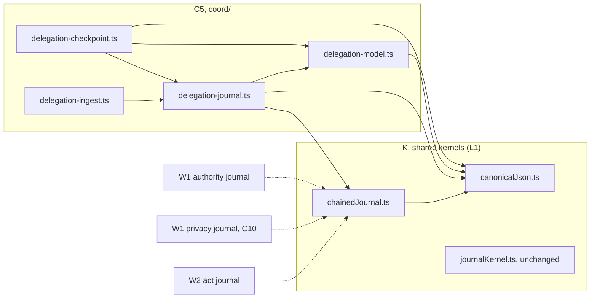

# Overlord W1: the chained-journal kernel, moved out of the delegation journal Implementation Plan

> **For agentic workers:** REQUIRED SUB-SKILL: Use superpowers:subagent-driven-development (recommended) or
> superpowers:executing-plans to implement this plan task-by-task. Steps use checkbox (`- [ ]`) syntax for tracking.

**Goal:** the hash-chained journal's codec, chain verifier and torn-tail rule live in one shared kernel that knows no
record grammar, and the delegation journal becomes the first journal on it. The canonical JSON writer that the codec
hashes moves with the kernel. Nothing changes in behaviour: every byte the delegation journal writes, every hash, every
refusal class, code and message, and every exported name stay as they are. W1's authority journal and privacy journal
then sit on the kernel, and W2's act journal does too, without importing the delegation context.

**Why:** H27 ("three journals on one kernel", §7.6). The tree has one chained journal, the delegation journal, and its
codec is written for its own grammar. A second and third journal would otherwise copy it, or import the delegation
model from another context. The extraction is move-only, with characterization tests first, so the delegation journal,
which is an authority whose bytes cannot change, keeps reading every file it wrote.

**Architecture:** two new shared-kernel files (context K, ring L1). `server/src/canonicalJson.ts` holds the RFC 8785
writer, the text hash and the hash-shape predicate, and imports `node:crypto` only. `server/src/chainedJournal.ts`
holds the record envelope, its two preimages, the strict line codec, the JSON defect scanner, the line splitter, the
torn-tail classification and heal rule, the chain verifier and the whole-bytes parser, all generic over a
`ChainedJournalFormat<E>` that a journal supplies (its entry grammar, its instant check and its error classes). It
imports `./canonicalJson.js` only. `server/src/coord/delegation-journal.ts` keeps its entry grammar, its append and
retention planning, its event row and its whole impure shell (the file port, the readers, the retained-set reader and
the writer), and binds the kernel to its grammar under its existing names. One pull request, four tasks.

**Tech Stack:** TypeScript (ESM), vitest. No new dependency.

**Spec:** `docs/superpowers/specs/2026-11-09-overlord-design.md` §7.6 (H27: "A generic chained-journal kernel
(codec, verifier, tail heal) is extracted from the delegation journal … The extraction is a move-only pull request with
characterization tests"; "Three record grammars sit on it"; "Each is a new file that no snapshot carries"), §10.1 (H27:
the act journal is chained, its head signed under a domain-separated preimage), Table 13.1 row H27 (`shape`, waves W1,
W2, W4), Table 14 row W1 ("the journal kernel"), §14 ("A shape call cannot trail"). The index is
`docs/superpowers/plans/2026-11-14-overlord-w1.md` (in #2814): row "Journal kernel", lane C, first; its open question 3.
The consolidation design's K17 and §3.19 (`docs/superpowers/specs/2026-10-19-ccrc-consolidation-wave-design.md`) decide
where the kernel may not go (question 2 below).

## Open questions

Each is a place where the spec is silent or does not match the tree. The plan builds the recommendation unless the
coordinator rules otherwise.

1. **The kernel is W1's first piece in lane C** (the index's question 3, slug `journal-kernel-is-the-first-w1-piece`).
   §7.6 says the extraction comes "before W1" and that "W1 ships the kernel". **Recommendation (the index's):** it is
   W1's first lane-C piece, move-only, ready to build now. This plan builds that.
2. **The tree already has a "journal kernel", and the delegation journal is pinned never to import it** (slug
   `chained-kernel-beside-the-log-first-kernel`). `server/src/journalKernel.ts` (K, L1) holds the log-first journals'
   shared steps (`maxJournalEpoch`, `journalFloor`, `appendThenApply`, `splitJournalRecords`). Its header says "The
   delegation journal (authority, not a projection; spec §3.19) never imports this file", and
   `server/test/single-definition/kernel-tail-journal.test.ts` pins that no `coord/delegation-*.ts` file imports it
   (`server/test/census-w8/journal.ts#delegationKernelImports`, 0). K17 records why: the delegation journal is the
   hash-chained authority and `coord.db` its projection, the reverse of a log-first mirror. The authority journal and
   the privacy journal are authorities too. **Recommendation:** the chained kernel is a new file,
   `server/src/chainedJournal.ts`, beside `journalKernel.ts`, which this piece does not touch. Its header names K17's
   reason as the "legitimately different" one, including for the second NDJSON framer it brings into K (bytes and a
   streaming leftover, against `splitJournalRecords`' whole text). The spec's words "the journal kernel" mean this
   file.
3. **The canonical JSON writer lives in the delegation model** (slug `canonical-writer-moves-to-k`). The codec hashes
   and checks records through `server/src/coord/delegation-model.ts#canonicalDelegationJson` and
   `#delegationSha256Hex`, which are context C5. A K kernel that imported them would point a shared kernel at a bounded
   context, and the privacy journal (C10) would import the delegation model. **Recommendation:** move the writer, the
   text hash and `isLowerHex64` to `server/src/canonicalJson.ts` (K, L1) in this pull request, as Task 2, before the
   chain moves. The delegation model keeps `canonicalDelegationJson`, `delegationSha256Hex` and `DelegationJsonError`
   under their names, each a binding that hands the writer the model's own error, so every class and message stays.
4. **What the kernel is** (slug `kernel-is-pure-the-writer-stays`). H27 names "codec, verifier, tail heal". The
   delegation journal also has an asynchronous file port, a chunked reader, a retained-set reader over its carried file
   and an `O_APPEND` writer. The authority journal is appended "inside the store's transaction, before the row" (§7.6):
   `CoordStore` is synchronous (`DatabaseSync`), and the tree's log-first writers append inside `tx()` through
   `appendThenApply`, while the delegation writer is a `Promise` through `DelegationFilePort`. **Recommendation:** the
   kernel is the pure part only: the codec, the verifier, the heal RULE (`chainedTailHealPlan`) and the whole-bytes
   parser. The port, the readers, the writer, compaction, retention and the heal's act
   (`server/src/coord/delegation-checkpoint.ts#DelegationDurability`) stay the delegation journal's. The authority
   journal's plan decides its synchronous writer, after the pattern of `server/src/coord/landingJournal.ts`, and says
   whether `appendThenApply` carries it. If two synchronous writers then exist, the second piece moves them into the
   kernel.
5. **The delegation journal keeps every exported name** (slug `delegation-names-kept`). Its names are imported by four
   source files and 21 test files. **Recommendation:** the move commit changes no caller and no test outside the pins
   named in Task 3. Each grammar-bound function keeps its name as a binding over the kernel with the delegation format.
   Each generic piece (the splitter, the defect scanner, the heal plan, the position, coverage, tail and options types)
   keeps its name as a one-line alias of the kernel's, listed in the pull request body. Retiring the aliases, by
   re-pointing callers to the kernel's names in an imports-and-names-only commit, is "Later".
6. **One envelope for every chained journal, and no domain tag in the record** (slug `one-envelope-no-record-domain`).
   §10.1 asks for a domain-separated preimage for the act journal's signed head, not for records. The delegation
   record's preimages (`{v, sequence, acceptedAt, previousDigest, entry}` and the same with `journalId`) cannot change.
   **Recommendation:** every journal on the kernel uses this envelope, and its kind lives in `entry.kind`. Each new
   journal's piece pins its entry kinds disjoint from every other journal's, and its own file is its domain. The act
   journal's head signature (W2) carries its domain at signing.
7. **The moved code is in no mutant set** (slug `kernel-mutant-sets`). Moved code adds no decider, so the index's rule
   ("every new L1 decider joins `MUTANT_SETS`") does not reach it. But three journals' boot coherence will rest on the
   chain verifier and the heal rule. **Recommendation:** Task 4 adds `server/test/sim/chainedJournalSets.ts`, with
   `decodeChainedLine`, `ChainVerifier` and `chainedTailHealPlan` as sets, floors measured. It changes tests only.

## What exists today

Measured on `main` at `416b8f942` (2026-11-14).

- **`server/src/coord/delegation-journal.ts`** (1,076 lines; context C5, by the `coord/**` row; ring L1 by its imports,
  which are `shared/api.ts`, `delegation-lease-state.ts` and `delegation-model.ts`; it does its I/O only through the
  injected port). Above its `IMPURE SHELL` banner, pure:
  - the refusal union `DelegationJournalErrorCode` (31 words), `DelegationJournalError` (message
    `delegation journal <code>: <detail>`, with ` (line N)` when it has a line), the total table
    `DELEGATION_JOURNAL_ERROR_CODES`, and `isDelegationJournalKebab` for `server/test/mail-routes.test.ts`'s scan of
    `server/src/coord`;
  - the preimages `delegationJournalId` and `delegationJournalDigest`, and `buildDelegationJournalRecord`;
  - the entry grammar (`validateEntry`, private, with the lease kinds' total key tables and its field helpers);
  - `findDelegationJsonDefect` (the duplicate-key scanner), `encodeDelegationJournalRecord`,
    `decodeDelegationJournalLine`, `DelegationJournalLineSplitter`, `delegationTornTailError`;
  - the heal rule: `DelegationJournalTail`, `DelegationTailHealPlan`, `delegationTailHealPlan` (D-4655), and the
    quarantine directory name `DELEGATION_TORN_DIR`;
  - the chain: `DelegationJournalPosition`, `DelegationJournalCoverage`, `DelegationJournalChainOptions`,
    `DelegationJournalChain`, `validateDelegationJournalBytes` (with the pruning holds' `held-evidence-missing`) and
    `parseDelegationJournal`;
  - delegation's own planning: `delegationEventRowOfRecord`, `delegationLeaseIdentityKey`,
    `planDelegationJournalAppend`, the retention view, collector and `planDelegationPruning`,
    `DELEGATION_RETENTION_FLOOR_MS`.

  Below the banner: the port (`DelegationFilePort`, `DelegationFileHandle`, `DelegationReadHandle`),
  `delegationBytesSha256` (the one Web Crypto use), `readDelegationJournalLines`, `readDelegationJournalRecords`,
  `readDelegationRetainedRecords` (the carried file, D-7021) and `DelegationJournalWriter`.
- **The canonical writer**, in `server/src/coord/delegation-model.ts` (1,813 lines, C5, L1, imports `node:crypto` for
  this alone): `canonicalDelegationJson` (RFC 8785 over a closed domain, by the private `canon`, `wellFormed`,
  `ownKeysOf`, `byCodeUnits` and `LONE_SURROGATE`), `DelegationJsonError` (message `delegation canonical JSON:
  <detail>`), `delegationSha256Hex` (via `createHash`) and `isLowerHex64`. The model also owns
  `parseDelegationInstant`, `DelegationJournalRecordV1` and `DelegationJournalEntryV1`, which stay.
- **Every caller.** Of the journal module, in `server/src`: `delegation-checkpoint.ts` (its codec, chain, heal, planning,
  readers, writer and port types), `delegation-ingest.ts` (`findDelegationJsonDefect`), `delegation-file-port.ts` (the
  port's types) and `watch.ts` (`DELEGATION_RETENTION_FLOOR_MS`); in `server/test`, 21 files. Of the writer family:
  `canonicalDelegationJson` in `delegation-checkpoint.ts`, `delegation-journal.ts`, `delegation-model.ts`,
  `delegation-policy.ts` and `watch.ts`; `delegationSha256Hex` in `delegation-conflicts.ts`, `delegation-journal.ts`,
  `delegation-model.ts` and `delegation-policy.ts`; `isLowerHex64` in `delegation-checkpoint.ts`,
  `delegation-journal.ts` and `delegation-model.ts` (no test); `DelegationJsonError` in those three, and in
  `server/test/delegation-model.test.ts`.
- **Pins that read these files' text or imports** (each re-measured in its task):
  - `server/test/delegation-recovery.test.ts`: the rows "the journal module has no method that could rewrite it" and
    "no other production source names the journal file", which read `delegation-journal.ts`; the pure/impure split
    rows, which pin `delegation-journal.ts`'s import list above the banner to exactly `shared/api.js`,
    `./delegation-lease-state.js` and `./delegation-model.js`, its one Web Crypto line, and "neither module defines a
    second canonical writer".
  - `server/test/delegation-wave3.integration.test.ts`: the journal module's `fsp` calls and the closed list of files
    that name the journal.
  - `server/test/delegation-model.test.ts`: "the model is L1", which pins its imports to exactly
    `shared/agent-protocol.js`, `shared/api.js`, `./delegation-lease-state.js` and `node:crypto`.
  - `server/test/single-definition/advance-switches.test.ts`: the ARCH-06 ceilings, `delegation-journal.ts` 10 and
    `delegation-model.ts` 5. A file with no row has ceiling 0, so a new literal source pin over either new file is red.
    Their pins go through `server/test/scan/symbols.ts`' `parsedFile` instead.
  - `server/test/mail-routes.test.ts`: every kebab word spelled under `server/src/coord` must be one of the named
    tables, among them `isDelegationJournalKebab`.
- **The log-first kernel** (`server/src/journalKernel.ts`), pinned as above (question 2). `kernel-tail-journal.test.ts`
  also pins that it imports nothing.
- **The other journals** in the tree are not hash-chained: `landing.log` (C4, "the landing authority journal", with its
  own synchronous adapter `server/src/coord/landingJournal.ts`), the collector switch's generation log
  (`server/src/coord/collectLaneJournal.ts`, the restore-detection pattern §7.6 cites), the pool edges
  (`server/src/coord/pooledgelog.ts`), the update intent (`server/src/coord/updateintentlog.ts`) and the deviation
  ledger's log. None of them moves onto this kernel here. The overlord authority journal's plan should name its file and
  class so they are not confused with `landing.log`.
- **The architecture spec** (`docs/superpowers/specs/2026-08-10-architecture-ddd-clean-solid.md`): the K row of the
  "Deciding a file's ring and context" table already lists `journalKernel.ts`. `server/test/rings/totality.test.ts`
  refuses an unmapped file, so each new file adds its row in the commit that creates it. The server ring rule's
  `node:crypto` sentence cites "`coord/delegation-model.ts`'s hashing" as its example, which Task 2 makes stale.
- **Growth.** `server/test/growthCheck.ts#GROWTH_FILES` lists `server/src/coord/delegation-checkpoint.ts`. This piece
  edits one import there (Task 2, `isLowerHex64`). It touches no other listed file.
- **In flight beside it.** The large-file programme (`docs/superpowers/specs/2026-11-13-large-file-programme-design.md`)
  pilots on `delegation-checkpoint.ts`, by pure moves, and may edit `delegation-recovery.test.ts`'s loops over that file.
  This piece keeps the checkpoint's surface and changes one import line in it. The second to land merges `main` once
  (worker clause 16) and re-runs the delegation suites.



*Figure 1. The imports after the move. Solid edges are this piece's. Dotted edges are the later journals, which import
the kernel and never the delegation model. Nothing imports `journalKernel.ts` from the delegation files.*

## Global Constraints

- **Move only (`CLAUDE.md`, "Characterization tests first when moving code").** Task 1's tests are green on `main`
  against the old code and are not edited after. A move commit changes the moved code's home, the moved files' own
  imports and bindings, the callers' import lines, and the test pins that name a moved file's path or import list. It
  changes no test assertion about behaviour. Any intended behaviour change is a commit of its own, and this plan has
  none.
- **Byte identity.** For every input Task 1 pins, the bytes written, both hashes, the record decoded, and every thrown
  error's class, `code`, `message` and `where` are identical before and after. Check order inside the decoder is kept
  (a line with two defects reports the same one).
- **Architecture.** Both new files are ring L1 and context K, and each says so in its header, with its reason for being
  separate (question 2 and K17). Neither imports anything under `server/src/coord/`, `continuity/` or any other
  context directory. `chainedJournal.ts` imports `./canonicalJson.js` only. `canonicalJson.ts` imports `node:crypto`
  only. The delegation journal's split stays: everything above its banner is pure. One writer of canonical JSON in the
  tree: after Task 2, `canon` exists only in `canonicalJson.ts`.
- **SAFETY (`CLAUDE.md`).** No ccd verb, no fleet act, no live `~/.ccrc`. Every test uses fixture directories under the
  per-run temp root, as the delegation suites do.
- **Tests.** From `server/`: `ccrc test -- ./node_modules/.bin/vitest run test/<file>.test.ts`. The last run of each
  task adds both `tsc` runs (`ccrc test -- npx tsc --noEmit -p tsconfig.json` and `-p test/tsconfig.tests.json`). No
  `shared/` file changes, so pwa's `tsc` is not needed.
- **Source pins.** A new pin over `canonicalJson.ts` or `chainedJournal.ts` reads them through
  `server/test/scan/symbols.ts`' `parsedFile` (its imports, symbols and calls), never through `readFileSync` and a
  string method (the ARCH-06 ratchet). Existing literal pins over the delegation files keep their counts.
- **Census.** The architecture spec's K row gains `canonicalJson.ts` (Task 2) and `chainedJournal.ts` (Task 3). No new
  door, table, lane, refusal word, wire field or capability word.
- **Public repository.** No private names: fixtures use `project-a`, `lane-a-project-a`. Cite by symbol or `@anchor`.
  No D-number invented: this plan's slugs are under "Deviations found", and the coordinator mints numbers.

## Review Focus

1. **Nothing moved changed.** Task 1's file is untouched by Tasks 2 to 4 and green after each. The diff of each move
   commit, read with `git diff --color-moved=dimmed-zebra`, is moved blocks, the format bindings, import lines and
   the named pins.
2. **The kernel is generic.** It spells no delegation word, imports nothing from a context, and a second format with a
   toy grammar runs every kernel path (Task 4).
3. **The delegation journal's guarantees hold.** Its writer still cannot cut the journal, the heal is still its one cut,
   the retained-set reader is still the one reader, and the pure/impure split still holds, with the same pins.
4. **Errors keep their class.** Every refusal the kernel throws for the delegation journal is a
   `DelegationJournalError`, and every canonical-domain refusal is a `DelegationJsonError`, with the messages Task 1
   pins. `delegation-checkpoint.ts`' `instanceof` branches see the same classes.

## The PR split

| PR | Tasks | What it ships | Needs first | Growth-checked files, estimate |
|---|---|---|---|---|
| One | 1 to 4 | The characterization tests, the canonical writer in K, the chained kernel in K with the delegation journal bound to it, and the kernel's own tests and mutant sets | nothing: **ready to build** | `server/src/coord/delegation-checkpoint.ts` +1 (one import line) |

Files that are not growth-checked, for scale: `delegation-journal.ts` about −430 net, `delegation-model.ts` about −90,
`chainedJournal.ts` about +470 new, `canonicalJson.ts` about +110 new. The four commits land in order: the tests, the
writer, the kernel, the kernel's own tests. W1's authority journal A and private store A need this pull request merged
(the index's order).

---

### Task 1: Characterization tests, green on `main`

**Files:**
- Create: `server/test/chained-journal-characterization.test.ts`

It imports only `../src/coord/delegation-journal.js` and `../src/coord/delegation-model.js`, so the move commits leave
it untouched. Every expected value is a literal measured once on `main` (a scratch script under the session's temp
root, never in the tree, whose output is pasted), never computed in the test from the code under test.

Cases:
- **Golden records.** One record of each entry kind (`evidence-accepted`, `lease-created`, `lease-transition`,
  `lease-released`, `lease-carrier-seen`) at fixed fields: the exact bytes of `encodeDelegationJournalRecord`, and
  `journalId` and `digest` as hex literals. A three-record chain from `planDelegationJournalAppend` (one item skipped as
  `duplicate-event`): each record's hashes and the skip list.
- **The canonical writer.** `canonicalDelegationJson` of values that test key order by UTF-16 code units (an astral key
  beside a BMP key above `U+D800`), string escapes, `-0`, `1e21`, `0.1`, nested arrays and objects. Each refused domain
  value (an unsafe integer, `NaN`, a lone surrogate in a value and in a key, a sparse array, `undefined`, a class
  instance, a cycle) throws `DelegationJsonError` with its exact message. `delegationSha256Hex` of a fixed text, and its
  refusal of a lone surrogate. `isLowerHex64` on a valid value, an uppercase value and a 63-character value.
- **Every refusal of the codec and the chain.** One crafted input per `DelegationJournalErrorCode` that
  `decodeDelegationJournalLine`, `DelegationJournalChain`, `delegationTornTailError`, `validateDelegationJournalBytes`
  and `parseDelegationJournal` can throw: the class, `code`, exact `message` and `where`. Order rows: a BOM and a CR on
  one line, a repeated key that also makes the text noncanonical, a bad `journalId` with a bad `digest`.
- **The chain.** A table of record sequences against `completeFromStart` and an anchor: each verdict, and for each
  accepted sequence `head()`, `recordCount()`, `firstRecord()`, `anchorWasSeen()` and `finish()`'s coverage.
- **The splitter.** A three-record journal cut into two chunks at every byte offset gives the same lines and
  `leftover()`.
- **The tail.** `delegationTornTailError` on a complete record with no LF (`missing-final-lf`) and on a fragment
  (`torn-tail`, its byte count in the message). `delegationTailHealPlan` over a null tail, an unsound prefix and each
  code: the exact plan, its `name` included.
- **The words.** `Object.keys(DELEGATION_JOURNAL_ERROR_CODES)` sorted, as a literal list. `isDelegationJournalKebab` is
  true for each code, each skip reason, each entry kind and `bad-event`, and false for `not-a-word`.

- [ ] **Step 1: Measure** the literals on `main`. Write the cases.
- [ ] **Step 2: Run** the file. Green on `main` (it is a characterization, not a red-first test).
- [ ] **Step 3: Bite check** with the coordinator skill's `references/mutation-run.py` (in memory, its temp tree
  removed): swap `byCodeUnits`' result, drop `previousDigest` from the digest preimage, and move the decoder's CR check
  before its BOM check. Each mutant reds at least one case. Record the table for the pull request body.
- [ ] **Step 4: Commit.** `test(journal): characterize the delegation journal's codec, chain and canonical writer before the kernel move (Overlord W1)`

### Task 2: The canonical writer moves to K

**Files:**
- Create: `server/src/canonicalJson.ts` (K, L1; imports `node:crypto` only)
- Modify: `server/src/coord/delegation-model.ts` (the writer family moves out; its four names stay, as below; its
  `node:crypto` import goes, if the measure in Step 1 finds no other use)
- Modify: `server/src/coord/delegation-journal.ts` and `server/src/coord/delegation-checkpoint.ts` (`isLowerHex64`'s
  import line only)
- Modify: `docs/superpowers/specs/2026-08-10-architecture-ddd-clean-solid.md` (the K row gains `canonicalJson.ts`, after
  `journalKernel.ts`; the ring rule's `node:crypto` example names `canonicalJson.ts`'s hashing)
- Test: `server/test/delegation-model.test.ts` (its import-list pin: `node:crypto` becomes `../canonicalJson.js`),
  `server/test/delegation-recovery.test.ts` (only the import-list literal for `delegation-journal.ts` above its banner,
  which gains `../canonicalJson.js`), `server/test/rings/*.test.ts`

**Interfaces:**

```ts
// server/src/canonicalJson.ts
/** RFC 8785 over the closed JSON domain. A value outside it throws `fail(detail)`, the caller's own error. */
export function canonicalJson(value: unknown, fail: (detail: string) => Error): string;
/** Lowercase SHA-256 of the text's UTF-8 bytes. A lone surrogate throws `fail(detail)`. */
export function sha256HexOfText(text: string, fail: (detail: string) => Error): string;
/** A lowercase 64-hex SHA-256. */
export const isLowerHex64: (v: unknown) => v is string;

// server/src/coord/delegation-model.ts keeps, under the same names and messages:
export class DelegationJsonError extends Error { /* unchanged */ }
export const canonicalDelegationJson = (value: unknown): string => canonicalJson(value, (d) => new DelegationJsonError(d));
export const delegationSha256Hex = (text: string): string => sha256HexOfText(text, (d) => new DelegationJsonError(d));
```

Each `detail` is the text the model passes to `DelegationJsonError` today, so the message is unchanged. The model's
other uses of `isLowerHex64` import it from `../canonicalJson.js`, and so do the journal and the checkpoint. The model
does not re-export it.

- [ ] **Step 1: Measure** the model's `node:crypto` uses (one, `delegationSha256Hex`, on `main`) and every
  `isLowerHex64` importer.
- [ ] **Step 2: Move.** Cut the family into `canonicalJson.ts`, write the two bindings, re-point the imports, and edit
  the spec's K row and example.
- [ ] **Step 3: Run** Task 1's file, `test/delegation-model.test.ts`, every `test/delegation-*.test.ts`,
  `test/coordination-snapshot.test.ts`, `test/mail-routes.test.ts`, `test/rings/*.test.ts`,
  `test/single-definition/*.test.ts` and both `tsc` runs. Green.
- [ ] **Step 4: Commit.** `refactor(journal): the canonical JSON writer moves to a shared kernel, which the delegation model binds (Overlord W1)`

### Task 3: The chained kernel moves to K

**Files:**
- Create: `server/src/chainedJournal.ts` (K, L1; imports `./canonicalJson.js` only)
- Modify: `server/src/coord/delegation-journal.ts` (the generic code moves out; the delegation format and the bindings
  below stay; the grammar, the planning, the event row and the shell are untouched)
- Modify: `docs/superpowers/specs/2026-08-10-architecture-ddd-clean-solid.md` (the K row gains `chainedJournal.ts`)
- Test: `server/test/delegation-recovery.test.ts` (only the import-list literal for `delegation-journal.ts` above its
  banner, which gains `../chainedJournal.js`)

**What moves.** The record envelope and its preimages, record building, the record keys and `exactKeys`,
`assertSequence`, the hex check, the defect scanner, encode and decode, the splitter, the torn-tail error and types,
the heal rule, the position, coverage and options types, the chain verifier and the whole-bytes parser. **What stays in
`delegation-journal.ts`:** the file names, `DelegationJournalError` and its seven own codes (`held-evidence-missing`,
`short-write`, `writer-unusable`, `short-copy`, `carried-order`, `carried-past-journal`, `carried-past-applied`), the
entry grammar and its field helpers, `isEventEnvelope`, the event row, the lease identity key, append and pruning
planning, the retention floor, and everything below the banner.

**Interfaces:**

```ts
// server/src/chainedJournal.ts
export type ChainedJournalErrorCode =
  | 'bom' | 'crlf' | 'blank-line' | 'torn-tail' | 'missing-final-lf' | 'invalid-utf8' | 'malformed-json'
  | 'duplicate-key' | 'unknown-key' | 'bad-field' | 'invalid-domain' | 'noncanonical' | 'sequence-domain'
  | 'sequence-start' | 'sequence-duplicate' | 'sequence-descent' | 'sequence-gap' | 'previous-digest'
  | 'journal-id-mismatch' | 'digest-mismatch' | 'anchor-sequence' | 'anchor-journal-id' | 'anchor-digest'
  | 'anchor-missing';
export const CHAINED_JOURNAL_ERROR_CODES: Readonly<Record<ChainedJournalErrorCode, true>>;
export interface JournalWhere { line?: number; offset?: number }

/** What a journal hands the kernel: its entry grammar, its instant check and its error classes. */
export interface ChainedJournalFormat<E> {
  /** The entry rebuilt field by field, or a refusal thrown through `fail`. */
  entry(raw: unknown): E;
  /** True for a canonical UTC millisecond instant (the delegation format binds `parseDelegationInstant`). */
  isInstant(v: unknown): boolean;
  /** Every refusal is thrown as this, so a journal's callers keep their `instanceof`. */
  fail(code: ChainedJournalErrorCode, detail: string, where?: JournalWhere): Error;
  /** The canonical writer's refusal, as the journal's own class. */
  jsonError(detail: string): Error;
}

export interface ChainedJournalRecord<E> {
  v: 1; sequence: number; journalId: string; acceptedAt: string; previousDigest: string | null; entry: E; digest: string;
}
export interface ChainedRecordFields<E> { sequence: number; acceptedAt: string; previousDigest: string | null; entry: E }

export function chainedRecordId<E>(fmt: ChainedJournalFormat<E>, f: ChainedRecordFields<E>): string;
export function chainedRecordDigest<E>(fmt: ChainedJournalFormat<E>, f: ChainedRecordFields<E> & { journalId: string }): string;
export function buildChainedRecord<E>(fmt: ChainedJournalFormat<E>, f: ChainedRecordFields<E>): ChainedJournalRecord<E>;
export function exactKeys<E>(fmt: ChainedJournalFormat<E>, o: Record<string, unknown>, keys: readonly string[], what: string): void;
export function findJsonDefect(text: string): 'duplicate-key' | 'malformed-json' | null;
export function encodeChainedRecord<E>(fmt: ChainedJournalFormat<E>, r: ChainedJournalRecord<E>): Uint8Array;
export function decodeChainedLine<E>(fmt: ChainedJournalFormat<E>, line: Uint8Array, where?: JournalWhere): ChainedJournalRecord<E>;
export class ChainedLineSplitter { push(chunk: Uint8Array): Uint8Array[]; leftover(): Uint8Array }
export function chainedTornTailError<E>(fmt: ChainedJournalFormat<E>, leftover: Uint8Array, where?: JournalWhere): Error;
export interface ChainedTail { offset: number; bytes: Uint8Array; sha256: string; code: 'torn-tail' | 'missing-final-lf' }
export interface ChainedTailHealPlan { offset: number; bytes: number; sha256: string; code: ChainedTail['code']; name: string }
export function chainedTailHealPlan(tail: ChainedTail | null, prefixSound: boolean): ChainedTailHealPlan | null;
export interface ChainedPosition { sequence: number; journalId: string; digest: string }
export interface ChainedCoverage {
  firstSequence: number | null; lastSequence: number | null; recordCount: number;
  firstPreviousDigest: string | null; copiedEof: ChainedPosition | null;
}
export interface ChainOptions { completeFromStart?: boolean; anchor?: ChainedPosition | null }
export class ChainVerifier<E> {
  constructor(fmt: ChainedJournalFormat<E>, opts?: ChainOptions);
  accept(r: ChainedJournalRecord<E>): void;
  head(): ChainedPosition | null; recordCount(): number;
  firstRecord(): { sequence: number; previousDigest: string | null } | null;
  anchorWasSeen(): boolean; finish(): ChainedCoverage;
}
/** Every complete line decoded and chained, in order, with `visit` called on each; bytes after the last LF throw. */
export function parseChainedBytes<E>(fmt: ChainedJournalFormat<E>, bytes: Uint8Array, opts?: ChainOptions,
  visit?: (r: ChainedJournalRecord<E>) => void): { records: ChainedJournalRecord<E>[]; coverage: ChainedCoverage };
```

**The delegation journal binds it.** A private `DELEGATION_FORMAT` supplies `validateEntry`, an instant check over
`parseDelegationInstant`, `new DelegationJournalError(code, detail, where)` and `new DelegationJsonError(detail)`.
Bindings under the old names: `delegationJournalId`, `delegationJournalDigest`, `buildDelegationJournalRecord`,
`encodeDelegationJournalRecord`, `decodeDelegationJournalLine`, `delegationTornTailError`,
`validateDelegationJournalBytes` (the kernel's parser, then its own `held-evidence-missing` check, as today),
`parseDelegationJournal`, and `class DelegationJournalChain extends ChainVerifier<DelegationJournalEntryV1>` with the
format fixed. Aliases for the generic pieces: `findDelegationJsonDefect`, `DelegationJournalLineSplitter`,
`delegationTailHealPlan`, and the types `DelegationJournalTail`, `DelegationTailHealPlan`, `DelegationJournalPosition`,
`DelegationJournalCoverage`, `DelegationJournalChainOptions`, `DelegationJournalRecordFields`.
`DelegationJournalErrorCode` becomes `ChainedJournalErrorCode` plus its seven own codes, and
`DELEGATION_JOURNAL_ERROR_CODES` spreads `CHAINED_JOURNAL_ERROR_CODES` and adds them, so it stays total and
`isDelegationJournalKebab` answers the same words. `DelegationJournalRecordV1` stays declared in the model.

- [ ] **Step 1: Measure** that every name in "What exists today" still has the one definition listed, and that no test
  outside the pins named here reads `delegation-journal.ts`' text in a way the move changes (search `server/test` for
  the file's name and for `IMPURE SHELL`).
- [ ] **Step 2: Move.** Cut the generic code into `chainedJournal.ts` with the format parameter, write the format, the
  bindings and the aliases, and edit the spec's K row and the import-list pin.
- [ ] **Step 3: Run** Task 1's file, the 21 test files that import `delegation-journal.js` (`git grep -l` lists them:
  every `test/delegation-*.test.ts` among them, with `test/coordination-snapshot.test.ts`, `test/lease-routes.test.ts`,
  `test/fleet-health.test.ts`, `test/ccrc-update-flip-backups.test.ts` and `test/mail-routes.test.ts`), `test/census-w8/journal.test.ts`,
  `test/single-definition/*.test.ts`, `test/rings/*.test.ts` and both `tsc` runs. Green.
- [ ] **Step 4: Commit.** `refactor(journal): the chained-journal kernel moves out of the delegation journal, which binds its grammar to it (Overlord W1)`

### Task 4: The kernel stands alone

**Files:**
- Create: `server/test/chained-journal.test.ts`
- Create: `server/test/sim/chainedJournalSets.ts`
- Modify: `server/test/sim/mutation-floors.test.ts` (`MUTANT_SETS`), `server/test/sim/mutation-floors.json`

This task changes tests only. Its new cases are new tests of moved code, so they are written after the move, as the
contract the next journals rely on.

Cases:
- **A second format.** A fixture format whose entry is `{ kind: 'probe', n: number }` (exact keys, `n` a positive safe
  integer), with its own error class. It builds, encodes, decodes and chains records. Each `ChainedJournalErrorCode`
  is reachable and thrown as the fixture's class, never as `DelegationJournalError`. A delegation record's line fails
  the fixture's grammar with `bad-field`, and a fixture record's line fails the delegation format's. A tail heals by the
  same rule.
- **Structure, by `parsedFile`.** `chainedJournal.ts` imports exactly `./canonicalJson.js`, and `canonicalJson.ts`
  exactly `node:crypto`. Neither file's code (comments excluded) spells `delegation` in any case. `canon` is declared
  in `canonicalJson.ts` and nowhere else under `server/src`. `journalKernel.ts` still imports nothing, and neither new
  file imports it or is imported by it.
- **One record type.** A type-level case (`expectTypeOf`) that `DelegationJournalRecordV1` equals
  `ChainedJournalRecord<DelegationJournalEntryV1>`.
- **Mutant sets.** `decodeChainedLine`, `ChainVerifier` and `chainedTailHealPlan`, each run against the cases of this
  file and Task 1's, on the shape of `server/test/sim/cardMutants.ts`.

- [ ] **Step 1: Write** the cases and the sets.
- [ ] **Step 2: Run** the file. Green (it tests moved code). **Step 3: Red check:** make `chainedTailHealPlan` heal an
  unsound prefix, and make `decodeChainedLine` call `fail` with `bad-field` where it calls `noncanonical`. Each reds a
  case. Revert.
- [ ] **Step 4: Measure the floors** with `test/sim/mutation-floors.test.ts` and record them in `mutation-floors.json`.
  Run it, both `tsc` runs and `test/single-definition/*.test.ts`. Green.
- [ ] **Step 5: Commit.** `test(journal): the chained-journal kernel stands alone: a second format, its imports and its mutant sets (Overlord W1)`

**The pull request ends here.** Its body lists every caller, the aliases kept and why, K17's "legitimately different"
reason for a second kernel beside `journalKernel.ts`, Task 1's bite table and Task 4's floors.

## Deviations found

Departures from the spec's text that this plan makes, by slug. The coordinator mints numbers.

- **`chained-kernel-beside-the-log-first-kernel`** — the spec's "journal kernel" is a new file,
  `server/src/chainedJournal.ts`, not the tree's existing `journalKernel.ts`, which K17 and a pinned census keep apart
  from the delegation journal (question 2).
- **`canonical-writer-moves-to-k`** — the spec names the codec, the verifier and the tail heal. This plan also moves
  the canonical JSON writer to K, so no later journal imports the delegation model (question 3).
- **`kernel-is-pure-the-writer-stays`** — the delegation journal's port, readers and writer are not in the kernel. The
  authority journal's synchronous writer is its own piece's decision (question 4).
- **`delegation-names-kept`** — the delegation journal keeps every exported name, as bindings and aliases, for this pull
  request (question 5).
- **`one-envelope-no-record-domain`** — one record envelope for every chained journal, with no domain tag in its
  preimages (question 6).
- **`kernel-mutant-sets`** — moved code gains mutant sets in a test-only task, though it adds no decider (question 7).

## Where things stand

**Agreed (by the brief and the index):** a move-only pull request in lane C, first, with characterization tests first,
in the shape of a W1a piece plan.

**Waiting on the coordinator:** the seven open questions above. Questions 2, 3 and 4 change what is built: the kernel's
file, whether the canonical writer moves now, and where the authority journal's writer comes from.

**Waiting on the operator:** nothing.

**Needs before it starts:** nothing beyond `main`. **What depends on it:** authority journal A and private store A (the
index's order), and W2's act journal.

**Later:** retiring the delegation aliases (an imports-and-names-only commit over the callers and tests); the
authority journal's synchronous writer, and whether a second one moves into this kernel; whether the instant grammar
(`parseDelegationInstant`) moves to `server/src/time/` once a second journal checks `acceptedAt`.
