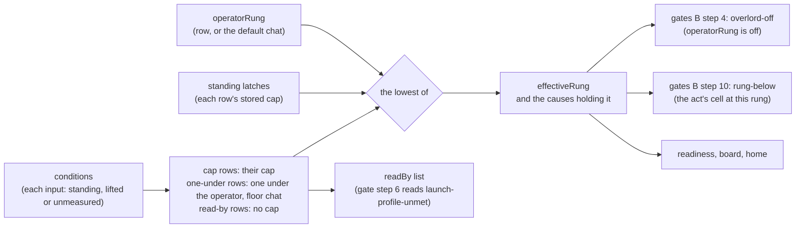
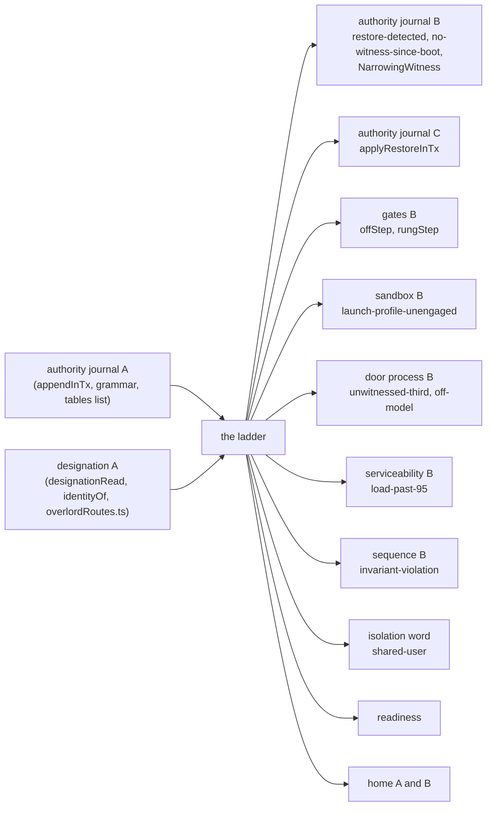

# Overlord W1: the ladder, its rung door, Pause and `off` Implementation Plan

> **For agentic workers:** REQUIRED SUB-SKILL: Use superpowers:subagent-driven-development (recommended) or
> superpowers:executing-plans to implement this plan task-by-task. Steps use checkbox (`- [ ]`) syntax for tracking.

**Goal:** one dial says how much the Overlord may do on its own, and the server computes it.

- `operatorRung` is the operator's setting: `off`, `chat`, `advise` or `full`. It is one settings row, written only by
  the operator's doors.
- Latches are rows, each with its cause and its cap. The server raises them, and only the operator clears them, one
  cause at a time.
- Conditions are never stored. Each is measured at every read, and lifts when its input ends.
- `effectiveRung` is the lowest of the operator's rung and every cap a standing latch or condition sets. Every door,
  hold and grant reads it.
- The rung door moves the operator's rung. Lowering takes no step-up. Raising takes the step-up, and in W1 stops at
  `chat`.
- Pause lowers the rung to `chat` and never raises it. `off` is one transaction.
- Every rung and latch write appends its record to the Overlord authority journal inside its own transaction. An
  operator narrowing always lands: when the journal cannot take its record, it writes its row only. A widening that
  the journal refuses is refused.
- The brakes (a rung down, Pause and `off`) read only the rung, so a bad row elsewhere never stops them.
- A narrowing reads "taking effect" until a witness off the server's volume holds it.

**Why:** H25 (§7.5): autonomy is a dial set apart from capability, and it moves down by itself. Widening is the
operator's act alone, and narrowing is the safe direction, so the server narrows without being asked. §7.6: a restore
must never bring back a rung or a cleared latch, so every change is journalled. W1 ships the ladder at `chat`, and
Pause (Table 14, row W1).

**Architecture:** one pull request in lane C, after authority journal A and designation A.

- `shared/overlord-ladder.ts` (L0, K) holds the rung words, the cause table, the effect shapes, W1's rung cells and
  the read's wire.
- `server/src/coord/overlordLadder.ts` (C5, L1) holds the pure deciders: `effectiveRung`, `rungMoveVerdict`,
  `offStep`, `rungStep` and `narrowingState`.
- `server/src/coord/overlordLadderStore.ts` (C5, L3) holds the two tables' writers and their reader. Each writer appends
  through `OverlordAuthorityJournal.appendInTx` inside its own `tx()`.
- `server/src/coord/overlordLadderRead.ts` (C5, L3) composes the read: the rows, each condition's input, and the
  witness port for "taking effect".
- `server/src/continuity/liveGeneration.ts` (C3, L3) is the continuity routes' live-generation reader, moved out so
  the `degraded` condition and the continuity doors read one function.
- The four doors join `server/src/coord/overlordRoutes.ts`, which designation A creates.

**Tech Stack:** TypeScript (ESM), `node:sqlite`, Fastify, vitest. No new dependency. No PWA code: the console's controls
are lane F's (question 14).

**Spec:** `docs/superpowers/specs/2026-11-09-overlord-design.md`:

- §7.5, H25, whole: the four rungs; "Computed, never stepped" with its three stored things and its readers; "Only the
  operator steps up"; Table 7.5a; "Tripwires refuse and count before they latch"; Pause; "`off` is one transaction";
  "The ladder needs `overlord-v1`".
- §3.2, C7: "One carrier, on the server" (`operatorRung`, a settings row with no file); the `off` rung; what `off`
  does in one transaction; "`off` never abandons a pending act"; Pause, one tap; "The brakes that work by themselves";
  "The Overlord never sets or clears a brake".
- §7.6: "A narrowing is done only once a witness holds it"; "After each boot … the rung is capped at `advise`"; "A
  detected restore latches the ladder at `chat`"; Confirm the restore's "each authority field takes the stricter";
  the authority journal's "changes of the ladder".
- §3.3.11: "While an Overlord generation is `degraded`, its ladder is capped at `chat`, a condition that lifts by itself
  when the generation leaves `degraded`".
- §11.2: the gate order's step 4 (`overlord-off`) and step 10 (`rung-below`); "The card, probe and note doors skip …
  At the `off` rung they skip the rung of step 10 too"; "Lowering never needs a step-up"; the operator's doors' group
  in Table 11.2 ("a rung up, clearing a latch" behind the step-up); "The census moves in the same pull request as each
  route".
- Table 11.1a, row "Ladder state: `operatorRung`, `latchedCap`, per-kind arming, engagement per programme" (K switches,
  L3, `coord.db` settings; W1 the rung). Table 11.1b, row "… `effectiveRung` …" (L1, W1). Table 11.1e, row "The
  ladder: rung, Pause, per-kind arming, engagement" (W1, W3).
- Table 11.6, rows `overlord-off` and `rung-below`.
- Table 13.1, row H25: `shape`, waves W1, W2 and W3, so the ladder's tables and doors ship with this piece.
- §4 (C8, `homePlace` reads `operatorRung`) and Table 5.2a's row "Brakes and the ladder", as readers of what this piece
  exposes.

The index is `docs/superpowers/plans/2026-11-14-overlord-w1.md` (on `main`). This plan builds on:

- its row "Ladder" (lane C, one pull request, five tasks, after authority journal A and designation A);
- its questions 19 (`w1-rung-door-stops-at-chat`), 20 (`ladder-causes-join-with-their-inputs`), 17 (the operator's
  doors reuse the account gate), 33 (no server-side `overlord-v1` gate on the operator's doors) and 36;
- its "Where lanes meet" bullet "The ladder's cause and condition tables", and its bullets for `overlordRoutes.ts`,
  `schema.ts`'s migrations and the door censuses;
- "What a merge arms" ("The ladder, the account set and the model class are read only by Overlord doors") and "States
  W2 may read" (`effectiveRung` and its latches).

The coordinator's brief for this plan and the cross-plan rulings of the authority journal (#2853), designation (#2856),
private store (#2855) and ccd arms (#2854) fix rounds bind over the index's text. The rulings this plan follows are
restated under "Open questions" and marked "(ruled)".

Revised in fix round 1 (review 2159). The coordinator's rulings on that review bind too, and two of them change the
sibling plans, which this pull request edits so the three plans agree:

- **X3b** (review F3): on any refused append an operator narrowing writes its row only, the journal calls
  `writerFailed`, and the answer says `journalled: false`. A widening still refuses. It extends X3 in X3's own
  direction: it trades journal completeness for a brake that always lands, which the coordinator tells the operator.
  The authority plan's decision rows 5 and 8 and its invariant NL, designation's retire, and this plan's questions 4 and
  13 change together.
- **`restore-detected` is a row** (review F4): the spec governs over X3's last sentence. It is a row-backed latch,
  raised through the ladder's writer by authority journal B, which Confirm the restore does not lift; the operator
  clears it once the journal is coherent (§7.6: "The `chat` cap stays as an ordinary latch, which the operator clears
  as any other").
- **Confirm appends first** (review F5): Confirm's transaction appends its record, then calls `applyRestoreInTx` with
  that record's sequence, and the record carries `{cause, cap}` pairs.

Each other ruling is marked "(ruled, F<n>)" where it applies.

## Open questions

One numbering runs through this section. Questions 1 to 10 restate the index's questions and the coordinator's rulings
this plan builds on. Questions 11 to 19 are this piece's own. The plan builds every recommendation unless the
coordinator or the operator rules otherwise.

1. **Which rungs the W1 rung door accepts** (index question 19, slug `w1-rung-door-stops-at-chat`). **Built here:** the
   rung words, `effectiveRung` and the deciders are total over all four rungs from W1. The rung door refuses
   `capability-missing` for a raise above `chat`, and names the word the target needs: `advise` needs
   `overlord-route-v1` (W2), and `full` needs `overlord-answer-v1` (W3, step two).
   - Each rung's word is a column of the rung table (`RUNG_MAP`'s `needs`), and the door checks it against
     `shared/api.ts#SERVER_CAPS`, the server's own words. So W2 opens `advise` by adding `overlord-route-v1` to
     `SERVER_CAP_MAP`, with no edit to the ladder.
   - A lowering is never refused for a word: `off` and `chat` need none, and a lower rung is always safe.
   - In W1 the operator's rung is therefore never above `chat`, so `effectiveRung` is never above `chat` either.
2. **The ladder ships the causes that have inputs** (index question 20, ruled; slug
   `ladder-causes-join-with-their-inputs`). The ladder ships the cause and condition tables, `effectiveRung` and one
   cause row: a `degraded` generation, a condition that caps `chat`. Each other cause row is added by the piece that
   produces its input, and each of those pieces needs the ladder first. Question 6 says how a row is added, and Table 2
   lists every later row with its owner.
3. **Every rung and latch write is journalled, and checks the answer** (ruled, the coordinator's brief and cross-plan
   rulings X1 and X2; re-taken against the authority plan's current contract, ruled F1). Each writer calls
   `OverlordAuthorityJournal.appendInTx(db, entry)` first, inside its own `tx()`, with `authority-rung`,
   `authority-latch-raise` or `authority-latch-clear`, the authority plan's grammar. `appendInTx` never throws and
   answers one of:
   - `{ ok: true, kind: 'appended', record }`: the writer writes its row with `record.sequence`;
   - `{ ok: true, kind: 'row-only', state }`: the writer writes its row with a NULL sequence, and the door answers
     `journalled: false` (question 4);
   - `{ ok: false, error }` with `not-in-transaction`, `authority-rolled-back`, `authority-unmeasured` or
     `journal-append`: the writer writes no row. A door maps `authority-rolled-back` and `authority-unmeasured` to the
     word `authority-rolled-back` (503), with the guard's cause in the body, and every other error to
     `journal-unreadable` (503), as the authority plan's "X2's door mapping" says.

   The ladder never decides which way an entry moves authority: the journal does, from the entry alone
   (`authorityDirection`), and the ladder reacts to its answer. The ladder also stamps `narrowedAt` from
   `authorityDirection`, so one function says what a narrowing is. The ladder adds `overlord_ladder` and
   `overlord_latches` to `OVERLORD_AUTHORITY_TABLES`.
4. **An operator narrowing always lands; a widening refuses** (ruled, X3, widened by X3b, F3). While the journal is not
   coherent, X3 already had an operator narrowing (Pause, retire, a rung down, a latch raise) write its row only, with
   no append and the head row unmoved, so the operator keeps every lever. X3b extends that to every refused append: the
   journal answers `row-only` for a narrowing in every row of its decision table, its rows 5 (the file unreadable) and
   8 (the append or head-row write failed) included, and calls `writerFailed` so the guard leaves `coherent`.
   - **Built here:** a narrowing (a rung down, Pause, `off`, a latch raise) reads `row-only` as any answer: it writes
     its row with a NULL sequence, and the door answers `{ ok: true, changed: true, journalled: false }`. A widening (a
     rung up, a latch clear) never receives `row-only`; it receives a refusal, writes nothing and the door answers the
     mapped word.
   - `not-in-transaction` is a programming error, not a journal state. It writes nothing for either direction, and a
     test pins that no ladder writer reaches it.
   - Confirm the restore folds the narrower row side in (`restoreStricter` takes the narrowest value), and a row left
     unjournalled with no Confirm is journalled by the ladder's next coherent write (question 20).
5. **The restore's latch and the no-witness condition are authority journal B's rows** (ruled, the brief: "give them
   the shape it needs and name the seam"; and F4: the spec governs, so `restore-detected` is a row). Built here:
   - a latch row is keyed by its cause and stores its cap, which is the shape `restore-detected` needs (cap `chat`);
   - a condition row reads `standing`, `lifted` or `unmeasured` from one input function per cause, which is the shape
     `no-witness-since-boot` needs (cap `advise`, lifted by the first counting witness since this boot);
   - the seam: authority journal B adds two rows to `LADDER_CAUSE_MAP`, the condition's input to the input table
     (question 6), and raises `restore-detected` through `raiseLatch`, at the boot step when the guard's verdict is
     `rolled-back` or `unmeasured`, and when a running guard first enters either state. The raise is a narrowing, so
     over a journal that is not coherent it writes its row only (question 4), which is the case it exists for. A
     standing latch of the cause answers `changed: false`, so it is raised once;
   - **Confirm does not lift it.** After Confirm the latch stands, with its row stamped by the Confirm record (question
     22), and caps the rung at `chat` until the operator clears it on the latch clear door. A clear is a widening, so
     the journal refuses it while it is not coherent: the operator clears the latch "once the restore is confirmed"
     (Table 7.5a). No clear rule of its own is needed, and a test here pins the refusal (slug
     `restore-latch-is-a-row`).
   - X3's last sentence ("The `restore-detected` latch is derived from the guard's state, is not journalled, and only
     Confirm clears it") is superseded. The authority plan's Task 7 said its clear door "does not offer
     `restore-detected`: that latch is derived, has no row and no writer"; this pull request rewrites that task, its
     questions 6 and 9, its `restoreStricter` latch row, its guard's `confirmed()` and their tests to the row form.
6. **How a later cause joins** (slug `cause-joins-by-a-row-and-an-input`). A later piece adds:
   - one row to `LADDER_CAUSE_MAP` (`shared/overlord-ladder.ts`): its key, its kind (latch or condition), its effect,
     its notice and its spec reference;
   - for a condition, one key in `ladderConditionInputs` (`overlordLadderRead.ts`), the function that reads its input.
     The type `LadderConditionInputs` is a mapped type over every condition key, so a condition row with no input is a
     compile error, never a silent `lifted`;
   - for a latch, a call to `raiseLatch` from the lane or door that measures its evidence.

   Nothing else changes: `effectiveRung`, the store, the read and the doors read the table. The effect shapes cover
   every row of Table 7.5a from W1, so no later row needs a new shape in W1 (question 7).
7. **The effect shapes** (slug `ladder-effects-cover-table-7-5a`). Table 7.5a has three kinds of effect, and the
   decider is total over all three from W1:
   - `{ kind: 'cap', cap }`: a fixed cap (most rows);
   - `{ kind: 'one-under-operator', floor }`: "one under the operator's rung, never under `chat`" (off the designated
     model, door process B);
   - `{ kind: 'read-by', reader }`: a row whose effect is not a cap, read by the one decider it names
     (§7.5: "A row of Table 7.5a whose effect is not a cap is read by the one decider it names"). W1's one reader word
     is `launch-profile-unmet` (sandbox B's row, read by the gate order's step 6). W3 adds `arming`, `ask-or-act` and
     `grants-lane` with their rows. `effectiveRung` ignores a `read-by` row for the rung and lists it in its answer's
     `readBy`, so the decider it names reads one list.
   - A row may also carry a notice for its raiser: `none`, `push` (the third unwitnessed write) or `item` (an
     invariant violation). The latch writer echoes it, and the raising piece sends it through its own lane. The ladder
     sends nothing itself.
8. **W1's rung cells, and the act catalogue of W2** (slug `rung-cells-seed-the-act-catalogue`). Step 10 refuses
   `rung-below` "by act kind", from the act catalogue's rung cells (Table 7.1a, H24), which is W2's
   (`OVERLORD_ACT_KINDS`). **Recommendation:** the ladder ships the cells for the act kinds W1's doors perform, and only
   those: `read` (every read door), `write-note` and `acknowledge`, each `allow` at `chat`, `advise` and `full`.
   W2's catalogue takes these rows over in a move commit, adding its other columns, and `rungStep` then reads the
   catalogue. One table, never two: the single-definition guard pins one home for the cells. `off` has no cell, as
   Table 7.1a has none (§11.2).
9. **`off`'s one transaction, W1's part** (slug `off-transaction-is-the-rung-write-in-w1`). §7.5 lists what `off`
   does: holds released, undelivered `overlord` mail and kickoffs cancelled, follow-up nudges stopped, open requests
   moved to `needs-you`, pending acts settled by measuring. Measured: none of these rows exists in W1. Holds are W3
   (Table 6.7c, H18). `fromId:'overlord'` mail and the Overlord's kickoffs come with the relay and start doors (W2,
   E3 and §8.2). Follow-ups, requests and act rows are W2 (§5.4, §5.1, Table 10.1b).
   - **Built here:** `setRungInTx` is the one writer of a rung change, and a move to `off` runs in its one transaction.
     W1's part is the rung row and its authority record. The writer's comment lists each later effect with its wave,
     and each later piece adds its call inside this one transaction, beside the rung write, never a transaction of its
     own.
   - **Two writers of the rung, pinned by function** (ruled, F6): `setRungInTx`, the operator's doors' writer, and
     `applyRestoreInTx`, Confirm the restore's. A test pins that no other function in `server/src` writes
     `operatorRung`, so a later `off` effect has one place to go. A rung that Confirm folds down to `off` runs none of
     `off`'s effects: Confirm writes the stricter value and runs §7.6's reconciliation pass, which owns what a restored
     state needs. In W1 there is nothing to release either way. Whether holds standing at a restore are released as
     `off` releases them is filed against W3 and the spec (W3 brings holds).
10. **Pause in W1** (slug `pause-never-raises`). Pause sets `operatorRung` to the lower of itself and `chat`. In W1
    the operator's rung is at most `chat` (question 1), so Pause changes nothing and answers `changed: false`. It ships
    now because §7.5 and Table 14 put it in W1, and because W2's `advise` makes it bite with no further edit. Its "every
    hold is released as `off` releases it" is W3's, inside the same writer (question 9).

The questions this piece raises, numbered on from the list above:

11. **The rung before the operator sets one** (slug `rung-before-any-choice-reads-chat`). The spec names no default.
   **Recommendation:** on a box that never had a row, an absent row reads `chat`, reported as
   `{ kind: 'default', rung: 'chat' }` and never as a row.
   - Why not seed a row: the authority plan's boot coherence reads "missing, beside any Overlord row" when the journal
     is absent and any table in `OVERLORD_AUTHORITY_TABLES` holds a row. A row seeded by the migration would make every
     fresh box read `missing` and refuse `authority-rolled-back` (slug `ladder-rows-only-from-their-writers`).
   - Why `chat`: designating is itself the operator's act behind the step-up, and an Overlord that starts at `off` could
     not talk until a second step-up. `chat` is W1's ceiling, so the default grants nothing a W1 door does not already
     allow.
   - **Confirm the restore reads an absent row as `off`** (ruled, F8): the spec's absent-side rule. A row missing beside
     an intact journal is a lost or new `coord.db`, not a box that never chose, so `restoreStricter` takes the narrowest
     rung for that side (the authority plan's "An absent side reads as the narrowest value per field"), and the
     stricter value is the lower of `off` and the journal's last `authority-rung`, which is `off`. The default `chat`
     applies only to an ordinary read of a box that never had a row. Both plans say so (slug
     `confirm-reads-an-absent-ladder-as-off`).
12. **Lowering and sign-in** (slug `lowering-works-dark`). The spec says the operator's doors reuse the account gate,
   which refuses `auth-off` while sign-in is dark (§7.4, §11.2). **Recommendation:** only the doors that widen ask the
   account gate: a rung up and a latch clear, each with `{ cap: null, stepUp: true }`.
   - A rung down, Pause and `off` ask no account gate. Armed, they sit behind the session gate like every PWA-surface
     write. Dark, they work, with the actor `flag-off`, as the rank door and the `lane-arm` and `run-close` switches
     record it (`server/src/coord/routes.ts`, `server/src/ccdargv.ts#deviceActor`).
   - Why: a brake must never wait on sign-in. A box can lose its sign-in after an Overlord was designated (the operator
     unsets `CCRC_AUTH`), and then the only levers left must still lower. A caller on a dark box can only lower, which is
     the safe direction. The same reasoning keeps the four ungated coordination doors open (D-282).
   - The cost: on a dark box a lowering is attributed `flag-off`, not to a device. On a single box every local process,
     a designated Overlord included, can then lower the rung or Pause: a denial of service of the Overlord, never a
     widening. C7's "the Overlord never sets or clears a brake" holds there by convention, as it does for the ungated
     coordination doors.
   - **The actor column's three forms** (F18): a raise or a clear stores the account gate's actor as its text
     (`String(actor)`, `<label> <8 hex>`, `server/src/accounts/audit.ts#actorOf`); an armed lowering stores
     `deviceActor(device)` (`device:<label>`); a dark lowering stores `flag-off`. A latch the server raises stores its
     raising lane or door in `raisedBy`. Each form is distinct by its shape, and no reader parses the column.
13. **A brake and an unwritable journal** (slug `brake-always-lands`; ruled, X3b, F3). The first draft wrote nothing and
   answered 503 when a narrowing's append failed on a coherent journal (`journal-append`), or when the guard read
   coherent over an unreadable file (`authority-unmeasured`). Review 2159 measured that this contradicts the authority
   plan's invariant NL ("An operator narrowing is never refused, whatever the journal's state") and X3's "so the
   operator keeps every lever", and that an unreadable file then refused every retry. **Ruled:** on any refused append a
   narrowing writes its row only, the journal calls `writerFailed`, and the door answers `journalled: false`. The
   journal answers `row-only` in those two rows itself (question 4), so the ladder's writers have one rule: a narrowing
   lands. Designation's retire answers the same way. The residual is the one X3 already accepts for every incoherent
   state: a `coord.db` restore before the row is journalled or folded by Confirm can lose it, and the row's NULL
   sequence ("taking effect, not recorded") is its durable marker until question 20's catch-up or Confirm journals it.
14. **Where the console's ladder controls live** (slug `ladder-controls-on-the-overlord-place`). No W1 piece names a
   control for a rung change or a latch clear. Home B names Pause and its "taking effect" line, and authority journal
   C's banner names Confirm only. Without a clear control, the `restore-detected` latch that authority journal B raises
   could not be cleared from the console. **Recommendation:** home B's Overlord place draws, from `GET
   /api/overlord/ladder`, the operator's rung with its Off and Chat controls, the standing latches with Clear, the
   live conditions and the effective rung, beside Pause. Its `pwa/src/lib/api.ts` calls are lane F's, as the index's
   "Where lanes meet" bullet for that file says. The index's home B row gains these (the list at the end).
15. **What "taking effect" is keyed on** (slug `narrowing-held-by-its-record`). §7.6 says a narrowing is reported done
   once a witness off the volume "holds its epoch", and the authority plan exposes `offVolumeHeld(epoch, holders)` in
   its PR B. The ladder knows its own record (the `sequence` that `appendInTx` answers), not an epoch, and the epoch is
   derived from the journals' heads by authority journal B. **Recommendation:** the ladder declares a consumer port,
   `NarrowingWitness`, with one call, `heldFor(recordSequence)`, answering `held`, `not-yet` or `unmeasured`.
   - Authority journal B implements it over its witness state (the record's epoch, then `offVolumeHeld`), and wires it
     in the same pull request that adds its two cause rows.
   - Until then the ladder wires a W1 adapter that answers `not-yet` (ruled, F17, the authority plan's Task 7: "While
     nothing has answered, it reads `not-yet`"), so every journalled narrowing reads "taking effect, no witness yet".
   - A narrowing written as row only (question 4) has no record. It reads "taking effect, not recorded" until Confirm
     stamps it with the Confirm record's sequence (question 22), or question 20's catch-up journals it.
16. **The latch row keeps its cap** (slug `latch-row-stores-its-cap`). §7.5 says "Each latch is a row with its cause and
   its cap", and the journal's `authority-latch-raise` record carries `cause` and `cap`. **Recommendation:** the row
   stores the cap it was raised with, and `effectiveRung` reads the stored cap, never the cause table's. So a latch
   whose cause this build does not know (raised by a newer build, read after a rollback) still caps the rung, listed
   with `known: false`. The writer takes the cap from the cause table at raise time, so the two agree on the day of the
   raise. Confirm keeps the cap too, because its record carries `{cause, cap}` pairs (question 22).
17. **An unmeasured input caps** (slug `unmeasured-condition-caps`). A condition input that cannot be read answers
   `unmeasured`. **Recommendation:** `effectiveRung` applies that condition's effect as if it stood, and lists it as
   `unmeasured`, never as `standing` or `lifted`. Replacing any input with `unmeasured` never raises the effective rung,
   which a property test pins. A row the composed read cannot narrow (an unknown rung word, a bad latch row, an
   unreadable table) makes the whole composed read `unmeasured`, and every door that needs it (the read, a raise, a
   clear, and later gates B) refuses `unavailable` (503) with the detail "the ladder could not be read". It is never
   read as the default. The brakes are the exception (question 21).
18. **The `degraded` input** (slug `live-generation-reader-moves-out`). The condition reads the designated session's live
   generation. On `main` the one reader of a session's live generation is a closure in the continuity routes
   (`liveGenerationOf`, inside `server/src/continuity/routes.ts`), which reads `CoordStore.liveGenerations`, applies
   the `continuity` lane's arming and calls `server/src/continuity/continuityStore.ts#effectiveGeneration`.
   Designation A rewrites it before the ladder lands: it keys the lookup through `identityOf(sessionId, designation)`
   and answers its unmeasured arm on an unreadable designation (the designation plan's question 6 and Task 3). A second
   copy for the ladder would be the parallel mechanism `CLAUDE.md` forbids. **Recommendation:** Task 3 moves the closure
   as designation A leaves it, behaviour-neutral and characterization first, into `server/src/continuity/liveGeneration.ts`,
   and both the continuity doors and the ladder call it with the bound session's id (ruled, F11: the characterization
   pins the post-designation-A answers and names `server/test/continuity-notes-route.test.ts`, which on `main` pins
   only the unmeasured arms; the signature is re-measured when designation A has merged). The input reads:
   - `lifted` when nobody is designated, or the bound session has no live generation yet;
   - `standing` when the effective generation state is `degraded`;
   - `unmeasured` when the designation or the generations cannot be read.
19. **The rung exists without a designation** (slug `rung-outlives-the-designation`). The spec ties the rung to no
   designation, and nothing resets it at retire or designate. **Recommendation:** the rung door works with no Overlord
   designated, so the operator may set `off` before a Start, and retire and designate leave the rung as it is. The
   conditions that read a designated session read `lifted` with none.
20. **An unjournalled row catches up** (slug `unjournalled-rows-catch-up`; ruled, F13). A row written `row-only` keeps
   its NULL sequence until Confirm stamps it. But a guard that read `unmeasured` re-measures to `coherent` with no
   Confirm (the authority plan's `remeasure()`), and a rollback found only by a witness is cleared by a restart, so a
   row-only narrowing could read "taking effect, not recorded" forever, and a `coord.db` restore could lose it.
   **Built here:** every ladder writer first runs `journalPendingInTx`, a function of the same store, inside its own
   transaction: for the rung row with a NULL `recordSequence` it appends `authority-rung { from: recordFrom, to: the
   row's rung }`, and for each standing latch with a NULL `raiseSequence` it appends `authority-latch-raise
   { cause, cap }`. Each `appended` answer stamps its row; a `row-only` answer leaves it for the next write. Then the
   writer's own change is appended. `recordFrom` is the rung the first unjournalled change moved from, kept on the
   row, so the late record is one narrowing from where the journal last stood to where the row is (only narrowings
   are ever row-only, so the net move narrows). No second mechanism: no lane, no boot pass, the same writers.
21. **The brakes read only the rung** (slug `lowering-reads-only-the-rung`; ruled, F2). A lowering decides from the
   operator's rung alone (`rungMoveVerdict` takes `current`), so the rung door's lowering arm, Pause and `off` read only
   the rung row (`ladderRungRead`), never the latches. One bad latch row, or a cause this build cannot narrow, never
   stops a brake.
   - A rung word this build cannot read (a newer build's word after a rollback) reads as worse than any rung. Only
     `off` lands over it: the rung door's `off` writes `off`, journalled `authority-rung { from: 'full', to: 'off' }`,
     which the journal classes as a narrowing; Pause over it writes `off` too, never `chat`, since `chat` might be a
     raise; any other target refuses `unavailable` with the detail "the operator's rung could not be read: only off
     lands".
   - A database that cannot be read at all still refuses `unavailable`: no write can happen there.
   - Raises, the clear and the composed read stay fail-closed (question 17).
22. **Confirm's order and its two stamps** (slug `confirm-appends-then-stamps`; ruled, F5). Confirm's one transaction
   appends its record first (`appendConfirmInTx`), then calls the ladder's `applyRestoreInTx(db, stricter,
   confirmSequence, at)` with the sequence that append answered, so the stamp exists when the rows are written (after a
   whole-file cut the new chain's record is 1). `applyRestoreInTx`:
   - writes the stricter rung, and inserts each latch the journal side holds and the database lacks, with
     `raisedBy: 'restore'` and its cap from the Confirm record, whose `latches` field carries `{cause, cap}` pairs (the
     authority plan's grammar and fold change with it);
   - stamps both columns that a row-only write leaves NULL, `overlord_ladder.recordSequence` and
     `overlord_latches.raiseSequence`, with `confirmSequence`, and gives a journal-only latch it inserts that sequence
     too;
   - leaves a row that is already journalled with its own sequence;
   - appends nothing of its own: the Confirm record is the record.
23. **The needs words are checked** (slug `rung-needs-words-checked`; F19). `RUNG_MAP`'s `needs` words are strings
   W2 and W3 will add to `SERVER_CAP_MAP`, so a typo would leave a rung unreachable with no red test. **Built here:** a
   test reads every `needs` word against `SERVER_CAPS` and a named, shrink-only list `RUNG_WORDS_NOT_YET_SHIPPED`
   (`overlord-route-v1`: W2; `overlord-answer-v1`: W3), in both directions: a word in neither, or in both, is red, and
   each word must also appear in the spec's Table 11.1d text. W2's pull request moves its word from the list into
   `SERVER_CAP_MAP`.

## Cross-plan seams

What this plan gives, and takes, by name. Each name not on `main` is marked with the plan that ships it.

| Seam | Owner | This plan's use |
|---|---|---|
| `OverlordAuthorityJournal.appendInTx(db, entry)` answering `appended`, `row-only` or `{ ok: false }` with `not-in-transaction`, `authority-rolled-back`, `authority-unmeasured` or `journal-append`; its entry excludes `authority-restore-confirmed` | authority journal A (as amended by X3b in this pull request: a narrowing answers `row-only` in every journal state, and the journal calls `writerFailed`) | Every ladder writer calls it first, inside its `tx()`, and reacts to the answer (questions 3, 4 and 13) |
| The grammar kinds `authority-rung`, `authority-latch-raise`, `authority-latch-clear` | authority journal A | The ladder's records. The rung words and the cause keys the grammar checks are re-pointed to this plan's L0 owners in the ladder's pull request (the authority plan: "the owner's piece re-points the check in its own pull request") |
| `OVERLORD_AUTHORITY_TABLES` | authority journal A | Gains `overlord_ladder` and `overlord_latches` |
| `designationRead()` with three arms | designation A (X7) | The `degraded` input reads the bound session; `unmeasured` makes the input `unmeasured` |
| `identityOf(sessionId, designation)` | designation A (X5) | The identity whose live generation the `degraded` input reads |
| `server/src/coord/overlordRoutes.ts`, `OVERLORD_OPERATOR_DOORS` | designation A | The four ladder doors join the file and the list |
| `restore-detected` (a row-backed latch, cap `chat`, raised at boot or when the guard first reads `rolled-back` or `unmeasured`, not lifted by Confirm) and `no-witness-since-boot` (condition, cap `advise`) | authority journal B | Two rows in `LADDER_CAUSE_MAP`, one input, and the raise through `raiseLatch` (question 5) |
| `NarrowingWitness.heldFor(recordSequence)` | declared here; implemented by authority journal B | "Taking effect" (question 15) |
| `applyRestoreInTx(db, stricter, confirmSequence, at)` | shipped here; called by authority journal C after `appendConfirmInTx`, in the same `tx()` | Confirm's stricter rung and latches written through the ladder's own writer, `overlord_ladder.recordSequence` and `overlord_latches.raiseSequence` stamped where NULL, and a journal-only latch inserted with its cap (question 22) |
| The Confirm record's `latches` as `{cause, cap}` pairs, and `AuthorityView.latches` as a map from cause to cap | authority journal A (grammar and fold), as amended in this pull request | `applyRestoreInTx` inserts a journal-only latch with its cap (questions 16 and 22) |
| An absent ladder row read as `off` by `restoreStricter` | authority journal C | The spec's absent-side rule; the ladder's default `chat` is for ordinary reads only (question 11) |
| `offStep` and `rungStep` | shipped here | Gates B composes them as steps 4 and 10 of its one gate-order decider |
| `ladderRead` (the composed `LadderRead`) | shipped here | Gates B, readiness (`off`), board B ("Brakes and the ladder"), home A and B (through `GET /api/overlord/ladder`) |
| The `read-by` reader `launch-profile-unmet` | shipped here | Sandbox B's row; gates B's step 6 reads `readBy` |

*Table 1. The seams.*

**Later cause rows and their owners.** Each needs the ladder first (index question 20), and each is one row plus one
input or one raising call (question 6). The keys are this plan's proposal, so every piece spells a cause one way.

| Cause key | Kind | Effect (Table 7.5a) | Added by | Wave |
|---|---|---|---|---|
| `generation-degraded` | condition | cap `chat` | **this piece** | W1 |
| `restore-detected` | latch | cap `chat`; raised at boot or when the guard first reads `rolled-back` or `unmeasured`; Confirm does not lift it; the operator clears it once the journal is coherent | authority journal B | W1 |
| `no-witness-since-boot` | condition | cap `advise` | authority journal B | W1 |
| `unwitnessed-third` | latch | cap `advise`, notice `push` | door process B | W1 |
| `off-model` | condition | one under the operator's rung, floor `chat` | door process B | W1 |
| `launch-profile-unengaged` | condition | read by `launch-profile-unmet` (gate step 6), no cap | sandbox B | W1 |
| `invariant-violation` | latch | cap `advise`, notice `item` | sequence and monitor B | W1 |
| `shared-user` | condition | cap `advise` | isolation word | W1 |
| `load-past-95` | condition | cap `chat` | serviceability and limits B | W1 |
| `probes-failed-twice` | latch | cap `chat` | the renewal readings | W1 |
| `overturned-three`, `audit-under-floor`, `act-ceiling-hit` | latch | cap `advise` | W3 pieces | W3 |
| `audit-gap`, `breaker-three` | condition | cap `advise` | W3 pieces | W3 |
| `missed-drill` | latch | read by `arming` | W3 | W3 |
| `supervision-debt`, `weekly-checks-missed` | condition | read by `ask-or-act`, `grants-lane` | W3 and W4 pieces | W3+ |

*Table 2. Every cause row of Table 7.5a, and who adds it.*


*Figure 1. How the rung is computed. Nothing is stepped: every reader recomputes it from the rows and the inputs, so a
condition that ends lifts by itself and a latch stays until the operator clears it.*

## What exists today

Measured on `origin/main` at `2b082b91f` (2026-11-15), and re-checked at `f6ea95de5` after portfolio A (#2842) merged.

- **The refusal words.** `shared/refusal.ts#OVERLORD_REFUSALS` (the vocabulary piece) holds `overlord-off` (409, "a state
  of the world"), `rung-below` (403), `authority-rolled-back` (503) and `capability-missing` (501), spread into
  `REFUSAL_STATUS`. `REFUSAL_STATUS` also holds `bad-request` (400), `unavailable` and `journal-unreadable` (503),
  `step-up-required` (403) and `auth-off` (501). `act-ceiling` is not in the group: ceilings are W2 and W3's (Table
  11.5b), and this piece adds no word. The words' Table 11.6 check is
  `server/test/single-definition/refusal-table.test.ts` over `refusal-table.data.json`.
- **The account gate.** `server/src/accounts/gate.ts#createAccountGate` refuses in order: `auth-off` while dark,
  `insecure-origin`, `unauthenticated` for anything but a session, the cap word (`cap: null` skips only that rung), and
  `step-up-required` when the ask sets `stepUp`. A pass answers the actor (`AccountActor`).
- **A door that works dark.** `server/src/ccdargv.ts#deviceActor` names a device. The `lane-arm` and `run-close` switches
  in `server/src/coord/routes.ts` record `deviceActor(sessionAuth(req).device)` when `cfg.authEnabled`, and `flag-off`
  otherwise. Portfolio's rank door (`w1-portfolio.md`, slug `rank-works-dark`) follows it.
- **The switchboard.** `shared/switches.ts#SWITCHES` has one row per operator switch, a marker file or a settings
  column (`SettingStorage`, `<table>.<column>`). `server/test/switches.test.ts` pins the settings rows by name and table
  in "the settings switches are rows that name their table and column". The nearest precedent for a settings row with
  its own table and one writer is `plain_memory_settings` (`server/src/coord/schema.ts`; its writer in
  `server/src/coord/store.ts`).
- **The server's capability words.** `shared/api.ts#SERVER_CAPS` derives from `SERVER_CAP_MAP`. Neither
  `overlord-route-v1` nor `overlord-answer-v1` is in it.
- **Generations.** `shared/continuity.ts` holds `GENERATION_STATE_MAP` with `degraded` ("no soft renewal; one operator
  item"). `server/src/continuity/generationMachine.ts` moves a generation into `degraded` after a second probe fail.
  `server/src/continuity/continuityStore.ts#liveGenerations` reads the live rows, and `#effectiveGeneration` applies the
  `continuity` lane's arming. The one composition of the two for an identity is the closure `liveGenerationOf` inside
  `registerContinuityRoutes` in `server/src/continuity/routes.ts`, used by the note doors. No `export` names it.
- **The W0 model.** `server/test/model/overlord/model.py` already computes the rung as the lowest of the operator's rung
  and the latch (`eff_rung`), and refuses at `off` in its gate (step 4). The ladder's property tests restate that rule
  in TypeScript. The authority plan extends this model for its own scenarios; this piece adds none.
- **Not on `main`:** the designation (`overlord_designation`, `designationRead`, `identityOf`,
  `server/src/coord/overlordRoutes.ts` and `OVERLORD_OPERATOR_DOORS`, designation A); the authority journal
  (`OverlordAuthorityJournal`, its grammar, `OVERLORD_AUTHORITY_TABLES`, the guard, authority journal A); the gate
  order (gates B); the readiness word; the board; the home; the act catalogue (W2). This plan takes their interfaces
  from their plans: designation's as merged on `main` (#2856), and the authority journal's at its tip `15c8f9a24` as
  this pull request amends it (F1), with the cross-plan rulings.
- **The censuses a new Overlord door touches** (measured):
  - `server/test/auth-gate.test.ts`: `ROUTES` spreads `scanRoutes(…)` per routes file (designation A adds
    `coord/overlordRoutes.ts` and its count), the `httpCount` sentences, and `FLAG_AWARE`, the set of routes that answer
    differently dark (`auth-off`); `server/src/auth/gate.ts`'s "all N routes" sentence.
  - `server/test/box-token-census.test.ts`: a hand-kept list per session-only routes file outside `coord/routes.ts`,
    checked both ways through `registrationsIn` and spread into `SESSION_ONLY_ALL` (the `LEDGER_OPERATOR_DOORS`
    pattern), which designation A copies as `OVERLORD_OPERATOR_DOORS`; and `CLAUDE.md`'s box-token paragraph, path by
    path.
  - `server/test/secret-mask.test.ts`: a GET is either masked (`server/src/server.ts#MASKED_GET_ROUTES`) or in the
    test's `EXEMPT` with a reason.
  - `server/test/rings/fastify-l4.data.ts#FASTIFY_L4_ALLOWLIST`: designation A adds `overlordRoutes.ts`; this piece
    adds no new Fastify importer.
- **The other censuses:**
  - `server/test/single-definition/writers-map.test.ts`'s `TABLES` lists every recorded table with its writers.
  - `server/test/single-definition/time-ports.test.ts`'s `TIME_PORT_FAMILIES` already covers every
    `server/src/**/overlord*.ts`, `server/src/continuity/` and `shared/overlord*.ts`, so this piece's files take time
    from `deps.time` with no list edit.
  - `server/test/rings/wire-totality.data.ts`: every exported literal union in `shared/*.ts` needs a runtime list, so
    each union here derives from a map.
  - `server/test/sim/mutation-floors.test.ts`'s `MUTANT_SETS` imports one sets module per piece (for example
    `pushOutboxSets.ts`), with floors in `mutation-floors.json`.
- **Migrations.** `server/src/coord/schema.ts`'s `MIGRATIONS` ends at portfolio A's (76, `portfolio_rank`) since `f6ea95de5`.
  This plan takes no number: the builder takes the next one at build time.
  A migration also edits `server/test/run-close-switch.test.ts` (its undo step and count) and
  `server/test/coord-db.test.ts`.
- **The growth check.** `server/test/growthCheck.ts#GROWTH_FILES` has 18 entries, and every ccd library is measured
  beside them. This piece touches six of them: `server/src/coord/schema.ts`, `server/src/coord/store.ts`,
  `server/src/server.ts`, `server/src/coord/routes.ts`, `server/src/watch.ts` and `shared/api.ts`, at `GROWTH_LIMIT`
  (40) net code lines each per pull request. `shared/api.ts` also has a cap of its own
  (`server/test/growth-caps/shared-api-ts.json`); this piece adds nothing to it.
- **No lane.** The ladder adds no `LANE_SCHEDULE` row and no watcher work: conditions are computed at each read, and
  latches are raised by the lanes and doors that measure their evidence.

## Global Constraints

- **Architecture (`CLAUDE.md`).**
  - **One writer per fact, pinned by function** (ruled, F6). `operatorRung` has two writers: `setRungInTx` (the rung
    door, Pause and `off`) and `applyRestoreInTx` (Confirm the restore). A latch row has `raiseLatchInTx`,
    `clearLatchInTx` and `applyRestoreInTx`. `journalPendingInTx` stamps sequences only, inside those writers'
    transactions (question 20). Nothing else writes either table, which `writers-map` pins by function, and a
    function-level scan pins the rung's two.
  - **Decide in L1, act in L4.** `overlordLadder.ts` imports L0 only: no `fs`, no Fastify, no clock (it takes no time
    at all). The store and the read are L3. The doors read facts, ask a verdict and act, and hold no `if` over a
    refusal word.
  - **Consolidate.** The rung is a settings row of the switchboard (`SWITCHES` gains `overlord-rung`). The step-up is
    the account gate's. The serialiser is `CoordRoutes.serial`, as designation A's doors use it. The live-generation
    read is moved, not copied (question 18). The witness is authority journal B's, read through a
    consumer port. Each later cause is a row, never a parallel mechanism.
  - **No overloaded null at a seam.** The default rung is `{ kind: 'default' }`, never a null rung. A row-only
    narrowing is `recordSequence: null` with `journalled: false` beside it in every answer, never a missing field. An
    unreadable read is the arm `{ kind: 'unmeasured', why }`.
- **Failure contracts (fail closed).**
  - An unreadable composed read, or a row it cannot narrow, answers `unmeasured`. The read, a raise and a clear refuse
    `unavailable` (503) with the detail "the ladder could not be read", and write nothing. It is never the default
    rung.
  - The brakes read only the rung row: a bad latch row never stops one, and over a rung word this build cannot read
    only `off` lands (question 21).
  - An unmeasured condition input caps as if it stood, and is listed `unmeasured` (question 17).
  - A latch whose cause this build does not know caps by its stored cap, listed `known: false`.
  - The journal: a narrowing always lands, as its row with a NULL sequence when the journal answers `row-only`; a
    widening's refusal writes nothing (questions 3, 4 and 13, X3b). A NULL sequence is journalled by the next coherent
    write or stamped by Confirm (questions 20 and 22).
  - An older server reads a newer `coord.db` and ignores both tables (Table 11.1a: "Ignores it"). It has no Overlord
    doors, so nothing reads the rung there.
  - An older console: no PWA code ships here, so nothing changes for it. The read's wire is a new route.
- **What a merge arms.** Nothing a running session sees. The doors exist, behind the session gate when armed, and
  nothing reads the rung but the doors that come with W1's later pieces (gates B, readiness, the board, the home). No
  row is written until the operator moves the rung. `degraded` reads only a designated session's generation.
- **SAFETY (`CLAUDE.md`).** No ccd verb, no argv, no marker file: "Nothing on a fleet host can set or clear it" (C7).
  Tests use an in-memory `coord.db` and a fixture journal directory; nothing touches the live `$HOME`.
- **Growth check.** Each growth-checked file stays within 40 net code lines in this pull request, with no waiver. The
  estimates are in the PR split. A task that measures over its row stops and asks.
- **Mutation floors.** `effectiveRung`, `rungMoveVerdict`, `offStep`, `rungStep`, `narrowingState` and
  `degradedReading` are new L1 deciders. Each joins `MUTANT_SETS` through a new `server/test/sim/ladderSets.ts`, and
  `mutation-floors.json` at its measured score, in this pull request. Each guard ships with a test that goes red when
  it is deleted, measured by hand with `mutation-run.py` as each task says.
- **Tests.** From `server/`: `ccrc test -- ./node_modules/.bin/vitest run test/<file>.test.ts`. A task's last run adds
  `ccrc test -- npx tsc --noEmit -p tsconfig.json` and `-p test/tsconfig.tests.json`. For the `shared/` file, add
  `cd ../pwa && ccrc test -- ./node_modules/.bin/tsc --noEmit` and the agent's `tsc`.
- **Public repository.** Fixtures use `lane-a`, `lane-b`, the `overlord` project and causes named in Table 2, or
  `latch-a` and `condition-a` for synthetic rows. Cite by symbol or `@anchor`. No D-number is invented: a builder's new
  departure goes in `docs/superpowers/plans/2026-11-14-overlord-w1/w1-ladder/notes.md`.

## Review Focus

1. **Monotonic in every input.** No input change that narrows (a lower operator rung, a latch raised, a condition
   standing or unmeasured, an unknown latch) ever raises `effectiveRung`. The property test enumerates the domain.
2. **Only the operator widens, and only behind the step-up.** A rung up and a latch clear each ask the account gate
   with `stepUp: true`, refuse dark, and append a record. A rung down, Pause and `off` ask none and never refuse for
   sign-in.
3. **A narrowing always lands, and a widening refuses** (X3b). Each writer is tested on a journal fake that answers
   every row of the authority plan's decision table, and a mutation that re-introduces a narrowing's refusal goes red.
   A bad latch row or an unreadable rung word never stops `off`.
4. **Pause never raises.** `off` stays `off`. In W1 it changes nothing.
5. **No door reads the rung as the default when it cannot read it.**
6. **The rung door never accepts a rung whose word this server lacks.**
7. **Every census moves with each door**, and the four doors are in `OVERLORD_OPERATOR_DOORS` and `CLAUDE.md`.

## The PR split

One pull request, five tasks. Net code lines, as `server/test/growthCheck.ts` counts them, estimated against
`origin/main` at `f6ea95de5`, after designation A and authority journal A.

| PR | Tasks | What it ships | Needs first | Growth-checked files, estimate |
|---|---|---|---|---|
| The ladder | 1 to 5 | The vocabulary and the deciders; the two tables, their writers and reader, and the authority records; the moved live-generation reader, the `degraded` condition and the composed read with its door; the rung door, Pause and `off`; the latch clear door; every census | authority journal A (and A0), designation A | `server/src/coord/schema.ts` about +24 (one migration: two tables and one index); `server/src/coord/store.ts` about +9 (one-line delegates: `ladderRows`, `ladderRungRead`, `setRung`, `raiseLatch`, `clearLatch`, `applyRestore`); `server/src/server.ts` about +6 (the ladder's deps into `registerOverlordRoutes`: the condition inputs, the witness port and `serverCaps`; and `MASKED_GET_ROUTES` gains the read); `shared/api.ts` 0; `server/src/coord/routes.ts` 0; `server/src/watch.ts` 0 |

For scale, the files that are not growth-checked change by about:

- new files: `shared/overlord-ladder.ts` +130, `server/src/coord/overlordLadder.ts` +170,
  `server/src/coord/overlordLadderStore.ts` +250, `server/src/coord/overlordLadderRead.ts` +90,
  `server/src/continuity/liveGeneration.ts` +30, `server/test/sim/ladderSets.ts` +120;
- `server/src/coord/overlordRoutes.ts` +150 (four handlers);
- `server/src/continuity/routes.ts` −10 (the closure moves out, one import in);
- the authority journal's module +3 (two table names, the re-pointed rung and cause checks);
- the sibling plan files this pull request amends: `w1-authority-journal.md` and `w1-designation.md` (the fix-round
  edits listed under "Index changes");
- `shared/switches.ts` +5 (one row); `server/src/index.ts` and `server/src/deps.ts` about +6 each;
- `server/test/helpers.ts` +4 (`testDeps`' defaults for the two new deps).

If a growth-checked file measures over 40 at build, the task stops and asks. It never plans a waiver.


*Figure 2. Where the ladder sits. Every arrow out of it is a piece that adds rows or reads the rung, never one that
changes the decider.*

## Index changes, and the sibling plans this pull request amends

The coordinator makes the index changes in its own index edit (X10). The fix-round rulings name three sibling edits
that this pull request makes itself, so the three plans agree when it lands.

**Edited here, in `w1-authority-journal.md`:**
- X3b (F3): `appendInTx`'s decision rows 5 and 8 answer `row-only` for a narrowing and call `writerFailed` (a new cause,
  `unreadable`, for row 5, which moves the guard to `unmeasured: journal`); a widening answers as before. The invariant
  NL is tested once per decision row, and a mutation that re-introduces a narrowing's refusal goes red. X3's text is
  marked as widened by X3b.
- F4: `restore-detected` is a row-backed latch raised through the ladder's `raiseLatch` at the boot step and when the
  guard first enters `rolled-back` or `unmeasured`; Confirm does not lift it; the operator clears it once the journal
  is coherent. Its questions 6 and 9, Global Constraints, Task 7, the `restoreStricter` latch row, the guard's
  `confirmed()`, the tests and the deviation slug change with it, and X3's last sentence is marked superseded.
- F5: Confirm's transaction appends its record, then calls `applyRestoreInTx` with its sequence; the Confirm record's
  `latches` carries `{cause, cap}` pairs, and `AuthorityView.latches` is a map from cause to cap (Task 3's grammar and
  fold tests change with it).
- F8: `restoreStricter` reads an absent ladder row as `off`; the ladder's default `chat` is for ordinary reads only.

**Edited here, in `w1-designation.md`:** X3b for retire: a live retire whose append the journal answers `row-only`
writes its row only, in every journal state, and only `not-in-transaction` writes nothing.

**For the coordinator's index edit:**
- **Table W1, the ladder's row:** unchanged in scope. Add "the latch clear door, `GET /api/overlord/ladder`, and the
  moved live-generation reader". It lands after designation A, whose rewrite of the live-generation reader the
  characterization pins (F11).
- **Table W1, home B's row:** add "the ladder's controls: the operator's rung (Off and Chat), each standing latch with
  Clear, the live conditions and the effective rung, beside Pause" (question 14).
- **Question 20's table:** the cause keys of Table 2, so every adding piece spells its cause as this plan does; and
  "Accounts past the 95% line" is `load-past-95`. `restore-detected` is a row-backed latch that authority journal B
  raises and Confirm does not lift (F4).
- **The cross-plan rulings:** X3b (F3) and the `restore-detected` ruling (F4), recorded beside X3; Confirm's order
  (append, then stamp) and its `{cause, cap}` latches (F5).
- **"What a merge arms":** "The ladder … read only by Overlord doors" stands; add "a rung down, Pause and `off` work
  while sign-in is dark, and only lower" (question 12), once ruled; and "a rung Confirm folds down to `off` runs none
  of `off`'s effects; §7.6's reconciliation pass owns a restored state" (question 9, F6).
- **"States W2 may read":** `LadderRead` and its arms are the state W2 reads; W2's catalogue takes over `RUNG_CELLS`
  (question 8), and W2 moves `overlord-route-v1` from `RUNG_WORDS_NOT_YET_SHIPPED` into `SERVER_CAP_MAP` (question 23).
- **Spec fixes:** the default rung (`chat` on a box that never had a row; `off` for an absent side at Confirm); the
  effect shapes of Table 7.5a's rows that are not caps; that a latch row stores its cap; that a lowering works dark;
  that a narrowing always lands (X3b); that `off`'s effects in W1 are the rung write alone; whether holds standing at a
  restore are released as `off` releases them (W3).

### Task 1: The vocabulary and the deciders (L0, L1)

**Files:**
- Create: `shared/overlord-ladder.ts` (K, L0, imports nothing)
- Create: `server/src/coord/overlordLadder.ts` (C5, L1, imports `shared/` only)
- Create: `server/test/overlord-ladder.test.ts`
- Create: `server/test/sim/ladderSets.ts`; Modify: `server/test/sim/mutation-floors.test.ts` (`MUTANT_SETS` spreads
  `LADDER_MUTANT_SETS`) and `server/test/sim/mutation-floors.json`
- Modify: `server/test/single-definition/` (the area file for the Overlord's vocabulary, measured at build): one home for
  the rung words and for `RUNG_CELLS`, and no `'off' | 'chat' | 'advise' | 'full'` union or SQL `IN` list spelled
  anywhere else (ruled, F15: the tables carry no `CHECK` on the rung words; the writer validates against `RUNGS`)
- Create: `server/test/single-definition/ladder-rung-words.test.ts` (question 23)

**Interfaces:**

```ts
// shared/overlord-ladder.ts (L0)
/** The four rungs, lowest first (§7.5, H25). `needs` is the server capability word a raise to it requires (question 1);
 *  a lowering never needs one. */
const RUNG_MAP = {
  off: { rank: 0, needs: null },
  chat: { rank: 1, needs: null },
  advise: { rank: 2, needs: 'overlord-route-v1' },
  full: { rank: 3, needs: 'overlord-answer-v1' },
} as const;
export type Rung = keyof typeof RUNG_MAP;
export const RUNGS = Object.keys(RUNG_MAP) as Rung[];
export function isRung(v: unknown): v is Rung;
export function rungRank(r: Rung): number;
export function rungNeeds(r: Rung): string | null;
/** The rung an absent row reads (question 11). */
export const LADDER_DEFAULT_RUNG: Rung = 'chat';

/** What a row of Table 7.5a does (question 7). */
const LADDER_READER_MAP = { 'launch-profile-unmet': 'the gate order step 6 refuses every door but card, probe and note' } as const;
export type LadderReader = keyof typeof LADDER_READER_MAP;
export const LADDER_READERS = Object.keys(LADDER_READER_MAP) as LadderReader[];
export type LadderEffect =
  | { readonly kind: 'cap'; readonly cap: Rung }
  | { readonly kind: 'one-under-operator'; readonly floor: Rung }
  | { readonly kind: 'read-by'; readonly reader: LadderReader };
const LADDER_NOTICE_MAP = { none: 'nothing', push: 'one push', item: 'one operator item' } as const;
export type LadderNotice = keyof typeof LADDER_NOTICE_MAP;
export const LADDER_NOTICES = Object.keys(LADDER_NOTICE_MAP) as LadderNotice[];
export interface LadderCauseRow {
  readonly kind: 'latch' | 'condition';
  readonly effect: LadderEffect;
  readonly notice: LadderNotice;
  readonly spec: string;               // the Table 7.5a row, in its own words
}
/** Every cause of Table 7.5a that W1 measures. Each later piece adds its row here (Table 2), never elsewhere. */
export const LADDER_CAUSE_MAP = {
  'generation-degraded': {
    kind: 'condition', effect: { kind: 'cap', cap: 'chat' }, notice: 'none',
    spec: 'a generation degraded (Table 7.5a, §3.3.11)',
  },
} as const satisfies Readonly<Record<string, LadderCauseRow>>;
export type LadderCause = keyof typeof LADDER_CAUSE_MAP;
export const LADDER_CAUSES = Object.keys(LADDER_CAUSE_MAP) as LadderCause[];
export type LadderConditionCause = { [K in LadderCause]: (typeof LADDER_CAUSE_MAP)[K]['kind'] extends 'condition' ? K : never }[LadderCause];
export type LadderLatchCause = { [K in LadderCause]: (typeof LADDER_CAUSE_MAP)[K]['kind'] extends 'latch' ? K : never }[LadderCause];
export const LADDER_CAUSE_KEY_RE: RegExp;   // /^[a-z][a-z0-9-]{0,47}$/, the shape a stored cause must have

/** W1's rung cells (question 8). W2's act catalogue takes these rows over. `off` has no cell (§11.2). */
const RUNG_CELL_MAP = {
  read: { chat: 'allow', advise: 'allow', full: 'allow' },
  'write-note': { chat: 'allow', advise: 'allow', full: 'allow' },
  acknowledge: { chat: 'allow', advise: 'allow', full: 'allow' },
} as const satisfies Readonly<Record<string, Readonly<Record<Exclude<Rung, 'off'>, 'allow' | 'refuse'>>>>;
export type LadderActKind = keyof typeof RUNG_CELL_MAP;
export const LADDER_ACT_KINDS = Object.keys(RUNG_CELL_MAP) as LadderActKind[];
export const RUNG_CELLS: typeof RUNG_CELL_MAP;

/** The words every reader of the ladder shares. They are L0 because the read's wire carries them (ruled, F7). */
const CONDITION_READING_MAP = { standing: 'its input measures it', lifted: 'its input measured it ended',
  unmeasured: 'its input could not be read; its effect applies' } as const;
export type ConditionReading = keyof typeof CONDITION_READING_MAP;
export const CONDITION_READINGS = Object.keys(CONDITION_READING_MAP) as ConditionReading[];
export interface Binding { readonly cause: string; readonly kind: 'latch' | 'condition'; readonly cap: Rung;
  readonly reading: Exclude<ConditionReading, 'lifted'>; readonly known: boolean }
export interface ReadByEntry { readonly cause: string; readonly reader: LadderReader;
  readonly reading: Exclude<ConditionReading, 'lifted'> }
const NARROWING_WHY_MAP = { 'no-witness-yet': 'no witness off the volume holds it yet',
  'witness-unmeasured': 'the witness could not be asked', 'not-journalled': 'written as its row only' } as const;
export type NarrowingWhy = keyof typeof NARROWING_WHY_MAP;
export const NARROWING_WHYS = Object.keys(NARROWING_WHY_MAP) as NarrowingWhy[];
export type NarrowingState =
  | { readonly state: 'done' }
  | { readonly state: 'taking-effect'; readonly why: NarrowingWhy };
export interface LadderWire { /* Task 3 */ }
/** Question 23: the `needs` words no server build carries yet, each with its wave; shrink-only. */
export const RUNG_WORDS_NOT_YET_SHIPPED = { 'overlord-route-v1': 'W2', 'overlord-answer-v1': 'W3' } as const;
```

```ts
// server/src/coord/overlordLadder.ts (L1); it imports `Rung`, `ConditionReading`, `Binding`, `ReadByEntry` and
// `NarrowingState` from the L0 file, and declares no wire type of its own
export interface LadderFacts {
  readonly operatorRung: { readonly kind: 'set'; readonly rung: Rung } | { readonly kind: 'default' };
  readonly latches: readonly { readonly cause: string; readonly cap: Rung }[];        // standing rows, stored caps
  readonly conditions: readonly { readonly cause: LadderConditionCause; readonly reading: ConditionReading }[];
  readonly causeTable: Readonly<Record<string, LadderCauseRow>>;                     // LADDER_CAUSE_MAP in production
}
export interface EffectiveRung {
  readonly rung: Rung;                 // the lowest of everything below
  readonly operatorRung: Rung;         // the row's, or the default
  readonly binding: readonly Binding[];  // every latch and standing or unmeasured condition whose cap is at or below `rung`
  readonly readBy: readonly ReadByEntry[];
}
/** §7.5: total over the facts. A condition `unmeasured` applies its effect (question 17). */
export function effectiveRung(f: LadderFacts): EffectiveRung;

export type RungMove =
  | { readonly kind: 'same'; readonly rung: Rung }
  | { readonly kind: 'lower'; readonly from: Rung; readonly to: Rung }
  | { readonly kind: 'raise'; readonly from: Rung; readonly to: Rung }
  | { readonly kind: 'refuse'; readonly word: 'capability-missing'; readonly needs: string }
  | { readonly kind: 'refuse'; readonly word: 'unavailable'; readonly why: 'rung-unreadable' };
/** The operator's rung as the brakes read it (question 21): a rung word, absent (the default), or a word this build
 *  cannot read. A database that cannot be read never reaches the decider: the door refuses first. */
export type CurrentRung = { readonly kind: 'rung'; readonly rung: Rung } | { readonly kind: 'default' } | { readonly kind: 'unreadable' };
/** The rung door's and Pause's one decider. `pause` targets the lower of the current rung and `chat`. */
export function rungMoveVerdict(current: CurrentRung, ask: { readonly kind: 'set'; readonly to: Rung } | { readonly kind: 'pause' },
  serverCaps: readonly string[]): RungMove;

export type DoorClass = 'card-probe-note' | 'other';
/** The gate order's step 4 (§11.2): the operator's rung, not the effective one (Table 11.6). Step 4's second half,
 *  `mail-disabled` at an answer door, is W3's, which brings the answer doors (F16). */
export function offStep(operatorRung: Rung, door: DoorClass): { readonly pass: true } | { readonly pass: false; readonly word: 'overlord-off' };
/** Step 10's rung half: the act's cell at the effective rung, skipped by card, probe and note at `off`. */
export function rungStep(effective: Rung, door: DoorClass, act: LadderActKind):
  { readonly pass: true } | { readonly pass: false; readonly word: 'rung-below'; readonly needs: Rung };

/** §7.6: a narrowing is done once a witness off the volume holds its record. */
export function narrowingState(recordSequence: number | null, held: 'held' | 'not-yet' | 'unmeasured'): NarrowingState;
```

**`effectiveRung`'s rule**, in order:
1. The operator's rung is the row's, or `LADDER_DEFAULT_RUNG` for `default`.
2. Each standing latch caps at its stored cap. Its cause is `known` when the cause table has it as a latch.
3. Each condition with reading `standing` or `unmeasured` applies its row's effect: `cap` caps; `one-under-operator`
   caps at the higher of its floor and one rung under the operator's rung (so it never caps below `chat`, and at `off`
   the operator's rung already holds); `read-by` caps nothing and is listed in `readBy`. A `lifted` condition does
   nothing.
4. The rung is the lowest of all of these. `binding` lists every latch and condition whose cap is at or below the
   result, so the console can say what holds it there.

**`rungMoveVerdict`'s rule**, first match (`default` reads as `LADDER_DEFAULT_RUNG`):
0. `current` is `unreadable` (question 21): a target of `off`, or Pause, is `lower` with `from: 'full'` and `to:
   'off'`, so the journal classes it a narrowing; any other target is `refuse`, `unavailable`, `rung-unreadable`.
1. `pause`: the target is the lower of `current` and `chat`.
2. The target equals `current`: `same`.
3. The target is below `current`: `lower`.
4. The target's `needs` word is not in `serverCaps`: `refuse`, `capability-missing`, naming it.
5. Otherwise `raise`.

**`narrowingState`'s rule:** a null record is `taking-effect: not-journalled`; `held` is `done`; `not-yet` is
`taking-effect: no-witness-yet`; `unmeasured` is `taking-effect: witness-unmeasured`.

- [ ] **Step 1: Failing tests** (`overlord-ladder.test.ts`):
  - every rung word round-trips through `isRung`, and ranks order them `off` < `chat` < `advise` < `full`;
  - every exported union has its runtime list (`RUNGS`, `LADDER_CAUSES`, `LADDER_READERS`, `LADDER_NOTICES`,
    `LADDER_ACT_KINDS`, `CONDITION_READINGS`, `NARROWING_WHYS`), and the L1 file exports no type the wire carries;
  - `LADDER_CAUSE_MAP`'s keys match `LADDER_CAUSE_KEY_RE`, and its one W1 row is `generation-degraded`, a condition
    capping `chat`;
  - `effectiveRung`: the default reads `chat`; each effect shape on a synthetic cause table (`latch-a` capping
    `advise`, `condition-a` one-under with floor `chat`, `condition-b` read-by `launch-profile-unmet`); an unknown
    latch caps with `known: false`; `binding` lists exactly the causes at or below the result;
  - **the property test:** over every operator rung (and the default), every subset of a synthetic table of one row
    per effect shape and cap, and every reading, narrowing any one input (a lower rung, a latch added, `lifted` to
    `standing` or `unmeasured`) never raises the result, and the result equals the W0 model's rule (`eff_rung`: the
    lowest of the operator's rung and every cap);
  - `rungMoveVerdict`: each rule, both ways, with `serverCaps` lacking and holding `overlord-route-v1`; Pause from
    `off` is `same`, never `raise`; no lowering from a readable rung is ever refused; over `unreadable`, `off` and
    Pause both answer `lower` to `off` from `full`, and `chat` refuses `unavailable`;
  - **the needs words** (question 23), in a guard suite of their own, `server/test/single-definition/ladder-rung-words.test.ts`:
    every `needs` word is in `SERVER_CAPS` or in `RUNG_WORDS_NOT_YET_SHIPPED`, never both and never neither, and each
    appears in the spec's Table 11.1d text. It reads a `docs/` file, so it lives where
    `.github/ci/fast-plan.mjs#GUARD_TESTS` runs it on every fast pull request, as the vocabulary piece's Table 11.6 test
    does, and the selection map is not edited;
  - `offStep`: refuses `overlord-off` only at `off` and only for `other`;
  - `rungStep`: allows every W1 act at `chat`; at `off`, card, probe and note pass and `other` refuses `rung-below`
    naming `chat`; the named rung is the lowest whose cell allows;
  - `narrowingState`: each of its four rows.
- [ ] **Step 2: Run.** Red.
- [ ] **Step 3: Implement.**
- [ ] **Step 4: Mutation.** The sets are `effectiveRung`, `rungMoveVerdict`, `offStep`, `rungStep` and
  `narrowingState`, through `ladderSets.ts`. Record each floor. Also check by hand that each of these reds a case, then
  restore it: take the highest instead of the lowest; read an `unmeasured` condition as `lifted`; let Pause target
  `chat` from `off`; read `effective` instead of the operator's rung in `offStep`.
- [ ] **Step 5: Run** this suite, `test/sim/mutation-floors.test.ts`, `test/single-definition/*.test.ts`,
  `test/rings/*.test.ts`, the server's two `tsc` runs and pwa's and the agent's `tsc`. Green.
- [ ] **Step 6: Commit.** `feat(overlord): the ladder's vocabulary and its deciders, effectiveRung computed never stepped (Overlord W1, H25)`

### Task 2: The two tables, their writers and their reader, journalled (L3)

**Files:**
- Create: `server/src/coord/overlordLadderStore.ts` (C5, L3)
- Modify: `server/src/coord/schema.ts` (one migration), `server/src/coord/store.ts` (one-line delegates)
- Modify: the authority journal's module (authority journal A's names, at their merged paths):
  `OVERLORD_AUTHORITY_TABLES` gains `overlord_ladder` and `overlord_latches`; the grammar's rung and cause checks read
  `isRung` and `LADDER_CAUSE_KEY_RE`
- Modify: `shared/switches.ts` (`SWITCHES` gains `overlord-rung`, placed after `plain-auto-memory`, the last settings
  row, so the table's last two keys stay the test box's and `pane-scope-stop-live`'s)
- Modify: `server/test/switches.test.ts` (ruled, F9): the settings map in "the settings switches are rows that name
  their table and column" gains `'overlord-rung': 'overlord_ladder.operatorRung'`; the writers test (titled "six
  settings routes") becomes seven and gains the row's writer; the count test moves from `[48, 37, 8, 3]` to
  `[49, 37, 9, 3]`, with its title; the `at(-1)` and `at(-2)` pins are unchanged
- Modify: `server/test/single-definition/writers-map.test.ts` (`TABLES` gains both tables, with their writers by
  function)
- Modify: `server/test/run-close-switch.test.ts` (its undo step drops both tables, and its count) and
  `server/test/coord-db.test.ts`
- Create: `server/test/overlord-ladder-store.test.ts`

**The tables** (one migration). The rung words carry no SQL `CHECK`: `RUNGS` is their one home, and the writer
validates (ruled, F15). A later rung then needs no table rebuild.

```sql
CREATE TABLE overlord_ladder (
  id             INTEGER PRIMARY KEY CHECK (id = 1),
  operatorRung   TEXT NOT NULL,
  actor          TEXT NOT NULL,       -- question 12's three forms
  updatedAt      INTEGER NOT NULL,
  recordSequence INTEGER,             -- the authority record of the last change; NULL: written as row only (question 4)
  recordFrom     TEXT,                -- with a NULL recordSequence: the rung the first unjournalled change moved from (question 20)
  narrowedAt     INTEGER,             -- when the last change narrowed (`authorityDirection`); NULL when it widened
  CHECK ((recordSequence IS NULL) OR (recordFrom IS NULL))
);
CREATE TABLE overlord_latches (
  id             INTEGER PRIMARY KEY AUTOINCREMENT,
  cause          TEXT NOT NULL,
  cap            TEXT NOT NULL,
  detail         TEXT NOT NULL,
  raisedAt       INTEGER NOT NULL,
  raisedBy       TEXT NOT NULL,       -- the raising lane or door, or 'restore' (applyRestoreInTx)
  raiseSequence  INTEGER,             -- NULL: written as row only
  clearedAt      INTEGER, clearedBy TEXT, clearSequence INTEGER,
  CHECK ((clearedAt IS NULL) = (clearedBy IS NULL)),
  CHECK ((clearedAt IS NULL) = (clearSequence IS NULL))
);
CREATE UNIQUE INDEX overlord_latches_standing ON overlord_latches(cause) WHERE clearedAt IS NULL;
```

No row is seeded (question 11). A cleared latch stays as history, so the console and a later Week page can show what
latched and when; one cause has at most one standing row. A clear is a widening and is only ever written with its
record, so a cleared row always carries `clearSequence`.

**Interfaces:**

```ts
// server/src/coord/overlordLadderStore.ts (L3)
export interface LadderRow { readonly operatorRung: Rung; readonly actor: string; readonly updatedAt: number;
  readonly recordSequence: number | null; readonly journalled: boolean; readonly narrowedAt: number | null }
export interface LatchRow { readonly id: number; readonly cause: string; readonly cap: Rung; readonly detail: string;
  readonly raisedAt: number; readonly raisedBy: string; readonly raiseSequence: number | null; readonly journalled: boolean }
/** The composed read's rows: fail-closed on any row it cannot narrow (question 17). */
export type LadderRowsRead =
  | { readonly kind: 'measured'; readonly rung: LadderRow | null; readonly standing: readonly LatchRow[] }   // null: no row
  | { readonly kind: 'unmeasured'; readonly why: string };
export function ladderRows(db: DatabaseSync): LadderRowsRead;
/** The brakes' read (question 21): the rung row alone. An unknown word is `unreadable`, never `unmeasured`. */
export type LadderRungRead = { readonly kind: 'current'; readonly current: CurrentRung } | { readonly kind: 'unmeasured'; readonly why: string };
export function ladderRungRead(db: DatabaseSync): LadderRungRead;

export type LadderWrite =
  | { readonly ok: true; readonly changed: false }
  | { readonly ok: true; readonly changed: true; readonly journalled: boolean; readonly recordSequence: number | null }
  | { readonly ok: false; readonly error: 'authority-rolled-back' | 'authority-unmeasured' | 'journal-append' | 'not-in-transaction' };
/** The operator's doors' writer of `operatorRung`. Inside its own tx(): `journalPendingInTx`, then re-reads the rung,
 *  appends `authority-rung {from, to}`, and reacts to the answer (question 3). A move to `off` runs W1's part of
 *  `off`'s one transaction (question 9). `from` is the row's rung, the default, or `full` over an unreadable word. */
export function setRungInTx(db: DatabaseSync, journal: AuthorityAppender, move: { to: Rung; actor: string; at: number }): LadderWrite;
/** The server's raise of a latch. A standing latch of the cause answers `changed: false` (a new latch never raises the
 *  cap). A narrowing: it lands as its row on `row-only`. Echoes the cause's notice for its raiser. */
export function raiseLatchInTx(db: DatabaseSync, journal: AuthorityAppender,
  latch: { cause: string; cap: Rung; detail: string; raisedBy: string; at: number }): LadderWrite & { notice?: LadderNotice };
/** The operator's clear of one cause, a widening: no row is written unless the record is `appended`. */
export function clearLatchInTx(db: DatabaseSync, journal: AuthorityAppender, clear: { cause: string; actor: string; at: number }): LadderWrite;
/** Question 20: inside a writer's tx(), appends a record for the rung row and each standing latch whose sequence is
 *  NULL, and stamps each one `appended`. Called first by every writer above; never on its own. */
export function journalPendingInTx(db: DatabaseSync, journal: AuthorityAppender): void;
/** Confirm the restore's writer (authority journal C), called in Confirm's transaction AFTER `appendConfirmInTx`, with
 *  the sequence it answered (question 22). Writes the stricter rung, inserts each journal-only latch with its cap and
 *  `raisedBy: 'restore'`, stamps `overlord_ladder.recordSequence` and `overlord_latches.raiseSequence` where NULL, and
 *  appends nothing. */
export function applyRestoreInTx(db: DatabaseSync,
  stricter: { operatorRung: Rung; latches: readonly { cause: string; cap: Rung }[] }, confirmSequence: number, at: number): void;
/** The port the writers take: `OverlordAuthorityJournal.appendInTx`, narrowed as the authority plan narrows it. */
export interface AuthorityAppender {
  appendInTx(db: DatabaseSync, entry: Exclude<OverlordAuthorityEntry, { kind: 'authority-restore-confirmed' }>): AuthorityAppend;
}
```

How each writer reacts to `AuthorityAppend` (question 3):

| The journal's answer | A narrowing (a rung down, Pause, `off`, a latch raise) | A widening (a rung up, a latch clear) |
|---|---|---|
| `appended` | writes the row with `record.sequence` | writes the row with `record.sequence` |
| `row-only` | writes the row with a NULL sequence (and `recordFrom` for the rung) | never received: a test pins that the fake never sends it, and a writer that got it would write nothing |
| `authority-rolled-back`, `authority-unmeasured`, `journal-append` | never received after X3b (the journal answers `row-only`); a writer that got one would write nothing | writes nothing, answers the error |
| `not-in-transaction` | writes nothing | writes nothing |

`ladderRows` narrows every value: an unknown rung word, a cap outside `RUNGS`, a cause that does not match
`LADDER_CAUSE_KEY_RE`, or an unreadable database answer `unmeasured`, never a partial read and never a throw.
`ladderRungRead` reads the one row: an unknown word is `{ kind: 'unreadable' }`, and only an unreadable database is
`unmeasured`.

**The switchboard row:**

```ts
'overlord-rung': {
  storage: { setting: 'overlord_ladder.operatorRung' }, default: 'chat', owner: 'C5',
  meaning: 'The operator\'s rung of the Overlord\'s ladder: off, chat, advise or full. The effective rung is never above it.',
  writer: 'POST /api/overlord/rung and POST /api/overlord/pause; Confirm the restore writes its stricter value',
},
```

- [ ] **Step 1: Failing tests** (`overlord-ladder-store.test.ts`, an in-memory `coord.db` and a fake
  `AuthorityAppender` that records every entry and answers, per entry, a chosen row of the authority plan's
  `appendInTx` decision table):
  - with no row, `ladderRows` answers `rung: null`; after a write, the row;
  - `setRungInTx` on `appended`: a lowering appends `authority-rung {from: 'chat', to: 'off'}` (the default as `from`
    when no row) and writes the row with the record's sequence and `narrowedAt`; a raise writes `narrowedAt` NULL; a
    same-rung write answers `changed: false` and appends nothing;
  - **NL, one case per decision row** (X3b): for each of the eight rows, a narrowing (a rung down, `off`, a latch raise)
    lands: on `row-only` its row is written with a NULL sequence and the answer is `journalled: false`; a widening (a
    rung up, a clear) on that row's refusal writes nothing and answers the error;
  - `not-in-transaction`: nothing is written for either direction, and no writer reaches it when called inside `tx()`;
  - `raiseLatchInTx`: appends `authority-latch-raise {cause, cap}` and writes a standing row; a second raise of a
    standing cause answers `changed: false` and appends nothing; on `row-only` it writes its row only; it echoes the
    row's notice;
  - `clearLatchInTx`: appends `authority-latch-clear {cause}` and stamps the row cleared with `clearSequence`; a cause
    with no standing row answers `changed: false`; on a refusal it writes nothing;
  - **the catch-up** (question 20): a row-only lowering, then a coherent raise, appends the pending
    `authority-rung {from: recordFrom, to: 'off'}` before the raise's own record and stamps the row; a row-only latch is
    stamped the same way; a catch-up answered `row-only` leaves the row for the next write;
  - `applyRestoreInTx` (question 22): writes the stricter rung; inserts a journal-only latch with its cap,
    `raisedBy: 'restore'` and `raiseSequence` equal to the Confirm sequence; stamps a row-only rung row and a row-only
    latch with the Confirm sequence; leaves an already-journalled row with its own sequence; keeps a standing latch;
    appends nothing;
  - `ladderRows` answers `unmeasured` on a hand-written bad rung, a bad cap, a bad cause and a closed database, and
    `ladderRungRead` answers `unreadable` on the bad rung and `current` with a bad latch row standing beside a good rung;
  - SQLite refuses a second standing row of one cause, a cleared row without its actor or its sequence, and a rung row
    with both a sequence and a `recordFrom`;
  - `writers-map` names the writers by function, `switches.test.ts` names `overlord-rung`, and `run-close-switch` and
    `coord-db` move with the migration;
  - `OVERLORD_AUTHORITY_TABLES` holds both tables, so a fresh box with no journal and a ladder row reads `missing` (the
    authority plan's coherence table, row 5), and a fresh box with neither reads `coherent`.
- [ ] **Step 2: Run.** Red. **Step 3: Implement**, with the migration and its pins.
- [ ] **Step 4: Mutation, by hand.** Write the row before the append: the refusal cases go red. **Refuse a narrowing on
  any journal answer** (the old rule): the NL cases go red. Let a widening write on `row-only`: red. Seed a row in the
  migration: the fresh-box coherence case goes red. Let a second raise replace the standing row's cap: red. Drop
  `journalPendingInTx` from one writer: the catch-up case goes red. Restore each.
- [ ] **Step 5: Run** this suite, `test/switches.test.ts`, `test/single-definition/*.test.ts`, `test/coord-db.test.ts`,
  `test/run-close-switch.test.ts`, the authority journal's suites, the growth check armed (`schema.ts`, `store.ts`)
  and both `tsc` runs. Green.
- [ ] **Step 6: Commit.** `feat(overlord): the ladder's rung row and latch rows, each change journalled, a narrowing always landing (Overlord W1, H25, H27)`

### Task 3: The `degraded` condition, the composed read and its door

**Files:**
- Create: `server/src/continuity/liveGeneration.ts` (C3, L3): `liveGenerationOf`, moved as designation A leaves it.
  On `main` the closure takes the identity and computes its gate as `(deps.continuityGate ??
  laneArmGate)(CONTINUITY_LANE)` (`shared/lane-arm.ts`); designation A keys it through `identityOf` and adds its
  unmeasured-designation arm, so its signature is re-measured when designation A has merged (ruled, F11)
- Modify: `server/src/continuity/routes.ts` (the closure is deleted; its callers import the function)
- Create: `server/src/coord/overlordLadderRead.ts` (C5, L3): `ladderRead`, the `LadderConditionInputs` table, the
  `NarrowingWitness` port and its W1 adapter
- Modify: `server/src/coord/overlordLadder.ts` (`degradedReading`, L1)
- Modify: `shared/overlord-ladder.ts` (`LadderWire`, L0, ruled F7)
- Modify: `server/src/coord/overlordRoutes.ts` (`GET /api/overlord/ladder`)
- Modify: `server/src/deps.ts`, `server/src/index.ts`, `server/src/server.ts` (the inputs, the witness port and
  `serverCaps`, passed to `registerOverlordRoutes`; `MASKED_GET_ROUTES` gains `GET /api/overlord/ladder`, ruled F10),
  `server/test/helpers.ts` (`testDeps`' defaults)
- Modify: the census sites for the read (below)
- Test: `server/test/live-generation.test.ts` (new: the characterization, first), beside
  `server/test/continuity-notes-route.test.ts`, which on `main` pins only the unmeasured arms; `server/test/overlord-ladder-read.test.ts`
  (new), `server/test/overlord-ladder-route.test.ts` (new; Tasks 4 and 5 add to it)

**The move, first.** The ladder lands after designation A, which rewrites the closure. `live-generation.test.ts` pins
the closure's answers as designation A leaves them: no generation, an unmeasured generations read, an unmeasured
designation, the bound Overlord found under identity `overlord`, a `degraded` live row, and a live row with the
`continuity` lane armed and disarmed. It is green on the `main` this piece starts from. The move commit changes only
where the function lives and the test's imports. Then the ladder calls it with the bound session's id.

**Interfaces:**

```ts
// server/src/coord/overlordLadder.ts (L1), added
/** The `generation-degraded` input (question 18). */
export function degradedReading(designation: DesignationRead,
  live: 'unmeasured' | 'no-generation' | { readonly state: GenerationState }): ConditionReading;

// server/src/coord/overlordLadderRead.ts (L3)
/** One input per condition row. A mapped type over every condition key: a row with no input does not compile. */
export type LadderConditionInputs = { readonly [K in LadderConditionCause]: () => ConditionReading };
export function ladderConditionInputs(deps: { coord: CoordStore; continuityGate: string | null }): LadderConditionInputs;
/** Declared by this consumer (question 15). Authority journal B implements it. */
export interface NarrowingWitness { heldFor(recordSequence: number): 'held' | 'not-yet' | 'unmeasured' }
export const NO_WITNESS_YET: NarrowingWitness;   // the W1 adapter: every record reads 'not-yet' (ruled, F17)
export type LadderRead =
  | { readonly kind: 'measured'; readonly effective: EffectiveRung; readonly rows: LadderRowsRead & { kind: 'measured' };
      readonly conditions: readonly { cause: LadderConditionCause; reading: ConditionReading }[];
      readonly lastChange: { readonly narrowing: NarrowingState | null } | null;
      readonly latchNarrowing: ReadonlyMap<number, NarrowingState> }
  | { readonly kind: 'unmeasured'; readonly why: string };
/** The one composed read: rows, then every input, then `effectiveRung`, then each narrowing's state. */
export function ladderRead(coord: CoordStore, inputs: LadderConditionInputs, witness: NarrowingWitness): LadderRead;
```

`degradedReading`, first match:
1. `designation` is `unmeasured`: `unmeasured`.
2. `not-designated`: `lifted`.
3. `live` is `unmeasured`: `unmeasured`.
4. `no-generation`: `lifted`.
5. The state is `degraded`: `standing`. Otherwise `lifted`.

**The door.** `GET /api/overlord/ladder`, session-gated, no account gate, not serialised. It answers `LadderWire`, which
lives in the L0 file with every type it names (ruled, F7):

```ts
// shared/overlord-ladder.ts (L0)
export interface LadderWire {
  readonly ok: true;
  readonly operatorRung: Rung; readonly operatorRungSource: 'set' | 'default';
  readonly effectiveRung: Rung;
  readonly binding: readonly Binding[];          // what holds the rung where it is
  readonly latches: readonly { cause: string; cap: Rung; raisedAt: number; detail: string; known: boolean;
    narrowing: NarrowingState }[];
  readonly conditions: readonly { cause: string; reading: ConditionReading; effect: LadderEffect }[];
  readonly readBy: readonly ReadByEntry[];
  readonly lastChange: { at: number; actor: string; narrowing: NarrowingState | null } | null;   // null: no row
  readonly rungs: readonly { rung: Rung; available: boolean; needs: string | null }[];       // what the rung door accepts
}
```

On `unmeasured`, 503 `unavailable` with the detail "the ladder could not be read".

**Censuses for the read:** `auth-gate.test.ts` (the file's count, the `httpCount` sentences, `gate.ts`'s sentence);
`box-token-census.test.ts`'s `OVERLORD_OPERATOR_DOORS` gains `/api/overlord/ladder`, and `CLAUDE.md`'s box-token
paragraph names it beside designation A's doors. The read is masked (ruled, F10): `server/src/server.ts#MASKED_GET_ROUTES`
gains it, as `/api/portfolio` is masked, because a latch's `detail` is a free string `raiseLatch` takes from the
later pieces that raise one; `secret-mask.test.ts` covers it through that list.

- [ ] **Step 1: Characterization, then the move.** Re-measure the closure's signature after designation A. Then
  `live-generation.test.ts` green on that `main`; move; green again, with `continuity-notes-route.test.ts`.
  Commit: `refactor(continuity): the live-generation read moves out of the routes closure, behaviour-neutral (Overlord W1 ladder)`.
- [ ] **Step 2: Failing tests:**
  - `degradedReading`: each row;
  - `ladderRead`: no designation reads `chat` with nothing binding; a designated session whose effective generation is
    `degraded` reads `chat` bound by `generation-degraded`; a lane disarmed reads the generation as the lane's
    `effectiveGeneration` does; an unmeasured generations read binds `generation-degraded` as `unmeasured`; a row-only
    narrowing reads `taking-effect: not-journalled`; with `NO_WITNESS_YET`, a journalled one reads
    `taking-effect: no-witness-yet`; with a fake witness answering `held`, `done`, and `unmeasured`,
    `taking-effect: witness-unmeasured`; a bad latch row makes the read `unmeasured`;
  - the type test: a fixture copy of the cause table with a second condition row and no input fails to compile
    (`// @ts-expect-error` on the inputs object), so the mapped type is load-bearing;
  - the door: the wire for each case above; `rungs` marks `advise` and `full` unavailable naming their words; 503 on an
    unreadable table; the answer passes through the masking hook; the census suites (`auth-gate`, `box-token-census`,
    `secret-mask`, `time-ports`).
- [ ] **Step 3: Run.** Red. **Step 4: Implement.**
- [ ] **Step 5: Mutation.** The set for `degradedReading`. By hand: read `unmeasured` as `lifted` in the read, and
  read the stored rung instead of the composed `effectiveRung` in the wire; each reds a case. Restore.
- [ ] **Step 6: Run** these suites, the continuity route suites (the note doors), the census suites, the growth check
  armed (`server.ts`) and every `tsc`. Green.
- [ ] **Step 7: Commit.** `feat(overlord): the degraded condition and the ladder's composed read (Overlord W1, Table 7.5a)`

### Task 4: The rung door, `off` and Pause

**Files:**
- Modify: `server/src/coord/overlordRoutes.ts` (`POST /api/overlord/rung`, `POST /api/overlord/pause`)
- Modify: `server/src/coord/overlordLadderStore.ts` (`setRungInTx`'s comment: the later effects of `off`, question 9)
- Modify: the census sites for both doors (below)
- Test: `server/test/overlord-ladder-route.test.ts`

**The doors.** Each runs its body on `deps.serial`.

- `POST /api/overlord/rung`, body `{ rung }`, parsed by `isRung`; anything else is 400 `bad-request`. Inside the
  serialiser:
  1. read `ladderRungRead`, the rung row alone (question 21); `unmeasured` (the database cannot be read) answers 503
     `unavailable`;
  2. ask `rungMoveVerdict(current, { kind: 'set', to }, deps.serverCaps)`. `serverCaps` comes through the routes'
     deps (ruled, F12), wired to `SERVER_CAPS` in production, so a test can widen it;
  3. `same`: `{ ok: true, changed: false, rung }`;
  4. `refuse`: `capability-missing`, the detail naming the word the rung needs; or `unavailable`, the detail "the
     operator's rung could not be read: only off lands";
  5. `raise`: ask the account gate with `{ cap: null, stepUp: true }`; on a pass, `setRungInTx` with the gate's actor
     (`String(actor)`, question 12). A raise also needs the composed read: it reads `ladderRows` first and refuses
     `unavailable` on `unmeasured`, so a bad latch row blocks a widening and never a brake;
  6. `lower`: no account gate; the actor is `deviceActor(sessionAuth(req).device)` when `cfg.authEnabled`, else
     `flag-off` (question 12); `setRungInTx`.

  The answer is `{ ok: true, changed: true, rung, journalled, narrowing }` (the narrowing's state for a lowering,
  `null` for a raise), or the writer's refusal mapped as question 3 says: `authority-rolled-back` and
  `authority-unmeasured` as `authority-rolled-back` (503) with the guard's cause, every other error as
  `journal-unreadable` (503). A lowering never receives a refusal after X3b; a test pins that its answer is always
  `changed: true` or `changed: false`.
- `POST /api/overlord/pause`, no body. As the rung door with `{ kind: 'pause' }`: it never asks the account gate,
  because `rungMoveVerdict` never answers `raise` for Pause. In W1 it answers `changed: false` (question 10). Over a
  rung word this build cannot read it writes `off`, never `chat` (question 21).
- **`off`.** A rung door call with `rung: 'off'` is `off`. `setRungInTx`'s one transaction holds W1's part (the row and
  its record). Its comment lists, each with its wave, what later pieces add inside this transaction: W2 cancels
  undelivered `fromId:'overlord'` mail and kickoffs, stops follow-up nudges, moves open unacknowledged requests to
  `needs-you` and settles pending acts by measuring; W3 releases every hold as `released:rung` with one grouped push.

**Censuses for the two doors:** `auth-gate.test.ts` (count and sentences; neither joins `FLAG_AWARE`, since a no-body
POST to the rung door answers 400 dark and armed alike and Pause asks no account gate, as review 2159 measured);
`box-token-census.test.ts`'s
`OVERLORD_OPERATOR_DOORS` gains `/api/overlord/rung` and `/api/overlord/pause`; `CLAUDE.md`'s box-token paragraph
names both, saying that a lowering works dark (question 12) and a raise takes the step-up. Neither is a GET, so
`secret-mask` is untouched.

- [ ] **Step 1: Failing tests** (a fake account gate, an in-memory `coord.db`, a fake `AuthorityAppender`, the fake
  clock):
  - a raise from `off` to `chat` asks the gate with `stepUp: true`; refused (`step-up-required`, `auth-off`), nothing is
    read past the verdict and nothing written; passed, it appends and writes with the gate's actor;
  - a raise to `advise` refuses `capability-missing` naming `overlord-route-v1`, before the gate is asked, and with
    `serverCaps` widened through the routes' deps it reaches the gate;
  - a lowering to `off` asks no gate, armed or dark, and records `flag-off` dark and `device:<label>` armed; a raise
    records the gate's actor text;
  - Pause from `chat` and from `off` answers `changed: false`, never asks the gate, and never writes; Pause from a
    hand-written `advise` row lowers to `chat`;
  - **the brakes over bad rows** (question 21): with a hand-written bad latch row standing, `off` and a lowering to
    `chat` land and a raise refuses `unavailable`; with a hand-written unknown rung word, `off` lands journalled
    `from: 'full'`, Pause writes `off`, and a target of `chat` refuses `unavailable`;
  - for each `row-only` journal state, a lowering answers `journalled: false`; a raise on `authority-rolled-back` or
    `authority-unmeasured` refuses `authority-rolled-back` and on `journal-append` refuses `journal-unreadable`;
  - 400 on a bad body; 503 on an unreadable database;
  - **the rung's writers, by function** (ruled, F6): a scan of `server/src`'s functions finds `operatorRung` written
    (an `INSERT` or `UPDATE` naming `overlord_ladder`) only inside `setRungInTx` and `applyRestoreInTx`, so a later
    `off` effect cannot grow a third writer;
  - the census suites.
- [ ] **Step 2: Run.** Red. **Step 3: Implement.**
- [ ] **Step 4: Mutation, by hand.** Ask the gate on a lowering: the dark lowering case goes red. Skip the gate on a
  raise: red. Let Pause target `chat` from `off`: red. Check `capability-missing` after the gate: the ordering case goes
  red. Read `ladderRows` on the lowering path: the bad-latch-row case goes red. Restore each.
- [ ] **Step 5: Run** this suite, the store's, the census suites, the growth check armed and both `tsc` runs. Green.
- [ ] **Step 6: Commit.** `feat(overlord): the rung door, off and Pause, lowering with no step-up (Overlord W1, H25, C7)`

### Task 5: The latch clear door, and the seams for the later rows

**Files:**
- Modify: `server/src/coord/overlordRoutes.ts` (`POST /api/overlord/latches/:cause/clear`)
- Modify: `server/src/coord/overlordLadderRead.ts` (`raiseLatch`, the one L4-facing raise helper later pieces call)
- Modify: the census sites for the door
- Test: `server/test/overlord-ladder-route.test.ts`, `server/test/overlord-ladder-seams.test.ts` (new)

**The door.** `POST /api/overlord/latches/:cause/clear`. The cause must match `LADDER_CAUSE_KEY_RE`, else 400
`bad-request`. It asks the account gate with `{ cap: null, stepUp: true }` first (a clear always widens), then on the
serialiser runs `clearLatchInTx` with the gate's actor. A cause with no standing latch answers
`{ ok: true, changed: false }`; a cleared one `{ ok: true, changed: true }`. A cause this build does not know may be
cleared if it stands (question 16). A clear reads the composed rows, so a bad latch row refuses it `unavailable`
(question 17). Over a journal that is not coherent the clear is refused `authority-rolled-back`, which is how
`restore-detected` waits for Confirm the restore; after Confirm it stands until this door clears it (question 5).

**`raiseLatch(deps, cause: LadderLatchCause, detail, raisedBy)`** opens the transaction, takes the cap from
`LADDER_CAUSE_MAP`, calls `raiseLatchInTx` and answers its `LadderWrite` with the row's notice. It is the one path a
later piece uses to raise a latch: authority journal B raises `restore-detected` through it at the boot step and when
the guard first enters `rolled-back` or `unmeasured`. In W1 the ladder has no latch row of its own, so nothing calls it
until authority journal B; its tests use a fixture cause table.

**The seams test** (`overlord-ladder-seams.test.ts`) pins the contracts the later pieces build on:
- adding a latch row and a condition row (with its input) to a fixture copy of the table changes `effectiveRung`'s
  answer as Table 7.5a says, with no other edit;
- authority journal C's order: a fake Confirm transaction appends its record (sequence `n`), then calls
  `applyRestoreInTx` with `n` and a stricter side that holds a lower rung and a latch the database lacks; the rung is
  the lower one, both latches stand with their caps, a row-only rung row and a row-only latch carry `n`, and an
  already-journalled latch keeps its own sequence;
- an absent ladder row on the database side: the stricter rung `applyRestoreInTx` receives is `off` (the authority
  plan's absent-side rule, question 11), and it writes `off`;
- `NarrowingWitness` answering `held` for a record turns its narrowing `done` (authority journal B's case);
- `restore-detected`'s shape (question 5): raised through `raiseLatch` over a rolled-back journal, it lands as its row
  and caps `chat`; raised again, it answers `changed: false`; after a fake Confirm it still stands; its clear is refused
  `authority-rolled-back` until the journal is coherent, and then clears.

**Censuses for the door:** `auth-gate.test.ts` (count, sentences, `FLAG_AWARE`: it answers `auth-off` dark);
`box-token-census.test.ts`'s `OVERLORD_OPERATOR_DOORS` gains `/api/overlord/latches/:cause/clear`; `CLAUDE.md`'s
paragraph names it.

- [ ] **Step 1: Failing tests:**
  - the gate refuses (`auth-off`, `step-up-required`) before anything is read;
  - a standing latch is cleared with the gate's actor and its record; no standing latch answers `changed: false`; a
    bad cause is 400;
  - over `authority-rolled-back`, the clear refuses that word and the latch stands;
  - `raiseLatch` takes the cap from the table, echoes the notice, and answers `changed: false` for a standing cause;
  - the seams cases above; the census suites.
- [ ] **Step 2: Run.** Red. **Step 3: Implement.**
- [ ] **Step 4: Mutation, by hand.** Clear without the step-up: red. Let `raiseLatch` take a cap from its caller: the
  table case goes red. Restore.
- [ ] **Step 5: Run** every suite this plan names, `test/sim/mutation-floors.test.ts`, `test/single-definition/*.test.ts`,
  `test/rings/*.test.ts`, the census suites, the growth check armed, every `tsc`, and `docs-grammar`, `anchors`,
  `citations`, `topology-clean` and `deviation-refs` for the `CLAUDE.md` edit. Green.
- [ ] **Step 6: Commit.** `feat(overlord): the latch clear door behind the step-up, and the seams for the later causes (Overlord W1, Table 7.5a)`

**The pull request ends here.** Its body states:

- what a merge arms: nothing a running session sees; no row until the operator moves the rung; the effective rung is
  `chat` at most in W1;
- that a lowering works dark (question 12), and that this is a choice the coordinator ruled on;
- the seams Table 1 lists, with the pieces that pick each up;
- the growth figures measured against the estimates.

## Deviations found

Each entry is a departure from the spec's text, or a choice the spec leaves open, by slug. The coordinator mints
numbers.

- **`rung-before-any-choice-reads-chat`**: the spec names no default rung. An absent row reads `chat` on a box that
  never had one, and no row is seeded (question 11).
- **`confirm-reads-an-absent-ladder-as-off`**: at Confirm the restore an absent ladder row is a lost `coord.db`, so it
  reads as the narrowest rung, `off`, as the spec's absent-side rule says (question 11, F8).
- **`ladder-rows-only-from-their-writers`**: the ladder's tables are written only by their journalled writers, never by
  a migration, so a fresh box reads coherent (question 11).
- **`lowering-works-dark`**: the spec has every operator door reuse the account gate, which refuses `auth-off` dark.
  A rung down, Pause and `off` ask no account gate, so the brakes work dark (question 12).
- **`brake-always-lands`** (X3b): an operator narrowing lands as its row on any refused append, the journal calls
  `writerFailed`, and the answer says `journalled: false`; designation's retire and the authority plan's rows 5 and 8
  agree (questions 4 and 13, F3).
- **`lowering-reads-only-the-rung`**: the brakes read the rung row alone, and over a rung word this build cannot read
  only `off` lands (question 21, F2).
- **`unjournalled-rows-catch-up`**: a row written as row only is journalled by the ladder's next coherent write, a
  function of the same writers (question 20, F13).
- **`confirm-appends-then-stamps`**: Confirm appends its record, then writes the ladder's stricter rows through
  `applyRestoreInTx` stamped with that record's sequence, and its record carries `{cause, cap}` pairs (question 22,
  F5).
- **`rung-needs-words-checked`**: a guard suite holds each rung's capability word against `SERVER_CAPS`, a shrink-only
  list of words not yet shipped, and the spec's Table 11.1d (question 23, F19).
- **`ladder-controls-on-the-overlord-place`**: no W1 piece named the rung and latch controls; home B draws them
  (question 14).
- **`narrowing-held-by-its-record`**: "holds its epoch" is asked of the record, through a consumer port authority
  journal B implements (question 15).
- **`latch-row-stores-its-cap`**: a latch row keeps the cap it was raised with, so an older build honours a newer
  build's latch (question 16).
- **`unmeasured-condition-caps`**: an unmeasured condition applies its effect and is listed `unmeasured` (question 17).
- **`live-generation-reader-moves-out`**: the continuity routes' live-generation closure becomes one exported function
  the ladder also calls (question 18).
- **`rung-outlives-the-designation`**: the rung is not reset by retire or designate, and its door works with no
  Overlord (question 19).
- **`cause-joins-by-a-row-and-an-input`** and **`ladder-effects-cover-table-7-5a`**: the cause table's extension
  contract and its three effect shapes (questions 6 and 7).
- **`rung-cells-seed-the-act-catalogue`**: W1's rung cells for its three act kinds, which W2's catalogue takes over
  (question 8).
- **`off-transaction-is-the-rung-write-in-w1`** and **`pause-never-raises`**: in W1 `off` releases nothing because
  nothing it releases exists yet, and Pause changes nothing because the rung is never above `chat` (questions 9 and 10).
- **`restore-latch-is-a-row`**: the spec governs over X3's last sentence. `restore-detected` is a row-backed latch
  raised through `raiseLatch` by authority journal B, not lifted by Confirm, and cleared by the operator once the
  journal is coherent; the journal's refusal of a widening while it is not coherent is its only clear rule (question
  5, F4).

## Where things stand

**Agreed:**
- One pull request in lane C, after authority journal A and designation A, as the index orders it.
- The rung door stops at `chat` in W1 by the capability word of each rung (index question 19).
- The ladder ships one cause row, `generation-degraded`; every other row joins with its input (index question 20).
- Every rung and latch write is journalled through `appendInTx` and reacts to its answer; an operator narrowing always
  lands, as its row only when the journal answers `row-only`, and a widening refuses (X2, X3, X3b).
- The ladder's tables join `OVERLORD_AUTHORITY_TABLES`.
- Fix round 1 (review 2159): the contract re-taken (F1); X3b (F3); `restore-detected` a row (F4); Confirm appends, then
  stamps, with `{cause, cap}` latches (F5); the brakes read only the rung (F2); the rung's two writers pinned by
  function (F6); the wire in L0 (F7); Confirm reads an absent row as `off` (F8); the switches pins (F9); the read masked
  (F10); the move pinned after designation A (F11); `serverCaps` through deps (F12); the catch-up (F13); and F14 to
  F19. The authority journal and designation plans are amended in this pull request to agree.

**Waiting on the coordinator** (each built as recommended unless ruled otherwise):
- Question 11: an absent row reads `chat`.
- Question 12: a lowering works dark.
- Question 14: home B draws the ladder's controls.
- Question 15: "taking effect" asked of the record through `NarrowingWitness`, implemented by authority journal B.
- Questions 16 to 19: the stored cap, unmeasured inputs that cap, the moved live-generation reader, and a rung that
  outlives the designation.
- The cause keys of Table 2, for the index's question 20.

**Later:**
- W2: `advise` through `overlord-route-v1`; the act catalogue takes over `RUNG_CELLS`; `off` cancels `overlord` mail
  and kickoffs, stops follow-ups, moves requests to `needs-you` and settles pending acts, inside `setRungInTx`'s
  transaction.
- W3: `full` through `overlord-answer-v1`; per-kind arming and engagement per programme (Table 11.1a's other ladder
  columns); holds released at `off` and at Pause; W3's latch and condition rows of Table 2; the handover brief when the
  ladder drops.
- The spec fixes listed under "Index changes".
