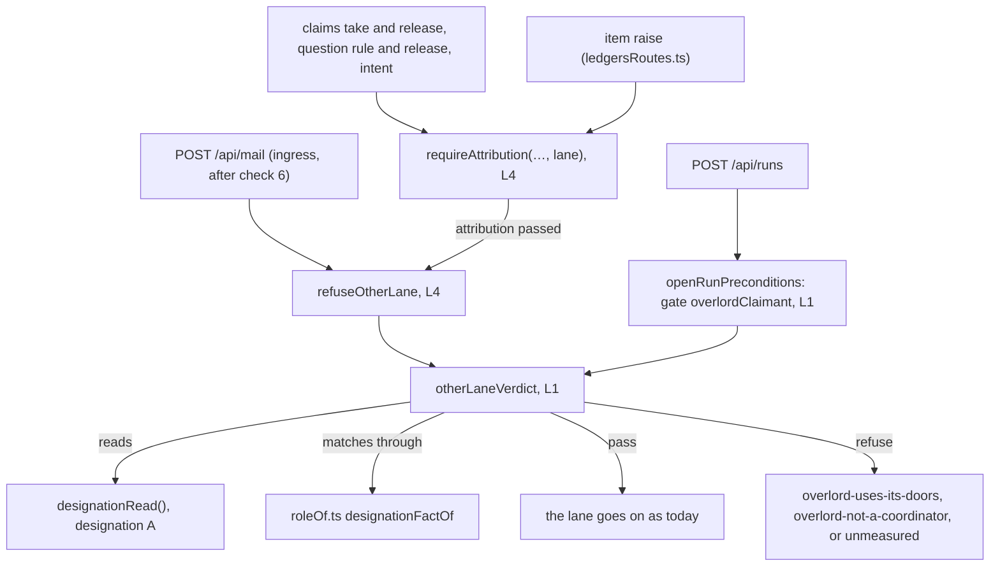

# Overlord W1: refusals on other write lanes, so the Overlord acts only through its own doors Implementation Plan

> **For agentic workers:** REQUIRED SUB-SKILL: Use superpowers:subagent-driven-development (recommended) or
> superpowers:executing-plans to implement this plan task-by-task. Steps use checkbox (`- [ ]`) syntax for tracking.

**Goal:** the designated session cannot reach a coordinator, a claim or a run by any lane that is not one of its own
doors.

- Every write lane the spec names refuses the designated session with `overlord-uses-its-doors`:
  - peer mail;
  - raising an item;
  - claims;
  - the claimant's question door;
  - coordinator intent.
- The run-open door refuses it with `overlord-not-a-coordinator` when `claimedBy` names it.
- One L1 decider makes every one of these decisions, from one table of lanes. Every lane reaches it through the shared
  attribution check, and a census reds a lane that skips it.
- Every caller each lane has today (coordinators, workers, plain sessions, the operator's tools) gets the same answer,
  byte for byte. A characterization suite pins that before any lane changes.

**Why:** H10 (§3.8): "The designated session is refused on every write lane that is not an Overlord door". C48 (§3.5):
"The run-open door refuses `overlord-not-a-coordinator` when `claimedBy` names the designated session. So it can never
become a coordinator by opening a run." Anti-goal A5 (§15): "Never hide an act. Every act goes through a door that logs
it." Today nothing on `main` tells the Overlord's call from any other session's on these lanes, so an Overlord that
found a side path could mail a coordinator, take a claim or open a run, and no act row would show it.

**Architecture:** one pull request in lane H, four tasks.

- **L1, C5.** A new file, `server/src/coord/otherLanes.ts`:
  - `OTHER_LANES`, the table of lanes, one row each: the route, the word it refuses with, and how the lane reaches the
    check;
  - `otherLaneVerdict(lane, callerId, designation)`, the one decider.

  It reads the designation only through designation A's `designationRead()`, handed in as a value. It matches the
  caller through `server/src/roleOf.ts#designationFactOf`, so the sessions it refuses are exactly the sessions `roleOf`
  reads as `overlord`.
- **L1, C5.** `server/src/coord/openRun.ts` gains one gate row, `overlordClaimant`, right after `attribution` in
  `OPEN_RUN_GATES`. It asks the same decider for the lane `runOpen`.
- **L4, C5.** `server/src/coord/routes.ts`:
  - `registerCoordRoutes`' `requireAttribution` closure gains an optional `lane` argument. When the attribution passes
    and a lane is named, the closure asks the decider and refuses through one new sender, `refuseOtherLane`.
  - The mail ingress, which keeps its own attribution (checks 5, 5.5 and 6), calls `refuseOtherLane` once, after
    check 6.
  - `POST /api/runs` hands `openRunPreconditions` the designation read.
- **L4, C5.** `server/src/coord/ledgersRoutes.ts`: the item-raise door passes its lane to the `requireAttribution` it
  is handed.
- No new route, no new table, no migration, no new refusal word (both are on `main`), no wire change.


*Figure 1. Every named lane reaches one decider. The decider reads the designation once, matches the caller the way
`roleOf` does, and either lets the lane go on unchanged or names the refusal.*

**Tech Stack:** TypeScript (ESM), Fastify, `node:sqlite` (through `CoordStore`), vitest. No new dependency.

**Spec:** `docs/superpowers/specs/2026-11-09-overlord-design.md`:

- §3.5, C48, "The line is held five ways", its bullet **The server**: the run-open refusal and the list of write lanes.
- §3.8, H10, **Only its doors**: the same list and the word.
- §8.1, "What it does not get": "any write lane that is not an Overlord door … all refuse `overlord-uses-its-doors`".
- Table 11.1e, the row "Refusals on other write lanes (`overlord-uses-its-doors`) and at run open
  (`overlord-not-a-coordinator`)": context C5, rings L1 and L4, no store, no writer, wave W1, and "What an older build
  does: Not refused: the deny set is the guard".
- Table 11.6, the rows `overlord-uses-its-doors` (H10) and `overlord-not-a-coordinator` (C48).
- Table 13.1, row H10: a `tightening` call in W1, which "may trail by one wave".
- §15, anti-goal A5. Table 16, the risk "It drifts into execution": "Run-open and other write lanes refuse it".

The index is `docs/superpowers/plans/2026-11-14-overlord-w1.md`, on `main`. This plan builds on:

- its row "Refusals on other write lanes" (lane H, 1 PR, 4 tasks; needs designation A and the vocabulary);
- its question 17 (`CallerIdentity` and the operator's doors) and question 23 (the Table 11.6 test);
- "Where lanes meet": `server/src/coord/routes.ts` (one line a door at most) and `ledgersRoutes.ts` (lane H's
  item-raise refusal);
- "What a merge arms".

It takes these from sibling plans that are open or in the queue, as their texts stand on their branches:

- designation A (`w1-designation.md`, #2856): `designationRead()` with exactly three arms, its `CoordStore` delegate,
  `shared/overlord-designation.ts#DesignationRead`, and `server/src/roleOf.ts#designationFactOf`;
- gates and identity (`w1-gates.md`, #2863): the `CallerIdentity` port and `callerStandingOf`, which this plan does not
  call (question 3).

## Open questions

The index's questions this plan builds on come first. Each other question is one the spec leaves open or the tree
contradicts. The plan builds every recommendation unless the coordinator or the operator rules otherwise.

1. **The two words are on `main`, with their Table 11.6 rows** (measured; the brief's ruling). `shared/refusal.ts`'s
   `OVERLORD_REFUSALS` holds `overlord-uses-its-doors` (403) and `overlord-not-a-coordinator` (403), and
   `server/test/single-definition/refusal-table.test.ts` holds both against Table 11.6 in both directions. **Built
   as:** this plan adds no word to Table 11.6 or to the group, unless question 9's worker arm is ruled in.
2. **"Is this caller the Overlord" has one reader and one matcher** (the brief's ruling). **Recommendation, built
   here:**
   - The reader is designation A's `designationRead()`, read once per call. This plan adds no reader.
   - The matcher is `roleOf.ts#designationFactOf`. A caller is refused when it answers `live` (the bound session) or
     `pending` (a designate or a rebind attempt's body). So the refused set is the set `roleOf` reads as `overlord`.
   - `designationFactOf` takes a `DesignationFact`, and `designationRead()` answers a `DesignationRead`. If designation
     A, as merged, exports the one narrowing from the read to the fact, the decider calls it. If each of its four
     callers narrows inline, this piece adds `designationFactFrom` beside `designationFactOf` in `roleOf.ts` (L1, one
     function), calls it, and reports the inline copies as a follow-up (slug `one-designation-narrowing`). It moves
     none of them.
3. **`CallerIdentity` does not fit these lanes** (the index's question 17; the brief: "where it fits"). The port
   serves the Overlord's own doors. These lanes are not Overlord doors: their credential is each lane's existing
   attribution, `coord/attribution.ts#attributionVerdict`, which the gates plan's attribution adapter wraps unchanged.
   **Recommendation, built here:** the lanes keep their attribution as it is. The check runs after it, on the
   attributed id, and asks only the designation. So there is still one credential reader (`attributionVerdict`) and
   one designation reader (`designationRead()`), and this piece does not wait for gates A or B.

   This decider is not `callerStandingOf`, for a recorded reason (the architecture's "legitimately different"
   catalogue: an opposite safety direction):
   - `callerStandingOf` decides who may pass an Overlord door, so it admits the bound body only, with its incarnation
     agreeing, and treats a rebind's pending body as `other`.
   - This decider decides who is refused on a lane that is not an Overlord door. Failing closed there means refusing
     more: the bound body and either attempt's pending body, by id, with no incarnation read. A session recreated under
     the same id is refused too, which costs nothing, because the designation mints a fresh id for every body.
4. **`unmeasured` refuses, never passes** (the brief's ruling). **Built as:** when `designationRead()` answers
   `unmeasured`, every caller of a named lane is refused, with the existing generic word `unmeasured` (502, in
   `GENERIC_REFUSALS`), the same word designation A's prompt route answers. Its detail says that the lane could not
   tell whether the caller is the Overlord, and that the refusal is transient.
   - This is the one way an existing caller's answer can change: a row the reader cannot narrow (a hand-written bad
     column) or a closed database. A closed database already fails every lane.
   - The operator learns of it from designation A's own path: the mail pace sweep raises one operator push per
     unmeasured episode (designation A's table "What an unmeasured designation does at each caller").
   - Review Focus 2 asks reviewers to weigh this blast radius: while it lasts, no session can send mail, take a claim
     or open a run.
5. **"Peer mail" means every send by the designated session** (§3.5 and H10 say "peer mail"; the code calls only
   `runId === null` traffic peer mail, for its quotas). **Recommendation, built here:** the mail lane refuses every
   `POST /api/mail` whose `fromId` is the designated session, run mail included. The Overlord holds no run, and a send
   that names another programme's run reaches that run's coordinator by the same side path.

   What stays open to it:
   - mail *to* the designated session (W2's coordinators report to `overlord`, Table 11.5b);
   - its mail reads (`GET /api/mail`, `GET /api/mail/inbox`, `GET /api/mail/:id`) and its acks
     (`POST /api/mail/:id/ack`), because the Overlord's own timer mail reaches it as mail (the Overlord's timers piece).
6. **The mail lane's refusal writes no `mail_rejections` row** (Table 11.1e: "Store or file: none"). The ingress's own
   rule is that every refusal is recorded through its `refuse`, whose code must be a `MailRejectCode`. **Recommendation,
   built here:** the mail lane answers through `refuseRoute`, as the claim lanes do, and records nothing. Widening
   `MAIL_REJECT_CODES` (`shared/api.ts`) would put one word in two vocabularies, and the spec stores none. M12 (Table
   12) counts the hook's denials and `relay-carries-method`, not these refusals. Slug `other-lane-refusals-unrecorded`.
7. **Which doors of each lane** (the spec names lanes, not routes). **Recommendation, built here:**

   | Lane key | Route | Word |
   |---|---|---|
   | `peerMail` | `POST /api/mail` | `overlord-uses-its-doors` |
   | `itemRaise` | `POST /api/programmes/:slug/items` | `overlord-uses-its-doors` |
   | `claimTake` | `POST /api/claims` | `overlord-uses-its-doors` |
   | `claimRelease` | `POST /api/claims/:id/release` | `overlord-uses-its-doors` |
   | `questionRule` | `POST /api/questions/:id/rule` | `overlord-uses-its-doors` |
   | `questionRelease` | `POST /api/questions/:id/release` | `overlord-uses-its-doors` |
   | `coordinatorIntent` | `POST /api/coordinators/:session/intent` (both `set` and `clear`) | `overlord-uses-its-doors` |
   | `runOpen` | `POST /api/runs`, when `claimedBy` names the designated session | `overlord-not-a-coordinator` |

   *Table 1. The lanes, their routes and their words.*

   Releasing a claim is refused with taking one, because the lane is the claim lane. The designated session can hold
   no claim (its body is always a new session, and taking is refused), so the release refusal costs nothing.
   `POST /api/claims/:id/break` is the operator's ungated door: it carries no attribution, so no identity can be
   refused there. That residual is held by the Overlord's launch profile, which has no command tool (sandbox A).
8. **The write doors the spec does not name.** A5 reads "every other write lane", while §3.5, H10 and §8.1 list five.
   Every other box-token write door on `main` is one of these:
   - **stopped by run ownership:** `POST /api/runs/:id/dispatch`, `close`, `advance`, `route`, `items`, `end-request`
     (which refuses `not-yours` to anyone but the run's coordinator or worker) and `review-rounds`. The designated
     session can claim no run, so it owns none;
   - **stopped by programme ownership** (`claimsProgramme`): `POST /api/items/:id/confirm`, `return`, `withdraw` and
     `blocking`, `POST /api/programmes/:slug/spec`, `modifications` and `modifications/merged`, the plan routes under
     `/api/programmes/:slug/plan`, and `POST /api/coord/programmes/:slug/calls`;
   - **its own doors and the hook's group** (§11.2): the continuity doors (card, start report, notes, handover, probe,
     timers), which the Overlord must reach;
   - **not stopped by anything but the launch profile:** `POST /api/landing/entries`, `POST /api/landing/order`,
     `POST /api/ledger/deviations`, `POST /api/leases/:lease/retain`, `POST /api/approvals`, the linking doors and the
     Linear proxy's writes.

   The build measures each entry's stopper. **Recommendation, built here:**
   - Task 4's census classifies every box-token write door into one of these classes, so a new write door is red
     until someone classifies it.
   - Only the spec's five lanes and run open get refusal rows in W1.
   - The last class goes to the spec-fixes run, which decides whether each joins the list. Joining is one row in
     `OTHER_LANES` and one argument at the door.

   If the coordinator rules that the landing and ledger doors join now, each adds one row and one argument, within the
   growth estimates below.
9. **A run that names the designated session as its worker.** `POST /api/runs`' `sessionId` names an existing
   workspace for a wave from 2 on, and dispatch then resumes it and injects `/clear`. Nothing on `main` refuses a
   `sessionId` that is the Overlord's body:
   - `project-mismatch` reads `coord.sessionProject`, which answers only for a session that has been a worker;
   - the child gate does not apply, because the Overlord is not a child.

   A coordinator that named it by mistake would clear the Overlord's generation. The spec has no word for this. **Recommendation:**
   - the same gate refuses it, with a new word `overlord-not-a-worker` (403, "the run names the designated session as
     its worker");
   - this pull request adds the word to `OVERLORD_REFUSALS`, its row to Table 11.6 and its entry to
     `refusal-table.test.ts`'s `W1_GROUP`, as the brief allows ("adds the word's row to Table 11.6 in its own PR");
   - slug `run-open-refuses-the-overlord-as-worker`.

   It is one step of Task 4, which the coordinator may strike. The gap then goes to the spec-fixes list.
10. **A retired body's id is not refused** (the spec says "the designated session"). After a retire the old id is on
    `pastIds` and on `stopsOwed`, and designation A's drain stops it. **Recommendation, built here:** past ids pass, as
    any session does. Refusing them would need a reader of `pastIds` that no other caller has. The body is being
    stopped, and its launch profile still has no command tool.

## What exists today

Measured on `origin/main` at `2a061d7a1` (2026-11-15). Designation A (#2856) is in the merge queue, and gates (#2863)
is in review. Their interfaces are read from their branches and named as such.

- **The words.** `shared/refusal.ts#OVERLORD_REFUSALS` holds both words at 403, each commented "(other-lane
  refusals)", and `REFUSAL_STATUS` carries them, so `refuseRoute` can send either. `GENERIC_REFUSALS` holds
  `unmeasured` (502). `server/test/single-definition/refusal-table.test.ts`'s `W1_GROUP` lists both, and its
  both-directions check holds them to Table 11.6's rows. No route sends either word.
- **The shared attribution check.** `server/src/coord/attribution.ts#attributionVerdict(io, cfg, whoId, whoUuid,
  uuidField)` reads the sender's one registry row, through `registry.ts#readSessionRecord`, and answers `{ ok: true }`
  or `registry-unmeasurable`, `unknown-sender` or `stale-uuid` with a detail. In `server/src/coord/routes.ts`,
  `registerCoordRoutes`' closure `requireAttribution(reply, whoId, whoUuid, uuidField)` sends its refusal through
  `refuseRoute` and answers a boolean. That closure is passed to `ledgersRoutes.ts`, `endRequest.ts`,
  `coordCallsRoute.ts` and `reviewRoundsRoute.ts`.
- **The lanes, as they reach attribution today:**
  - `POST /api/mail`: its own inline checks. Check 5 is the sender's row, 5.5 its measured identity, and 6
    `fromUuid`, over one `readRegistryMeasured`. Each refusal goes through the ingress's `refuse`, which writes a
    `mail_rejections` row first. `GET /api/mail/inbox` calls `requireAttribution` (field `fromUuid`).
    `POST /api/mail/:id/ack` has its own copy of the gate.
  - `POST /api/programmes/:slug/items` (`registerLedgerCoordinatorRoutes`): the box token, the body, the outside-link
    check, `deps.requireAttribution(…, 'byUuid')`, then `owns` (the programme's claimant).
    `LedgerCoordinatorDeps.requireAttribution`'s type takes `uuidField: 'byUuid'` only.
  - `POST /api/claims` and `POST /api/claims/:id/release`: the box token, the body, `requireAttribution(…, 'byUuid')`,
    then the run read (take) or the ownership check (release).
  - `POST /api/questions/:id/rule` and `/release`: the box token, the body by its `kind`,
    `requireAttribution(…, 'fromUuid')`, then the id and the kind check.
  - `POST /api/coordinators/:session/intent`: the box token, the body, `byId === :session` (`not-owner`),
    `requireAttribution(…, 'byUuid')`, then the incarnation read.
  - `POST /api/runs`: inside `coordMutex`, `coord/openRun.ts#openRunPreconditions` runs `OPEN_RUN_GATES` in order. Its
    `attribution` gate calls the `attribute` fact (`attributionVerdict` with `claimedByUuid`), or, before the
    switch-over, checks that the claimant is listed. `reviewRead`, the first store read, comes next. A refusal is an
    `error` word (sent by `refuseRoute`) or a `refused` word (a `RunRefuseCode`, sent by `refuseRun`).
    `open-run-preconditions.test.ts` holds the order in a gate-order table, with every adjacent pair named.
- **The designation, from designation A's plan (#2856, in the queue).**
  - `shared/overlord-designation.ts#DesignationRead`:
    - `{ kind: 'designated', sessionId, term, row }`, a live binding;
    - `{ kind: 'not-designated', row }`, no row, or a row with no live binding, a pending-only row among them;
    - `{ kind: 'unmeasured', why }`.

    `row.pending` holds the attempt's `sessionId` and `kind` (`designate` or `rebind`).
  - `designationRead()` is a `CoordStore` one-line delegate over `overlordDesignationStore.ts`. It is synchronous and
    never throws.
  - `server/src/roleOf.ts#designationFactOf(sessionId, DesignationFact)` answers `live`, `pending` or `none`.
    `roleOf` reads `live` and `pending` as `overlord`.
  - Designation A's plan names no shared narrowing from the read to the fact (question 2).
- **Gates and identity, from its plan (#2863, in review).** `server/src/auth/callerIdentity.ts`'s `CallerIdentity` (L2)
  and the attribution adapter (L3) wrap `attributionVerdict` unchanged. `coord/overlordGate.ts#callerStandingOf` is
  step 1 of the Overlord doors' gate order. Neither is on `main`, and this plan calls neither (question 3).
- **Censuses these lanes already carry,** all green on `main`, none naming the Overlord:
  - `server/test/box-token-census.test.ts` derives the box-token lanes from each lane source's handler bodies
    (`registrationsIn`, `lanesIn`) and holds the prose sites to them;
  - `server/src/auth/gate.ts#EXEMPT` gives the claim lanes, the question family's claimant pair and the intent door one
    reason each, and `auth-gate.test.ts` holds them;
  - `server/test/coord-attribution.test.ts` pins `attributionVerdict`'s answers byte for byte on the mail inbox, a claim
    lane (`POST /api/claims/:id/release`) and `POST /api/runs`;
  - `server/test/question-doors-pin.test.ts` pins every question door's refusals, successes and side effects, row by
    row, and is run unedited by any change to those doors;
  - `server/test/mail-routes.test.ts` holds the ingress's refusals and, in "every quoted kebab token in server/src/coord
    that looks like a code is declared", scans every `server/src/coord/*.ts` for quoted kebab literals. It admits each
    vocabulary through its exported guard. **It does not admit `isOverlordRefusal`**, so a coord file that quotes
    `'overlord-uses-its-doors'` is red today (Task 2 admits the guard);
  - `claims-routes.test.ts`, `coordinator-intent-route.test.ts`, `ledgers-coordinator-routes.test.ts`,
    `open-run-preconditions.test.ts`, `runs-attribution-switch.test.ts` and `mail-ingress-one-read.test.ts` hold each
    lane's behaviour.
- **The guard an older build leaves.** `OVERLORD_DENY_RULES`, which §3.5 places in `shared/api.ts`, is not on `main`
  and no W1 piece plan creates it. The Overlord's launch profile carries its own deny rules (`Bash`, `Edit`, `Write`,
  the web and cron tools; sandbox A, `w1-sandbox.md`). That profile is what Table 11.1e's "the deny set is the guard"
  can mean in W1 (index changes, below).

## Global Constraints

- **Architecture (`CLAUDE.md`).**
  - `server/src/coord/otherLanes.ts` is L1, C5: pure, with no `fs`, store, clock or Fastify. It imports types from
    `shared/overlord-designation.ts` and `shared/refusal.ts`, and `designationFactOf` (with `designationFactFrom` if
    question 2 adds it) from `server/src/roleOf.ts`, which is L1.
  - `openRun.ts` stays L1: its new gate reads a fact handed in, and calls the decider.
  - `routes.ts` and `ledgersRoutes.ts` stay L4. They read the designation, hand it to the decider, and send its
    answer. They decide nothing, and no `if` over a designation field appears in either.
  - No port is added. `designationRead()` is designation A's `CoordStore` delegate, and `OpenRunFacts` gains one fact.
- **One owner each.**
  - The designation's one reader is `designationRead()`.
  - The one decider of "this lane refuses this caller" is `otherLaneVerdict`.
  - The one table of lanes is `OTHER_LANES`. A new lane is a row, never a second check.
  - The one L4 sender is `refuseOtherLane`, called by `requireAttribution` and by the mail ingress. The run-open gate
    answers through `sendOpenRunRefusal`'s `error` arm, which sends with `refuseRoute`.
- **Failure contracts.**
  - `unmeasured` refuses every caller, never passes (question 4). The decider has no `default` that passes.
  - No overloaded null: the decider answers `{ kind: 'pass' }` or `{ kind: 'refuse', word, detail }`, never a nullable
    word.
  - The check runs only after the lane's attribution passed, so an unattributed caller keeps today's refusal and its
    bytes, its `mail_rejections` row included.
  - **An older peer.** The check reads only `coord.db` on the server. No agent, ccd or console version matters, and no
    wire changes. A server rolled back below this pull request stops refusing, and the launch profile is the guard
    (Table 11.1e).
- **Byte for byte for every existing caller.** While `designationRead()` answers `not-designated`, or `designated`
  for another session, every lane's status, body bytes and side effects equal today's. Task 1's characterization suite
  pins that before any lane changes, and Tasks 3 and 4 run it unedited. `question-doors-pin.test.ts` and
  `coord-attribution.test.ts` also run unedited.
- **Kebab literals.** Lane keys are camelCase (`peerMail`, `runOpen`), so the coord kebab census never reads them as
  codes. The words are admitted through `isOverlordRefusal` (Task 2), never through `NOT_CODES`.
- **Growth check.** `server/src/coord/routes.ts` is growth-checked. Its net growth is about +22 lines, within the 40-line
  check, with no waiver (the PR split below). No other growth-checked file changes, unless question 9 adds its word:
  `shared/refusal.ts` is not growth-checked.
- **Mutation floors.** `otherLaneVerdict` joins `MUTANT_SETS` through a new `server/test/sim/otherLanesSets.ts` and
  `server/test/sim/mutation-floors.json`, in this pull request, at the floor its first run measures.
- **What a merge arms.** Nothing a running session sees or does changes. No designation row exists until the operator
  designates, so every lane passes as today. The refusals start with the first designation, and only for that body.
- **SAFETY (`CLAUDE.md`).** No ccd verb, no fleet act and no live `~/.ccrc`. Every test builds `coord.db` in memory or
  under the per-run temp root, with fixture registries (`idGateFixture.ts`).
- **Tests.** Run from `server/` as `ccrc test -- ./node_modules/.bin/vitest run test/<file>.test.ts`. Each task's last
  run adds both server `tsc` runs (`ccrc test -- npx tsc --noEmit -p tsconfig.json` and
  `-p test/tsconfig.tests.json`).
- **Public repository.** Fixtures use neutral ids (`lane-a-overlord-quiet-oak`, `lane-a-project-a-coord`,
  `lane-a-project-a-worker`). Cite by symbol or `@anchor`, never by line. No D-number is invented: departures are slugs
  under "Deviations found", and the coordinator mints numbers.

## Review Focus

1. **Nobody else's answer moves.** For a coordinator, a worker or a plain session, each of the eight doors answers
   exactly what it answers on `main`, refusals and side effects included, with and without a designation row for
   another session. The characterization suite proves it, and it is green before the first lane edit.
2. **Fail closed, and weigh the cost.** An unreadable designation refuses every caller of every named lane with
   `unmeasured` (502). That is the brief's ruling. While it lasts, no session can send mail, take a claim or open a
   run. Check that the detail says so plainly and that designation A's operator push covers it.
3. **One decider, one table, no skipped lane.** Every refusal comes from `otherLaneVerdict` over `OTHER_LANES`. The
   census reds a lane whose handler stops passing its key, a key passed at the wrong route, and an unclassified
   box-token write door.
4. **The refused set is `roleOf`'s.** The bound body and either attempt's pending body are refused, and the recorded
   difference from `callerStandingOf` (question 3) is sound.

## The PR split

| PR | Tasks | What it ships | Needs first | Growth-checked files, estimate (net lines) |
|---|---|---|---|---|
| A | 1 to 4 | The characterization suite; `OTHER_LANES` and `otherLaneVerdict` with their mutant set; the lanes through `requireAttribution` and the mail ingress; the run-open gate; the census; the route slicer moved to a test helper | designation A (`designationRead()`, `designationFactOf`) and the vocabulary (on `main`) | `server/src/coord/routes.ts` about +22: `requireAttribution`'s lane branch (+5), `refuseOtherLane` (+9 with its comment), the mail ingress (+3), the run-open fact (+2), the five call sites (0: an argument each) and the imports (+1 or +2). `shared/api.ts` 0. `server/src/server.ts` 0. `server/src/coord/store.ts` 0. `server/src/coord/schema.ts` 0 |

The pull request merges `main` once before merge, after designation A has landed (worker clause 16).

For scale, the files that are not growth-checked change by about this much:

| File | Change |
|---|---|
| `server/src/coord/otherLanes.ts` | +75, new |
| `server/src/coord/openRun.ts` | +16 (one fact, one gate, the `error` arm widened) |
| `server/src/coord/ledgersRoutes.ts` | +1 (the deps type gains `lane?`; the raise call gains its key) |
| `server/src/roleOf.ts` | +12, only if question 2 adds `designationFactFrom` |
| `shared/refusal.ts` | +2, only if question 9 is ruled in |
| `docs/superpowers/specs/2026-11-09-overlord-design.md` | +1 (Table 11.6), only if question 9 is ruled in |
| `server/test/routeRegistrations.ts` | +70, new (moved from `box-token-census.test.ts`) |
| `server/test/box-token-census.test.ts` | −68 (the move: definitions out, one import in) |
| `server/test/mail-routes.test.ts` | +4 (the guard and its import) |
| `server/test/open-run-preconditions.test.ts` | +10 (two gate rows, two pairs re-pointed) |
| `server/test/sim/mutation-floors.test.ts` | +2 (the import and the spread) |
| new tests and the mutant set | about +600 |

---

### Task 1: Characterize every named lane for today's callers

Characterization first (`CLAUDE.md`): this suite is green on `main` with designation A merged, before any lane
changes. Tasks 3 and 4 run it unedited.

**Files:**
- Create: `server/test/overlord-other-lanes-pin.test.ts`

**The suite.** It uses `buildServer` over an in-memory store, with the id-gate rig's fixture registries
(`idGateFixture.ts`: `appFor`, `seedRow`, `recorder`). It seeds three registry rows: a coordinator that claims a
programme with an open run, that run's worker, and a plain session. For each of the eight doors in Table 1, every case
below runs under three designation states:
- no `overlord_designation` row;
- a row whose live binding is a fourth session (seeded through designation A's store writers with a fake `appendInTx`
  that answers `{ ok: true }`, as `overlord-designation-store.test.ts` does);
- a pending-only row for that fourth session.

Each case pins:
- the status, and the body as the exact bytes fastify sent;
- the side effects:
  - the `mail_rejections` and `mail_deliveries` row counts;
  - the claim rows;
  - the item rows;
  - the question row's state;
  - the run rows and the hold;
  - for intent, the delegation applier's change count (a fake applier).

The cases, per door:
- **`POST /api/mail`:** a coordinator's run mail to its worker; a worker's `wave-done` to `coordinator`; a plain
  session's peer mail; a stale `fromUuid` (`stale-uuid`, recorded); an unknown sender (`unknown-sender`, recorded).
- **`POST /api/programmes/:slug/items`:** the claimant raises an item; a non-claimant is refused by `owns`; a stale
  uuid.
- **`POST /api/claims` and `/release`:** take, re-take, release by the holder, release by another (`not-owner`), a
  stale uuid.
- **`POST /api/questions/:id/rule` and `/release`:** the parent rules an ask and releases another; a session that is
  not the parent; a stale uuid.
- **`POST /api/coordinators/:session/intent`:** `set` and `clear` by the session itself; `byId` that is not the path's
  session (`not-owner`); a stale uuid.
- **`POST /api/runs`:** a coordinator opens a work run, and a review run of its own work run; a stale `claimedByUuid`;
  no `claimedByUuid` before and after the switch-over.

- [ ] **Step 1: Write the suite.** Expected values come from running each case against `main`, never from reading the
  code.
- [ ] **Step 2: Run.** `ccrc test -- ./node_modules/.bin/vitest run test/overlord-other-lanes-pin.test.ts`: green on
  `main`. The three designation states answer identically, because no lane reads the designation yet.
- [ ] **Step 3: Self-check.** Change one byte of one pinned body: red. Restore.
- [ ] **Step 4: Commit.** `test(overlord): pin the named write lanes for today's callers, before the refusals (H10)`

### Task 2: The lane table and the decider (L1)

**Files:**
- Create: `server/src/coord/otherLanes.ts` (C5, L1)
- Modify: `server/src/roleOf.ts`, only if question 2 needs `designationFactFrom`
- Create: `server/test/overlord-other-lanes.test.ts`
- Create: `server/test/sim/otherLanesSets.ts`
- Modify: `server/test/sim/mutation-floors.test.ts` (one import, one spread into `MUTANT_SETS`),
  `server/test/sim/mutation-floors.json` (one floor)
- Modify: `server/test/mail-routes.test.ts` (the coord kebab census admits `isOverlordRefusal`, with its import and a
  comment naming this piece, in the idiom of its other guards)

**Interfaces:**

```ts
// server/src/coord/otherLanes.ts
import type { DesignationRead } from '../../../shared/overlord-designation.js';
import type { OverlordRefusal } from '../../../shared/refusal.js';

/** How a lane reaches the check: through `requireAttribution`'s lane argument, through the mail ingress's one call,
 *  or through `OPEN_RUN_GATES`' `overlordClaimant` gate. The census reads this column. */
export type OtherLaneVia = 'attribution' | 'ingress' | 'open-run-gate';

/** The write lanes that refuse the designated session (§3.5, H10, Table 1). A new lane is a row. */
export const OTHER_LANES = {
  peerMail:          { route: 'POST /api/mail', word: 'overlord-uses-its-doors', via: 'ingress' },
  itemRaise:         { route: 'POST /api/programmes/:slug/items', word: 'overlord-uses-its-doors', via: 'attribution' },
  claimTake:         { route: 'POST /api/claims', word: 'overlord-uses-its-doors', via: 'attribution' },
  claimRelease:      { route: 'POST /api/claims/:id/release', word: 'overlord-uses-its-doors', via: 'attribution' },
  questionRule:      { route: 'POST /api/questions/:id/rule', word: 'overlord-uses-its-doors', via: 'attribution' },
  questionRelease:   { route: 'POST /api/questions/:id/release', word: 'overlord-uses-its-doors', via: 'attribution' },
  coordinatorIntent: { route: 'POST /api/coordinators/:session/intent', word: 'overlord-uses-its-doors', via: 'attribution' },
  runOpen:           { route: 'POST /api/runs', word: 'overlord-not-a-coordinator', via: 'open-run-gate' },
} as const satisfies Record<string, { route: string; word: OverlordRefusal; via: OtherLaneVia }>;
export type OtherLane = keyof typeof OTHER_LANES;
export const OTHER_LANE_KEYS = Object.keys(OTHER_LANES) as OtherLane[];

/** The decider's answer. `unmeasured` is the generic word (502): the lane could not tell whether the caller is the
 *  Overlord, so it refuses (question 4). */
export type OtherLaneVerdict =
  | { readonly kind: 'pass' }
  | { readonly kind: 'refuse'; readonly word: (typeof OTHER_LANES)[OtherLane]['word'] | 'unmeasured';
      readonly detail: string };

/** May this attributed caller use this lane? Refuses the bound body and either attempt's pending body, the sessions
 *  `roleOf` reads as `overlord` (question 2), by id; refuses every caller on an unmeasured designation. */
export function otherLaneVerdict(lane: OtherLane, callerId: string, designation: DesignationRead): OtherLaneVerdict;
```

If question 9 is ruled in, Task 4 adds a second run-open row, `runWorker`, with `overlord-not-a-worker` and the same
`via`.

**The decider, in order:**
1. `designation.kind === 'unmeasured'`: refuse `unmeasured`. The detail is: "the Overlord's designation could not be
   read (`<why>`), so `<route>` cannot tell whether this caller is the Overlord; transient, retry".
2. Narrow the read to a `DesignationFact` (question 2), and ask `designationFactOf(callerId, fact)`.
3. `live` or `pending`: refuse with the row's word. The detail names the lane and the remedy: "`<callerId>` is the
   designated Overlord, which acts only through its own doors (spec §3.5, H10); `<route>` is not one of them".
4. `none`: pass.

The words in the table are literals in a `server/src/coord/` file, so the coord kebab census reads them. Admitting
`isOverlordRefusal` there is part of this task, in its own commit before the decider's, so the census never goes red
on `main`.

- [ ] **Step 1: Failing tests** (`test/overlord-other-lanes.test.ts`):
  - For each lane key, with `designated` for the caller: refuse with the row's word, and the detail names the route.
  - A `designate` attempt's pending body, and a `rebind` attempt's pending body: refused on every lane.
  - A rebind's old bound body, while the attempt is pending: refused (it is still `live`).
  - Another session, under `designated`, `not-designated` with no row, and a pending-only row for someone else: pass.
  - `unmeasured`: refuse `unmeasured` on every lane, for any caller, with the `why` in the detail.
  - A past id (a retired body): pass (question 10).
  - `OTHER_LANES` is total: every key has a route, a word that `isOverlordRefusal` accepts, and a `via`. No two rows
    share a route, except the `runOpen` and `runWorker` pair if question 9 adds it.
  - `REFUSAL_STATUS` gives every row's word 403, and `unmeasured` 502.
- [ ] **Step 2: Run.** Red.
- [ ] **Step 3: Implement** the admission in `mail-routes.test.ts`, then `otherLanes.ts` (and `designationFactFrom`, if
  question 2 needs it).
- [ ] **Step 4: Mutation.** `otherLaneVerdict` joins `MUTANT_SETS` through `otherLanesSets.ts`, with mutants that:
  - pass on `unmeasured`;
  - match only the bound id;
  - match only the pending id;
  - answer `overlord-uses-its-doors` at `runOpen`;
  - compare the caller with the term instead of the id.

  Its floor in `mutation-floors.json` is what the first run measures. By hand: delete the `isOverlordRefusal` line in
  the kebab census and `mail-routes.test.ts` goes red. Restore.
- [ ] **Step 5: Run** this suite, `mail-routes`, `sim/mutation-floors`, `rings/*.test.ts`,
  `single-definition/refusal-table` and both `tsc` runs. Green.
- [ ] **Step 6: Commit** twice:
  - `test(coord): the kebab census admits the Overlord's refusal words through their guard`;
  - `feat(overlord): the other write lanes' table and their one decider (H10, C48)`.

### Task 3: The named lanes refuse the designated session

**Files:**
- Modify: `server/src/coord/routes.ts`:
  - `requireAttribution` gains `lane?: OtherLane`;
  - a new closure `refuseOtherLane(reply, lane, callerId): boolean` beside it;
  - the mail ingress, one call after check 6;
  - `POST /api/claims`, `POST /api/claims/:id/release`, `POST /api/questions/:id/rule`,
    `POST /api/questions/:id/release` and `POST /api/coordinators/:session/intent` each pass their key.
- Modify: `server/src/coord/ledgersRoutes.ts` (`LedgerCoordinatorDeps.requireAttribution`'s type gains `lane?:
  OtherLane`; the raise door passes `'itemRaise'`)
- Create: `server/test/overlord-other-lanes-routes.test.ts`

**The L4 pieces, in `registerCoordRoutes`:**

```ts
// The other write lanes' one sender (spec §3.5, H10): reads the designation once, asks the decider, refuses through
// refuseRoute. No row is written (Table 11.1e: no store).
const refuseOtherLane = (reply: FastifyReply, lane: OtherLane, callerId: string): boolean => {
  const v = otherLaneVerdict(lane, callerId, deps.coord!.designationRead());
  if (v.kind === 'refuse') refuseRoute(reply, v.word, { detail: v.detail });
  return v.kind === 'pass';
};
```

- `requireAttribution(reply, whoId, whoUuid, uuidField, lane?)`: when the verdict is `ok` and `lane` is given, it
  answers `refuseOtherLane(reply, lane, whoId)`. Every existing caller passes no lane and is unchanged, the inbox read,
  the approvals, landing and lease doors, `endRequest.ts`, `coordCallsRoute.ts` and `reviewRoundsRoute.ts` among them.
- The mail ingress: right after check 6 and before check 7, `if (!refuseOtherLane(reply, 'peerMail', fromId)) return;`.
  So an unattributed or stale sender keeps its recorded refusal, and the designated sender is refused before any
  recipient, run or quota read.
- Every other door changes one argument, so its handler grows by no line.

The order inside each lane is unchanged up to attribution. The refusal comes right after attribution, before the lane's
own ownership, run, id or incarnation checks, so the answer names its cause (`overlord-uses-its-doors`) rather than
`not-owner`.

- [ ] **Step 1: Failing tests** (`test/overlord-other-lanes-routes.test.ts`, the Task 1 rig with a live binding for a
  fourth registry row, `lane-a-overlord-quiet-oak`):
  - Each of the seven doors, called by the bound session with a current uuid: 403 `overlord-uses-its-doors`, the
    detail naming its route. Nothing is written:
    - no `mail_rejections` row and no delivery (`peerMail`, question 6);
    - no claim, no item, no question move;
    - no applier change.
  - The same, called by a `designate` attempt's pending body and by a `rebind` attempt's pending body.
  - The bound session with a stale uuid: today's `stale-uuid`, recorded on the mail lane. The check does not run
    before attribution.
  - The bound session's mail reads and its ack: unchanged (`GET /api/mail/inbox`, `POST /api/mail/:id/ack`).
  - Mail from a coordinator to the bound session: delivered as today.
  - A hand-written bad designation row: 502 `unmeasured` for the coordinator, the worker and the plain session, on
    every door. Nothing is written.
  - `POST /api/claims/:id/break` with the bound session in the body: unchanged (ungated, question 7).
- [ ] **Step 2: Run.** Red.
- [ ] **Step 3: Implement.**
- [ ] **Step 4: Run** this suite and these, unedited and green:
  - `overlord-other-lanes-pin` (Task 1), `coord-attribution`, `question-doors-pin`, `question-doors-posture`;
  - `mail-routes`, `mail-ingress-one-read`, `mail-peer-quota`, `claims-routes`, `coordinator-intent-route`,
    `ledgers-coordinator-routes`;
  - `box-token-census`, `auth-gate`, `coord-pause-route`, `refusal-status`;
  - `growth-check` armed, and both `tsc` runs.
- [ ] **Step 5: Red check.** Each change below reds a case. Revert each.
  - Drop the lane argument at `POST /api/claims`: the claim-take case.
  - Call `refuseOtherLane` before check 6 in the mail ingress: the stale-uuid case's recorded row.
  - Make `refuseOtherLane` pass on `unmeasured`: the bad-row case.
- [ ] **Step 6: Commit.** `feat(overlord): peer mail, items, claims, the claimant's doors and intent refuse the
  Overlord (H10)`

### Task 4: Run open refuses the Overlord, and the census

**Files:**
- Modify: `server/src/coord/openRun.ts`:
  - `OpenRunFacts` gains `designation: () => DesignationRead`;
  - `OPEN_RUN_GATES` gains `overlordClaimant` right after `attribution`;
  - `OpenRunRefusal`'s `error` arm gains `'overlord-not-a-coordinator' | 'unmeasured'` (and `'overlord-not-a-worker'`
    under question 9).
- Modify: `server/src/coord/routes.ts` (`POST /api/runs` passes `designation: () => coord.designationRead()`)
- Modify: `server/test/open-run-preconditions.test.ts`:
  - single-gate rows for `overlordClaimant`;
  - the rows that named the pair `['attribution', 'reviewRead']` now name `['attribution', 'overlordClaimant']` and
    `['overlordClaimant', 'reviewRead']`;
  - every word those rows assert is unchanged.
- Create: `server/test/routeRegistrations.ts` (moved, below)
- Modify: `server/test/box-token-census.test.ts` (imports the moved helpers; no assertion changes)
- Create: `server/test/overlord-other-lanes-census.test.ts`
- Under question 9 only: `shared/refusal.ts` (`overlord-not-a-worker`: 403, in `OVERLORD_REFUSALS`), Table 11.6 in the
  spec (its row), `refusal-table.test.ts`'s `W1_GROUP` (its entry), and `OTHER_LANES`' `runWorker` row.

**The gate.** `overlordClaimant` runs after `attribution` and before `reviewRead`, the first store read, so a refused
open leaves no `planned` row and places no hold.
- It asks `otherLaneVerdict('runOpen', claimedBy, f.designation())`. A refusal is `{ error: word, detail }`, and
  `sendOpenRunRefusal` sends it through `refuseRoute`. The body is `{ ok: false, error: 'overlord-not-a-coordinator',
  detail }` at 403.
- It is an `error` word, not a `refused` word. A `RunRefuseCode` would have to be documented as a recovery in the
  coordinator corpus (`coordinator-skill.test.ts`), and a coordinator has no recovery for it, for the reason
  `reclaim.ts`' words stay out (slug `overlord-run-refusal-is-an-error-word`).
- An unattributed open before the switch-over (no `claimedByUuid`) is checked the same way: the gate reads `claimedBy`.
- **Question 9's arm**, if ruled in: when the body's `sessionId` is present, it asks
  `otherLaneVerdict('runWorker', sessionId, …)` too, after the claimant's check.

**The route slicer moves.** `registrationsIn`, `routeCallsIn` and `ALL_VERBS` move from `box-token-census.test.ts` into
`server/test/routeRegistrations.ts`, which also exports `handlerBody(src, key)`: the slice from a route's registration
to the next one, the slice `lanesIn` already takes. It also exports the census's lane-source list, so the two censuses
read one list. The move commit changes only `box-token-census.test.ts`' imports and definitions, and it stays green
(slug `route-slicer-shared`).

**The census** (`test/overlord-other-lanes-census.test.ts`), every assertion in both directions:
1. **Every `attribution` lane passes its key.** For each `OTHER_LANES` row whose `via` is `attribution`, the handler of
   its `route`, in `coord/routes.ts` or `coord/ledgersRoutes.ts`, calls `requireAttribution(` or
   `deps.requireAttribution(` with that key as the last argument, exactly once.
2. **No key at the wrong door.** Every key passed to `requireAttribution` or `refuseOtherLane` in those two files sits
   in the handler of the route its row names.
3. **The ingress lane.** The `peerMail` row's handler calls `refuseOtherLane(reply, 'peerMail', fromId)` once, after
   the text of check 6 (`stale-uuid`) and before check 7 (`unknown-recipient`).
4. **The gate lane.** `OPEN_RUN_GATES` holds `overlordClaimant` directly after `attribution`, and `openRun.ts` calls
   `otherLaneVerdict('runOpen'` exactly once.
5. **Every box-token write door is classified** (question 8). Each non-`GET` box-token lane the census's sources
   register is exactly one of:
   - a row's route;
   - an Overlord door or a door of the hook's group (`HOOK_GROUP_DOORS`: the continuity doors);
   - `NOT_REFUSED`, a hand-kept map from route to its stopper (`run-ownership`, `programme-ownership`, `ungated`,
     `launch-profile`), each with a one-line reason.

   A new box-token write door is red until it is placed.

- [ ] **Step 1: The move.** Move the slicer. `box-token-census` stays green. Commit:
  `test(census): the route slicer moves to a shared test helper, unchanged`.
- [ ] **Step 2: Failing tests.**
  - `open-run-preconditions`: the gate's rows. `claimedBy` is the bound body: `overlord-not-a-coordinator`. A pending
    body: the same. Unmeasured: `unmeasured`. Another session: passes to `reviewRead`. A review open by the bound body
    is refused before the reviewed run is read.
  - In the routes suite: the bound session opens a run and gets 403 `overlord-not-a-coordinator`. No run row and no
    hold are written.
  - The census, as above.
  - Under question 9: a coordinator's open whose `sessionId` is the bound body is refused `overlord-not-a-worker`,
    before any store read.
- [ ] **Step 3: Run.** Red.
- [ ] **Step 4: Implement** the gate, the fact, the `error` arm and the census.
- [ ] **Step 5: Run** these, green:
  - the census, `open-run-preconditions`, `runs-attribution-switch`, `collect-open-run-hold`, `coord-attribution`;
  - `overlord-other-lanes-pin` (unedited) and `overlord-other-lanes-routes`;
  - `box-token-census`, `single-definition/refusal-table` (under question 9), `rings/*.test.ts`, `sim/mutation-floors`;
  - `growth-check` armed, and both `tsc` runs.
- [ ] **Step 6: Red check.** Each change below reds a case. Revert each.
  - Delete the `'claimRelease'` argument: census assertion 1, and the routes case.
  - Pass `'claimTake'` at the release door: census assertion 2.
  - Move `overlordClaimant` after `reviewRead`: the gate-order table, and census assertion 4.
  - Register a new box-token `POST` door in a scratch copy of `ledgersRoutes.ts` read by the census: assertion 5.
- [ ] **Step 7: Commit.** `feat(overlord): run open refuses the Overlord, and a census holds every lane to the check
  (C48, H10)`

**The pull request ends here.** Its body states:
- the lanes and their words (Table 1);
- that every existing caller answers as before, with the characterization suite named;
- the `unmeasured` ruling and its blast radius;
- that no row is written, and why;
- the questions ruled, and the floors;
- that nothing changes at merge;
- that a rollback below it leaves the launch profile as the guard.

## Index changes

The coordinator passes these to the index's next fix round.

- **The "Refusals on other write lanes" row:**
  - what it ships: "`OTHER_LANES` and `otherLaneVerdict` (C5, L1); `overlord-uses-its-doors` on peer mail (every send
    by the designated session), item raise, claims (take and release), the claimant's question door (rule and
    release) and coordinator intent (set and clear), through `requireAttribution`'s lane argument and the mail
    ingress; `overlord-not-a-coordinator` at run open, a gate in `OPEN_RUN_GATES`; `unmeasured` on an unread
    designation; a census over every box-token write door";
  - "needs first" stays "designation A, vocabulary". Gates A and B are not needed (question 3).
- **Lane H's file list:** `server/src/coord/otherLanes.ts`; `requireAttribution` and the mail ingress in
  `server/src/coord/routes.ts`; `ledgersRoutes.ts`' raise door; `server/src/coord/openRun.ts`'s gate table;
  `server/test/routeRegistrations.ts` (shared with the box-token census).
- **"Where lanes meet":**
  - `server/src/coord/routes.ts`: about +22 for lane H, and the five doors change one argument each;
  - `server/src/coord/openRun.ts`: lane H adds one gate. No other W1 piece edits it;
  - `server/src/roleOf.ts`: lane H adds `designationFactFrom` only if designation A ships no narrowing (question 2).
    Designation A owns the file's designation input;
  - `server/test/mail-routes.test.ts`'s coord kebab census: lane H admits `isOverlordRefusal`. Every later piece that
    quotes an Overlord word in `server/src/coord/` relies on it (designation, ladder, gates, sequence, the Overlord's
    timers), so whichever of them lands first adds it, and lane H drops its step;
  - `server/test/box-token-census.test.ts`: lane H moves the route slicer out. A piece that adds a lane source edits
    the shared list in `routeRegistrations.ts`.
- **"What a merge arms":** add "The other write lanes refuse only the designated body, and only once one is designated.
  An unreadable designation refuses every caller of those lanes with `unmeasured`."
- **Question 17:** add that the other-lane refusals read the designation, not the port (question 3 here).
- **The spec-fixes list gains:**
  - A5's "every other write lane" against §3.5's five lanes: the write doors in question 8's last class need a ruling;
  - Table 11.1e's "the deny set is the guard": `OVERLORD_DENY_RULES` is not on `main` and no W1 piece creates it, so in
    W1 the guard is the launch profile's deny rules (sandbox A);
  - "peer mail" means every send by the designated session, run mail included (question 5);
  - the run that names the designated session as its worker (question 9), whether or not it is ruled into W1.

## Deviations found

These are the departures from the spec's text, and from the index, that this plan makes, by slug. The coordinator mints
the numbers.

- **`other-lane-refusals-unrecorded`**: the mail lane's refusal writes no `mail_rejections` row, unlike every other
  ingress refusal, because Table 11.1e stores none and the word is not a `MailRejectCode` (question 6).
- **`peer-mail-is-every-send`**: "peer mail" is every `POST /api/mail` by the designated session, run mail included,
  while the code's own "peer mail" is `runId === null` traffic (question 5).
- **`claim-lane-is-take-and-release`**: the claim lane refuses take and release. Break is the operator's ungated door,
  where no identity can be refused (question 7).
- **`refused-set-is-roleofs`**: the refused set is the bound body and either attempt's pending body, matched by id
  through `designationFactOf`, which differs on purpose from `callerStandingOf` (question 3).
- **`unmeasured-designation-refuses-every-caller`**: an unread designation refuses every caller of the named lanes with
  the generic `unmeasured` (the brief's ruling, question 4).
- **`overlord-run-refusal-is-an-error-word`**: `overlord-not-a-coordinator` travels as an `error` word through
  `refuseRoute`, not as a `RunRefuseCode` `refused` word.
- **`unnamed-write-doors-classified`**: A5's "every other write lane" is held by a census that classifies every
  box-token write door. Only the spec's five lanes and run open refuse in W1 (question 8).
- **`run-open-refuses-the-overlord-as-worker`**: only if ruled in (question 9). A new word, `overlord-not-a-worker`,
  with its Table 11.6 row.
- **`one-designation-narrowing`**: only if designation A ships no shared narrowing from the read to the fact. This
  piece adds `designationFactFrom` and reports the inline copies (question 2).
- **`route-slicer-shared`**: the box-token census's route slicer moves to a shared test helper, unchanged, so the two
  censuses slice handlers one way (Task 4).
- **`lanes-without-the-port`**: the lanes read the designation and keep their own attribution, rather than calling
  `CallerIdentity` (question 3, the index's question 17).

## Where things stand

**Agreed:**
- From the brief:
  - the shape of the merged piece plans;
  - one PR in lane H, four tasks;
  - the designation through `designationRead()`, `unmeasured` refusing, one shared check with a census;
  - characterization first;
  - the two words measured on `main`, with their Table 11.6 rows.

**Waiting on the operator:** nothing.

**Waiting on the coordinator:**
- The recommendations of questions 2, 3 and 5 to 8 and 10.
- Question 9: whether run open also refuses the designated session as a worker, with a new word.
- Question 8's list of write doors with nothing but the launch profile behind them: whether any joins W1.
- The index changes above.

**Needs before it starts:** designation A merged (`designationRead()`, its `CoordStore` delegate and
`designationFactOf`). The vocabulary is on `main`.

**What depends on it:**
- `overlord-v1`, which waits for every W1 piece;
- every later lane that joins `OTHER_LANES`, as one row and one argument.

**Later:**
- The doors in question 8's last class, once the spec-fixes run rules on them.
- M12's counter (Table 12), which counts the hook's denials and `relay-carries-method`. If the spec-fixes run adds these
  refusals to M12, the count joins `refuseOtherLane`, the one sender.
- A credential per session (#273, #275), when the lanes' attribution can say more than freshness.
