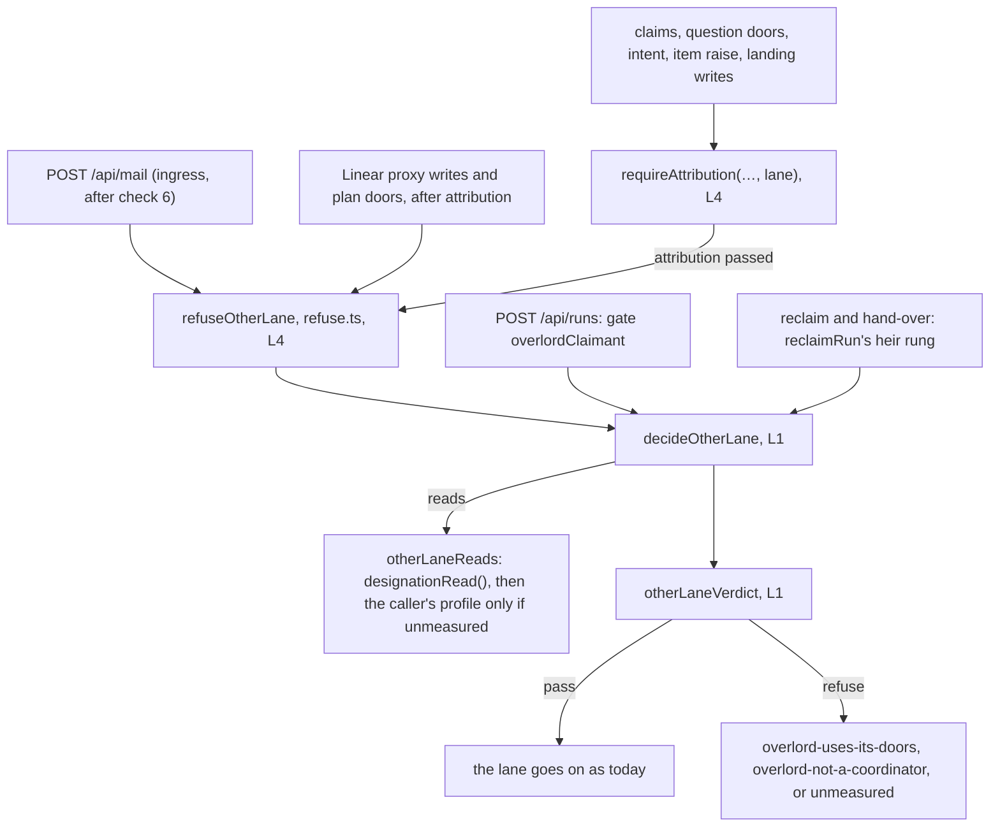

# Overlord W1: refusals on other write lanes, so the Overlord acts only through its own doors Implementation Plan

> **For agentic workers:** REQUIRED SUB-SKILL: Use superpowers:subagent-driven-development (recommended) or
> superpowers:executing-plans to implement this plan task-by-task. Steps use checkbox (`- [ ]`) syntax for tracking.

**Goal:** the Overlord's body cannot reach a coordinator, a claim, a run, the landing line or the tracker by any write
lane that can name its caller and is not one of the Overlord's own doors. Where a door cannot name its caller, the plan
says so and names what guards it instead.

- Every attributed write lane that is not an Overlord door refuses the Overlord's body with `overlord-uses-its-doors`:
  - the five the spec names: peer mail, raising an item, claims, the claimant's question door, coordinator intent;
  - three more ruled in: the landing writes and the Linear proxy's writes (fix round 1), and the six plan doors (the
    coordinator's ruling on fix round 1).
- Two doors refuse it with `overlord-not-a-coordinator`, so it can never become a programme's claimant:
  - run open, when `claimedBy` names it (C48);
  - the reclaim door and the archive door's hand-over, when the heir is the Overlord's body (ruled in, fix round 1).
- One L1 decider makes every one of these decisions, from one table of lanes. A census reds a lane that skips it, a key
  at the wrong door, and any write door nobody has classified.
- Every caller each lane has today (coordinators, workers, plain sessions, the operator) gets the same answer, byte for
  byte. A characterization suite pins that before any lane changes.

**Why:** H10 (§3.8): "The designated session is refused on every write lane that is not an Overlord door". C48 (§3.5):
"The run-open door refuses `overlord-not-a-coordinator` when `claimedBy` names the designated session. So it can never
become a coordinator by opening a run." Anti-goal A5 (§15): "Never hide an act. Every act goes through a door that logs
it." Today nothing on `main` tells the Overlord's call from any other session's on these lanes, so an Overlord that
found a side path could mail a coordinator, take a claim, open a run, move the landing line or write to the tracker, and
no act row would show it.

**Architecture:** one pull request in lane H, four tasks.

- **L1, C5.** A new file, `server/src/coord/otherLanes.ts`:
  - `OTHER_LANES`, the table of lanes, one row each: the route, the word it refuses with, and how the lane reaches the
    check (`via`);
  - `otherLaneVerdict(lane, callerId, facts)`, the one decider, pure and synchronous;
  - `decideOtherLane(lane, callerId, reads)`, which reads the designation, reads the caller's launch profile only when
    the designation is unmeasured, and asks `otherLaneVerdict`. It is async over handed-in reads, as
    `openRunPreconditions` is;
  - `OtherLaneReads`, the two reads it is handed, declared by this consumer.

  It reads the designation only through designation A's `designationRead()`. It matches the caller through
  `server/src/roleOf.ts#designationFactOf`, and it also refuses an id still on the designation's `stopsOwed`.
- **L3, C5.** A new file, `server/src/coord/otherLaneReads.ts`: `otherLaneReadsOf({ coord, io, cfg })` builds the two
  reads from `CoordStore.designationRead()` and `registry.ts#fieldMeasured` (the caller's `profile` route field). It owns
  the one log line per unmeasured episode.
- **L4.** `server/src/refuse.ts`, the home of the route refusal senders, gains `refuseOtherLane(reply, lane, callerId,
  reads)`: it asks `decideOtherLane` and refuses through `refuseRoute`.
- **L4, C5.** `server/src/coord/routes.ts`:
  - `registerCoordRoutes`' `requireAttribution` closure gains an optional `lane` argument. When the attribution passes
    and a lane is named, it calls `refuseOtherLane`.
  - The mail ingress, which keeps its own attribution (checks 5, 5.5 and 6), calls `refuseOtherLane` once, after
    check 6.
  - `landingWrite` takes a lane from each of its two registrations and passes it on.
  - `POST /api/runs` hands `openRunPreconditions` the reads. `POST /api/runs/:id/reclaim` maps `reclaimRun`'s two new
    refusals.
- **L1, C5.** `server/src/coord/openRun.ts` gains one gate row, `overlordClaimant`, right after `attribution` in
  `OPEN_RUN_GATES`.
- **C5.** `server/src/coord/reclaim.ts`: `reclaimRun`'s heir rung asks `decideOtherLane('runReclaim', heir, …)`. The
  archive door's hand-over (`moveClaims`) calls `reclaimRun`, so it is refused there too.
- **L4, C5.** `server/src/coord/ledgersRoutes.ts`: the item-raise door passes its lane.
- **L4, C4.** `server/src/linear/proxyRoutes.ts`: after its attribution step, a write verb asks `refuseOtherLane` with
  its own lane.
- **L4, C5.** `server/src/coord/planRoutes.ts`: its shared `door` helper takes a lane from each of its six
  registrations and, after its attribution, asks `refuseOtherLane`. `server/src/server.ts` builds one reads instance and
  passes it to the Linear routes and the plan routes.
- **The console.** `pwa/src/fleet/ResumeSheet.tsx` and `ArchiveSheet.tsx` each gain one sentence for the heir refusal.
- No new route, no new table, no migration, no new refusal word (both are on `main`), no wire change.


*Figure 1. Every lane reaches one decider. It reads the designation once, matches the caller the way `roleOf` does
(plus an id still owed its stop), and on an unreadable designation asks only the caller's own launch profile.*

**Tech Stack:** TypeScript (ESM), Fastify, `node:sqlite` (through `CoordStore`), React (two sentences), vitest. No new
dependency.

**Spec:** `docs/superpowers/specs/2026-11-09-overlord-design.md`:

- §3.5, C48, "The line is held five ways", its bullet **The server**: the run-open refusal, the dispatch doors and the
  list of write lanes.
- §3.8, H10, **Only its doors**: the same list and the word.
- §8.1, "What it does not get": "any write lane that is not an Overlord door … all refuse `overlord-uses-its-doors`";
  also "merges by any route other than clause 15's" and "claim breaks".
- Table 11.1e, the row "Refusals on other write lanes (`overlord-uses-its-doors`) and at run open
  (`overlord-not-a-coordinator`)": context C5, rings L1 and L4, no store, no writer, wave W1, and "What an older build
  does: Not refused: the deny set is the guard".
- Table 11.6, the rows `overlord-uses-its-doors` (H10) and `overlord-not-a-coordinator` (C48).
- Table 13.1, row H10: a `tightening` call in W1, which "may trail by one wave".
- §15, anti-goal A5. Table 16, the risk "It drifts into execution": "Run-open and other write lanes refuse it".

The index is `docs/superpowers/plans/2026-11-14-overlord-w1.md`, on `main`. This plan builds on:

- its row "Refusals on other write lanes" (lane H, 1 PR, 4 tasks; needs designation A and the vocabulary);
- its question 17 (`CallerIdentity` and the operator's doors) and question 23 (the Table 11.6 test);
- "Where lanes meet": `server/src/coord/routes.ts` (one line a door at most) and `ledgersRoutes.ts` (lane H's
  item-raise refusal);
- "What a merge arms".

It takes these from sibling plans on `main`:

- designation A (`w1-designation.md`, #2856): `designationRead()` with exactly three arms, its `CoordStore` delegate,
  `shared/overlord-designation.ts#DesignationRead` with the row's `stopsOwed`, `server/src/roleOf.ts#designationFactOf`,
  and the create that writes the body's `profile` route field;
- gates and identity (`w1-gates.md`, #2863): the `CallerIdentity` port, `callerStandingOf` and `OVERLORD_DOORS`, which
  this plan does not call (question 3).

Revised in fix round 1 (review 2171), then once more for the coordinator's ruling on the plan doors. The coordinator's
rulings are marked "(ruled)".

## Open questions

The index's questions this plan builds on come first. Each other question is one the spec leaves open or the tree
contradicts. The plan builds every recommendation unless the coordinator or the operator rules otherwise.

1. **The two words are on `main`, with their Table 11.6 rows** (measured; the brief's ruling). `shared/refusal.ts`'s
   `OVERLORD_REFUSALS` holds `overlord-uses-its-doors` (403) and `overlord-not-a-coordinator` (403), and
   `server/test/single-definition/refusal-table.test.ts` holds both against Table 11.6 in both directions. **Built
   as:** this plan adds no word to Table 11.6 or to the group. The table's "Door or lane" cells name fewer lanes than
   this plan refuses (questions 7 and 8), which the spec-fixes run widens.
2. **"Is this caller the Overlord" has one reader and one matcher** (the brief's ruling). **Built as:**
   - The reader is designation A's `designationRead()`, read once per call. This plan adds no designation reader.
   - The matcher is `roleOf.ts#designationFactOf`: a caller is refused when it answers `live` (the bound body) or
     `pending` (a designate or a rebind attempt's body).
   - An id on the row's `stopsOwed` is refused too (question 10).
   - `designationFactOf` takes a `DesignationFact`, and `designationRead()` answers a `DesignationRead`. If designation
     A, as merged, exports the one narrowing from the read to the fact, the decider calls it. If each of its four
     callers narrows inline, this piece adds `designationFactFrom` beside `designationFactOf` in `roleOf.ts` (L1, one
     function), calls it, and reports the inline copies as a follow-up (slug `one-designation-narrowing`). It moves
     none of them. `stopsOwed` is read from the read's row, never folded into the fact, so `roleOf` keeps its meaning.
3. **`CallerIdentity` does not fit these lanes** (the index's question 17; the brief: "where it fits"). The port
   serves the Overlord's own doors. These lanes are not Overlord doors: their credential is each lane's existing
   attribution, `coord/attribution.ts#attributionVerdict`, which the gates plan's attribution adapter wraps unchanged.
   **Built as:** the lanes keep their attribution as it is. The check runs after it, on the attributed id. So there is
   still one credential reader (`attributionVerdict`) and one designation reader (`designationRead()`), and this
   piece does not wait for gates A or B.

   This decider is not `callerStandingOf`, for a recorded reason (the architecture's "legitimately different"
   catalogue: an opposite safety direction; review 2171 confirmed it):
   - `callerStandingOf` decides who may pass an Overlord door, so it admits the bound body only, with its incarnation
     agreeing, and treats a rebind's pending body as `other`.
   - This decider decides who is refused on a lane that is not an Overlord door. Failing closed there means refusing
     more: the bound body, either attempt's pending body and an id still owed its stop, by id, with no incarnation read.
     A session recreated under the same id is refused too, which costs nothing, because the designation mints a fresh
     id for every body.
4. **An unreadable designation refuses only a caller that could be the Overlord's body** (ruled, F4; the brief's
   ruling that `unmeasured` never passes, narrowed for these lanes). These lanes are the fleet's core, so refusing every
   caller would stop every worker's mail and every claim and run open. **Built as:** when `designationRead()` answers
   `unmeasured`, the decider reads the caller's own `profile` route field (`$REG/<id>.profile`, through
   `registry.ts#fieldMeasured`) and:
   - refuses `unmeasured` (502) when it reads `overlord`, or when it cannot be read;
   - lets the caller through when it reads any other role, or is absent, and the reads log one line per unmeasured
     episode (`console.warn('ccrc-server: …')`, naming the lanes that are passing on profile alone).

   Why the profile, and why an absent field passes: the designate and rebind doors write `profile=overlord` on the
   body's create (designation A, slug `profile-fields-written-at-create`), so the Overlord's body always carries it, and
   most other sessions carry no `profile` while the launch-profile lane is shadow. The start doors and the Overlord's
   own doors keep their own every-caller rule; this narrowing is these lanes' only.

   **The residual:** while the designation is unreadable, an Overlord body whose `profile` file was removed or rewritten
   out of band passes these lanes. Its launch profile still has no command tool. The causes of an unreadable
   designation are a hand-written bad column, a closed database, and a server rolled forward over a row written with a
   newer word (`designationRead()` narrows the pending kind, the class words and the outcome word, and answers
   `unmeasured` on any it does not know). The operator learns of it from designation A's own push, which the mail pace
   sweep raises once per episode. This piece's log line names the lanes that are deciding by profile.
5. **"Peer mail" means every send by the Overlord's body** (§3.5 and H10 say "peer mail"; the code calls only
   `runId === null` traffic peer mail, for its quotas). **Built as:** the mail lane refuses every `POST /api/mail` whose
   `fromId` is the body, run mail included. The Overlord holds no run, and a send that names another programme's run
   reaches that run's coordinator by the same side path.

   What stays open to it:
   - mail *to* it (W2's coordinators report to `overlord`, Table 11.5b);
   - its mail reads (`GET /api/mail`, `GET /api/mail/inbox`, `GET /api/mail/:id`) and its acks
     (`POST /api/mail/:id/ack`), because the Overlord's own timer mail reaches it as mail (the Overlord's timers piece).
6. **The mail lane's refusal writes no `mail_rejections` row** (Table 11.1e: "Store or file: none"). The ingress's own
   rule is that every refusal is recorded through its `refuse`, whose code must be a `MailRejectCode`. **Built as:** the
   mail lane answers through `refuseRoute`, as the claim lanes do, and records nothing. Widening `MAIL_REJECT_CODES`
   (`shared/api.ts`) would put one word in two vocabularies, and the spec stores none. M12 (Table 12) counts the hook's
   denials and `relay-carries-method`, not these refusals. Slug `other-lane-refusals-unrecorded`.
7. **The lanes and their doors** (the spec names lanes, not routes; landing, Linear and reclaim ruled in, F2 and F5;
   the six plan doors ruled in after fix round 1).
   **Built as:**

   | Lane key | Route | Word | Reached through (`via`) |
   |---|---|---|---|
   | `peerMail` | `POST /api/mail` | `overlord-uses-its-doors` | the ingress, after check 6 |
   | `itemRaise` | `POST /api/programmes/:slug/items` | `overlord-uses-its-doors` | `requireAttribution` |
   | `claimTake` | `POST /api/claims` | `overlord-uses-its-doors` | `requireAttribution` |
   | `claimRelease` | `POST /api/claims/:id/release` | `overlord-uses-its-doors` | `requireAttribution` |
   | `questionRule` | `POST /api/questions/:id/rule` | `overlord-uses-its-doors` | `requireAttribution` |
   | `questionRelease` | `POST /api/questions/:id/release` | `overlord-uses-its-doors` | `requireAttribution` |
   | `coordinatorIntent` | `POST /api/coordinators/:session/intent` (both `set` and `clear`) | `overlord-uses-its-doors` | `requireAttribution` |
   | `landingEntries` | `POST /api/landing/entries` | `overlord-uses-its-doors` | `landingWrite`, then `requireAttribution` |
   | `landingOrder` | `POST /api/landing/order` | `overlord-uses-its-doors` | `landingWrite`, then `requireAttribution` |
   | `linearCreate` | `POST /api/linear/proxy/issues` | `overlord-uses-its-doors` | the Linear proxy, after its attribution |
   | `linearUpdate` | `POST /api/linear/proxy/issues/:id` | `overlord-uses-its-doors` | the Linear proxy, after its attribution |
   | `linearComment` | `POST /api/linear/proxy/issues/:id/comments` | `overlord-uses-its-doors` | the Linear proxy, after its attribution |
   | `linearLink` | `POST /api/linear/proxy/issues/:id/links` | `overlord-uses-its-doors` | the Linear proxy, after its attribution |
   | `planDeclare` | `POST /api/programmes/:slug/plan` | `overlord-uses-its-doors` | `planRoutes.ts`' `door`, after its attribution |
   | `planMet` | `POST /api/programmes/:slug/plan/met` | `overlord-uses-its-doors` | `planRoutes.ts`' `door`, after its attribution |
   | `planTickets` | `POST /api/programmes/:slug/plan/tickets` | `overlord-uses-its-doors` | `planRoutes.ts`' `door`, after its attribution |
   | `planTicketsMove` | `POST /api/programmes/:slug/plan/tickets/move` | `overlord-uses-its-doors` | `planRoutes.ts`' `door`, after its attribution |
   | `planEpicsDrop` | `POST /api/programmes/:slug/plan/epics/drop` | `overlord-uses-its-doors` | `planRoutes.ts`' `door`, after its attribution |
   | `planClose` | `POST /api/programmes/:slug/plan/close` | `overlord-uses-its-doors` | `planRoutes.ts`' `door`, after its attribution |
   | `runOpen` | `POST /api/runs`, when `claimedBy` names the body | `overlord-not-a-coordinator` | `OPEN_RUN_GATES`' `overlordClaimant` |
   | `runReclaim` | `POST /api/runs/:id/reclaim`, and the archive door's hand-over, when the heir is the body | `overlord-not-a-coordinator` | `reclaimRun`'s heir rung |

   *Table 1. The lanes, their routes and their words.*

   - Releasing a claim is refused with taking one, because the lane is the claim lane. The body can hold no claim (it is
     always a new session, and taking is refused), so the release refusal costs nothing.
   - The Linear proxy's `POST /api/linear/proxy/search` is a read sent as a POST, and stays open. Its other reads are
     `GET`s.
   - The plan doors (ruled in). Each is attributed (`planRoutes.ts`' `door` calls `opts.attribute`), and then
     `coord/planPolicy.ts#planCallerVerdict` admits the plan's owner, a worker into its own run's epic, and any
     attributed caller while the programme has no plan owner (`owner === null`). That last arm let the body declare the
     plan of a programme that has none, so the refusal comes right after attribution, before the reserved-programme
     check, the Linear store read and the mutex. `GET /api/programmes/:slug/plan` (`plan show`) is a read and stays
     open.
   - `runReclaim` is decided on the heir's id, because the reclaim door's caller is the operator: there is no
     attributed caller to ask about. The archive door's hand-over (`moveClaims`, D-8199) reaches the same rung, so a
     hand-over to the body is refused too, and the archive or stop goes no further, as for any refused hand-over.
   - `POST /api/claims/:id/break` is the operator's ungated door. It carries no attribution, so no identity can be
     refused there (question 8, class `operator-gated`).
8. **Every other write door, by what stops the Overlord's body there** (ruled, F1, F5 and F6; measured on `main`). A5
   reads "every other write lane", while §3.5, H10 and §8.1 list five. Each write door that is not in Table 1 is in
   exactly one of these classes, and Task 4's census holds each to its class:

   | Class | Doors | What stops the body |
   |---|---|---|
   | `run-ownership` | `POST /api/runs/:id/end-request`, `POST /api/runs/:id/review-rounds` | Attribution, then the run's own people: `end-request` takes the run's coordinator or worker (`not-yours`), and `review-rounds` the run's `claimedBy` or a claimant of its programme. The body is neither, because run open and reclaim refuse it |
   | `programme-ownership` | `POST /api/items/:id/confirm`, `return`, `withdraw`, `blocking`; `POST /api/programmes/:slug/spec`, `modifications`, `modifications/merged`; `POST /api/coord/programmes/:slug/calls` | Attribution, then `claimsProgramme`. The body can claim no programme: run open and reclaim refuse it (Table 1) |
   | `lease-ownership` | `POST /api/leases/:lease/retain` | `decideRetain` refuses `not-lease-parent` unless the caller is the lease's parent at its incarnation or that parent's coordinator |
   | `child-only` | the approvals request door | `questions.raiseApproval` refuses `not-a-child` for a session with no child marker, which the body is |
   | `hook-group` | the continuity routes file's box-token doors: card, start report, notes, handover, probe, timers | They are the doors the Overlord must reach (§11.2). The census reads them from the continuity routes file, as the box-token census does |
   | `operator-gated` | every `UNGATED` and `SESSION_ONLY` door, and the other session-gated operator doors, the linking doors among them; `POST /api/runs/:id/reclaim` is here and in Table 1 | The operator's sign-in, or nothing on a box with sign-in dark. No session identity rides them |
   | `launch-profile` | `POST /api/runs/:id/dispatch`, `close`, `advance`, `route` and `items`; `POST /api/ledger/deviations` | Nothing on the server. The bodies carry no caller identity (below) |

   *Table 2. The write doors outside Table 1, and their stoppers.*

   **The five run doors carry no identity** (ruled, F1; measured). Each of `dispatch`, `close`, `advance`, `route` and
   `items` checks the box token and nothing else. None reads a `fromId`, `fromUuid`, `byId` or `byUuid`, and
   `dispatchRun`, `closeRun`, `advanceGate`, `settleItems` and `decideRoute` make no caller check. The ruling's premise
   that the coordinator client sends `fromId` and `fromUuid` on dispatch, close and advance does not hold on `main`:
   `ccd/ccrc-api` passes each body through unchanged (`runs.dispatch`, `runs.advance` and `runs.close` fill no
   identity), and the coordinator skill's bodies carry none (`references/wave-lifecycle-2-dispatch.md`: `{brief,
   items, route, slug}`; `wave-lifecycle-4-advance.md` and `wave-lifecycle-5-boundary.md`: no identity field on
   advance or close). So none of the five can be refused by id without a wire change, and, per the ruling, this plan
   states the residual instead:
   - **The residual:** any holder of the box token can drive these five doors on any run. For the Overlord's body, what
     holds is that its launch profile has no shell or command tool (sandbox A), and its door process lists no tool for
     these verbs (door process A: its tools are the `ccrc-api` verbs the `ccrc-overlord` skill names, and the skill
     names none of them).
   - Spec §3.5's "the dispatch doors refuse it as they refuse any non-claimant" is false on `main`. It goes on the
     spec-fixes list, with the question whether to add attribution to the five doors as a later piece (a wire change
     and a coordinator skill corpus change).

   **The plan doors** are in Table 1, not here (ruled after fix round 1). Review 2171 had them under
   `programme-ownership`, but `planCallerVerdict` admits any attributed caller while a programme has no plan owner, so
   ownership was no stopper there.

   **The ledger mint** (`POST /api/ledger/deviations`) takes an optional `byId` and no attribution, so a refusal by id
   is bypassed by leaving it out. Closing it is a wire change, so it stays in `launch-profile` (F5).
9. **A run that names the Overlord's body as its worker is already refused** (measured; review 2171 F7).
   `POST /api/runs`' `sessionId` names an existing workspace for a wave from 2 on, and dispatch then resumes it and
   injects `/clear`. A coordinator that named the body there by mistake would clear its generation. On `main`, the
   `notAChild` gate in `OPEN_RUN_GATES` refuses a `sessionId` whose registry row exists and has no child marker (`root`),
   with `not-a-child` (409). The designate door creates the body with a session create in the `overlord` project, never
   with `ws-add --child`, so a bound body is `root` and refused.

   The gate admits an id with no registry row yet (`absent`), as the dispatch before `ws-add` needs, and a `deferred`
   row. A pending body's id has no row only between the designation's write and ccd's create, and the id is minted
   fresh from entropy, so naming it then is not a realistic path. **Built as:** no new word and no new gate. Task 4 pins
   the `not-a-child` refusal for the bound body, so a later change to the child marker cannot open that path unseen.
10. **An id still owed its stop is refused; a drained past id passes** (ruled, F3). Designation A puts an id on the
    row's `stopsOwed` when a retire, a failed attempt or a rebind leaves a body that may still be running without a
    binding, and its drain removes the id once the stop has happened. Until then that body is the Overlord's own, with
    the Overlord's launch profile. **Built as:** the decider refuses a caller whose id is on `row.stopsOwed` (either
    arm's row), with the lane's word. An id that is only on `pastIds` passes, as any session does: its body has been
    stopped.

## What exists today

Measured on `origin/main` at `4b5ae49d5` (2026-11-15). Designation A (#2856) and gates (#2863) are merged as plans;
neither has code on `main`, so their interfaces are read from their plans.

- **The words.** `shared/refusal.ts#OVERLORD_REFUSALS` holds both words at 403, each commented "(other-lane
  refusals)", and `REFUSAL_STATUS` carries them, so `refuseRoute` can send either. `GENERIC_REFUSALS` holds
  `unmeasured` (502). `server/test/single-definition/refusal-table.test.ts`'s `W1_GROUP` lists both, and its
  both-directions check holds them to Table 11.6's rows. No route sends either word.
- **The shared attribution check.** `server/src/coord/attribution.ts#attributionVerdict(io, cfg, whoId, whoUuid,
  uuidField)` reads the sender's one registry row, through `registry.ts#readSessionRecord`, and answers `{ ok: true }`
  or `registry-unmeasurable`, `unknown-sender` or `stale-uuid` with a detail. In `server/src/coord/routes.ts`,
  `registerCoordRoutes`' closure `requireAttribution(reply, whoId, whoUuid, uuidField)` sends its refusal through
  `refuseRoute` and answers a boolean. That closure is passed to `ledgersRoutes.ts`, `endRequest.ts`,
  `coordCallsRoute.ts` and `reviewRoundsRoute.ts`. Attribution is freshness, not identity (`requireAttribution`'s own
  note): it proves the caller presented the current `.uuid` of the id it claims.
- **The registry field reader.** `server/src/registry.ts#fieldMeasured(io, dir, id, name)` reads one `$REG/<id>.<name>`
  file and keeps absent apart from unreadable. The launch profile is the route field `profile` (`ccd/ccd`'s
  `ROUTE_FIELDS`), whose server writer is the launch-profile lane (`server/src/continuity/profileLane.ts`, shadow until
  armed) and, for the Overlord's body, the designate and rebind doors' create (designation A).
- **The lanes, as they reach attribution today:**
  - `POST /api/mail`: its own inline checks. Check 5 is the sender's row, 5.5 its measured identity, and 6
    `fromUuid`, over one `readRegistryMeasured`. Each refusal goes through the ingress's `refuse`, which writes a
    `mail_rejections` row first. `GET /api/mail/inbox` calls `requireAttribution` (field `fromUuid`).
    `POST /api/mail/:id/ack` has its own copy of the gate.
  - `POST /api/programmes/:slug/items` (`registerLedgerCoordinatorRoutes`): the box token, the body, the outside-link
    check, `deps.requireAttribution(…, 'byUuid')`, then `owns` (the programme's claimant).
    `LedgerCoordinatorDeps.requireAttribution`'s type takes `uuidField: 'byUuid'` only.
  - `POST /api/claims` and `POST /api/claims/:id/release`: the box token, the body, `requireAttribution(…, 'byUuid')`,
    then the run read (take) or the ownership check (release).
  - `POST /api/questions/:id/rule` and `/release`: the box token, the body by its `kind`,
    `requireAttribution(…, 'fromUuid')`, then the id and the kind check.
  - `POST /api/coordinators/:session/intent`: the box token, the body, `byId === :session` (`not-owner`),
    `requireAttribution(…, 'byUuid')`, then the incarnation read.
  - `POST /api/landing/entries` and `/order`: each registration checks the box token and calls one closure,
    `landingWrite(req, reply, kind)`, which parses the body and calls `requireAttribution(…, 'byUuid')` before
    `coordMutex` and the store write.
  - The Linear proxy (`server/src/linear/proxyRoutes.ts`, C4, L4): thirteen box-token routes, each `handle(verb, …)`.
    Step 3 reads `byId` and `byUuid` from the query and calls `deps.attribute` (`attributionVerdict` with `byUuid`,
    passed from `server.ts`). `LINEAR_OPS[verb].class` is `write` for `create`, `update`, `comment` and `link`.
  - The plan doors (`server/src/coord/planRoutes.ts`, C5, L4; a lane source of the box-token census of its own): six
    box-token `POST` routes, each registered with its path spelled out and its handler built by one closure,
    `door(work)`. `door` reads the slug, `byId` and `byUuid` from the query, calls `opts.attribute` (`attributionVerdict`
    with `byUuid`, passed from `server.ts`), refuses the reserved programme, reads the Linear store, and runs the work
    inside `serial`, where `planCallerVerdict` decides. `plan-routes.test.ts` holds them.
  - `POST /api/runs`: inside `coordMutex`, `coord/openRun.ts#openRunPreconditions` runs `OPEN_RUN_GATES` in order. Its
    `attribution` gate calls the `attribute` fact (`attributionVerdict` with `claimedByUuid`), or, before the
    switch-over, checks that the claimant is listed. `reviewRead`, the first store read, comes next. A refusal is an
    `error` word (sent by `refuseRoute`) or a `refused` word (a `RunRefuseCode`, sent by `refuseRun`).
    `open-run-preconditions.test.ts` holds the order in a gate-order table, with every adjacent pair named.
  - `POST /api/runs/:id/reclaim`: the operator's ungated door (session-gated when armed). Its body is `{claimedBy}`, the
    heir. `coord/reclaim.ts#reclaimRun` checks that the run and the old claimant exist, the heir's id shape (`bad-session`,
    `which: 'heir'`), that the heir is not the worker of a third party's open run (`heir-is-a-worker`), the heir's
    project, and that the old claimant measures dead. It checks nothing about what the heir is. The route maps each
    `ReclaimOutcome` kind in an exhaustive `switch`. `moveClaims` (the archive door's hand-over, D-8199) proves the heir
    live, then calls `reclaimRun` per programme. `pwa/src/fleet/ResumeSheet.tsx` words the door's refusals
    (`RECLAIM_COPY`, with `unknown` for a word it does not know), and `ArchiveSheet.tsx` words a refused hand-over by
    its `kind`.
- **The five run doors carry no identity** (question 8, measured): `dispatch`, `close`, `advance`, `route` and `items`
  check the box token only.
- **The designation, from designation A's plan (#2856).**
  - `shared/overlord-designation.ts#DesignationRead`:
    - `{ kind: 'designated', sessionId, term, row }`, a live binding;
    - `{ kind: 'not-designated', row }`, no row, or a row with no live binding, a pending-only row among them;
    - `{ kind: 'unmeasured', why }`.

    `row.pending` holds the attempt's `sessionId` and `kind` (`designate` or `rebind`). `row.stopsOwed` lists the ids
    a move left running without a binding, until the drain stops each.
  - `designationRead()` is a `CoordStore` one-line delegate over `overlordDesignationStore.ts`. It is synchronous and
    never throws.
  - `server/src/roleOf.ts#designationFactOf(sessionId, DesignationFact)` answers `live`, `pending` or `none`.
    `roleOf` reads `live` and `pending` as `overlord`.
  - Designation A's plan names no shared narrowing from the read to the fact (question 2).
- **Gates and identity, from its plan (#2863).** `server/src/auth/callerIdentity.ts`'s `CallerIdentity` (L2) and the
  attribution adapter (L3) wrap `attributionVerdict` unchanged. `coord/overlordGate.ts#callerStandingOf` is step 1 of
  the Overlord doors' gate order, and `coord/overlordDoors.ts#OVERLORD_DOORS` will list the Overlord's routes. None is
  on `main`, and this plan calls none (question 3).
- **Censuses these lanes already carry,** all green on `main`, none naming the Overlord:
  - `server/test/box-token-census.test.ts` derives the box-token lanes from each lane source's handler bodies
    (`registrationsIn`, `lanesIn`), keeps `UNGATED` and `SESSION_ONLY` from `coord-pause-route.test.ts`'s sets, and
    holds the prose sites to them;
  - `server/src/auth/gate.ts#EXEMPT` gives the claim lanes, the question family's claimant pair, the intent door, the
    landing writes and the Linear proxy routes one reason each, and `auth-gate.test.ts` holds them;
  - `server/test/coord-attribution.test.ts` pins `attributionVerdict`'s answers byte for byte on the mail inbox, a claim
    lane (`POST /api/claims/:id/release`) and `POST /api/runs`;
  - `server/test/question-doors-pin.test.ts` pins every question door's refusals, successes and side effects, row by
    row, and is run unedited by any change to those doors;
  - `server/test/mail-routes.test.ts` holds the ingress's refusals and, in "every quoted kebab token in server/src/coord
    that looks like a code is declared", scans every `server/src/coord/*.ts` for quoted kebab literals. It admits each
    vocabulary through its exported guard. **It does not admit `isOverlordRefusal`**, so a coord file that quotes
    `'overlord-uses-its-doors'` is red today (Task 2 admits the guard);
  - `claims-routes.test.ts`, `coordinator-intent-route.test.ts`, `ledgers-coordinator-routes.test.ts`,
    `open-run-preconditions.test.ts`, `runs-attribution-switch.test.ts`, `mail-ingress-one-read.test.ts`, and the
    landing, Linear proxy, reclaim and archive hand-over suites hold each lane's behaviour (Task 1 names each file it
    reads, measured at build).
- **The guard an older build leaves.** `OVERLORD_DENY_RULES`, which §3.5 places in `shared/api.ts`, is not on `main`
  and no W1 piece plan creates it. The Overlord's launch profile carries its own deny rules (`Bash`, `Edit`, `Write`,
  the web and cron tools; sandbox A, `w1-sandbox.md`). That profile is what Table 11.1e's "the deny set is the guard"
  can mean in W1 (index changes, below).

## Global Constraints

- **Architecture (`CLAUDE.md`).**
  - `server/src/coord/otherLanes.ts` is L1, C5: no `fs`, store, clock or Fastify. It imports types from
    `shared/overlord-designation.ts` and `shared/refusal.ts`, and `designationFactOf` (with `designationFactFrom` if
    question 2 adds it) from `server/src/roleOf.ts`, which is L1. `decideOtherLane` awaits only the reads it is handed.
  - `server/src/coord/otherLaneReads.ts` is L3: it composes `CoordStore.designationRead()` and `fieldMeasured`, keeps
    every distinction they give (absent apart from unreadable), and writes the episode's log line. It decides nothing.
  - `openRun.ts` stays L1: its new gate reads the reads handed in, and calls the decider.
  - `refuse.ts`, `routes.ts`, `ledgersRoutes.ts`, `planRoutes.ts` and `linear/proxyRoutes.ts` stay L4. They hand the reads to the
    decider and send its answer. No `if` over a designation field appears in any of them.
  - No port is added beyond `OtherLaneReads`, declared by its consumer. `OpenRunFacts` gains one fact.
- **One owner each.**
  - The designation's one reader is `designationRead()`. The caller's profile is read only through `fieldMeasured`.
  - The one decider of "this lane refuses this caller" is `otherLaneVerdict`, reached only through `decideOtherLane`.
  - The one table of lanes is `OTHER_LANES`. A new lane is a row, never a second check.
  - The one L4 sender is `refuseOtherLane` in `refuse.ts`, called by `requireAttribution`, the mail ingress, the
    Linear proxy and the plan routes' `door`. The run-open gate answers through `sendOpenRunRefusal`'s `error` arm, and `reclaimRun` through two new
    `ReclaimOutcome` kinds that the reclaim route sends with `refuseRoute`.
  - The one builder of the reads is `otherLaneReadsOf`. `registerCoordRoutes` builds one instance from its own deps,
    `server.ts` builds one for the Linear proxy and the plan routes, and `reclaimRun` builds one from its `ReclaimDeps`. They share one
    module-scope episode latch, so an unmeasured episode logs one line in all.
- **Failure contracts.**
  - An unmeasured designation never passes a caller whose profile reads `overlord` or cannot be read (question 4). The
    decider has no `default` that passes.
  - No overloaded null: `otherLaneVerdict` answers `{ kind: 'pass' }`, `{ kind: 'pass-unmeasured', why }` or
    `{ kind: 'refuse', word, detail }`, never a nullable word. The profile read is `{ kind: 'measured', word }`,
    `{ kind: 'absent' }` or `{ kind: 'unreadable', why }`, or `'not-read'` when the designation was measured.
  - The check runs only after the lane's attribution passed, so an unattributed caller keeps today's refusal and its
    bytes, its `mail_rejections` row included.
  - **Attribution is freshness** (review 2171 F9). The decider refuses the *claimed* id. A caller that presented another
    session's current `.uuid` would pass as that session. The guard there is the same as everywhere on this fleet: the
    Overlord's launch profile has no command tool, so it cannot read another session's `.uuid`.
  - **An older peer.** The check reads only `coord.db` and the server's view of the registry. No agent, ccd or console
    version matters, and no wire changes. A server rolled back below this pull request stops refusing, and the launch
    profile is the guard (Table 11.1e). An older console shows the heir refusal as its generic fallback sentence.
- **Byte for byte for every existing caller.** While `designationRead()` answers `not-designated`, or `designated` for
  another session with no owed stop naming the caller, every lane's status, body bytes and side effects equal today's.
  Task 1's characterization suite pins that before any lane changes, and Tasks 3 and 4 run it unedited.
  `question-doors-pin.test.ts` and `coord-attribution.test.ts` also run unedited.
- **Kebab literals.** Lane keys are camelCase (`peerMail`, `runReclaim`), so the coord kebab census never reads them as
  codes. The words are admitted through `isOverlordRefusal` (Task 2), never through `NOT_CODES`.
- **Growth check.** `server/src/coord/routes.ts` and `server/src/server.ts` are growth-checked. Each stays within the
  40-line check with no waiver (the PR split below). No other growth-checked file changes.
- **Mutation floors.** `otherLaneVerdict` joins `MUTANT_SETS` through a new `server/test/sim/otherLanesSets.ts` and
  `server/test/sim/mutation-floors.json`, in this pull request, at the floor its first run measures.
- **What a merge arms.** Nothing a running session sees or does changes. No designation row exists until the operator
  designates, so every lane passes as today. The refusals start with the first designation, and only for the Overlord's
  bodies. An unreadable designation refuses only callers whose profile reads `overlord` or cannot be read.
- **SAFETY (`CLAUDE.md`).** No ccd verb, no fleet act and no live `~/.ccrc`. Every test builds `coord.db` in memory or
  under the per-run temp root, with fixture registries (`idGateFixture.ts`). The reclaim and hand-over tests use the
  existing fixture tmux doubles, never a live pane. No test calls Linear: the proxy tests use the suite's fetch double.
- **Tests.** Run from `server/` as `ccrc test -- ./node_modules/.bin/vitest run test/<file>.test.ts`, and from `pwa/`
  the same way for the two sentences. Each task's last run adds both server `tsc` runs
  (`ccrc test -- npx tsc --noEmit -p tsconfig.json` and `-p test/tsconfig.tests.json`), and Task 4's adds pwa's `tsc`.
- **Public repository.** Fixtures use neutral ids (`lane-a-overlord-quiet-oak`, `lane-a-project-a-coord`,
  `lane-a-project-a-worker`). Cite by symbol or `@anchor`, never by line. No D-number is invented: departures are slugs
  under "Deviations found", and the coordinator mints numbers.

## Review Focus

1. **Nobody else's answer moves.** For a coordinator, a worker, a plain session or the operator, each door in Table 1
   answers exactly what it answers on `main`, refusals and side effects included, with and without a designation row
   for another session. The characterization suite proves it, and it is green before the first lane edit.
2. **Fail closed where it can be the Overlord, and keep the fleet running.** An unreadable designation refuses a caller
   whose profile reads `overlord` or cannot be read, and lets every other caller through with one logged line per
   episode. Check the residual (question 4) and that both arms are tested.
3. **One decider, one table, no skipped lane, no unclassified door.** Every refusal comes from `otherLaneVerdict` over
   `OTHER_LANES`. The census reds a lane whose door stops passing its key, a key at the wrong door, and any write door,
   box-token or operator-gated, that is in no class of Table 2.
4. **The refused set.** The bound body, either attempt's pending body and an id still owed its stop are refused; a
   drained past id passes. The recorded difference from `callerStandingOf` (question 3) is sound.
5. **No false stopper.** Table 2 states, for each door, a stopper that exists on `main`. The five run doors and the
   ledger mint are stated as residuals, not as ownership. The plan doors, whose ownership check admits any caller
   while a programme has no plan owner, are refused in Table 1.

## The PR split

| PR | Tasks | What it ships | Needs first | Growth-checked files, estimate (net lines) |
|---|---|---|---|---|
| A | 1 to 4 | The characterization suite; `OTHER_LANES`, `otherLaneVerdict` and `decideOtherLane` with their mutant set; the reads; `refuseOtherLane`; the lanes through `requireAttribution`, the mail ingress, `landingWrite`, the Linear proxy and the plan routes' `door`; the run-open gate; the reclaim heir rung and its two sentences; the census; the route slicer moved to a test helper | designation A (`designationRead()`, `designationFactOf`, the create's `profile`) and the vocabulary (on `main`) | `server/src/coord/routes.ts` about +26: `requireAttribution`'s lane branch (+4), building the reads (+2), the mail ingress (+3), `landingWrite`'s lane parameter and its two registrations (+1), the run-open reads (+2), the reclaim route's two new cases (+6), the imports (+2), the call sites (0: an argument each), and comments (+6). `server/src/server.ts` about +5 (one reads instance, built once with its comment, passed to the Linear proxy and the plan routes). `shared/api.ts` 0. `server/src/coord/store.ts` 0. `server/src/coord/schema.ts` 0 |

The pull request merges `main` once before merge, after designation A has landed (worker clause 16).

For scale, the files that are not growth-checked change by about this much:

| File | Change |
|---|---|
| `server/src/coord/otherLanes.ts` | +120, new |
| `server/src/coord/otherLaneReads.ts` | +45, new |
| `server/src/refuse.ts` | +12 |
| `server/src/coord/openRun.ts` | +16 (one fact, one gate, the `error` arm widened) |
| `server/src/coord/reclaim.ts` | +12 (the heir rung, two `ReclaimOutcome` kinds) |
| `server/src/coord/ledgersRoutes.ts` | +1 (the deps type gains `lane?`; the raise call gains its key) |
| `server/src/linear/proxyRoutes.ts` | +6 (`LinearProxyDeps` gains the reads; one call after attribution) |
| `server/src/coord/planRoutes.ts` | +6 (`PlanRouteOpts` gains the reads; `door` gains a lane and one call after attribution; each registration one argument) |
| `server/test/plan-routes.test.ts` | +2 (its opts builder gains a reads double that answers `not-designated`) |
| `server/src/roleOf.ts` | +12, only if question 2 adds `designationFactFrom` |
| `pwa/src/fleet/ResumeSheet.tsx`, `ArchiveSheet.tsx` | +4 each (one sentence, read from the `error` body) |
| `server/test/routeRegistrations.ts` | +70, new (moved from `box-token-census.test.ts`) |
| `server/test/box-token-census.test.ts` | −68 (the move: definitions out, one import in) |
| `server/test/mail-routes.test.ts` | +4 (the guard and its import) |
| `server/test/open-run-preconditions.test.ts` | +10 (two gate rows, two pairs re-pointed) |
| `server/test/sim/mutation-floors.test.ts` | +2 (the import and the spread) |
| new tests and the mutant set | about +850 |

---

### Task 1: Characterize every lane in Table 1 for today's callers

Characterization first (`CLAUDE.md`): this suite is green on `main` with designation A merged, before any lane
changes. Tasks 3 and 4 run it unedited.

**Files:**
- Create: `server/test/overlord-other-lanes-pin.test.ts`

**The suite.** It uses `buildServer` over an in-memory store, with the id-gate rig's fixture registries
(`idGateFixture.ts`: `appFor`, `seedRow`, `recorder`), the fixture tmux doubles the reclaim suites use, and the Linear
proxy suite's fetch double. It seeds four registry rows: a coordinator that claims a programme with an open run, that
run's worker, a plain session, and a coordinator whose pane measures dead. For each door in Table 1, every case below
runs under three designation states:
- no `overlord_designation` row;
- a row whose live binding is a fifth session (seeded through designation A's store writers with a fake `appendInTx`
  that answers `{ ok: true }`, as `overlord-designation-store.test.ts` does), with a sixth id on `stopsOwed`;
- a pending-only row for that fifth session.

Each case pins:
- the status, and the body as the exact bytes fastify sent;
- the side effects:
  - the `mail_rejections` and `mail_deliveries` row counts;
  - the claim rows, the item rows, the question row's state, the stored plan and its owner;
  - the run rows, the hold and each run's `claimedBy`;
  - the landing line's entries and order;
  - the Linear fetch double's calls;
  - for intent, the delegation applier's change count (a fake applier).

The cases, per door:
- **`POST /api/mail`:** a coordinator's run mail to its worker; a worker's `wave-done` to `coordinator`; a plain
  session's peer mail; a stale `fromUuid` (`stale-uuid`, recorded); an unknown sender (`unknown-sender`, recorded).
- **`POST /api/programmes/:slug/items`:** the claimant raises an item; a non-claimant is refused by `owns`; a stale
  uuid.
- **`POST /api/claims` and `/release`:** take, re-take, release by the holder, release by another (`not-owner`), a
  stale uuid.
- **`POST /api/questions/:id/rule` and `/release`:** the parent rules an ask and releases another; a session that is
  not the parent; a stale uuid.
- **`POST /api/coordinators/:session/intent`:** `set` and `clear` by the session itself; `byId` that is not the path's
  session (`not-owner`); a stale uuid.
- **`POST /api/landing/entries` and `/order`:** a coordinator's entry and order write; a stale uuid; a malformed body.
- **The four Linear write routes:** a coordinator's create, update, comment and link; a stale uuid. And `search`, which
  stays open.
- **The six plan doors:** for each, the plan owner's call; a call by another session while the programme has a plan
  owner (`planCallerVerdict`'s refusal); a call by a plain session while it has none (admitted today, the arm the
  ruling closes for the body only); a stale uuid. `tickets` also by a worker into its own run's epic. And
  `GET /api/programmes/:slug/plan`, which stays open.
- **`POST /api/runs`:** a coordinator opens a work run, and a review run of its own work run; a stale `claimedByUuid`;
  no `claimedByUuid` before and after the switch-over.
- **`POST /api/runs/:id/reclaim`:** the operator moves a dead coordinator's programme to a live coordinator; an heir
  that is another run's worker (`heir-is-a-worker`). And the archive door's hand-over to a live coordinator.

- [ ] **Step 1: Write the suite.** Expected values come from running each case against `main`, never from reading the
  code. List the existing suite each door already has beside its cases, measured at build, so a reviewer can see what
  this adds.
- [ ] **Step 2: Run.** `ccrc test -- ./node_modules/.bin/vitest run test/overlord-other-lanes-pin.test.ts`: green on
  `main`. The three designation states answer identically, because no lane reads the designation yet.
- [ ] **Step 3: Self-check.** Change one byte of one pinned body: red. Restore.
- [ ] **Step 4: Commit.** `test(overlord): pin the write lanes the Overlord will be refused on, for today's callers (H10)`

### Task 2: The lane table, the decider and the reads

**Files:**
- Create: `server/src/coord/otherLanes.ts` (C5, L1)
- Create: `server/src/coord/otherLaneReads.ts` (C5, L3)
- Modify: `server/src/refuse.ts` (`refuseOtherLane`)
- Modify: `server/src/roleOf.ts`, only if question 2 needs `designationFactFrom`
- Create: `server/test/overlord-other-lanes.test.ts`
- Create: `server/test/sim/otherLanesSets.ts`
- Modify: `server/test/sim/mutation-floors.test.ts` (one import, one spread into `MUTANT_SETS`),
  `server/test/sim/mutation-floors.json` (one floor)
- Modify: `server/test/single-definition/time-ports.test.ts`, only if `otherLaneReads.ts`' latch reads a clock (it
  should not: an episode is counted by reads, not by time)
- Modify: `server/test/mail-routes.test.ts` (the coord kebab census admits `isOverlordRefusal`, with its import and a
  comment naming this piece, in the idiom of its other guards)

**Interfaces:**

```ts
// server/src/coord/otherLanes.ts
import type { DesignationRead } from '../../../shared/overlord-designation.js';
import type { OverlordRefusal } from '../../../shared/refusal.js';

/** How a lane reaches the check. The census reads this column. */
export type OtherLaneVia =
  | 'attribution' | 'ingress' | 'landing-write' | 'linear-proxy' | 'plan-door' | 'open-run-gate' | 'reclaim-heir';

/** The write lanes that refuse the Overlord's body (§3.5, H10, C48; Table 1). A new lane is a row. */
export const OTHER_LANES = {
  peerMail:          { route: 'POST /api/mail', word: 'overlord-uses-its-doors', via: 'ingress' },
  itemRaise:         { route: 'POST /api/programmes/:slug/items', word: 'overlord-uses-its-doors', via: 'attribution' },
  claimTake:         { route: 'POST /api/claims', word: 'overlord-uses-its-doors', via: 'attribution' },
  claimRelease:      { route: 'POST /api/claims/:id/release', word: 'overlord-uses-its-doors', via: 'attribution' },
  questionRule:      { route: 'POST /api/questions/:id/rule', word: 'overlord-uses-its-doors', via: 'attribution' },
  questionRelease:   { route: 'POST /api/questions/:id/release', word: 'overlord-uses-its-doors', via: 'attribution' },
  coordinatorIntent: { route: 'POST /api/coordinators/:session/intent', word: 'overlord-uses-its-doors', via: 'attribution' },
  landingEntries:    { route: 'POST /api/landing/entries', word: 'overlord-uses-its-doors', via: 'landing-write' },
  landingOrder:      { route: 'POST /api/landing/order', word: 'overlord-uses-its-doors', via: 'landing-write' },
  linearCreate:      { route: 'POST /api/linear/proxy/issues', word: 'overlord-uses-its-doors', via: 'linear-proxy' },
  linearUpdate:      { route: 'POST /api/linear/proxy/issues/:id', word: 'overlord-uses-its-doors', via: 'linear-proxy' },
  linearComment:     { route: 'POST /api/linear/proxy/issues/:id/comments', word: 'overlord-uses-its-doors', via: 'linear-proxy' },
  linearLink:        { route: 'POST /api/linear/proxy/issues/:id/links', word: 'overlord-uses-its-doors', via: 'linear-proxy' },
  planDeclare:       { route: 'POST /api/programmes/:slug/plan', word: 'overlord-uses-its-doors', via: 'plan-door' },
  planMet:           { route: 'POST /api/programmes/:slug/plan/met', word: 'overlord-uses-its-doors', via: 'plan-door' },
  planTickets:       { route: 'POST /api/programmes/:slug/plan/tickets', word: 'overlord-uses-its-doors', via: 'plan-door' },
  planTicketsMove:   { route: 'POST /api/programmes/:slug/plan/tickets/move', word: 'overlord-uses-its-doors', via: 'plan-door' },
  planEpicsDrop:     { route: 'POST /api/programmes/:slug/plan/epics/drop', word: 'overlord-uses-its-doors', via: 'plan-door' },
  planClose:         { route: 'POST /api/programmes/:slug/plan/close', word: 'overlord-uses-its-doors', via: 'plan-door' },
  runOpen:           { route: 'POST /api/runs', word: 'overlord-not-a-coordinator', via: 'open-run-gate' },
  runReclaim:        { route: 'POST /api/runs/:id/reclaim', word: 'overlord-not-a-coordinator', via: 'reclaim-heir' },
} as const satisfies Record<string, { route: string; word: OverlordRefusal; via: OtherLaneVia }>;
export type OtherLane = keyof typeof OTHER_LANES;
export const OTHER_LANE_KEYS = Object.keys(OTHER_LANES) as OtherLane[];

/** The caller's `profile` route field, as `fieldMeasured` gave it; `not-read` when the designation was measured. */
export type CallerProfileRead =
  | { readonly kind: 'measured'; readonly word: string } | { readonly kind: 'absent' }
  | { readonly kind: 'unreadable'; readonly why: string } | 'not-read';

/** What the decider is handed: its consumer's port (L2 by declaration, here beside its one consumer). */
export interface OtherLaneReads {
  readonly designation: () => DesignationRead;
  readonly profile: (sessionId: string) => Promise<Exclude<CallerProfileRead, 'not-read'>>;
}

export type OtherLaneVerdict =
  | { readonly kind: 'pass' }
  /** The designation was unreadable, and the caller's profile shows it is not the Overlord's body (question 4). */
  | { readonly kind: 'pass-unmeasured'; readonly why: string }
  | { readonly kind: 'refuse'; readonly word: (typeof OTHER_LANES)[OtherLane]['word'] | 'unmeasured';
      readonly detail: string };

/** The one decision, pure: may this caller use this lane? */
export function otherLaneVerdict(lane: OtherLane, callerId: string,
  facts: { readonly designation: DesignationRead; readonly profile: CallerProfileRead }): OtherLaneVerdict;

/** Reads the designation; reads the caller's profile only when the designation is unmeasured; decides. */
export function decideOtherLane(lane: OtherLane, callerId: string, reads: OtherLaneReads): Promise<OtherLaneVerdict>;

/** The lane of a Linear proxy verb, or null for a read (`search` included). */
export function linearLaneOf(verb: string): OtherLane | null;
```

```ts
// server/src/coord/otherLaneReads.ts (L3)
export function otherLaneReadsOf(deps: {
  coord: Pick<CoordStore, 'designationRead'>; io: FleetIO; cfg: Pick<CcrcConfig, 'registryDir'>;
}): OtherLaneReads;
```

```ts
// server/src/refuse.ts (L4)
/** The other write lanes' one sender (§3.5, H10): asks `decideOtherLane`, refuses through `refuseRoute`, writes no row
 *  (Table 11.1e: no store). Answers whether the lane may go on. */
export const refuseOtherLane: (reply: FastifyReply, lane: OtherLane, callerId: string, reads: OtherLaneReads)
  => Promise<boolean>;
```

**The decider, in order** (`otherLaneVerdict`):
1. `designation.kind === 'unmeasured'`, by the caller's profile (question 4):
   - `measured` with the word `overlord`, or `unreadable`, or `not-read`: refuse `unmeasured`. The detail is "the
     Overlord's designation could not be read (`<why>`), and this caller's launch profile reads `<word or why>`, so
     `<route>` cannot rule out that it is the Overlord; transient, retry".
   - `measured` with any other word, or `absent`: `pass-unmeasured`, with the designation's `why`.
2. Narrow the read to a `DesignationFact` (question 2), and ask `designationFactOf(callerId, fact)`. `live` or
   `pending`: refuse with the row's word.
3. The read's row is not null and its `stopsOwed` holds the caller's id: refuse with the row's word (question 10).
4. Otherwise: pass.

The refusal's detail names the lane and the remedy: "`<callerId>` is the Overlord's body, which acts only through its
own doors (spec §3.5, H10); `<route>` is not one of them". At `runReclaim` the id is the heir's, and the detail says so.

**The reads** (`otherLaneReadsOf`): `designation` is `coord.designationRead()`. `profile` is `fieldMeasured(io,
registryDir, id, 'profile')`, mapped to `measured`, `absent` or `unreadable` with no other narrowing. Each `designation`
call notes the episode: the first `unmeasured` answer after a measured one (or since the process started) writes one
`console.warn('ccrc-server: the Overlord designation is unreadable (<why>); the other write lanes refuse only callers
whose launch profile reads overlord or cannot be read until it reads again')`, and a measured answer ends the episode.
The latch is one module-scope boolean, so every instance shares one episode.

**`refuseOtherLane`:** `refuse` sends `refuseRoute(reply, word, { detail })` and answers `false`; `pass` and
`pass-unmeasured` answer `true`.

The words in the table are literals in a `server/src/coord/` file, so the coord kebab census reads them. Admitting
`isOverlordRefusal` there is part of this task, in its own commit before the decider's, so the census never goes red
on `main`.

- [ ] **Step 1: Failing tests** (`test/overlord-other-lanes.test.ts`):
  - For each lane key, with `designated` for the caller: refuse with the row's word, and the detail names the route.
  - A `designate` attempt's pending body, and a `rebind` attempt's pending body: refused on every lane.
  - A rebind's old bound body, while the attempt is pending: refused (it is still `live`).
  - An id on `stopsOwed`, under `designated` and under `not-designated`: refused on every lane. The same id once the
    drain removed it, on `pastIds` only: pass.
  - Another session, under `designated`, `not-designated` with no row, and a pending-only row for someone else: pass.
  - `unmeasured`, both arms (question 4): profile `overlord`, `unreadable` and `not-read` refuse `unmeasured` with the
    `why` in the detail; profile `coordinator`, `plain` and `absent` answer `pass-unmeasured`.
  - `decideOtherLane` reads the profile only when the designation is `unmeasured` (a reads double counts the calls).
  - The reads: the episode logs one line for two unmeasured reads in a row, none for a measured one, and one again
    after a measured read ends the episode.
  - `refuseOtherLane` answers `false` and sends the word's status for `refuse`, and `true` for both passes.
  - `linearLaneOf`: each write verb maps to its row; `search` and every read map to null.
  - The six `plan-door` rows refuse the bound body with `overlord-uses-its-doors`, like every other row.
  - `OTHER_LANES` is total: every key has a route, a word that `isOverlordRefusal` accepts, and a `via`. No two rows
    share a route.
  - `REFUSAL_STATUS` gives every row's word 403, and `unmeasured` 502.
- [ ] **Step 2: Run.** Red.
- [ ] **Step 3: Implement** the admission in `mail-routes.test.ts`, then `otherLanes.ts`, `otherLaneReads.ts` and
  `refuseOtherLane` (and `designationFactFrom`, if question 2 needs it).
- [ ] **Step 4: Mutation.** `otherLaneVerdict` joins `MUTANT_SETS` through `otherLanesSets.ts`, with mutants that:
  - pass on `unmeasured` with an `overlord` profile;
  - pass on `unmeasured` with an unreadable profile;
  - refuse on `unmeasured` with a `coordinator` profile;
  - match only the bound id;
  - match only the pending id;
  - drop the `stopsOwed` arm;
  - answer `overlord-uses-its-doors` at `runOpen` or `runReclaim`;
  - compare the caller with the term instead of the id.

  Its floor in `mutation-floors.json` is what the first run measures. By hand: delete the `isOverlordRefusal` line in
  the kebab census and `mail-routes.test.ts` goes red. Restore.
- [ ] **Step 5: Run** this suite, `mail-routes`, `sim/mutation-floors`, `rings/*.test.ts`,
  `single-definition/refusal-table`, `single-definition/time-ports`, `refusal-status` and both `tsc` runs. Green.
- [ ] **Step 6: Commit** twice:
  - `test(coord): the kebab census admits the Overlord's refusal words through their guard`;
  - `feat(overlord): the other write lanes' table, their one decider and its reads (H10, C48)`.

### Task 3: The attributed lanes refuse the Overlord's body

**Files:**
- Modify: `server/src/coord/routes.ts`:
  - `registerCoordRoutes` builds one `otherLaneReadsOf({ coord, io, cfg })` from its deps;
  - `requireAttribution` gains `lane?: OtherLane`;
  - the mail ingress, one call after check 6;
  - `landingWrite` gains a `lane` parameter, and its two registrations pass `'landingEntries'` and `'landingOrder'`;
  - `POST /api/claims`, `POST /api/claims/:id/release`, `POST /api/questions/:id/rule`,
    `POST /api/questions/:id/release` and `POST /api/coordinators/:session/intent` each pass their key.
- Modify: `server/src/coord/ledgersRoutes.ts` (`LedgerCoordinatorDeps.requireAttribution`'s type gains `lane?:
  OtherLane`; the raise door passes `'itemRaise'`)
- Modify: `server/src/linear/proxyRoutes.ts` (`LinearProxyDeps` gains `otherLaneReads: OtherLaneReads`; after step 3's
  attribution, `const lane = linearLaneOf(verb)`, and a non-null lane calls `refuseOtherLane`)
- Modify: `server/src/coord/planRoutes.ts` (`PlanRouteOpts` gains `otherLaneReads: OtherLaneReads`; `door(work)`
  becomes `door(lane, work)` and, right after `opts.attribute` passes, `if (!(await refuseOtherLane(reply, lane, id,
  opts.otherLaneReads))) return reply;`; the six registrations pass `'planDeclare'`, `'planMet'`, `'planTickets'`,
  `'planTicketsMove'`, `'planEpicsDrop'` and `'planClose'`)
- Modify: `server/test/plan-routes.test.ts` (its opts builder passes a reads double that answers `not-designated`; no
  assertion changes)
- Modify: `server/src/server.ts` (one `const otherLaneReads = otherLaneReadsOf({ coord: deps.coord, io: deps.io, cfg:
  deps.cfg })`, or, with no coord store, a reads object whose designation answers `unmeasured`, so a profile
  `overlord` caller is still refused; the Linear proxy's deps and `registerPlanRoutes`' opts each take it)
- Create: `server/test/overlord-other-lanes-routes.test.ts`

**The L4 pieces:**
- `requireAttribution(reply, whoId, whoUuid, uuidField, lane?)`: when the verdict is `ok` and `lane` is given, it
  answers `refuseOtherLane(reply, lane, whoId, reads)`. Every existing caller passes no lane and is unchanged, the inbox
  read, the approvals, lease and other doors, `endRequest.ts`, `coordCallsRoute.ts` and `reviewRoundsRoute.ts` among
  them.
- The mail ingress: right after check 6 and before check 7,
  `if (!(await refuseOtherLane(reply, 'peerMail', fromId, reads))) return;`. So an unattributed or stale sender keeps
  its recorded refusal, and the Overlord's body is refused before any recipient, run or quota read.
- `landingWrite(req, reply, kind, lane)` passes `lane` to its `requireAttribution`. The key sits at each registration,
  where the census can read it.
- The Linear proxy: the refusal comes after attribution and before the validator, the egress check, the rate service
  and any call to Linear, so a refused write sends nothing to Linear and writes no journal line.
- The plan doors: the refusal comes in `door`, after attribution and before the reserved-programme check, the Linear
  store read and `serial`, so a refused plan write reads no plan, takes no mutex and writes nothing. `PlanRouteOpts`
  takes the reads as a required field, so no registration of the plan routes can leave them out.
- Every other door changes one argument, so its handler grows by no line.

The order inside each lane is unchanged up to attribution. The refusal comes right after attribution, before the lane's
own ownership, run, id or incarnation checks, so the answer names its cause (`overlord-uses-its-doors`) rather than
`not-owner`.

- [ ] **Step 1: Failing tests** (`test/overlord-other-lanes-routes.test.ts`, the Task 1 rig with a live binding for a
  fifth registry row, `lane-a-overlord-quiet-oak`):
  - Each door of Task 3, called by the bound body with a current uuid: 403 `overlord-uses-its-doors`, the detail naming
    its route. Nothing is written:
    - no `mail_rejections` row and no delivery (`peerMail`, question 6);
    - no claim, item, question move, landing entry or order, or applier change;
    - no call to the Linear fetch double and no Linear journal line;
    - no plan row, plan owner, ticket, met mark or close written, and no Linear store read (`plan` doors).
  - Each plan door, called by the bound body on a programme with no plan owner (the arm `planCallerVerdict` admits
    today): 403 `overlord-uses-its-doors`. A plain session on the same programme: admitted, as Task 1 pinned.
  - The same, called by a `designate` attempt's pending body, a `rebind` attempt's pending body, and an id on
    `stopsOwed`.
  - The bound body with a stale uuid: today's `stale-uuid`, recorded on the mail lane. The check does not run before
    attribution.
  - The bound body's mail reads and its ack: unchanged (`GET /api/mail/inbox`, `POST /api/mail/:id/ack`). Its Linear
    `search`: unchanged.
  - Mail from a coordinator to the bound body: delivered as today.
  - A hand-written bad designation row (question 4):
    - a coordinator, a worker and a plain session with no `profile`, or `profile=coordinator`, pass every door,
      answering as Task 1 pinned, and the server logs one line;
    - a caller with `profile=overlord`, and one whose `profile` file cannot be read: 502 `unmeasured` on every door,
      nothing written.
  - `POST /api/claims/:id/break` with the bound body in the body: unchanged (ungated, question 7).
- [ ] **Step 2: Run.** Red.
- [ ] **Step 3: Implement.**
- [ ] **Step 4: Run** this suite and these, unedited and green:
  - `overlord-other-lanes-pin` (Task 1), `coord-attribution`, `question-doors-pin`, `question-doors-posture`;
  - `mail-routes`, `mail-ingress-one-read`, `mail-peer-quota`, `claims-routes`, `coordinator-intent-route`,
    `ledgers-coordinator-routes`, `plan-routes` (its opts builder's one added field aside), and the landing-write and
    Linear proxy suites;
  - `box-token-census`, `auth-gate`, `coord-pause-route`, `refusal-status`;
  - `growth-check` armed, and both `tsc` runs.
- [ ] **Step 5: Red check.** Each change below reds a case. Revert each.
  - Drop the lane argument at `POST /api/claims`: the claim-take case.
  - Pass no lane from the `/api/landing/order` registration: the landing-order case.
  - Call `refuseOtherLane` before check 6 in the mail ingress: the stale-uuid case's recorded row.
  - Make `refuseOtherLane` answer `true` on `refuse`: every refusal case.
  - Move the Linear proxy's call after the validator: the no-fetch assertion on a refused write with a bad body.
  - Pass `'planMet'` from the `/plan/close` registration: the plan-close case.
  - Move the plan `door`'s call inside `serial`: the no-Linear-store-read assertion.
- [ ] **Step 6: Commit.** `feat(overlord): mail, items, claims, the claimant's doors, intent, landing, Linear and plan
  writes refuse the Overlord (H10)`

### Task 4: Run open and reclaim refuse the Overlord as a claimant, and the census

**Files:**
- Modify: `server/src/coord/openRun.ts`:
  - `OpenRunFacts` gains `otherLaneReads: OtherLaneReads`;
  - `OPEN_RUN_GATES` gains `overlordClaimant` right after `attribution`;
  - `OpenRunRefusal`'s `error` arm gains `'overlord-not-a-coordinator' | 'unmeasured'`.
- Modify: `server/src/coord/reclaim.ts`:
  - `ReclaimOutcome` gains `{ ok: false; kind: 'overlord-not-a-coordinator'; detail }` and
    `{ ok: false; kind: 'unmeasured'; detail }`;
  - `reclaimRun`'s heir rung: right after rung 3 (the heir's registry read, whose `bad-id` arm is the heir's shape
    check, `bad-session` with `which: 'heir'`), it asks `decideOtherLane('runReclaim', to, otherLaneReadsOf(deps))` and
    returns the refusal as one of those kinds.
- Modify: `server/src/coord/routes.ts` (`POST /api/runs` passes `otherLaneReads`; `POST /api/runs/:id/reclaim`'s
  `switch` maps the two kinds through `refuseRoute`, keeping its exhaustive `default`)
- Modify: `pwa/src/fleet/ResumeSheet.tsx` (an `error` of `overlord-not-a-coordinator` reads "that session is the
  Overlord, which never takes a programme"; `unmeasured` keeps its `detail`)
- Modify: `pwa/src/fleet/ArchiveSheet.tsx` (the hand-over refusal's `why` gains the same sentence for that `kind`)
- Modify: `server/test/open-run-preconditions.test.ts`:
  - single-gate rows for `overlordClaimant`;
  - the rows that named the pair `['attribution', 'reviewRead']` now name `['attribution', 'overlordClaimant']` and
    `['overlordClaimant', 'reviewRead']`;
  - every word those rows assert is unchanged.
- Create: `server/test/routeRegistrations.ts` (moved, below)
- Modify: `server/test/box-token-census.test.ts` (imports the moved helpers; no assertion changes)
- Create: `server/test/overlord-other-lanes-census.test.ts`

**The run-open gate.** `overlordClaimant` runs after `attribution` and before `reviewRead`, the first store read, so a
refused open leaves no `planned` row and places no hold.
- It asks `decideOtherLane('runOpen', claimedBy, f.otherLaneReads)`. A refusal is `{ error: word, detail }`, and
  `sendOpenRunRefusal` sends it through `refuseRoute`. The body is `{ ok: false, error: 'overlord-not-a-coordinator',
  detail }` at 403.
- It is an `error` word, not a `refused` word. A `RunRefuseCode` would have to be documented as a recovery in the
  coordinator corpus (`coordinator-skill.test.ts`), and a coordinator has no recovery for it, for the reason
  `reclaim.ts`' words stay out (slug `overlord-run-refusal-is-an-error-word`).
- An unattributed open before the switch-over (no `claimedByUuid`) is checked the same way: the gate reads `claimedBy`.
- A `sessionId` that names the Overlord's body is not this gate's: `notAChild` already refuses it (question 9).

**The reclaim heir rung.** It runs inside `coordMutex`, before the heir's worker rung, the project read and the old
claimant's measurement, so a refused reclaim measures no pane and re-points nothing. The route answers
`overlord-not-a-coordinator` (403) or `unmeasured` (502) with the detail, both through `refuseRoute`, as `error` words:
`ReclaimRefuseCode` (`shared/api.ts`) is the door's `refused` vocabulary, and it stays as it is. `moveClaims` turns
the kind into its `ClaimsMoveRefusal` unchanged (`refusalOfReclaim`), so the archive door answers its existing refused
hand-over shape, and nothing is stopped or archived.

**The route slicer moves.** `registrationsIn`, `routeCallsIn` and `ALL_VERBS` move from `box-token-census.test.ts` into
`server/test/routeRegistrations.ts`, which also exports `handlerBody(src, key)`: the slice from a route's registration
to the next one, the slice `lanesIn` already takes. It also exports the census's lane-source list and the `UNGATED` and
`SESSION_ONLY` reads, so the two censuses read one list. The move commit changes only `box-token-census.test.ts`'
imports and definitions, and it stays green (slug `route-slicer-shared`).

**The census** (`test/overlord-other-lanes-census.test.ts`), every assertion in both directions:
1. **Every `attribution` lane passes its key.** For each `OTHER_LANES` row whose `via` is `attribution`, the handler of
   its `route`, in `coord/routes.ts` or `coord/ledgersRoutes.ts`, calls `requireAttribution(` or
   `deps.requireAttribution(` with that key as the last argument, exactly once.
2. **Every `landing-write` lane passes its key at its registration**: the handler of its route calls
   `landingWrite(req, reply, '<kind>', '<key>')` once, and `landingWrite` passes its `lane` to `requireAttribution`.
3. **No key at the wrong door.** Every key passed to `requireAttribution`, `landingWrite`, `door` or `refuseOtherLane`
   in those files and in `coord/planRoutes.ts` sits in the handler of the route its row names.
4. **The ingress lane.** The `peerMail` row's handler calls `refuseOtherLane(reply, 'peerMail', fromId, …)` once,
   after the text of check 6 (`stale-uuid`) and before check 7 (`unknown-recipient`).
5. **The Linear and plan lanes.**
   - The `linear-proxy` rows are exactly `LINEAR_OPS`' verbs of class `write`, each by its route in
     `LINEAR_PROXY_ROUTES`; `handle` calls `linearLaneOf(verb)` and `refuseOtherLane` once, after `deps.attribute`.
   - The `plan-door` rows are exactly the `POST` routes `coord/planRoutes.ts` registers, each of whose handlers is
     `door('<key>', …)` with its own row's key. `door` calls `refuseOtherLane` once, after `opts.attribute` and before
     `serial`. A seventh plan write door is red until it has a row.
6. **The claimant lanes.** `OPEN_RUN_GATES` holds `overlordClaimant` directly after `attribution`, and `openRun.ts`
   calls `decideOtherLane('runOpen'` exactly once. `reclaim.ts` calls `decideOtherLane('runReclaim'` exactly once,
   after the heir's registry read (rung 3) and before `heir-is-a-worker`.
7. **Every write door is classified** (question 8, Table 2). Each write door the sources register is in exactly one
   place:
   - a Table 1 row's route;
   - `NOT_REFUSED`, a hand-kept map from route to its class (`run-ownership`, `programme-ownership`, `lease-ownership`,
     `child-only`, `launch-profile`), each with a one-line reason;
   - `hook-group`: the continuity routes file's box-token lanes, as the box-token census computes them from that file;
   - `operator-gated`: the box-token census's `UNGATED` and `SESSION_ONLY` sets and the other session-gated doors it
     names (`KICKOFF`, `ARCHIVE`, `DIGEST_CORRECT`, `LEDGER_OPERATOR_DOORS`, `UPDATE_DOORS`, `TOKEN_DOORS`,
     `CONTINUITY_SESSION_DOORS`), and the linking doors.

   An Overlord door has no class here yet: gates A's `OVERLORD_DOORS` is not on `main`, and no Overlord route exists.
   The gates piece adds the class `overlord-door`, read from `OVERLORD_DOORS`, in the pull request that creates it. A
   new write door of any kind is red until it is placed.

- [ ] **Step 1: The move.** Move the slicer. `box-token-census` stays green. Commit:
  `test(census): the route slicer moves to a shared test helper, unchanged`.
- [ ] **Step 2: Failing tests.**
  - `open-run-preconditions`: the gate's rows. `claimedBy` is the bound body: `overlord-not-a-coordinator`. A pending
    body and an id on `stopsOwed`: the same. Unmeasured with profile `overlord`: `unmeasured`; with profile
    `coordinator`: passes to `reviewRead`. Another session: passes to `reviewRead`. A review open by the bound body is
    refused before the reviewed run is read.
  - In the routes suite:
    - the bound body opens a run and gets 403 `overlord-not-a-coordinator`, and no run row or hold is written;
    - the operator reclaims a dead coordinator's programme with the bound body as heir: 403
      `overlord-not-a-coordinator`, `claimedBy` unchanged on every run, no pane measured (the tmux double records no
      call);
    - the archive door's hand-over to the bound body (the heir proved live by the double): the refused hand-over
      shape, `kind` `overlord-not-a-coordinator`, nothing moved, stopped or archived;
    - the same reclaim with a pending body and an id on `stopsOwed` as heir;
    - a pin, green from the start (question 9): a coordinator's open whose `sessionId` is the bound body, a registry
      row with no child marker, is refused `not-a-child` (409), and no run row is written.
  - `pwa`: `ResumeSheet` and `ArchiveSheet` render the sentence for the new word, and an older answer still renders as
    before.
  - The census, as above.
- [ ] **Step 3: Run.** Red.
- [ ] **Step 4: Implement** the gate, the heir rung, the two route cases, the two sentences and the census.
- [ ] **Step 5: Run** these, green:
  - the census, `open-run-preconditions`, `runs-attribution-switch`, `collect-open-run-hold`, `coord-attribution`;
  - the reclaim, archive hand-over and `ResumeSheet`/`ArchiveSheet` suites (measured at build);
  - `overlord-other-lanes-pin` (unedited) and `overlord-other-lanes-routes`;
  - `box-token-census`, `single-definition/refusal-table`, `rings/*.test.ts`, `sim/mutation-floors`, `mail-routes`;
  - `growth-check` armed, both server `tsc` runs, and pwa's `tsc`.
- [ ] **Step 6: Red check.** Each change below reds a case. Revert each.
  - Delete the `'claimRelease'` argument: census assertion 1, and the routes case.
  - Pass `'claimTake'` at the release door: census assertion 3.
  - Move `overlordClaimant` after `reviewRead`: the gate-order table, and census assertion 6.
  - Move the heir rung after the old claimant's measurement: the "no pane measured" assertion, and census assertion 6.
  - Drop `link` from the Linear rows: census assertion 5.
  - Drop the `planEpicsDrop` row: census assertion 5, and assertion 7 (an unclassified door).
  - Register a new box-token `POST` door, and a new session-gated door, in a scratch copy read by the census:
    assertion 7, each.
- [ ] **Step 7: Commit.** `feat(overlord): run open and reclaim refuse the Overlord as a claimant, and a census holds
  every write door to its class (C48, H10)`

**The pull request ends here.** Its body states:
- the lanes and their words (Table 1), and the classes of every other write door (Table 2), with the five run doors and
  the ledger mint as stated residuals;
- that every existing caller answers as before, with the characterization suite named;
- the narrowed unmeasured rule and its residual (question 4);
- that no row is written, and why;
- the questions ruled, and the floors;
- that nothing changes at merge;
- that a rollback below it leaves the launch profile as the guard.

## Index changes

The coordinator passes these to the index's next fix round.

- **The "Refusals on other write lanes" row:**
  - what it ships: "`OTHER_LANES`, `otherLaneVerdict` and `decideOtherLane` (C5, L1) with their reads (L3) and one
    sender in `refuse.ts`; `overlord-uses-its-doors` on peer mail (every send by the Overlord's body), item raise,
    claims (take and release), the claimant's question door (rule and release), coordinator intent (set and clear),
    the landing writes, the Linear proxy's writes and the six plan doors; `overlord-not-a-coordinator` at run open and at the reclaim and
    archive hand-over heir; the refused set is the bound body, either pending body and an id still owed its stop; an
    unreadable designation refuses only a caller whose profile reads `overlord` or cannot be read; a census that
    classifies every write door";
  - "needs first" stays "designation A, vocabulary". Gates A and B are not needed (question 3).
- **Lane H's file list:** `server/src/coord/otherLanes.ts` and `otherLaneReads.ts`; `refuseOtherLane` in
  `server/src/refuse.ts`; `requireAttribution`, `landingWrite`, the mail ingress and the reclaim route in
  `server/src/coord/routes.ts`; `ledgersRoutes.ts`' raise door; `server/src/linear/proxyRoutes.ts`' write verbs and
  `server/src/coord/planRoutes.ts`' `door`, with their reads in `server.ts`; `server/src/coord/openRun.ts`' gate table; `server/src/coord/reclaim.ts`' heir rung;
  `pwa/src/fleet/ResumeSheet.tsx` and `ArchiveSheet.tsx`; `server/test/routeRegistrations.ts` (shared with the
  box-token census).
- **"Where lanes meet":**
  - `server/src/coord/routes.ts`: about +26 for lane H, and the doors change one argument each;
  - `server/src/server.ts`: about +5 for lane H (one reads instance for the Linear proxy and the plan routes);
  - `server/src/coord/openRun.ts` and `reclaim.ts`: lane H adds one gate and one rung. No other W1 piece edits them;
  - `server/src/roleOf.ts`: lane H adds `designationFactFrom` only if designation A ships no narrowing (question 2).
    Designation A owns the file's designation input;
  - `server/test/mail-routes.test.ts`'s coord kebab census: lane H admits `isOverlordRefusal`. Every later piece that
    quotes an Overlord word in `server/src/coord/` relies on it (designation, ladder, gates, sequence, the Overlord's
    timers), so whichever of them lands first adds it, and lane H drops its step;
  - `server/test/box-token-census.test.ts`: lane H moves the route slicer out. A piece that adds a lane source edits
    the shared list in `routeRegistrations.ts`;
  - gates A adds the census class `overlord-door`, read from `OVERLORD_DOORS`, when it creates the table.
- **"What a merge arms":** add "The other write lanes refuse only the Overlord's bodies, and only once one is
  designated. An unreadable designation refuses only callers whose launch profile reads `overlord` or cannot be read,
  and logs one line per episode."
- **Question 17:** add that the other-lane refusals read the designation, not the port (question 3 here).
- **The spec-fixes list gains:**
  - §3.5's "the dispatch doors refuse it as they refuse any non-claimant" is false: the five run doors (`dispatch`,
    `close`, `advance`, `route`, `items`) carry no caller identity. Whether to add attribution to them, a wire and
    coordinator-corpus change, is a ruling for a later piece (question 8);
  - A5's "every other write lane" against §3.5's five lanes, with Table 2's classes; the ledger mint takes no identity;
  - the reclaim door and the archive hand-over as paths to C48's "it can never become a coordinator", now refused;
  - Table 11.6's "Door or lane" cells for both words gain the landing writes, the Linear writes, the plan doors and
    reclaim;
  - Table 11.1e's "the deny set is the guard": `OVERLORD_DENY_RULES` is not on `main` and no W1 piece creates it, so in
    W1 the guard is the launch profile's deny rules (sandbox A);
  - "peer mail" means every send by the Overlord's body, run mail included (question 5);
  - the narrowed unmeasured rule on these lanes (question 4);
  - §3.5's server bullet can add that a run naming the Overlord's body as its worker is refused already, by
    `not-a-child` (question 9).

## Deviations found

These are the departures from the spec's text, and from the index, that this plan makes, by slug. The coordinator mints
the numbers.

- **`other-lane-refusals-unrecorded`**: the mail lane's refusal writes no `mail_rejections` row, unlike every other
  ingress refusal, because Table 11.1e stores none and the word is not a `MailRejectCode` (question 6).
- **`peer-mail-is-every-send`**: "peer mail" is every `POST /api/mail` by the Overlord's body, run mail included, while
  the code's own "peer mail" is `runId === null` traffic (question 5).
- **`claim-lane-is-take-and-release`**: the claim lane refuses take and release. Break is the operator's ungated door,
  where no identity can be refused (question 7).
- **`refused-set-is-roleofs-and-owed-stops`**: the refused set is the bound body, either attempt's pending body and an
  id still on `stopsOwed`, matched by id, which differs on purpose from `callerStandingOf` (questions 3 and 10).
- **`unmeasured-designation-asks-the-profile`**: an unread designation refuses only a caller whose launch profile reads
  `overlord` or cannot be read, and lets other callers through with one logged line per episode (ruled, question 4).
- **`overlord-run-refusal-is-an-error-word`**: `overlord-not-a-coordinator` travels as an `error` word through
  `refuseRoute`, at run open and at reclaim, not as a `RunRefuseCode` or `ReclaimRefuseCode` `refused` word.
- **`landing-linear-and-plan-lanes`**: the landing writes, the Linear proxy's writes and the six plan doors refuse
  with `overlord-uses-its-doors`, which the spec does not list (ruled, question 7). The plan doors' own check admits
  any attributed caller while a programme has no plan owner, so ownership did not stop the body there.
- **`reclaim-refuses-the-overlord-as-heir`**: the reclaim door and the archive door's hand-over refuse an heir that is
  the Overlord's body, with `overlord-not-a-coordinator`, which the spec does not list (ruled, question 7).
- **`write-doors-classified`**: every write door outside Table 1 is held by a census to one class of Table 2, with the
  five run doors and the ledger mint as stated residuals (question 8).
- **`run-doors-carry-no-identity`**: §3.5's dispatch-door sentence is false on `main`; the five run doors stay guarded
  only by the launch profile and the door process's tool list (ruled, question 8).
- **`one-designation-narrowing`**: only if designation A ships no shared narrowing from the read to the fact. This
  piece adds `designationFactFrom` and reports the inline copies (question 2).
- **`route-slicer-shared`**: the box-token census's route slicer moves to a shared test helper, unchanged, so the two
  censuses slice handlers one way (Task 4).
- **`lanes-without-the-port`**: the lanes read the designation and keep their own attribution, rather than calling
  `CallerIdentity` (question 3, the index's question 17).

## Where things stand

**Agreed:**
- From the brief:
  - the shape of the merged piece plans;
  - one PR in lane H, four tasks;
  - the designation through `designationRead()`, one shared check with a census, characterization first;
  - the two words measured on `main`, with their Table 11.6 rows.
- From fix round 1 (review 2171, ruled):
  - F1: the five run doors carry no identity on `main` (the premise that the client sends `fromId`/`fromUuid` on
    dispatch, close and advance was measured false), so each is a stated residual, and §3.5's dispatch sentence goes to
    the spec-fixes run;
  - F2: reclaim, and with it the archive hand-over, refuses the Overlord's body as heir;
  - F3: an id on `stopsOwed` is refused until it is drained;
  - F4: an unreadable designation refuses only a caller whose profile reads `overlord` or cannot be read;
  - F5: the landing writes and the Linear proxy's writes refuse now; every other door has its measured class;
  - F6 to F9: the `operator-gated` class, question 9's edges, the census's real sources, and attribution as freshness.
- From the coordinator's ruling on fix round 1: the six plan doors join Table 1 and refuse the body with
  `overlord-uses-its-doors`, one row and one argument each, with their pin and census rows; the residual is gone.

**Waiting on the operator:** nothing.

**Waiting on the coordinator:**
- The recommendations of questions 2 and 3.
- The index changes above.

**Needs before it starts:** designation A merged (`designationRead()`, its `CoordStore` delegate, `designationFactOf`
and the create's `profile`). The vocabulary is on `main`.

**What depends on it:**
- `overlord-v1`, which waits for every W1 piece;
- gates A, which adds the census class `overlord-door`;
- every later lane that joins `OTHER_LANES`, as one row and one argument.

**Later:**
- Attribution on the five run doors and the ledger mint, if the spec-fixes run rules it (a wire change).
- M12's counter (Table 12), which counts the hook's denials and `relay-carries-method`. If the spec-fixes run adds these
  refusals to M12, the count joins `refuseOtherLane`, the one sender.
- A credential per session (#273, #275), when the lanes' attribution can say more than freshness.
