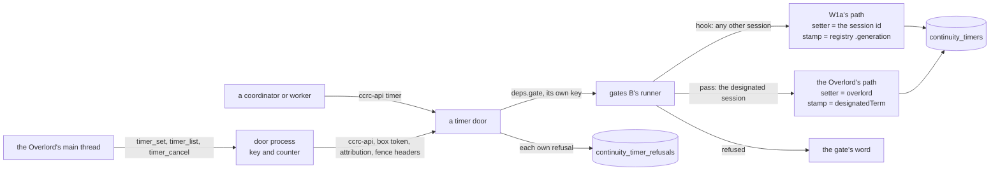
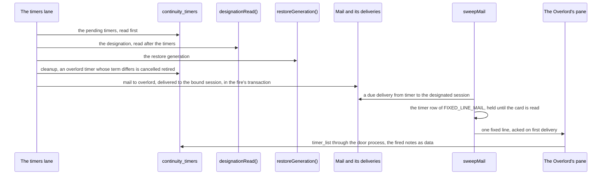

# Overlord W1: the Overlord's timers Implementation Plan

> **For agentic workers:** REQUIRED SUB-SKILL: Use superpowers:subagent-driven-development (recommended) or
> superpowers:executing-plans to implement this plan task by task. Steps use checkbox (`- [ ]`) syntax for tracking.

**Goal:** the Overlord sets itself timers, and they outlive every body that serves the role. W1a built the timer lane
for coordinators and workers: one table, one lane, one mail per setter and run, and the operator's read and cancel.
This piece makes the Overlord a setter of the same lane, never a second one:

- **The doors through the door process.** The three timer doors (`POST /api/timers`, `GET /api/timers`,
  `POST /api/timers/:id/cancel`) each get an `OVERLORD_DOORS` row and call gates B's runner. For every other session
  the runner answers `hook` and the door works as W1a built it. For the designated session it answers `pass`, and the
  door sets, lists or cancels the role's timers: setter `overlord`, stamped with the designation's `designatedTerm`.
- **The setter kind `overlord` in the lane.** The cleanup reads the designation, not the registry, for an `overlord`
  timer, and cancels it `retired` when the designation is retired, binds no session, or carries another
  `designatedTerm`. A rebind and Confirm the restore keep the term, so they keep the timers.
- **`overlord` as a recipient.** A fired timer's mail is addressed to the role (`mail.toId` is `overlord`, so I17's
  check still reads "to the row's setter") and delivered to the session the designation binds. The Overlord has no mail
  verb, so the mail lane types one fixed line for it, through the inbox's `FIXED_LINE_MAIL` table, and holds that
  delivery until the live generation has read its card.
- **What the Overlord reads.** Its card's facts list the role's pending timers. Its `timer_list` door answers its
  pending timers and, for the designated caller only, the ones fired in the last 24 hours, so a fired note is
  readable without a mail verb.
- **The operator's read and cancel** add the role's timers to the bound session's page, each marked as the role's.
- **Two carries from W1a's timers plan:** the "fired again after a restore" line, which reads authority journal C's
  restore generation, and M36's refusal counts, one counted table.
- **One measurement:** what the oldest build a box can roll back to does with queued `overlord` mail and with pending
  `overlord` timers (Table 11.5, ruled F12).

**Why:** R20 and C61 to C65: a reminder is a commitment, and every commitment is on the server when it is made. The
Overlord renews by a fresh start and is rebound to new bodies, so a reminder held in its own memory or in Claude Code's
scheduled tasks (which its launch profile denies) is lost. §3.3.12: "The Overlord's timers belong to the role
`overlord` … Their stamp is the designation's `designatedTerm`." §11.2: the timer doors take the gate order's steps 1 to
9 for the designated session, then only their own checks.

**Architecture:** decide in L1, act in L4, one writer per fact. Nothing here is a second mechanism: the table, the
lane, the doors, the mail sender, the fixed-line table and the gate runner all exist or are built by the pieces this one
needs. This piece adds rows, arms and one column.

- **L0, `shared/continuity-timers.ts`** (W1a's file): the Overlord's stamp codec, the fired view and its window, the
  restore fact's words, and the doors' names for the refusal count.
- **L1, `server/src/continuity/timers.ts`** (W1a's file):
  - `timerCleanupVerdict` takes a setter-kind union: W1a's session facts, or the designation fact of an `overlord`
    timer. Its `overlord` arm answers `retired`, `keep` or `wait`.
  - `timerRestoreFact`, which answers whether a timer was set before a confirmed restore.
  - `packTimerMail` renders the restore line when a timer carries one.
- **L1, `server/src/coord/envelope.ts`** (the inbox's `FIXED_LINE_MAIL`): a `timer` row and a `waitsForCard` column,
  with `cardHoldVerdict`.
- **L3, `server/src/continuity/continuityStore.ts`:** one migration's column (`setRestoreGeneration` on
  `continuity_timers`), `firedTimersOf`, and the refusal count's table, its one writer and its read.
- **L4:**
  - `server/src/continuity/routes.ts`: each timer door calls `deps.gate`, and the designated caller's branch.
  - `server/src/continuity/timerLane.ts`: the designation read and the restore read in the gather, and the mail's
    recipient.
  - `server/src/coord/rundefsTx.ts`: `insertSystemMailTx` delivers a role-addressed mail to a resolved session.
  - `server/src/watch.ts`: `sweepMail`'s card hold for a `waitsForCard` row.
- **Gates' files** (lane C, this lane): `OVERLORD_DOORS` gains three rows, and a row may name no act kind, so step 10
  is skipped for it (question 1).


*Figure 1. One door, two setters. The gate runner tells the designated session from every other caller. A coordinator
or worker keeps W1a's path unchanged. The Overlord's call writes a row of the same table under the role's identity.
Every refusal the door answers itself is counted for M36.*


*Figure 2. A fired Overlord timer. The lane reads the timers before the designation, so a timer set under a new term
is never compared with an older read. The mail row keeps the role and the delivery names the body. The pane gets one
fixed line, after the card is read, and the notes arrive as tool output.*

**Tech Stack:** TypeScript (ESM), `node:sqlite`, Fastify, React (one PWA reader), vitest. No new dependency.

**Spec:** `docs/superpowers/specs/2026-11-09-overlord-design.md`:

- §3.3.12 whole: C61 ("The Overlord's timers belong to the role `overlord`", "A timer fires only while its stamp
  matches", "A timer never acts"), Table 3.3.12a (`setter`, `setterIncarnation`, `role`, `cancelReason`'s `retired`),
  the doors ("The Overlord calls them through its door process", "The operator sees and cancels every timer"), C62
  ("Renewals … For the Overlord it also waits until that generation has read its card", "For the Overlord, a fired
  timer is also a row of band 3 of its inbox from W2 … In W1 it arrives as mail only", the cleanup arm's `retired`, "A
  restore … The repeat says 'fired again after a restore'"), C63, and C65's "The Overlord in W1".
- §11.2: "The timer doors sit beside them" (steps 1 to 9, then the door's own checks; no act kind, no
  `overlordMayAct`, no act row).
- §11.5 and Table 11.5: "`overlord` as a mail sender and a recipient … The plan measures what an older mail lane does
  with queued `overlord` mail", and the `timer` row.
- Tables 11.1a (`continuity_timers`, `overlord_designation`'s `designatedTerm`), 11.1c (the timer lane), 11.1e (the
  timer doors and the operator's read), 11.5b (the timer bounds), 11.6 (the `timer-*` words), I17, M36, and §14's W1
  row ("The Overlord's timers ride its door process and carry the designation's `designatedTerm`").

**The index:** `docs/superpowers/plans/2026-11-14-overlord-w1.md`, row "The Overlord's timers", lane C, one pull
request, five tasks, needing designation B, gates B and authority journal C. Its "Carried from W1a's timers plan" row
(the restore line, M36's refusal counts), question 29 (the board's Timers part), question 35 (the restore generation)
and "Where lanes meet" (`continuity/routes.ts`'s timer doors and the operator's timer read) bind it. This plan also
needs the inbox's Task 4 (`FIXED_LINE_MAIL`), which the index's row lacks (Index changes).

**W1a's timers plan:** `docs/superpowers/plans/2026-11-10-overlord/w1a-timers.md`. Its questions 2
(`no-restore-generation-reader`) and 3 (`m36-refusals-unrecorded`) left the restore line and M36's refusal counts to
W1. Both are built here.

## Open questions

Each has a recommendation, which this plan builds unless the coordinator rules otherwise.

1. **The timer doors name no act kind** (slug `timer-doors-name-no-act-kind`). Gates B's `OverlordDoorRow.act` is a
   `LadderActKind`, and the ladder's `RUNG_CELL_MAP` holds `read`, `write-note` and `acknowledge`, "the act kinds W1's
   doors perform, and only those", which W2's act catalogue takes over. §11.2 says "a timer is no act kind, so neither
   the rung by act kind nor `overlordMayAct` applies". Borrowing `read` and `write-note` gives the same answer in W1,
   but W2's catalogue would then make timers acts. **Recommendation:** `OverlordDoorRow.act` widens to
   `LadderActKind | null`, where `null` says "no act kind: step 10 is skipped". `overlordGate`'s step 10 reads it in one
   place, and the gates census holds that only the three timer rows carry `null`. Steps 1 to 9 run as for any `other`
   door: at `off` the timer doors refuse `overlord-off` (step 4), and while a generation renews they refuse `renewing`
   (step 9).
2. **The Overlord reads a fired timer through its list door** (slug `overlord-lists-its-fired-timers`). The Overlord
   has no mail verb (`ccd/overlord-skill/references/starting.md`), and C62 says "In W1 it arrives as mail only". A mail
   it cannot read delivers nothing, and the card lists pending timers only. **Recommendation:** for the designated
   caller, `GET /api/timers` answers `{ ok, timers, fired }`: `timers` is the role's pending timers, as for every
   caller, and `fired` is the role's timers fired in the last `TIMER_FIRED_SHOWN_MS` (24 hours, a starting value),
   newest first, each a `FiredTimerView` with its `firedAt` and its restore fact. Every other caller's answer is
   unchanged, with no `fired` field. W2's band 3 serves the same rows in the inbox and changes nothing here.
3. **One fixed line for a fired timer, held until the card is read** (slug `timer-fixed-line-waits-for-the-card`). The
   inbox plan (its question 8, `fixed-line-mail-is-one-table`) leaves this piece to add a `FIXED_LINE_MAIL` row or say
   why none is needed. The generic nudge tells a session to run the mail client, which the Overlord cannot.
   **Recommendation:** one row, `timer`: it matches mail from `TIMER_MAIL_SENDER`, binds only the designated session,
   types `ccrc-mail: you have new mail. <n> of your timers came due: read them with your timer list door.`, and is
   acked on first delivery (`firstDelivery: 'none'`, as `spot-probe`). `<n>` is read from the subject's `timer: <n>
   due`, and an unreadable subject types the line without a count. The table gains one column, `waitsForCard`, `true`
   on this row only: C62's "for the Overlord it also waits until that generation has read its card". While it holds,
   no attempt is spent. The other rows keep `false`: each names a door that itself refuses `card-unread` (gates B,
   step 8), and the spec asks the wait of the timer mail alone.
4. **`overlord` is a recipient of system mail only, in W1** (slug `overlord-recipient-is-system-mail-only`). The
   designation plan says "`overlord` is not a role address yet: the Overlord's timers piece adds it". The mail route
   resolves `coordinator` and `worker` at send (`server/src/coord/routes.ts`, its check 7). In W1 only the timer lane
   writes mail to the Overlord, and a session's mail to it would reach a pane that cannot read mail.
   **Recommendation:** the timer lane's mail is the one writer of `toId: 'overlord'` in W1. `insertSystemMailTx` gains
   `deliverTo`: the mail row keeps `toId: 'overlord'`, and the delivery and its envelope name the bound session, as the
   mail route does for a role. `POST /api/mail` keeps refusing `overlord` with `unknown-recipient`, as it does today
   (no registry row has that id). W2's relay and requests decide whether sessions write to it.
5. **What the restore line can say** (slug `restore-line-says-it-may-have-fired`). C62 says "The repeat says 'fired
   again after a restore' when the lane reads the restore generation." The restore generation lives in the authority
   journal and the witnesses, never in `coord.db` (authority journal plan, question 13). A restored `coord.db` holds a
   timer `pending` again, and its earlier mail is gone with the history, so the lane can tell that a timer was set
   before a confirmed restore, but not that it fired before it. **Recommendation:** the set door stamps a new column,
   `setRestoreGeneration`, with `restoreGeneration()`'s value (`NULL` when it reads `unmeasured`). At the fire,
   `timerRestoreFact` answers `set-before-restore` when the current value is measured, above zero and above the stamp,
   and the mail line reads "Set before restore <n> of the coordination database: if it came due before that restore,
   it fired then too, so this may be its second mail." It answers `unmeasured` when either side cannot be read and a
   restore has ever been confirmed, and the line says so. It answers `none` when no restore was ever confirmed (the
   current value is 0), whatever the stamp, so the timers that were pending at this piece's migration carry no line.
6. **M36's refusal counts** (slug `m36-counts-the-timer-doors-own-refusals`). M36 lists "refusals by word", and W1a
   stores none. **Recommendation:** one table, `continuity_timer_refusals (day, door, word, n)`, one row a UTC day, door
   and word, raised by one writer, `recordTimerRefusal`, inside the door's refusal call. It counts every word the five
   timer doors answer themselves: the `timer-*` words, `bad-request`, `unavailable`, `write-failed` and the token's
   `unauthenticated`. It does not count the gate runner's words, which the gate's own measures count (M21, the fence
   refusals). A failed count never changes the answer. The lane purges rows older than `TIMER_KEEP_MS` beside the
   timers it purges. M36's report is the measures work's, which reads `timerRefusalCounts(sinceDay)`.
7. **A rollback below this piece cancels the Overlord's pending timers** (slug
   `older-lane-cancels-overlord-timers-setter-gone`). An older timer lane reads an `overlord` timer as a session's: it
   asks `incarnationOf('overlord')`, which answers `absent` (no registry row has that id), the listing does not name it,
   and `timerCleanupVerdict` cancels it `setter-gone`. The cancel is final, so a roll forward does not bring the timers
   back. **Recommendation:** accept it and record it as a Table 11.5 row. The Overlord's timers are reminders, the
   rollback is the operator's act, and the operator's read shows each one cancelled. Task 5 measures it at the oldest
   kept build.
8. **The Overlord's timers reach it by its card and its list, not the board** (slug
   `overlord-timers-reach-it-by-card-and-list`; index question 29). Q29 says "The Overlord's own timers reach the board
   through the Overlord's timers piece." The board's Timers part counts each programme's coordinator's timers
   (`timersByProgramme`, board and history B), and an `overlord` timer belongs to no programme. **Recommendation:** the
   card's facts read the role's pending timers through `identityOf` (Task 4), and the list door serves them (Task 3).
   The board's part is left as board and history B plans it. If the coordinator wants an Overlord line on the board,
   it is one field on the Itself part, board and history B's to add.
9. **A bound Overlord timer** (slug `overlord-binds-what-its-body-claims`). A timer may bind a run or a programme that
   is "the setter's own: a run it claims or works on, or a programme it coordinates". **Recommendation:** for the
   Overlord, `bindingOf` reads the bound session's claims, as today. In W1 the Overlord claims no run and coordinates
   no programme, so every binding answers `timer-key-unknown`, and its timers are unbound. A rebind keeps an unbound
   timer whole.
10. **The order of the lane's reads** (slug `timers-read-before-the-designation`). A designate can raise
    `designatedTerm` between two reads. **Recommendation:** the gather reads the pending timers first and the
    designation second. A timer set under a newer term is then never compared with an older read of the designation:
    it is either missing from this pass's list or compared with a read at least as new as its stamp. The set door
    writes its stamp from a `designationRead()` taken in the same synchronous segment as the insert (Task 3).

## What exists today

Measured on `main` at `a7d0c978a` (2026-11-15).

- **The table.** `continuity_timers` (migration 70, `server/src/coord/schema.ts`): `setter` ("a session id, or
  'overlord' from W1"), `setterIncarnation` ("the designation's designatedTerm from W1"), `setById`, `setByUuid`,
  `role`, `note`, `runId`, `programme`, `setAt`, `dueAt`, `state`, `firedAt`, `mailId`, `cancelledAt`, `cancelReason`.
  Its writers, each a compare-and-set on `state = 'pending'`, are in
  `server/src/continuity/continuityStore.ts`: `insertTimer`, `cancelTimer`, `markTimersFired` (all of one mail's ids, or
  none, with a savepoint) and `purgeTimers`. The reads are `pendingTimersOf(setter)`, `pendingTimers()`, `timerById`,
  `timerHoldFacts` and `setsSince` (which throws on a failed read). `writers-map.test.ts` names the four writers.
- **The vocabulary.** `shared/continuity-timers.ts`: `TIMER_STATES`, `TIMER_TRANSITIONS`, `timerMoveAllowed`,
  `TIMER_CANCEL_REASON_MAP` with `retired` already mapped to `cleanup` ("`retired` has its writer, the cleanup arm,
  from W1"), the bounds, `TIMER_KEEP_MS` (90 days), `TIMER_MAIL_SENDER` (`timer`) and `TimerView`. The refusal words
  are `shared/refusal.ts#TIMER_REFUSALS`. The cap by role is `shared/fleetRoles.ts`'s `timerCap` column, 50 on the
  `overlord` row, read through `timerCapOf`.
- **The deciders.** `server/src/continuity/timers.ts`: `timerBodyVerdict`, `timerSetVerdict`, `timerCancelVerdict`
  (`operator` asker answers `timer-not-found` for an absent id), `timerCleanupVerdict` (run, programme, the listing,
  the incarnation; `setter-gone` from the stamp only), `timerPreview`, and `packTimerMail`, which groups by `(setter,
  runId)` and already says "`setter` … and `setById` … differ for W1's Overlord timers, so mail groups by `setter`".
  `server/test/sim/timerSets.ts` holds their mutant sets, with floors in `mutation-floors.json`.
- **The lane.** `server/src/continuity/timerLane.ts`: `gatherTimerFacts` reads the pending timers, then each setter's
  incarnation once (`incarnationOf`, twice-read); `timersPass` cleans up, fires each packed mail in one transaction
  (`insertSystemMailTx`, then `markTimersFired`), and purges. Fire is held while `mail-disabled` stands; cleanup is
  not. `FleetWatcher.sweepTimers` (`server/src/watch.ts`) runs it on the `timers` row of
  `server/src/laneSchedule.ts#LANE_SCHEDULE`, a minute, `skip`. Nothing reads a designation: an `overlord` setter today
  would be asked `incarnationOf('overlord')`, read `absent`, and be cancelled `setter-gone`.
- **The mail.** `server/src/coord/rundefsTx.ts#insertSystemMailTx` inserts the mail, queues one delivery to
  `m.toId`, renders the envelope against the delivery id and stamps it, inside the caller's transaction. The mail
  route resolves a role at send: the `mail` row keeps the role in `toId`, and the delivery and the envelope take the
  resolved session (`server/src/coord/routes.ts`, its role resolution after check 8). `SYSTEM_MAIL_SENDER_MAP`
  (`server/src/coord/rundefs.ts`) has `coordinator`, `operator` and `timer`, and derives `MAIL_ROLE_IDS`, which
  `FleetWatcher.mailSender` reads so a role sender gets no park notice.
- **The doors.** `server/src/continuity/routes.ts#registerContinuityRoutes`: `POST /api/timers` (token in `onRequest`,
  then the body, then `deps.attribute`, then the stamp through `deps.setterStamp`, the role through
  `sessionRoleRead`, and one synchronous segment of `bindingOf`, `pendingTimersOf`, `setsSince`, `timerSetVerdict` and
  `insertTimer`); `GET /api/timers` (`deps.attributeReader`, then `pendingTimersOf`); `POST /api/timers/:id/cancel`
  (`timerById`, `timerCancelVerdict`, `cancelOf`). The operator's `GET /api/sessions/:id/timers` reads
  `pendingTimersOf(id)` ("In W1 it adds the Overlord's timers for the session the designation binds"), and
  `POST /api/sessions/:id/timers/:timerId/cancel` checks the row's setter against the path's id. The three session
  doors are `EXEMPT` rows of `server/src/auth/gate.ts`; the census counts them in `box-token-census.test.ts`'s
  `CONTINUITY_LANES` and the operator's two in `CONTINUITY_SESSION_DOORS`. `/api/timers` and
  `/api/sessions/:id/timers` are in `server/src/server.ts#MASKED_GET_ROUTES`, masked whole by `maskDeep`.
- **The card.** `server/src/continuity/cardFacts.ts` reads `coord.pendingTimersOf(id)` by session id. The Overlord's
  card is one line until `overlord-v1` (`server/src/continuity/card.ts#CARD_OVERLORD_LINE`).
- **The console.** `pwa/src/session/timersWords.ts#readTimers` is the one reader of the operator's answer, and
  `pwa/src/session/TimersSection.tsx` renders it, with `pwa/test/timers-section.test.tsx`.
- **Tests.** `server/test/continuity-timers*.test.ts`, `continuity-timer-lane.test.ts`, `ccrc-api-timer.test.ts`,
  `stall-timer-hold.test.ts`, `timer-first-run.test.ts`, `timer-period.test.ts`, and the timer day
  (`server/test/sim/timerDay.ts`, `timer-day.test.ts`).

**What the pieces this one needs ship** (each on `main` as a plan; measure each symbol on `main` before building):

- **Designation A and B** (`w1-designation.md`): `CoordStore.designationRead()` answering exactly three arms,
  `designated` (`sessionId`, `term`, `row` with `designatedTerm`), `not-designated` (no row, or a row with no live
  binding) and `unmeasured`; `server/src/roleOf.ts#identityOf(sessionId, fact)`, answering `overlord` for the live
  bound id and a pending designate's id; `goLive` setting `designatedTerm = term` and a rebind and Confirm never raising
  it; designation B's rebind re-targeting outstanding deliveries of mail whose `toId` is `overlord` ("W1 queues no
  `overlord` mail before the timers piece, so the repoint is tested on rows the test writes").
- **Gates A and B** (`w1-gates.md`): `server/src/coord/overlordDoors.ts#OVERLORD_DOORS` and `NOT_OVERLORD_DOORS`, whose
  not-door list holds the three timer doors "until it adds their rows"; `overlordGate` with step 10 by
  `rungStep(rung, ladderClass, act)`; the runner `overlordGateRun`, bound into the continuity routes as `deps.gate(req,
  reply, key, { sessionId, uuid, uuidField })`, answering `pass`, `hook` or `refused`; the census
  `overlord-gate-census.test.ts` (every `overlord` row's handler has the `onRequest` token form and calls `deps.gate(`
  with its key before its first store read).
- **Door process A** (`w1-door-process.md`): `DOOR_TOOLS`' `timer_set` (fenced, `operate`), `timer_list` (`view`) and
  `timer_cancel` (fenced, `operate`), with their argv. This piece adds no tool row.
- **The inbox's Task 4** (`w1-inbox.md`): `server/src/coord/envelope.ts#FIXED_LINE_MAIL` with `fixedLineMailOf(m,
  designated)`, the rows `operator-message`, `spot-probe` and `inbox-wake`, and `sweepMail`'s branch reading it once a
  sweep.
- **Authority journal C** (`w1-authority-journal.md`, Task 9): `restoreGeneration(): { kind: 'measured'; n } | {
  kind: 'unmeasured'; why: 'journal' }` in `server/src/coord/overlordRestoreState.ts`, "0 on a fresh journal", and "The
  Overlord's timers piece reads the same accessor".
- **The sequence** (`w1-sequence-monitor.md`): timers stamp no sequence line (§10.4: "I17 and I18 over their own
  tables, which stamp no sequence"). Sequence B's I17 predicate joins a fired row to its mail by `mailId` and checks the
  mail is from `TIMER_MAIL_SENDER` and to the row's `setter`. This piece keeps that seam: the mail row's `toId` is the
  setter, `overlord`.

## Global Constraints

- **Architecture (`CLAUDE.md`).** `timerCleanupVerdict`, `timerRestoreFact`, `packTimerMail`, `fixedLineMailOf` and
  `cardHoldVerdict` are pure. The doors, the lane and `sweepMail` read facts, ask a decider and act. L1 imports L0 only:
  the designation reaches `timers.ts` as its own narrow fact type, built by the lane from `designationRead()`, never as
  designation A's row type. Nothing below L4 imports `server.ts` or `watch.ts`.
- **Contexts.** The doors, the lane and the deciders are C3 (Session Conversation), as W1a placed them. The designation
  (C5) and the restore generation (C5) are read through ports the consumer declares: `ContinuityRouteDeps` gains
  `designation` and `restoreGeneration`, and the lane's deps gain `restoreGeneration`. `WatcherCoordMember` gains
  `designationRead` if designation A has not added it.
- **One timer mechanism.** The Overlord's timers are rows of `continuity_timers`, moved by the same four writers through
  `TIMER_TRANSITIONS`, fired by the same lane, from the same sender. No second table, lane, sender or door.
- **One writer per fact.**
  - A timer's state: the four writers, unchanged. The Overlord's set, cancel and fire call them.
  - `setRestoreGeneration`: only `insertTimer`.
  - A refusal count: only `recordTimerRefusal`, called only from the timer doors' one refusal helper.
  - `toId: 'overlord'` mail: only the timer lane, through `insertSystemMailTx`.
  - `designatedTerm`: designation A's writers. This piece only reads it.
- **Unmeasured is never a value.** An unmeasured designation makes every `overlord` timer `wait` (no fire, no cancel),
  makes the operator's read say `overlordTimers: 'unmeasured'`, and makes the operator's cancel of an `overlord` timer
  answer `timer-unmeasured`. An unmeasured restore generation is the restore fact `unmeasured`, never `none`. An
  unmeasured card read holds the fixed line.
- **The stamp is read where it is written.** The set door's `designationRead()` and its insert run in one synchronous
  segment with the count and the rate, with no `await` between (W1a's rule for the count, review 2052 F3).
- **Wire discipline.** Additive only. `TimerView` keeps its fields; the operator's answer gains `owner` on each row and
  one `overlordTimers` field; the designated caller's list answer gains `fired`. An older console reads every row as
  the session's own and ignores the field; an older `ccrc-api` passes the body through.
- **Time through ports.** The doors read `deps.wall()`, the lane `Clock.wall`. The refusal count's day is the UTC date
  of `deps.wall()`. SQL never reads the clock.
- **Growth check.** Each growth-checked file stays within 40 net lines in this pull request (The PR split). No waiver.
- **Mutation floors.** Every new or widened L1 decider has its set in `server/test/sim/timerSets.ts` (the timers') or
  the inbox's set file (`fixedLineMailOf`, `cardHoldVerdict`), and its floor in `server/test/sim/mutation-floors.json`,
  in the task that changes it.
- **Tests.** From `server/`: `ccrc test -- ./node_modules/.bin/vitest run test/<file>.test.ts`. Each task's last run
  adds both `tsc` runs (`ccrc test -- npx tsc --noEmit -p tsconfig.json` and `-p test/tsconfig.tests.json`),
  `test/typecheck-tests.test.ts`, `test/rings/*.test.ts`, and pwa's `tsc` when `shared/` changed. Fixture HOMEs only,
  neutral names (`lane-a`, `project-a`, `prog-a`).
- Cite by symbol or `@anchor`, and a sibling's unbuilt symbol by its plan's contract. No private names. No D-number:
  the builder's departures go in `docs/superpowers/plans/2026-11-14-overlord-w1/w1-overlord-timers/departures.md`.

## Review Focus

1. **One mechanism.** No second table, lane, mail sender or door. Every Overlord timer move goes through
   `TIMER_TRANSITIONS`' writers, and every fire is one transaction with its one mail (I17).
2. **The stamp.** An `overlord` timer carries `designatedTerm`, written from a designation read in the insert's
   synchronous segment. A rebind and Confirm the restore keep it; a retire, an unbound designation and another term
   cancel it `retired`; an unmeasured designation neither fires nor cancels. The lane reads the timers before the
   designation.
3. **The gate.** Each timer door calls `deps.gate` with its own key before its first store read. `hook` keeps W1a's
   path byte for byte (the characterization). `pass` takes the role's path. A timer door skips step 10 only because its
   row names no act kind, and never skips steps 1 to 9.
4. **The recipient.** The mail row says `overlord`; the delivery and the envelope say the bound session. The pane gets
   one fixed line, only after the live generation has read its card, and never the note. The note reaches the
   Overlord only as tool output.
5. **Counted, not changed.** A refusal is counted once by the door that answered it, and a failed count never changes
   the answer or its status.

## The PR split

| PR | Tasks | What it ships | Needs first | Growth-checked files, estimate |
|---|---|---|---|---|
| The Overlord's timers | 1 to 5 | The stamp codec, the fired view and the restore fact; the cleanup's `overlord` arm and the restore line; one migration (`setRestoreGeneration`, `continuity_timer_refusals`) with its writers and reads; the three `OVERLORD_DOORS` rows and `act: null`; the doors' Overlord branch, the operator's read and cancel of the role's timers, and the console's mark; the refusal count; the lane's designation and restore reads and the role-addressed mail; the `timer` row of `FIXED_LINE_MAIL` and its card hold; the card's facts through `identityOf`; the Table 11.5 measurement | designation B (and through it designation A: `designationRead()`, `identityOf`, the rebind's repoint); gates B (`OVERLORD_DOORS`, the runner, `deps.gate` in the continuity routes, the census); authority journal C (`restoreGeneration()`); the inbox (its Task 4, `FIXED_LINE_MAIL`); and through gates B, door process A (`DOOR_TOOLS`' timer rows) and the ladder | `server/src/coord/schema.ts` about +24 (one migration with its comment); `server/src/coord/store.ts` about +5 (delegates: `firedTimersOf`, `recordTimerRefusal`, `timerRefusalCounts`, `purgeTimerRefusals`, and `designationRead` on the watcher port only if absent); `server/src/watch.ts` about +12 (`sweepTimers` passes `restoreGeneration`; `sweepMail`'s card hold for a `waitsForCard` row); `server/src/server.ts` about +5 (the continuity routes' `designation`, `restoreGeneration` and `recordRefusal` deps); `server/src/coord/routes.ts` 0; `shared/api.ts` 0 |

**Order inside the pull request:** Task 1, Task 2, then Tasks 3 and 4 in either order, then Task 5.

**Not growth-checked:** `server/src/continuity/routes.ts` about +90; `server/src/continuity/timers.ts` about +60;
`server/src/continuity/timerLane.ts` about +35; `server/src/continuity/continuityStore.ts` about +55;
`shared/continuity-timers.ts` about +30; `server/src/coord/envelope.ts` about +25; `server/src/coord/rundefsTx.ts`
about +6; `server/src/coord/overlordDoors.ts` about +8; `server/src/coord/overlordGate.ts` about +3;
`server/src/continuity/cardFacts.ts` about +3; `pwa/src/session/timersWords.ts` about +15 and `TimersSection.tsx` about
+8. If `watch.ts` measures past 40, the card hold's fact read moves into `server/src/coord/envelope.ts`'s caller as one
port call the branch makes in one line.

**What later pieces read** (the states this piece exposes):

- `overlord-v1` and the Overlord's card renderer: `CardFacts.timers` holds the role's pending timers for the bound
  session.
- W2's band 3: the role's fired timers through `firedTimersOf('overlord', since)`, with `firedAt` and the restore fact.
- M36's report: `timerRefusalCounts(sinceDay)`, and the role's rows of `continuity_timers` by `role`.
- Board and history B: nothing new (question 8).

## Index changes

The index (`docs/superpowers/plans/2026-11-14-overlord-w1.md`) should carry these:

1. **The row's needs:** add the inbox (its Task 4's `FIXED_LINE_MAIL`), and Figure W1 gains `IN --> OT`. The row's
   files: `shared/continuity-timers.ts`, `server/src/continuity/{timers,timerLane,routes,continuityStore,cardFacts}.ts`,
   `server/src/coord/{envelope,rundefsTx,overlordDoors,overlordGate}.ts`, one migration, and
   `pwa/src/session/{timersWords.ts,TimersSection.tsx}`.
2. **Question 29:** "The Overlord's own timers reach the Overlord through its card's facts and its list door, not the
   board's Timers part, which counts per programme" (question 8).
3. **"Where lanes meet":**
   - `server/src/continuity/routes.ts`: the three timer doors call `deps.gate`, and the operator's read and cancel read
     the designation. Lane B's start-report and "picked up" handlers are untouched.
   - `server/src/coord/overlordDoors.ts`: this piece adds three rows and moves the three timer doors off
     `NOT_OVERLORD_DOORS`; `OverlordDoorRow.act` widens to `LadderActKind | null`, and `overlordGate`'s step 10 skips a
     `null` act (question 1).
   - `server/src/coord/envelope.ts#FIXED_LINE_MAIL`: the `timer` row and the `waitsForCard` column (question 3).
   - `server/src/coord/rundefsTx.ts#insertSystemMailTx`: an optional `deliverTo` (question 4).
   - `schema.ts`'s migrations: this piece takes one (a column and a table), with `run-close-switch.test.ts` and
     `coord-db.test.ts`.
   - `writers-map.test.ts`'s `TABLES`: `continuity_timer_refusals: [recordTimerRefusal, purgeTimerRefusals]`.
4. **The capability words:** none added. The timer doors' rows carry `timers-v1` (gates plan), so the Overlord's timers
   work wherever `timers-v1` is advertised and the designation exists; `overlord-v1` still hides the Overlord's doors
   from the console.
5. **"Carried from W1a's timers plan":** the restore line says "may have fired" (question 5), and M36 counts the timer
   doors' own refusals (question 6).

### Task 1: The vocabulary and the deciders

**Files:**
- Modify: `shared/continuity-timers.ts` (L0): `overlordTimerStamp`, `FiredTimerView`, `TIMER_FIRED_SHOWN_MS`,
  `TIMER_RESTORE_FACT_MAP`, `TIMER_DOOR_MAP`
- Modify: `server/src/continuity/timers.ts` (C3, L1): the setter-kind union in `CleanupFacts`, `timerCleanupVerdict`'s
  `overlord` arm, `timerRestoreFact`, and `DueTimer.restore` rendered by `packTimerMail`
- Modify: `server/test/sim/timerSets.ts` (the widened sets and one new), `server/test/sim/mutation-floors.json`
- Modify: `server/test/continuity-timers.test.ts`, `server/test/continuity-timers-vocab.test.ts`

**Interfaces:**

```ts
// shared/continuity-timers.ts
/** The stamp of an `overlord` timer (C61): the designation's `designatedTerm`, in decimal. One codec, both ways. */
export function overlordTimerStamp(designatedTerm: number): string;
/** How long a fired timer of the role stays in the designated caller's list answer (question 2): 24 hours. */
export const TIMER_FIRED_SHOWN_MS = 86_400_000;
/** Whether a fired timer was set before a confirmed restore of `coord.db` (question 5). */
const TIMER_RESTORE_FACT_MAP = {
  none: 'no restore was confirmed between its set and its fire',
  'set-before-restore': 'it was set before a confirmed restore, so it may have fired once before that restore',
  unmeasured: 'whether a restore came between could not be read',
} as const;
export type TimerRestoreFact = keyof typeof TIMER_RESTORE_FACT_MAP;
export const TIMER_RESTORE_FACTS = Object.keys(TIMER_RESTORE_FACT_MAP) as TimerRestoreFact[];
/** One fired timer of the role, in the designated caller's list answer. */
export interface FiredTimerView extends TimerView { readonly firedAt: number; readonly restore: TimerRestoreFact }
/** The timer doors, as the refusal count names them (question 6). */
const TIMER_DOOR_MAP = {
  set: 'POST /api/timers', list: 'GET /api/timers', cancel: 'POST /api/timers/:id/cancel',
  'operator-read': 'GET /api/sessions/:id/timers', 'operator-cancel': 'POST /api/sessions/:id/timers/:timerId/cancel',
} as const;
export type TimerDoor = keyof typeof TIMER_DOOR_MAP;
export const TIMER_DOORS = Object.keys(TIMER_DOOR_MAP) as TimerDoor[];
```

```ts
// server/src/continuity/timers.ts
/** What the lane read about a timer's setter: W1a's session facts, or for `overlord` the designation (Task 4 builds it
 *  from `designationRead()`, so this file imports no designation type). */
export type SetterFacts =
  | { readonly kind: 'session'; readonly listing: …; readonly incarnation: …; readonly setAt: number;
      readonly listedAt: number | null }                                   // W1a's fields, moved unchanged
  | { readonly kind: 'overlord';
      readonly designation: { readonly kind: 'bound'; readonly designatedTerm: number } | { readonly kind: 'unbound' }
        | { readonly kind: 'unmeasured' } };
export interface CleanupFacts {
  readonly boundRun: …; readonly boundProgramme: …;   // unchanged
  readonly setter: SetterFacts;
  readonly stamp: string;
}
/** W1a's order for a session setter, unchanged. For an `overlord` setter, after the run and programme rungs: an
 *  `unmeasured` designation waits; `unbound` (retired, or binding no session) cancels `retired`; a bound designation
 *  whose `overlordTimerStamp(designatedTerm)` differs from the stamp cancels `retired`; an equal one keeps. */
export function timerCleanupVerdict(f: CleanupFacts): CleanupVerdict;
/** The restore fact at the fire: `stamp` is the timer's `setRestoreGeneration` (null when it was not measured at the
 *  set), `now` the restore generation read this pass. `none` when `now` is measured 0. Otherwise `unmeasured` when either
 *  side is not measured or the stamp is above `now` (a journal that came back older); `set-before-restore` when the stamp
 *  is below `now`; `none` when they are equal. */
export function timerRestoreFact(stamp: number | null,
  now: { readonly kind: 'measured'; readonly n: number } | { readonly kind: 'unmeasured' }): TimerRestoreFact;
```

`DueTimer` gains `restore: TimerRestoreFact`. `timerLines` adds one trusted line after the "Credited to" line when it is
not `none`: for `set-before-restore`, "Set before restore <n> of the coordination database: if it came due before that
restore, it fired then too, so this may be its second mail."; for `unmeasured`, "Whether a restore of the coordination
database came between this timer's set and now could not be read." `<n>` is the current generation, carried on the
`DueTimer` beside the fact. The line is trusted text the server measured, outside the untrusted block, and it carries no
part of the note.

- [ ] **Step 1: Failing tests.**
  - `continuity-timers-vocab.test.ts`: `TIMER_RESTORE_FACTS` and `TIMER_DOORS` equal their maps' keys, each written out
    in the test; `overlordTimerStamp(0)`, `(7)` and `(2 ** 31)` are decimal strings, and the stamp of a term never equals
    a stamp of another term.
  - `continuity-timers.test.ts`, the cleanup:
    - every W1a case, unchanged, under `setter: { kind: 'session', … }` (the move is a refactor; the expected answers do
      not change);
    - `overlord` with a closed bound run cancels `run-closed` before the designation is read; an `unmeasured` bound run
      waits first;
    - `overlord`: `unmeasured` waits; `unbound` cancels `retired`; bound with the same term keeps; bound with another
      term cancels `retired`; a stamp that is not a decimal string (a session's UUID) under a bound designation cancels
      `retired` (it was never this role's stamp);
    - no `overlord` case ever answers `setter-gone` or `setter-archived`, and no `session` case ever answers `retired`
      (a generated sweep over every arm).
  - `continuity-timers.test.ts`, the restore fact: the table of `(stamp, now)` pairs: `(null, 0)`, `(3, 0)` none; `(null,
    2)` and `(3, 2)` unmeasured; `(1, 2)` set-before-restore; `(2, 2)` none; `(x, unmeasured)` unmeasured for every `x`.
  - `continuity-timers.test.ts`, the mail: a due timer with `set-before-restore` renders the restore line after its
    credit line and outside the untrusted block; `unmeasured` renders its line; `none` renders nothing; a mail of
    timers each at the note cap with the restore line still fits `MAIL_BODY_MAX_BYTES` with at least one timer.
- [ ] **Step 2: Run.** Red.
- [ ] **Step 3: Implement.** Move W1a's setter fields into the `session` arm in its own commit first, with every W1a
  case green and unchanged (`refactor(timers): the setter's facts are one arm of a union`), then add the `overlord`
  arm and the restore fact.
- [ ] **Step 4: Mutation.** `timerCleanupVerdict`'s set gains mutants for the new arm (drop the `unbound` cancel, compare
  `term` for equality as numbers without the codec, read `unmeasured` as `unbound`); `timerRestoreFact` joins
  `MUTANT_SETS` with a floor of 1; `packTimerMail`'s set gains a mutant that drops the restore line.
- [ ] **Step 5: Run** both suites, `test/sim/mutation-floors.test.ts`, `test/sim/timer-day.test.ts`, both `tsc` runs and
  pwa's `tsc`. Green.
- [ ] **Step 6: Commit.** `feat(timers): the setter kind overlord in the cleanup, and the restore fact (Overlord W1)`

### Task 2: The store: the restore column and the refusal count

**Files:**
- Modify: `server/src/coord/schema.ts` (one migration: a column on `continuity_timers` and one table)
- Modify: `server/src/continuity/continuityStore.ts`: `TimerInsert.setRestoreGeneration`, `insertTimer`,
  `TimerRow.setRestoreGeneration`, `firedTimersOf`, `recordTimerRefusal`, `timerRefusalCounts`, `purgeTimerRefusals`
- Modify: `server/src/coord/store.ts` (four delegates)
- Modify: `server/src/coord/ports.ts` (`WatcherCoordMember` gains `purgeTimerRefusals`) and
  `server/test/rings/watcher-store-port.data.ts` (its row)
- Modify: `server/test/single-definition/writers-map.test.ts` (`TABLES` gains `continuity_timer_refusals`, and its
  writers), `server/test/run-close-switch.test.ts` (the undo step and the count), `server/test/coord-db.test.ts` (the
  count)
- Modify: `server/test/continuity-timers-store.test.ts`

**The migration** (its slot taken at build time; re-measure it before the pull request and before merge, as migration 70's
comment shows):

```sql
ALTER TABLE continuity_timers ADD COLUMN setRestoreGeneration INTEGER;  -- restoreGeneration() at the set; NULL: unmeasured
CREATE TABLE continuity_timer_refusals (
  day  TEXT NOT NULL,     -- the UTC date of the refusal, YYYY-MM-DD
  door TEXT NOT NULL,     -- a TimerDoor
  word TEXT NOT NULL,     -- the refusal word the door answered
  n    INTEGER NOT NULL,  -- how many times that day
  PRIMARY KEY (day, door, word)
);
```

A column added to an existing table and a new table: an older build opening the file takes rule 3 (it warns, reads
as-is and migrates nothing). It names its columns in every `SELECT` (`TIMER_COLUMNS`) and never names the new table, so
it boots and reads every timer as before. `NULL` in `setRestoreGeneration` means "not measured at the set": the read
failed, or an older build wrote the row. Both read `unmeasured` in `timerRestoreFact`, which handles them the same way,
so the one value is no overloaded seam.

**The functions:**

```ts
/** The setter's timers fired at or after `since`, newest first: the designated caller's `fired` list. A failed read is
 *  `{ ok: false, detail }`, never an empty list. */
export function firedTimersOf(db: DatabaseSync, setter: string, since: number): TimersRead;
/** Raises one (day, door, word) count by one, in one statement (`INSERT … ON CONFLICT DO UPDATE SET n = n + 1`).
 *  Never throws: a failed statement answers `{ ok: false }`, which the door ignores. */
export function recordTimerRefusal(db: DatabaseSync, r: { day: string; door: TimerDoor; word: string }):
  { ok: true } | { ok: false };
/** Every count from `sinceDay` on, by day, door and word: M36's read. */
export function timerRefusalCounts(db: DatabaseSync, sinceDay: string):
  { ok: true; rows: { day: string; door: string; word: string; n: number }[] } | { ok: false; detail: string };
/** Removes the days before `beforeDay`. The timers lane calls it beside `purgeTimers`. */
export function purgeTimerRefusals(db: DatabaseSync, beforeDay: string): { removed: number };
```

`insertTimer` writes `setRestoreGeneration` from its input, whose type is `number | null`. `timerRowOf` reads it, and a
value that is not an integer or null fails the row's read, as a bad `runId` does.

- [ ] **Step 1: Failing tests** (`continuity-timers-store.test.ts`, a fixture `coord.db` at the new version):
  - `insertTimer` with `setRestoreGeneration: 2` and with `null` round-trips through `timerById`; a row whose column
    holds text fails the read with a detail;
  - `firedTimersOf` answers the setter's fired rows at or after `since`, newest first, and no pending, cancelled or
    other setter's row; a dropped table answers `{ ok: false }`;
  - `recordTimerRefusal` twice for one key reads `n: 2`; another day or door is its own row; a dropped table answers
    `{ ok: false }` and does not throw;
  - `timerRefusalCounts` reads from `sinceDay` on; `purgeTimerRefusals` removes only earlier days;
  - an older build's read: `pendingTimersOf` on a database the new migration wrote, through W1a's column list, reads
    every row (the column is extra, never required).
  - `writers-map`: `continuity_timer_refusals` has `recordTimerRefusal` and `purgeTimerRefusals`, and
    `continuity_timers` keeps its four writers.
- [ ] **Step 2: Run.** Red. **Step 3: Implement.**
- [ ] **Step 4: Run** the suite, `writers-map`, `coord-db`, `run-close-switch`, `rings/*`, `growth-check` armed for
  `schema.ts` and `store.ts`, and both `tsc` runs. Green.
- [ ] **Step 5: Commit.** `feat(timers): the restore generation at the set, and the timer doors' refusal count (Overlord W1, M36)`

### Task 3: The doors: the gate, the role's branch, the operator's read, and the count

**Files:**
- Modify: `server/src/coord/overlordDoors.ts` (three rows; the three timer doors leave `NOT_OVERLORD_DOORS`;
  `OverlordDoorRow.act` is `LadderActKind | null`)
- Modify: `server/src/coord/overlordGate.ts` (step 10 skipped for a `null` act, in one place)
- Modify: `server/src/continuity/routes.ts`:
  - `ContinuityRouteDeps` gains `designation: () => DesignationRead`, `restoreGeneration: () => RestoreGenerationRead`
    and `recordRefusal: (door: TimerDoor, word: string) => void`;
  - one helper, `refuseTimer(reply, door, word, extra)`, which calls `deps.recordRefusal` then `refuseRoute`, used by
    every refusal the five timer doors answer, their `onRequest` token check included;
  - each session timer door calls `deps.gate(req, reply, '<key>', { sessionId, uuid, uuidField })` where it called
    `deps.attribute` or `deps.attributeReader`; `refused` returns; `hook` runs W1a's path; `pass` runs the role's path;
  - the operator's read and cancel read the designation.
- Modify: `server/src/server.ts` (the three new deps, bound once)
- Modify: `server/src/auth/gate.ts` (the three `EXEMPT` reasons gain "for the designated session, the gate order of
  §11.2, steps 1 to 9")
- Modify: `pwa/src/session/timersWords.ts` (`readTimers` reads `owner` per row and `overlordTimers`; one word each),
  `pwa/src/session/TimersSection.tsx` (a row the role owns says so; `unmeasured` says the Overlord's timers could not be
  read)
- Modify: `server/test/continuity-timers-route.test.ts`, `server/test/overlord-doors-census.test.ts`,
  `server/test/overlord-gate.test.ts`, `server/test/overlord-gate-census.test.ts`, `pwa/test/timers-section.test.tsx`
- Create: `server/test/timer-doors-characterization.test.ts` (Step 1)

**The rows:**

| Key | Method and path | File | Group | Verb class | Write | Word | Others | Ladder class | Act |
|---|---|---|---|---|---|---|---|---|---|
| `timer-set` | `POST /api/timers` | `continuity/routes.ts` | overlord | operate | yes | `timers-v1` | hook | other | none (`null`) |
| `timer-list` | `GET /api/timers` | `continuity/routes.ts` | overlord | view | no | `timers-v1` | hook | other | none (`null`) |
| `timer-cancel` | `POST /api/timers/:id/cancel` | `continuity/routes.ts` | overlord | operate | yes | `timers-v1` | hook | other | none (`null`) |

The operator's read and cancel stay in `NOT_OVERLORD_DOORS` (session-gated). Set and cancel are writes, so the fence,
the witness and the counter run for them (steps 5, 7 and 7a), which `DOOR_TOOLS`' fenced rows already present. The list
is a read.

**The role's path** (the runner answered `pass`, so the caller is the designated session, live, with a current card):

- **Set.** The body checks run first, as today. After the gate, the stamp's read is the designation, so
  `deps.setterStamp` is not asked. Then one synchronous segment: `deps.designation()` must answer `designated` with
  `sessionId` equal to `fromId` (a TOCTOU re-check, legitimately different from the gate's read, which awaits before
  it), otherwise `timer-unmeasured` with the detail "the designation moved while the timer was set; try again";
  `bindingOf(coord, fromId, …)` (question 9); `pendingTimersOf('overlord')`, `setsSince('overlord', …)`; then
  `timerSetVerdict` with `incarnation: { measured, overlordTimerStamp(row.designatedTerm) }`, the cap
  `timerCapOf('overlord')`, and `insertTimer` with setter `overlord`, that stamp, `setById: fromId`, `setByUuid:
  fromUuid`, role `overlord`, and `setRestoreGeneration` from `deps.restoreGeneration()` (`null` when `unmeasured`).
  The identity word is the one `identityOf` answers, never a second spelling.
- **List.** `pendingTimersOf('overlord')` as `timers`, and `firedTimersOf('overlord', now - TIMER_FIRED_SHOWN_MS)` as
  `fired`, each fired row with `timerRestoreFact(row.setRestoreGeneration, deps.restoreGeneration())`. Either read
  failing answers `timer-unmeasured`, never a partial answer.
- **Cancel.** `timerCancelVerdict(row, 'overlord')`, then `cancelOf(…, 'setter-cancel', 'setter', …)`.

Every other session (`hook`) keeps W1a's path. Its attribution is now the runner's step 1, so the door's own
`deps.attribute` call goes, as gates B did for the start doors. The response of every W1a case does not change.

**The operator's read and cancel:**

- **Read.** `pendingTimersOf(id)`, each row `owner: 'session'`. Then `deps.designation()`: `designated` with
  `sessionId === id` adds `pendingTimersOf('overlord')`, each row `owner: 'overlord'`, and `overlordTimers:
  'included'`; `designated` for another id or `not-designated` answers `overlordTimers: 'not-this-session'`;
  `unmeasured` answers `overlordTimers: 'unmeasured'` with the session's own rows still served. A failed read of
  either list answers `timer-unmeasured`.
- **Cancel.** A row whose setter is `overlord`: the designation must be `designated` with `sessionId === id`
  (`timer-not-yours` otherwise; `timer-unmeasured` when it is `unmeasured`), then `timerCancelVerdict(row, 'overlord',
  'operator')` and the operator's cancel with reason `operator`. Any other row: W1a's check, unchanged.

- [ ] **Step 1: The characterization, green on `main` first.** `timer-doors-characterization.test.ts` drives the five
  doors as a coordinator, a worker and the operator would, with fixture registries, and pins the status and body of each
  refusal and each success. Commit it before any change (`test(timers): pin the timer doors' answers before the gate`).
- [ ] **Step 2: Failing tests.**
  - `overlord-doors-census.test.ts`: the three rows are registered in `continuity/routes.ts`, the three doors are no
    longer in `NOT_OVERLORD_DOORS`, and only these three rows carry `act: null`.
  - `overlord-gate.test.ts`: a row with `act: null` skips step 10 at every rung, and runs steps 1 to 9 (a case each for
    `overlord-off`, `card-unread` and `renewing`); `first-refusal`'s oracle gains the `null` arm.
  - `overlord-gate-census.test.ts`: each of the three handlers calls `deps.gate(` with its key before its first store
    read.
  - `continuity-timers-route.test.ts`, with a test runner (`deps.gate` as gates B's tests bind it) and a fake
    designation:
    - a coordinator's set, list and cancel get `hook` and answer exactly as the characterization pins;
    - the designated session's set stores setter `overlord`, stamp `overlordTimerStamp(designatedTerm)`, role
      `overlord`, `setById` its id, and `setRestoreGeneration` from the fake; the cap is 50 and the rate counts the
      role's sets, whatever body set them;
    - a designation that moves between the gate and the insert answers `timer-unmeasured` and stores nothing;
    - `--run` or `--programme` from the Overlord answers `timer-key-unknown` (question 9);
    - the Overlord's list answers its pending timers and `fired` (only rows fired inside 24 hours, newest first, each
      with its restore fact); a failed fired read answers `timer-unmeasured`; a coordinator's list carries no `fired`;
    - the Overlord cancels its own timer, and cannot cancel a session's (`timer-not-yours`);
    - the operator's read of the bound session adds the role's timers with `owner: 'overlord'` and `overlordTimers:
      'included'`; of another session, `not-this-session`; under an unmeasured designation, the session's rows with
      `overlordTimers: 'unmeasured'`;
    - the operator cancels an `overlord` timer through the bound session's path, and not through another session's
      (`timer-not-yours`); under an unmeasured designation, `timer-unmeasured`;
    - every refusal of the five doors calls `recordRefusal` once with its door and word, the token's `unauthenticated`
      included; a `recordRefusal` that throws does not change the answer; the gate's own refusals are not counted.
  - `pwa/test/timers-section.test.tsx`: a row with `owner: 'overlord'` says it is the Overlord's; `overlordTimers:
    'unmeasured'` shows its sentence; a body without either field reads as today.
- [ ] **Step 3: Run.** Red. **Step 4: Implement.**
- [ ] **Step 5: Run** these suites, the characterization, `auth-gate`, `box-token-census`, `secret-mask`,
  `single-definition/refusal-table.test.ts`, `single-definition/core-vocab.test.ts`, `growth-check` armed for
  `server.ts`, `rings/*`, both `tsc` runs, and pwa's suite for the section and its `tsc`. Green.
- [ ] **Step 6: Mutation, by hand.** Each reds a case, then restore: stamp the registry `.generation` on the role's path;
  read the designation before the `await` of the gate; serve `fired` to a coordinator; let the operator cancel an
  `overlord` timer through another session's path; skip `recordRefusal` on the token's refusal; drop the step-10 skip for
  `null`.
- [ ] **Step 7: Commit.** `feat(timers): the Overlord's timers through its door process, stamped with designatedTerm (Overlord W1, C61)`

### Task 4: The lane, the recipient, the fixed line and the card

**Files:**
- Modify: `server/src/continuity/timerLane.ts`:
  - `gatherTimerFacts` reads the pending timers, then `coord.designationRead()` (question 10), and asks
    `incarnationOf` only for session setters;
  - `TimerFacts` gains `designation` (the narrow fact) and `restore` (the restore generation read once a pass);
  - `timersPass` builds `SetterFacts` per timer, passes `timerRestoreFact` into each `DueTimer`, and for a mail whose
    setter is `overlord` calls `insertSystemMailTx` with `toId: 'overlord'` and `deliverTo` the bound session;
  - the purge step also calls `purgeTimerRefusals` with the day `TIMER_KEEP_MS` ago.
- Modify: `server/src/coord/rundefsTx.ts` (`insertSystemMailTx`'s `m` gains `deliverTo?: string`: the delivery, the
  envelope's `toId` and nothing else take it; the mail row keeps `m.toId`)
- Modify: `server/src/coord/envelope.ts` (`FixedLineMailRow.waitsForCard`, the `timer` row, `renderTimerFiredLine`,
  `cardHoldVerdict`)
- Modify: `server/src/watch.ts` (`sweepTimers` passes `restoreGeneration`; `sweepMail`'s fixed-line branch asks
  `cardHoldVerdict` for a `waitsForCard` row before it types, and a hold spends no attempt)
- Modify: `server/src/deps.ts` (`WatcherDeps.restoreGeneration`), `server/src/index.ts` (one wiring line)
- Modify: `server/src/continuity/cardFacts.ts` (the timers read keys by `identityOf(id, fact)`, the fact designation A
  already passes in)
- Modify: `server/test/continuity-timer-lane.test.ts`, `server/test/fixed-line-mail.test.ts` (the inbox's), the mail
  lane suite the inbox extends, `server/test/continuity-card-facts.test.ts`, `server/test/sim/timerDay.ts` and
  `server/test/sim/timer-day.test.ts`

**The fixed line and the hold:**

```ts
// server/src/coord/envelope.ts
export interface FixedLineMailRow {
  /* the inbox's fields, unchanged */
  /** True when the row's delivery waits until the designated session's live generation has read its card (C62). */
  readonly waitsForCard: boolean;
}
/** `ccrc-mail: you have new mail. <n> of your timers came due: read them with your timer list door.` Its head is
 *  `INJECTED_PROMPTS['mail-nudge'].text`. `<n>` comes from the subject's `timer: <n> due`; an unreadable subject types
 *  the line without the count. It names no `ccrc-api`, no mail verb and no part of a note. */
export function renderTimerFiredLine(subject: string): string;
/** The hold for a `waitsForCard` row: the same card fact gates B's step 8 reads. */
export function cardHoldVerdict(card: 'read-current' | 'read-stale' | 'none' | { kind: 'unmeasured'; why: string }):
  { readonly deliver: true } | { readonly deliver: false; readonly why: 'card-unread' | 'unmeasured' };
```

The `timer` row: `{ name: 'timer', matches: (m) => m.fromId === TIMER_MAIL_SENDER, designatedOnly: true, line: (m) =>
renderTimerFiredLine(m.subject), firstDelivery: 'none', waitsForCard: true }`. The inbox's three rows take
`waitsForCard: false`. The card fact is read once a sweep, only when a due delivery matched a `waitsForCard` row: the
designated session's live generation through `effectiveGeneration` (by `identityOf`), then `cardReadOfStart(startId)`.
If gates B keeps the mapping from those reads to the four-arm card fact inline in its runner, this task first moves it
into one L1 function in `overlordGate.ts`, in a move-only commit with gates B's runner suite green, so the gate and the
hold read one mapping. A hold logs one `ccrc-server: the timer line to the Overlord holds: <why>` line when the reason
changes, and is read again next sweep.

**The narrow designation fact** the lane builds: `designated` gives `{ bound, designatedTerm: row.designatedTerm }`
(with `sessionId` kept for `deliverTo`); `not-designated` gives `unbound`; `unmeasured` gives `unmeasured`. A designation
whose pending attempt is a designate and has no live binding is `not-designated`, so it gives `unbound`: a retire came
first, and the role's timers were set under the retired term.

- [ ] **Step 1: Failing tests.**
  - `continuity-timer-lane.test.ts` (in-memory `coord.db`, fake time, fake designation and restore reads):
    - a due `overlord` timer under a bound designation with the same term fires one mail: `mail.fromId` `timer`,
      `mail.toId` `overlord`, the delivery's and the envelope's `toId` the bound session, `markTimersFired` with that
      mail's id, in one transaction;
    - a rebind (same `designatedTerm`, another session) before the fire: the mail is delivered to the new body;
    - a retire, a row that binds no session and another `designatedTerm`: cancelled `retired` on the pass, never mailed;
    - an `unmeasured` designation: the role's timers wait (no fire, no cancel), and the session setters' timers in the
      same pass fire as before;
    - the gather reads the pending timers before the designation (a recording fake), and `incarnationOf` is never
      asked for `overlord`;
    - the restore line: a timer stamped 1 with the restore generation at 2 carries it; at 0, none; `unmeasured`, its
      line;
    - `mail-disabled` holds the role's fire and still runs its cleanup;
    - the purge removes refusal counts older than `TIMER_KEEP_MS`.
  - `fixed-line-mail.test.ts`: `fixedLineMailOf` answers `timer` for a mail from `timer` to the designated session,
    `generic` for one to any other session, and `generic` for every `designatedOnly` row under an unmeasured
    designation; `renderTimerFiredLine` on `timer: 3 due (4, 5, 6)` reads "3 of your timers came due", on a cut subject
    still reads the count, on another subject has no count, and never contains `ccrc-api`; `cardHoldVerdict` delivers
    only on `read-current`.
  - The mail lane suite: a delivery of the role's timer mail is held while the card fact is `none`, `read-stale` or
    `unmeasured`, spends no attempt and types nothing; once `read-current`, it types the line with `resumeIfOwn:
    'whole'`, is acked on first delivery and is never replayed; a coordinator's timer mail keeps the generic nudge and
    its own ack.
  - `continuity-card-facts.test.ts`: the bound session's card facts list the role's pending timers, and a coordinator's
    list its own.
  - The timer day: a seed with an `overlord` setter across a rebind, a retire and a Confirm (the fake restore read
    stepping up) holds I17 on every pass, through sequence B's production predicate if it has merged, else through the
    day's own `TIMER_DAY_INVARIANTS`.
- [ ] **Step 2: Run.** Red. **Step 3: Implement.**
- [ ] **Step 4: Run** these suites, the inbox's mail-lane suites, `lane-schedule`, `growth-check` armed for `watch.ts`,
  `store.ts` and `server.ts`, `rings/*` (the watcher port's row), `time-ports`, both `tsc` runs. Green.
- [ ] **Step 5: Mutation, by hand.** Each reds a case, then restore: put the bound session in `mail.toId`; read the
  designation before the pending timers; type the line before the card is read; count a held delivery as an attempt;
  ask `incarnationOf('overlord')`.
- [ ] **Step 6: Commit.** `feat(timers): the role's timer mail to overlord, one fixed line after the card (Overlord W1, C62, C63)`

### Task 5: What an older build does, measured, and the rest

**Files:**
- Create: `docs/superpowers/plans/2026-11-14-overlord-w1/w1-overlord-timers/older-build.md` (the measurement)
- Create: `docs/superpowers/plans/2026-11-14-overlord-w1/w1-overlord-timers/departures.md` (the builder's departures, if
  any)

**The measurement** (Table 11.5, ruled F12). §11.5: "The plan measures, before each wave merges, what the oldest build
a box can roll back to does with it." The build to measure is the oldest kept on either box (`ccrc versions`), and at
least the newest release without this piece. For each, from a scratch worktree of that tag, with a fixture HOME and a
fixture `coord.db` this branch's migrations wrote:

1. **Queued `overlord` mail.** One mail from `timer` with `toId: 'overlord'`, one delivery queued to a fixture session
   that the fixture designation binds. Run that build's mail sweep once against the fixture (its own test harness). Record:
   whether it delivers by the delivery's `toId` (expected: yes, `dueDeliveries` selects by state); the line it types
   (expected: the generic nudge); whether it acks, replays and parks (expected: up to `MAIL_REPLAY_MAX_ATTEMPTS`, then
   parked read-but-unanswered); and whether the park sends a notice or a push, and to whom (expected: none for a role
   sender in a build with `timer` in `MAIL_ROLE_IDS`; a notice and a push for a session named `timer` in a build
   before `timers-v1`, as Table 11.5's `timer` row already says).
2. **Readers of `mail.toId`.** Every reader in that build that reads a mail row's `toId` as a session (the parked-mail
   lane, the revive lane, the feed, the console's mail views): what each does with `overlord`. The expected answer is a
   label with no session behind it, and no push, but it is measured, not assumed.
3. **Pending `overlord` timers.** One pending timer with setter `overlord`. Run that build's timers lane once. Record
   the cancel (expected: `setter-gone`, question 7) or, for a build before `timers-v1`, that the table is not read.
4. **The new column and table.** That build boots on the file (rule 3) and its timer reads ignore
   `setRestoreGeneration` and `continuity_timer_refusals`.

The note records each answer with the tag, the command and what was seen. The pull request body carries the Table 11.5
rows the spec-fixes run should add: "`overlord` as a timer setter" and the measured `overlord` recipient line.

- [ ] **Step 1:** Run the measurement and write the note. If any answer differs from the expected one in a way that
  loses a timer silently or sends a push for a session that does not exist, stop and report before the pull request.
- [ ] **Step 2:** Run the guards from `server/`: `docs-grammar`, `anchors`, `citations`, `topology-clean`, and
  `deviation-refs` after `git fetch origin main`, through `ccrc test`. Green.
- [ ] **Step 3: Commit.** `docs(timers): what an older build does with the Overlord's timers, measured (Overlord W1, Table 11.5)`

## Rollback and older builds

- **An older server** (this piece's absence) reads an `overlord` timer as a session's and cancels it `setter-gone` on
  its first pass, so a roll forward does not bring it back (question 7). Its doors serve the designated session as any
  session, so a timer the Overlord sets there has setter its session id, fires as a session's, and reaches it as the
  generic nudge, which it cannot act on.
- **Queued `overlord` mail** under an older mail lane is delivered by the delivery's `toId`, typed as the generic
  nudge, replayed and parked. Task 5 measures it. Nothing else reads it as a session: the sender `timer` is a role in
  every build that has `timers-v1`.
- **The column and the table** are ignored (rule 3). A timer an older build sets has `NULL` in `setRestoreGeneration`,
  which reads `unmeasured`, or `none` while no restore was ever confirmed.
- **No new persisted word** but `continuity_timer_refusals`' door names, in a table no older build reads. `retired` was
  in `TIMER_CANCEL_REASON_MAP` from W1a, so an older build reads a `retired` row.
- **No new refusal word.** Every word the doors send is in `TIMER_REFUSALS` or the generic group already.

## Deviations found

Departures from the spec's text, and from sibling plans, that this plan makes, by slug. The coordinator mints numbers.

- **`timer-doors-name-no-act-kind`**: gates B's door rows each name an act kind. The three timer rows name none, and
  step 10 is skipped for them, as §11.2 says (question 1).
- **`overlord-lists-its-fired-timers`**: C62 says a fired timer reaches the Overlord "as mail only" in W1. The Overlord
  has no mail verb, so its list door also serves the role's timers fired in the last 24 hours, a new starting value
  for Table 11.5b (question 2).
- **`timer-fixed-line-waits-for-the-card`**: the inbox's `FIXED_LINE_MAIL` gains a `timer` row and a `waitsForCard`
  column, true on that row only (question 3).
- **`overlord-recipient-is-system-mail-only`**: `overlord` is a recipient of the timer lane's mail only, in W1; the
  mail route does not resolve it (question 4).
- **`restore-line-says-it-may-have-fired`**: the spec's "fired again after a restore" is stronger than the lane can
  know; the line says it may have fired, and `continuity_timers` gains `setRestoreGeneration` (question 5).
- **`m36-counts-the-timer-doors-own-refusals`**: M36's refusals by word are the timer doors' own, counted by day, door
  and word in a new table; the gate's are counted by the gate's measures (question 6).
- **`older-lane-cancels-overlord-timers-setter-gone`**: a rollback below this piece cancels the role's pending timers,
  recorded as a Table 11.5 row (question 7).
- **`overlord-timers-reach-it-by-card-and-list`**: index question 29's board line becomes the card and the list
  (question 8).
- **`timers-read-before-the-designation`**: the lane reads the pending timers before the designation (question 10).

## Where things stand

**Agreed** (the brief's rulings, built as stated):
- The timer lane on `main` is the one timer mechanism. The Overlord's timers are its rows, fired by its lane, from its
  sender, with `mailId` on each fired row and one mail carrying many timers.
- Every door this piece makes an Overlord door has its `OVERLORD_DOORS` row and calls gates B's runner. The door
  process's `timer_set` and `timer_cancel` rows are fenced, and `timer_list` is not, as door process A ships them.
- The Overlord has no mail verb, so this piece adds the `timer` row of `FIXED_LINE_MAIL`.
- Timers stamp no sequence line (§10.4), and sequence B's I17 predicate holds unchanged because the mail row's `toId`
  is the setter.
- Plan decisions are slugs. No D-number.

**Waiting on the coordinator** (open, with a recommendation): questions 1 to 10 above, and the index changes.

**Spec fixes for the spec-fixes run:**
- §3.3.12 C62: "fired again after a restore" becomes "may have fired before a restore", and Table 3.3.12a gains
  `setRestoreGeneration` (question 5).
- §3.3.12 C62: "In W1 it arrives as mail only" gains "and the Overlord reads it through its list door" (question 2).
- Table 11.5b: `TIMER_FIRED_SHOWN_MS`, 24 hours (question 2).
- Table 11.1a: `continuity_timer_refusals`, and M36's source names it (question 6).
- Table 11.5: "`overlord` as a timer setter" (an older timers lane cancels the role's pending timers `setter-gone`),
  and the measured `overlord` recipient line (question 7, Task 5).
- §11.2: the timer doors' rows name no act kind (question 1); not a change of meaning.

**Later:**
- W2: band 3 serves the role's fired timers in the inbox, read through `firedTimersOf`, and the list's `fired` stays as
  it is.
- `overlord-v1`: the Overlord's card renders `CardFacts.timers`.
- M36's report reads `timerRefusalCounts` and the role's rows.
