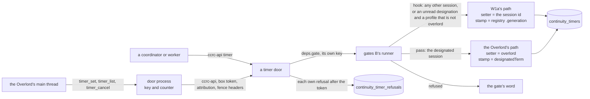
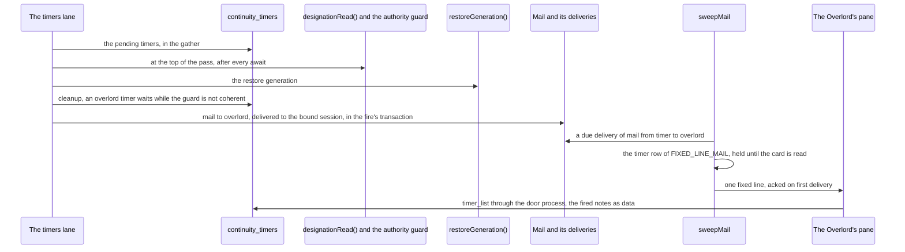

# Overlord W1: the Overlord's timers Implementation Plan

> **For agentic workers:** REQUIRED SUB-SKILL: Use superpowers:subagent-driven-development (recommended) or
> superpowers:executing-plans to implement this plan task by task. Steps use checkbox (`- [ ]`) syntax for tracking.

**Goal:** the Overlord sets itself timers, and they outlive every body that serves the role. W1a built the timer lane
for coordinators and workers: one table, one lane, one mail per setter and run, and the operator's read and cancel.
This piece makes the Overlord a setter of the same lane, never a second one:

- **The doors through the door process.** The three timer doors (`POST /api/timers`, `GET /api/timers`,
  `POST /api/timers/:id/cancel`) each get an `OVERLORD_DOORS` row and call gates B's runner. For every other session
  the runner answers `hook` and the door works as W1a built it. For the designated session it answers `pass`, and the
  door sets, lists or cancels the role's timers: setter `overlord`, stamped with the designation's `designatedTerm`.
- **The setter kind `overlord` in the lane.** The cleanup reads the designation, not the registry, for an `overlord`
  timer, and cancels it `retired` when the designation is retired, binds no session, or carries another
  `designatedTerm`. A rebind keeps the term, so it keeps the timers. Confirm the restore keeps the term too, and a
  Confirm that binds no session cancels them `retired` on the next pass.
- **Held while the authority journal is not coherent.** A `coord.db` restore brings fired timers back `pending` and
  due. While the authority guard reads anything but `coherent`, the role's timers neither fire nor cancel. Once Confirm
  lands, a pending timer stamped below the current restore generation fires with the "may have fired" line.
- **`overlord` as the recipient of the timer lane's mail.** A fired timer's mail is addressed to the role
  (`mail.toId` is `overlord`, so I17's check still reads "to the row's setter") and delivered to the session the
  designation binds. The Overlord has no mail verb, so the mail lane types one fixed line for it, through the inbox's
  `FIXED_LINE_MAIL` table, and holds that delivery until the live generation has read its card.
- **What the Overlord reads.** In W1 its `timer_list` door is the one route: it answers the role's pending timers and,
  for the designated caller only, the current term's fired timers while their mail is unacked and for 24 hours after
  the ack. The card's facts carry the role's pending timers too, which the Overlord sees once `overlord-v1` renders its
  card.
- **The operator's read and cancel** add the role's timers to the bound session's page, each marked as the role's.
- **Two carries from W1a's timers plan:** the restore line, which reads authority journal C's restore generation, and
  M36's refusal counts, one counted table.
- **One measurement:** what the oldest build a box can roll back to does with queued `overlord` mail and with pending
  `overlord` timers (Table 11.5, ruled F12).

**Why:** R20 and C61 to C65: a reminder is a commitment, and every commitment is on the server when it is made. The
Overlord renews by a fresh start and is rebound to new bodies, so a reminder held in its own memory or in Claude Code's
scheduled tasks (which its launch profile denies) is lost. §3.3.12: "The Overlord's timers belong to the role
`overlord` … Their stamp is the designation's `designatedTerm`." §11.2: the timer doors take the gate order's steps 1 to
9 for the designated session, then only their own checks.

**Architecture:** decide in L1, act in L4, one writer per fact. Nothing here is a second mechanism: the table, the
lane, the doors, the mail sender, the fixed-line table, the gate runner and the profile read all exist or are built by
the pieces this one needs. This piece adds rows, arms and one migration.

- **L0, `shared/continuity-timers.ts`** (W1a's file): the Overlord's stamp codec, the fired view, the restore fact's
  words, the doors' names for the refusal count, and the operator's answer's two words (`owner`, `overlordTimers`).
- **L1, `server/src/continuity/timers.ts`** (W1a's file):
  - `timerCleanupVerdict` takes a setter-kind union: W1a's session facts, or the designation and the authority state
    of an `overlord` timer. Its `overlord` arm answers `retired`, `keep` or `wait`.
  - `timerRestoreFact`, which answers whether a timer was set before a confirmed restore.
  - `packTimerMail` renders the restore line on a `set-before-restore` timer only.
- **L1, `server/src/coord/envelope.ts`** (the inbox's `FIXED_LINE_MAIL`): a `timer` row and a `waitsForCard` column,
  with `cardHoldVerdict`.
- **L1, `server/src/coord/overlordGate.ts`** (gates B's): `callerStandingOf` reads the caller's launch profile when
  the designation is unmeasured at a `by-profile` door, and step 10 skips a row that names no act kind.
- **L3, `server/src/continuity/continuityStore.ts`:** one migration's column (`setRestoreGeneration`), `firedTimersOf`,
  and the refusal count's table with its writers and its read.
- **L4:**
  - `server/src/continuity/routes.ts`: each timer door calls `deps.gate`, the designated caller's branch, and the stamp
    of `setRestoreGeneration` on every set.
  - `server/src/continuity/timerLane.ts`: the designation and authority reads at the top of the pass, the restore
    read, and the mail's recipient.
  - `server/src/coord/rundefsTx.ts`: `insertSystemMailTx` delivers a role-addressed mail to a resolved session.
  - `server/src/watch.ts`: `sweepMail`'s card hold for a `waitsForCard` row.


*Figure 1. One door, two setters. The gate runner tells the designated session from every other caller. A coordinator
or worker keeps W1a's path, also while the designation cannot be read, unless its launch profile reads `overlord` or
cannot be read. The Overlord's call writes a row of the same table under the role's identity. Every refusal the door
answers itself, after the token check, is counted for M36.*


*Figure 2. A fired Overlord timer. The pass reads the designation and the guard synchronously, after the gather's
awaits, so a rebind cannot slip between the read and the fire. The mail row keeps the role and the delivery names the
body. The pane gets one fixed line, after the card is read, and the notes arrive as tool output.*

**Tech Stack:** TypeScript (ESM), `node:sqlite`, Fastify, React (one PWA reader), vitest. No new dependency.

**Spec:** `docs/superpowers/specs/2026-11-09-overlord-design.md`:

- §3.3.12 whole: C61 ("The Overlord's timers belong to the role `overlord`", "A timer fires only while its stamp
  matches", "A timer never acts"), Table 3.3.12a (`setter`, `setterIncarnation`, `role`, `cancelReason`'s `retired`),
  the doors ("The Overlord calls them through its door process", "The operator sees and cancels every timer"), C62
  ("Renewals … For the Overlord it also waits until that generation has read its card", "For the Overlord, a fired
  timer is also a row of band 3 of its inbox from W2 … In W1 it arrives as mail only", "The brakes hold firing, not
  cleanup", the cleanup arm's `retired`, "A restore … The repeat says 'fired again after a restore'"), C63, and C65's
  "The Overlord in W1".
- §11.2: "The timer doors sit beside them" (steps 1 to 9, then the door's own checks; no act kind, no
  `overlordMayAct`, no act row).
- §7.6: the authority journal's guard and Confirm the restore.
- §11.5 and Table 11.5: "`overlord` as a mail sender and a recipient … The plan measures what an older mail lane does
  with queued `overlord` mail", and the `timer` row.
- Tables 11.1a (`continuity_timers`, `overlord_designation`'s `designatedTerm`), 11.1c (the timer lane), 11.1e (the
  timer doors and the operator's read), 11.5b (the timer bounds), 11.6 (the `timer-*` words), I17, M36, and §14's W1
  row ("The Overlord's timers ride its door process and carry the designation's `designatedTerm`").

**The index:** `docs/superpowers/plans/2026-11-14-overlord-w1.md`, row "The Overlord's timers", lane C, one pull
request, five tasks, needing designation B, gates B and authority journal C. Its "Carried from W1a's timers plan" row
(the restore line, M36's refusal counts), question 29 (the board's Timers part), question 35 (the restore generation)
and "Where lanes meet" (`continuity/routes.ts`'s timer doors and the operator's timer read) bind it. This plan also
needs the inbox's Task 4 (`FIXED_LINE_MAIL`) and the other-lane refusals (the profile read and its episode latch), and
its writes are live only once door process B lands, none of which the index's row lists (Index changes).

**W1a's timers plan:** `docs/superpowers/plans/2026-11-10-overlord/w1a-timers.md`. Its questions 2
(`no-restore-generation-reader`) and 3 (`m36-refusals-unrecorded`) left the restore line and M36's refusal counts to
W1. Both are built here.

**Fix round 1** (review 2182, the coordinator's rulings): F1 holds the role's timers while the authority guard is not
coherent, and the restore line attaches only to timers stamped below the current restore generation (question 11);
F2 stamps `setRestoreGeneration` on every set (question 5); F3 narrows an unmeasured designation at the timer doors to
callers whose launch profile reads `overlord` or cannot be read (question 12); F4 moves the watcher-port members to
Task 4; F5 reads the designation at the top of the pass (question 10); F6 and F7 bound the fired list (question 2);
F8 counts no `unauthenticated` (question 6); F9 matches the fixed line on the mail's `toId` (question 3); F10 makes the
cleanup's reshape a Step 0 commit; F11 accepts the rollback effect as a Table 11.5 row (question 7); F12 to F18 as the
report says.

## Open questions

Each has a recommendation, which this plan builds unless the coordinator rules otherwise. Questions ruled in fix round 1
say so.

1. **The timer doors name no act kind** (slug `timer-doors-name-no-act-kind`). Gates B's `OverlordDoorRow.act` is a
   `LadderActKind`, and the ladder's `RUNG_CELL_MAP` holds `read`, `write-note` and `acknowledge`, "the act kinds W1's
   doors perform, and only those", which W2's act catalogue takes over. §11.2 says "a timer is no act kind, so neither
   the rung by act kind nor `overlordMayAct` applies". Borrowing `read` and `write-note` gives the same answer in W1,
   but W2's catalogue would then make timers acts. **Recommendation:** `OverlordDoorRow.act` widens to
   `LadderActKind | null`, where `null` says "no act kind: step 10 is skipped". `overlordGate`'s step 10 reads it in one
   place, and the gates census holds that only the three timer rows carry `null`. Steps 1 to 9 run as for any `other`
   door: at `off` the timer doors refuse `overlord-off` (step 4), and while a generation renews they refuse `renewing`
   (step 9).
2. **The Overlord reads a fired timer through its list door** (slugs `overlord-lists-its-fired-timers`,
   `fired-list-is-the-current-terms`, `fired-list-window-starts-at-the-ack`; F6 and F7 ruled). The Overlord has no mail
   verb (`ccd/overlord-skill/references/starting.md`), and C62 says "In W1 it arrives as mail only". A mail it cannot
   read delivers nothing, and the card lists pending timers only. **Ruled:** for the designated caller,
   `GET /api/timers` answers `{ ok, timers, fired }`. `timers` is the role's pending timers, as for every caller.
   `fired` is the role's fired timers whose stamp is the current `designatedTerm` (a new designation never sees its
   predecessor's notes), while any delivery of their mail is not yet acked (queued, delivered or parked) and for
   `TIMER_FIRED_SHOWN_MS` (24 hours, a starting value) after it was acked. The window starts at the ack, because the card
   hold can keep a line from the pane for longer than a day. Each row is a `FiredTimerView` with its `firedAt` and its
   restore fact, newest first. Every other caller's answer is unchanged, with no `fired` field. W2's band 3 serves the
   same rows in the inbox, by the same rule.
3. **One fixed line for a fired timer, held until the card is read** (slug `timer-fixed-line-waits-for-the-card`; F9
   ruled). The inbox plan (its question 8, `fixed-line-mail-is-one-table`) leaves this piece to add a `FIXED_LINE_MAIL`
   row or say why none is needed. The generic nudge tells a session to run the mail client, which the Overlord cannot.
   **Ruled:** one row, `timer`. It matches a mail from `TIMER_MAIL_SENDER` whose mail row's `toId` is `overlord`, so a
   session-keyed timer mail (a rebind's pending body may set one, because the gate serves it as `other`) keeps the
   generic nudge and the session's own list and cancel. It binds only the designated session, types `ccrc-mail: you
   have new mail. <n> of your timers came due: read them with your timer list door.`, and is acked on first delivery
   (`firstDelivery: 'none'`, as `spot-probe`). `<n>` is read from the subject's `timer: <n> due`, and an unreadable
   subject types the line without a count. The table gains one column, `waitsForCard`, `true` on this row only: C62's
   "for the Overlord it also waits until that generation has read its card". While it holds, no attempt is spent. The
   other rows keep `false`: each names a door that itself refuses `card-unread` (gates B, step 8), and the spec asks the
   wait of the timer mail alone. Under an unmeasured designation the `designatedOnly` rows answer `generic`, which would
   pass the hold; designation A's mail pace refuses the whole sweep's delivery for that pass (its table of callers, "The
   mail pace"), so no line or nudge reaches the Overlord then, and a test pins it.
4. **`overlord` is the recipient of the timer lane's mail only, in W1** (slug
   `overlord-recipient-is-system-mail-only`). The designation plan says "`overlord` is not a role address yet: the
   Overlord's timers piece adds it". The mail route resolves `coordinator` and `worker` at send
   (`server/src/coord/routes.ts`, its check 7). In W1 only the timer lane writes mail to the Overlord, and a session's
   mail to it would reach a pane that cannot read mail. **Recommendation:** the timer lane's mail is the one writer of
   `toId: 'overlord'` in W1. `insertSystemMailTx` gains `deliverTo`: the mail row keeps `toId: 'overlord'`, and the
   delivery and its envelope name the bound session, as the mail route does for a role. `overlord` is a reserved id
   (F16): `POST /api/mail` refuses `toId: 'overlord'` with `unknown-recipient` by rule, not only because no registry row
   has that id today, and the timer doors refuse a caller or a path whose id is `overlord` with `bad-request`. W2's relay
   and requests decide whether sessions write to the role.
5. **What the restore line can say, and every set stamps it** (slugs `restore-line-says-it-may-have-fired`,
   `every-timer-stamps-the-restore-generation`; F2 and F14 ruled). C62 says "The repeat says 'fired again after a
   restore' when the lane reads the restore generation." The restore generation lives in the authority journal and the
   witnesses, never in `coord.db` (authority journal plan, question 13), and a restored `coord.db` has lost the earlier
   mail. The lane can tell that a timer was set before a confirmed restore, not that it fired before it. **Ruled:** every
   set, the hook path's included, stamps a new column, `setRestoreGeneration`, with `restoreGeneration()`'s value
   (`NULL` when it reads `unmeasured`), in the set's synchronous segment; a coordinator's or worker's response is byte
   for byte unchanged. At the fire, `timerRestoreFact(stamp, now)` answers:
   - `none` for a `NULL` stamp while `now` is a measured 0 (the timers pending at this piece's migration, before any
     restore);
   - `unmeasured` when `now` is not measured, the stamp is `NULL` and `now` is above 0, or the stamp is above `now`
     (a journal that came back older), 0 included;
   - `set-before-restore` when the stamp is below `now`;
   - `none` when they are equal.

   The mail carries the line only for `set-before-restore`: "Set before restore <n> of the coordination database: if it
   came due before that restore, it fired then too, so this may be its second mail." The fact stays in the Overlord's
   `fired` rows whatever its value, so `unmeasured` is shown there and never read as `none`.
6. **M36's refusal counts** (slug `m36-counts-the-timer-doors-own-refusals`; F8 ruled). M36 lists "refusals by word",
   and W1a stores none. **Ruled:** one table, `continuity_timer_refusals (day, door, word, n)`, one row a UTC day, door
   and word, raised by one writer, `recordTimerRefusal`, inside the door's refusal helper. It counts every word the five
   timer doors answer themselves after their token check: the `timer-*` words, `bad-request`, `unavailable` and
   `write-failed`. It counts no `unauthenticated`: the token's refusal stays in `onRequest`, calls `refuseRoute`
   directly and writes nothing, so a tokenless caller of these public doors causes no write. It does not count the gate
   runner's words (the designation's `unavailable` included), which the gate's own measures count (M21, the fence
   refusals). A failed count never changes the answer. `purgeTimerRefusals` deletes the days older than
   `TIMER_KEEP_MS`, called by the timers lane beside `purgeTimers`. M36's report is the measures work's, which reads
   `timerRefusalCounts(sinceDay)`.
7. **A rollback below this piece cancels the Overlord's pending timers** (slug
   `older-lane-cancels-overlord-timers-setter-gone`; F11 ruled, no operator question). An older timer lane reads an
   `overlord` timer as a session's: it asks `incarnationOf('overlord')`, which answers `absent` (no registry row has that
   id), the listing does not name it, and `timerCleanupVerdict` cancels it `setter-gone`. The cancel is final, so a roll
   forward does not bring the timers back. **Ruled:** accept it as a Table 11.5 row. The rollback is the operator's act,
   and the operator's read shows each cancelled timer. Task 5 measures it at the oldest kept build.
8. **In W1 the Overlord's timers reach it by its list door** (slug `overlord-timers-reach-it-by-card-and-list`; index
   question 29). Q29 says "The Overlord's own timers reach the board through the Overlord's timers piece." The board's
   Timers part counts each programme's coordinator's timers (`timersByProgramme`, board and history B), and an
   `overlord` timer belongs to no programme. **Recommendation:** in W1 the list door is the one route (Task 3). The
   card's facts read the role's pending timers through `identityOf` (Task 4), but the Overlord's card is
   `CARD_OVERLORD_LINE` until `overlord-v1`, so they reach it only once `overlord-v1` renders its card. A rebind's
   pending body is keyed by its own session id (`identityOf`, designation A's X5), so its first card shows no role
   timers until it goes live. The board's part is left as board and history B plans it; an Overlord line there would be
   one field on the Itself part, board and history B's to add.
9. **The Overlord's timers bind nothing in W1** (slug `overlord-timers-bind-nothing-in-w1`; F18 adopted). A timer may
   bind a run or a programme that is "the setter's own". The Overlord claims no run and coordinates no programme in W1.
   **Ruled:** on the role's path any `runId` or `programme` answers `timer-key-unknown` before any read, with the
   detail "the Overlord's timers bind no run or programme in W1". A later wave that gives the Overlord runs adds the
   ownership read.
10. **The order of the lane's reads** (slug `timers-read-before-the-designation`; F5 ruled). A designate can raise
    `designatedTerm`, and a rebind can go live, between two reads. **Ruled:** the gather reads the pending timers and
    awaits each session setter's incarnation. `timersPass`, which is synchronous, then reads `designationRead()` and the
    authority guard's `state()` first, so no `await` sits between those reads and the fire's transaction. A timer set
    under a newer term is either missing from the pass's list or compared with a read at least as new as its stamp, and
    a rebind that went live during the awaits is the one the fire delivers to. The set door writes its stamp from a
    `designationRead()` taken in the same synchronous segment as the insert (Task 3).
11. **The role's timers wait while the authority journal is not coherent** (slug
    `role-timers-wait-while-authority-incoherent`; F1 ruled). A `coord.db` restore brings fired timers back `pending`
    and due, and the restored designation row may still bind a body the journal says is gone. Before Confirm, the lane
    would re-fire them within a minute, with no line, at that body. **Ruled:** the lane reads the authority guard's
    `state()` (authority journal A's `OverlordAuthorityGuard`, the one step 3 of the gate reads) once a pass, through a
    port its deps declare. While it is `rolled-back` or `unmeasured`, every `overlord` timer answers `wait`: it neither
    fires nor cancels, because the restored row is not yet the authority (Confirm takes the stricter of the row and the
    journal, §7.6), so a `retired` read from it could be wrong. Once Confirm makes the guard `coherent` and raises the
    restore generation, a pending role timer stamped below it fires with the line, and a Confirm that binds no session
    cancels the role's timers `retired`. Coordinators' and workers' timers are not held: they keep C62's brakes as W1a
    built them. This amends C62's brake list (Spec fixes).
12. **An unmeasured designation at the timer doors** (slug `timer-doors-unmeasured-designation-by-profile`; F3 ruled).
    Gates B's `callerStandingOf` answers `unmeasured` (`unavailable`, 503) for every caller at every Overlord door when
    the designation cannot be read. Once the timer doors are rows, a designation read failure would refuse every
    coordinator's and worker's timers. **Ruled:** the narrowing the other-lane refusals use (`w1-other-lanes.md`, its
    question 4). `OverlordDoorRow` gains `unmeasuredDesignation: 'refuse' | 'by-profile'`, `refuse` on every gates row
    and `by-profile` on the three timer rows. At a `by-profile` door, when the designation is unmeasured, the runner
    reads the caller's launch profile through the other-lane refusals' reader (`otherLaneReadsOf(…).profile`, over
    `fieldMeasured`), and `callerStandingOf` answers `other` (so `hook`) for a profile that is measured and not
    `overlord`, or absent, and `unmeasured` for `overlord`, an unreadable profile, or a profile not read. The episode
    logs one line through the other-lane refusals' module-scope latch, so the whole server logs one episode. Both arms
    are tested at all three doors.

## What exists today

Measured on `main` at `a7d0c978a` (2026-11-15).

- **The table.** `continuity_timers` (migration 70, `server/src/coord/schema.ts`): `setter` ("a session id, or
  'overlord' from W1"), `setterIncarnation` ("the designation's designatedTerm from W1"), `setById`, `setByUuid`,
  `role`, `note`, `runId`, `programme`, `setAt`, `dueAt`, `state`, `firedAt`, `mailId`, `cancelledAt`, `cancelReason`.
  Its writers, each a compare-and-set on `state = 'pending'`, are in
  `server/src/continuity/continuityStore.ts`: `insertTimer`, `cancelTimer`, `markTimersFired` (all of one mail's ids, or
  none, with a savepoint) and `purgeTimers`. The reads are `pendingTimersOf(setter)`, `pendingTimers()`, `timerById`,
  `timerHoldFacts` and `setsSince` (which throws on a failed read). `writers-map.test.ts` names the four writers.
  `mail_deliveries` carries `state`, `deliveredAt` and `ackedAt`, which the fired list's window reads.
- **The vocabulary.** `shared/continuity-timers.ts`: `TIMER_STATES`, `TIMER_TRANSITIONS`, `timerMoveAllowed`,
  `TIMER_CANCEL_REASON_MAP` with `retired` already mapped to `cleanup` ("`retired` has its writer, the cleanup arm,
  from W1"), the bounds, `TIMER_KEEP_MS` (90 days), `TIMER_MAIL_SENDER` (`timer`) and `TimerView`. The refusal words
  are `shared/refusal.ts#TIMER_REFUSALS`. The cap by role is `shared/fleetRoles.ts`'s `timerCap` column, 50 on the
  `overlord` row, read through `timerCapOf`.
- **The deciders.** `server/src/continuity/timers.ts`: `timerBodyVerdict`, `timerSetVerdict`, `timerCancelVerdict`
  (`operator` asker answers `timer-not-found` for an absent id), `timerCleanupVerdict` (run, programme, the listing,
  the incarnation; `setter-gone` from the stamp only), `timerPreview`, and `packTimerMail`, which groups by `(setter,
  runId)` and already says "`setter` … and `setById` … differ for W1's Overlord timers, so mail groups by `setter`".
  The file imports `../coord/untrusted.js` and `./card.js` besides L0. `server/test/sim/timerSets.ts` holds their mutant
  sets in `TIMER_MUTANT_SETS` (K1 to K14 quote `timerCleanupVerdict`'s flat reads, such as `f.listing.listed` and
  `f.incarnation.kind`, and `mutate.ts` throws unless the quoted text occurs exactly once), with floors in
  `mutation-floors.json`.
- **The lane.** `server/src/continuity/timerLane.ts`: `gatherTimerFacts` reads the pending timers, then awaits each
  setter's incarnation once (`incarnationOf`, twice-read); `timersPass` (synchronous) cleans up, fires each packed mail
  in one transaction (`insertSystemMailTx`, then `markTimersFired`), and purges. Fire is held while `mail-disabled`
  stands; cleanup is not. `FleetWatcher.sweepTimers` (`server/src/watch.ts`) runs it on the `timers` row of
  `server/src/laneSchedule.ts#LANE_SCHEDULE`, a minute, `skip`. Nothing reads a designation or the authority guard: an
  `overlord` setter today would be asked `incarnationOf('overlord')`, read `absent`, and be cancelled `setter-gone`.
- **The mail.** `server/src/coord/rundefsTx.ts#insertSystemMailTx` inserts the mail, queues one delivery to
  `m.toId`, renders the envelope against the delivery id and stamps it, inside the caller's transaction. The mail
  route resolves a role at send: the `mail` row keeps the role in `toId`, and the delivery and the envelope take the
  resolved session (`server/src/coord/routes.ts`, its role resolution after check 8). Its check 7 refuses a `toId` that
  is no role and no registry row (`unknown-recipient`). `SYSTEM_MAIL_SENDER_MAP` (`server/src/coord/rundefs.ts`) has
  `coordinator`, `operator` and `timer`, and derives `MAIL_ROLE_IDS`, which `FleetWatcher.mailSender` reads so a role
  sender gets no park notice.
- **The doors.** `server/src/continuity/routes.ts#registerContinuityRoutes`: `POST /api/timers` (token in `onRequest`,
  then the body, then `deps.attribute`, then the stamp through `deps.setterStamp`, the role through
  `sessionRoleRead`, and one synchronous segment of `bindingOf`, `pendingTimersOf`, `setsSince`, `timerSetVerdict` and
  `insertTimer`); `GET /api/timers` (`deps.attributeReader`, then `pendingTimersOf`); `POST /api/timers/:id/cancel`
  (`timerById`, `timerCancelVerdict`, `cancelOf`). Ids pass `IDENTITY_RE`, which admits `overlord`. The operator's
  `GET /api/sessions/:id/timers` reads `pendingTimersOf(id)` ("In W1 it adds the Overlord's timers for the session the
  designation binds"), and `POST /api/sessions/:id/timers/:timerId/cancel` checks the row's setter against the path's
  id. The three session doors are `EXEMPT` rows of `server/src/auth/gate.ts`; the census counts them in
  `box-token-census.test.ts`'s `CONTINUITY_LANES` and the operator's two in `CONTINUITY_SESSION_DOORS`. `/api/timers`
  and `/api/sessions/:id/timers` are in `server/src/server.ts#MASKED_GET_ROUTES`, masked whole by `maskDeep`.
- **The card.** `server/src/continuity/cardFacts.ts` reads `coord.pendingTimersOf(id)` by session id. The Overlord's
  card is one line until `overlord-v1` (`server/src/continuity/card.ts#CARD_OVERLORD_LINE`).
- **The console.** `pwa/src/session/timersWords.ts#readTimers` is the one reader of the operator's answer, and
  `pwa/src/session/TimersSection.tsx` renders it, with `pwa/test/timers-section.test.tsx`.
- **The rings.** `server/test/rings/watcher-store-port.test.ts` reds a `WatcherCoordMember` that no watcher-reached
  file uses; `server/test/rings/watcher-store-port.data.ts` holds only empty sets.
- **Tests.** `server/test/continuity-timers*.test.ts`, `continuity-timer-lane.test.ts`, `ccrc-api-timer.test.ts`,
  `stall-timer-hold.test.ts`, `timer-first-run.test.ts`, `timer-period.test.ts`, and the timer day
  (`server/test/sim/timerDay.ts` with `TIMER_DAY_INVARIANTS`, `timer-day.test.ts`).

**What the pieces this one needs ship** (each on `main` as a plan; measure each symbol on `main` before building):

- **Designation A and B** (`w1-designation.md`): `CoordStore.designationRead()` answering exactly three arms,
  `designated` (`sessionId`, `term`, `row` with `designatedTerm`), `not-designated` (no row, or a row with no live
  binding) and `unmeasured`; `server/src/roleOf.ts#identityOf(sessionId, fact)`, answering `overlord` for the live
  bound id and a pending designate's id, and the session id for a rebind's pending body; `goLive` setting
  `designatedTerm = term` and a rebind and Confirm never raising it; the mail pace refusing a sweep's delivery while the
  designation is unmeasured; designation B's rebind re-targeting outstanding deliveries of mail whose `toId` is
  `overlord` ("W1 queues no `overlord` mail before the timers piece, so the repoint is tested on rows the test
  writes").
- **Gates A and B** (`w1-gates.md`): `server/src/coord/overlordDoors.ts#OVERLORD_DOORS` and `NOT_OVERLORD_DOORS`, whose
  not-door list holds the three timer doors "until it adds their rows"; `callerStandingOf` and `overlordGate` with step
  10 by `rungStep(rung, ladderClass, act)`; the runner `overlordGateRun`, bound into the continuity routes as
  `deps.gate(req, reply, key, { sessionId, uuid, uuidField })`, answering `pass`, `hook` or `refused`; the census
  `overlord-gate-census.test.ts`. Its default witness binding refuses every Overlord write 502 `unmeasured` until door
  process B binds the real one.
- **The other-lane refusals** (`w1-other-lanes.md`): `server/src/coord/otherLaneReads.ts#otherLaneReadsOf`, whose
  `profile` reads `fieldMeasured(io, registryDir, id, 'profile')` as `measured`, `absent` or `unreadable`, and whose
  `designation` call notes the one module-scope episode latch.
- **Door process A and B** (`w1-door-process.md`): A ships `DOOR_TOOLS`' `timer_set` (fenced, `operate`), `timer_list`
  (`view`) and `timer_cancel` (fenced, `operate`), with their argv; this piece adds no tool row. B binds the witness,
  without which the role's set and cancel refuse at step 7a.
- **The inbox's Task 4** (`w1-inbox.md`): `server/src/coord/envelope.ts#FIXED_LINE_MAIL` with `fixedLineMailOf(m,
  designated)`, the rows `operator-message`, `spot-probe` and `inbox-wake`, and `sweepMail`'s branch reading it once a
  sweep.
- **The authority journal A and C** (`w1-authority-journal.md`): A ships `OverlordAuthorityGuard.state()` answering
  `coherent`, `rolled-back` or `unmeasured`; C (Task 9) ships `restoreGeneration(): { kind: 'measured'; n } | { kind:
  'unmeasured'; why: 'journal' }` in `server/src/coord/overlordRestoreState.ts`, "0 on a fresh journal", and "The
  Overlord's timers piece reads the same accessor".
- **The sequence** (`w1-sequence-monitor.md`): timers stamp no sequence line (§10.4: "I17 and I18 over their own
  tables, which stamp no sequence"). Sequence B's I17 predicate joins a fired row to its mail by `mailId` and checks the
  mail is from `TIMER_MAIL_SENDER` and to the row's `setter`. This piece keeps that seam: the mail row's `toId` is the
  setter, `overlord`.

## Global Constraints

- **Architecture (`CLAUDE.md`).** `timerCleanupVerdict`, `timerRestoreFact`, `packTimerMail`, `fixedLineMailOf`,
  `cardHoldVerdict` and `callerStandingOf` are pure. The doors, the lane, the runner and `sweepMail` read facts, ask a
  decider and act. `timers.ts` keeps its imports: L0 and the two modules it imports today (`../coord/untrusted.js`,
  `./card.js`), with no new one. The designation and the authority state reach it as its own narrow fact types, built
  by the lane, never as designation A's or the journal's types. Nothing below L4 imports `server.ts` or `watch.ts`.
- **Contexts.** The doors, the lane and the timer deciders are C3 (Session Conversation), as W1a placed them. The
  designation, the authority guard and the restore generation (C5) are read through ports the consumer declares:
  `ContinuityRouteDeps` gains `designation`, `restoreGeneration` and `recordRefusal`, and the lane's deps gain
  `authority` and `restoreGeneration`. The gate's profile port is the runner's, bound to the other-lane refusals'
  reader.
- **One timer mechanism.** The Overlord's timers are rows of `continuity_timers`, moved by the same four writers through
  `TIMER_TRANSITIONS`, fired by the same lane, from the same sender. No second table, lane, sender or door.
- **One writer per fact.**
  - A timer's state: the four writers, unchanged. The Overlord's set, cancel and fire call them.
  - `setRestoreGeneration`: only `insertTimer`, on every set.
  - The refusal counts: `recordTimerRefusal` raises a count, called only from the timer doors' one refusal helper;
    `purgeTimerRefusals` deletes old days, called only by the timers lane.
  - `toId: 'overlord'` mail: only the timer lane, through `insertSystemMailTx`.
  - `designatedTerm`: designation A's writers. This piece only reads it.
- **Unmeasured is never a value.** An unmeasured designation makes every `overlord` timer `wait` (no fire, no cancel),
  makes the operator's read say `overlordTimers: 'unmeasured'`, and makes the operator's cancel of an `overlord` timer
  answer `timer-unmeasured`. At the timer doors it refuses only a caller whose profile reads `overlord` or cannot be
  read (question 12). An authority guard that is `unmeasured` holds the role's timers as `rolled-back` does. An
  unmeasured restore generation is the restore fact `unmeasured`, never `none`. An unmeasured card read holds the fixed
  line.
- **The stamp is read where it is written.** The set door's `designationRead()`, `restoreGeneration()` and its insert
  run in one synchronous segment with the count and the rate, with no `await` between (W1a's rule for the count, review
  2052 F3). The lane's designation and guard reads open the synchronous pass.
- **Wire discipline.** Additive only. `TimerView` keeps its fields; the operator's answer gains `owner` on each row and
  one `overlordTimers` field, each a word of an L0 list; the designated caller's list answer gains `fired`. An older
  console reads every row as the session's own and ignores the field; an older `ccrc-api` passes the body through.
- **Time through ports.** The doors read `deps.wall()`, the lane `Clock.wall`. The refusal count's day is the UTC date
  of `deps.wall()`. SQL never reads the clock.
- **Growth check.** Each growth-checked file stays within 40 net lines in this pull request (The PR split). No waiver.
- **Mutation floors.** Every new or widened L1 decider has its set in `server/test/sim/timerSets.ts`
  (`TIMER_MUTANT_SETS`), the inbox's set file (`fixedLineMailOf`, `cardHoldVerdict`) or gates' `gateSets.ts`
  (`callerStandingOf`), and its floor in `server/test/sim/mutation-floors.json`, in the task that changes it.
- **Tests.** From `server/`: `ccrc test -- ./node_modules/.bin/vitest run test/<file>.test.ts`. Each task's last run
  adds both `tsc` runs (`ccrc test -- ./node_modules/.bin/tsc --noEmit -p tsconfig.json` and `-p
  test/tsconfig.tests.json`), `test/typecheck-tests.test.ts`, `test/rings/*.test.ts`, and pwa's `tsc` when `shared/`
  changed. Fixture HOMEs only, neutral names (`lane-a`, `project-a`, `prog-a`).
- Cite by symbol or `@anchor`, and a sibling's unbuilt symbol by its plan's contract. No private names. No D-number:
  the builder's departures go in `docs/superpowers/plans/2026-11-14-overlord-w1/w1-overlord-timers/departures.md`.

## Review Focus

1. **One mechanism.** No second table, lane, mail sender or door. Every Overlord timer move goes through
   `TIMER_TRANSITIONS`' writers, and every fire is one transaction with its one mail (I17).
2. **The stamp.** An `overlord` timer carries `designatedTerm`, written from a designation read in the insert's
   synchronous segment. A rebind and Confirm the restore keep it; a retire, an unbound designation and another term
   cancel it `retired`; an unmeasured designation and an incoherent authority guard neither fire nor cancel. The pass
   reads the designation after every await.
3. **The gate.** Each timer door calls `deps.gate` with its own key before its first store read. `hook` keeps W1a's
   path byte for byte (the characterization), also under an unmeasured designation for a caller whose profile is not
   `overlord`. `pass` takes the role's path. A timer door skips step 10 only because its row names no act kind, and
   never skips steps 1 to 9.
4. **The recipient.** The mail row says `overlord`; the delivery and the envelope say the bound session. The pane gets
   one fixed line, only for mail to `overlord`, only after the live generation has read its card, and never the note.
   The note reaches the Overlord only as tool output, and only the current term's.
5. **Counted, not changed.** A refusal is counted once by the door that answered it, after its token check, and a
   failed count never changes the answer or its status.

## The PR split

| PR | Tasks | What it ships | Needs first | Growth-checked files, estimate |
|---|---|---|---|---|
| The Overlord's timers | 1 to 5 | The stamp codec, the fired view, the restore fact and the answer's words; the cleanup's `overlord` arm with the authority hold and the restore line; one migration (`setRestoreGeneration`, `continuity_timer_refusals`) with its writers and reads; the three `OVERLORD_DOORS` rows, `act: null` and `unmeasuredDesignation`; the doors' Overlord branch, the restore stamp on every set, the reserved id, the operator's read and cancel of the role's timers, and the console's mark; the refusal count; the lane's designation, guard and restore reads and the role-addressed mail; the `timer` row of `FIXED_LINE_MAIL` and its card hold; the card's facts through `identityOf`; the Table 11.5 measurement | designation B (and through it designation A: `designationRead()`, `identityOf`, the mail pace's refusal, the rebind's repoint); gates B (`OVERLORD_DOORS`, `callerStandingOf`, the runner, `deps.gate` in the continuity routes, the census); authority journal C (`restoreGeneration()`, and through it A's guard); the inbox (its Task 4, `FIXED_LINE_MAIL`); the other-lane refusals (`otherLaneReadsOf`'s profile and its latch); and through gates B, door process A (`DOOR_TOOLS`' timer rows) and the ladder. Door process B: until it lands, gates B's default witness refuses the role's set and cancel 502 `unmeasured` at step 7a, so the Overlord can list but not set or cancel; this pull request's tests bind the witness port's test double to `witnessed` | `server/src/coord/schema.ts` about +24 (one migration with its comment); `server/src/coord/store.ts` about +5 (delegates: `firedTimersOf`, `recordTimerRefusal`, `timerRefusalCounts`, `purgeTimerRefusals`); `server/src/watch.ts` about +13 (`sweepTimers` passes `authority` and `restoreGeneration`; `sweepMail`'s card hold for a `waitsForCard` row); `server/src/server.ts` about +6 (the continuity routes' `designation`, `restoreGeneration` and `recordRefusal` deps; the runner's profile port); `server/src/coord/routes.ts` about +2 (check 7's reserved id); `shared/api.ts` 0 |

**Order inside the pull request:** Task 1, Task 2, Task 3, Task 4, then Task 5. Each task ends green, `rings/*`
included: the watcher-port members land in Task 4, with the lane that reaches them.

**Not growth-checked:** `server/src/continuity/routes.ts` about +100; `server/src/continuity/timers.ts` about +65;
`server/src/continuity/timerLane.ts` about +40; `server/src/continuity/continuityStore.ts` about +60;
`shared/continuity-timers.ts` about +40; `server/src/coord/envelope.ts` about +25; `server/src/coord/rundefsTx.ts`
about +6; `server/src/coord/overlordDoors.ts` about +10; `server/src/coord/overlordGate.ts` about +12;
`server/src/coord/overlordGateRun.ts` about +8; `server/src/continuity/cardFacts.ts` about +3;
`pwa/src/session/timersWords.ts` about +15 and `TimersSection.tsx` about +8. If `watch.ts` measures past 40, the card
hold's fact read moves into a function of `server/src/coord/envelope.ts`'s caller that the branch calls in one line.

**What later pieces read** (the states this piece exposes):

- `overlord-v1` and the Overlord's card renderer: `CardFacts.timers` holds the role's pending timers for the bound
  session.
- W2's band 3: the role's fired timers through `firedTimersOf('overlord', stamp, since)`, with `firedAt` and the
  restore fact, by the same window rule.
- M36's report: `timerRefusalCounts(sinceDay)`, and the role's rows of `continuity_timers` by `role`.
- Board and history B: nothing new (question 8).

## Index changes

The index (`docs/superpowers/plans/2026-11-14-overlord-w1.md`) should carry these:

1. **The row:** its needs gain the inbox (its Task 4's `FIXED_LINE_MAIL`) and the other-lane refusals (the profile
   read), and Figure W1 gains `IN --> OT` and `REF --> OT`; door process B is named as the point the role's writes go
   live. "Resolving `overlord` as a mail recipient" narrows to "`overlord` as the recipient of the timer lane's mail
   only". The row's files: `shared/continuity-timers.ts`,
   `server/src/continuity/{timers,timerLane,routes,continuityStore,cardFacts}.ts`,
   `server/src/coord/{envelope,rundefsTx,overlordDoors,overlordGate,overlordGateRun}.ts`, check 7 of
   `server/src/coord/routes.ts`, one migration, and `pwa/src/session/{timersWords.ts,TimersSection.tsx}`.
2. **Question 29:** "In W1 the Overlord's own timers reach it through its list door, and through its card only once
   `overlord-v1` renders it; not through the board's Timers part, which counts per programme" (question 8).
3. **"Where lanes meet":**
   - `server/src/continuity/routes.ts`: the three timer doors call `deps.gate`, every set stamps
     `setRestoreGeneration`, and the operator's read and cancel read the designation. Lane B's start-report and
     "picked up" handlers are untouched.
   - `server/src/coord/overlordDoors.ts`, `overlordGate.ts` and `overlordGateRun.ts`: this piece adds three rows and moves
     the three timer doors off `NOT_OVERLORD_DOORS`; `OverlordDoorRow.act` widens to `LadderActKind | null` with step 10
     skipping `null` (question 1); the row gains `unmeasuredDesignation`, and the runner's profile read at a
     `by-profile` door (question 12).
   - `server/src/coord/envelope.ts#FIXED_LINE_MAIL`: the `timer` row, the `waitsForCard` column, and the row's `matches`
     taking the mail row's `toId` (question 3).
   - `server/src/coord/rundefsTx.ts#insertSystemMailTx`: an optional `deliverTo` (question 4).
   - `server/src/watch.ts`: `sweepMail`'s fixed-line branch is shared with lane D's inbox; this piece adds the card hold
     there and `authority` and `restoreGeneration` to `sweepTimers`.
   - `server/src/continuity/cardFacts.ts`: designation A edits it too; this piece changes only the timers read.
   - `schema.ts`'s migrations: this piece takes one (a column and a table), with `run-close-switch.test.ts` and
     `coord-db.test.ts`.
   - `writers-map.test.ts`'s `TABLES`: `continuity_timer_refusals: [recordTimerRefusal, purgeTimerRefusals]`.
4. **The timer doors and an unmeasured designation:** they refuse only a caller whose launch profile reads `overlord` or
   cannot be read; every other caller keeps W1a's path (question 12, F3 ruled).
5. **The restore line:** the role's timers wait while the authority guard is not coherent, and the line attaches only to
   timers stamped below the current restore generation (question 11, F1 ruled).
6. **The capability words:** none added. The timer doors' rows carry `timers-v1` (gates plan), so the Overlord's timers
   work wherever `timers-v1` is advertised and the designation exists; `overlord-v1` still hides the Overlord's doors
   from the console.
7. **"Carried from W1a's timers plan":** the restore line says "may have fired" (question 5), and M36 counts the timer
   doors' own refusals (question 6).

### Task 1: The vocabulary and the deciders

**Files:**
- Modify: `shared/continuity-timers.ts` (L0): `overlordTimerStamp`, `FiredTimerView`, `TIMER_FIRED_SHOWN_MS`,
  `TIMER_RESTORE_FACT_MAP`, `TIMER_DOOR_MAP`, `TIMER_OWNER_MAP`, `OVERLORD_TIMERS_READ_MAP`
- Modify: `server/src/continuity/timers.ts` (C3, L1): the setter-kind union in `CleanupFacts`, `timerCleanupVerdict`'s
  `overlord` arm, `timerRestoreFact`, and `DueTimer.restore` rendered by `packTimerMail`
- Modify: `server/test/sim/timerSets.ts` (`TIMER_MUTANT_SETS`: the reshaped quotes, the widened sets and one new),
  `server/test/sim/mutation-floors.json`
- Modify: `server/test/continuity-timers.test.ts`, `server/test/continuity-timers-vocab.test.ts`

**Interfaces:**

```ts
// shared/continuity-timers.ts
/** The stamp of an `overlord` timer (C61): the designation's `designatedTerm`, in decimal. One codec, both ways. */
export function overlordTimerStamp(designatedTerm: number): string;
/** How long after its mail's ack a fired timer of the role stays in the designated caller's list (question 2): 24 h. */
export const TIMER_FIRED_SHOWN_MS = 86_400_000;
/** Whether a fired timer was set before a confirmed restore of `coord.db` (question 5). */
const TIMER_RESTORE_FACT_MAP = {
  none: 'no restore was confirmed between its set and its fire',
  'set-before-restore': 'it was set before a confirmed restore, so it may have fired once before that restore',
  unmeasured: 'whether a restore came between could not be read',
} as const;
export type TimerRestoreFact = keyof typeof TIMER_RESTORE_FACT_MAP;
export const TIMER_RESTORE_FACTS = Object.keys(TIMER_RESTORE_FACT_MAP) as TimerRestoreFact[];
/** One fired timer of the role, in the designated caller's list answer. */
export interface FiredTimerView extends TimerView { readonly firedAt: number; readonly restore: TimerRestoreFact }
/** The timer doors, as the refusal count names them (question 6). */
const TIMER_DOOR_MAP = {
  set: 'POST /api/timers', list: 'GET /api/timers', cancel: 'POST /api/timers/:id/cancel',
  'operator-read': 'GET /api/sessions/:id/timers', 'operator-cancel': 'POST /api/sessions/:id/timers/:timerId/cancel',
} as const;
export type TimerDoor = keyof typeof TIMER_DOOR_MAP;
export const TIMER_DOORS = Object.keys(TIMER_DOOR_MAP) as TimerDoor[];
/** Whose a row of the operator's read is (F13): the path's session, or the role it is bound to. */
const TIMER_OWNER_MAP = { session: 'the session the path names set it', overlord: "the Overlord's role holds it" } as const;
export type TimerOwner = keyof typeof TIMER_OWNER_MAP;
export const TIMER_OWNERS = Object.keys(TIMER_OWNER_MAP) as TimerOwner[];
/** Whether the operator's read of a session carries the role's timers (F13). */
const OVERLORD_TIMERS_READ_MAP = {
  included: 'the designation binds this session, and the role timers are listed',
  'not-this-session': 'the designation binds no session, or another one',
  unmeasured: 'the designation could not be read, so the role timers are not listed',
} as const;
export type OverlordTimersRead = keyof typeof OVERLORD_TIMERS_READ_MAP;
export const OVERLORD_TIMERS_READS = Object.keys(OVERLORD_TIMERS_READ_MAP) as OverlordTimersRead[];
```

```ts
// server/src/continuity/timers.ts
/** What the lane read about a timer's setter: W1a's session facts, or for `overlord` the designation and the authority
 *  guard (Task 4 builds both from their readers, so this file imports no designation or journal type). */
export type SetterFacts =
  | { readonly kind: 'session'; readonly listing: …; readonly incarnation: …; readonly setAt: number;
      readonly listedAt: number | null }                                   // W1a's fields, moved unchanged
  | { readonly kind: 'overlord';
      readonly authority: 'coherent' | 'not-coherent';
      readonly designation: { readonly kind: 'bound'; readonly designatedTerm: number } | { readonly kind: 'unbound' }
        | { readonly kind: 'unmeasured' } };
export interface CleanupFacts {
  readonly boundRun: …; readonly boundProgramme: …;   // unchanged
  readonly setter: SetterFacts;
  readonly stamp: string;
}
/** W1a's order for a session setter, unchanged. For an `overlord` setter, after the run and programme rungs: an
 *  authority guard that is not coherent waits; an `unmeasured` designation waits; `unbound` (retired, or binding no
 *  session) cancels `retired`; a bound designation whose `overlordTimerStamp(designatedTerm)` differs from the stamp
 *  cancels `retired`; an equal one keeps. */
export function timerCleanupVerdict(f: CleanupFacts): CleanupVerdict;
/** The restore fact (question 5): `stamp` is the timer's `setRestoreGeneration`, `now` the restore generation read
 *  this pass. */
export function timerRestoreFact(stamp: number | null,
  now: { readonly kind: 'measured'; readonly n: number } | { readonly kind: 'unmeasured' }): TimerRestoreFact;
```

`DueTimer` gains `restore: TimerRestoreFact` and `restoreNow: number | null` (the measured `n`, for the line).
`timerLines` adds one trusted line after the "Credited to" line for `set-before-restore` only: "Set before restore <n>
of the coordination database: if it came due before that restore, it fired then too, so this may be its second mail."
The line is trusted text the server measured, outside the untrusted block, and carries no part of the note.

- [ ] **Step 0: The reshape, its own commit.** Move W1a's setter fields into the `session` arm of `SetterFacts`,
  reshape `timerSets.ts`' `BASE`, `c()` and the K1 to K14 quotes to the new reads (`f.setter.listing.listed`,
  `f.setter.incarnation.kind` and the rest, each still occurring exactly once), and re-run `TIMER_MUTANT_SETS`: every
  W1a case green with its expected answer unchanged, and every mutant still killed at its floor
  (`refactor(timers): the setter's facts are one arm of a union`). Only then write the red tests below.
- [ ] **Step 1: Failing tests.**
  - `continuity-timers-vocab.test.ts`: `TIMER_RESTORE_FACTS`, `TIMER_DOORS`, `TIMER_OWNERS` and `OVERLORD_TIMERS_READS`
    equal their maps' keys, each written out in the test; `overlordTimerStamp(0)`, `(7)` and `(2 ** 31)` are decimal
    strings, and the stamp of a term never equals a stamp of another term.
  - `continuity-timers.test.ts`, the cleanup:
    - `overlord` with a closed bound run cancels `run-closed` before the designation is read; an `unmeasured` bound run
      waits first;
    - `overlord` under `authority: 'not-coherent'` waits for every designation arm, a bound one with another term
      included (no `retired` from a restored row);
    - `overlord` under `coherent`: `unmeasured` waits; `unbound` cancels `retired`; bound with the same term keeps;
      bound with another term cancels `retired`; a stamp that is not a decimal string (a session's UUID) under a bound
      designation cancels `retired` (it was never this role's stamp);
    - no `overlord` case ever answers `setter-gone` or `setter-archived`, and no `session` case ever answers `retired`
      (a generated sweep over every arm).
  - `continuity-timers.test.ts`, the restore fact, the table of `(stamp, now)` pairs: `(null, 0)` none; `(3, 0)`
    unmeasured; `(null, 2)` unmeasured; `(3, 2)` unmeasured; `(1, 2)` set-before-restore; `(2, 2)` none; `(x,
    unmeasured)` unmeasured for every `x`.
  - `continuity-timers.test.ts`, the mail: a due timer with `set-before-restore` renders the restore line after its
    credit line and outside the untrusted block; `unmeasured` and `none` render no line; a mail of timers each at the
    note cap with the restore line still fits `MAIL_BODY_MAX_BYTES` with at least one timer.
- [ ] **Step 2: Run.** Red. **Step 3: Implement** the `overlord` arm and the restore fact.
- [ ] **Step 4: Mutation.** `timerCleanupVerdict`'s set gains mutants for the new arm (drop the authority wait, drop the
  `unbound` cancel, compare the term without the codec, read `unmeasured` as `unbound`); `timerRestoreFact` joins
  `TIMER_MUTANT_SETS` with a floor of 1; `packTimerMail`'s set gains a mutant that renders the line for `unmeasured`.
- [ ] **Step 5: Run** both suites, `test/sim/mutation-floors.test.ts`, `test/sim/timer-day.test.ts`, `rings/*`, both
  `tsc` runs and pwa's `tsc`. Green.
- [ ] **Step 6: Commit.** `feat(timers): the setter kind overlord in the cleanup, and the restore fact (Overlord W1)`

### Task 2: The store: the restore column, the fired list and the refusal count

**Files:**
- Modify: `server/src/coord/schema.ts` (one migration: a column on `continuity_timers` and one table)
- Modify: `server/src/continuity/continuityStore.ts`: `TimerInsert.setRestoreGeneration`, `insertTimer`,
  `TimerRow.setRestoreGeneration`, `firedTimersOf`, `recordTimerRefusal`, `timerRefusalCounts`, `purgeTimerRefusals`
- Modify: `server/src/coord/store.ts` (four delegates)
- Modify: `server/test/single-definition/writers-map.test.ts` (`TABLES` gains `continuity_timer_refusals` and its two
  writers), `server/test/run-close-switch.test.ts` (the undo step drops the new table, and the count),
  `server/test/coord-db.test.ts` (the count)
- Modify: `server/test/continuity-timers-store.test.ts`

No `WatcherCoordMember` changes here: the lane that reaches the new members lands in Task 4, so `rings/*` stays green.

**The migration** (its slot taken at build time; re-measure it before the pull request and before merge, as migration 70's
comment shows):

```sql
ALTER TABLE continuity_timers ADD COLUMN setRestoreGeneration INTEGER;  -- restoreGeneration() at the set; NULL: unmeasured
CREATE TABLE continuity_timer_refusals (
  day  TEXT NOT NULL,     -- the UTC date of the refusal, YYYY-MM-DD
  door TEXT NOT NULL,     -- a TimerDoor
  word TEXT NOT NULL,     -- the refusal word the door answered
  n    INTEGER NOT NULL,  -- how many times that day
  PRIMARY KEY (day, door, word)
);
```

A column added to an existing table and a new table: an older build opening the file takes rule 3 (it warns, reads
as-is and migrates nothing). It names its columns in every `SELECT` (`TIMER_COLUMNS`) and never names the new table, so
it boots and reads every timer as before. `NULL` in `setRestoreGeneration` means "not measured at the set": the read
failed, or an older build or the migration's own backfill left it. `timerRestoreFact` handles every `NULL` the same way,
so the one value is no overloaded seam.

**The functions:**

```ts
/** The role's fired timers of one term: `state = 'fired'`, `setter`, `setterIncarnation = stamp`, and either a delivery
 *  of its mail that is not acked (`ackedAt IS NULL`: queued, delivered or parked) or one acked at or after `since`.
 *  Newest first. A read join on `mail_deliveries` by `mailId`; it writes nothing there. A failed read is
 *  `{ ok: false, detail }`, never an empty list. */
export function firedTimersOf(db: DatabaseSync, setter: string, stamp: string, since: number): TimersRead;
/** Raises one (day, door, word) count by one, in one statement (`INSERT … ON CONFLICT DO UPDATE SET n = n + 1`).
 *  Never throws: a failed statement answers `{ ok: false }`, which the door ignores. */
export function recordTimerRefusal(db: DatabaseSync, r: { day: string; door: TimerDoor; word: string }):
  { ok: true } | { ok: false };
/** Every count from `sinceDay` on, by day, door and word: M36's read. */
export function timerRefusalCounts(db: DatabaseSync, sinceDay: string):
  { ok: true; rows: { day: string; door: string; word: string; n: number }[] } | { ok: false; detail: string };
/** Removes the days before `beforeDay`. The timers lane calls it beside `purgeTimers`. */
export function purgeTimerRefusals(db: DatabaseSync, beforeDay: string): { removed: number };
```

`insertTimer` writes `setRestoreGeneration` from its input, whose type is `number | null`. `timerRowOf` reads it, and a
value that is not an integer or null fails the row's read, as a bad `runId` does.

- [ ] **Step 1: Failing tests** (`continuity-timers-store.test.ts`, a fixture `coord.db` at the new version):
  - `insertTimer` with `setRestoreGeneration: 2` and with `null` round-trips through `timerById`; a row whose column
    holds text fails the read with a detail;
  - `firedTimersOf`: the setter's fired rows of the given stamp only (a predecessor term's rows are left out); a row
    whose delivery is queued, delivered or parked is listed whatever its age; one acked inside the window is listed and
    one acked before it is not; newest first; no pending, cancelled or other setter's row; a dropped table answers
    `{ ok: false }`;
  - `recordTimerRefusal` twice for one key reads `n: 2`; another day or door is its own row; a dropped table answers
    `{ ok: false }` and does not throw;
  - `timerRefusalCounts` reads from `sinceDay` on; `purgeTimerRefusals` removes only earlier days;
  - an older build's read: `pendingTimersOf` on a database the new migration wrote, through W1a's column list, reads
    every row (the column is extra, never required);
  - `writers-map`: `continuity_timer_refusals` has `recordTimerRefusal` and `purgeTimerRefusals`, and
    `continuity_timers` keeps its four writers.
- [ ] **Step 2: Run.** Red. **Step 3: Implement.**
- [ ] **Step 4: Run** the suite, `writers-map`, `coord-db`, `run-close-switch`, `rings/*`, `growth-check` armed for
  `schema.ts` and `store.ts`, and both `tsc` runs. Green.
- [ ] **Step 5: Commit.** `feat(timers): the restore generation at the set, the fired list and the refusal count (Overlord W1, M36)`

### Task 3: The doors: the gate, the role's branch, the operator's read, and the count

**Files:**
- Modify: `server/src/coord/overlordDoors.ts` (three rows; the three timer doors leave `NOT_OVERLORD_DOORS`;
  `OverlordDoorRow.act` is `LadderActKind | null`; `OverlordDoorRow.unmeasuredDesignation`, `refuse` on every other
  row)
- Modify: `server/src/coord/overlordGate.ts` (step 10 skipped for a `null` act, in one place; `callerStandingOf` reads
  the profile under an unmeasured designation at a `by-profile` door)
- Modify: `server/src/coord/overlordGateRun.ts` (`OverlordGateDeps.profile`, asked only when the designation is
  unmeasured at a `by-profile` door; the episode noted through the other-lane refusals' latch)
- Modify: `server/src/continuity/routes.ts`:
  - `ContinuityRouteDeps` gains `designation: () => DesignationRead`, `restoreGeneration: () => RestoreGenerationRead`
    and `recordRefusal: (door: TimerDoor, word: string) => void`;
  - one helper, `refuseTimer(reply, door, word, extra)`, which calls `deps.recordRefusal` then `refuseRoute`, used by
    every refusal the five timer doors answer after their token check (the `onRequest` token refusal keeps
    `refuseRoute` and is not counted);
  - each session timer door calls `deps.gate(req, reply, '<key>', { sessionId, uuid, uuidField })` where it called
    `deps.attribute` or `deps.attributeReader`; `refused` returns; `hook` runs W1a's path, which now also stamps
    `setRestoreGeneration`; `pass` runs the role's path;
  - a caller id or a path id that is the identity word `overlord` answers `bad-request` before any read;
  - the operator's read and cancel read the designation.
- Modify: `server/src/coord/routes.ts` (check 7: a `toId` equal to the identity word answers `unknown-recipient` with
  the detail "the Overlord's role takes no mail in W1", before the registry is asked)
- Modify: `server/src/server.ts` (the three continuity deps and the runner's profile port, bound once)
- Modify: `server/src/auth/gate.ts` (the three `EXEMPT` reasons gain "for the designated session, the gate order of
  §11.2, steps 1 to 9")
- Modify: `pwa/src/session/timersWords.ts` (`readTimers` reads `owner` per row and `overlordTimers`, each through its L0
  list), `pwa/src/session/TimersSection.tsx` (a row the role owns says so; `unmeasured` says the Overlord's timers could
  not be read)
- Modify: `server/test/continuity-timers-route.test.ts`, `server/test/overlord-doors-census.test.ts`,
  `server/test/overlord-gate.test.ts`, `server/test/overlord-gate-run.test.ts`, `server/test/overlord-gate-census.test.ts`,
  `server/test/mail-routes.test.ts`, `pwa/test/timers-section.test.tsx`
- Modify: `server/test/sim/gateSets.ts` (`callerStandingOf`'s profile arm), `server/test/sim/mutation-floors.json`
- Create: `server/test/timer-doors-characterization.test.ts` (Step 1)

**The rows:**

| Key | Method and path | File | Group | Verb class | Write | Word | Others | Ladder class | Act | Unmeasured designation |
|---|---|---|---|---|---|---|---|---|---|---|
| `timer-set` | `POST /api/timers` | `continuity/routes.ts` | overlord | operate | yes | `timers-v1` | hook | other | none (`null`) | by-profile |
| `timer-list` | `GET /api/timers` | `continuity/routes.ts` | overlord | view | no | `timers-v1` | hook | other | none (`null`) | by-profile |
| `timer-cancel` | `POST /api/timers/:id/cancel` | `continuity/routes.ts` | overlord | operate | yes | `timers-v1` | hook | other | none (`null`) | by-profile |

The operator's read and cancel stay in `NOT_OVERLORD_DOORS` (session-gated). Set and cancel are writes, so the fence,
the witness and the counter run for them (steps 5, 7 and 7a), which `DOOR_TOOLS`' fenced rows already present. The list
is a read.

**The gates seam** (question 12). `callerStandingOf` gains one input, `profile: { kind: 'measured'; word: string } |
{ kind: 'absent' } | { kind: 'unreadable'; why: string } | 'not-read'`, and its first match becomes: the designation is
`unmeasured` and the door is `by-profile`: `other` for `measured` with any word but `overlord`, or `absent`; `unmeasured`
for `measured` `overlord`, `unreadable` or `not-read`. A `refuse` door keeps gates B's answer, `unmeasured`, whatever the
profile. The runner asks `deps.profile(sessionId)` only in that case, so a measured designation costs no read, and binds
it in `server.ts` to `otherLaneReadsOf(…).profile`, the one mapping of `fieldMeasured`'s answer. The first unmeasured
answer of an episode logs through the other-lane refusals' latch, so the server logs one line an episode.

**The role's path** (the runner answered `pass`, so the caller is the designated session, live, with a current card):

- **Set.** The body checks run first, as today, and a `runId` or `programme` answers `timer-key-unknown` (question 9).
  After the gate, the stamp's read is the designation, so `deps.setterStamp` is not asked. Then one synchronous segment:
  `deps.designation()` must answer `designated` with `sessionId` equal to `fromId` (a TOCTOU re-check, legitimately
  different from the gate's read, which awaits before it), otherwise `timer-unmeasured` with the detail "the designation
  moved while the timer was set; try again" (slug `designation-moved-is-timer-unmeasured`); `pendingTimersOf('overlord')`,
  `setsSince('overlord', …)`; then `timerSetVerdict` with `incarnation: { measured, overlordTimerStamp(row.designatedTerm)
  }`, `binding: 'none'`, the cap `timerCapOf('overlord')`, and `insertTimer` with setter `overlord`, that stamp, `setById:
  fromId`, `setByUuid: fromUuid`, role `overlord`, and `setRestoreGeneration` from `deps.restoreGeneration()` (`null`
  when `unmeasured`). The identity word is the one `identityOf` answers, never a second spelling.
- **List.** `pendingTimersOf('overlord')` as `timers`, and `firedTimersOf('overlord', overlordTimerStamp(term), now -
  TIMER_FIRED_SHOWN_MS)` as `fired`, the term from `deps.designation()`, each fired row with
  `timerRestoreFact(row.setRestoreGeneration, deps.restoreGeneration())`. Either read failing, or a designation that is
  no longer `designated` for the caller, answers `timer-unmeasured`, never a partial answer.
- **Cancel.** `timerCancelVerdict(row, 'overlord')`, then `cancelOf(…, 'setter-cancel', 'setter', …)`.

Every other session (`hook`) keeps W1a's path. Its attribution is now the runner's step 1, so the door's own
`deps.attribute` call goes, as gates B did for the start doors. The set adds `setRestoreGeneration` from
`deps.restoreGeneration()` inside its existing synchronous segment (question 5). The response of every W1a case does not
change.

**The operator's read and cancel:**

- **Read.** `pendingTimersOf(id)`, each row's `owner` from its setter (`session`). Then `deps.designation()`:
  `designated` with `sessionId === id` adds `pendingTimersOf('overlord')`, each `owner: 'overlord'`, and
  `overlordTimers: 'included'`; `designated` for another id or `not-designated` answers `overlordTimers:
  'not-this-session'`; `unmeasured` answers `overlordTimers: 'unmeasured'` with the session's own rows still served. A
  failed read of either list answers `timer-unmeasured`.
- **Cancel.** A row whose setter is `overlord`: the designation must be `designated` with `sessionId === id`
  (`timer-not-yours` otherwise; `timer-unmeasured` when it is `unmeasured`), then `timerCancelVerdict(row, 'overlord',
  'operator')` and the operator's cancel with reason `operator`. Any other row: W1a's check, unchanged. So the operator
  cancels a role timer from the bound session's page; while no session is bound, the role's timers are cancelled
  `retired` by the lane's next coherent pass (slug `operator-cancels-role-timers-through-the-bound-session`).

- [ ] **Step 1: The characterization, green on `main` first.** `timer-doors-characterization.test.ts` drives the five
  doors as a coordinator, a worker and the operator would, with fixture registries, and pins the status and body of each
  refusal and each success. Commit it before any change (`test(timers): pin the timer doors' answers before the gate`).
- [ ] **Step 2: Failing tests.**
  - `overlord-doors-census.test.ts`: the three rows are registered in `continuity/routes.ts`, the three doors are no
    longer in `NOT_OVERLORD_DOORS`, only these three rows carry `act: null`, and only these three are `by-profile`.
  - `overlord-gate.test.ts`: a row with `act: null` skips step 10 at every rung, and runs steps 1 to 9 (a case each for
    `overlord-off`, `card-unread` and `renewing`); `callerStandingOf` under an unmeasured designation at a `by-profile`
    door: `coordinator` and `absent` profiles are `other`, and `overlord`, `unreadable` and `not-read` are `unmeasured`;
    at a `refuse` door every profile is `unmeasured`; `first-refusal`'s oracle gains both arms.
  - `overlord-gate-run.test.ts`: under a measured designation the profile port is never asked; under an unmeasured one
    at a `by-profile` door it is asked once, and two unmeasured calls log one episode line.
  - `overlord-gate-census.test.ts`: each of the three handlers calls `deps.gate(` with its key before its first store
    read.
  - `continuity-timers-route.test.ts`, with a test runner (`deps.gate` as gates B's tests bind it) and a fake
    designation:
    - a coordinator's set, list and cancel get `hook` and answer exactly as the characterization pins, and the set
      stores `setRestoreGeneration` from the fake (`2`, and `null` when it reads `unmeasured`);
    - under an unmeasured designation: a coordinator and a worker (profile `coordinator`, `worker`) set, list and cancel
      as the characterization pins, at all three doors; a caller whose profile reads `overlord` or cannot be read is
      refused 503 `unavailable` at all three;
    - the designated session's set stores setter `overlord`, stamp `overlordTimerStamp(designatedTerm)`, role
      `overlord`, `setById` its id, and `setRestoreGeneration` from the fake; the cap is 50 and the rate counts the
      role's sets, whatever body set them;
    - a designation that moves between the gate and the insert answers `timer-unmeasured` and stores nothing;
    - `--run` or `--programme` from the Overlord answers `timer-key-unknown` and reads no claim;
    - the Overlord's list answers its pending timers and `fired`, the current term's only, by the window rule; a failed
      fired read answers `timer-unmeasured`; a coordinator's list carries no `fired`;
    - the Overlord cancels its own timer, and cannot cancel a session's (`timer-not-yours`);
    - a caller id `overlord` at the three doors, and a path id `overlord` at the operator's two, answer `bad-request`;
    - the operator's read of the bound session adds the role's timers with `owner: 'overlord'` and `overlordTimers:
      'included'`; of another session, `not-this-session`; under an unmeasured designation, the session's rows with
      `overlordTimers: 'unmeasured'`;
    - the operator cancels an `overlord` timer through the bound session's path, and not through another session's
      (`timer-not-yours`); under an unmeasured designation, `timer-unmeasured`;
    - every refusal of the five doors after the token check calls `recordRefusal` once with its door and word; a
      tokenless call calls it never; a `recordRefusal` that throws does not change the answer; the gate's own refusals
      are not counted.
  - `mail-routes.test.ts`: `POST /api/mail` to `toId: 'overlord'` answers `unknown-recipient` with a fixture registry
    that holds a row named `overlord`, and with one that does not.
  - `pwa/test/timers-section.test.tsx`: a row with `owner: 'overlord'` says it is the Overlord's; `overlordTimers:
    'unmeasured'` shows its sentence; a body without either field reads as today.
- [ ] **Step 3: Run.** Red. **Step 4: Implement.**
- [ ] **Step 5: Run** these suites, the characterization, `auth-gate`, `box-token-census`, `secret-mask`,
  `single-definition/refusal-table.test.ts`, `single-definition/core-vocab.test.ts`, `mutation-floors`, `growth-check`
  armed for `server.ts` and `coord/routes.ts`, `rings/*`, both `tsc` runs, and pwa's suite for the section and its
  `tsc`. Green.
- [ ] **Step 6: Mutation, by hand.** Each reds a case, then restore: stamp the registry `.generation` on the role's path;
  read the designation before the `await` of the gate; serve `fired` to a coordinator; drop the term filter from the
  fired read; let the operator cancel an `overlord` timer through another session's path; count the token's refusal;
  drop the step-10 skip for `null`; answer `other` for an `overlord` profile under an unmeasured designation; drop the
  restore stamp from the hook path.
- [ ] **Step 7: Commit.** `feat(timers): the Overlord's timers through its door process, stamped with designatedTerm (Overlord W1, C61)`

### Task 4: The lane, the recipient, the fixed line and the card

**Files:**
- Modify: `server/src/continuity/timerLane.ts`:
  - `gatherTimerFacts` reads the pending timers and awaits `incarnationOf` for session setters only; it reads no
    designation;
  - `timersPass` opens with `coord.designationRead()` and `deps.authority()`, then `deps.restoreGeneration()`, with no
    `await` before the last fire (question 10); it builds `SetterFacts` per timer, passes `timerRestoreFact` into each
    `DueTimer`, and for a mail whose setter is `overlord` calls `insertSystemMailTx` with `toId: 'overlord'` and
    `deliverTo` the bound session;
  - the purge step also calls `purgeTimerRefusals` with the day `TIMER_KEEP_MS` ago.
- Modify: `server/src/coord/ports.ts` (`WatcherCoordMember` gains `purgeTimerRefusals`, and `designationRead` if
  designation A has not added it) and `server/test/rings/watcher-store-port.data.ts` only if its sets need an entry
  (measured at build time)
- Modify: `server/src/coord/rundefsTx.ts` (`insertSystemMailTx`'s `m` gains `deliverTo?: string`: the delivery, the
  envelope's `toId` and nothing else take it; the mail row keeps `m.toId`)
- Modify: `server/src/coord/envelope.ts` (`FixedLineMailRow.waitsForCard`; `matches` takes the mail row's `{ fromId,
  toId, subject }`; the `timer` row; `renderTimerFiredLine`; `cardHoldVerdict`)
- Modify: `server/src/watch.ts` (`sweepTimers` passes `authority` and `restoreGeneration`; `sweepMail`'s fixed-line
  branch passes the mail row's `toId` to the table and asks `cardHoldVerdict` for a `waitsForCard` row before it types,
  and a hold spends no attempt)
- Modify: `server/src/deps.ts` (`WatcherDeps.authority` and `WatcherDeps.restoreGeneration`), `server/src/index.ts`
  (two wiring lines)
- Modify: `server/src/continuity/cardFacts.ts` (the timers read keys by `identityOf(id, fact)`, the fact designation A
  already passes in)
- Modify: `server/test/continuity-timer-lane.test.ts`, `server/test/fixed-line-mail.test.ts` (the inbox's), the mail
  lane suite the inbox extends, `server/test/continuity-card-facts.test.ts`, `server/test/sim/timerDay.ts` and
  `server/test/sim/timer-day.test.ts`

**The fixed line and the hold:**

```ts
// server/src/coord/envelope.ts
export interface FixedLineMailRow {
  /* the inbox's fields, with `matches` taking the mail row's `{ fromId, toId, subject }` */
  /** True when the row's delivery waits until the designated session's live generation has read its card (C62). */
  readonly waitsForCard: boolean;
}
/** `ccrc-mail: you have new mail. <n> of your timers came due: read them with your timer list door.` Its head is
 *  `INJECTED_PROMPTS['mail-nudge'].text`. `<n>` comes from the subject's `timer: <n> due`; an unreadable subject types
 *  the line without the count. It names no `ccrc-api`, no mail verb and no part of a note. */
export function renderTimerFiredLine(subject: string): string;
/** The hold for a `waitsForCard` row: the same card fact gates B's step 8 reads. */
export function cardHoldVerdict(card: 'read-current' | 'read-stale' | 'none' | { kind: 'unmeasured'; why: string }):
  { readonly deliver: true } | { readonly deliver: false; readonly why: 'card-unread' | 'unmeasured' };
```

The `timer` row: `{ name: 'timer', matches: (m) => m.fromId === TIMER_MAIL_SENDER && m.toId === <the identity word>,
designatedOnly: true, line: (m) => renderTimerFiredLine(m.subject), firstDelivery: 'none', waitsForCard: true }`. The
inbox's three rows take `waitsForCard: false`, and their matchers ignore the new `toId`. The card fact is read once a
sweep, only when a due delivery matched a `waitsForCard` row: the designated session's live generation through
`effectiveGeneration` (by `identityOf`), then `cardReadOfStart(startId)`. If gates B keeps the mapping from those reads
to the four-arm card fact inline in its runner, this task first moves it into one L1 function in `overlordGate.ts`, in
a move-only commit with gates B's runner suite green, so the gate and the hold read one mapping. A hold logs one
`ccrc-server: the timer line to the Overlord holds: <why>` line when the reason changes, and is read again next sweep.

**The narrow facts** the pass builds: `designated` gives `{ bound, designatedTerm: row.designatedTerm }` (with
`sessionId` kept for `deliverTo`); `not-designated` gives `unbound`; `unmeasured` gives `unmeasured`. A designation whose
pending attempt is a designate and has no live binding is `not-designated`, so it gives `unbound`: a retire came first,
and the role's timers were set under the retired term. The guard's `coherent` gives `coherent`; `rolled-back` and
`unmeasured` give `not-coherent`.

- [ ] **Step 1: Failing tests.**
  - `continuity-timer-lane.test.ts` (in-memory `coord.db`, fake time, fake designation, guard and restore reads):
    - a due `overlord` timer under a bound designation with the same term and a coherent guard fires one mail:
      `mail.fromId` `timer`, `mail.toId` `overlord`, the delivery's and the envelope's `toId` the bound session,
      `markTimersFired` with that mail's id, in one transaction;
    - a rebind (same `designatedTerm`, another session) before the fire: the mail is delivered to the new body;
    - a rebind that goes live while the gather awaits a session setter's incarnation (the fake flips the designation
      inside that await): the fire delivers to the new body (F5);
    - a retire, a row that binds no session and another `designatedTerm`: cancelled `retired` on the pass, never mailed;
    - an `unmeasured` designation: the role's timers wait (no fire, no cancel), and the session setters' timers in the
      same pass fire as before;
    - the restore (F1): a role timer that was fired, brought back `pending` and due by a restore, with the guard
      `rolled-back`, neither fires nor cancels for as many passes as the guard stands, even under a designation that
      binds the old body or carries another term; a session setter's due timer in the same passes fires; once the guard
      is `coherent` and the restore generation rises from 1 to 2, the role timer stamped 1 fires with the restore line,
      and one stamped 2 in the same mail carries none;
    - a Confirm that binds no session: the next coherent pass cancels the role's pending timers `retired`;
    - `mail-disabled` holds the role's fire and still runs its cleanup;
    - the purge removes refusal counts older than `TIMER_KEEP_MS`.
  - `fixed-line-mail.test.ts`: `fixedLineMailOf` answers `timer` for a mail from `timer` to `overlord` delivered to the
    designated session; `generic` for a session-keyed timer mail (`toId` a session id) to the designated session, for
    one to any other session, and for every `designatedOnly` row under an unmeasured designation;
    `renderTimerFiredLine` on `timer: 3 due (4, 5, 6)` reads "3 of your timers came due", on a cut subject still reads
    the count, on another subject has no count, and never contains `ccrc-api`; `cardHoldVerdict` delivers only on
    `read-current`.
  - The mail lane suite: a delivery of the role's timer mail is held while the card fact is `none`, `read-stale` or
    `unmeasured`, spends no attempt and types nothing; once `read-current`, it types the line with `resumeIfOwn:
    'whole'`, is acked on first delivery and is never replayed; a coordinator's timer mail keeps the generic nudge and
    its own ack; under an unmeasured designation the sweep delivers nothing to the designated session, through
    designation A's mail-pace refusal, so neither the generic nudge nor the line reaches it.
  - `continuity-card-facts.test.ts`: the bound session's card facts list the role's pending timers; a rebind's pending
    body's list its own; a coordinator's list its own.
  - The timer day: a seed with an `overlord` setter across a rebind, a retire, and a restore with Confirm (the fake guard
    and restore reads stepping) holds I17 on every pass, through sequence B's production predicate if it has merged,
    else through the day's own `TIMER_DAY_INVARIANTS`.
- [ ] **Step 2: Run.** Red. **Step 3: Implement.**
- [ ] **Step 4: Run** these suites, the inbox's mail-lane suites, `lane-schedule`, `growth-check` armed for `watch.ts`,
  `store.ts` and `server.ts`, `rings/*` (the watcher port's members), `time-ports`, both `tsc` runs. Green.
- [ ] **Step 5: Mutation, by hand.** Each reds a case, then restore: put the bound session in `mail.toId`; read the
  designation in the gather; fire a role timer while the guard is `rolled-back`; match the `timer` row on `fromId`
  alone; type the line before the card is read; count a held delivery as an attempt; ask `incarnationOf('overlord')`.
- [ ] **Step 6: Commit.** `feat(timers): the role's timer mail to overlord, one fixed line after the card (Overlord W1, C62, C63)`

### Task 5: What an older build does, measured, and the rest

**Files:**
- Create: `docs/superpowers/plans/2026-11-14-overlord-w1/w1-overlord-timers/older-build.md` (the measurement)
- Create: `docs/superpowers/plans/2026-11-14-overlord-w1/w1-overlord-timers/departures.md` (the builder's departures, if
  any)

**The measurement** (Table 11.5, ruled F12). §11.5: "The plan measures, before each wave merges, what the oldest build
a box can roll back to does with it." The build to measure is the oldest kept on either box (`ccrc versions`), and at
least the newest release without this piece. For each, from a scratch worktree of that tag, with a fixture HOME and a
fixture `coord.db` this branch's migrations wrote:

1. **Queued `overlord` mail.** One mail from `timer` with `toId: 'overlord'`, one delivery queued to a fixture session
   that the fixture designation binds. Run that build's mail sweep once against the fixture (its own test harness). Record:
   whether it delivers by the delivery's `toId` (expected: yes, `dueDeliveries` selects by state); the line it types
   (expected: the generic nudge); whether it acks, replays and parks (expected: up to `MAIL_REPLAY_MAX_ATTEMPTS`, then
   parked read-but-unanswered); and whether the park sends a notice or a push, and to whom (expected: none for a role
   sender in a build with `timer` in `MAIL_ROLE_IDS`; a notice and a push for a session named `timer` in a build
   before `timers-v1`, as Table 11.5's `timer` row already says).
2. **Readers of `mail.toId`.** Every reader in that build that reads a mail row's `toId` as a session (the parked-mail
   lane, the revive lane, the feed, the console's mail views): what each does with `overlord`. The expected answer is a
   label with no session behind it, and no push, but it is measured, not assumed.
3. **Pending `overlord` timers.** One pending timer with setter `overlord`. Run that build's timers lane once. Record
   the cancel (expected: `setter-gone`, question 7) or, for a build before `timers-v1`, that the table is not read.
4. **The new column and table.** That build boots on the file (rule 3) and its timer reads ignore
   `setRestoreGeneration` and `continuity_timer_refusals`.

The note records each answer with the tag, the command and what was seen. The pull request body carries the Table 11.5
rows the spec-fixes run should add: "`overlord` as a timer setter" (ruled F11) and the measured `overlord` recipient
line.

- [ ] **Step 1:** Run the measurement and write the note. If any answer differs from the expected one in a way that
  loses a timer silently or sends a push for a session that does not exist, stop and report before the pull request.
- [ ] **Step 2:** Run the guards from `server/`: `docs-grammar`, `anchors`, `citations`, `topology-clean`, and
  `deviation-refs` after `git fetch origin main`, through `ccrc test`. Green.
- [ ] **Step 3: Commit.** `docs(timers): what an older build does with the Overlord's timers, measured (Overlord W1, Table 11.5)`

## Rollback and older builds

- **An older server** (this piece's absence) reads an `overlord` timer as a session's and cancels it `setter-gone` on
  its first pass, so a roll forward does not bring it back (question 7, a Table 11.5 row). Its doors serve the
  designated session as any session, so a timer the Overlord sets there has setter its session id, fires as a
  session's, and reaches it as the generic nudge, which it cannot act on. It does not hold the role's timers while the
  authority guard is not coherent, because it does not know them.
- **Queued `overlord` mail** under an older mail lane is delivered by the delivery's `toId`, typed as the generic
  nudge, replayed and parked. Task 5 measures it. Nothing else reads it as a session: the sender `timer` is a role in
  every build that has `timers-v1`.
- **The column and the table** are ignored (rule 3). A timer an older build sets has `NULL` in `setRestoreGeneration`,
  which reads `none` while no restore was ever confirmed and `unmeasured` after.
- **No new persisted word** but `continuity_timer_refusals`' door names, in a table no older build reads. `retired` was
  in `TIMER_CANCEL_REASON_MAP` from W1a, so an older build reads a `retired` row.
- **No new refusal word.** Every word the doors send is in `TIMER_REFUSALS` or the generic group already. Check 7's
  `unknown-recipient` for `overlord` is the word it already sends.

## Deviations found

Departures from the spec's text, and from sibling plans, that this plan makes, by slug. The coordinator mints numbers.

- **`timer-doors-name-no-act-kind`**: gates B's door rows each name an act kind. The three timer rows name none, and
  step 10 is skipped for them, as §11.2 says (question 1).
- **`overlord-lists-its-fired-timers`**: C62 says a fired timer reaches the Overlord "as mail only" in W1. The Overlord
  has no mail verb, so its list door also serves the role's fired timers (question 2).
- **`fired-list-is-the-current-terms`**: the list serves only the current term's fired timers (question 2, F7).
- **`fired-list-window-starts-at-the-ack`**: a fired timer is listed while its mail is unacked and for 24 hours after
  the ack, a new starting value for Table 11.5b (question 2, F6).
- **`timer-fixed-line-waits-for-the-card`**: the inbox's `FIXED_LINE_MAIL` gains a `timer` row matched on the mail's
  `toId`, and a `waitsForCard` column, true on that row only (question 3).
- **`overlord-recipient-is-system-mail-only`**: `overlord` is a recipient of the timer lane's mail only, in W1, and a
  reserved id at the mail route and the timer doors (question 4).
- **`restore-line-says-it-may-have-fired`**: the spec's "fired again after a restore" is stronger than the lane can
  know; the line says it may have fired, and attaches only to timers stamped below the current restore generation
  (questions 5 and 11).
- **`every-timer-stamps-the-restore-generation`**: `continuity_timers` gains `setRestoreGeneration`, written on every set
  (question 5, F2).
- **`m36-counts-the-timer-doors-own-refusals`**: M36's refusals by word are the timer doors' own, after the token check,
  counted by day, door and word in a new table; the gate's are counted by the gate's measures (question 6).
- **`older-lane-cancels-overlord-timers-setter-gone`**: a rollback below this piece cancels the role's pending timers,
  recorded as a Table 11.5 row (question 7, F11).
- **`overlord-timers-reach-it-by-card-and-list`**: index question 29's board line becomes the list door, and the card
  once `overlord-v1` renders it (question 8).
- **`overlord-timers-bind-nothing-in-w1`**: the Overlord's timers bind no run or programme in W1 (question 9).
- **`timers-read-before-the-designation`**: the lane reads the designation and the guard at the top of the synchronous
  pass, after the gather's awaits (question 10).
- **`role-timers-wait-while-authority-incoherent`**: C62's brakes gain one: the role's timers neither fire nor cancel
  while the authority guard is not coherent (question 11, F1).
- **`timer-doors-unmeasured-designation-by-profile`**: gates B fails every caller closed on an unmeasured designation;
  at the timer doors only callers whose launch profile reads `overlord` or cannot be read are refused (question 12, F3).
- **`designation-moved-is-timer-unmeasured`**: §11.2 says the registry stamp's `timer-unmeasured` never applies to the
  Overlord's path. A designation that moves between the gate and the insert answers `timer-unmeasured` (Task 3, F12).
- **`operator-cancels-role-timers-through-the-bound-session`**: §3.3.12 says the operator "cancels any of them". The
  operator cancels a role timer from the bound session's page; while no session is bound, the lane cancels them
  `retired` (Task 3, F12).

## Where things stand

**Agreed** (the brief's rulings and fix round 1's, built as stated):
- The timer lane on `main` is the one timer mechanism. The Overlord's timers are its rows, fired by its lane, from its
  sender, with `mailId` on each fired row and one mail carrying many timers.
- Every door this piece makes an Overlord door has its `OVERLORD_DOORS` row and calls gates B's runner. The door
  process's `timer_set` and `timer_cancel` rows are fenced, and `timer_list` is not, as door process A ships them.
- The Overlord has no mail verb, so this piece adds the `timer` row of `FIXED_LINE_MAIL`.
- Timers stamp no sequence line (§10.4), and sequence B's I17 predicate holds unchanged because the mail row's `toId`
  is the setter.
- Fix round 1: the authority hold and the restore line (F1); the restore stamp on every set (F2); the profile
  narrowing at the timer doors (F3); the port members with the lane (F4); F5 to F10 and F12 to F18 adopted; the
  rollback effect a Table 11.5 row (F11).
- Plan decisions are slugs. No D-number.

**Waiting on the coordinator** (open, with a recommendation): questions 1, 4 and 8 above, and the index changes.

**Spec fixes for the spec-fixes run:**
- §3.3.12 C62: "fired again after a restore" becomes "may have fired before a restore", attached only to a timer set
  before the current restore generation, and Table 3.3.12a gains `setRestoreGeneration` (questions 5 and 11).
- §3.3.12 C62, "The brakes hold firing, not cleanup": the role's timers neither fire nor cancel while the authority
  guard is not coherent (question 11).
- §3.3.12 C62: "In W1 it arrives as mail only" gains "and the Overlord reads it through its list door" (question 2).
- Table 11.5b: `TIMER_FIRED_SHOWN_MS`, 24 hours after the ack (question 2).
- Table 11.1a: `continuity_timer_refusals`, and M36's source names it (question 6).
- Table 11.5: "`overlord` as a timer setter" (an older timers lane cancels the role's pending timers `setter-gone`),
  and the measured `overlord` recipient line (question 7, Task 5).
- §11.2: the timer doors' rows name no act kind (question 1), and an unmeasured designation refuses at them only a
  caller whose launch profile reads `overlord` or cannot be read (question 12).

**Later:**
- W2: band 3 serves the role's fired timers in the inbox, read through `firedTimersOf` by the same window rule, and the
  list's `fired` stays as it is.
- `overlord-v1`: the Overlord's card renders `CardFacts.timers`.
- M36's report reads `timerRefusalCounts` and the role's rows.
