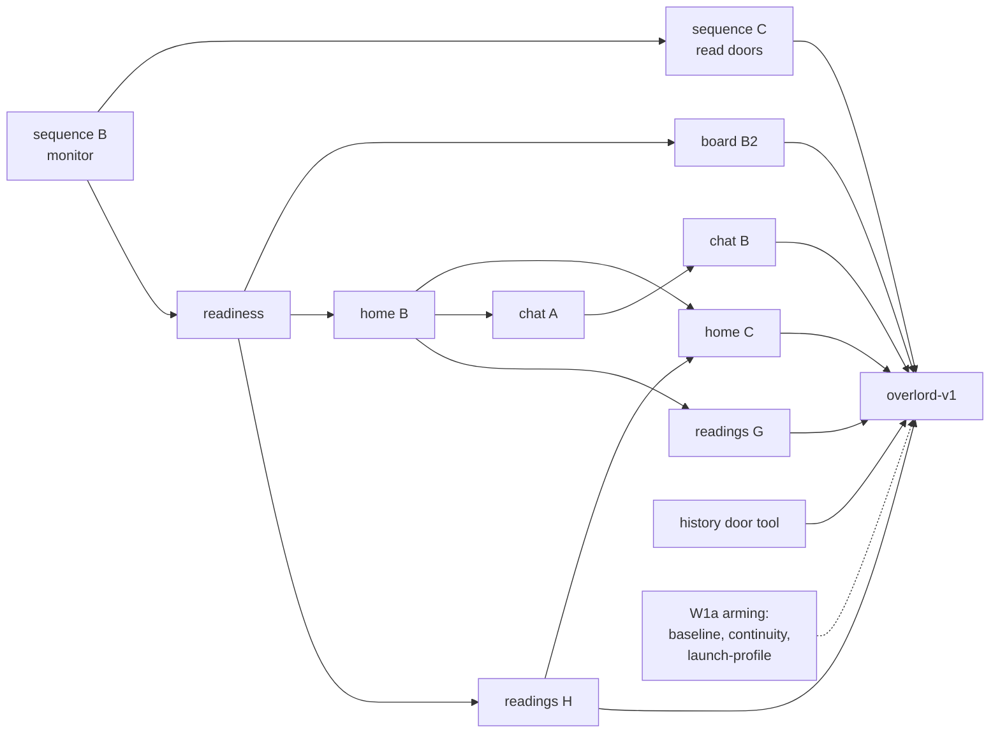

# Overlord W1: the `overlord-v1` word Implementation Plan

> **For agentic workers:** REQUIRED SUB-SKILL: Use superpowers:subagent-driven-development (recommended) or
> superpowers:executing-plans to implement this plan task by task. Steps use checkbox (`- [ ]`) syntax for tracking.

**Goal:** one pull request makes W1 reachable. It adds the server capability word `overlord-v1`, and with it:

- **The word.** `shared/api.ts#SERVER_CAP_MAP` gains the row `overlord-v1`. `GET /health`'s `caps` then names it, and the
  fleet box's `~/.ccrc/server-caps` names it within a minute.
- **The Overlord's own doors pass step 2.** Seven door rows carry the word: `inbox`, `messages`, `acknowledge`,
  `history`, `link-team` and, once they land, `board` and `sequence`. Their gate's step 2 stops refusing
  `capability-missing`. Step 1 still refuses every caller but the designated session.
- **The client follows the word.** `ccrc-api`'s rows for those doors refuse `capability-missing` locally, unsent, when
  a current cap file omits the word. This uses the client's existing table of gated rows, not a new mechanism.
- **The Overlord's card.** The one placeholder line, `CARD_OVERLORD_LINE`, becomes the Overlord's W1 card. The card lists
  every unsettled operator message and is never trimmed below that list (I8's second half). It also lists the role's
  pending timers.
- **The console.** The console already hides every Overlord door until the word stands (home A). This piece only
  types the console's constant, `OVERLORD_CAP`, against the server's word list.
- **The skill's bullet.** `CLAUDE.md` gains the `ccrc-overlord` bullet, and `overlord-skill.test.ts` scans it for the
  count word.

**Why:** before this merge, the console hides every Overlord door, the Overlord's doors refuse `capability-missing`, the
card carries one placeholder line, and nobody can be designated from the console. After it, the operator can tap Start
the Overlord. The flip must be **complete**: every behaviour the plans hold for the word turns on, and nothing waits on
a hold this plan did not find. It must be **checkable**: each behaviour has a case that goes red if the flip misses it.
It must be **reversible**: the way back is written down, both with nobody designated and with a bound Overlord.

**Architecture by ring:**

| Ring | What this piece touches | Rule kept |
|---|---|---|
| L0 `shared/` | `api.ts`: one `ServerCap` member and one map row. `continuity-card.ts`: one `CardFacts` field, `messages`, and its row type `CardMessage` | One owner per word: the map's keys. No `node:*` import |
| L1 policy | `server/src/continuity/card.ts`: the Overlord's renderer, replacing the one line. `pwa/src/overlord/homePlace.ts`: `OVERLORD_CAP` typed as `ServerCap` (a type-only import) | The renderer decides from facts. It reads no word and makes no I/O |
| L3 adapters | `server/src/continuity/cardFacts.ts`: the gatherer reads `unsettledFacts()` through the port it already receives | The port is declared by the consumer, widened by one method. Nothing is narrowed: an unreadable store reads `unmeasured`, never "no messages" |
| L4 delivery | None. `continuity/routes.ts` already passes `deps.operatorModel` to the gatherer | No decision in delivery code |
| L5 | None. `index.ts` and `server.ts` are not edited | |
| ccd (bash) | `ccd/ccrc-api`: the gated-rows table gains the Overlord's rows; its check no longer reads only `plan.*` | One table and one check (the table's own comment: "One table (row key, word, refusal text), one check that reads it") |
| Docs | `CLAUDE.md`: one bullet | Public repo: no private name |

**Tech Stack:** TypeScript (ESM), vitest, bash 5 (`ccd/ccrc-api`), React (no component change).

**Spec:** `docs/superpowers/specs/2026-11-09-overlord-design.md`. The sections this piece reads:

- §3.3.3, C38: the card, what it holds, and I8 ("open holds and unsettled operator messages are never trimmed").
- §4, C8: "Without `overlord-v1` nothing of the Overlord is drawn".
- §7.5, "The ladder needs `overlord-v1`".
- §11.1, Table 11.1d: the capability words, `overlord-v1` among them.
- §11.2: the gate order, step 2.
- §11.4: clause 22 (built as coordinator clause 24, #3354), which acts only under the word.
- §11.5: "A capability word is a property of the build", and Table 11.5's older-build rows.
- §14, Table 14's W1 row: `overlord-v1`.
- Question 33 (the index): designate and rebind refuse without `continuity-v1`, and the console hides every Overlord door
  until this piece lands.

**The index:** `docs/superpowers/plans/2026-11-14-overlord-w1.md`, Table W1's row `overlord-v1`: "1 PR, 2 tasks", lane C,
last of all. It needs "every other W1 piece but the Overlord clause, and W1a's `continuity-v1` and anchor".

Written against `main` at `4fa87d73f87c3b475086bab3ad0e893fa8935238` (2026-11-25). Every "re-measure at build" row is
measured again by the builder on the `main` they start from.

## Open questions

Each question has a recommendation, and the build follows it unless the coordinator rules otherwise. None of them
changes what W1 is for, so none goes to the operator.

1. **Is the word held at the server or only in the console?** (slug `overlord-v1-is-held-at-both-ends`.) The index's
   question 33 says "there is no separate server-side `overlord-v1` gate: the console hides every Overlord door". The
   board and history plan (its question 11), the gates, inbox and sequence plans, and `main` put the word at step 2 of
   the gate on the Overlord's own doors (`OverlordDoorRow.word`). **Recommendation:** both readings are right about
   different doors. Question 33 speaks of the operator's doors (designate, rebind and the rest), which carry no word.
   The Overlord's own doors refuse at step 2. This piece changes neither: it adds the word, and both holds lift
   together. The index's sentence gains that clause (Index changes).

2. **What does the card's list of unsettled messages carry: facts or text?** (slug `card-lists-message-facts-not-text`.)
   The private-store plan's question 15 hands this piece the list and names the reader `unsettledMessages()`, which
   carries the text. The inbox plan names `unsettledFacts()`, which carries none. **Recommendation:** facts only. Each
   line is the message's id, its time, its state and whether its text was cut. The Overlord reads the words through
   the `messages` door, which writes a read-ledger line for each read (§9.4). If the card carried the text, the
   operator's words would reach the session without that ledger line, and the card's 15k-token budget would rest on
   what the operator typed. A facts line is short, so the list nearly always fits whole. When it does not, the card
   lists the ids and says how many lines it left out (I8). **Alternative:** the text, masked and capped as the store
   holds it. That needs a read-ledger line per card read, written by the card door, which is a second ledger writer.

3. **What does the W1 card hold besides the list?** (slug `w1-card-renders-what-w1-has`.) §3.3.3 lists seven parts.
   **Recommendation:** the card renders the parts whose facts exist in W1, in the spec's order:
   1. the role line;
   2. the authority line, when a fenced block follows;
   3. the constitution pointer, which names the workspace memory file the launch profile ships;
   4. live state: the unsettled messages (never trimmed), the role's pending timers, and the notes;
   5. the checkpoint, at a renewal only;
   6. the history line.

   The live grants, open holds, open requests, live commands, recent acts, the operator-model entries and the practice
   notes come with the waves that build them (W2 to W4b). Each of those waves adds its section to this renderer, and the
   card prints no "none" line for a part that does not exist yet. The never-empty rule (C51) still holds: a card whose
   every read part is empty prints `CARD_NOTHING_LINE`.

4. **Does the card renderer read the word?** (slug `card-renderer-held-by-the-build`.) §7.5 says "the hook's card
   arm" acts only under the word. **Recommendation:** no. The renderer and the word ship in one build, so a server that
   renders the W1 card always advertises the word. A rollback takes both back together. This is the clause plan's ruling
   for clause 24 (`coord-clause-condition-held-by-the-build`). The hook has no Overlord card arm. It prints the anchor
   that the card door answers, so it needs no edit. That a hook arm exists is a spec fix.

5. **How does the client gate the Overlord's rows?** (slug `client-word-gate-is-one-table`.) `ccd/ccrc-api` already has
   a table of gated rows: the `case "$key"` that sets `gate` and `gate_msg`, read by one check. That check runs only
   for `plan.*`. The W2 route plan (its question RV9) expects "one row of that table per prefix". **Recommendation:**
   - The table gains a row for each Overlord row: `overlord.inbox`, `overlord.messages`, `overlord.acknowledge`,
     `overlord.history`, `linking.confirm`, and, when they land, `overlord.board` and the sequence row.
   - The check drops its `plan.*` condition, so it reads every row of the table.
   - The timers' gate and the older gates stay as they are, because this piece leaves those rows alone.
   - A census test holds the table to `OVERLORD_DOORS` in both directions: a client row is in the table exactly when
     its method and path are an Overlord door that carries `overlord-v1`.
   - **Alternative:** a `[[ "$key" == overlord.* ]]` prefix gate. That would miss `linking.confirm`, and it would miss
     the sequence row if its key is bare `sequence` (re-measure at build).

6. **How is the console's constant typed?** **Recommendation:**
   `export const OVERLORD_CAP: ServerCap = 'overlord-v1'`, with `import type { ServerCap } from '../../../shared/api'`.
   - `homePlace.ts` keeps its "imports types only" rule, so the mutation sets still load it by path.
   - A revert of the map row makes this line a compile error. The console's constant then goes with the word.
   - **Alternative:** a value import of `SERVER_CAPS`. That breaks the types-only rule.

7. **Does this piece wait for chat PR B (the replies)?** The chat plan says it need not (its question 7) and calls it
   the coordinator's call. The index says this piece waits for every other W1 piece. **Recommendation:** wait.
   - Operator item 327 ruled that each reply is recorded in the private store when its turn ends.
   - The checkpoint's thread reads replies from that record.
   - So an Overlord started before chat B would renew without its own side of the conversation.
   - **Alternative:** land without chat B. The replies are then shown only in the session stream until chat B lands.

8. **The history door has no door-process tool on `main`** (ticket `history-door-process-row`, review 3730 F3, call
   1063). The history door, its row and its `ccrc-api` row are merged, but `ccd/door-process.mjs#DOOR_TOOLS` has no
   `history` row. So the Overlord cannot reach history, and the skill's start order ("card, then the probe round, then
   the board") meets a missing tool. **Recommendation:** that ticket is an entry condition, built in its own pull
   request, and this piece carries no door-process edit. Task 2's census holds it: every door row that carries
   `overlord-v1` and has a client row must have a door tool too. **Alternative:** carry the row here. That would bring
   a fenced-reader ruling into a one-word pull request.

9. **What does the console show after a revert while an Overlord is bound?** Reverting the word hides every Overlord
   door, including Retire, Pause and the ladder, while the designation and its body stand. The server's operator doors
   still answer, but the console offers none of them. **Recommendation:** keep home A's rule, and write the way back as
   a runbook. The operator retires the Overlord (or sets the rung to `off`) before the word is reverted. If a revert
   happens with a bound Overlord, the way back to Retire is to roll forward to a build with the word.
   **Alternative:** draw Retire and Pause whenever a designation reads bound, whatever the word says. That changes
   home A's `overlordShown` rule and its tests, and belongs in a home pull request of its own if the coordinator wants it.

10. **Does `DESIGNATE_SERVER_WORDS` gain `overlord-v1`?** **Recommendation:** no. The designation reads this server's
    own `SERVER_CAPS`, and the word ships in the same build, so the check could never refuse. Question 33 stands.

11. **Does `OverlordDoorRow.word` narrow to `ServerCap`?** **Recommendation:** no. W2 adds door rows that carry
    `overlord-route-v1` before W2's last piece adds that word, and the row's word is exactly what holds those doors.
    The census's `SERVER_WORDS` stays a hand list of W1's words. Task 1 adds a case that every W1 word on a row is in
    `SERVER_CAPS`.

12. **Does the merge wait for the W1a arming, or only the first Start?** The index's "What a merge arms" says the first
    designation waits for the `continuity` lane to be live (after the replay quiz baseline) and for the `launch-profile`
    lane to be live. **Recommendation:** the merge waits too, because the merge is what puts Start in front of the
    operator. A Start before the arming would place an Overlord that cannot renew. These are the coordinator's readings
    at landing (the entry checklist, rows E10 to E12), never a test. **Alternative:** merge, and let the operator's own
    Start wait. That depends on a console that knows nothing of the arming.

## What exists today

Measured on `main` at `4fa87d73f8`, with `git grep` and by reading the named files.

- **The word list.** `shared/api.ts#SERVER_CAP_MAP` has fourteen words, ending `continuity-v1`. `overlord-v1` is not
  among them. `ServerCap` is the union of the same fourteen. `SERVER_CAPS` is derived from the map's keys and served on
  `GET /health` (`server/src/server.ts`). A `server` or `both` node writes it to `~/.ccrc/server-caps`
  (`server/src/update/serverCaps.ts`, from `watch.ts`), and a `fleet` node's `ccd-update-sync` copies it.
  `SERVER_CAPS_LEASE_S` is 180.
- **`continuity-v1` is built.** It is in the map, with the promise that the gate runs with the witness bound (door
  process B1). The index's prerequisites table and its "W1 also reads words it does not add" sentence still say "not
  started" and "not yet built", and so do two lines of the programme ledger. `main` rules; see Index changes.
- **The Overlord's own doors.** `server/src/coord/overlordDoors.ts#OVERLORD_DOORS` has five rows whose `word` is
  `overlord-v1`: `link-team` (`POST /api/linking/confirm`), `inbox`, `messages`, `acknowledge` (in
  `overlordInboxRoutes.ts`) and `history` (`overlordHistoryRoutes.ts`). The gate decider
  (`server/src/coord/overlordGate.ts#overlordGate`) checks step 1 (who calls) before step 2 (the word). So today the
  designated session gets `capability-missing` from these doors, and every other caller gets `not-the-overlord`.
- **The inbox wake.** It asks the gate for the `inbox` row only while an Overlord is designated, so today it would hold
  `capability-missing` (`overlord-inbox-wake.test.ts`, "a server without overlord-v1 holds capability-missing").
- **`link-team` stays refused after the flip.** Its act is allowed at the `full` rung only, and W1's rung door stops at
  `chat`. So after this merge the Overlord's team link refuses at step 10 (`rung-below`) instead of step 2.
- **The client.** `ccd/ccrc-api#ROUTES` has 102 rows, among them `overlord.inbox`, `overlord.messages`,
  `overlord.acknowledge`, `overlord.history` and `linking.confirm`. None of them has a word gate. The gated rows are
  the `goals.show`, `calls.record` and `plan.*` checks, the `case` table of `plan.phase-ref`, `plan.take`,
  `plan.triage` and `plan.ticket-done`, and the `timer.*` check. All read `_api_server_cap`, and all fail open on an
  absent, stale, torn or future file.
- **The door process.** `ccd/door-process.mjs#DOOR_TOOLS` serves `card`, `probe`, `probe_answer`, the four note tools,
  the three timer tools, `inbox`, `messages`, `acknowledge`, `link_team` and `read`. It has no `history` tool (ticket
  `history-door-process-row`). Its `read` tool's enum is empty, because no row is marked `reader: true`.
- **The card.** `server/src/continuity/card.ts#renderCard` answers one section for the `overlord` renderer:
  `keepLine('overlord', CARD_OVERLORD_LINE)`, whose text is "The Overlord's card ships with W1 (`overlord-v1`)."
  `server/test/continuity-card-render.test.ts` pins that text. `BODY_FACTS` and `bodyOf` exclude `overlord`.
  - `CardFacts` (`shared/continuity-card.ts`) has no message field.
  - `gatherCardFacts` already reads `timers` (`pendingTimersOf`) for every role, and the timers plan says the Overlord
    sees them "once `overlord-v1` renders its card".
  - `continuity/routes.ts` already passes `messages: deps.operatorModel` to the gatherer. The gatherer declares that
    port as `NoteKeysMessages = Pick<OperatorModelStore, 'messageSessionOf'>`. `deps.operatorModel` is
    `Pick<OperatorModelStore, 'moveMessage' | 'messageStateOf' | 'unsettledFacts' | 'messagesSince'>` (`server/src/deps.ts`).
  - `renderCard`, `trimCard` and `oneLine` are in `server/test/sim/mutation-floors.json`.
- **The private store's readers.** `server/src/operatorModel/store.ts` has `unsettledMessages()` (rows with text, id
  order, never trimmed) and `unsettledFacts()` (`MessageFacts`: `id`, `at`, `term`, `state` or `unknown`, `cut`; no
  text, id order, never trimmed).
- **The console.** `pwa/src/overlord/homePlace.ts#OVERLORD_CAP` is the string `'overlord-v1'`, and `overlordShown` is
  true only for an answered caps read that names it. The store makes no Overlord read without it
  (`pwa/src/stores/overlord.ts`). The routes, bars, palette and chord follow it (home A, #3207). The browser tests
  already stand a server advertising the word.
- **The skill.** The skill is merged (twenty-two clauses). Its `references/starting.md` door table names `inbox`,
  `messages`, `acknowledge`, `board`, `history`, `sequence` and `link team` under `overlord-v1`, and says to stop on
  `capability-missing`. `server/test/overlord-skill.test.ts` scans `README.md` for the count word wherever it names
  `ccd/overlord-skill/SKILL.md`. Its comment says the `CLAUDE.md` bullet lands with this piece. `CLAUDE.md` has no
  `ccrc-overlord` bullet.
- **The coordinator clause.** Clause 24 of the coordinator skill (#3354) is the Overlord clause. It "acts only while
  the server advertises `overlord-v1`", and its plan rules that the build holds that condition.
- **The hook.** `ccd/session-hook.sh` reads `_hook_server_cap` for `hook-main-state-v1` and `dispatch-live-gate-v1`
  only. It reads neither `continuity-v1` nor `overlord-v1`.
- **The census.** `server/test/overlord-doors-census.test.ts#SERVER_WORDS` is `['continuity-v1', 'timers-v1',
  'overlord-v1']`. Every Overlord row's word must be one of them.
- **The ladder.** `chat` needs no word (`shared/overlord-ladder.ts#RUNG_MAP`), so the flip changes no rung.
- **Size.** `server/test/growth-caps/shared-api-ts.json` caps `shared/api.ts` at 5,140 code lines (D-8635). A rough
  count at `4fa87d73f8` (comments and blank lines stripped) is about 5,138. Re-measure at build with
  `growthCheck.ts#codeLines`.

**Where the plans and `main` disagree** (`main` rules):

- The index says `continuity-v1` is not built. It is (above).
- The index's capability table says that without the word "the card carries no Overlord line". The card carries the
  placeholder line `CARD_OVERLORD_LINE`.
- The index's question 33 says "no separate server-side gate". The Overlord's own doors have one at step 2 (question 1).
- The private-store plan names `unsettledMessages()` for the card, and the inbox plan names `unsettledFacts()`
  (question 2).
- The index lists the Overlord clause as "waits on item". It merged as clause 24 (#3354).
- The board and history plan's B1 note leaves the history door-process row owed. The index says the board and history
  piece adds it (question 8).

## The inventory

### Table 1. Every behaviour held for the word

The columns: the behaviour; where it lives on `main`; how it is held today; what this piece changes; the case that goes
red if the flip misses it. "Not on main" rows come from the pieces in Table 3 and are re-measured at build.

| # | Behaviour | File and symbol | Held today by | This piece | Red case if missed |
|---|---|---|---|---|---|
| H1 | The server advertises the word | `shared/api.ts#SERVER_CAP_MAP`, `ServerCap` | absent | adds the row and the union member | Task 1: `SERVER_CAPS` contains `overlord-v1` |
| H2 | `GET /api/overlord/inbox` serves the bound session | `overlordInboxRoutes.ts`, row `inbox` | step 2 refuses `capability-missing` | the word is in `SERVER_CAPS` | Task 1: the gate with production `SERVER_CAPS` passes step 2 for each W1 word row |
| H3 | `GET /api/overlord/messages/:id` | same file, row `messages` | step 2 | same | same |
| H4 | `POST /api/overlord/messages/:id/acknowledge` | same file, row `acknowledge` | step 2 | same | same |
| H5 | `POST /api/overlord/history` | `overlordHistoryRoutes.ts`, row `history` | step 2 | same | same |
| H6 | `POST /api/linking/confirm` for the Overlord | `linking/routes.ts`, row `link-team` | step 2 (then step 10 at `chat`) | step 2 passes; step 10 still refuses below `full` | same; `linking-overlord-confirm.test.ts` keeps its rung case |
| H7 | The inbox wake sends | `overlordInboxWake.ts` through the `inbox` gate | the gate's `capability-missing` | passes | `overlord-inbox-wake.test.ts` (injected words); Task 1's step-2 case covers production |
| H8 | `GET /api/overlord/board` | board B2, row `board` (not on main) | step 2 | same | Task 1's case iterates every row, so B2's row is included |
| H9 | `GET /api/overlord/sequence` | sequence C, row `sequence` (not on main) | step 2 | same | same |
| H10 | The client sends the Overlord's rows | `ccd/ccrc-api`, the gated-rows table | no hold | the table gains the rows and the check covers them | Task 2: a current cap file without the word refuses each row, unsent; the census |
| H11 | The door process serves the Overlord's tools | `ccd/door-process.mjs#DOOR_TOOLS` | through H10 and the server | nothing; each tool runs its `ccrc-api` verb | Task 2: every word row with a client row has a door tool |
| H12 | The Overlord's card | `card.ts#renderCard`, `CARD_OVERLORD_LINE` | a constant the renderer returns | the W1 renderer | Task 1: the render cases; the old pin is removed |
| H13 | The card lists every unsettled message (I8's second half) | `CardFacts.messages` (new), `gatherCardFacts` | no field | the field, its gather and its never-trimmed section | Task 1: twenty facts lines over a full budget keep every id |
| H14 | The card lists the role's pending timers | `CardFacts.timers`, `timersSections` | not rendered for `overlord` | rendered | Task 1: the timers case |
| H15 | The console draws the Overlord | `homePlace.ts#OVERLORD_CAP`, `overlordShown` | string compare to an unadvertised word | typed as `ServerCap`; the server now sends it | `pwa/test/overlord-home-place.test.ts` (`SERVER_CAPS` contains `OVERLORD_CAP`, new) |
| H16 | The doors, palette row, `/overlord` route and desk door | home A (merged) | `overlordShown` | nothing | home A's suites (already written against the word) |
| H17 | The place: Start, Open, Rebind, Restart, Pause, the ladder controls, the readiness lines | home B (not on main) | `overlordShown` | nothing | home B's suites |
| H18 | Settings › Overlord | home C (not on main) | `overlordShown` | nothing | home C's suites |
| H19 | The chat | chat A (not on main) | `overlordShown` | nothing | chat A's suites |
| H20 | The coordinator clause acts | coordinator skill clause 24 | the build | nothing | none: held by the build (clause plan, question 2) |
| H21 | The skill's door table is true | `ccd/overlord-skill/references/starting.md` | the build | nothing | none: text |
| H22 | The `CLAUDE.md` bullet and its count word | `CLAUDE.md`; `overlord-skill.test.ts` | absent | adds both | Task 2: the scan's `CLAUDE.md` half |
| H23 | The census lists the word | `overlord-doors-census.test.ts#SERVER_WORDS` | a hand list | Task 1 adds "every W1 word on a row is in `SERVER_CAPS`" | that case |

Counts: 23 rows. 18 are on `main` today, and 5 wait on pieces not on `main` (H8, H9, H17, H18 and H19). This piece
edits code for 7 rows (H1, H10, H12, H13, H14, H15 and H22). It adds tests for 9 more: one case covers H2 to H9, and
one covers H23. The other 7 need no change from this piece: H11 and H16 to H19 follow the word through code already
written, and H20 and H21 are held by the build.

### Table 2a. Findings: behaviours the plans promise under the word with no hold in the code

| # | The promise | Where promised | What `main` has | What this plan does |
|---|---|---|---|---|
| F1 | "The hook's card arm acts only while the server's capability file carries it" | spec §7.5, §11.5 | No hook arm reads `overlord-v1`; the hook prints what the card door answers | Nothing in the hook. The renderer is held by the build (question 4); spec fix |
| F2 | "`ccrc-api`'s Overlord verbs refuse `capability-missing`" | index, capability table; spec §11.5 | No client gate on any Overlord row | Task 2 builds it (question 5) |
| F3 | "Designate and rebind" wait for the word | index question 33, home and designation plans ("the console offers Start only under `overlord-v1`") | The console hides the door. The server's designate door does not read the word, so a signed-in operator could designate through the API before this merge | Nothing (question 10). The entry checklist reads that no designation stands before the merge (E14) |
| F4 | The Overlord reads history through its door process | skill `starting.md`; door-process plan | No `history` tool in `DOOR_TOOLS` | An entry condition, held by Task 2's census (question 8) |
| F5 | "Nothing of the Overlord is drawn" includes the readiness line on Fleet health and Waiting on you | home plan, question 9 | Not built yet (home B) | Re-measured at build: home B's tests read `overlordShown` |

### Table 2b. Findings: holds in the code that no plan names

| # | The hold | Where | Why it matters | What this plan does |
|---|---|---|---|---|
| G1 | `link-team` carries `overlord-v1`, but its act needs `full`, which the W1 rung door refuses | `overlordDoors.ts`, `link-team`; `shared/overlord-ladder.ts` | The flip does not make the Overlord's team link work. It moves the refusal from step 2 to step 10 | Recorded. W3 (`overlord-answer-v1`) opens `full` |
| G2 | `overlord-doors-census.test.ts#SERVER_WORDS` already lists `overlord-v1` while no server advertises it | the census | The census passed while the word was missing, so it cannot catch a flip that misses the map | Task 1's case reads `SERVER_CAPS` itself |
| G3 | The inbox wake holds `capability-missing` while designated | `overlordInboxWake.ts` | A designation made through the API before this merge (F3) would sit with a held wake | Covered by E14 |

Counts: five findings of the first kind (F1 to F5), three of the second (G1 to G3).

## What is not on `main` yet

Each row is re-measured at build: the builder checks that the piece merged and that the symbol named exists at the
`main` they start from.

### Table 3. The pieces this one waits for

| Piece | Plan | Open PR at writing | What this piece needs from it, by that plan's symbols | Re-measure at build |
|---|---|---|---|---|
| Sequence B (the invariant monitor) | `w1-sequence-monitor.md`, Tasks 4 to 6 | #3394 (draft) | `server/src/coord/invariants.ts` with the W1 predicates (I2, I5's term arm, I7, I17), `overlord_invariant_findings`, the runner on its `LANE_SCHEDULE` row `invariants` (shadow until armed), the Shadow lanes card's `invariants` row, and the ladder's cause row `invariant-violation`. The entry checklist reads its findings (E9) | yes |
| Sequence C (the read doors) | `w1-sequence-monitor.md`, Task 7 | none | `GET /api/overlord/sequence` with its `OVERLORD_DOORS` row (word `overlord-v1`), the operator's `GET /api/overlord/invariants`, and the `ccrc-api` row the plan names `sequence`. Its row joins Task 2's table and census | yes, including the row's key |
| Readiness | `w1-readiness.md` | none | `shared/overlord-readiness.ts`'s words, the `overlordReadiness` lane, `readinessRead()` and `GET /api/overlord/readiness`. With nobody designated the lane writes `absent` and pushes nothing. The entry checklist reads the word (E8) | yes |
| Board and history B2 (the board) | `w1-board-history.md`, Task 6 | none | `GET /api/overlord/board` (row `board`, word `overlord-v1`), `composeBoard`, and the `ccrc-api` row `overlord.board`. Its row joins Task 2's table and census | yes |
| Home B (the place) | `w1-home.md`, Tasks 4 to 7 | none | `OverlordPlace` and `BodyPart` (Start, Open, Rebind, Restart), Pause, the ladder controls, the readiness lines on Fleet health and Waiting on you, `useOverlordSessionStream`, the `@overlord-place` mark. Start the Overlord lives here | yes |
| Home C (Settings) | `w1-home.md`, Tasks 8 and 9 | none | Settings › Overlord (`OverlordSection`): Retire, the model class, the account set, the backstop, retention, the account facts and the account-hold Clear | yes |
| Chat A | `w1-chat.md`, Tasks 1 to 4 | none | The chat part of the place, its thread and earlier-generation doors, and `offRecord` | yes |
| Chat B (the replies) | `w1-chat.md`, Task 5 | none | `recordReply` and `overlord_replies` (question 7) | yes, if ruled |
| Renewal readings G | `w1-renewal-readings.md`, Task 10 | none | `placeHiddenObservedMs` read from the `@overlord-place` mark. On `main`, `generationsLane.ts` still has `placeHiddenObservedMs: later('W1')` | yes |
| Renewal readings H | `w1-renewal-readings.md`, Task 11 | none | `overlord_account_holds` with its door and reader, `heldOutOfList`, and the hold in `accountOutsideSet` and `installBehind` | yes |
| History door tool | ticket `history-door-process-row` | none | A `history` row in `ccd/door-process.mjs#DOOR_TOOLS` (question 8) | yes |

Every other W1 piece is merged: vocabulary, pool set A1 to B2, ccd arms A to C2, serviceability A and B, renewal
readings A to F, journal kernel, authority journal A0 to C, designation A to C, ladder, gates A and B, the Overlord's
timers (#3388), isolation word, other lanes, sequence A and B1 (#3395), sandbox A, A2 and B, door process A1 to B2,
private store A and B, inbox, board and history A and B1, portfolio A and B, push outbox A and B, responses A and B,
home A, the skill and the Overlord clause (#3354). W1a's `continuity-v1`, anchor and renewal hand-offs are merged.
Delegation marks are outside the gate (the index).


*Figure 1. What `overlord-v1` waits for. Solid arrows are pieces that must merge; the dashed arrow is the operator's
arming, which the coordinator reads at landing. Chat B's edge stands if question 7 is ruled as recommended.*

## The entry checklist

Each row says where to read it, and whether a test holds it or the coordinator reads it at landing.

### Table 4. What must read true before this pull request merges

| # | Check | Where to read it | Held by |
|---|---|---|---|
| E1 | Every piece of Table 3 is merged | `gh pr view <n> --json state,mergeCommit` for each; `git grep` of each symbol on `origin/main` | the coordinator |
| E2 | Every Overlord door row that carries `overlord-v1` has a client row in the gated table, and the other way round | Task 2's census | a test |
| E3 | Every such row with a client row has a door tool (`history` included) | Task 2's census | a test |
| E4 | Every W1 word on a door row is in `SERVER_CAPS` | Task 1's case | a test |
| E5 | `shared/api.ts` stays within its cap | the growth check (`growth-caps.test.ts`) | a test |
| E6 | The card keeps every unsettled message's id under a full budget | Task 1's case | a test |
| E7 | The count word is right in `CLAUDE.md` | `overlord-skill.test.ts` | a test |
| E8 | The readiness word reads `absent` with nobody designated, and its lane is fresh | `GET /api/overlord/readiness` | the coordinator |
| E9 | The invariant monitor's findings: none open, except the predicate the coordinator rules is known to read "differs" by design. On #3394's branch, I5's term arm reads `unmeasured` until its baseline read is wired, and I7 reads only under a coherent guard; the coordinator names the one it means and reads it first | the operator's invariants read (`GET /api/overlord/invariants`, sequence C) or the Shadow lanes card's `invariants` row | the coordinator |
| E10 | The replay quiz baseline is recorded | the Shadow lanes card's quiz state (`LANE_ARM_QUIZ_STATES`: `recorded`) | the coordinator |
| E11 | The `continuity` and `launch-profile` lanes are `live`, and the `anchor-slot` lane's state is what the W1a index requires | `GET /api/coord/lane-arm` | the coordinator |
| E12 | Doctor's `overlord-mods` check passes on the fleet box | `ccrc doctor` | the coordinator |
| E13 | Every placing fleet node advertises `pool-set`, `keep-awake-v1`, `launch-surface-v1`, `hibernate-fresh`, `project-add`, `ws-title-v1` and `ws-wrapper-v1` | `GET /api/updates`, the node inventory's caps | the coordinator |
| E14 | No designation stands (`GET /api/overlord/designation` reads none), and no Overlord timer, item or message row is pending | the designation read; the operator's timers read | the coordinator |
| E15 | The ladder has no standing latch from the shadow pieces | `GET /api/overlord/ladder` | the coordinator |
| E16 | `main`'s daily full suite is green at the merge base | the daily run's `full-suite` job | the coordinator |

Tests hold E2 to E7. The coordinator reads E1 and E8 to E16 at landing.

## What the merge arms

### With nobody designated

Measured against the code on `main` and the plans of Table 3:

- **The server.** `GET /health`'s `caps` gains `overlord-v1`. A `server` or `both` node writes it into
  `~/.ccrc/server-caps` on its next minute, and a `fleet` node's `ccd-update-sync` copies it on its next minute.
  No lane starts, no table is written, and no door answers differently: step 1 of the gate still refuses every caller
  `not-the-overlord`, because nothing is bound. No session's card changes, because no session's role reads `overlord`.
- **The client.** The gated rows stop refusing locally, so a session that calls them gets the server's own
  `not-the-overlord`.
- **The console.** It draws the Overlord door in the desk and phone bars, offers "Go to Overlord" (`g o`), and opens
  `/overlord` instead of replacing it with `/fleet`. The place shows Start (home B). Settings gains the Overlord
  section (home C). `/` still lands on the Fleet, because `homePlace` answers the Fleet with no designation.
- **Coordinators.** Clause 24 now acts, but with no Overlord it sends and asks nothing. Its doors (`request ack`, the
  act read) still refuse until W2, naming `overlord-route-v1`.

### The operator's first tap

Start the Overlord (home B), behind the account gate's step-up:

1. The designate door checks the two-account count, ccd's words and `continuity-v1`, writes a `pending` designation,
   composes the session create in the `overlord` project with its profile and digest, and writes the route record.
2. `ccd keep-awake` writes the body's two sleep markers. The first prompt is delivered. Sandbox B's settle step moves
   the designation to `live` (or to `overlord-sandbox-unmet`).
3. The body reads its card: the W1 card of this piece, with its unsettled messages and timers. It then runs the probe
   round and reads the board, as the skill's start order says.
4. From then on: the readiness lane writes words for the bound session, the inbox wake sends, the timers lane serves
   the role, the renewal lane renews the body, and the monitor stamps and checks its lines.

### The way back

- **Retire, then revert (the runbook).** The operator taps Retire in Settings › Overlord. The retire door stops the
  body through the owed-stop drain, `ccd keep-awake --state off` removes the markers, and the route record's set is
  cleared. On their next passes the timer lane cancels the role's timers `retired` and readiness settles its items
  `retired`. A revert of the word's row then leaves only inert history: the retired designation row, the private store's
  messages, the journals' lines, the sequence lines, and the readiness and response rows. Nothing reads them as live.
- **A revert with a bound Overlord** (question 9). The body keeps running: its sleep markers stand, so it is never
  hibernated or rolled, and the renewal lane keeps renewing it. Its card, note, probe and timer doors still answer
  (`continuity-v1`, `timers-v1`). The board, inbox, messages, acknowledge, history, sequence and team-link doors refuse
  `capability-missing` at step 2, and the client refuses them first. The inbox wake holds. The console hides every
  Overlord door, Retire and Pause among them, though the operator doors still answer at the server. The operator's
  prompts are still recorded as messages and stay unsettled. The remedy is to roll forward and Retire.
- **A rollback to an older server build** (`ccrc rollback`). This is everything in the case above, plus Table 11.5's
  rows. A build older than the designation ignores the Overlord's tables. An older timer lane cancels the role's
  timers `setter-gone`, and the cancel is final (the timers plan, question 7). An older mail lane's handling of queued
  `overlord` mail is the timers plan's measurement (F12). On the fleet box the markers stand. An older ccd refuses the
  Overlord's renewal on `.no-roll` (`opted-out`), which fails closed, and the capability floor's rows refuse a move
  below `pool-set`, `keep-awake-v1` or `launch-surface-v1` without `--below-cap`.

### Older builds side by side (additive wire, absence permits)

| Newer side | Older side | What happens |
|---|---|---|
| Server with the word | Fleet box `ccrc-api` without the table gate | The client sends, and the server answers. Nothing breaks |
| Fleet box `ccrc-api` with the gate | Server without the word | A current cap file refuses the rows locally, `capability-missing`, unsent. An absent, stale or torn file sends, and the older server answers its own step-2 refusal, or a 404 where the route does not exist |
| Server with the word | Console from home A on | The console compares the string and draws the doors: the same behaviour |
| Server with the word | Console older than home A | The console draws nothing of the Overlord |
| Console with the typed constant | Server without the word | `caps` lacks it, so the console hides everything |
| Server with the W1 card | Any hook | The hook prints the anchor the card door answers. The card is rendered on the server only |

No wire field is added or removed. `caps` is an existing array that gains one string, and every reader already treats
an unknown word as absent.

## The client

**The verbs that follow the word.** These are the `ccrc-api` rows whose server door is an Overlord door carrying
`overlord-v1`:

| Row | Door row | On `main` |
|---|---|---|
| `overlord.inbox` | `inbox` | yes |
| `overlord.messages` | `messages` | yes |
| `overlord.acknowledge` | `acknowledge` | yes |
| `overlord.history` | `history` | yes |
| `linking.confirm` | `link-team` | yes |
| `overlord.board` | `board` | board B2 |
| the sequence row (named `sequence` by its plan) | `sequence` | sequence C |

`sessions.card`, the note, probe and handover rows, and the `timer.*` rows are not on the list: their doors carry
`continuity-v1` or `timers-v1`, and they serve every session.

**How each refuses below the word.** Each row gets the same rule as the existing gated rows. A current, well-formed
`~/.ccrc/server-caps` that omits `overlord-v1` refuses `capability-missing`, exit 2, unsent, with the detail "the server
this box talks to does not answer the Overlord's doors yet (it does not advertise overlord-v1); nothing was sent". An
absent, stale, torn or future file sends, as every gate in the client does.

**The closed table and its census.** The row count does not change (102 on `main`, plus the board and sequence rows when
they land), so `ccrc-api.test.ts`'s count words do not move for this piece. The gated table is one `case` block. The new
census test (Task 2) reads that block and `ROUTES` from `ccd/ccrc-api`'s text and `OVERLORD_DOORS` from the module, and
checks both directions:

- every row in the block whose word is `overlord-v1` is a `ROUTES` row whose method and path (`{id}` read as `:id`) are an
  Overlord row of word `overlord-v1`;
- every such Overlord row that has a `ROUTES` row is in the block;
- every such row has a `DOOR_TOOLS` row whose `verb` is the row's key.

## Global Constraints

- **SAFETY.** No ccd verb, no tmux, no registry write, no unit. Tests use fixture HOMEs (`makeCcdHarness`, or the
  client harness `ccrc-api-timer.test.ts` uses). No live `$HOME`.
- **One owner per fact.** The word's one owner is `SERVER_CAP_MAP`. The console's constant is typed against it, and the
  client's table is held to `OVERLORD_DOORS` by a census, never by a second list that nobody checks.
- **No second mechanism.** The client gate extends the existing table and check. The card section is a renderer arm,
  with no new door.
- **No overloaded null.** `CardFacts.messages` has three readings: read (a list, possibly empty), `unmeasured` (the store
  could not be read, or the server has none), and `null` (this renderer does not ask). Every card but the Overlord's
  carries `null`.
- **No operator text on the card** (question 2).
- **Wire discipline.** Additive only. `FLEET_PROTO` is not touched.
- **Mutation floors.** `renderCard` stays in `MUTANT_SETS`, and its floor in `mutation-floors.json` is re-measured
  after Task 1. No new L1 module.
- **Growth.** Only one growth-checked file changes: `shared/api.ts`, by at most 1 code line (Table 5).
- **Public repository.** No private name in code, tests, commits or the PR body. `CLAUDE.md`'s bullet names files and
  counts only.
- **Tests.** Every test and typecheck runs through `ccrc test -- …`. The PR's fast run covers the server tests it
  relates to. The pwa suite runs whole for the console's constant.

## Review Focus

- **Completeness.** Every row of Table 1 is either changed or shown to need no change, and every red case exists. A
  door with the word and no client row, or a client row with no door tool, reds Task 2's census.
- **Reversibility.** The runbook (Retire, then revert) is in the PR body. The bound-Overlord revert is described, not
  hidden.
- **The card.** The unsettled list is never trimmed, carries no text, and lists ids with a count when it cannot fit.
  Every non-Overlord card's text is byte for byte what it is on `main`, held by the existing render cases.
- **No decision in delivery.** `continuity/routes.ts`, `server.ts` and `index.ts` are untouched.
- **The client's fail direction** matches every other gate: a current file refuses, and an absent, stale or torn file
  sends.

## Tasks

### Task 1: The word, the step-2 case and the Overlord's card

**Files:**
- Modify: `shared/api.ts` (`ServerCap` gains `'overlord-v1'`, edited in place; `SERVER_CAP_MAP` gains its row and doc
  comment, after `continuity-v1`).
- Modify: `shared/continuity-card.ts` (`CardMessage` and `CardFacts.messages`).
- Modify: `server/src/continuity/cardFacts.ts` (the port widened to `unsettledFacts`; the gather for the `overlord`
  renderer only).
- Modify: `server/src/continuity/card.ts` (`CARD_OVERLORD_LINE` removed; the Overlord's renderer; `CARD_CONSTITUTION_LINE`;
  the messages section with its never-trimmed rank and its left-out line).
- Modify: `server/src/continuity/noteKeys.ts` only if `NoteKeysMessages` is the port the gatherer widens (re-measure: the
  gatherer may declare its own `Pick` instead).
- Test: `server/test/overlord-v1-word.test.ts` (new); `server/test/continuity-card-render.test.ts`;
  `server/test/continuity-card-facts.test.ts`;
  `server/test/overlord-doors-census.test.ts`.
- Modify: `server/test/sim/mutation-floors.json` (re-measured floor of `renderCard`, if it moves).

**Interfaces:**

```ts
// shared/continuity-card.ts
/** One unsettled operator message on the Overlord's card: facts only, never its text (the plan's question 2). */
export interface CardMessage {
  readonly id: number; readonly at: number; readonly term: number; readonly state: string; readonly cut: boolean;
}
// CardFacts gains:
/** The private store's unsettled messages, for the Overlord's renderer only; `null` for every other renderer. */
readonly messages: Fact<readonly CardMessage[]> | null;
```

- [ ] **Step 1: Write the failing word case.** In `server/test/overlord-v1-word.test.ts`:
  - `SERVER_CAPS` contains `'overlord-v1'`;
  - for every row of `OVERLORD_DOORS` with `group: 'overlord'` and `word: 'overlord-v1'`, the decider `overlordGate`,
    given a bound standing and `serverWords: SERVER_CAPS`, does not refuse at step 2. Build the facts with the helpers
    `overlord-gate-run.test.ts` uses;
  - every W1 word on a door row (`continuity-v1`, `timers-v1`, `overlord-v1`) is in `SERVER_CAPS`.
- [ ] **Step 2: Run it and see it fail.**
  `ccrc test -- ./node_modules/.bin/vitest run test/overlord-v1-word.test.ts` from `server/`. Expected: the first and
  second cases fail with `capability-missing` at step 2.
- [ ] **Step 3: Add the word.** Add `| 'continuity-v1' | 'overlord-v1'` in place on the union's last line. Add the row
  `'overlord-v1': true,` with a doc comment that states the promise: the Overlord's own doors pass step 2, `ccrc-api`'s
  Overlord rows send, the card renders the Overlord's W1 card, and the console draws the Overlord; added by the change
  that completes W1, cut after every other W1 piece. If the growth check measures over the cap, put the row on
  `continuity-v1`'s line (the precedent is `'plan-phases-v1': true, 'plan-inbound-v1': true`).
- [ ] **Step 4: Run it and see it pass.** Same command. Then run `overlord-doors-census.test.ts`,
  `overlord-inbox-routes.test.ts`, `overlord-history-door.test.ts` and `linking-overlord-confirm.test.ts`. They inject
  their words, so they must stay green unchanged.
- [ ] **Step 5: Write the failing card cases.** In `continuity-card-render.test.ts`, replace the pin of
  `CARD_OVERLORD_LINE` with these cases:
  - the Overlord's card for facts with two unsettled messages, one pending timer and one note renders, in order: the
    role line, the authority line, the constitution line, the messages section (one line per message: id, time, state,
    and "(cut)" when `cut`), the timers section, the notes section and the history line;
  - no card text contains "ships with W1";
  - `messages: { kind: 'unmeasured', why }` renders a line that names the read as unmeasured, never "no messages";
  - read and empty everywhere renders `CARD_NOTHING_LINE` (C51);
  - **the never-trimmed case:** forty messages with a budget that cannot hold their lines still keep every message id
    on the card. The section lists the ids and says how many lines it left out (I8);
  - every other renderer's text is unchanged for the existing fixtures, which carry `messages: null`.
- [ ] **Step 6: Write the failing gather cases.** In `continuity-card-facts.test.ts`:
  - a session whose renderer is `overlord` gets `messages` from `unsettledFacts()`;
  - a store read that answers unmeasured gives `{ kind: 'unmeasured' }`;
  - an absent store gives `unmeasured`;
  - every other renderer gets `null`, and the store is not asked (a spy counts zero calls).
- [ ] **Step 7: Run them and see them fail.** Run both suites through `ccrc test`.
- [ ] **Step 8: Implement.**
  - `CardMessage` and the field.
  - The gatherer widens its declared port to `Pick<OperatorModelStore, 'messageSessionOf' | 'unsettledFacts'>`. It calls
    `unsettledFacts()` only after the renderer reads `overlord`, mapping a `MessageFacts` row field for field.
  - In `card.ts`, remove `CARD_OVERLORD_LINE` and add the Overlord's arm to `renderCard`: the role section, the authority
    line rule, a stable constitution line, then `messagesSections`, `timersSections`, `notesSections`,
    `checkpointSections` and `historySections`.
  - `messagesSections` emits a `keep: true` header and lines. When `trimCard` must still drop to fit, it drops only
    `keep: false` sections, so the message lines are `keep: true`. A list longer than its own cap (the page budget
    less the kept stable parts) becomes the ids on one kept line plus the left-out count.
  - The Overlord's renderer joins `BODY_FACTS` (`messages`, `notes`, `timers`, `checkpoint`), so C51's rule covers it.
- [ ] **Step 9: Run every card suite and the floor.** `continuity-card-render`, the gatherer's suite, `continuity-anchor`
  and the `renderCard` mutant set (`ccrc test -- ./node_modules/.bin/vitest run
  test/sim/mutation-floors.test.ts`). Update `mutation-floors.json` only upward, or as the floor's own rule allows.
- [ ] **Step 10: Commit.** `feat(overlord): the overlord-v1 word and the Overlord's W1 card (Overlord W1, overlord-v1 Task 1)`.

### Task 2: The client, the console's constant and the skill's bullet

**Files:**
- Modify: `ccd/ccrc-api` (the gated table's rows; the check drops `plan.*`; the header comment's list of gates).
- Modify: `pwa/src/overlord/homePlace.ts` (`OVERLORD_CAP: ServerCap`, type-only import).
- Modify: `CLAUDE.md` (the `ccrc-overlord` bullet, after the reviewer bullet).
- Modify: `server/test/overlord-skill.test.ts` (the count-word scan reads `CLAUDE.md` too).
- Test: `server/test/ccrc-api-overlord-word.test.ts` (new); `pwa/test/overlord-home-place.test.ts`.

- [ ] **Step 1: Write the failing client cases.** In `ccrc-api-overlord-word.test.ts`, with the harness
  `ccrc-api-timer.test.ts` uses (a fixture HOME, a recording server):
  - for each gated Overlord row, a current cap file of today's words less `overlord-v1` answers
    `{ok:false, error:'capability-missing'}` with the detail naming `overlord-v1`, exit 2, and the server records no
    request;
  - a current file with the word sends;
  - an absent file sends, and so does a stale one;
  - a `plan.*` row's refusal is unchanged (the check now reads the whole table).
- [ ] **Step 2: Write the failing census.** In the same file:
  - parse `ROUTES` and the gated `case` block from `ccd/ccrc-api`'s text;
  - import `OVERLORD_DOORS` and `DOOR_TOOLS`;
  - check the three directions in "The client";
  - expect no exception list. If the history tool has not landed, this case is red, which is entry row E3.
- [ ] **Step 3: Run them and see them fail.**
  `ccrc test -- ./node_modules/.bin/vitest run test/ccrc-api-overlord-word.test.ts` from `server/`.
- [ ] **Step 4: Implement the client.**
  - Add the Overlord rows to the `case` block, each setting `gate='overlord-v1'` and the one detail text.
  - Change the check's condition from `[[ "$key" == plan.* && -n "$gate" ]]` to `[[ -n "$gate" ]]`.
  - Add one line to the header comment's list of gated rows.
- [ ] **Step 5: Run them and see them pass.** Then run `ccrc-api.test.ts`, `ccrc-api-closed.test.ts`,
  `ccrc-api-inbox.test.ts` and `ccrc-api-timer.test.ts`.
- [ ] **Step 6: The console's constant.** Write the failing case in `overlord-home-place.test.ts`:
  `expect(SERVER_CAPS).toContain(OVERLORD_CAP)`. Then type `OVERLORD_CAP` as `ServerCap` through a type-only import,
  and rewrite its comment so it no longer says the row is to come. Run the pwa suite whole:
  `ccrc test -- ./node_modules/.bin/vitest run` from `pwa/` (the console's hiding cases read the constant).
- [ ] **Step 7: The skill's bullet.** Write the failing scan.
  - In `overlord-skill.test.ts`, the README case's marker loop also runs over `CLAUDE.md`, and expects at least one hit
    there.
  - Then add the bullet to `CLAUDE.md`, beside the worker and reviewer bullets: "So does the Overlord
    (`ccd/overlord-skill/SKILL.md`, `ccrc-overlord`, twenty-two clauses pinned by `server/test/overlord-skill.test.ts`).
    It goes in no home: it is staged at `~/.cc-sessions/overlord-skill`, only the `overlord` launch profile loads it,
    and it acts only while the server advertises `overlord-v1`."
  - Run `overlord-skill.test.ts`, `skill-size-ratchet.test.ts` and `box-token-census.test.ts`. The last reads
    `CLAUDE.md`'s sentences; re-measure that it reads none of the bullets near the new one.
- [ ] **Step 8: Commit.** `feat(overlord): ccrc-api and the console follow overlord-v1; the skill's CLAUDE.md bullet (Overlord W1, overlord-v1 Task 2)`.

## The PR split

One pull request, two tasks, lane C, last of all (the index). Its tests: the server tests vitest relates to the change,
the guard suites, and the pwa suite whole (a `pwa/src` change). It changes no `docs/` file but this plan's (already
merged), so it is not docs-only. The builder pushes once, after both tasks.

### Table 5. Growth, against `main` at `4fa87d73f8`

| File | Growth-checked | Estimate | Note |
|---|---|---|---|
| `shared/api.ts` | yes, capped at 5,140 code lines | +1 code line (0 on the fallback) | About 5,138 counted roughly; re-measure with `codeLines`. The union line is edited in place |
| `shared/continuity-card.ts` | no | +6 | |
| `server/src/continuity/card.ts` | no | +45 | the renderer arm and the messages section |
| `server/src/continuity/cardFacts.ts` | no | +8 | |
| `ccd/ccrc-api` | no (not in `GROWTH_FILES`, not a `ccd/lib` library) | +20 | seven case rows of two lines, one condition, one comment line |
| `pwa/src/overlord/homePlace.ts` | no | +1 | |
| `CLAUDE.md` | no | +4 | |
| Tests | no | about +260 | two new files, three edited |

No other growth-checked file changes: `server/src/server.ts`, `index.ts`, `watch.ts`, `coord/store.ts`, `schema.ts`,
`routes.ts`, `pwa/src/lib/api.ts` and `ccd/session-hook.sh` are untouched. No migration.

## Deviations found

These are departures from the spec's or the index's text that this plan makes, by slug. The coordinator mints the
numbers.

- **`overlord-v1-is-held-at-both-ends`** (question 1): the index's question 33 reads as console-only. The Overlord's own
  doors also hold the word at step 2, as §11.2 says. The operator's doors carry no word.
- **`card-lists-message-facts-not-text`** (question 2): §3.3.3 says the card "lists every unsettled message". The card
  lists each one's facts and id, and the text is read through the `messages` door and its ledger.
- **`w1-card-renders-what-w1-has`** (question 3): §3.3.3's seven parts. W1's card renders the parts whose facts exist,
  and each later wave adds its own section.
- **`card-renderer-held-by-the-build`** (question 4): §7.5 and §11.5 name "the hook's card arm". There is none, and
  the server's renderer is held by the build.
- **`client-word-gate-is-one-table`** (question 5): the Overlord rows join the client's existing table of gated rows,
  whose check now reads every row.
- **`overlord-v1-waits-for-the-history-tool`** (question 8): the index's needs for this piece gain the history door
  tool.
- **`merge-waits-for-the-w1a-arming`** (question 12): the index puts the W1a arming before the first designation. This
  plan also puts it before the merge.

## Index changes, for the coordinator to fold

- Table W1, row `overlord-v1`: the plan is `w1-overlord-v1.md` (written). Its needs gain the history door tool (ticket
  `history-door-process-row`) and, if question 7 is ruled as recommended, chat B.
- Question 33: add "Question 33's 'no separate server-side gate' is the operator's doors. The Overlord's own doors
  refuse `capability-missing` at step 2 until the word stands."
- The prerequisites table (`continuity-v1`, "not started") and the sentence "`continuity-v1` (W1a, not yet built)":
  `continuity-v1` is merged and in `SERVER_CAP_MAP`.
- The capability table's `overlord-v1` row: "the card carries no Overlord line" becomes "the card carries one
  placeholder line".
- The Overlord clause's row: merged as coordinator clause 24 (#3354).
- "Where things stand", Later: drop `w1-overlord-v1.md` from the plans not yet written.
- The ledger (`docs/superpowers/programs/overlord.md`): its two lines that call `continuity-v1` not started.
- **Spec fixes for the spec-fixes run:**
  - §7.5 and §11.5's "the hook's card arm" becomes "the card door's Overlord renderer".
  - §3.3.3's "lists every unsettled message" becomes "lists every unsettled message's id and facts".
  - The W1 row of §14 names the history door tool as part of the door process's W1 tools.

## Where things stand

**Agreed:**
- The word is one row of `SERVER_CAP_MAP`, added last of all W1 pieces but the Overlord clause, which has merged.
- The console's hiding is built (home A). This piece types its constant.
- The card's unsettled list belongs to this piece (the private-store plan's question 15).
- The `CLAUDE.md` bullet belongs to this piece (the skill plan's slug `overlord-skill-prose-in-readme-only`).

**Waiting on the coordinator:**
- Questions 1 to 12, each with its recommendation; questions 7 (chat B), 8 (the history tool) and 12 (the arming before
  the merge) change this piece's entry.
- Which monitor predicate is "known to read differs by design" (entry row E9).
- The index changes above.

**Later:**
- The build, once every row of Table 3 has merged. Every "re-measure at build" row is measured again then.
- W2 adds `overlord-route-v1` the same way: its rows join the client's table under their own word, and its census reads
  the word from the row.
