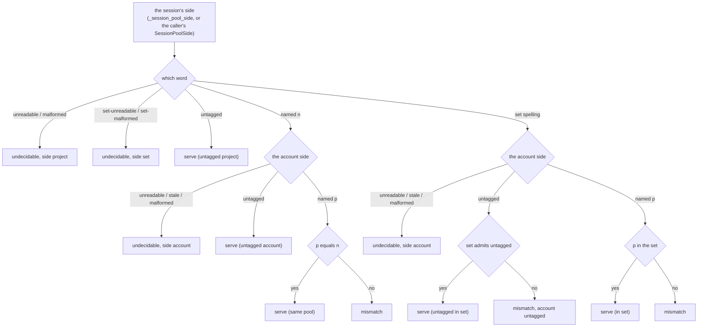
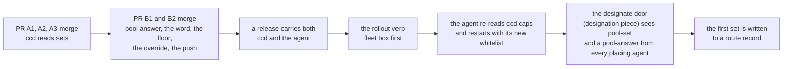

# Overlord W1: the pool rule's session side as a set (`pool-set`) Implementation Plan

> **For agentic workers:** REQUIRED SUB-SKILL: Use superpowers:subagent-driven-development (recommended) or
> superpowers:executing-plans to implement this plan task-by-task. Steps use checkbox (`- [ ]`) syntax for tracking.

**Goal:** the pool rule decides, for any session, whether an account may serve it. The session's side is either its
project's one-name tag (as today) or a set of pool names with an `untagged` yes or no, carried on the session's route
record. ccd reads a session's side through one reader, and every ccd user of the pool decision keyed by a session reads
it there. The route record carries the set and the Overlord's ordered account list, which only `ccd route --session`
writes. A read-only `ccd pool-answer` reports the pool answer for a session's current account. The word `pool-set`
says a box has all of it. While a set stands on a box, no update or rollback takes that box below the word without
`--below-cap pool-set`, the unattended paths that do cross it say so and the operator is pushed, and the doctor fails
on a box that got there.

**Why:** R18 (the operator, 2026-11-12) replaced reserved accounts with "the account pools the Overlord may draw from"
(C46). The set lives on the designation row and reaches placement through the one pool rule, so placement keeps one
decider (Table 3.4c's chosen option). The designate and rebind doors refuse `capability-missing` until every agent that
can place sessions advertises `pool-set` (C46, "Every agent before the server", §14), so this piece ships first in lane
A, before any door writes a set.

**Architecture:** the rule is written once per language and driven by one fixture table: `poolRule`
(`shared/poolrule.ts`, L0) and `_pool_ok` (`ccd/ccd`). The set's one-token spelling is written once per language too:
`poolSetSpelling` and `parsePoolSet` in a new one-concern L0 sibling, `shared/poolset.ts`, and `_poolset_parse` in
ccd, driven by one spelling table. ccd is the anti-corruption layer and the authority at placement: it reads the set
from `$REG/<id>.poolset` through a bounded, measured read and never folds an unreadable or malformed set into "no set".
The new set helpers live in a fourth ccd library, `ccd/lib/pool-set.sh`; `ccd/ccd`'s body keeps its own functions and
gains one-line calls into the library (the large-file programme's rule: new code goes to its target module, and no
existing function moves here, which is that programme's pure-move work). The server never places and never writes the
set in this piece: the designation piece is the set's first writer. Five pull requests: **PR A1** (Tasks 1 and 2: the
set in L0, the library, the route fields), **PR A2** (Task 3: the one reader and `_pool_ok`'s set case), **PR A3**
(Tasks 4 and 5: every ccd user of Table 3.4d, the crossing marker and the undecided words), **PR B1** (Tasks 6 to 8:
`ccd pool-answer`, the word `pool-set` and the release's `ccdCaps`, the stamp's field, the floor below `pool-set`, its
call sites and restore arms, and the doctor's check), and **PR B2** (Tasks 9 and 10: the override `--below-cap
pool-set` on three verbs with its forwardings and its cap word, and the server's push when a placing box loses the word
while a set stands).

**Tech Stack:** TypeScript (ESM), bash (`ccd/ccd`, `ccd/ccrc`, `ccd/ccrc-doctor-checks`), vitest. No new dependency.

**Spec:** `docs/superpowers/specs/2026-11-09-overlord-design.md` §3.4 (C46 whole: the set, its one writer, "How it
reaches placement", "The rule this design widens", "One reader of the session's side", "A bad set is undecidable",
"The renewal lane asks ccd for the generation's pool answer", "An older ccd", "Untagged accounts serve it only when the
set says so", "An empty set serves nothing", "A deliberate crossing holds until the next renewal"; Table 3.4c; Table
3.4d whole; C56's "The list holds only accounts in the set"; C57's four causes of `stranded`), Table 3.3.11b's row "The
generation's account is outside its set" (the consumer of `ccd pool-answer`, built by the renewal rows piece), Table
11.1c's rows for the pool rule's session side and for ccd's `overlord` arms (this piece takes `cmd_route`'s two fields,
`ccd pool-answer`, the home re-seed's stand-down; the ccd arms piece takes the rest of that row), Table 11.1d's row for
ccd's capability words, §11.5's "An older fleet build" (the doctor failure, and the refusal of `ccrc rollout` and
`ccrc rollback` below `pool-set` while a standing fact needs it, which this piece owns: index review 2075's F8), §14's
"Every agent before the server", and Table 13.1's C46 and C56 rows. The W1 index is
`docs/superpowers/plans/2026-11-14-overlord-w1.md` (PR #2814, row "Pool set", lane A, first). R18's minors from review
1862 are in the programme ledger (`docs/superpowers/programs/overlord.md`, "R18's minors, for the W1 plan"); each is
answered below. The large-file programme is `docs/superpowers/specs/2026-11-13-large-file-programme-design.md`.

Measured against `origin/main` at `4fd5998ed` (2026-11-15); the branch itself is parented on the first draft's
`416b8f942`. Of the files this plan touches, five moved between the two (review 2092 N12): `server/test/growthCheck.ts`
(the three growth stages of #2811), `server/src/watch.ts`, `server/test/sim/mutation-floors.test.ts`,
`server/test/sim/mutation-floors.json` and `server/test/single-definition/writers-map.test.ts`. Every task's builder
re-measures what it cites on the `main` it starts from. The index was read from `origin/ws/overlord-plan-w1`. The
coordinator's rulings on reviews 2085 and 2092 are recorded in the open questions they settle.

## Open questions

Each carries a recommendation or a ruling, and the plan builds it. The index's questions this piece builds on are its
6 (the route fields' names and grammar: this plan names them, below) and its 9 (the hold-down, which is the ccd arms
piece's, not this one's).

1. **The route fields' names** (index question 6, slug `route-field-names-are-the-pool-set-plans`). **Built:**
   `poolset` for the set and `acctorder` for the ordered list, stored as `$REG/<id>.poolset` and `$REG/<id>.acctorder`
   like every route field. Measured: no registry suffix in `ccd/ccd` spells either today. `accounts` was rejected
   because the account-management deny rules guard writes under `~/.cc-sessions/.accounts/`, and a field name one
   character from that path invites a false match in the hook's path arms.
2. **The set side's undecidable words** (slug `set-side-undecidable-words`). C46 says the reader answers in
   `_project_pool_state`'s words plus `set <spelling>`, and that a bad set answers `unreadable` or `malformed`. Bare,
   those two words cannot tell `_pool_ok` which side failed, and `set unreadable` is the valid spelling of the one-pool
   set `{unreadable}` (`unreadable` passes `POOL_NAME_RE`). **Built:** the reader answers `set-unreadable` and
   `set-malformed`, two words of their own, so `_pool_ok` sets `POOL_OK_SIDE=set` and `POOL_OK_STATE` to the spec's
   `unreadable` or `malformed`. Only the side word is new. Every site that matches the side word uses the quoted `"set
   "*` form (with the space) or an exact word, never a bare `set*`, which would match `set-unreadable` (review 2085
   F9).
3. **The empty set's spelling** (slug `empty-set-has-no-spelling`). An empty set with `untagged` off serves nothing. No
   door writes one: designate, rebind and the Settings row refuse fewer than two accounts that can serve it (C56), and
   an empty route value means "clear the field" for these two fields (question 13), so it cannot spell the empty set.
   **Built:** the empty set has no route spelling. `poolSetSpelling` refuses it (returns `null`), `parsePoolSet` and
   `_poolset_parse` read an empty names list without `+untagged` as `malformed`, and a malformed set is undecidable,
   which also places nothing. `poolRule` itself is total over the empty set and answers a mismatch for every account,
   so the server's count (designation piece) reads zero.
4. **`ccd pool-answer`'s argument form** (review 1862 minor, slug `pool-answer-takes-session-flag`). C46 writes `ccd
   pool-answer <id>`. A positional id would need a one-token whitelist grant, which admits every positional form the
   verb might grow. **Built:** `ccd pool-answer --session <id>`, with `pool-answer` in `REQUIRED_VERB_FLAG`
   (`agent/src/whitelist.ts`) bound to `--session`, as `route` and `win-size` are.
5. **Which word `_swap_target`'s undecided pool answer carries** (review 1862 minor, slug `swap-target-rc-by-side`).
   `_swap_target` runs inside `$( )`, so `POOL_OK_SIDE` dies with the subshell and its caller cannot read the side.
   Its rc 6 is taken ("a name, chosen one rung down"). **Built:** rc 4 stays the project side, rc 7 is the account side
   (the word `projection`), and rc 8 is the set side (the word `set`). The tick's own verdict site (`stuck=pool`,
   inside `_auto_swap_check`, where `POOL_OK_SIDE` is in scope) picks the same three words from the side. Every reader
   of `_swap_target`'s rc is named in Task 5, and `_rescue_target`'s undecided test widens from `rc >= 2 && rc <= 5` to
   `rc >= 2 && rc != 6` (review 2085 F18).
6. **Who clears the crossing marker at a renewal** (slug `fresh-start-clears-crossing-in-ccd-arms`). C46 and Table
   11.1c's ccd row say the fresh start for a session whose side is a set removes the marker and logs `crosspool-ended`
   with the reason `renewal`. That is an edit to the fresh start, which the ccd arms piece already edits for the
   three-step pick. **Recommendation:** the ccd arms piece, beside its pick. This piece ships the marker's `set:` kind
   and the tick's handling of a set-side marker, which the clearing reads. The index should name it in the ccd arms
   row.
7. **What stands for "a standing fact needs `pool-set`" on a box** (review 1862 minor, §11.5, index review 2075 F8,
   review 2085 F17, slug `standing-set-is-a-poolset-entry`). **Built (Task 8):** the fact is measured on the box, where
   ccd reads it: any entry at a path `$REG/<id>.poolset` for any registry row, tested with `-e` or `-L` (a regular file,
   a dangling link, a directory and a FIFO all count, because the new ccd reads each as `set-unreadable`, failing
   closed, while an older ccd would ignore it and fail open). A registry that exists but cannot be listed is
   "unmeasured" and refuses. Both the update's check and the doctor's run on every role; a `server` box has no registry
   rows, so it reads "nothing stands" and proceeds or passes.
8. **An older agent beside a newer ccd** (slug `older-agent-reads-unmeasured`; review 2085 F13, ruled). The agent does
   not only cache `ccd caps` at boot: `agent/src/server.ts#refreshVerbs` runs `ccd caps` again whenever the stat of the
   ccd entry or body changes, on every caps request (the server's 60 s `caps` lane). So an agent that has not
   restarted advertises `pool-set` within about a minute of a newer ccd landing, while its compiled-in whitelist still
   has no `pool-answer` row. That happens after every ccd-only landing, not only a hand deploy. Placement is not
   affected: ccd honours the set, and the old `['route', '--session']` grant still carries `--set poolset=…`. **The
   coordinator's ruling, for the designation piece:** the designate door also requires the agent's own answer to `ccd
   pool-answer`, so an older agent's `forbidden` (`ran: false`) refuses the designation. This piece pins the shape that
   door reads (Task 6's `ran`-first contract) and builds nothing more for it. The renewal lane reads the same refusal as
   a read that failed (not due).
9. **The ordered list's validation** (slug `acctorder-checks-shape-not-roster`). **Built:** `acctorder` is checked for
   shape only (account ids, comma-joined, no repeats, at most `ROUTE_LIST_MAX_BYTES`), never for roster membership, so
   an account removed later does not make the record malformed. The ccd arms piece's pick skips an id
   `_is_valid_wrapper` does not know.
10. **Who may write the two fields** (slugs `poolset-stays-an-accident-guard`, `route-argv-refuses-the-set`; review
    2085 F2, ruled). `ROUTE_FIELDS` is also `_route_argv_check`'s allow-list, so without a refusal `ccd ws-add --route
    poolset=…`, `ccd start --route …` and `ccd enable --route …` would accept a set, and each places its account
    before it writes the route record, so a session would be created outside the set it was handed. **Ruled and
    built:** `_route_argv_check` refuses `poolset` and `acctorder` as it refuses `degraded` and `inert`, so no `--route`
    on `ws-add`, `start` or `enable` carries a set. A set is written only through `ccd route --session <id> --set …`
    (the designate door's write, through `CCD_ARGV.routeSet`). That path stays an accident guard, as C46 says: any
    session's shell can still run `ccd route`, and the server writes the record again at each renewal and change. On
    the server both fields are lane-only (`ROUTE_LANE_ONLY_FIELDS`), so no route door forwards them.
11. **How `ccrc update` learns whether the target build has `pool-set`** (slug `ccd-caps-ride-build-json`; review 2085
    F4 and F5, ruled). Running the staged tree's `ccd caps` before install would run code the update has not installed.
    **Built (Tasks 7 and 8):** `build.json` gains `ccdCaps`, the built tree's whole `ccd caps` list. `ccd caps` prints
    verbs and capability tokens in one flat list with no separator (`ws-expire` and `hibernate` sit among the tokens),
    and membership is all the check asks, so the whole list is stamped. The builder seeds a scratch `HOME` with the
    generated default roster (`node deploy/gen-accounts.mjs deploy/accounts.default.json`), because with an empty `HOME`
    `ccd caps` exits 1 ("no account roster"). It fails the build on a non-zero exit and never writes an empty array.
    The reader is the one build-stamp parser, `ccd/ccrc#_box_build_fields`, widened by one output line with its pin.
    That line is a field-level answer (review 2092 N2, ruled): `<absent>` (a build from before the field, a
    `deploy/deploy.sh` stamp, a kept tree from before it), `<malformed>` (present but not an array of well-shaped
    tokens), or the space-joined list, `[]` being the empty list, which "lists no `pool-set`" and refuses. The
    sentinels sit outside the token grammar, and the field never fails the stamp, so the stamp parser and
    `shared/buildinfo.ts#parseBuildInfo` still agree on every stamp. The one token that reflects the build box rather
    than the target (`pool-sync-installed` or `pool-sync-absent`) is stamped as printed and read by nothing.
12. **What overrides the floor** (slug `below-cap-is-a-typed-flag`; review 2085 F6, ruled). `--force` already means
    "reinstall a converged box" on the update verb and "move a converged fleet anyway" on the rollout verb (forwarded to
    every box), and the rollback verb takes no `--force` by design (D-3285). **Ruled and built:** the override is a
    typed flag, `--below-cap pool-set`, accepted by the update, rollback and rollout verbs, naming the one capability
    it passes, and carried through every re-exec (the two detaches and the rollback's fall-through, review 2092 N1).
    Any other word after it is a usage error. `--force` keeps its meanings and never crosses the floor. The rollout
    verb forwards the flag only to a box whose check line advertises the new cap word `below-cap`, and refuses up
    front, before any box moves, naming every box that lacks it (review 2092 N7, ruled; Task 9). The console's
    rollback tap (`POST /api/updates/rollback`, `--from pwa`) passes no such flag, so it refuses while a set stands;
    its refusal sentence puts the remedy first (run the rollback from the box's shell with `--below-cap pool-set`, or
    retire or rebind the Overlord in Settings, which clears the set). The refused tap reads as a `failed` row in the
    update control plane, whose detail is that sentence cut to 200 characters, and it halts the rest of the move until
    acked, as any refusal before a change does today. A retry hits the same refusal until the set is cleared or the
    flag is passed.
13. **How a set is cleared** (slug `poolset-empty-value-clears`; review 2085 F10). `cmd_route` refuses an empty value
    for every field except `compact` and `compactwindow`. **Built:** `poolset` and `acctorder` join that exemption, so
    `ccd route --session <id> --set poolset= --set acctorder=` removes both files. That is how the designation piece's
    retire clears the retired row's set, and how its rebind clears the old row's set after writing the new row's.
14. **The unattended paths** (slug `pool-set-floor-unattended-warn-and-push`; review 2085 F7, ruled). The watchdog's
    rollback (`--from watchdog`) and the gate-failure restore (`--from restore`) put health first and never refuse.
    They read `previous`'s `ccdCaps` where a stamp exists (the watchdog's rollback, restore arms 1 and 2); when it
    lacks `pool-set` and a set stands, they still roll back, print the `WARN`, and the operator is pushed, naming every
    standing set (Task 10). Restore arm 3 has no stamp to read (the backup keeps no `build.json`), so it reads no
    capability and, while a set stands, prints the "could not be read" `WARN` (review 2092 N8, ruled). The realistic trigger is narrow: both paths
    return to `previous`, so they cross below the word only when `previous` names a build without `pool-set`, as when a
    same-tag reinstall of a `pool-set` build fails while `previous` still names an older build. In the ordinary failed
    move from one release to the next, neither path crosses. (The first draft's reason, "a box that fails its health
    probe places nothing", was false: the gate measures `ccrc.service` and `ccrc-agent.service`, never the session
    supervisors, which keep placing.)
15. **How the push reaches the operator** (slug `pool-set-loss-push-from-the-caps-lane`). A box cannot push: the
    unattended paths run in bash, on the box. **Built (Task 10):** the server raises the push, from facts it already
    reads. On each watcher tick, a lane file (`server/src/poolSetLossLane.ts`) asks one L1 decider, `poolSetLoss`,
    whether the box lacks `pool-set` in the caps the `caps` lane last recorded while any session on it carries a
    `poolset` route field, readable or listed but unreadable (the registry reader reads every `ROUTE_WRITABLE_FIELDS`
    file a listing shows, so after Task 2 it reads `poolset`, and it names an unreadable one in `route.unreadable`). It
    raises one notice through the notice funnel (`server/src/notice.ts#notify`, mode `push`, kind `coord`, session id
    `''`, `hasNotice` read first, as `buildCaptureLane.ts` does), naming each session that carries a set. In remote
    mode that covers every path below the word, forced, unattended or a hand deploy, with one mechanism. In `local`
    mode the caps are read once at boot, so a change is seen at the next server restart; and on any `both` box a
    rollback below PR B2 takes the server below Task 10 as well, so no push comes, and the doctor's line is the signal
    there. The operator item the designation piece may raise for a lost word reads the same decider.

## What exists today

Measured on `origin/main` at `4fd5998ed`.

- **The rule in TypeScript.** `shared/poolrule.ts#poolRule(account: AccountPoolWire, projectPool: ProjectPoolWire):
  PoolVerdict`. The project side decides first: `unreadable` or `malformed` is undecidable, `untagged` serves without
  reading the account; a `tagged` project reads the account side, where `unreadable`, `malformed` and `stale` are
  undecidable, `untagged` serves, and membership (`account.pools.includes(projectPool.name)`) serves. `PoolVerdict`'s
  arms: `ok: true` with `why` (`untagged-project`, `untagged-account`, `same-pool`), `pool-mismatch` with both names,
  `pool-undecidable` with `state`. `ProjectPoolWire` is in `shared/api.ts`. `declaredAccountPool` adapts a roster name.
  Consumers: `server/src/poolrule.ts` (the server's mirror, purity-scanned by `pools.test.ts`), `pwa/src/lib/pools.ts`,
  `pwa/src/lib/accounts.ts`, `pwa/src/screens/AccountsScreen.tsx`.
- **The rule in bash.** `ccd/ccd#_pool_ok` takes an account id and the project side's state word, answers rc 0 serve,
  1 mismatch, 2 undecidable, and sets `POOL_OK_SIDE` (`project` or `account`) and `POOL_OK_STATE`.
  `server/test/ccd-pool-ok.test.ts` counts the lines of `ccdSource()` that contain `_pool_ok ` (16 today, 12 of them
  not comments) against the figure the function's header states. `_pool_undecidable_why` (side, state, project,
  account) and `_pool_mismatch_why` render rc 2 and rc 1.
- **One fixture table.** `server/test/fixtures/poolRule.ts#POOL_RULE_CASES` (`accountPool`, `project`, optional
  `accountState`, `expect` in a third vocabulary: `serve`, `mismatch`, `undecidable`), driven through `poolRule` by
  `server/test/pool-rule-core.test.ts` and through `_pool_ok` by `server/test/ccd-pool-ok.test.ts`. Pool names
  `pool-a`, `pool-b`, `pool-ab`; account ids from the test roster.
- **The project side.** `ccd/ccd#_project_pool_state` reads `$POOLS_DIR/<project>` with a bounded read (`read -r -d ''
  -n 64`, where a NUL or the cap is `malformed`) and answers `named <n>`, `untagged`, `unreadable` or `malformed`,
  always rc 0, under `LC_ALL=C`. It proves absence level by level (`$REG`, then `$POOLS_DIR`). The server's reader is
  `server/src/pools.ts#readProjectPools`. `POOL_NAME_RE` is `^[a-z][a-z0-9-]{0,31}$` (`shared/roster.ts`, with its bash
  literal held equal).
- **The registry read.** `ccd/ccd#_reg_read` answers rc 1 for an absent field and rc 2 for an unreadable one (a
  symlink, a directory, a FIFO, mode 000), but takes the bytes through `_file_read_to`, which falls back to `$(cat)`
  when the file holds a NUL, and bash drops the NUL. Measured by review 2085: `pool-a\0+untagged` reads back rc 0 as
  `pool-a+untagged`, a zero-byte file reads rc 0 empty, CRLF keeps the `\r`, and a 5,000-byte file is read whole. When
  `$REG` itself is not searchable, `_reg_read_to` answers rc 2 for any field, an absent one included.
- **The account side.** `ccd/ccd#_acct_pool_state` reads `$REG/pool-epoch` (central `pool_edges`, pulled by
  `ccd-pool-sync.timer`) and answers `named <n>`, `untagged`, `unreadable`, `stale` or `malformed`.
- **The users of the decision in ccd,** each reading the project side today (Table 3.4d, re-measured): `_swap_target`
  (`pps=$(_project_pool_state "$project")`, then `_crosspool_valid` on cur and home and `_pool_ok "$cur"`; rc 2, 3, 4
  and 5 are "nobody can say", 4 being the pool rule; rc 6 a name one rung down), `_auto_swap_check` (the home re-seed:
  on `_pool_ok "$home"` rc 1 it asks `_ws_least_loaded "$project"` and writes `home`, logging `rehome`; then `_pool_ok
  "$wrapper"` feeds the affinity arm and the verdict site `stuck=pool`; it also relocates an out-of-pool session at the
  first idle turn boundary), `cmd_swap`, `cmd_start` (its pool refusals sit under `[[ -z "$regw" ]]`, so only a new row
  is refused; an existing row, on revival or `ccd enable`, gets a stderr warning on rc 1 and nothing on rc 2; pinned by
  `ccd-crosspool.test.ts`'s "WARNS rather than refusing on a REVIVAL"), `cmd_prefer`, `_default_pool` (a pay-per-use
  lane joins only when the project reads `named <p>` and the lane's pool reads the same), `_strand_why`
  (`tag:<state> $POOLS_DIR/<p>` for a bad project side), `_strand_mark` (names the project's pool), and
  `_undecidable_cause` (the word `pool` names the project's tag file whatever side was undecided; it has no
  `projection` or `set` word). `_swap_target`'s rc is read by four direct calls (three in `_rescue_target`, one in
  `_rescue_strand_cause`), five calls of `_rescue_target`, `_auto_swap_check`'s rescue map (`4) uword=pool`),
  `_wake_ceiling_move` (acts on rc 0 or 6 only) and `_watchdog_one` (`trc >= 2` logs `watchdog-undecidable rc<n>`).
  `_rescue_target`'s undecided test is `(( rc >= 2 && rc <= 5 ))`. Project-keyed and unchanged: `_ws_least_loaded`,
  `_place_for_class`, `_ws_pool_read`, `_ws_wrapper_why`, `_ws_lane_why`, `cmd_ws_add`'s refusal loop,
  `cmd_project_pool`.
- **The crossing marker.** `ccd/ccd#_crosspool_mark` writes `$REG/<id>.crosspool` as `<epoch> <pool> <account>`; its
  three callers (`cmd_start`, `cmd_swap`, `cmd_prefer`) pass `${pps#named }`. `_crosspool_valid` (id, pool state,
  accounts…) accepts only while `$pps == "named $pool"`, and answers 0 valid, 1 none, 2 unreadable. `_crosspool_tick`
  ends a lapsed marker with `crosspool-ended`; its gate is the one unquoted glob, `[[ "$pps" == named* || "$pps" ==
  untagged ]] || return 1`. `cmd_swap`'s `swap.log` line reads `cross-pool … [project=… pool=… target-pool=…]`. Tests:
  `server/test/ccd-crosspool.test.ts`, whose case "an exit code this build does not name is reported as ignorance"
  stubs `_swap_target() { return 7; }` and expects `rc7`.
- **The route record.** `ccd/ccd#ROUTE_FIELDS` is twelve fields (`class effort subagent workflow compact browser
  degraded inert profile automem compactwindow precompact`), pinned in order by `server/test/ccd-route-fields.test.ts`.
  `cmd_route` refuses a field outside it, refuses `degraded` and `inert` as ccd's own, validates each value with
  `_route_valid` (rc 0, 1 bad value, 2 the box cannot judge), refuses an empty value for every field except `compact`
  and `compactwindow` (which an empty value clears), and logs each change to `swap.log` and the lifecycle journal.
  `_route_argv_check` uses `ROUTE_FIELDS` as the allow-list for `--route` on `ws-add`, `start` and `enable`, refusing
  only `degraded` and `inert` besides. `_route_any` skips `browser`, `profile`, `automem`, `compactwindow` and
  `precompact`. The TypeScript vocabulary is `shared/api.ts#ROUTE_WRITABLE_FIELDS`, with `ROUTE_LANE_ONLY_FIELDS`
  derived as the slice from `profile` on (refused `lane-only` by `parseRouteFields` at every route door).
  `server/src/registry.ts` reads each `ROUTE_WRITABLE_FIELDS` file a listing shows; `CCD_ARGV.routeSet`
  (`server/src/ccdargv.ts`) composes `--set` pairs in that order.
- **Capability words.** `ccd/ccd#cmd_caps` prints one flat list: the verbs it implements, then capability tokens. With
  an empty `HOME` it exits 1 ("no account roster"); with the generated default roster it prints 111 lines. The server
  spells each token once (`server/src/ccdargv.ts`: `POOLS_CAP`, `ACCOUNT_POOLS_CAP`, …); `server/test/ccdCapTokens.ts`
  and `ccd-archive.test.ts`'s `KNOWN_CAPABILITY_TOKENS` are the other spellings. `CCD_CAN` maps each `CCD_ARGV` row to
  `verbRow` (permit on no evidence) or `capRow` (refuse on no evidence). The agent re-reads `ccd caps` when the ccd
  entry or body changes (`agent/src/server.ts#refreshVerbs`), on each `caps` request (`server/src/laneSchedule.ts`'s
  `caps` row).
- **The agent's whitelist.** `agent/src/whitelist.ts`: grants are argv prefixes; `REQUIRED_VERB_FLAG` binds a gated
  verb to its whole argument surface; type bypass files under `agent/test/types/bypasses/` go up to `g28`;
  `server/test/whitelist-subset.test.ts` checks every server argv against the grants. An off-whitelist exec is refused
  `forbidden`, which the runner returns as `{code: 1, stdout: '', ran: false, reason: 'spawn'}` (callers narrow on `ran`
  first, D-6034). `server/src/remote/runner.ts`'s per-verb timeouts default to 90 s.
- **ccd's libraries.** `ccd/lib/disk-retention.sh`, `train-proof.sh` and `delegation-lease.sh` are loaded at the foot of
  `ccd/ccd` by `_ccd_lib_load`, each pinned by a SHA-256 line rendered at install (`__CCD_LIB_TRAIN_SHA256` and its
  siblings) by `ccd/ccd-entry-install.py`, and evaluated from the bytes that were hashed; a source checkout (every pin a
  placeholder) evaluates them unpinned. Each library's code sits in `# @ccd-lib:<id>` regions with a pointer line in
  `ccd/ccd`, which is how `ccdSource()` (read by 158 test files) sees library code. The third library's pull request
  (#2256, `git show --stat a520aaace`) and review 2085's F15 list every site a new library touches (Task 2, Step 0).
- **Growth stages (#2811).** A listed file grows at most `GROWTH_LIMIT` (40) net code lines a pull request, waivers
  counting; a frozen file (`server/test/growth-frozen/`) at most `SPINE_LIMIT` (10) with no waiver; a capped file
  (`server/test/growth-caps/`) stays within its cap. On `origin/main`: nothing is frozen (no `growth-frozen/`), and
  `shared/api.ts` is capped at 5,140; `ccd/ccd`, `ccd/ccrc`, `ccd/ccrc-doctor-checks`, `server/src/watch.ts`
  and every `ccd/lib/*.sh` are listed. A listed file new in its own diff counts in full.
- **The update's floor, its restore and its rollback.** `ccd/ccrc#_upd_floor_check` refuses a version below
  `~/.ccrc/floor` unless `--downgrade` was typed, and lets `--from restore|rollback|watchdog` through with a `WARN`.
  `cmd_rollback` flips itself to a kept tree (`_ver_flip_back`, under its lock, then its gate and sweep) and reaches
  `cmd_update` only when there is no kept tree, a written-through tree, a failed flip or an unversioned layout. Its
  argument loop sends any unknown flag to `_ccrc_usage_die`. The gate-failure restore (`_upd_restore`) tries arm 1 (a
  flip to `previous`'s kept tree), then arm 2 (a child update to `previous` from the new tree, which runs
  `cmd_update`), then arm 3 (a copy back from the backup). `ccd/ccrc#_box_build_fields` is the one reader of a build
  stamp (the staged `build.json`, a kept tree's stamp copy, the box's own stamp), with an END sentinel and a field count,
  pinned by `server/test/single-definition/roster-bash.test.ts`. No check reads a capability a standing fact needs.
- **The doctor.** `ccd/ccrc-doctor-checks#CCRC_DOCTOR_CHECKS`: its lines are cited by number elsewhere, so a new entry
  joins an existing line; `pool-sync` sits alone on its line. `_check_pools` reports `pools-unlistable` when `$REG` is
  not searchable (`-x`); a `$REG` with `x` but no `r` passes it.
- **The server's placement forecast** is `server/src/limits.ts#projectHome` and `#projectPlacement`, which take the
  project side as `pool: ProjectPoolWire`, filter by `poolEligible`, and are twinned in ccd by `_ws_least_loaded`
  (pinned together in `projected-home.test.ts`). That is the placement decision the set feeds (index review 2075 F3):
  the designation piece's first-account pick and C56's count read it with the set as the side. `limits.ts` is shared
  with the designation piece, and D-8126's A7 also edits it (not on `main`). This piece does not edit it:
  `SessionPoolSide` contains `ProjectPoolWire`, so every existing caller compiles unchanged.
- **The notice funnel.** `server/src/notice.ts#notify(deps, event, mode, opts)` is the one push path; `opts.dedupeKey`
  is archived with the notice and `CoordStore.hasNotice` reads it, so a caller raises a notice once per key.
- **Nothing writes a set yet, and nothing reads one.** No `poolset`, `acctorder`, `pool-set` or `ccdCaps` exists in
  the tree.

## Global Constraints

- **Architecture (`CLAUDE.md`).** The rule stays one decider per language, driven by one fixture table (Table 3.4c's
  chosen option). `poolRule` and the spelling functions are L0 (`shared/poolrule.ts` and `shared/poolset.ts` import
  types only, because the PWA bundles them). New wire vocabulary goes to `shared/poolset.ts` (the set, its spelling and
  the `ccd pool-answer` line's words), never into `shared/api.ts`, whose only edit is two words on
  `ROUTE_WRITABLE_FIELDS`. `parsePoolAnswer` and `poolSetLoss` are L1 in `server/src/poolrule.ts` (pure,
  purity-scanned). The new set helpers go to `ccd/lib/pool-set.sh`, and `ccd/ccd`'s own functions gain one-line calls
  into it; no existing function moves (review 2075 F6, review 2085's growth ruling). ccd is the authority at placement.
  One owner per fact: the set's writer is the operator's doors (designation piece), the account's pool is `pool_edges`,
  and this piece adds readers, one refusal and one push. No overloaded null at a seam: a set that cannot be read or
  parsed is never "no set" (C46's fail-open), and the side word says which side failed. An adapter never narrows what
  it received: `_session_pool_side` keeps `_reg_read`'s three answers, and the floor keeps "lacks it" and "unmeasured"
  apart.
- **Behaviour for every session without a set is unchanged,** except the one named change: the `projection` word
  (Task 5) gives every session whose account side is undecidable the sentence that names `$REG/pool-epoch`, where
  today it names the project's tag file. That is a fix fleet-wide (review 1862 minor), in a commit of its own, said in
  PR A3's body.
- **SAFETY (`CLAUDE.md`).** Every ccd and ccrc test runs in a fixture HOME (`makeCcdHarness`,
  `server/test/ccdWsHelpers.ts`), never the live `$HOME`; no test touches tmux, `~/.cc-sessions` or a supervisor. `ccd
  pool-answer` writes nothing: its test lists the fixture registry before and after a call and asserts it unchanged. It
  is not a forbidden verb. The floor's tests use fixture release trees and never run an update or rollback against a
  live box.
- **Bash discipline.** Every new reader and parser shadows `LC_ALL=C`, so a set's bytes give one verdict under any
  locale. Comparisons quote the right side (`[[ "$a" == "$b" ]]`), because a pool name compared unquoted would glob.
  Side words match quoted with their space (`"set "*`) or exactly. `ROUTE_LIST_MAX_BYTES` and
  `POOL_SET_SPELLING_MAX_BYTES` are plain assignments in the library, because a top-level `declare` inside the loader's
  `eval` is local and lost. A helper that sets `POOL_OK_*` is called bare, never inside `$( )`.
- **Tests.** From `server/`: `ccrc test -- ./node_modules/.bin/vitest run test/<file>.test.ts`; from `agent/` the same
  for its suites; the last run of each pull request adds every `tsc` (server, its tests project, agent, pwa). TDD: each
  step's failing test runs red before the code.
- **Growth.** Each pull request measures every growth-checked file against `origin/main`'s stages before it opens and
  stays under the 40-line limit for `ccd/ccd` and for `ccd/lib/pool-set.sh`, with no waiver (the coordinator's ruling:
  split PR A, never a waiver). If a stage freezes or caps `ccd/ccd` or `ccd/lib` before PR A1 opens, the worker asks
  the coordinator before writing code. `shared/api.ts` stays within its cap (+0).
- **Mutation floors.** `poolRule`, `poolSetSpelling`, `parsePoolSet`, `parsePoolAnswer` and `poolSetLoss` join a new
  `server/test/sim/poolSetSets.ts` (`POOL_SET_MUTANT_SETS`), registered in `server/test/sim/mutation-floors.test.ts`,
  with a floor each in `server/test/sim/mutation-floors.json` measured in the pull request that adds it. The bash twins
  are held by the shared tables, and each new bash guard ships with a measured red-without-it run, restored from a saved
  copy, never `git checkout`.
- **Censuses this piece touches:** `ccd/contexts.tsv` (each new function, C1); `ccd-pool-ok.test.ts`'s count of
  `_pool_ok ` lines over `ccdSource()` (re-measured in Tasks 3, 4 and 6, the header edited in the same commit);
  `ccd-reg-get-census.test.ts` if a `_reg_get` call site moves; `single-definition`'s route-field, capability-token and
  build-stamp scans (`roster-bash.test.ts`); `ccd-verb-sets.test.ts`; `ccd-can.test.ts`; `verb-gate.test.ts`;
  `id-argv-census.test.ts`; `ccdArgvSamples.ts`; `whitelist-subset.test.ts`, the agent's whitelist suites and a new
  bypass file `g29`; `ccdCapTokens.ts` and `KNOWN_CAPABILITY_TOKENS`; every site a new ccd library touches (Task 2,
  Step 0); `build-release.test.ts`'s `build.json` shape and its and `release-main.test.ts`'s fixture trees (Task 7);
  `CCRC_CAP_WORDS` and the suites that pin the check line's `caps=` (Task 9); `CCRC_DOCTOR_CHECKS` and the suites that
  count it; the watcher censuses for Task 10's call (`watcher-quiet-census`, if a test builds a watcher) and the rings'
  table for its new lane file. No route, table, lane schedule row or migration; one lane file, shaped like
  `buildCaptureLane.ts`.
- **Wire.** Additive only. `FLEET_PROTO` does not change. Two new route-record files appear in a listing, and an older
  server reads only the fields it knows. `build.json`'s `ccdCaps` is additive: an older `ccrc` ignores it.
- **Public repository.** Fixtures use `pool-a` and `pool-b` (and `pool-ab` where the table already does), the test
  roster's account ids, and session ids of the form `<account>-overlord` or `<account>-project-a`. No real pool name,
  account, host or path. Cite by symbol or `@anchor`, never by line. No D-number is invented: departures are slugs here
  and in `docs/superpowers/plans/2026-11-14-overlord-w1/w1-pool-set-departures.md`, beside its siblings' `<plan>-departures.md`, which Task 1 creates.

## Review Focus

1. **No fail-open.** A `poolset` entry that exists but cannot be read, or does not parse (a NUL, zero bytes, past the
   cap, a CR), makes every placement of that session undecidable on the `set` side, never a fall back to its project
   (which for the Overlord is the untagged `overlord` project that every account serves). The empty set and a set
   naming no carried pool serve nothing. No `--route` carries a set.
2. **No change for any session without a set.** Every project-side answer, sentence and log line is what it was, pinned
   by characterization tests green on `main` before each reader moves, except the `projection` sentence, which is the
   one named change. A `$REG` that cannot be searched answers the project's words, as today.
3. **One rule.** The set's membership is decided in `poolRule` and `_pool_ok` (through its library helper) only.
   `_default_pool`, the crossing marker, `ccd pool-answer` and `poolSetLoss` ask the rule or read its globals; none
   re-derives membership.
4. **The side names the remedy.** A bad set names the route record (`$REG/<id>.poolset`) and its remedy, a stale
   projection names `$REG/pool-epoch` and the pool sync, a bad project tag names `$POOLS_DIR/<project>`, on the start,
   tick, rescue and strand paths alike.
5. **An existing row warns, the tick relocates.** A revival or `ccd enable` on an account outside the set, or with the
   set unreadable, warns on stderr and is never silent; a new row outside the set is refused (a case production never
   meets, because a new id carries no set, so its test plants the set by hand); the tick moves an existing one back at
   its next idle boundary.
6. **`ccd pool-answer` cannot be widened by the wire,** and its refusal by an older agent reads as `ran: false`.
7. **The way below `pool-set` is closed while a set stands.** Both call sites refuse before anything changes, each
   inside the reporting window, so the console's tap gets its `failed` row; absent or malformed `ccdCaps` and an
   unlistable registry refuse, and no `ccdCaps` shape fails the stamp itself; only `--below-cap pool-set`, carried
   through every re-exec and forwarded only to a box that advertises `below-cap`, and the two unattended paths pass,
   each with a `WARN`, and the server pushes the operator once per loss, an unreadable set included.

## The rule, widened


*Figure 1. The pool rule with the session's side widened to a set. The project side still decides first, and a set is
never "untagged": an untagged account serves a set only by its explicit yes.*

The set's spelling, one token: its pool names in ascending byte order (`LC_ALL=C`), joined by `,`, then `+untagged`
when it admits untagged accounts. `pool-a,pool-b`, `pool-b+untagged`, `+untagged`. Grammar:
`^(N(,N)*)?(\+untagged)?$`, `N` being `POOL_NAME_RE`, non-empty as a whole, names strictly ascending (a repeat or an
unsorted list is `malformed`, so one set has one spelling), at most `POOL_SET_SPELLING_MAX_BYTES` (1,024) bytes. Today's
one-name tag `n` is the set `n+untagged` (C46), and the fixture table pins that equivalence.

---

### Task 1: The set in L0, its spelling, and the fixture rows (PR A1)

**Files:**
- Create: `shared/poolset.ts` (L0, one concern: `PoolSet`, `poolSetSpelling`, `parsePoolSet`,
  `POOL_SET_SPELLING_MAX_BYTES`; it holds the pool-name pattern as a copy held equal to `POOL_NAME_RE` by a test, or
  imports the value from `shared/roster.ts` if that adds no cycle; measure)
- Modify: `shared/poolrule.ts` (`SessionPoolSide`, `poolRule`'s set arm; it imports the `PoolSet` type only)
- Modify: `server/test/fixtures/poolRule.ts` (the set rows and the derived equivalence rows)
- Create: `server/test/fixtures/poolSetSpelling.ts` (`POOL_SET_SPELLING_CASES`: spelling in, set or `malformed` out,
  and set in, spelling or `null` out)
- Create: `server/test/sim/poolSetSets.ts`; Modify: `server/test/sim/mutation-floors.test.ts`,
  `server/test/sim/mutation-floors.json`
- Create: `docs/superpowers/plans/2026-11-14-overlord-w1/w1-pool-set-departures.md` (the measurements and departures
  each later task records)
- Test: `server/test/pool-rule-core.test.ts`, `server/test/pool-set-spelling.test.ts` (new), `server/test/pools.test.ts`
  (the server mirror's purity scan stays green), pwa's `tsc`, and `rings/totality.test.ts` if it lists `shared/`
  (measure; if so, the new file's row)

**Interfaces:**

```ts
// shared/poolset.ts
/** A session's set (C46): pool names in the operator's order, and the yes or no for accounts in no pool. */
export interface PoolSet { readonly pools: readonly string[]; readonly untagged: boolean }
/** The set's one token, or null for the empty set, which has no route spelling (open question 3). */
export function poolSetSpelling(set: PoolSet): string | null;
export function parsePoolSet(spelling: string): { readonly ok: true; readonly set: PoolSet } | { readonly ok: false };

// shared/poolrule.ts
/** The session's side of the rule: a project's tag as today, or a set read from the session's route record. */
export type SessionPoolSide =
  | ProjectPoolWire
  | { readonly state: 'set'; readonly set: PoolSet }
  | { readonly state: 'set-unreadable' }
  | { readonly state: 'set-malformed' };
export type PoolVerdict =
  | { ok: true; why: 'untagged-project' | 'untagged-account' | 'same-pool' | 'in-set' | 'untagged-in-set' }
  | { ok: false; reason: 'pool-mismatch'; side: 'project'; accountPool: string; projectPool: string }
  | { ok: false; reason: 'pool-mismatch'; side: 'set'; account: { pool: string } | { untagged: true }; set: string }
  | { ok: false; reason: 'pool-undecidable'; side: 'project' | 'account' | 'set';
      state: 'unreadable' | 'malformed' | 'unrecognised' | 'stale' };
export function poolRule(account: AccountPoolWire, side: SessionPoolSide): PoolVerdict;
```

`side` joins every existing arm as a new field (additive: no consumer reads it today; measure the four consumers named
in "What exists today" and add the field to any literal they build). The set mismatch arm names the account's side as
untagged rather than inventing a pool name (C46). `set` in that arm is the spelling, or `-` for the empty set, which
reaches it only from a caller holding a designation row.

- [ ] **Step 1: Characterize.** Before any edit, run `pool-rule-core.test.ts` and `ccd-pool-ok.test.ts` green on
  `main` and record their counts in the departures note.
- [ ] **Step 2: Failing tests.** Set rows in `POOL_RULE_CASES` (a new optional `set` on `PoolRuleCase`, which the
  driver uses as the side in place of `project`): an account in `pool-a` under `{pool-a}` serves (`in-set`); under
  `{pool-b}` mismatches; under `{pool-a, pool-b}` serves; an untagged account under `{pool-a}` mismatches with
  `account: {untagged: true}`; under `{pool-a}+untagged` serves (`untagged-in-set`); under `+untagged` serves; every
  account under the empty set mismatches; an account `unreadable`, `stale` or `malformed` under any set is undecidable
  on the `account` side; `set-unreadable` and `set-malformed` are undecidable on the `set` side over every account
  state, including an untagged account; the prefix pair (`pool-a` against `{pool-ab}`, and `pool-ab` against
  `{pool-a}`) mismatches. **The equivalence rows are derived, not typed:** for every row whose project is `tagged n`,
  the driver adds the same row with the side `{state: 'set', set: {pools: [n], untagged: true}}` and asserts the same
  `expect` (C46: "pins that equivalence in both spellings"). The spelling table: `pool-b,pool-a` is `malformed`,
  `pool-a,pool-a` is `malformed`, an empty string is `malformed`, `+untagged` parses, `pool-a+untagged+untagged` is
  `malformed`, a name failing `POOL_NAME_RE` is `malformed`, a spelling past 1,024 bytes is `malformed`, a CR, a NUL
  or any byte outside the grammar is `malformed`, `poolSetSpelling` sorts (`{pool-b, pool-a}` spells `pool-a,pool-b`)
  and drops repeats, the empty set spells `null`, and every spelling round-trips.
- [ ] **Step 3: Run.** Red. **Step 4: Implement.** **Step 5: Run** both suites, `pools.test.ts`,
  `projected-home.test.ts`, the server's two `tsc` runs and pwa's `tsc`. Green.
- [ ] **Step 6: Mutation.** Register the three deciders in `POOL_SET_MUTANT_SETS` over these suites and set each floor
  to its measured score. By hand, measured: let an untagged account serve a set that does not admit it: red. Let
  `set-unreadable` fall back to the project side: red. Restore from the saved copy.
- [ ] **Step 7: Commit.** `feat(pools): the pool rule's session side as a set, its spelling, and the fixture rows (W1)`

### Task 2: The library, and the route fields `poolset` and `acctorder` (PR A1)

**Files:**
- Create: `ccd/lib/pool-set.sh` (the fourth library, C1, with its header and one `# @ccd-lib:poolset` region: here
  `_poolset_parse`, `_acctorder_valid`, `ROUTE_LIST_MAX_BYTES` and `POOL_SET_SPELLING_MAX_BYTES`, as plain assignments;
  Task 3's helpers and Task 6's verb join it)
- Modify: `ccd/ccd` (the region's pointer line; `_ccd_lib_load`'s file and pin arrays, a
  `__CCD_LIB_POOLSET_SHA256=stamp-at-install` line and the source-checkout test; `ROUTE_FIELDS` gains `poolset
  acctorder` at its end; `_route_valid`'s two one-line arms; `_route_any`'s skip list; `cmd_route`'s empty-value
  exemption gains both fields (open question 13); `_route_argv_check` refuses both, beside `degraded` and `inert`
  (open question 10))
- Modify: every other loader site the third library touched and review 2085 F15 lists: `ccd/ccd-entry-install.py`
  (the pin's render and the staging), `ccd/ccd-entry.py`'s header comment, `ccd/ccrc` (the update backup's names and
  the uninstall list), `deploy/deploy.sh`, `server/test/ccdWsHelpers.ts` (`CCD_LIBS`),
  `server/test/consolidationCensus.ts` (`CCD_LIB_FILES`), `installTreeFixture.ts`, `ownership.test.ts`,
  `session-hook.test.ts`'s `SCANNED`, `single-definition/writers-map.test.ts`, `tmux-socket-census.test.ts`
- Modify: `shared/api.ts` (`ROUTE_WRITABLE_FIELDS` gains `'poolset', 'acctorder'` at its end, inside
  `ROUTE_LANE_ONLY_FIELDS`; its docstring names their writers: the designation's doors and the renewal lane)
- Modify: `ccd/contexts.tsv` (`_poolset_parse`, `_acctorder_valid`, C1)
- Test: `server/test/ccd-route-fields.test.ts`, `server/test/ccd-route-argv.test.ts`, `server/test/pool-set-spelling.test.ts`
  (the bash arm), `server/test/single-definition/*.test.ts`, the registry and route suites the `tsc` runs reach, and
  the library suites the third library's pull request changed (`ccd-lib-load`, `ccd-entry-install`,
  `ccd-install-stamp`, `build-release`, `ccrc-uninstall`, `ccrc-update-flip-backups`, `ccd-ws-add-child`, the agent's
  `ccd-entry-exec` and `deploy-verify`), each gaining the fourth library beside the third

`_poolset_parse <spelling>` prints the set as `names=<n1> <n2>…` and `untagged=yes|no` on two lines and answers rc 0,
or prints nothing and answers rc 1 for `malformed`, under `LC_ALL=C`, checking the same grammar as `parsePoolSet` (the
order test uses `[[ "$a" < "$b" ]]` in the C locale). `_route_valid poolset` is `_poolset_parse` with its output
discarded. `_acctorder_valid` checks `^A(,A)*$`, `A` being the account-id shape ccd accepts for a wrapper, no repeats,
at most `ROUTE_LIST_MAX_BYTES` (1,024) bytes by `_route_bytes`, and never roster membership (open question 9).
`_route_any` skips both: they decide placement, never the spawn's model or flags (slug `pool-fields-outside-route-any`).

- [ ] **Step 0: The library, alone, in its own commit.** Create `ccd/lib/pool-set.sh` with its header (not an
  executable, loaded at the foot of `ccd/ccd`, its trust chain the other libraries') and its region, and wire every
  loader site. Red first: `ccd-lib-load.test.ts` expects four libraries; a missing, linked or changed
  `lib/pool-set.sh` refuses the start (status 125); a source checkout evaluates it; `ccdSource()` includes its region.
  Green, then commit `feat(ccd): the pool-set library, loaded and pinned like the other three (W1)`.
- [ ] **Step 1: Failing tests.** `ccd-route-fields.test.ts`: `ROUTE_FIELDS` is the fourteen-field record, with `poolset
  acctorder` last; `ccd route --set poolset=pool-a,pool-b` writes `$REG/<id>.poolset`; `pool-b,pool-a`, an empty names
  list with no `+untagged`, `Pool-A` and a 1,025-byte value are refused `bad value`; `acctorder` accepts
  `claude-a,claude-b` and refuses a repeat and a bad id; `--set poolset=` and `--set acctorder=` remove the files; a row
  carrying only `poolset` and `acctorder` reads `_route_any` false; both changes are logged to `swap.log` as every field
  is. `ccd-route-argv.test.ts`: `ws-add --route poolset=pool-a`, `start --route poolset=pool-a` and `enable --route
  acctorder=claude-a` are each refused, and nothing is created. The spelling suite's bash arm drives `_poolset_parse`
  over every `POOL_SET_SPELLING_CASES` row and agrees with `parsePoolSet` on each. On the server: `parseRouteFields`
  refuses both as `lane-only`; `CCD_ARGV.routeSet` composes them last; the registry reads both from a listing.
- [ ] **Step 2: Run.** Red. **Step 3: Implement.** Run every `tsc`: each `Record<RouteField, …>` the compiler names
  gains its two rows, and the departures note lists them.
- [ ] **Step 4: Run** the suites above. Green.
- [ ] **Step 5: Mutation.** Drop the order check from `_poolset_parse`: the spelling suite's bash arm goes red. Drop
  `poolset` from `_route_argv_check`'s refusal: the argv rows go red. Restore.
- [ ] **Step 6: Commit.** `feat(ccd): the route fields poolset and acctorder, written only by ccd route (W1)`

**PR A1 ends here.** It changes no placement: nothing reads a set yet.

### Task 3: The one reader of a session's side, and `_pool_ok`'s set case (PR A2)

**Files:**
- Modify: `ccd/lib/pool-set.sh` (`_session_pool_side`; `_pool_ok_set`, the set arm's body, called bare; the set
  renderers `_pool_set_undecidable_why` and `_pool_set_mismatch_why`)
- Modify: `ccd/ccd` (`_pool_ok` gains one `"set "*|set-unreadable|set-malformed` arm that calls `_pool_ok_set`;
  `_pool_undecidable_why` gains a fifth argument, the session id, and a one-line `set` arm; `_pool_mismatch_why` a
  one-line set arm)
- Modify: `ccd/contexts.tsv` (the four new functions, C1)
- Modify: `CLAUDE.md` (the "Account pools" bullet: `_project_pool_state` stays the one reader of the project's tag, and
  `_session_pool_side` is the one reader of a session's side, the set when its route record carries one)
- Test: `server/test/ccd-pool-ok.test.ts`, `server/test/ccd-session-pool-side.test.ts` (new)

**Interfaces (bash):**

```bash
_session_pool_side() {   # id [project] -> "set <spelling>" | set-unreadable | set-malformed | the project's four words ; rc 0
  # 1. $REG not a searchable directory: the project's words, as _project_pool_state answers there (review 2085 F11)
  # 2. no entry at $REG/<id>.poolset (-e and -L both false): the project's words
  # 3. an entry that is a link, not a regular file, or not readable (-L, ! -f, ! -r: _reg_read's own tests,
  #    reproduced here without its read, which takes the whole file first): set-unreadable
  # 4. the bytes, by a bounded read: read -r -d '' -n $((POOL_SET_SPELLING_MAX_BYTES + 1)); a read that hit the cap,
  #    found a NUL, read zero bytes, or holds a CR or a newline: set-malformed (review 2085 F1)
  # 5. _poolset_parse on the bytes: "set <spelling>" or set-malformed
  # The project argument is taken when $# -ge 2, so an empty project is not "no project". With $# -lt 2 the project
  # is read from the row only after steps 1 to 5 find no set, as _swap_target reads it today: an absent field (rc 1)
  # is the empty name, which _project_pool_state answers as it does today; an unreadable one (rc 2) answers
  # unreadable unless _pool_untaggable says no project can be tagged (review 2092 N14). Both are pinned.
}
```

`_pool_ok`'s new arm is one line, `"set "*|set-unreadable|set-malformed) _pool_ok_set "$1" "$2"; return $? ;;`, and
`_pool_ok_set` sets `POOL_OK_SIDE` and `POOL_OK_STATE` (it is called bare, so the globals reach `_pool_ok`'s caller):
for `set-unreadable` and `set-malformed`, side `set`, state `unreadable` or `malformed`, rc 2, before the account side;
for `"set "*`, the account side as today, then untagged serves iff the set says `+untagged`, and `named p` serves iff
`p` is in the set.

- [ ] **Step 1: Characterize.** The current count of `_pool_ok ` lines over `ccdSource()` and every existing `_pool_ok`
  row, green on `main`.
- [ ] **Step 2: Failing tests.** `ccd-pool-ok.test.ts` drives every set row of `POOL_RULE_CASES` and the derived
  equivalence rows through `_pool_ok` with the side word built from the row, asserting rc, `POOL_OK_SIDE` and
  `POOL_OK_STATE`. The new suite: no `poolset` entry answers the project's word for each of the four project states; a
  readable `poolset` answers `set <spelling>` even when the project is tagged (the set binds, the project's tag does
  not); mode 000, a directory at that path, a dangling symlink and a FIFO each answer `set-unreadable`, never the
  project's word; `pool-b,pool-a`, `pool-a\0+untagged`, a zero-byte file, `pool-a\r` (CRLF) and a 1,025-byte file each
  answer `set-malformed`; an unsearchable `$REG` answers the project's word (as `_project_pool_state` does there); a
  passed empty project is not read as "no project argument"; with no project argument, an absent project field and an
  unreadable one each answer as `_swap_target`'s read does today; an open failure inside the bounded read folds to
  zero bytes and reads `set-malformed`, fail-closed; the same bytes give the same word under `LC_ALL=C` and
  `en_US.UTF-8`. The sentences: the `set` arm of `_pool_undecidable_why` names `$REG/<id>.poolset`, says the server
  writes it again at its next sweep or the operator saves the set again in Settings, and says the project's tag is not
  involved; `_pool_mismatch_why` for a set names the spelling and says the account's pool is not in it, or that the
  account is in no pool and the set does not admit untagged accounts.
- [ ] **Step 3: Run.** Red. **Step 4: Implement.** **Step 5: Run.** Green, the `_pool_ok ` count re-measured and the
  header edited.
- [ ] **Step 6: Mutation.** Let `_session_pool_side` answer the project's word on `_reg_read` rc 2: the unreadable rows
  go red. Read the bytes through `_reg_read` instead of the bounded read: the NUL row goes red. Restore.
- [ ] **Step 7: Commit.** `feat(ccd): one reader of a session's pool side, and _pool_ok's set case (W1)`

**PR A2 ends here.** Nothing calls the reader yet, so placement is unchanged.

### Task 4: Every user keyed by a session reads its side (Table 3.4d) (PR A3)

**Files:**
- Modify: `ccd/ccd` (`_swap_target`, `_auto_swap_check`, `cmd_swap`, `cmd_start`, `cmd_prefer`, `_default_pool`,
  `_strand_why`, `_strand_mark`: each a 1:1 swap of the reader, or a one-line call into the library)
- Modify: `ccd/lib/pool-set.sh` (`_pool_side_token`, which prints a side as a log token: the pool name for `named`,
  `set:<spelling>` for a set, so log lines never print "set pool-b" as a pool name)
- Test: `server/test/ccd-auto-swap-pool.test.ts`, `server/test/ccd-default-pool.test.ts`,
  `server/test/ccd-crosspool.test.ts`, `server/test/ccd-rescue-policy.test.ts`, `server/test/ccd-rescue-unknown-rank.test.ts`,
  `server/test/ccd-swap-target-class.test.ts`, `server/test/ccd-project-pool.test.ts`,
  `server/test/ccd-session-pool-side.test.ts`, `server/test/ccd-pool-ok.test.ts` (the count again: `_default_pool`
  gains a `_pool_ok` call)

Each user replaces `pps=$(_project_pool_state "$project")` with `pps=$(_session_pool_side "$id" "$project")`, and every
reader of `pps` that tests `"named "*` gains the quoted `"set "*` case where it names a pool:

| User | What changes |
|---|---|
| `_swap_target`, `cmd_swap`, `cmd_prefer` | Read the session's side. A swap target, a manual swap and a `prefer` honour the set, and refuse an account outside it as a mismatch, overridable by `--cross-pool` exactly as a project mismatch is |
| `cmd_start` | Reads the session's side. A **new** row outside the set is refused, as today's new-row refusal (no production path meets it, because a set lives on an existing row; the test plants one by hand). An **existing** row (revival, `ccd enable`) keeps today's warn-only arm: a mismatch warns on stderr with a set-side text naming the spelling, and an undecidable set (rc 2) warns too, naming `$REG/<id>.poolset`, where today rc 2 is silent. The tick's relocation (below) is what moves an existing row back inside the set (slug `existing-row-warns-the-tick-relocates`, the coordinator's ruling on review 2085 F8) |
| The home re-seed in `_auto_swap_check` | Stands down when the side is `"set "*` (Table 3.4d's second row): no `_ws_least_loaded` call, no `home` write, no `rehome` line. The affinity arm's stand-down is the ccd arms piece's, keyed on the role |
| `_auto_swap_check`'s relocation | Reads the session's side, so an existing row on an account outside its set is moved at the next idle turn boundary, as an out-of-pool row is today |
| `_default_pool` | Asks `_pool_ok` instead of its own equality test: a pay-per-use lane joins when `_pool_ok` answers rc 0 with `POOL_OK_SIDE=account` and `POOL_OK_STATE` `"named "*` (D-8098's "only when a pool names it", in the rule's terms) |
| `_strand_why`, `_strand_mark` | Read the session's side. A set's undecidable arm answers `set:<state> $REG/<id>.poolset`; the pool they name is the side token |
| Log lines (`cmd_swap`'s `cross-pool … pool=…`, `cmd_start`'s warning, `_strand_mark`'s banner) | Print `_pool_side_token`, so a set side logs `pool=set:pool-b`, and a named side logs exactly what it logs today |
| Project-keyed placers | Unchanged: `_ws_least_loaded`, `_place_for_class`, `_ws_pool_read`, `_ws_wrapper_why`, `_ws_lane_why`, `cmd_ws_add` |

*Table 1. The users this task moves, row by row from Table 3.4d.*

**A rescue may land on a `prefer --cross-pool` home** (review 1862 minor). `_swap_target` accepts a valid crossing
marker that names the home (`cross_home`), so for a session whose side is a set, the hard-block rescue can move it home
to an account outside the set that the operator crossed onto with `prefer --cross-pool`. That stands until the next
renewal clears the marker (open question 6). This task pins it as today's behaviour, by a test, rather than adding a
second rule.

- [ ] **Step 1: Characterize, on `main`, before any reader moves** (review 2085 F14). For a project-side session in
  each project state (`untagged`, `named pool-a`, `unreadable`, `malformed`), and for a `named pool-a` project with the
  account side `unreadable`, `stale` and `malformed`, pin each user's answer: the swap target and its rc, the re-seed's
  `home` and log line, the pay-per-use admission, the strand line, the new-row start refusal and the existing-row start
  warning, `cmd_swap`'s and `cmd_prefer`'s refusal texts, and the `cross-pool … [project=… pool=… target-pool=…]`
  `swap.log` line. Pin too: an absent project field (`prjrc` 1), an unreadable project field with no `$POOLS_DIR`, and
  an unsearchable `$REG`. Commit the pins alone; they stay green through this task.
- [ ] **Step 2: Failing tests.** A session `<account>-overlord` whose project is untagged and whose `poolset` is
  `pool-b`: the swap target never names a `pool-a` account; `ccd swap` to a `pool-a` account refuses a mismatch and
  `--cross-pool` writes the marker; a new row on a `pool-a` account is refused (a hand-made fixture: a `poolset` file
  planted for an id that has no `uuid` yet, because in production a new id carries no set, review 2092 N13); an
  existing row revived on a `pool-a` account warns with the set-side text and starts; with `poolset` unreadable, the revival warns naming
  `$REG/<id>.poolset`; the tick relocates that existing row into the set at its next idle boundary; `ccd prefer`
  refuses and `--cross-pool` marks; the home re-seed writes no `home` when the home is outside the set; a pay-per-use
  lane in `pool-b` joins the candidates and one in `pool-a` does not; the strand line names `set:pool-b`; the
  `swap.log` cross-pool line reads `pool=set:pool-b`; with `poolset` unreadable, each path answers undecidable on the
  `set` side and names `$REG/<id>.poolset`. With `poolset` `pool-b` and the home a crossed `pool-a` account named by a
  valid marker, the rescue may go home (the pin above).
- [ ] **Step 3: Run.** Red. **Step 4: Implement.** **Step 5: Run** this task's suites and every characterization pin.
  Green, the `_pool_ok ` count re-measured.
- [ ] **Step 6: Mutation.** Leave `_auto_swap_check` reading the project side: the set's swap and relocation rows go
  red. Make the existing-row rc 2 arm silent again: the unreadable revival row goes red. Restore.
- [ ] **Step 7: Commit.** `feat(ccd): every pool user keyed by a session reads its side (W1)`

### Task 5: The crossing marker's kind, and the undecided words by side (PR A3)

**Files:**
- Modify: `ccd/lib/pool-set.sh` (`_pool_cross_field`, which writes a side's marker field; `_pool_cross_match`, the side
  test; `_pool_cross_lapse_why`, the set side's reason; `_pool_side_rc_word`, the rc-to-word map)
- Modify: `ccd/ccd` (`_crosspool_mark`'s three callers; `_crosspool_valid`; `_crosspool_tick`'s gate and reason;
  `_undecidable_cause`'s `projection` and `set` words; the tick's verdict site in `_auto_swap_check`; `_swap_target`'s rc
  7 and 8; every reader of its rc)
- Test: `server/test/ccd-crosspool.test.ts`, `server/test/ccd-auto-swap-pool.test.ts`,
  `server/test/ccd-rescue-unknown-rank.test.ts`, `server/test/ccd-acct-pool-state.test.ts`

**The marker's field carries its kind** (Table 3.4d): a `named` side writes the plain pool name, as today; a set side
writes `set:<spelling>`. `_crosspool_valid` accepts a `set:` field only while the side reads `set <that spelling>`, so
a crossing lapses when the set changes, and not when the operator only reorders it (the spelling is sorted).
`_crosspool_tick`'s gate becomes `[[ "$pps" == "named "* || "$pps" == "set "* || "$pps" == untagged ]] || return 1`
(review 2085 F9): `set-unreadable` and `set-malformed` return before the tick, as undecided, and never delete a marker.
A decided set side ends a lapsed marker like `named`: the reason is "account set is now <spelling>", or the move off the
marked account.

**The undecided words by side** (review 1862 minor): `_undecidable_cause` gains `projection` ("the pool projection
could not be read ($REG/pool-epoch); the remedy is the pool sync and the control-plane link, not the project's tag")
and `set` ("the account set on the route record could not be read ($REG/<id>.poolset); the server writes it again at
its next sweep, or the operator saves the set again"). Both sites pick the word from the side: the tick's verdict
(`stuck=`) from `POOL_OK_SIDE`, which is in scope there, and the rescue's map from `_swap_target`'s rc (4 the project
side, 7 the account side, 8 the set side; open question 5). **`projection` applies fleet-wide:** any session whose
account side is undecidable gets it, not only the Overlord, which is this piece's one behaviour change, in a commit of
its own.

**The readers of `_swap_target`'s rc** (review 2085 F18): the four direct calls (three in `_rescue_target`, one in
`_rescue_strand_cause`), the five calls of `_rescue_target`, `_auto_swap_check`'s rescue map, `_wake_ceiling_move`
(acts on rc 0 or 6 only, unchanged) and `_watchdog_one` (logs `watchdog-undecidable rc<n>`, unchanged). `_rescue_target`'s
`(( rc >= 2 && rc <= 5 ))` becomes `(( rc >= 2 && rc != 6 ))`, so rc 7 and 8 are undecided there by rule, not by the
`-z "$out"` accident.

- [ ] **Step 1: Re-measure** the readers above on the branch and list them in the departures note; each names 7 and 8
  or is shown not to need them, and the map's `*) uword="rc$strc"` arm stays.
- [ ] **Step 2: Failing tests.** A set-side `--cross-pool` writes `set:pool-b` in the marker; the marker stays valid
  when the set is saved again reordered; lapses with `crosspool-ended` "account set is now pool-a,pool-b" when the set
  grows; and does not come back when the set returns to `pool-b`. With the `poolset` unreadable and a valid marker, the
  marker is kept. A named-side marker is byte-identical to today's. A tagged project with a stale `$REG/pool-epoch`
  strands with the `projection` sentence on the tick and on the rescue; a set side with an unreadable `poolset` strands
  with the `set` sentence on both; a bad project tag keeps today's `pool` sentence. `_rescue_target` treats rc 7 and 8
  as undecided with a non-empty `out`. `ccd-crosspool.test.ts`'s "an exit code this build does not name" case moves its
  stub from 7 to 9 and still expects "this build does not name" and `rc9`; the sibling case that lists the known words
  gains `projection` and `set`.
- [ ] **Step 3: Run.** Red. **Step 4: Implement**, the `projection` word in its own commit. **Step 5: Run.** Green.
- [ ] **Step 6: Mutation.** Let the tick's verdict site set `stuck=pool` whatever the side: the projection and set rows
  go red. Write the gate as a bare `set*`: the kept-marker row goes red. Restore.
- [ ] **Step 7: Commits.** `feat(ccd): the crossing marker carries its kind, set: for a set side (W1)`, then
  `fix(ccd): an undecidable account side names the pool projection, not the project's tag (W1)`

**PR A3 ends here.** Its body says that nothing writes a set yet, that every session without a set behaves as before
except the `projection` sentence, and that an existing row outside its set warns and the tick relocates it.

### Task 6: `ccd pool-answer`, its argv, its whitelist row and its parser (PR B1)

**Files:**
- Modify: `ccd/lib/pool-set.sh` (new `cmd_pool_answer`)
- Modify: `ccd/ccd` (the dispatch's `pool-answer)` arm; `cmd_caps`'s verb list)
- Modify: `ccd/contexts.tsv` (`cmd_pool_answer`, C1)
- Modify: `shared/poolset.ts` (`POOL_ANSWER_VERDICTS`, `POOL_ANSWER_CROSSINGS` and the `PoolAnswer` type)
- Modify: `server/src/ccdargv.ts` (`CCD_ARGV.poolAnswer(id)`; `CCD_CAN.poolAnswer: capRow(POOL_SET_CAP)`)
- Modify: `server/src/poolrule.ts` (`parsePoolAnswer`, L1)
- Modify: `agent/src/whitelist.ts` (`['pool-answer', '--session']`; `REQUIRED_VERB_FLAG['pool-answer'] = '--session'`)
- Create: `agent/test/types/bypasses/g29-pool-answer-without-session.ts`
- Modify: `server/test/ccdArgvSamples.ts`
- Test: `server/test/ccd-pool-answer.test.ts` (new), `server/test/ccd-verb-sets.test.ts`, `server/test/ccd-can.test.ts`,
  `server/test/verb-gate.test.ts`, `server/test/id-argv-census.test.ts`, `server/test/whitelist-subset.test.ts`,
  `server/test/pools.test.ts`, `server/test/ccd-pool-ok.test.ts` (the count again), the agent's whitelist suites

**The verb** (review 1862 minor: its argument form, exit codes and grammar). `ccd pool-answer --session <id>` reads the
session's `wrapper` and `project` through `_reg_read`, its side through `_session_pool_side`, asks `_pool_ok` for the
account it runs on and `_crosspool_valid` for that account, and prints one line:

```
pool-answer side=<side> verdict=<serve|mismatch|undecidable> pool-side=<project|account|set> pool-state=<state> crossing=<valid|none|unreadable> account=<id>
```

A value that holds a space today carries `:` for it, so each token is `key=value` with no space: `side=set:pool-a,pool-b`,
`side=named:pool-a`, `side=untagged`, `side=set-unreadable`; `pool-state=named:pool-a`. Exit codes: 0 with the line;
1 `no such session` (no `$REG/<id>.uuid`); 2 usage (any other argument, or an id outside the registry-id grammar); 3 the
session's own `wrapper` or `project` field could not be read, with a reason on stderr and no line. It writes nothing.

**The contract its readers keep** (review 2085 F16): a caller narrows on the runner's `ran` before its `code`. `ran:
false` (an older agent's `forbidden`, a spawn failure) is "the read did not happen", never rc 1's `no such session`;
only `ran: true` with code 0 and a line that parses is an answer. The renewal rows piece and the designation piece's door
read it this way. No timeout row is added: the verb is read-only and bounded by its reads, so the runner's 90 s default
holds, as for every read-only verb.

```ts
// shared/poolset.ts: the line's words, one vocabulary for the parser and its readers
export const POOL_ANSWER_VERDICTS = ['serve', 'mismatch', 'undecidable'] as const;
export const POOL_ANSWER_CROSSINGS = ['valid', 'none', 'unreadable'] as const;
export type PoolAnswer = {
  readonly side: string; readonly verdict: (typeof POOL_ANSWER_VERDICTS)[number];
  readonly poolSide: 'project' | 'account' | 'set'; readonly poolState: string;
  readonly crossing: (typeof POOL_ANSWER_CROSSINGS)[number]; readonly account: string;
};
// server/src/poolrule.ts (L1)
/** The runner's result for one `ccd pool-answer` call, read `ran` first: an answer, a read that did not happen, or a
 *  line that did not parse. Every unknown key, a missing key or a word outside its vocabulary is `unparsed`. */
export function parsePoolAnswer(r: { readonly ran: boolean; readonly code: number; readonly stdout: string }):
  | { readonly kind: 'answer'; readonly answer: PoolAnswer }
  | { readonly kind: 'not-run' }
  | { readonly kind: 'refused'; readonly code: number }
  | { readonly kind: 'unparsed'; readonly why: string };
```

Nobody calls it yet: the renewal rows piece composes the read through `CCD_ARGV.poolAnswer` behind `ccdCan(state,
'poolAnswer')` and maps the answer onto Table 3.3.11b's set trigger, and the designation piece's door requires an
`answer` from every placing agent (open question 8). This piece pins the contract both read.

- [ ] **Step 1: Failing tests.** The new suite, in a fixture HOME: for each side (untagged project, `named pool-a`,
  `set pool-b`, `set-unreadable`) and each account state, the line parses with `parsePoolAnswer` and agrees with
  `_pool_ok` and `_crosspool_valid` run directly; a valid crossing marker answers `crossing=valid`; an unreadable one
  `crossing=unreadable`; the registry listing is unchanged by the call; rc 1, 2 and 3 as above, with no line on stdout.
  `parsePoolAnswer`: `{ran: false, code: 1}` is `not-run`, never `refused`; `{ran: true, code: 1}` is `refused`; an extra
  key, a missing key, a verdict outside three words and an empty line are `unparsed`. Server: `CCD_ARGV.poolAnswer`
  refuses an id outside `isRegistryId`; `ccdCan` refuses on no evidence; `whitelist-subset` admits the argv. Agent: the
  grant without `--session` fails `tsc` in the bypass file, and the boot audit refuses a one-token grant.
- [ ] **Step 2: Run.** Red. **Step 3: Implement.** **Step 4: Run** the suites above, every `tsc`, and the agent's
  suite. Green.
- [ ] **Step 5: Mutation.** Register `parsePoolAnswer` in `POOL_SET_MUTANT_SETS` and set its floor. By hand: drop
  `REQUIRED_VERB_FLAG`'s row: the agent's audit suite goes red. Read `code` before `ran`: the `not-run` row goes red.
  Restore.
- [ ] **Step 6: Commit.** `feat(ccd): ccd pool-answer, the read-only pool answer for a session's account (W1)`

### Task 7: The release's `ccdCaps`, and the word `pool-set` (PR B1)

**Files:**
- Modify: `ccd/ccd` (`cmd_caps` echoes `pool-set`, with a comment naming what it advertises)
- Modify: `server/src/ccdargv.ts` (`POOL_SET_CAP = 'pool-set'`, spelled once, beside `ACCOUNT_POOLS_CAP`)
- Modify: `server/test/ccdCapTokens.ts`, `server/test/ccd-archive.test.ts` (`KNOWN_CAPABILITY_TOKENS`)
- Modify: `deploy/build-release.sh` (the `ccdCaps` step and its bash floor, open question 11)
- Modify: `server/test/build-release.test.ts` and `server/test/release-main.test.ts` (their fixture trees, below)
- Test: `server/test/ccd-archive.test.ts`, `server/test/build-release.test.ts`, `server/test/release-main.test.ts`

The word advertises all of Tasks 1 to 6 on one box: the set side, the two route fields and `ccd pool-answer` (Table
11.1d). It is added last among them, so no build that lacks a part advertises it. It ships in PR B1, before PR B2's
override and push, so the designation piece's doors need PR B2, not only B1 ("What the index should change"): no set is
written while a box has the word but not the override.

**`ccdCaps`** is the whole list the built tree's `ccd/ccd caps` prints (verbs and tokens together; membership is all
the floor asks). The step sits in `build-release.sh` after the tree is extracted and before the `build.json` `printf`,
in the script's `set -euo pipefail`, each failure an explicit `|| die`:

1. **The bash floor, tested by the builder itself.** `ccd/ccd` has no general bash floor: its one `BASH_VERSINFO` test
   guards the privileged entry verbs only. So the step tests `BASH_VERSINFO` for 4.4 or later itself, through a small
   function the test can call with a version pair, and dies naming the bash it ran (`$BASH_VERSION`; macOS ships 3.2 as
   `/bin/bash`), rather than stamping nothing.
2. **A scratch `HOME` with the generated default roster.** `node deploy/gen-accounts.mjs deploy/accounts.default.json`
   writes the roster to stdout, so the step makes the directory and redirects: `mkdir -p "$H/.ccrc"`, then the
   generator `> "$H/.ccrc/accounts.sh"`. With an empty `HOME`, `ccd caps` exits 1 ("no account roster"); with this
   one it exits 0 and prints 111 lines (measured by review 2092). The run also creates `.cc-sessions/` inside that
   scratch `HOME`, and nothing outside it.
3. **The list.** `HOME="$H" bash <tree>/ccd/ccd caps`: a non-zero exit, an empty list, or a line that fails
   `^[a-z][a-z0-9-]*$` fails the build, so the field is never written empty, partial or with a byte that needs
   escaping. The lines are joined into a JSON array of strings inside the existing `printf` template.

The builder is CI's `build-release.sh` run (`release-main.yml` and `release.yml`, `ubuntu-24.04`, bash 5.2).
`deploy/deploy.sh`'s stamper writes no `ccdCaps`, because the fallback path never runs the update's preflight; Task 8
reads an absent field as "lacks it".

**The fixture work** (review 2092 N3). `build-release.test.ts`'s `FIXTURE_FILES['ccd/ccd']` is `echo fixture ccd body`,
and its fixture repository has no `deploy/gen-accounts.mjs`, `deploy/accounts.default.json` or `shared/generate.mjs`;
`release-main.test.ts`'s smallest tree has no `ccd/ccd` at all. Each suite's fixture tree gains three stubs: a `ccd/ccd`
that answers `caps` with a short list of well-shaped lines, a `deploy/gen-accounts.mjs` that prints a one-line roster,
and a `deploy/accounts.default.json`. Every existing case runs green on the stubs before the step lands.

- [ ] **Step 1: The fixtures, alone.** Add the three stubs to both suites' trees; both suites stay green on `main`'s
  `build-release.sh`, which ignores them. Commit `test(release): fixture trees carry a ccd and a roster generator (W1)`.
- [ ] **Step 2: Failing tests.** `ccd caps` lists `pool-set` and `pool-answer`; the token is in both TypeScript
  spellings; a built release's `build.json` carries `ccdCaps` with `pool-set` in it, a JSON array of tokens that each
  pass the capability-token shape; a stub `ccd caps` that exits non-zero fails the build and writes no `build.json`; an
  empty list fails it too; a line with a space or a capital fails it; the floor function answers "too old", naming the
  version, for 3.2 and 4.3, and passes 4.4 and 5.2.
- [ ] **Step 3: Run.** Red. **Step 4: Implement.** **Step 5: Run.** Green.
- [ ] **Step 6: Measure the fail-open once, by hand.** Take a tree from before PR A1 (a `main` sha before A1 merged):
  `git archive <sha> ccd shared | tar -x -C <scratch>`, never a vendored copy in the tree. (`git show <sha>:ccd/ccd`
  alone fails: `ccd/ccd` loads `lib/*.sh` at its foot and answers rc 125 `lib-missing`.) Run its `ccd/ccd` in a fixture
  HOME with the roster seeded as above and a registry that carries a `poolset`: its `ccd route --set poolset=…` refuses
  `unknown routing field`, and its swap target serves an account outside the set. Record both answers and the sha in
  the departures note: they are why Task 8 refuses.
- [ ] **Step 7: Commit.** `feat(ccd): the capability word pool-set, and the release's ccdCaps (W1)`

### Task 8: The floor below `pool-set` while a set stands, and the doctor's check (PR B1)

**Files:**
- Modify: `ccd/ccrc` (`_box_build_fields` gains a field-level `ccdCaps` answer, below, with its pin in
  `single-definition/roster-bash.test.ts`; a new `_upd_cap_floor_check` beside `_upd_floor_check`; its two call sites;
  restore arms 1 and 3)
- Modify: `ccd/ccrc-doctor-checks` (`pool-set` joins `pool-sync`'s line of `CCRC_DOCTOR_CHECKS`, and `_check_pool-set`
  is appended at the end of the file)
- Test: `server/test/ccrc-update-cap-floor.test.ts` (new), `server/test/ccrc-box-build-caps.test.ts` (new),
  `server/test/ccrc-doctor-pool-set.test.ts` (new), `server/test/single-definition/roster-bash.test.ts`, and the suites
  that pin `cmd_update`'s refusal order, the rollback verb's kept branch and the doctor's table (measure: the floor's
  suite, the rollback suite, `ccrc-doctor-fleet-box.test.ts`)

**The stamp's `ccdCaps` is a field-level answer** (review 2092 N2, ruled). `_box_build_fields` accepts a stamp whole or
answers rc 6, so a `ccdCaps` folded into its one filter as a plain `join` would make a stamp the server accepts
(`shared/buildinfo.ts#parseBuildInfo` ignores unknown keys) fail as rc 6 everywhere: `_inst_stamp_shipped`,
`_upd_fetch`, `_ver_kept` and `cmd_version` would refuse it. So the new output line is its own three-way answer,
computed inside the same `jq -r` (still one parse, as the pin counts) by an expression that cannot throw:

```
(if has("ccdCaps") | not then "<absent>"
 elif (.ccdCaps | type == "array")
      and (.ccdCaps | all(type == "string" and test("^[a-z][a-z0-9-]*$")))
 then .ccdCaps | join(" ")
 else "<malformed>" end)
```

`BOX_BUILD[5]` is `<absent>`, `<malformed>`, or the space-joined list, which is empty for `[]`. The two sentinel words
hold `<`, outside the token grammar, so no list spells them. The field never fails the stamp: whatever `ccdCaps`
holds, the rc and the five fields are what they are today. A token carrying a control byte fails the pattern and reads
`<malformed>`, so the control-byte loop meets no new byte. The output grows to seven lines, the count check reads 7
and the `END` sentinel moves to index 6. The six callers read indexes 0 to 4 and need no edit; `_upd_cap_floor_check`
is the one reader of index 5.

**The check, `_upd_cap_floor_check <target-stamp|-> <from>`** (PR B2 adds its third argument, the override). The
standing fact (open question 7) is any entry at `$REG/<id>.poolset` (`-e` or `-L`), measured by one listing of `$REG`.
The target's capabilities come from its stamp's index 5; `-` names no stamp (restore arm 3, below):

| Standing fact | The target stamp's `ccdCaps` answer | Answer |
|---|---|---|
| nothing stands (no entry, or no registry at all) | not read | Proceeds |
| a set stands | a list holding `pool-set` | Proceeds |
| a set stands | `<absent>` (a build from before the field, a `deploy/deploy.sh` stamp, a kept tree from before it) | Refuses: builds before `ccdCaps` predate `pool-set` |
| a set stands | `<malformed>` | Refuses: the target's `ccdCaps` cannot be read |
| a set stands | a list without `pool-set`, `[]` included | Refuses: the target build lacks `pool-set` |
| a set stands | the stamp does not parse (`_box_build_fields` rc 3 to 6) | Refuses: the target's stamp could not be read, naming the rc. Neither call site meets this today (`_upd_fetch` and `_ver_kept` refuse such a stamp first); the check refuses rather than proceed |
| unmeasured (`$REG` exists but cannot be listed) | not read | Refuses: the registry could not be read, so nobody knows whether a set stands |

*Table 2. The floor below `pool-set`.* Every refusal changes nothing (the stamp, `~/ccrc`'s link and
`~/.ccrc/installed` unchanged) and exits 1, like the version floor's. **Its sentence is one ASCII line, the remedy
first and the rows last** (review 2092 N4), because the update control plane keeps only the first `REPORT_DETAIL_MAX`
(200) printable-ASCII characters of a report's detail (`server/src/update/inventory.ts#printableDetail`; an em-dash
becomes a space): `clear the set (retire or rebind the Overlord in Settings): <reason>; sets stand on <ids>`. PR B2
puts `pass --below-cap pool-set, or ` at its front. `--from watchdog` and `--from restore` pass with a `WARN` line
naming what they passed (open question 14). `--from rollback` refuses. `--from pwa`, the console's tap, can pass no
flag, so it refuses while a set stands, and its `failed` row reads as open question 12 says.

**Its two call sites** (review 2085 F3, review 2092 N4). (a) `cmd_update`, once the target tree is staged and verified
and before anything is installed, reading the staged `$UPD_TREE/build.json`. That point is after `cmd_update` sets
`UPD_REPORTING=1`, so a refusal there writes the `failed` report. This covers an update to any version, the rollout
verb's per-box update, a rollback that falls through to `cmd_update`, and restore arm 2's child update, which runs as
`--from restore`. (b) `cmd_rollback`'s kept branch, reading the kept tree's stamp copy, **after** `UPD_FROM`,
`UPD_REPORT_TARGET` and `UPD_REPORTING=1` are set and before `_upd_phase installing` and `_ver_flip_back`. Under the
lock the branch holds `UPD_REPORTING=0` until that line (its "RESET" comment), and `_ccrc_die` writes `failed` only
when the flag is 1, so a check placed earlier would print to stderr and leave the detached console run with no row.
This covers the operator's rollback and the console's tap to a kept tree, and the watchdog's rollback to a kept tree
(`--from watchdog`, which passes with the `WARN`).

**The restore arms.** **Arm 1** (a flip to `previous`) calls the check as `--from restore` on `previous`'s kept stamp
copy, so it prints the `WARN`. **Arm 2** passes through (a). **Arm 3** (a copy back from the backup) reads no
capability (review 2092 N8, ruled): the backup set (`_upd_backup_set`) keeps no `build.json`, and stays as it is. Arm 3
calls the check with `-`, which measures only the standing fact: when a set stands, or the registry is unmeasured, it
prints the `WARN` that the restored build's capabilities could not be read, and Task 10's push is the signal. No restore
arm ever refuses.

**The doctor's check** runs on every role. It passes when nothing stands or this box's `ccd caps` lists `pool-set`, and
fails when a set stands and this box's ccd does not advertise `pool-set`: a box moved below the word with the flag, by
an unattended path or by a hand deploy, where the set fails open. The remedy names the update to a release that
carries `pool-set`. A `$REG` with `x` but no `r` cannot be listed and is not reported by `pools-unlistable` (which tests
`-x` only), so this check reports it on a line of its own, `pool-set` unmeasured, rather than skipping it. A `$REG`
without `x` is `pools-unlistable`'s already, and this check skips it, so the doctor never fails twice for one cause. A
`server` box has no registry rows and passes.

- [ ] **Step 1: Measure** `cmd_update`'s spine (where the staged `build.json` is first on disk, and where
  `UPD_REPORTING=1` is set), `cmd_rollback`'s kept branch (its lock, its `UPD_REPORTING=0` reset and the line that sets
  it to 1 again), the three restore arms' entry points, `_box_build_fields`'s callers (six, read by index, which need no
  edit) and the doctor table's `pool-sync` line. Record each in the departures note.
- [ ] **Step 2: Failing tests.** The stamp, in the new suite: an absent `ccdCaps` answers `<absent>`; `[]` answers the
  empty list; `["ws-add","pool-set"]` answers `ws-add pool-set`; a string, an object, a number, `[1]`, `["Pool"]`,
  `["a b"]` and a token holding a control byte each answer `<malformed>`; for every one of them `_box_build_fields`
  answers rc 0 with the five fields unchanged, and `parseBuildInfo` accepts the same stamp. Each row of Table 2,
  through call site (a) and through call site (b); a dangling link at `$REG/<id>.poolset` counts as standing; `--force`
  alone still refuses; a `--from pwa --detach` rollback to a kept tree while a set stands writes a `failed` report, and
  `printableDetail` of its detail, with ten 40-character session ids, still holds `Settings`; `--from watchdog` and
  `--from restore` pass with the `WARN`; arm 1 prints the `WARN`, and arm 3 the "could not be read" `WARN` without
  reading any stamp. Doctor: a `poolset` entry and a ccd without `pool-set` fail `pool-set`; with `pool-set`, pass; no
  entry, pass; a `$REG` without `r` reports its own unmeasured line; a `server` box passes.
- [ ] **Step 3: Run.** Red. **Step 4: Implement.** **Step 5: Run** these suites and the suites Step 1 named. Green.
- [ ] **Step 6: Mutation.** Read `<absent>` as "has it": the absent row goes red. Drop the type guard from the
  `ccdCaps` expression: the string row's rc 0 goes red. Drop call site (b): the kept-tree rows go red. Move (b) above
  `UPD_REPORTING=1`: the `failed`-report row goes red. Let `--force` pass the floor: the `--force` row goes red. Restore
  each from its saved copy.
- [ ] **Step 7: Commit.** `feat(ccrc): no move below pool-set while a set stands, and the doctor's check (W1)`

**PR B1 ends here.** Its body says that the word ships here, that until PR B2 the floor's only remedy is the Settings
step, and that the designation piece's doors need PR B2.

### Task 9: `--below-cap pool-set`, its forwardings, and the cap word `below-cap` (PR B2)

**Files:**
- Modify: `ccd/ccrc` (the flag on the update, rollback and rollout verbs and in their usage text; `_upd_cap_floor_check`'s
  third argument; the three forwardings; `CCRC_CAP_WORDS` gains `below-cap`; the rollout verb's up-front gate and its
  rc 2 arm; the refusal sentence gains the flag at its front)
- Test: `server/test/ccrc-update-cap-floor.test.ts`, and the suites that pin the rollout verb, the check line's `caps=`
  and the detach argv (measure: the rollout suite, the cap-words suite, the detach suite)

**The flag** (open question 12). `--below-cap pool-set` names the one capability it passes; any other word after it is
a usage error. It passes every refusal of Table 2 with a `WARN` line naming what it passed. `--force` keeps its
meanings and never crosses the floor.

**The three forwardings** (review 2092 N1). A flag that a re-exec drops is D-3139's defect, and the floor is fail-closed,
so a dropped flag makes the operator's flagged run refuse. (1) The update verb's `--detach` re-exec goes through
`_upd_detach` with its explicit `dflags` (`--force`, `--downgrade`, `--allow-unsigned`, `--no-gate`): `--below-cap
pool-set` joins them, last, in the fixed order. (2) The rollback verb's `--detach` calls `_upd_detach rollback "$to"
"$from"` with no flags today: it passes the flag. (3) `cmd_rollback`'s fall-through runs `cmd_update --to "$to"
--downgrade --from "$run_from" ${extra[@]}`, where `extra` carries only `--allow-unsigned`: `extra` gains the flag.
There the version floor is already passed by `--downgrade`, so the cap floor is the one refusal left.

**Only a box that says it knows the flag gets it** (review 2092 N7, ruled). An older `ccrc`'s update verb ends its
argument loop in `_ccrc_usage_die` ("unknown argument: --below-cap", the whole usage, exit 2), and the `--check`
preflight sends no flag, so nothing would trip before a box moved. **Built:** `below-cap` joins `CCRC_CAP_WORDS` (one
word on its existing line), so the check line prints it in `caps=`. `ccrc rollout --below-cap pool-set` reads each
box's `caps=` in its preflight, as it already does, and before any box moves refuses, naming every box whose caps lack
`below-cap`. It then forwards the flag to each box whose caps list it, which after the gate is every box. The precedent
is `update-json` gating `--from rollout`. An older `ccrc` has no cap floor, so a box without the word loses nothing by
the refusal but a move it can make without the flag.

**The rollout's rc 2 sentence.** Today every exit other than 0, 3 and 4 reads "Its lines above name the backup taken
before anything changed", which is false for a usage exit: an argument-parse failure takes no backup. **Built:** an rc 2
arm reads "exited 2, a usage error from that box's ccrc: it changed nothing and took no backup". Step 1 measures every
`exit 2` that `cmd_update` can reach; if one sits after the backup, the arm says "read its lines above" instead. With the
gate, `--below-cap` never meets an older box, so the arm covers only the other usage exits.

- [ ] **Step 1: Measure** the three forwarding sites, the rollout verb's preflight loop and its exit arms, and every
  `exit 2` `cmd_update` can reach; record each in the departures note.
- [ ] **Step 2: Failing tests.** `--below-cap pool-set` proceeds past each refusal of Table 2 with the `WARN`;
  `--below-cap something-else` is a usage error; `--force` alone still refuses; a detached update with the flag passes,
  and the child's argv carries it; a detached rollback with the flag passes; a rollback with no kept tree (the
  fall-through) with the flag passes; the check line's `caps=` lists `below-cap`; `rollout --below-cap pool-set` with
  one fixture box whose check line lacks `below-cap` refuses before either box moves, naming that box; with both
  advertising it, the flag reaches both; the rc 2 arm's sentence; the refusal sentence's `printableDetail` cut, with ten
  40-character session ids, still holds `--below-cap pool-set` and `Settings`.
- [ ] **Step 3: Run.** Red. **Step 4: Implement.** **Step 5: Run.** Green.
- [ ] **Step 6: Mutation.** Drop the flag from `dflags`: the detached-update row goes red. Drop it from `extra`: the
  fall-through row goes red. Drop the rollout gate: the older-box row goes red. Restore each from its saved copy.
- [ ] **Step 7: Commit.** `feat(ccrc): --below-cap pool-set on update, rollback and rollout, to boxes that know it (W1)`

### Task 10: The server's push when a placing box loses `pool-set` while a set stands (PR B2)

**Files:**
- Modify: `server/src/poolrule.ts` (`poolSetLoss`, L1)
- Create: `server/src/poolSetLossLane.ts` (the lane, shaped like `server/src/buildCaptureLane.ts`: the decider, the
  `hasNotice` read and the `notify` call)
- Modify: `server/src/watch.ts` (the lane's field and its one call in the tick, about +2 lines, as `buildCaptureLane`'s)
- Test: `server/test/pool-set-loss.test.ts` (new), `server/test/pool-set-loss-lane.test.ts` (new), and the watcher and
  ring censuses the new file and call reach (measure: `watcher-quiet-census` if a test builds a watcher, the rings'
  table for the new file)

**Where the call sits** (review 2092 N11 a). The `caps` lane's body is `server/src/refreshcaps.ts#makeRefreshCaps`,
which records the box's `ccd caps` into the fleet state and has no registry access; it is wired in remote mode only
(`server/src/index.ts`). The two facts meet in `FleetWatcher`'s tick, which holds the registry read and the caps last
recorded. So the lane runs on each tick, after the registry read, reading the caps the `caps` lane last recorded; the
dedupe makes a repeated call free. That costs `watch.ts` its field and its call, measured against the precedent, rather
than 0. In `local` mode there is no `caps` lane: the server reads `ccd caps` once at boot (Step 1 measures where), so a
ccd-only change on a local box is seen at the next server restart. A local box is a `both` box, and a rollback below
PR B2 takes the server below this task too, so no push comes there, and the doctor's line is the signal.

```ts
/** Whether a box that places sessions has lost `pool-set` while a session on it carries a set (§11.5, open question
 *  15). `caps` is the caps last recorded (`null` = unmeasured, which raises nothing); `sets` are the session ids whose
 *  route record carries `poolset`, and `unreadableSets` those whose `poolset` was listed but could not be read. */
export function poolSetLoss(caps: readonly string[] | null, sets: readonly string[],
  unreadableSets: readonly string[], build: string | null):
  | { readonly raise: false }
  | { readonly raise: true; readonly sessions: readonly string[]; readonly dedupeKey: string };
```

**An unreadable set counts** (N11 b). `server/src/registry.ts` puts a listed-but-unreadable route field in
`route.unreadable`, not in `route.fields`. A box that lost the word while its only set is mode 000 or a dangling link is
the fail-open this plan forbids for ccd, so a session whose `route.unreadable` names `poolset` is counted, and the push
marks it as unreadable.

**The notice, copied from the precedent** (N11 c). As `buildCaptureLane.ts` does: read `coord.hasNotice('coord', '',
dedupeKey)` first (a throw sends the notice), then `notify(deps, {kind: 'coord', sessionId: '', runId: null, title,
body}, 'push', {tag: 'pool-set-lost', dedupeKey, url: '/settings', lane: 'pool set', degraded: …})`. The session id is
`''`: with a real one, `notice.ts`'s raise skips both the record and the push while the operator is viewing that
session, and the dedupe would not hold. The body names each session that carries a set and the remedy (move the box up
to a release that carries `pool-set`).

**The key, and the re-pushes it accepts** (N11 d). `dedupeKey` is `pool-set-lost:<build>:<sorted session ids>`, `build`
being the box's measured stamp sha (`build?.sha` on the fleet state, at handshake cadence) or `unmeasured`. One loss
pushes once, and a new build or a new set pushes again. Two re-pushes are accepted, because each names a loss that
still stands: a standing loss pushes again once its feed row is pruned past `FEED_RETENTION` (2,000 rows; `hasNotice`
reads a pruned row as never recorded), and retiring one of two sets changes the key. It reads facts the server already
holds, so it adds no poller, lane schedule row or table.

- [ ] **Step 1: Measure** `makeRefreshCaps` and its wiring, where the tick's registry read and the recorded caps are
  both in scope, `local` mode's boot read of `ccd caps`, and `buildCaptureLane.ts`'s notice call; record each.
- [ ] **Step 2: Failing tests.** `poolSetLoss`: caps with `pool-set` raise nothing; caps without it and no sets raise
  nothing; caps without it and two sets raise once, naming both, sorted; one unreadable set alone raises; `null` caps
  raise nothing. The lane: a box whose recorded caps lack the word while a session carries `poolset` pushes once, with
  session id `''`; the next tick with the same facts pushes nothing; a new build pushes again; a `hasNotice` that throws
  still sends.
- [ ] **Step 3: Run.** Red. **Step 4: Implement.** **Step 5: Run.** Green.
- [ ] **Step 6: Mutation.** Register `poolSetLoss` in `POOL_SET_MUTANT_SETS` and set its floor. By hand: drop the
  `unreadableSets` input: the unreadable row goes red. Restore.
- [ ] **Step 7: Commit.** `feat(pools): push the operator when a placing box loses pool-set while a set stands (W1)`

**PR B2 ends here.** Its body says the word reaches every agent through the release, that the designate door (a later
piece) refuses `capability-missing` until every placing agent advertises the word and answers `pool-answer`, and what an
older build does, with the floor, the override, the doctor check and the push that now guard it.

## Every agent before the server


*Figure 2. The order C46 and §14 require. Nothing in this piece writes a set, so every box honours sets before any door
can write one.*

| Mix | What happens | Safe? |
|---|---|---|
| ccd at PR A2 or later, no set written | Every session reads its project's side, as today | Yes |
| ccd at PR B1 or later, agent older than PR B1 (any ccd-only landing, for about a minute before the agent restarts, or a hand deploy) | The agent re-reads `ccd caps` and advertises `pool-set`, but its whitelist refuses `pool-answer` (`ran: false`). The designate door refuses on that (the designation piece, open question 8), and the renewal lane reads a failed read (not due). ccd honours the set at every placement | Yes |
| ccd below PR A2, set on a route record | The set is ignored, and the session reads its project's side, which for the Overlord is untagged: any account serves it | **No: fails open.** The floor refuses to reach it without `--below-cap pool-set` (Tasks 8 and 9), the unattended paths warn, the server pushes the operator (Task 10), and the doctor fails on a box that got there |
| `local` mode (no agent) | The server's own `ccd caps` answer the same word | Yes |

*Table 3. Each mix of builds, and what it does.*

## Rollback below `pool-set`: the set survives only to PR A2, and the way below it is guarded

A box moved back from PR B1 or later to PR A3 keeps honouring the set, but loses `ccd pool-answer` and the word, so the designate
and rebind doors refuse, and the renewal lane's set trigger reads unmeasured. A box moved below PR A2 forgets the set:
its `_pool_ok` reads the Overlord's untagged project and serves every account. Below PR A1 its `cmd_route` also refuses
the server's re-write of `poolset` (`unknown routing field`), so the next renewal's route write fails (Task 7's Step 6
records both answers); a box at PR A1 accepts the write and reads nothing (review 2092 N15). §11.5's answer is built
here.
While a set stands, both call sites refuse a target whose stamp does not list `pool-set`, unless `--below-cap pool-set`
is passed, and the rollout verb stops on that box; with the flag, it refuses before any box moves when a box's check
line does not advertise `below-cap`. The unattended paths pass with a `WARN`, and the server pushes the
operator naming every standing set. The doctor fails on a box where a set stands and ccd lacks the word.

One cost is left, said plainly. A move from PR B1 or later to PR A3 is a move below `pool-set` (PR A3 advertises nothing), so it
refuses too while a set stands, although PR A3 still honours the set. That costs a `--below-cap pool-set` on a move
that is safe, and it never fails open. `deploy/deploy.sh`, the fallback, runs no preflight and checks nothing, as with
the version floor; the doctor and the push still see its result.

## The PR split

| PR | Tasks | Needs first | Growth (net code lines, estimated; each measured against `origin/main`'s stages before it opens) |
|---|---|---|---|
| A1 | 1, 2 | nothing: ready to build | `ccd/ccd` about +4 to +7 (the pointer line, the loader's lines, `ROUTE_FIELDS`, two `_route_valid` arms, the exemption and the argv refusal); `ccd/lib/pool-set.sh` about +25 to +32, new, counted in full; `ccd/ccrc` about +2 (the backup and uninstall names); `shared/api.ts` +0, within its cap |
| A2 | 3 | A1 | `ccd/ccd` about +3 to +5 (one `_pool_ok` arm, two renderer arms); `ccd/lib/pool-set.sh` about **+38** (`_session_pool_side` 13 with the bounded read, the `$# -ge 2` fallback and the `-e`/`-L` tests; `_pool_ok_set` 14 plus 2 to 3 for the parse call; the two renderers 7), a 2-line margin: measured before A2 opens, and if it is over 40 the two renderers move to A3 (review 2092 N6) |
| A3 | 4, 5 | A2 | `ccd/ccd` about +18 to +28 (the 1:1 reader swaps, the re-seed's stand-down, `_default_pool`, the existing-row warnings, `_undecidable_cause`'s two arms, the tick's site, the rc readers); `ccd/lib/pool-set.sh` about +22 to +28 (the side token, the crossing helpers, the rc-word map) |
| B1 | 6, 7, 8 | A3 | `ccd/lib/pool-set.sh` about +28 to +34 (`cmd_pool_answer`); `ccd/ccd` about +3 to +4 (the dispatch arm, the verb and the word in `cmd_caps`); `ccd/ccrc` about +32 (the stamp's `ccdCaps` line 3 to 4, `_upd_cap_floor_check` 22 to 26, its two call sites 2, restore arms 1 and 3 2 to 4: 29 to 36); `ccd/ccrc-doctor-checks` about +15 to +25; `deploy/build-release.sh` about +12, not a listed file (`GROWTH_FILES` names files over 3,000 lines and the ccd libraries) |
| B2 | 9, 10 | B1 | `ccd/ccrc` about +30 (the flag on three verbs about 15, the three forwardings 3, the usage text 3 to 4, the rollout gate about 6, the rc 2 arm about 3, the cap word 0 on its existing line: 30 to 32); `server/src/watch.ts` about +2 (the lane's field and its call); `server/src/poolSetLossLane.ts` new and not listed |

*Table 4. The five pull requests.* All are lane A's and land before the ccd arms piece, which reads `acctorder` and the
set side (index, lane A). The growth is counted the way `server/test/growthCheck.ts` counts it (non-blank, non-comment
lines, heredoc bodies included, a new listed file in full; review 2092 N5 sketched PR B's `ccd/ccrc` at about +52 as
one pull request, which is why it splits). Every growth-checked file stays under 40 in every pull request, with no
waiver. If a measurement shows a file over 40, the worker splits that pull request's task before opening it, and asks
the coordinator if it cannot. If a stage freezes or caps `ccd/ccd` or `ccd/lib` before PR A1 opens, the worker asks the
coordinator first. PR B1's and B2's `ccd/ccrc` and B1's `ccd/ccrc-doctor-checks` are the bash track's next files in the
large-file programme; if either is frozen (10 lines) before its pull request opens, the task that grows it becomes a
pull request of its own per file.

## Deviations found

None from the spec's intent. Decisions this plan takes, by slug (the coordinator mints numbers):

- **`route-field-names-are-the-pool-set-plans`** — the index's question 6: `poolset` and `acctorder` (open question 1).
- **`set-side-undecidable-words`** — the set side's bad states are `set-unreadable` and `set-malformed`, not bare
  `unreadable` and `malformed`, because bare words cannot name the side and `set unreadable` spells a valid one-pool set
  (open question 2). C46's text says `unreadable` and `malformed`; the next spec-fixes run should adopt these words.
- **`empty-set-has-no-spelling`** — the empty set is never written to a route record, and its absence of a spelling
  reads `malformed`, which serves nothing (open question 3).
- **`pool-answer-takes-session-flag`** — `ccd pool-answer --session <id>`, not the positional `<id>` C46 writes (open
  question 4).
- **`swap-target-rc-by-side`** — `_swap_target` answers rc 7 (account side) and rc 8 (set side) beside rc 4 (open
  question 5).
- **`pool-fields-outside-route-any`** — `poolset` and `acctorder` are not routing fields for `_route_any`.
- **`acctorder-checks-shape-not-roster`** — the ordered list is checked for shape, never roster membership (open
  question 9).
- **`route-argv-refuses-the-set`** — `_route_argv_check` refuses both fields, so only `ccd route --session` writes a set
  (open question 10, the coordinator's ruling on review 2085 F2).
- **`poolset-empty-value-clears`** — both fields join `cmd_route`'s empty-value exemption (open question 13).
- **`existing-row-warns-the-tick-relocates`** — an existing row outside its set, or with its set unreadable, warns on
  start and is moved back by the tick; only a new row is refused (the coordinator's ruling on review 2085 F8).
- **`fresh-start-clears-crossing-in-ccd-arms`** — the renewal's clearing of a set-side crossing marker is left to the
  ccd arms piece (open question 6).
- **`standing-set-is-a-poolset-entry`** — §11.5's "a standing fact needs it" is measured on the box as any entry at a
  `poolset` path, not as a designation row the box cannot see (open question 7).
- **`ccd-caps-ride-build-json`** — a release names its whole `ccd caps` list in `build.json`'s `ccdCaps`; absent,
  malformed and an empty list each read as lacking `pool-set`, each with its own sentence (open question 11).
- **`below-cap-is-a-typed-flag`** — `--below-cap pool-set` passes the floor, and `--force` never does (open question 12,
  the coordinator's ruling on review 2085 F6). §11.5 says only "unless forced".
- **`pool-set-floor-unattended-warn-and-push`** — the restore and watchdog paths pass with a `WARN` and the operator is
  pushed (open question 14, the ruling on review 2085 F7).
- **`pool-set-loss-push-from-the-caps-lane`** — the push is the server's, raised from the `caps` lane's facts through the
  notice funnel (open question 15).
- **`projection-word-fleet-wide`** — the `projection` sentence changes the stranded text for every session whose
  account side is undecidable, not only the Overlord (review 1862 minor). Named in PR A3's body.
- **`ccdcaps-field-level-answer`** — the stamp parser answers `ccdCaps` as `<absent>`, `<malformed>` or the list, and
  the field never fails the stamp (open question 11, the coordinator's ruling on review 2092 N2).
- **`below-cap-gated-by-cap-word`** — the rollout verb forwards `--below-cap pool-set` only to a box whose check line
  advertises `below-cap`, and refuses up front otherwise (open question 12, the ruling on review 2092 N7).
- **`restore-arm-3-reads-no-caps`** — restore arm 3 reads no capability and warns while a set stands; the backup set
  stays without `build.json` (open question 14, the ruling on review 2092 N8).
- **`pool-set-loss-lane-in-the-tick`** — the push's lane runs in the watcher's tick, where the recorded caps and the
  registry read meet, at about +2 lines on `watch.ts`, and counts an unreadable set (open question 15, review 2092 N11).
- **`pool-set-library`** — the new set helpers and the verb live in a fourth ccd library, `ccd/lib/pool-set.sh`, and the
  new wire words in `shared/poolset.ts` (index review 2075 F6; review 2085's growth ruling: PR A splits, no waiver).

## Where things stand

**Needs before it starts:** PR A1 needs nothing beyond `main`. A2 needs A1, A3 needs A2, B1 needs A3, and B2 needs B1.
No waiver is needed.

**What depends on it:** the ccd arms piece (the three-step pick reads `acctorder` and the set side; it clears the
crossing marker at the fresh start), the designation piece (the set's writer through `CCD_ARGV.routeSet`, and its
clearing at retire and rebind; its first account and C56's count through `server/src/limits.ts#projectPlacement` with
the set as the side, which it widens; `capability-missing` on `pool-set`, and a `pool-answer` answer from every placing
agent, read `ran` first; its doors need PR B2, not only B1), the serviceability piece (PR A1 to A3, as the index says), and the renewal rows piece (the set
trigger reads `ccd pool-answer` through `parsePoolAnswer`).

**What changed in fix round 1 (review 2085):** the fail-opens closed (a bounded read for the set, F1; no `--route` set,
F2); the floor's second call site in the rollback verb's kept branch and the restore arms stated (F3); `ccdCaps` built
with a seeded roster as the whole list, failing the build rather than stamping nothing, and read through the widened
`_box_build_fields` with its third answer (F4, F5); `--below-cap pool-set` in place of `--force` (F6); the unattended
paths warn and the server pushes, with the rationale corrected (F7, now Task 10); an existing row warns and the tick
relocates (F8); quoted side matches and the kept-marker row (F9); the empty-value exemption (F10); `$REG` searchability
and `$# -lt 2` in the reader (F11); the crosspool test's stub moved to 9 (F12); the agent's caps re-read and the
designation's `pool-answer` requirement (F13); the missing characterization pins (F14); the library's region and every
loader site, and the `_pool_ok` count described as measured (F15); the `ran`-first contract, no timeout row, and the
census suites (F16); any entry counts for the floor, and an `r`-less `$REG` gets its own doctor line (F17);
`_rescue_target`'s widened test and the named readers (F18); `set:<spelling>` in log lines (F19); `departures.md`
created in Task 1 and the wording fixes (F20); PR A split into A1, A2 and A3 with no waiver; measurements re-based on
`origin/main`.

**What changed in fix round 2 (review 2092):** `_box_build_fields`'s `ccdCaps` line is a field-level three-way answer
with sentinel words that never fails the stamp, `[]` reading "lists no `pool-set`", and a Table 2 row for a stamp that
does not parse (N2, ruled); the rollout verb forwards `--below-cap pool-set` only to a box whose check line advertises
the new cap word `below-cap`, refuses up front naming every box that lacks it, and its rc 2 arm no longer claims a
backup (N7, ruled; Task 9); the flag survives the detached update, the detached rollback and the rollback's
fall-through, each tested (N1); call site (b) sits after `UPD_REPORTING=1`, and the refusal sentence is ASCII with the
remedy first and its 200-character cut tested (N4); restore arm 3 reads no capability and prints the "could not be
read" `WARN` while a set stands, `build.json` staying out of the backup set (N8, ruled); PR B split into B1 (Tasks 6 to
8) and B2 (Tasks 9 and 10), the old Task 8's flag becoming Task 9 and the push Task 10, with the growth recounted the
way `growthCheck.ts` counts (N5, ruled); Task 10's place measured (a lane file and a 2-line call in the watcher's tick,
since the caps and the registry read meet only there), `local` mode stated, an unreadable set counted, the precedent's
notice call copied, and the two accepted re-pushes stated (N11); the build step's `mkdir` and redirect, the two release
suites' fixture trees, and the bash floor tested by `build-release.sh` itself (N3); PR A2's library at about +38,
measured before it opens (N6); the pre-A1 tree taken with `git archive … | tar -x` (N9); `_reg_read`'s tests reproduced
without its read (N10); the five files that moved under the plan re-listed (N12); the hand-made fixture for a new row
with a set (N13); the `$# -lt 2` project field's absent and unreadable answers (N14); the PR A1 box sentence (N15); the
departures file beside its siblings, as `w1-pool-set-departures.md` (the note).

**What the index should change:** the pool set row is now 5 pull requests (A1, A2, A3, B1, B2) and 10 tasks, with
`server/src/poolSetLossLane.ts` among lane A's new files; the designation row needs PR B2, not only B1 (the override
and the push ship there); the designation row also takes the `pool-answer` requirement and the clearing of a set at
retire and rebind, and the ccd arms row the clearing of the crossing marker at the fresh start (open question 6); lane
E's hot-files list names Task 10's call in `server/src/watch.ts`, and the push outbox piece's table of push sites gains
a row for `poolSetLoss`'s notice (review 2092's answer to the brief's question 2: no collision, since that piece keeps
`notify` and `dedupeKey`). Two points from the first wave-done still stand: the index gives C10 to the Operator Model
while C10 already names "Session host", and this plan's directory (`2026-11-14-overlord-w1/`, as the brief said) is not
the index's `2026-11-10-overlord/`.

**What changed after index review 2075:** F8 moved the doctor failure and the refusal below `pool-set` into this
piece. F6 moved the new helpers and the verb into `ccd/lib/pool-set.sh` and the new wire words into `shared/poolset.ts`.
F3 named `server/src/limits.ts#projectHome` and `#projectPlacement` as the placement the set feeds, left to the
designation piece.

**R18's minors from review 1862, each answered:** the tick path's verdict site as well as the rc-4 arm (Task 5, open
question 5); the whitelist row and argument form for `ccd pool-answer` (Task 6, open question 4); its exit codes and
grammar (Task 6); the `projection` word applies fleet-wide (Task 5, `projection-word-fleet-wide`); a rescue can land on a
`prefer --cross-pool` home until the next renewal (Task 4, pinned); what follows a `pool-set` rollback ("Rollback below
`pool-set`", Tasks 8 to 10).

**Open questions for the coordinator:** the fifteen above, of which 8, 10, 12 and 14 are the coordinator's rulings on
review 2085, 11, 12 and 14 also carry its rulings on review 2092 (N2, N7, N8), and 6 moves work to the ccd arms piece,
so the index should say so.

**Open questions for the operator:** none.
