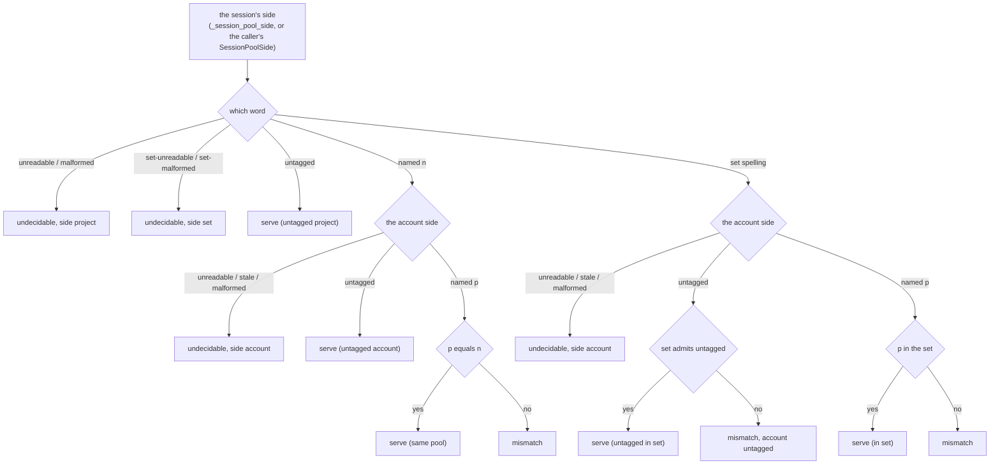
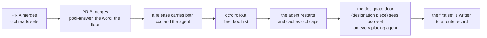

# Overlord W1: the pool rule's session side as a set (`pool-set`) Implementation Plan

> **For agentic workers:** REQUIRED SUB-SKILL: Use superpowers:subagent-driven-development (recommended) or
> superpowers:executing-plans to implement this plan task-by-task. Steps use checkbox (`- [ ]`) syntax for tracking.

**Goal:** the pool rule decides, for any session, whether an account may serve it, with the session's side either its
project's one-name tag (today) or a set of pool names with an `untagged` yes or no, carried on the session's route
record. ccd reads a session's side through one reader, every ccd user of the pool decision keyed by a session reads
it there, the route record carries the set and the Overlord's ordered account list, and a read-only `ccd pool-answer`
reports the pool answer for a session's current account. The word `pool-set` says a box has all of it, and while a set
stands on a box, no update or rollback takes that box below the word unless forced, and the doctor fails on a box that
got there.

**Why:** R18 (the operator, 2026-11-12) replaced reserved accounts with "the account pools the Overlord may draw from"
(C46). The set lives on the designation row and reaches placement through the one pool rule, so placement keeps one
decider (Table 3.4c's chosen option). The designate and rebind doors refuse `capability-missing` until every agent that
can place sessions advertises `pool-set` (C46, "Every agent before the server", §14), so this piece ships first in lane
A, before any door writes a set.

**Architecture:** the rule is written once per language and driven by one fixture table: `poolRule`
(`shared/poolrule.ts`, L0) and `_pool_ok` (`ccd/ccd`). The set's one-token spelling is written once per language too:
`poolSetSpelling` and `parsePoolSet` in a new one-concern L0 sibling, `shared/poolset.ts`, and `_poolset_parse` in
ccd, driven by one spelling table. ccd is the anti-corruption layer and the authority at placement: it reads the set
from `$REG/<id>.poolset` through a measured read and never folds an unreadable or malformed set into "no set". Every
new ccd function and the new verb live in a fourth ccd library, `ccd/lib/pool-set.sh` (the large-file programme,
`docs/superpowers/specs/2026-11-13-large-file-programme-design.md`: new code goes to its target module, not into
`ccd/ccd`'s body). Only edits to functions `ccd/ccd` already has stay in its body. The server never places and never
writes the set in this piece: the designation piece is the set's first writer. Two pull requests: **PR A** (Tasks 1 to
5: the set in both spellings, the route fields, the one reader, every ccd user of Table 3.4d, the crossing marker and
the undecided words) and **PR B** (Tasks 6 to 8: `ccd pool-answer` with its argv, whitelist row and parser, the word
`pool-set`, and the doctor's failure and `ccrc`'s refusal below `pool-set` while a set stands).

**Tech Stack:** TypeScript (ESM), bash (`ccd/ccd`), vitest. No new dependency.

**Spec:** `docs/superpowers/specs/2026-11-09-overlord-design.md` §3.4 (C46 whole: the set, its one writer, "How it
reaches placement", "The rule this design widens", "One reader of the session's side", "A bad set is undecidable",
"The renewal lane asks ccd for the generation's pool answer", "An older ccd", "Untagged accounts serve it only when the
set says so", "An empty set serves nothing", "A deliberate crossing holds until the next renewal"; Table 3.4c; Table
3.4d whole; C56's "The list holds only accounts in the set"; C57's four causes of `stranded`), Table 3.3.11b's row "The
generation's account is outside its set" (the consumer of `ccd pool-answer`, built by the renewal rows piece), Table
11.1c's rows for the pool rule's session side and for ccd's `overlord` arms (this piece takes `cmd_route`'s two fields,
`ccd pool-answer`, the home re-seed's stand-down; the ccd arms piece takes the rest of that row), Table 11.1d's row for
ccd's capability words, §11.5's "An older fleet build" (the doctor failure, and the refusal of `ccrc rollout` and
`ccrc rollback` below `pool-set` while a standing fact needs it, which this piece owns: review 2075's F8), §14's
"Every agent before the server", and Table 13.1's C46 and C56 rows. The W1 index is `docs/superpowers/plans/2026-11-14-overlord-w1.md` (PR #2814, row "Pool set", lane A,
first). R18's minors from review 1862 are in the programme ledger (`docs/superpowers/programs/overlord.md`, "R18's
minors, for the W1 plan"); each is answered below.

Written against `main` at `416b8f942` (2026-11-14), with the index read from `origin/ws/overlord-plan-w1`.

## Open questions

Each carries a recommendation, and the plan builds the recommendation unless the coordinator rules otherwise. The
index's questions this piece builds on are its 6 (the route fields' names and grammar: this plan names them, below)
and its 9 (the hold-down, which is the ccd arms piece's, not this one's).

1. **The route fields' names** (index question 6, slug `route-field-names-are-the-pool-set-plans`).
   **Recommendation, built:** `poolset` for the set and `acctorder` for the ordered list, stored as
   `$REG/<id>.poolset` and `$REG/<id>.acctorder` like every route field. Measured: no registry suffix in `ccd/ccd`
   spells either today. `accounts` was rejected because the account-management deny rules guard writes under
   `~/.cc-sessions/.accounts/`, and a field name one character from that path invites a false match in the hook's
   path arms.
2. **The set side's undecidable words** (slug `set-side-undecidable-words`). C46 says the reader answers in
   `_project_pool_state`'s words plus `set <spelling>`, and that a bad set answers `unreadable` or `malformed`. Bare,
   those two words cannot tell `_pool_ok` which side failed, and `set unreadable` is the valid spelling of the one-pool
   set `{unreadable}` (`unreadable` passes `POOL_NAME_RE`). **Recommendation, built:** the reader answers
   `set-unreadable` and `set-malformed`, two words of their own, so `_pool_ok` sets `POOL_OK_SIDE=set` and
   `POOL_OK_STATE` to `unreadable` or `malformed` from the word, and no spelling can collide with them.
3. **The empty set's spelling** (slug `empty-set-has-no-spelling`). An empty set with `untagged` off serves nothing.
   On the route record an empty value means "clear the field" (`cmd_route` removes the file), so it cannot spell the
   empty set. No door writes one: designate, rebind and the Settings row refuse fewer than two accounts that can serve
   it (C56). **Recommendation, built:** the empty set has no route spelling. `poolSetSpelling` refuses it (returns
   `null`), `parsePoolSet` and `_poolset_parse` read an empty names list without `+untagged` as `malformed`, and a
   malformed set is undecidable, which also places nothing. `poolRule` itself is total over the empty set and answers
   a mismatch for every account, so the server's count (designation piece) reads zero.
4. **`ccd pool-answer`'s argument form** (review 1862 minor, slug `pool-answer-takes-session-flag`). C46 writes
   `ccd pool-answer <id>`. A positional id would need a one-token whitelist grant, which admits every positional form
   the verb might grow. **Recommendation, built:** `ccd pool-answer --session <id>`, with `pool-answer` in
   `REQUIRED_VERB_FLAG` (`agent/src/whitelist.ts`) bound to `--session`, as `route` and `win-size` are.
5. **Which word `_swap_target`'s undecided pool answer carries** (review 1862 minor, slug `swap-target-rc-by-side`).
   `_swap_target` runs inside `$( )`, so `POOL_OK_SIDE` dies with the subshell and its caller cannot read the side.
   Its rc 6 is taken ("a name, chosen one rung down"). **Recommendation, built:** rc 4 stays the project side, rc 7 is
   the account side (the word `projection`), and rc 8 is the set side (the word `set`). The tick's own verdict site
   (`stuck=pool`, inside `_auto_swap_check`, where `POOL_OK_SIDE` is in scope) picks the same three words from the
   side. Every reader of `_swap_target`'s rc is measured in Task 5 and each names the two new codes.
6. **Who clears the crossing marker at a renewal** (slug `fresh-start-clears-crossing-in-ccd-arms`). C46 and Table
   11.1c's ccd row say the fresh start for a session whose side is a set removes the marker and logs `crosspool-ended`
   with the reason `renewal`. That is an edit to the fresh start, which the ccd arms piece already edits for the
   three-step pick, and the index lists it under neither piece. **Recommendation:** the ccd arms piece, beside its
   pick. This piece ships the marker's `set:` kind and the tick's handling of a set-side marker, which the clearing
   reads. The index should name it in the ccd arms row.
7. **What stands for "a standing fact needs `pool-set`" on a box** (review 1862 minor, §11.5, review 2075 F8, slug
   `standing-set-is-a-poolset-file`). Below PR A the Overlord's set fails open (see "Rollback below `pool-set`"). The
   index gives this piece the doctor failure and the refusal of `ccrc rollout` and `ccrc rollback` below `pool-set`.
   **Recommendation, built (Task 8):** the fact is measured on the box that places sessions, where ccd reads it: a
   regular file `$REG/<id>.poolset` for any registry row. It needs no designation row, so a server-only box (no
   registry rows) never refuses. A registry that cannot be listed refuses too, with a sentence of its own. The
   operator item for a box that loses `pool-set` while a designation stands stays with the designation piece, which
   holds the designation row and the capability refresh that sees the loss.
8. **An older agent beside a newer ccd** (slug `older-agent-reads-unmeasured`). The agent caches `ccd caps` at boot,
   so a newer ccd under an agent that has not restarted advertises nothing new, and the doors refuse, which is safe. An
   agent older than PR B under a ccd at PR B is the other mix: `pool-set` is advertised, but the agent's whitelist has
   no `pool-answer` row and refuses the exec. **Recommendation, built:** the release installs both together, so this
   mix exists only after a hand deploy of one side. The renewal lane (renewal rows piece) reads a refused exec as a
   read that failed, so the set trigger is not due and readiness names what could not be measured. Placement is not
   affected, because ccd honours the set. Nothing else is built for it.
9. **The ordered list's validation** (slug `acctorder-checks-shape-not-roster`). **Recommendation, built:** `acctorder`
   is checked for shape only (account ids, comma-joined, no repeats, at most `ROUTE_LIST_MAX_BYTES`), never for roster
   membership, so an account removed later does not make the record malformed. The ccd arms piece's pick skips an id
   `_is_valid_wrapper` does not know.
10. **Whether `cmd_route` refuses the two fields from a Claude Code shell** (slug `poolset-stays-an-accident-guard`).
    C46 says the set on the route record is an accident guard, which any session's shell can still write with `ccd
    route`, and the server writes it again at each renewal and change. **Recommendation, built:** no refusal of its
    own. The two fields are lane-only on the server side (`ROUTE_LANE_ONLY_FIELDS`), so no route door forwards them.
11. **How `ccrc update` learns whether the target build has `pool-set`** (slug `ccd-caps-ride-build-json`). Running
    the staged tree's `ccd caps` before install would run code the update has not installed, and a text search of its
    `ccd/ccd` would pin the refusal to one line's spelling. **Recommendation, built (Task 8):** `build.json` gains
    `ccdCaps`, the built tree's `ccd caps` capability tokens, written by `deploy/build-release.sh` at build. The
    refusal reads the target's `build.json` (the staged tree, or the kept tree for a rollback by flip). An absent
    `ccdCaps` means the build predates the field, and every such build predates `pool-set` (both ship in PR B), so it
    reads as lacking it. Additive: an older `ccrc` ignores the field. The same field can later carry other words a
    standing fact needs.
12. **What overrides the refusal, and what the unattended paths do** (slug `pool-set-floor-forced-and-unattended`).
    §11.5 says "unless forced". **Recommendation, built:** `--force` on `ccrc update` passes it, as it passes a
    converged box today, and `ccrc rollback` and `ccrc rollout` pass it through (Task 8 measures whether `rollback`
    takes `--force` today, and adds it if not). The two unattended paths, the gate-failure restore (`--from
    restore`) and the watchdog's rollback (`--from watchdog`), proceed with a `WARN` line naming the standing set,
    because a box that fails its health probe places nothing either, and the doctor's `pool-set` check then fails on
    the box until it is moved up again. The operator's own `ccrc rollback` (`--from rollback`) refuses unless forced.

## What exists today

- **The rule in TypeScript.** `shared/poolrule.ts#poolRule(account: AccountPoolWire, projectPool: ProjectPoolWire):
  PoolVerdict`. The project side decides first: `unreadable` or `malformed` is undecidable, `untagged` serves without
  reading the account; a `tagged` project reads the account side, where `unreadable`, `malformed` and `stale` are
  undecidable, `untagged` serves, and membership (`account.pools.includes(projectPool.name)`) serves. `PoolVerdict`'s
  arms: `ok: true` with `why` (`untagged-project`, `untagged-account`, `same-pool`), `pool-mismatch` with both names,
  `pool-undecidable` with `state`. `ProjectPoolWire` is in `shared/api.ts`. `declaredAccountPool` adapts a roster name.
  Consumers: `server/src/poolrule.ts` (the server's mirror, purity-scanned by `pools.test.ts`), `pwa/src/lib/pools.ts`,
  `pwa/src/lib/accounts.ts`, `pwa/src/screens/AccountsScreen.tsx`.
- **The rule in bash.** `ccd/ccd#_pool_ok` takes an account id and the project side's state word, answers rc 0 serve,
  1 mismatch, 2 undecidable, and sets `POOL_OK_SIDE` (`project` or `account`) and `POOL_OK_STATE`. Its header
  counts the call sites that clobber those globals inside `$( )`, and `server/test/ccd-pool-ok.test.ts` pins that
  count. `_pool_undecidable_why` (side, state, project, account) and `_pool_mismatch_why` render rc 2 and rc 1.
- **One fixture table.** `server/test/fixtures/poolRule.ts#POOL_RULE_CASES` (`accountPool`, `project`, optional
  `accountState`, `expect` in a third vocabulary: `serve`, `mismatch`, `undecidable`), driven through `poolRule` by
  `server/test/pool-rule-core.test.ts` and through `_pool_ok` by `server/test/ccd-pool-ok.test.ts`. Pool names
  `pool-a`, `pool-b`, `pool-ab`; account ids from the test roster.
- **The project side.** `ccd/ccd#_project_pool_state` reads `$POOLS_DIR/<project>` and answers `named <n>`,
  `untagged`, `unreadable` or `malformed`, always rc 0, under `LC_ALL=C`. The server's reader is
  `server/src/pools.ts#readProjectPools`. `POOL_NAME_RE` is `^[a-z][a-z0-9-]{0,31}$` (`shared/roster.ts`, with its bash
  literal held equal).
- **The account side.** `ccd/ccd#_acct_pool_state` reads `$REG/pool-epoch` (central `pool_edges`, pulled by
  `ccd-pool-sync.timer`) and answers `named <n>`, `untagged`, `unreadable`, `stale` or `malformed`.
- **The users of the decision in ccd,** each reading the project side today (Table 3.4d, re-measured):
  `_swap_target` (`pps=$(_project_pool_state "$project")`, then `_crosspool_valid` on cur and home and `_pool_ok
  "$cur"`; rc 2, 3, 4 and 5 are "nobody can say", 4 being the pool rule; rc 6 a name one rung down),
  `_auto_swap_check` (the home re-seed: on `_pool_ok "$home"` rc 1 it asks `_ws_least_loaded "$project"` and writes
  `home`, logging `rehome`; then `_pool_ok "$wrapper"` feeds the affinity arm and the verdict site `stuck=pool`),
  `cmd_swap`, `cmd_start`, `cmd_prefer`, `_default_pool` (a pay-per-use lane joins only when the project reads `named
  <p>` and the lane's pool reads the same), `_strand_why` (`tag:<state> $POOLS_DIR/<p>` for a bad project side),
  `_strand_mark` (names the project's pool), `_undecidable_cause` (the word `pool` names the project's tag file whatever
  side was undecided; it has no `projection` or `set` word). The rescue's rc-to-word map lives in `_auto_swap_check`
  (`4) uword=pool`). Project-keyed and unchanged: `_ws_least_loaded`, `_place_for_class`, `_ws_pool_read`,
  `_ws_wrapper_why`, `_ws_lane_why`, `cmd_ws_add`'s refusal loop, `cmd_project_pool`.
- **The crossing marker.** `ccd/ccd#_crosspool_mark` writes `$REG/<id>.crosspool` as `<epoch> <pool> <account>`;
  its three callers (`cmd_start`, `cmd_swap`, `cmd_prefer`) pass `${pps#named }`. `_crosspool_valid` (id, pool state,
  accounts…) accepts only while `$pps == "named $pool"`, and answers 0 valid, 1 none, 2 unreadable.
  `_crosspool_tick` ends a lapsed marker with `crosspool-ended` and returns early for a side that is neither `named`
  nor `untagged`. Tests: `server/test/ccd-crosspool.test.ts`.
- **The route record.** `ccd/ccd#ROUTE_FIELDS` is twelve fields (`class effort subagent workflow compact browser
  degraded inert profile automem compactwindow precompact`), pinned in order by `server/test/ccd-route-fields.test.ts`.
  `cmd_route` refuses a field outside it, refuses `degraded` and `inert` as ccd's own, validates each value with
  `_route_valid` (rc 0, 1 bad value, 2 the box cannot judge), removes the file on an empty value, and logs each change
  to `swap.log` and the lifecycle journal. `_route_any` skips `browser`, `profile`, `automem`, `compactwindow` and
  `precompact` ("not routing fields for this question"). `_route_get` answers "the validated value, or nothing";
  `_reg_read` tells absent (rc 1), present and unreadable (rc 2) apart. The TypeScript vocabulary is
  `shared/api.ts#ROUTE_WRITABLE_FIELDS`, with `ROUTE_LANE_ONLY_FIELDS` derived as the slice from `profile` on (refused
  `lane-only` by `parseRouteFields` at every route door), and `ROUTE_READ_FIELDS` adds `degraded` and `inert`.
  `server/src/registry.ts` reads each `ROUTE_WRITABLE_FIELDS` file a listing shows; `CCD_ARGV.routeSet`
  (`server/src/ccdargv.ts`) composes `--set` pairs in that order. The door-only 32-byte cap
  (`ROUTE_VALUE_MAX_BYTES`) does not apply to a lane-only field.
- **Capability words.** `ccd/ccd#cmd_caps` prints the verbs it implements, then capability tokens (`hibernate-fresh`,
  `account-v2` and others). The server spells each token once (`server/src/ccdargv.ts`: `POOLS_CAP`,
  `ACCOUNT_POOLS_CAP`, …); `server/test/ccdCapTokens.ts#CCD_CAPABILITY_TOKENS` and `ccd-archive.test.ts`'s
  `KNOWN_CAPABILITY_TOKENS` are the other spellings. `CCD_CAN` maps each `CCD_ARGV` row to `verbRow` (permit on no
  evidence) or `capRow` (refuse on no evidence); `ccdCan` reads it.
- **The agent's whitelist.** `agent/src/whitelist.ts`: grants are argv prefixes; `REQUIRED_VERB_FLAG` binds a gated
  verb to the flag that is its whole argument surface; the type bypass files under `agent/test/types/bypasses/` go up
  to `g28`; `server/test/whitelist-subset.test.ts` checks every server argv against the grants.
  `server/src/remote/runner.ts` keeps per-verb deadlines.
- **ccd's context map.** `ccd/contexts.tsv` maps every function in `ccd/ccd` to one context; `_pool_ok`, `cmd_route`
  and the crossing functions are C1. `server/test/ccd-contexts.test.ts` holds it total.
- **The server's placement forecast** is `server/src/limits.ts#projectHome` and `#projectPlacement`, which take the
  project side as `pool: ProjectPoolWire`, filter by `poolEligible`, and are twinned in ccd by `_ws_least_loaded`
  (pinned together in `projected-home.test.ts`). That is the placement decision the set feeds (review 2075 F3): the
  designation piece's first-account pick and C56's count read it with the set as the side. `limits.ts` is shared with
  the designation piece, and D-8126's A7 also edits it (not on `main`). This piece does not edit it: `SessionPoolSide`
  contains `ProjectPoolWire`, so every existing caller compiles unchanged, and widening `projectHome`'s parameter is
  the designation piece's.
- **ccd's libraries.** `ccd/lib/disk-retention.sh`, `train-proof.sh` and `delegation-lease.sh` are loaded at the foot
  of `ccd/ccd` by `_ccd_lib_load`, each pinned by a SHA-256 line rendered at install (`__CCD_LIB_TRAIN_SHA256` and
  its siblings) by `ccd/ccd-entry-install.py`, and evaluated from the bytes that were hashed. A source checkout (every
  pin a placeholder) evaluates them unpinned. The third library's pull request (#2256, `git show --stat a520aaace`)
  lists every site a new library touches: the loader's two arrays and its placeholder test, the installer, the update
  backup's names in `ccd/ccrc`, `deploy/deploy.sh`, the harness (`server/test/ccdWsHelpers.ts`), and the suites
  `ccd-lib-load`, `ccd-entry-install`, `ccd-install-stamp`, `build-release`, `ccrc-uninstall`,
  `ccrc-update-flip-backups`, `ccd-ws-add-child`, the agent's `ccd-entry-exec` and `deploy-verify`. Each library in
  `ccd/lib/*.sh` is growth-checked, and a new one counts in full (a listed file new in its diff does not waive itself).
- **The update's floor, and the doctor.** `ccd/ccrc#_upd_floor_check` refuses a version below `~/.ccrc/floor` unless
  `--downgrade` was typed, and lets `--from restore|rollback|watchdog` through with a `WARN`. No check reads a
  capability a standing fact needs. `build.json` (`deploy/build-release.sh`) carries the build's identity and no
  capability list. The doctor's table is `ccd/ccrc-doctor-checks#CCRC_DOCTOR_CHECKS`, whose lines are cited by number
  elsewhere, so new entries join an existing line (`flock timeout`'s convention); `pools` and `pool-sync` are its pool
  checks (`_check_pools`, and the projection's effect).
- **Nothing writes a set yet, and nothing reads one.** No `poolset`, `acctorder` or `pool-set` exists in the tree.

## Global Constraints

- **Architecture (`CLAUDE.md`).** The rule stays one decider per language, driven by one fixture table (Table 3.4c's
  chosen option). `poolRule` and the spelling functions are L0 (`shared/poolrule.ts` imports types only, because the
  PWA bundles it). New wire vocabulary goes to the one-concern sibling `shared/poolset.ts` (the set, its spelling and
  the `ccd pool-answer` line's words), never into `shared/api.ts`, whose only edit is two words on
  `ROUTE_WRITABLE_FIELDS`. New ccd functions go to `ccd/lib/pool-set.sh`; `ccd/ccd`'s body keeps only edits to the
  functions it already has, the loader's lines and the dispatch arm (review 2075 F6). `parsePoolAnswer` is L1 in
  `server/src/poolrule.ts` (pure, purity-scanned). ccd is the authority
  at placement and the only component that names `$REG` and `$POOLS_DIR`. One owner per fact: the set's writer is the
  operator's doors (designation piece), the account's pool is `pool_edges`, and this piece adds readers only. No
  overloaded null at a seam: a set that cannot be read or parsed is never "no set" (C46's fail-open), and the side word
  says which side failed. An adapter never narrows what it received: `_session_pool_side` keeps `_reg_read`'s three
  answers.
- **Behaviour for every session without a set is unchanged,** except the one named change: the `projection` word
  (Task 5) gives every session whose account side is undecidable the sentence that names `$REG/pool-epoch`, where
  today it names the project's tag file. That is a fix fleet-wide (review 1862 minor), in a commit of its own, said in
  the pull request.
- **SAFETY (`CLAUDE.md`).** Every ccd test runs in a fixture HOME (`makeCcdHarness`, `server/test/ccdWsHelpers.ts`),
  never the live `$HOME`; no test touches tmux, `~/.cc-sessions` or a supervisor. `ccd pool-answer` writes nothing and
  is read-only by construction: its test lists the fixture registry before and after a call and asserts it unchanged.
  It is not a forbidden verb.
- **Bash discipline.** Every new reader and parser shadows `LC_ALL=C` (as `_project_pool_state` does), so a set's
  bytes give one verdict under any locale. Comparisons quote the right side (`[[ "$a" == "$b" ]]`), because a pool
  name compared unquoted would glob. No new function is called bare where it sets globals another caller reads.
- **Tests.** From `server/`: `ccrc test -- ./node_modules/.bin/vitest run test/<file>.test.ts`; from `agent/` the same
  for its suites; the last run of each PR adds every `tsc` (server, its tests project, agent, pwa). TDD: each step's
  failing test is run red before the code.
- **Growth check.** `ccd/ccd`, `ccd/ccrc`, `ccd/ccrc-doctor-checks`, `shared/api.ts` and every `ccd/lib/*.sh` are
  growth-checked at 40 net code lines per pull request (`server/test/growthCheck.ts#growthFiles`), and the new
  library counts in full in the pull request that creates it. PR A grows `ccd/ccd` past that (estimate below), by edits
  to functions it already has, and carries a growth waiver, `server/test/growth-waivers/<D-number>-ccd-ccd.json`,
  whose number the coordinator mints before the PR opens, with its measured `maxDelta`. Every other file in both pull
  requests stays under 40. If `ccd/ccd` reaches the large-file programme's frozen stage (10 lines a PR, no waivers)
  before PR A opens, PR A asks the operator's named exemption instead, through the coordinator.
- **Mutation floors.** `poolRule`, `poolSetSpelling`, `parsePoolSet` and `parsePoolAnswer` join a new
  `server/test/sim/poolSetSets.ts` (`POOL_SET_MUTANT_SETS`), registered in `server/test/sim/mutation-floors.test.ts`,
  with a floor each in `server/test/sim/mutation-floors.json` measured in the PR that adds it. The bash twins are
  held by the shared tables, and each new bash guard ships with a measured red-without-it run, restored from a saved
  copy, never `git checkout`.
- **Censuses this piece touches:** `ccd/contexts.tsv` (each new function, C1); `ccd-pool-ok.test.ts`'s header count
  of `_pool_ok`'s substituted call sites (re-measured, the header edited in the same commit); `ccd-reg-get-census.test.ts`
  if a `_reg_get` call site moves; `single-definition`'s route-field and capability-token scans; `ccd-verb-sets.test.ts`
  (the new verb); `ccd-can.test.ts` (`CCD_CAN` stays total); `whitelist-subset.test.ts` and the agent's whitelist suites
  and a new bypass file `g29`; `ccdCapTokens.ts` and `KNOWN_CAPABILITY_TOKENS`; every site a new ccd library touches
  (Task 2, Step 0); `build.json`'s shape in `build-release.test.ts`; the doctor's `CCRC_DOCTOR_CHECKS` and the suites
  that count it. No route, table, lane or migration.
- **Wire.** Additive only. `FLEET_PROTO` does not change. Two new route-record files appear in a listing, and an older
  server reads only the fields it knows.
- **Public repository.** Fixtures use `pool-a` and `pool-b` (and `pool-ab` where the table already does), the test
  roster's account ids, and session ids of the form `<account>-overlord` or `<account>-project-a`. No real pool name,
  account, host or path. Cite by symbol or `@anchor`, never by line. No D-number is invented: departures are slugs here
  and in `docs/superpowers/plans/2026-11-14-overlord-w1/w1-pool-set/departures.md`.

## Review Focus

1. **No fail-open.** A `poolset` file that exists but cannot be read, or does not parse, makes every placement of that
   session undecidable on the `set` side, never a fall back to its project (which for the Overlord is the untagged
   `overlord` project that every account serves). The empty set and a set naming no carried pool serve nothing.
2. **No change for any session without a set.** Every project-side answer, sentence and log line is what it was, pinned
   by characterization tests green on `main` before each reader moves, except the `projection` sentence, which is the
   one named change.
3. **One rule.** The set's membership is decided in `poolRule` and `_pool_ok` only. `_default_pool`, the crossing
   marker and `ccd pool-answer` ask `_pool_ok` or read its globals; none re-derives membership.
4. **The side names the remedy.** A bad set names the route record (`$REG/<id>.poolset`) and its remedy, a stale
   projection names `$REG/pool-epoch` and the pool sync, a bad project tag names `$POOLS_DIR/<project>`, on the start,
   tick, rescue and strand paths alike.
5. **`ccd pool-answer` cannot be widened by the wire.** The whitelist row binds `--session`, the argv builder validates
   the id, the verb asserts its own arity, and it writes nothing.
6. **The way below `pool-set` is closed while a set stands.** The update's preflight refuses a target that does not
   list `pool-set` before it changes anything; an absent `ccdCaps` and an unlistable registry both refuse; only
   `--force` and the two unattended paths pass, each with a `WARN`.

## The rule, widened


*Figure 1. The pool rule with the session's side widened to a set. The project side still decides first, and a set is
never "untagged": an untagged account serves a set only by its explicit yes.*

The set's spelling, one token: its pool names in ascending byte order (`LC_ALL=C`), joined by `,`, then `+untagged`
when it admits untagged accounts. `pool-a,pool-b`, `pool-b+untagged`, `+untagged`. Grammar:
`^(N(,N)*)?(\+untagged)?$`, `N` being `POOL_NAME_RE`, non-empty as a whole, names strictly ascending (a repeat or an
unsorted list is `malformed`, so one set has one spelling). Today's one-name tag `n` is the set `n+untagged` (C46), and
the fixture table pins that equivalence.

---

### Task 1: The set in L0, its spelling, and the fixture rows

**Files:**
- Create: `shared/poolset.ts` (L0, one concern: `PoolSet`, `poolSetSpelling`, `parsePoolSet`,
  `POOL_SET_SPELLING_MAX_BYTES`; it imports `POOL_NAME_RE`'s pattern as a type-free copy held equal by a test, or the
  value if `shared/roster.ts` can be imported without a cycle; measure)
- Modify: `shared/poolrule.ts` (`SessionPoolSide`, `poolRule`'s set arm; it imports the `PoolSet` type only)
- Modify: `server/test/fixtures/poolRule.ts` (the set rows and the derived equivalence rows)
- Create: `server/test/fixtures/poolSetSpelling.ts` (`POOL_SET_SPELLING_CASES`: spelling in, set or `malformed` out,
  and set in, spelling or `null` out)
- Create: `server/test/sim/poolSetSets.ts`; Modify: `server/test/sim/mutation-floors.test.ts`,
  `server/test/sim/mutation-floors.json`
- Test: `server/test/pool-rule-core.test.ts`, `server/test/pool-set-spelling.test.ts` (new), `server/test/pools.test.ts`
  (the server mirror's purity scan stays green), pwa's `tsc`

**Interfaces:**

```ts
// shared/poolset.ts
/** A session's set (C46): pool names in the operator's order, and the yes or no for accounts in no pool. */
export interface PoolSet { readonly pools: readonly string[]; readonly untagged: boolean }
/** The set's one token, or null for the empty set, which has no route spelling (open question 3). */
export function poolSetSpelling(set: PoolSet): string | null;
export function parsePoolSet(spelling: string): { readonly ok: true; readonly set: PoolSet } | { readonly ok: false };

// shared/poolrule.ts
/** The session's side of the rule: a project's tag as today, or a set read from the session's route record. */
export type SessionPoolSide =
  | ProjectPoolWire
  | { readonly state: 'set'; readonly set: PoolSet }
  | { readonly state: 'set-unreadable' }
  | { readonly state: 'set-malformed' };
export type PoolVerdict =
  | { ok: true; why: 'untagged-project' | 'untagged-account' | 'same-pool' | 'in-set' | 'untagged-in-set' }
  | { ok: false; reason: 'pool-mismatch'; side: 'project'; accountPool: string; projectPool: string }
  | { ok: false; reason: 'pool-mismatch'; side: 'set'; account: { pool: string } | { untagged: true }; set: string }
  | { ok: false; reason: 'pool-undecidable'; side: 'project' | 'account' | 'set';
      state: 'unreadable' | 'malformed' | 'unrecognised' | 'stale' };
export function poolRule(account: AccountPoolWire, side: SessionPoolSide): PoolVerdict;
```

`side` joins every existing arm as a new field (additive: no consumer reads it today; measure the four consumers named
in "What exists today" and add the field to any literal they build). The set mismatch arm names the account's side as
untagged rather than inventing a pool name (C46). `set` in that arm is the spelling, or `-` for the empty set, which
reaches it only from a caller holding a designation row (`poolSetSpelling` is not asked there).

- [ ] **Step 1: Characterize.** Before any edit, run `pool-rule-core.test.ts` and `ccd-pool-ok.test.ts` green on
  `main` and record their counts in the departures note.
- [ ] **Step 2: Failing tests.** Set rows in `POOL_RULE_CASES` (a new optional `set` on `PoolRuleCase`, which the
  driver uses as the side in place of `project`): an account in `pool-a` under `{pool-a}` serves (`in-set`); under
  `{pool-b}` mismatches; under `{pool-a, pool-b}` serves; an untagged account under `{pool-a}` mismatches with
  `account: {untagged: true}`; under `{pool-a}+untagged` serves (`untagged-in-set`); under `+untagged` serves; every
  account under the empty set mismatches; an account `unreadable`, `stale` or `malformed` under any set is undecidable
  on the `account` side; `set-unreadable` and `set-malformed` are undecidable on the `set` side over every account
  state, including an untagged account (the short-circuit row this table already keeps for the project side); the
  prefix pair (`pool-a` against `{pool-ab}`, and `pool-ab` against `{pool-a}`) mismatches, so membership is equality per
  name. **The equivalence rows are derived, not typed:** for every row whose project is `tagged n`, the driver adds the
  same row with the side `{state: 'set', set: {pools: [n], untagged: true}}` and asserts the same `expect` (C46: "pins
  that equivalence in both spellings"). The spelling table: `pool-b,pool-a` is `malformed`, `pool-a,pool-a` is
  `malformed`, an empty string is `malformed`, `+untagged` parses, `pool-a+untagged+untagged` is `malformed`, a name
  failing `POOL_NAME_RE` is `malformed`, a spelling past `POOL_SET_SPELLING_MAX_BYTES` (1,024) is `malformed`,
  `poolSetSpelling` sorts (`{pool-b, pool-a}` spells `pool-a,pool-b`) and drops repeats, the empty set spells `null`,
  and every spelling round-trips.
- [ ] **Step 3: Run.** Red. **Step 4: Implement.** **Step 5: Run** both suites, `pools.test.ts`,
  `projected-home.test.ts`, the server's two `tsc` runs and pwa's `tsc`. Green.
- [ ] **Step 6: Mutation.** Register the three deciders in `POOL_SET_MUTANT_SETS` over these suites and set each floor
  to its measured score. By hand, measured: let an untagged account serve a set that does not admit it: red. Let
  `set-unreadable` fall back to the project side: red. Restore from the saved copy.
- [ ] **Step 7: Commit.** `feat(pools): the pool rule's session side as a set, its spelling, and the fixture rows (W1)`

### Task 2: The route fields `poolset` and `acctorder`

**Files:**
- Create: `ccd/lib/pool-set.sh` (the fourth library, C1: `_poolset_parse` and `ROUTE_LIST_MAX_BYTES` here; Task 3's
  reader and Task 6's verb join it), with every loader site the third library touched (see "What exists today"):
  `_ccd_lib_load`'s file and pin arrays, a `__CCD_LIB_POOLSET_SHA256=stamp-at-install` line, the source-checkout
  test, `ccd/ccd-entry-install.py`'s pin render and staging, the update backup's names, `deploy/deploy.sh`, and the
  harness
- Modify: `ccd/ccd` (`ROUTE_FIELDS` gains `poolset acctorder` at its end; `_route_valid`'s two cases; `_route_any`'s skip
  list; the loader's lines)
- Modify: `shared/api.ts` (`ROUTE_WRITABLE_FIELDS` gains `'poolset', 'acctorder'` at its end, so both fall inside
  `ROUTE_LANE_ONLY_FIELDS`; its docstring says their writer is the designation's doors and the renewal lane)
- Modify: `ccd/contexts.tsv` (`_poolset_parse`, C1)
- Test: `server/test/ccd-route-fields.test.ts`, `server/test/ccd-route-argv.test.ts`, `server/test/pool-set-spelling.test.ts`
  (the bash arm), `server/test/single-definition/*.test.ts`, the registry and route suites the three `tsc` runs reach,
  and every library-site suite the third library's pull request changed (`ccd-lib-load`, `ccd-entry-install`,
  `ccd-install-stamp`, `build-release`, `ccrc-uninstall`, `ccrc-update-flip-backups`, `ccd-ws-add-child`, the agent's
  `ccd-entry-exec` and `deploy-verify`), each gaining the fourth library beside the third

`_poolset_parse <spelling>` prints the set as `names=<n1> <n2>…` and `untagged=yes|no` on two lines and answers rc 0,
or prints nothing and answers rc 1 for `malformed`, under `LC_ALL=C`, checking the same grammar as `parsePoolSet` (the
order test uses `[[ "$a" < "$b" ]]` in the C locale). `_route_valid poolset` is `_poolset_parse` with its output
discarded. `_route_valid acctorder` checks `^A(,A)*$`, `A` being the account-id shape ccd accepts for a wrapper, no
repeats, at most `ROUTE_LIST_MAX_BYTES` (1,024) bytes by `_route_bytes`, and never roster membership (open question 9).
`_route_any` skips both: they decide placement, never the spawn's model or flags, and the pool reader reads `poolset`
on its own (slug `pool-fields-outside-route-any`).

- [ ] **Step 0: The library, alone, in its own commit.** Create `ccd/lib/pool-set.sh` with its header (not an
  executable, loaded at the foot of `ccd/ccd`, its trust chain the other libraries') and one function, and wire every
  loader site. Red first: `ccd-lib-load.test.ts` expects four libraries, a missing, linked or changed
  `lib/pool-set.sh` refuses the start (status 125), and a source checkout evaluates it. Green, then commit
  `feat(ccd): the pool-set library, loaded and pinned like the other three (W1)`.
- [ ] **Step 1: Failing tests.** `ccd-route-fields.test.ts`: `ROUTE_FIELDS` is the fourteen-field record, with
  `poolset acctorder` last; `ccd route --set poolset=pool-a,pool-b` writes `$REG/<id>.poolset`; `pool-b,pool-a`, an
  empty names list with no `+untagged`, `Pool-A` and a 1,025-byte value are refused `bad value`; `acctorder` accepts
  `claude-a,claude-b` and refuses a repeat and a bad id; an empty value removes the file; a row carrying only
  `poolset` and `acctorder` reads `_route_any` false; both changes are logged to `swap.log` as every field is. The
  spelling suite's bash arm drives `_poolset_parse` over every `POOL_SET_SPELLING_CASES` row and agrees with
  `parsePoolSet` on each. On the server: `parseRouteFields` refuses both as `lane-only`; `CCD_ARGV.routeSet` composes
  them last; the registry reads both from a listing.
- [ ] **Step 2: Run.** Red. **Step 3: Implement.** Run every `tsc`: each `Record<RouteField, …>` the compiler names
  gains its two rows, and the departures note lists them.
- [ ] **Step 4: Run** the suites above. Green.
- [ ] **Step 5: Mutation.** Drop the order check from `_poolset_parse`: the spelling suite's bash arm goes red. Restore.
- [ ] **Step 6: Commit.** `feat(ccd): the route fields poolset and acctorder, with the set's bash spelling (W1)`

### Task 3: The one reader of a session's side, and `_pool_ok`'s set case

**Files:**
- Modify: `ccd/lib/pool-set.sh` (new `_session_pool_side`)
- Modify: `ccd/ccd` (`_pool_ok`'s set arm; `_pool_undecidable_why`'s `set` arm and its fifth argument, the session id;
  `_pool_mismatch_why`'s set arm)
- Modify: `ccd/contexts.tsv` (`_session_pool_side`, C1)
- Modify: `CLAUDE.md` (the "Account pools" bullet: `_project_pool_state` stays the one reader of the project's tag,
  and `_session_pool_side` is the one reader of a session's side, the set when its route record carries one)
- Test: `server/test/ccd-pool-ok.test.ts`, `server/test/ccd-session-pool-side.test.ts` (new)

**Interfaces (bash):**

```bash
_session_pool_side() {   # id project -> "set <spelling>" | set-unreadable | set-malformed | the project's four words ; rc 0
  # a measured read of $REG/<id>.poolset (_reg_read: rc 1 absent, rc 2 unreadable), never _route_get
}
_pool_ok() {   # account-id side-word -> 0 serve | 1 mismatch | 2 undecidable, with POOL_OK_SIDE project|account|set
  # set-unreadable|set-malformed: POOL_OK_SIDE=set, POOL_OK_STATE=unreadable|malformed, rc 2, before the account side
  # "set <s>": the account side as today; untagged serves iff the set says +untagged; named p serves iff p is in it
}
```

The reader answers the project's words only when the `poolset` file is proven absent. It reads `project` itself only
when its caller passes none (callers that hold the project pass it, so no `_reg_get` site moves; measure the census).

- [ ] **Step 1: Characterize.** The current header count of `_pool_ok`'s substituted call sites, and every existing
  `_pool_ok` row, green on `main`.
- [ ] **Step 2: Failing tests.** `ccd-pool-ok.test.ts` drives every set row of `POOL_RULE_CASES` and the derived
  equivalence rows through `_pool_ok` with the side word built from the row (`set <spelling>`, or `set-unreadable` and
  `set-malformed`), asserting rc, `POOL_OK_SIDE` and `POOL_OK_STATE`. The new suite: no `poolset` file answers the
  project's word for each of the four project states; a readable `poolset` answers `set <spelling>` even when the
  project is tagged (the set binds, the project's tag does not, C46); a `poolset` with mode 000, a directory at that
  path and a dangling symlink each answer `set-unreadable`, never the project's word; `pool-b,pool-a` answers
  `set-malformed`; the same bytes give the same word under `LC_ALL=C` and `en_US.UTF-8`. The sentences: the `set` arm
  of `_pool_undecidable_why` names `$REG/<id>.poolset`, says the server writes it again at its next sweep or the
  operator saves the set again in Settings, and says the project's tag is not involved; `_pool_mismatch_why` for a set
  names the spelling and says the account's pool is not in it, or that the account is in no pool and the set does not
  admit untagged accounts.
- [ ] **Step 3: Run.** Red. **Step 4: Implement.** **Step 5: Run.** Green, and the header count re-measured and
  edited.
- [ ] **Step 6: Mutation.** Let `_session_pool_side` answer the project's word on `_reg_read` rc 2: the unreadable rows
  go red. Restore.
- [ ] **Step 7: Commit.** `feat(ccd): one reader of a session's pool side, and _pool_ok's set case (W1)`

### Task 4: Every user keyed by a session reads its side (Table 3.4d)

**Files:**
- Modify: `ccd/ccd` (`_swap_target`, `_auto_swap_check`, `cmd_swap`, `cmd_start`, `cmd_prefer`, `_default_pool`,
  `_strand_why`, `_strand_mark`)
- Test: `server/test/ccd-auto-swap-pool.test.ts`, `server/test/ccd-default-pool.test.ts`,
  `server/test/ccd-rescue-policy.test.ts`, `server/test/ccd-rescue-unknown-rank.test.ts`,
  `server/test/ccd-swap-target-class.test.ts`, `server/test/ccd-project-pool.test.ts`,
  `server/test/ccd-session-pool-side.test.ts`

Each user replaces `pps=$(_project_pool_state "$project")` with `pps=$(_session_pool_side "$id" "$project")`, and
every reader of `pps` that tests `named *` gains the `set *` case where it names a pool:

| User | What changes |
|---|---|
| `_swap_target`, `cmd_swap`, `cmd_start`, `cmd_prefer` | Read the session's side. A swap target, a manual swap, a start and a `prefer` honour the set, and refuse an account outside it as a mismatch, overridable by `--cross-pool` exactly as a project mismatch is |
| The home re-seed in `_auto_swap_check` | Stands down when the side is `set *` (Table 3.4d's second row): no `_ws_least_loaded` call, no `home` write, no `rehome` line. The affinity arm's stand-down is the ccd arms piece's, keyed on the role |
| `_default_pool` | Asks `_pool_ok` instead of its own equality test: a pay-per-use lane joins when `_pool_ok` answers rc 0 with `POOL_OK_SIDE=account` and `POOL_OK_STATE=named *` (D-8098's "only when a pool names it", in the rule's terms). Its `_pool_ok` call runs in the function's own `$( )` caller, so it clobbers nobody |
| `_strand_why`, `_strand_mark` | Read the session's side. A set's undecidable arm answers `set:<state> $REG/<id>.poolset`; the pool they name reads `account set <spelling>` |
| Project-keyed placers | Unchanged: `_ws_least_loaded`, `_place_for_class`, `_ws_pool_read`, `_ws_wrapper_why`, `_ws_lane_why`, `cmd_ws_add` |

*Table 1. The users this task moves, row by row from Table 3.4d.*

**A rescue may land on a `prefer --cross-pool` home** (review 1862 minor). `_swap_target` accepts a valid crossing
marker that names the home (`cross_home`), so for a session whose side is a set, the hard-block rescue can move it home
to an account outside the set that the operator crossed onto with `prefer --cross-pool`. That stands until the next
renewal clears the marker (open question 6). This task pins it as today's behaviour, by a test, rather than adding a
second rule.

- [ ] **Step 1: Characterize, on `main`, before any reader moves.** For a project-side session in each project state
  (`untagged`, `named pool-a`, `unreadable`, `malformed`), pin each user's answer: the swap target and its rc, the
  re-seed's `home` and log line, the pay-per-use admission, the strand line and the start's refusal text. Commit the
  pins alone; they stay green through this task.
- [ ] **Step 2: Failing tests.** A session `<account>-overlord` whose project is untagged and whose `poolset` is
  `pool-b`: the swap target never names a `pool-a` account; `ccd swap` to a `pool-a` account refuses a mismatch and
  `--cross-pool` writes the marker; `ccd start` on a `pool-a` account refuses; `ccd prefer` refuses and `--cross-pool`
  marks; the home re-seed writes no `home` when the home is outside the set; a pay-per-use lane in `pool-b` joins the
  candidates and one in `pool-a` does not; the strand line names `account set pool-b`; with `poolset` unreadable, each
  path answers undecidable on the `set` side and names `$REG/<id>.poolset`. With `poolset` `pool-b` and the home a
  crossed `pool-a` account named by a valid marker, the rescue may go home (the pin above).
- [ ] **Step 3: Run.** Red. **Step 4: Implement.** **Step 5: Run** this task's suites and every characterization pin.
  Green.
- [ ] **Step 6: Mutation.** Leave `_auto_swap_check` reading the project side: the set's swap rows go red. Restore.
- [ ] **Step 7: Commit.** `feat(ccd): every pool user keyed by a session reads its side (W1)`

### Task 5: The crossing marker's kind, and the undecided words by side

**Files:**
- Modify: `ccd/ccd` (`_crosspool_mark`'s three callers; `_crosspool_valid`; `_crosspool_tick`; `_undecidable_cause`'s
  `projection` and `set` words; the tick's verdict site in `_auto_swap_check`; `_swap_target`'s rc 7 and 8 and every
  reader of its rc)
- Test: `server/test/ccd-crosspool.test.ts`, `server/test/ccd-auto-swap-pool.test.ts`,
  `server/test/ccd-rescue-unknown-rank.test.ts`, `server/test/ccd-acct-pool-state.test.ts`

**The marker's field carries its kind** (Table 3.4d): a `named` side writes the plain pool name, as today; a `set`
side writes `set:<spelling>` (the callers strip `set ` from the side word). `_crosspool_valid` accepts a `set:` field
only while the side reads `set <that spelling>`, so a crossing lapses when the set changes, and not when the operator
only reorders it (the spelling is sorted). `_crosspool_tick` ends a decided `set` side like `named`: the reason is
"account set is now <spelling>", or the move off the marked account. Without that a set-side marker would never be
removed, and one that lapsed would come back if the set returned to its old spelling.

**The undecided words by side** (review 1862 minor): `_undecidable_cause` gains `projection` ("the pool projection
could not be read ($REG/pool-epoch); the remedy is the pool sync and the control-plane link, not the project's tag")
and `set` ("the account set on the route record could not be read ($REG/<id>.poolset); the server writes it again at
its next sweep, or the operator saves the set again"). Both sites pick the word from the side: the tick's verdict
(`stuck=`) from `POOL_OK_SIDE`, which is in scope there; the rescue's map from `_swap_target`'s rc, which now answers 4
for the project side, 7 for the account side and 8 for the set side (open question 5). **`projection` applies
fleet-wide:** any session whose account side is undecidable gets it, not only the Overlord, which is the one behaviour
change of this piece, in a commit of its own.

- [ ] **Step 1: Measure** every reader of `_swap_target`'s rc (its four call sites and the rescue map) and list them in
  the departures note; each gains 7 and 8, and the map's `*) uword="rc$strc"` arm stays.
- [ ] **Step 2: Failing tests.** A set-side `--cross-pool` writes `set:pool-b` in the marker; the marker stays valid
  when the set is saved again reordered; lapses with `crosspool-ended` "account set is now pool-a,pool-b" when the set
  grows; and does not come back when the set returns to `pool-b`. A named-side marker is byte-identical to today's. A
  tagged project with a stale `$REG/pool-epoch` strands with the `projection` sentence on the tick and on the rescue;
  a set side with an unreadable `poolset` strands with the `set` sentence on both; a bad project tag keeps today's
  `pool` sentence.
- [ ] **Step 3: Run.** Red. **Step 4: Implement**, the `projection` word in its own commit. **Step 5: Run.** Green.
- [ ] **Step 6: Mutation.** Let the tick's verdict site set `stuck=pool` whatever the side: the projection and set rows
  go red. Restore.
- [ ] **Step 7: Commits.** `feat(ccd): the crossing marker carries its kind, set: for a set side (W1)`, then
  `fix(ccd): an undecidable account side names the pool projection, not the project's tag (W1)`

**PR A ends here.** Its body says that nothing writes a set yet, that every session without a set behaves as before
except the `projection` sentence, and that it carries the growth waiver.

### Task 6: `ccd pool-answer`, its argv, its whitelist row and its parser

**Files:**
- Modify: `ccd/lib/pool-set.sh` (new `cmd_pool_answer`, about 30 code lines, so the library stays under 40 in this pull
  request)
- Modify: `ccd/ccd` (the dispatch's `pool-answer)` arm; `cmd_caps`'s verb list: two lines in its body)
- Modify: `shared/poolset.ts` (`POOL_ANSWER_VERDICTS`, `POOL_ANSWER_CROSSINGS` and the `PoolAnswer` type, the line's
  words, so `parsePoolAnswer` and the renewal rows piece read one vocabulary)
- Modify: `ccd/contexts.tsv` (`cmd_pool_answer`, C1)
- Modify: `server/src/ccdargv.ts` (`CCD_ARGV.poolAnswer(id)`; `CCD_CAN.poolAnswer: capRow(POOL_SET_CAP)`)
- Modify: `server/src/remote/runner.ts` (a `pool-answer` deadline, 5,000 ms: it reads three registry files and the
  pool projection)
- Modify: `server/src/poolrule.ts` (`parsePoolAnswer`, L1)
- Modify: `agent/src/whitelist.ts` (`['pool-answer', '--session']`; `REQUIRED_VERB_FLAG['pool-answer'] = '--session'`)
- Create: `agent/test/types/bypasses/g29-pool-answer-without-session.ts`
- Test: `server/test/ccd-pool-answer.test.ts` (new), `server/test/ccd-verb-sets.test.ts`, `server/test/ccd-can.test.ts`,
  `server/test/whitelist-subset.test.ts`, `server/test/pools.test.ts`, the agent's whitelist suites

**The verb** (review 1862 minor: its argument form, exit codes and grammar). `ccd pool-answer --session <id>` reads the
session's `wrapper` and `project` through `_reg_read`, its side through `_session_pool_side`, asks `_pool_ok` for the
account it runs on and `_crosspool_valid` for that account, and prints one line:

```
pool-answer side=<side> verdict=<serve|mismatch|undecidable> pool-side=<project|account|set> pool-state=<state> crossing=<valid|none|unreadable> account=<id>
```

A value that holds a space today carries `:` for it, so each token is `key=value` with no space: `side=set:pool-a,pool-b`,
`side=named:pool-a`, `side=untagged`, `side=set-unreadable`; `pool-state=named:pool-a`. Exit codes: 0 with the line;
1 `no such session` (no `$REG/<id>.uuid`); 2 usage (any other argument, or an id outside the registry-id grammar); 3
the session's own `wrapper` or `project` field could not be read, with a reason on stderr and no line. It writes
nothing to any path.

```ts
// shared/poolset.ts: the line's words, one vocabulary for the parser and the renewal rows piece
export const POOL_ANSWER_VERDICTS = ['serve', 'mismatch', 'undecidable'] as const;
export const POOL_ANSWER_CROSSINGS = ['valid', 'none', 'unreadable'] as const;
export type PoolAnswer = {
  readonly side: string; readonly verdict: (typeof POOL_ANSWER_VERDICTS)[number];
  readonly poolSide: 'project' | 'account' | 'set'; readonly poolState: string;
  readonly crossing: (typeof POOL_ANSWER_CROSSINGS)[number]; readonly account: string;
};
// server/src/poolrule.ts (L1)
/** One line of `ccd pool-answer`, or why it did not parse. Every unknown key, a missing key or a word outside its
 *  vocabulary is `unparsed`, which the renewal lane reads as a read that failed (not due). */
export function parsePoolAnswer(line: string): { readonly ok: true; readonly answer: PoolAnswer } | { readonly ok: false; readonly why: string };
```

Nobody calls it yet: the renewal rows piece composes the read through `CCD_ARGV.poolAnswer` behind `ccdCan(state,
'poolAnswer')` and maps the answer onto Table 3.3.11b's set trigger. This piece pins the contract both of them read.

- [ ] **Step 1: Failing tests.** The new suite, in a fixture HOME: for each side (untagged project, `named pool-a`,
  `set pool-b`, `set-unreadable`) and each account state, the line parses with `parsePoolAnswer` and agrees with
  `_pool_ok` and `_crosspool_valid` run directly; a valid crossing marker answers `crossing=valid`; an unreadable one
  `crossing=unreadable`; the registry listing is unchanged by the call; rc 1, 2 and 3 as above, with no line on stdout.
  `parsePoolAnswer` refuses an extra key, a missing key, a verdict outside three words and an empty line. Server:
  `CCD_ARGV.poolAnswer` refuses an id outside `isRegistryId`; `ccdCan` refuses on no evidence; `whitelist-subset`
  admits the argv. Agent: the grant without `--session` fails `tsc` in the bypass file, and the boot audit refuses a
  one-token grant.
- [ ] **Step 2: Run.** Red. **Step 3: Implement.** **Step 4: Run** the suites above, every `tsc`, and the agent's
  suite. Green.
- [ ] **Step 5: Mutation.** Register `parsePoolAnswer` in `POOL_SET_MUTANT_SETS` and set its floor. By hand: drop
  `REQUIRED_VERB_FLAG`'s row: the agent's audit suite goes red. Restore.
- [ ] **Step 6: Commit.** `feat(ccd): ccd pool-answer, the read-only pool answer for a session's account (W1)`

### Task 7: The word `pool-set`, and the release that names it

**Files:**
- Modify: `ccd/ccd` (`cmd_caps` echoes `pool-set`, with a comment naming what it advertises)
- Modify: `server/src/ccdargv.ts` (`POOL_SET_CAP = 'pool-set'`, spelled once, beside `ACCOUNT_POOLS_CAP`)
- Modify: `server/test/ccdCapTokens.ts`, `server/test/ccd-archive.test.ts` (`KNOWN_CAPABILITY_TOKENS`)
- Modify: `deploy/build-release.sh` (`build.json` gains `ccdCaps`, the built tree's capability tokens, open question
  11)
- Modify: `docs/superpowers/plans/2026-11-14-overlord-w1/w1-pool-set/departures.md` (the rollback measurement)
- Test: `server/test/ccd-archive.test.ts`, `server/test/build-release.test.ts`

The word advertises all of Tasks 1 to 6 on one box: the set side, the two route fields and `ccd pool-answer` (Table
11.1d). It is added last among them, so no build that lacks a part advertises it.

`ccdCaps` is the list `ccd caps` prints after its verbs (the capability tokens, not the verb names), read by running the
built tree's `ccd/ccd caps` under a scratch `HOME` in the build job, as a source checkout. `deploy/deploy.sh`'s own
stamper writes no `ccdCaps`, because the fallback path never runs the update's preflight; Task 8 reads an absent field
as "lacks it".

- [ ] **Step 1: Failing tests.** `ccd caps` lists `pool-set` and `pool-answer`; the token is in both TypeScript
  spellings; a built release's `build.json` carries `ccdCaps` with `pool-set` in it, and the field is a JSON array of
  tokens that each pass the capability-token shape.
- [ ] **Step 2: Run.** Red. **Step 3: Implement.** **Step 4: Run.** Green.
- [ ] **Step 5: Measure the rollback once, by hand.** Run `ccd/ccd` from `main` before PR A (`git show <sha>:ccd/ccd`
  into the scratch directory, never a vendored copy in the tree) in a fixture HOME whose registry carries a `poolset`:
  its `ccd route --set poolset=…` refuses `unknown routing field`, and its swap target serves an account outside the
  set (the fail-open below). Record both answers and the sha in the departures note: they are why Task 8 refuses.
- [ ] **Step 6: Commit.** `feat(ccd): the capability word pool-set, and the release's ccdCaps (W1)`

### Task 8: The doctor's `pool-set` check, and no move below it while a set stands

**Files:**
- Modify: `ccd/ccrc` (a new `_upd_cap_floor_check` beside `_upd_floor_check`, called from `cmd_update` once the target
  tree is staged and verified, or chosen for a flip, and before anything is installed; `--force` passes it;
  `cmd_rollback` and `cmd_rollout` pass `--force` through)
- Modify: `ccd/ccrc-doctor-checks` (`pool-set` joins `pool-sync`'s line of `CCRC_DOCTOR_CHECKS`, and `_check_pool-set`
  is appended at the end of the file)
- Test: `server/test/ccrc-update-cap-floor.test.ts` (new), `server/test/ccrc-doctor-pool-set.test.ts` (new), and the
  suites that pin `cmd_update`'s refusal order and the doctor's table (measure: the floor's suite, the rollback suite,
  `ccrc-doctor-fleet-box.test.ts`)

**The standing fact** (open question 7) is a regular file `$REG/<id>.poolset` under any registry row on this box,
measured by one listing of `$REG`. The check answers one of three things:

| Answer | When | What the update does |
|---|---|---|
| nothing stands | no `*.poolset` file, or no registry at all (a server-only box) | Proceeds |
| a set stands | at least one `*.poolset` file | Reads the target's `build.json` `ccdCaps`: with `pool-set`, proceeds. Without it, or with no `ccdCaps`, refuses, naming the rows that carry a set and the target, and changes nothing |
| unmeasured | `$REG` exists but cannot be listed | Refuses, with a sentence of its own: the registry could not be read, so nobody knows whether a set stands |

*Table 4. The refusal below `pool-set`.* `--force` passes both refusals with a `WARN` line that names what it passed.
`--from restore` and `--from watchdog` pass with that `WARN` (open question 12). `--from rollback`, the operator's own
rollback verb, refuses unless forced, and the rollout verb relays the first box's refusal and stops, as it stops on any
failed box today.

**The doctor's check** runs on a `fleet` or `both` box (where ccd places sessions) and is skipped on a `server` box, as
the per-account checks are (D-3111). It passes when nothing stands or this box's `ccd caps` lists `pool-set`, and fails
when a set stands and this box's ccd does not advertise `pool-set`: that is a box moved below the word by force, or
deployed by hand, where the set fails open. The remedy names the update verb with a release that carries `pool-set`.
An unlistable registry is `pools-unlistable`'s to report already, so this check skips on it rather than failing twice.

- [ ] **Step 1: Measure** `cmd_update`'s spine (where the target tree is first on disk, for a download and for a flip),
  whether `cmd_rollback` and `cmd_rollout` take `--force` today, and the doctor table's line that holds `pool-sync`.
  Record each in the departures note.
- [ ] **Step 2: Failing tests.** In a fixture HOME with fixture release trees: no `poolset` file, an update to a target
  without `ccdCaps` proceeds; one `poolset` file, the same update refuses with exit 1 and changes nothing (the stamp,
  `~/ccrc`'s link and `~/.ccrc/installed` unchanged); a target whose `ccdCaps` lists `pool-set` proceeds; `--force`
  proceeds with the `WARN`; a rollback to a kept tree below the word refuses, and passes with `--force`; `--from
  watchdog` and `--from restore` pass with the `WARN`; an unlistable `$REG` refuses with its own sentence. Doctor: a
  `poolset` file and a ccd without `pool-set` fail `pool-set`; with `pool-set`, pass; no file, pass; a `server` box,
  skip.
- [ ] **Step 3: Run.** Red. **Step 4: Implement.** **Step 5: Run** these suites and the suites Step 1 named. Green.
- [ ] **Step 6: Mutation.** Read an absent `ccdCaps` as "has it": the no-field row goes red. Let `--from rollback` pass
  unforced: the rollback row goes red. Restore each from its saved copy.
- [ ] **Step 7: Commit.** `feat(ccrc): no move below pool-set while a set stands, and the doctor's check (W1)`

**PR B ends here.** Its body says the word reaches every agent through the release, that the designate door (a later
piece) refuses `capability-missing` until every agent that places sessions advertises it, and what an older build does,
with the refusal and the doctor check that now guard it.

## Every agent before the server


*Figure 2. The order C46 and §14 require. Nothing in this piece writes a set, so every box honours sets before any door
can write one.*

| Mix | What happens | Safe? |
|---|---|---|
| ccd at PR A or later, no set written | Every session reads its project's side, as today | Yes |
| ccd at PR B, agent not yet restarted | The agent's cached caps lack `pool-set`, so the designate and rebind doors refuse `capability-missing` | Yes |
| ccd at PR B, agent older than PR B (a hand deploy of one side) | `pool-set` is advertised, the agent refuses the `pool-answer` exec, the renewal lane reads a failed read (not due) and readiness names it. ccd still honours the set at every placement | Yes for placement (open question 8) |
| ccd older than PR A, set on a route record | The set is ignored, and the session reads its project's side, which for the Overlord is untagged: any account serves it | **No: fails open.** The update and rollback verbs refuse to reach it unless forced (Task 8), and the doctor fails on a box that got there |
| `local` mode (no agent) | The server's own `ccd caps` answer the same word | Yes |

*Table 2. Each mix of builds, and what it does.*

## Rollback below `pool-set`: the set survives only to PR A, and the way below it refuses

A box moved back from PR B to PR A keeps honouring the set, but loses `ccd pool-answer` and the word, so the designate
and rebind doors refuse, and the renewal lane's set trigger reads unmeasured. A box moved below PR A forgets the set: its
`_pool_ok` reads the Overlord's untagged project and serves every account, and its `cmd_route` refuses the server's
re-write of `poolset`, so the next renewal's route write fails (Task 7 records both). §11.5's answer is built here (Task
8). While a set stands, the update and rollback verbs refuse a target whose `build.json` does not list `pool-set`,
unless forced, and the rollout verb stops on that box. The doctor fails on a box where a set stands and ccd lacks the
word. The unattended restore and watchdog paths pass with a `WARN`, because a box failing its health probe places
nothing either.

One gap is left, said plainly. A move from PR B to PR A is a move below `pool-set` (PR A advertises nothing), so it
refuses too while a set stands, although PR A still honours the set. That costs a `--force` on a move that is safe, and
it never fails open. `deploy/deploy.sh`, the fallback, runs no preflight and checks nothing, as with the version floor.
The operator item for a box that loses `pool-set` while a designation stands is the designation piece's, beside its
capability refresh (open question 7).

## The PR split

| PR | Tasks | Needs first | Growth (net code lines) |
|---|---|---|---|
| A | 1 to 5 | nothing: ready to build | `ccd/ccd` about +80 by edits to functions it already has (Task 2 about +10 with the loader's lines, Task 3 about +18, Task 4 about +20, Task 5 about +30), over the 40-line limit, so a growth waiver whose number the coordinator mints; `ccd/lib/pool-set.sh` about +25 (`_poolset_parse` and `_session_pool_side`), new, so counted in full and under 40; `shared/api.ts` +0 (two words on an existing line; its docstring is a comment); `shared/poolset.ts`, `shared/poolrule.ts`, `server/src/poolrule.ts` and the tests are not growth-checked |
| B | 6 to 8 | PR A | `ccd/lib/pool-set.sh` about +30 (`cmd_pool_answer`); `ccd/ccd` about +4 (the dispatch arm and the caps lines); `ccd/ccrc` about +30 (`_upd_cap_floor_check`, its call and the `--force` pass-through); `ccd/ccrc-doctor-checks` about +20 (`_check_pool-set`); `deploy/build-release.sh` is not growth-checked. Each under 40, re-measured before it opens |

*Table 3. The two pull requests.* Both are lane A's and land before the ccd arms piece, which reads `acctorder` and the
`set` side (index, lane A). Each re-measures every growth-checked file against its merge base before opening, and PR A
records the measured `ccd/ccd` figure in its waiver's `maxDelta`. PR B's `ccd/ccrc` and `ccd/ccrc-doctor-checks` are
the bash track's next files in the large-file programme; if either has reached its frozen stage (10 lines a PR) before
PR B opens, PR B splits Task 8 into a pull request of its own per file.

## Deviations found

None from the spec's intent. Decisions this plan takes, by slug (the coordinator mints numbers):

- **`route-field-names-are-the-pool-set-plans`** — the index's question 6: `poolset` and `acctorder` (open question 1).
- **`set-side-undecidable-words`** — the set side's bad states are `set-unreadable` and `set-malformed`, not bare
  `unreadable` and `malformed`, because bare words cannot name the side and `set unreadable` spells a valid one-pool set
  (open question 2). C46's text says `unreadable` and `malformed`; the next spec-fixes run should adopt these words.
- **`empty-set-has-no-spelling`** — the empty set is never written to a route record, and its absence of a spelling
  reads `malformed`, which serves nothing (open question 3).
- **`pool-answer-takes-session-flag`** — `ccd pool-answer --session <id>`, not the positional `<id>` C46 writes (open
  question 4).
- **`swap-target-rc-by-side`** — `_swap_target` answers rc 7 (account side) and rc 8 (set side) beside rc 4 (open
  question 5).
- **`pool-fields-outside-route-any`** — `poolset` and `acctorder` are not routing fields for `_route_any`.
- **`acctorder-checks-shape-not-roster`** — the ordered list is checked for shape, never roster membership (open
  question 9).
- **`fresh-start-clears-crossing-in-ccd-arms`** — the renewal's clearing of a set-side crossing marker is left to the
  ccd arms piece (open question 6).
- **`standing-set-is-a-poolset-file`** — §11.5's "a standing fact needs it" is measured on the box as a `poolset` file
  under any registry row, not as a designation row the box cannot see (open question 7).
- **`ccd-caps-ride-build-json`** — a release names its ccd capability tokens in `build.json`'s `ccdCaps`, and an absent
  field reads as lacking `pool-set` (open question 11).
- **`pool-set-floor-forced-and-unattended`** — `--force` passes the refusal, and the restore and watchdog paths pass it
  with a `WARN` (open question 12). §11.5 says only "unless forced".
- **`projection-word-fleet-wide`** — the `projection` sentence changes the stranded text for every session whose
  account side is undecidable, not only the Overlord (review 1862 minor). Named in PR A's body.
- **`pool-set-library`** — the new functions and the verb live in a fourth ccd library, `ccd/lib/pool-set.sh`, and the
  new wire words in `shared/poolset.ts` (review 2075 F6, the large-file programme's rule).

## Where things stand

**Needs before it starts:** PR A needs nothing beyond `main`. PR B needs PR A. Before PR A opens, the coordinator mints
one D-number for its `ccd/ccd` growth waiver.

**What depends on it:** the ccd arms piece (the three-step pick reads `acctorder` and the set side; it clears the
crossing marker at the fresh start), the designation piece (the set's writer through `CCD_ARGV.routeSet`; its first
account and C56's count through `server/src/limits.ts#projectPlacement` with the set as the side, which it widens; the
operator item when a placing box loses `pool-set`; `capability-missing` on `pool-set`), the serviceability piece (PR A
only, as the index says), and the renewal rows piece (the set trigger reads `ccd pool-answer` through
`parsePoolAnswer`).

**What changed after review 2075 of the index:** F8 moved the doctor failure and the refusal below `pool-set` into this
piece (Task 8, open questions 7, 11 and 12, `ccd/ccrc` and `ccd/ccrc-doctor-checks` in its files). F6 moved the new
functions and the verb into `ccd/lib/pool-set.sh` and the new wire words into `shared/poolset.ts`. F3 named
`server/src/limits.ts#projectHome` and `#projectPlacement` as the placement the set feeds, which this piece leaves to
the designation piece.

**R18's minors from review 1862, each answered:** the tick path's verdict site as well as the rc-4 arm (Task 5, open
question 5); the whitelist row and argument form for `ccd pool-answer` (Task 6, open question 4); its exit codes and
grammar (Task 6); the `projection` word applies fleet-wide (Task 5, `projection-word-fleet-wide`); a rescue can land on a
`prefer --cross-pool` home until the next renewal (Task 4, pinned); what follows a `pool-set` rollback ("Rollback below
`pool-set`", Task 8).

**Open questions for the coordinator:** the twelve above. Question 6 moves work to the ccd arms piece, so the index
should say so.

**Open questions for the operator:** none.
