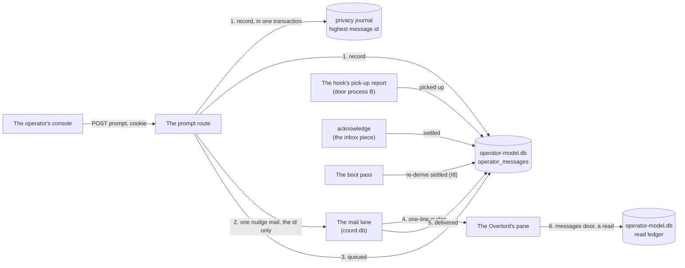

# Overlord W1: the private store, the operator's messages and the read ledger Implementation Plan

> **For agentic workers:** REQUIRED SUB-SKILL: Use superpowers:subagent-driven-development (recommended) or
> superpowers:executing-plans to implement this plan task-by-task. Steps use checkbox (`- [ ]`) syntax for tracking.

**Goal:** the operator's words to the Overlord become server rows in a store no fleet session can reach. A second SQLite
file, `operator-model.db`, opens beside `coord.db` under the same rules: its own `user_version` migrations, and it
refuses to start rather than open empty. It is backed up and restored with `coord.db`, and its path is on the deny list
every session is spawned with. It holds two tables in W1: `operator_messages`, one row for each message the operator
sends the designated session from the console, and the read ledger, one line for each read an Overlord door serves. A
message moves only through one L0 table of message moves and one writer. A new file, the privacy journal, sits on the
chained-journal kernel and records each message id issued, so no id is ever used twice, across a restore or a lost
store. In PR B the console's prompt route records a message to the designated session before anything else happens,
and then nudges the session through the mail lane, naming only the message id. The boot pass re-derives `settled`, so
after a crash the next card can list every unsettled message (I8). The piece also ships the readings the renewal lane
needs (`turns`, and the time of the operator's last message), and `message` as a note key.

**Why:** H7, "the operator's words are server rows" (§3.8). Today the prompt route records nothing: it types the text
into the pane, where it cannot be told apart from anything else that reaches that pane. The Overlord's authority rests on
the operator's words, so they must exist as rows the server wrote under the sign-in cookie, before the session sees
them. H10 adds the read ledger: any process of the fleet user can forge the Overlord's attribution and call its read
doors, so a read door that leaves no line would be a silent leak. C29 puts both in a file of their own, because they
are the operator's private data, which a `coord.db` snapshot shared for debugging must never carry.

**Architecture:** a new bounded context, **C11 Operator Model** (the W1 index's question 4), with its own directory,
`server/src/operatorModel/`:

- L0, a new `shared/operatorMessages.ts`: the message states, the events, the actor allowed each event, the message
  moves table (`MESSAGE_MOVES`), the settlement kinds, the read ledger's doors, callers and turn-state words, the bounds
  (the text cap), the nudge's subject helpers, and the wire row the inbox and the chat read.
- L1, `server/src/operatorModel/messages.ts`: `messageMove` (total over state, event and actor), `capMessageText`,
  `settlementMarkOf`, `nextMessageId`, `bootSettlement`, `nudgeRecovery` and `deliveryStageOf`. And
  `server/src/operatorModel/privacyJournal.ts`: the privacy journal's format (its kinds, its entry grammar and its error
  class, handed to the kernel) and `privacyCoherence`, the boot verdict of the journal against the store.
- L3, `server/src/operatorModel/store.ts`: `OperatorModelStore`, the one owner of the file's SQL. It holds the one
  message writer, `moveMessage`, the one insert, `recordMessage`, the one read-ledger writer, `recordRead`, and the
  readers. `server/src/operatorModel/schema.ts` holds the file's migrations, and `server/src/operatorModel/db.ts` opens
  it. Three shared-kernel adapters serve it and are not its own: `server/src/sqliteFile.ts`, the migrating opener
  moved out of `server/src/coord/db.ts#openCoordDb`, and `server/src/appendOnlyFile.ts` with
  `server/src/chainedJournalFile.ts` on top of it, the synchronous file adapters for any chained journal, shared with
  the authority journal (open questions 1 and 2).
- L4, `server/src/operatorModel/promptRecord.ts`: the act the prompt route takes for the designated session (record,
  nudge, mark), and `server/src/operatorModel/bootPass.ts`: the boot pass. The route itself stays in
  `server/src/server.ts`, and the composition root opens the store in `server/src/index.ts`.

Two pull requests. PR A ships the file, its tables, its journal and its safety nets, and nothing reachable. PR B makes
the prompt route record, and wires the readers.

**Tech Stack:** TypeScript (ESM), `node:sqlite`, bash (`ccd/ccrc`, the session hook), Node scripts (`deploy/`), vitest.

**Spec:** `docs/superpowers/specs/2026-11-09-overlord-design.md`:

- §3.8, H7 ("The record", "Where it lives", "Delivery is like mail", "A message has four states", "No message is lost",
  "Requests bind whole messages"), H8 (the settlement mark, "Typing 'I command' or `/icommand`"), H10 ("The read ledger",
  "Reads have ceilings").
- §3.3.2, C37 (a `miss` note keys to an operator message); §3.3.3 (unsettled messages head the card, I8); §3.3.11
  ("Before the message record exists"); Table 3.3.11b (the `turns` row).
- §7.6, H27 ("The privacy journal and the private store", "Each record is appended inside the store's transaction,
  before the row", "No id is used twice across a restore").
- §9.1, C29 and Table 9.1a (the store and its W1 tables); §9.4, rules 1, 3, 4, 5, 12 and 13.
- §11.1: the context sentence (C11), and the rows `operator_messages`, the read ledger, the privacy journal, the message
  moves table, the prompt route, the hook's reports and `acknowledge` (Tables 11.1a to 11.1c); §11.5 (older builds).
- §11.7: I8 and I13.
- Table 13.1: H7 (`shape`, W1), H10 (`tightening`, W1), H27 (`shape`, W1: the privacy journal's file).

The W1 index is `docs/superpowers/plans/2026-11-14-overlord-w1.md`, row "Private store and messages", lane D. This plan
builds on the index's questions 4 (C11, ruled), 10 (the Overlord's replies, waiting on operator item 327), 21 (two
journals at boot), 26 (the nudge rides the mail lane) and 31 (no transaction spans the two files).



*Figure 1. One message's life. Every arrow into `operator_messages` but the record goes through the one writer,
`moveMessage`, by the message moves table. Steps 1 to 3 run in order with no `await` between them.*

## Open questions

Each is a place where the spec is unclear, does not match the tree, or leaves a choice to the plan. The plan builds the
recommendation unless the coordinator or the operator rules otherwise.

1. **One synchronous writer for every chained journal** (slug `sync-chained-writer-is-shared`). The privacy journal
   appends inside the private store's `DatabaseSync` transaction, and the authority journal appends inside one in
   `coord.db`. The kernel (#2848) is pure, and the delegation journal's writer is async (`DelegationFilePort`). Two
   piece plans written at once would each build a synchronous writer, beside the landing journal's, which is already
   one. **Agreed with the authority journal's plan (by mail, 2026-11-15), whose Tasks 2 and 3 state it:**
   - the landing journal's synchronous mechanics (`server/src/coord/landingJournal.ts`: the retained parent descriptor,
     the `O_NOFOLLOW` leaf, the identity snapshot, `O_APPEND`, the short-write loop, `fsync` of the file and then its
     parent, the re-proof; its fault seam `LandingJournalFsOps`) move, characterization first, into a byte-level K port,
     `server/src/appendOnlyFile.ts`, which the landing journal then binds;
   - `server/src/chainedJournalFile.ts` (K, L3), generic over `ChainedJournalFormat<E, X>`, sits on it: `read()`
     verifies the whole file through the kernel, `appendNext` builds the next record from the verified head of that
     read (the kernel's `chainNext`, the kernel plan's question 4) and appends it, and `healTail` applies the kernel's
     torn-tail plan into a quarantine directory;
   - whichever of private store A and authority journal A merges first creates both files, and the other imports
     them. Each journal keeps its own format, error class and `FORMATS` row, decides when it reads and verifies, and
     checks its own transaction (`DatabaseSync#isTransaction`), because only it knows its database. The privacy
     journal verifies at the store's open and appends with the snapshot of that read, re-reading only after a refused
     append (`changed`).
2. **One migrating opener for both SQLite files** (slug `opener-is-shared`). `server/src/coord/db.ts#openCoordDb` holds
   the rules the private store must follow: the 0-byte guard, one transaction per migration with `user_version` inside
   it, a higher `user_version` read and never migrated, and the cleanup of a file this process created.
   **Recommendation:** move those rules, with no behaviour change, into a K adapter, `server/src/sqliteFile.ts#openMigratedSqlite`,
   which takes the migrations, the label and the restore advice, and throws the caller's error class. `openCoordDb`
   becomes a call to it with today's text, pinned byte for byte by a characterization test first. Copying the rules
   would be a second mechanism for one job.
3. **The nudge rides the mail lane** (the index's question 26; slug `message-nudge-rides-the-mail-lane`).
   **Recommendation, built as the index recommends:**
   - The nudge is system mail from `operator` (`SYSTEM_MAIL_SENDER_MAP`'s role for PWA-surface routes), kind `status`,
     subject `operator-message:<id>`, and a body that names the id and the `messages` door, never the words (§9.4 rule
     5).
   - `queued` is written when the nudge's delivery row is queued: by the route, right after `queueSystemMail` answers
     `queued: true`, with no `await` between. `delivered` is written by the mail lane on the nudge's first delivery
     (`FleetWatcher.sweepMail`, after `markDelivered` lands and `deliveredAt` was null). Both are the mail lane's own
     delivery states, so no new lane is built.
   - The lane finds the message by the mail row's subject (`CoordStore.mailOrigin`, already a `WatcherCoordMember`).
     The private store holds no `coord.db` id, so neither file holds a key into the other.
   - The nudge is record-only for pushes. `FleetWatcher.pushNewMail` would otherwise push the operator's phone about the
     operator's own message. Its record-only list (beside `isAskNudgeMail` and the timer sender) gains
     `isOperatorMessageMail`.
4. **The actor column ships with the table** (slug `message-actor-ships-with-the-table`). The index gives gates A
   "actor columns on the designation and message rows". The spec puts `actor` in the message row from its first write
   (§3.8, Table 9.1a), and private store B can write rows before gates A lands. **Recommendation:** `operator_messages`
   has `actor` from migration 1. Private store B fills it from the account gate's pass
   (`server/src/accounts/gate.ts#createAccountGate`, its `actor`, rendered as `audit.ts#actorOf` renders it), which
   the index's question 17 already names as the operator's doors' source. Gates A then supplies the same value through
   `CallerIdentity` at `operator` strength, and changes the writer's source, never the table. The index row for gates A
   drops "message rows".
5. **The text cap** (slug `message-text-cap`). §3.8 says "masked, capped, and cut whole with a mark", and Table 11.5b
   names no cap. **Recommendation:** 16,384 UTF-8 bytes (`MESSAGE_TEXT_MAX_BYTES`), a starting value beside the
   handover note's (`HANDOVER_MAX_BYTES`). The text is masked first, by the server's egress masker, then cut at the last
   whole code point that fits with the mark, and the mark is `[cut: <n> more bytes]`. `sha256` is the hash of the
   stored text, which is what a request will cite (§5.1). The response tells the console it was cut, so the chat can
   say so.
6. **Attachments to the designated session** (slug `overlord-prompt-takes-no-attachment`). "Attachments are content,
   never words" (§3.8), and no W1 door serves a file to the Overlord. **Recommendation:** in W1 the route refuses a
   prompt to the designated session that names an attachment, `bad-attachment` (400), before any record. The console's
   chat (lane F) offers none.
7. **`renewing` is for typed prompts only** (slug `renewing-is-for-typed-prompts`). W1a's renewal hand-offs make the
   route answer `renewing` while a session's generation is in `clearing` or `carded`, "before the message record
   exists" (§3.3.11). Once it exists, nothing is typed into the Overlord's pane, so a renewal loses nothing.
   **Recommendation:** the designated session's branch runs before that check. A message sent during a renewal is
   recorded at once, and its nudge waits in the mail lane, whose gate holds deliveries until the new generation has
   read its card. Every other session keeps `renewing` as W1a builds it.
8. **What the settlement mark matches** (slug `settlement-mark-is-a-whole-message`). H8: "Typing 'I command' or
   `/icommand` in the chat opens the list of open proposals. With none open, it records on the message row that a
   disagreement about a class-none act is settled." Proposals are W3, so in W1 none is ever open. **Recommendation:**
   `settlementMarkOf` answers `mark` only for a whole message that is, after trimming, exactly `/icommand`, or `I
   command` in any letter case with single spaces. A message that merely contains the words is an ordinary message.
   The mark settles the row in the transaction that records it (`settledBy: 'mark'`), and the nudge is still sent, so
   the Overlord sees what the operator said. W3 adds the proposals list in front of this answer and changes no W1
   answer.
9. **Which citing rows the W1 boot pass reads** (slug `boot-pass-reads-no-citing-table-in-w1`). I8: "a message that
   reads `settled` while no row cites it, no `acknowledge` settled it and the prompt route did not mark it is
   unsettled again". The citing doors (requests, answers) are W2 and W3, so W1 has no citing table. **Recommendation:**
   the pass takes a citation reader as a port. Its W1 adapter answers `not-applicable`, a word of its own. A row
   settled by `acknowledge` or `mark` stays settled, because the row itself records that. A row settled by `cite`
   cannot be written by a W1 build. It appears only after a rollback from a later build, and the pass makes it
   unsettled, because this build can neither show nor honour what cites it, and offering a message again is the safe
   direction for I8. An `unmeasured` citation read (a later build whose table read failed) changes nothing, and the
   pass reports how many rows it could not judge. The pass never folds `unmeasured` into "no row cites it". W2 adds
   the measured adapter and the `spent` arm.
10. **A privacy journal that is missing, behind or malformed** (slug `privacy-journal-coherence`). In W1 the journal's
    only job is that no message id is used twice. **Recommendation:** `privacyCoherence(journal, store)`, total:
    - equal highest ids, or a journal ahead of the store (a crash between the append and the commit, or a store
      restored alone): `coherent`. The next id starts above the journal's highest.
    - no file, and no message rows: `fresh`. The first message writes the first record.
    - no file beside message rows, or a journal behind the store: `re-anchor`. The store appends a `privacy-anchor`
      record carrying the store's highest id, and logs one `ccrc-server:` line. Where a witness off the volume holds
      the old head, authority journal B's witness check refuses `authority-rolled-back` (§7.6), which is the right
      answer to a lost journal.
    - a defect the kernel refuses that is not a healable torn tail: `refuse`. The server still starts, every record of
      a message answers `journal-unreadable` (503), and the boot line names the file and says to move it aside, after
      which the next boot re-anchors. The rest of the server does not depend on this file, so stopping it would trade
      the console for an id guarantee only the Overlord needs.
11. **The read ledger's retention** (slug `read-ledger-kept-in-w1`). The spec names none. M32 compares reads against a
    28-day median, so lines must outlive 28 days. **Recommendation:** W1 deletes no line. The read ceilings bound the
    rate (about one line a read), and W4's privacy controls (wipe, retention) take the ledger with the rest of the
    store. The plan measures the table's size in its test, at a year of lines at the ceilings, and states it.
12. **What a null `turnState` means** (slug `null-turn-state-is-a-console-read`). Board and history's question 15
    (ruled F10) gives the read ledger a nullable `turnState` and leaves null "for lines written before the column
    existed". The column ships with the table, so no such line exists. **Recommendation:** null has one meaning, a
    read by the operator's console, which has no turn behind it. A `CHECK` ties it to `caller = 'operator'`. A
    session's read always carries one of the turn marker reader's words: `working`, `done` or `failed`
    (`TURN_MARK_STATES`), or `absent`, `unmeasured`, `malformed`, `foreign` or `stale` (`TurnMarkUnread`). The board
    and history plan names only three of the five unread words. This plan takes all five, so no reader state is
    folded into another.
13. **Operator-quiet's observed time** (slug `operator-quiet-is-observed-by-the-lane`). `softRenewal.ts#SoftInputs`
    wants `operatorQuietObservedMs`, observed time since the operator's last message (§11.5). Observed time is an
    accumulator advanced by a lane (`server/src/time/observed.ts#observeTime`). The private store has no lane, and W1a
    builds the coordinator's twin as a mark whose `at` the route owns and whose `quiet` the generations lane advances
    (`w1a-renewal-handoffs.md`, Task 3). **Recommendation:** this piece ships the wall-time reading the accumulator
    starts from, `lastOperatorMessage()`, and no observed time of its own. The renewal readings piece turns it into
    `operatorQuietObservedMs` with the generations lane's own advance, reusing W1a's mark mechanism, never a second
    accumulator. The index's row for this piece says "the `turns` and operator-quiet readings"; that reads "the
    readings they are computed from".
14. **The Overlord's replies** (the index's question 10, operator item 327; **waits on the item**). W1's tables hold the
    operator's words only. **Effect on this plan:** none of its eight tasks waits on the item. The answer decides
    whether a later piece adds the replies to the private store (a migration of its own, and a second writer through
    a door) or reads them from transcripts at checkpoint time. Either way, nothing this plan builds changes: the
    message moves table, the boot pass and the readers are about the operator's words. What waits: the checkpoint's
    thread of replies, the chat-reply response rows (responses B, chat), and the index's question 27.
15. **Who lists unsettled messages on the card** (slug `card-unsettled-list-has-no-owner`). I8 has two halves: the
    boot pass re-derives `settled` (here), and "the next card lists every unsettled message" (§3.3.3). The card shows
    `CARD_OVERLORD_LINE` for the Overlord today (`server/src/continuity/card.ts`), and no W1 row of the index puts the
    unsettled list on it. **Recommendation:** this piece ships the reader the card needs, `unsettledMessages()`, never
    trimmed and in id order. The coordinator assigns the card's Overlord section (it reads naturally as the
    `overlord-v1` piece's, which replaces the placeholder line). Until then I8's second half has no owner.

## What exists today

Measured on `main` at `49a34f76e`, and the kernel at `2b082b91f`.

- **One SQLite file.** `coord.db` is the server's only `node:sqlite` database: `new DatabaseSync` appears once in
  `server/src`, in `server/src/coord/db.ts#openCoordDb`. That function holds rule 2 ("never start empty") in three
  parts: a 0-byte file that predates the process refuses (`CoordDbUnmigratable`), each migration runs in one `tx()`
  with its `PRAGMA user_version` (`server/src/coord/tx.ts`), and a failed first migration of a file this process
  created removes the 0-byte artefact (`shouldRemoveMigrationFailureArtifact`). A higher `user_version` is read and
  never migrated. WAL, foreign keys and a busy timeout are set only after migration. `server/src/index.ts` opens it at
  the root, before the watcher, after the restore marker check (`coordinationRestoreRefusal`), and lets the throw kill
  the process. `server/test/coord-db.test.ts` pins these rules, and `describeMigrationProgress` and
  `shouldRemoveMigrationFailureArtifact` are exported for it. `ccd/history/store.mjs` opens a SQLite file of its own,
  in another package, on the fleet host.
- **No context C11.** `server/test/ccdContextIds.ts#CCD_CONTEXTS` is C1 to C10 and K, and `CCD_ONLY_CONTEXTS` is
  `['C10']`. `server/test/rings/totality.test.ts` requires the architecture spec's numbered list of bounded contexts to
  have one item per context (but K), and its `ring-context-map` table to hold a row for each context but the ccd-only
  ones, in order. `server/test/ccd-contexts.test.ts` requires `ccd/contexts.tsv`'s legend to equal `CCD_CONTEXTS`. The
  architecture spec (`docs/superpowers/specs/2026-08-10-architecture-ddd-clean-solid.md`) says every file "maps to
  exactly one of the first nine contexts, or to **K**", and `CLAUDE.md` says "one of contexts C1–C9 or K".
  `server/test/single-definition/time-ports.test.ts#TIME_PORT_FAMILIES` already scopes `server/src/operatorModel/`.
- **The backup set.** `ccd/ccrc#_upd_backup` (run by `ccrc update` and, standalone, by `ccrc backup`) snapshots
  `coord.db` with `deploy/backup-coord.mjs` (`VACUUM INTO` a temp file, then a rename; the snapshot's mode is the
  umask's), runs `_upd_backup_set`, and last runs `deploy/coordination-snapshot.mjs capture`, which describes the
  SQLite snapshot and the delegation sidecars in one manifest, `coordination-snapshot.json`. The helper imports
  `node:*` only. Its manifest's `members` are `coordDb`, `delegationJournal`, `delegationCheckpoint` and, additive and
  optional, `delegationCarried` (`MEMBER_KEYS`); `SNAPSHOT_NAMES`, `THIN_MEMBERS`, `RESTORE_SET` and `PUT_BACK_ORDER`
  list the files a thinning drops and a restore replaces. `deploy/deploy.sh`'s server lane snapshots `coord.db` the same
  way. No backup copies `landing.log` or `collect-lane-generation.log`, and the README's "What a restore can and cannot
  undo" says so for the second.
- **The deny list.** `shared/api.ts#ACCOUNT_SECRET_PATHS` (`~/.cc-secrets/**`, `~/.ccrc/auth-scratch/**`,
  `~/.ccrc/codex/*/runtime.env`, `~/.ccrc/agent.env`, `~/.ccrc/linear/**`, `~/.ccrc/linear.key`,
  `~/.ccrc/operator-secrets/**`) becomes `Read(...)` rules in `ACCOUNT_DENY_RULES`, which every session is spawned with.
  `ccd/install-session-hooks.sh` holds a bash copy, held equal by `server/test/account-deny.test.ts`. The session hook's
  account arm (`ccd/session-hook.sh`, the jq definitions `ASEC` and `APSEC` and the fast test on `$apf`) refuses the
  path-qualified, quoted and `$VAR` forms, pinned by `server/test/session-hook-account-deny.test.ts`. The operator's
  secret slots (programme ledgers PL6) were added to all four.
- **The prompt route.** `app.post('/api/sessions/:id/prompt', …)` in `server/src/server.ts` checks the id
  (`knownId`), validates attachments and text, and calls `server/src/inject/send.ts#sendPrompt`, which types the text
  into the pane. It records nothing. It is session-gated by the auth gate, not by the account gate.
- **The mail lane.** `queueSystemMail` (`server/src/coord/rundefsTx.ts`) inserts a system mail row and its delivery,
  answering `{ queued: true, mailId, deliveryId }`, or `{ queued: false }` when an identical one is outstanding.
  `FleetWatcher.sweepMail` types `renderMailNudge(toId)`, a one-line nudge that names no mail, and calls
  `CoordStore.markDelivered` on success; a first delivery is the one whose `deliveredAt` was null. `pushNewMail` pushes
  the operator for new mail unless the row is on its record-only list (`isAskNudgeMail`, `isApprovalNudgeMail`, the
  stall subjects, the timer sender and others). The Overlord's `MAIL_PACE` row is on `main`.
- **The turn marker.** `server/src/turnmark.ts#readTurnMarkMeasured` answers a mark with `state` in `TURN_MARK_STATES`
  (`working`, `done`, `failed`), or `ok: false` with a `TurnMarkUnread` reason (`absent`, `unmeasured`, `malformed`,
  `foreign`, `stale`), both declared in `server/src/coord/stall.ts`.
- **The renewal readings.** `server/src/continuity/renewalDue.ts#RenewalInputs` has `turns: Reading<number>`
  ("operator messages and answered holds this generation"), and `generationsLane.ts#renewalInputsOf` passes it as `W1`,
  unmeasured. `softRenewal.ts#SoftInputs` has `operatorQuietObservedMs: SoftReading<number>`, which nothing on `main`
  assembles yet.
- **Notes.** `shared/continuity.ts#NoteKey` has the kinds `programme`, `item` and `run`, and its comment says
  "`message` (a `miss`) in W1". `NOTE_KIND_MAP` has `thread` and `caution`. `server/src/continuity/noteKeys.ts#noteKeyReader`
  reads a key from `CoordStore`, and `server/src/continuity/notes.ts#noteKeyFact` decides `live`, `gone`, `not-yours` or
  `unmeasured`. The handover note's thread references use the same `NoteKey`.
- **The kernel** merged during this plan's writing (#2848, `2b082b91f`), and these facts were re-measured there:
  `server/src/chainedJournal.ts` exports `ChainedJournalFormat<E, X>` (`kinds`, `entry`, `fail`, `jsonError`),
  `buildChainedRecord`, `encodeChainedRecord`, `parseChainedBytes`, `ChainVerifier` and `chainedTailHealPlan`. Its
  kinds census, `server/test/chained-journal-formats.test.ts#FORMATS`, holds every format's kinds pairwise disjoint and
  finds every format declared under `server/src`; a later journal adds its row with a sample entry. No synchronous
  chained writer exists, and no `chainNext` (the kernel plan's question 4): the piece that creates the adapters adds it
  to the kernel. The one synchronous journal appended inside a `DatabaseSync` transaction today is the landing
  journal (`server/src/coord/landingJournalPort.ts`), which is a log-first journal, not a chained one.
- **Refusal words** this piece uses are on `main`: `bad-attachment` (400), `unmeasured` (502), `write-failed`,
  `journal-unreadable` and `journal-unwritable` (503) in `shared/refusal.ts#GENERIC_REFUSALS` and `REFUSAL_STATUS`, and
  the account gate's `auth-off` and `unauthenticated`. It adds no word, so Table 11.6's test does not move.
- **Growth caps** (`server/test/growth-caps/`): `shared/api.ts` holds 5,099 code lines under a cap of 5,140, and
  `deploy/coordination-snapshot.mjs` 1,515 under 1,555 (`growthCheck.ts#codeLines`, measured on this commit).

## Global Constraints

- **Architecture (`CLAUDE.md`).** Decide in L1, act in L4. `messageMove`, `capMessageText`, `settlementMarkOf`,
  `nextMessageId`, `bootSettlement`, `nudgeRecovery`, `deliveryStageOf` and `privacyCoherence` are pure. The store and
  the kernel adapters are L3. The route's act and the boot pass are L4 and decide nothing. L1 never imports L3 or
  L4, and nothing below L4 imports `server.ts` or `watch.ts` (`rings/host-imports.test.ts`).
- **The context.** Every file under `server/src/operatorModel/` is C11, by its directory row in the architecture
  spec's table. `shared/operatorMessages.ts` is L0 and imports nothing. The kernel adapters are K. A C11 file may
  take a type from `server/src/coord/stall.ts` (the turn marker's words) and from the designation's module (designation
  A), and nothing else outside C11 and K.
- **One writer per fact.**
  - `operator_messages` rows are inserted only by `OperatorModelStore.recordMessage`, called only by the prompt
    route's act. Their state and stamps change only through `OperatorModelStore.moveMessage`, which asks
    `messageMove` first and refuses what it refuses. Its callers are the route's act (queue, mark), the mail lane
    (deliver), the boot pass (unsettle, and the nudge recovery's queue), and, from later pieces, the hook's pick-up door
    (door process B), `acknowledge` (the inbox piece) and the citing doors (W2).
  - Read-ledger lines are written only by `OperatorModelStore.recordRead`.
  - The privacy journal is appended only by `OperatorModelStore.recordMessage` (a `privacy-message-issued` record)
    and by the store's open (a `privacy-anchor` record).
  - `server/test/single-definition/writers-map.test.ts` gains a describe of its own for the private store's two
    tables, reusing `tableWriters` with a table list passed in, so the existing pin's title ("coord.db's recorded
    tables") stays true.
- **No transaction spans the two files** (the index's question 31). The route records in the private store and
  commits, then queues the nudge in `coord.db` and commits, then moves the row to `queued`. A crash between any two
  steps leaves a row the boot pass finds (Task 7).
- **Unmeasured is never a value.** Every reader answers a union: measured, `none` where absence is a fact, or
  `unmeasured` with a reason. A store that did not open answers `unmeasured` to every read and refuses every write.
  The read ledger's `generationRead` is a word, so no null stands for "unmeasured".
- **No words in `coord.db`.** The nudge mail's subject and body hold the message id only. No log line, refusal or
  feed row carries a message's text. The route's warnings name the id.
- **Time through ports.** Every new module under `server/src/operatorModel/` is in `TIME_PORT_FAMILIES` already, and
  reads time only from an injected `Clock`. SQL never reads the clock. The kernel adapters read no clock.
- **Older builds.** An older server never opens `operator-model.db` and never reads the privacy journal. Its prompt
  route types into the Overlord's pane as today, and records nothing (Table 11.1a's last column). Rollback and older
  builds, below, says what it does with a nudge mail left queued.
- **Growth check** (`server/test/growthCheck.ts`, 40 net code lines a file a pull request, and the caps): each PR
  states its estimate below, and the builder measures it before pushing. No waiver.
- **Mutation floors.** Every new L1 decider joins `MUTANT_SETS` through a new `server/test/sim/operatorModelSets.ts`
  and `server/test/sim/mutation-floors.json`, in the pull request that creates it.
- **Tests.** From `server/`: `ccrc test -- ./node_modules/.bin/vitest run test/<file>.test.ts`. Each task's last run
  adds both `tsc` runs (`ccrc test -- npx tsc --noEmit -p tsconfig.json` and `-p test/tsconfig.tests.json`),
  `test/typecheck-tests.test.ts`, `test/rings/*.test.ts`, and pwa's `tsc` when `shared/` changed. Fixture HOMEs only
  (`makeCcdHarness`, `tmpHelpers.ts`), and neutral names (`lane-a`, `project-a`, `prog-a`).
- Cite by symbol or `@anchor`. No private names. No D-number invented: the builder's departures go in
  `docs/superpowers/plans/2026-11-14-overlord-w1/w1-private-store/departures.md`.

## Review Focus

1. **Recorded before delivered.** For the designated session, the row and its journal record commit before any mail
   is queued, and nothing is ever typed into the pane but the mail lane's one-line nudge. A failed record queues no
   nudge and answers a refusal the console keeps the draft for.
2. **No id twice.** The next message id is above both the store's highest and the privacy journal's highest, and the
   journal record is appended inside the insert's transaction, before the row. A store restored alone, a journal lost,
   or a crash between the append and the commit never reissues an id.
3. **One writer, one table of moves.** Every change of a message's state goes through `moveMessage` and
   `MESSAGE_MOVES`, and a test reds when any other statement writes `operator_messages`. A move the table refuses
   changes nothing and says so.
4. **I8.** After a crash between any two steps of the route, and after a restore of either file, the boot pass leaves
   no message wrongly settled, re-nudges a message whose nudge was never queued, and never takes away a settlement the
   row itself proves.
5. **The store's safety nets.** The file refuses to open empty, its snapshot is taken by `VACUUM INTO` at mode 0600
   and listed in the manifest, a restore replaces it with `coord.db` as one set, the privacy journal is in no snapshot,
   and every session is denied a read of the file, its sidecars and its copies.

## The PR split

| PR | Tasks | What it ships | Needs first | Growth-checked files, estimate |
|---|---|---|---|---|
| A, the store and its safety nets | 1 to 5 | C11 registered; the shared opener; `operator-model.db` with its migration, `operator_messages`, the read ledger, the message moves table and the one writer; the synchronous journal adapters (if authority journal A has not merged them) and the privacy journal with its boot coherence; the snapshot, the restore set and the deny path. Nothing reachable: no caller records a message or a read | nothing more: the journal kernel merged (#2848), so **ready to build** | `shared/api.ts` about +2 (cap headroom 41); `ccd/ccrc` about +6; `ccd/session-hook.sh` about +2; `deploy/coordination-snapshot.mjs` about +18 (cap headroom 40) |
| B, the record and its readers | 6 to 8 | The prompt route's record-then-nudge for the designated session, with the mark; the mail lane's `delivered`; the record-only push; the boot pass (I8 and the nudge recovery); the readers for `turns`, the operator's last message and the card; `message` as a note key, with `miss` | PR A; designation A (the designated session, its term, and the `roleOf` reader); W1a's renewal hand-offs (the route's `renewing` branch) | `server/src/server.ts` about +8; `server/src/watch.ts` about +4 |

**Order:** PR A at once. PR B once PR A, designation A and W1a's renewal hand-offs have merged.

**What later pieces read** (the states this piece exposes):
- The inbox (band 1 and `messages`): `OperatorModelStore.unsettledMessages`, `messageById` and the wire row
  `OperatorMessageRow` (`shared/operatorMessages.ts`); `acknowledge` calls `moveMessage(id, 'settle', 'acknowledge')`;
  every read calls `recordRead`.
- Board and history B: `recordRead` with `door`, `scope`, `count`, `outcome`, `generation` and `turnState`.
- Door process B: `moveMessage(id, 'pick-up', 'hook')`.
- The renewal readings piece: `messagesSince` (for `turns`) and `lastOperatorMessage` (for `operatorQuietObservedMs`).
- Authority journal B: `privacyJournalHead()` (the head digest, the record count and the highest message id) for the
  witness epoch, and the hook the epoch rises on, one call for each privacy record (open question 1's adapter reports
  each append).
- The chat (lane F): the message row's state and stamps for its ticks, and `cut`.
- W2's citing doors: `moveMessage(id, 'settle' | 'spend', 'citing-door')`, the citation adapter of the boot pass, and
  the stored `sha256`.

---

### Task 1: Context C11, registered

**Files:**
- Modify: `server/test/ccdContextIds.ts` (`CCD_CONTEXTS` gains `C11` after `C10`; `CCD_ONLY_CONTEXTS` stays `['C10']`)
- Modify: `docs/superpowers/specs/2026-08-10-architecture-ddd-clean-solid.md`:
  - "## Bounded contexts" gains item 11, **Operator Model**: the private store (`server/src/operatorModel/`) and its
    vocabulary (`shared/operatorMessages.ts`); its language (message, move, settlement, read line, privacy record); its
    allowed dependencies (L0 `shared/operatorMessages.ts`, the K kernels `sqliteFile.ts`, `chainedJournal.ts`,
    `canonical.ts`, `appendOnlyFile.ts` and `chainedJournalFile.ts`, a type from `coord/stall.ts`, and the designation's reader); and its
    reason to be a context, privacy: one store, one reader, one deny path;
  - the "first nine contexts" sentence names C11 beside them;
  - the `ring-context-map` table gains `| C11 Operator Model | \`operatorModel/**\` | (none) |` between C9 and K, and
    the K row gains `sqliteFile.ts` (Task 2), and `appendOnlyFile.ts` and `chainedJournalFile.ts` (Task 4, unless
    authority journal A has added them), in the tasks that create them;
- Modify: `ccd/contexts.tsv` (the header's legend gains "C11 Operator Model"; no function row)
- Modify: `CLAUDE.md` ("one of contexts C1–C9 or K" reads "one of contexts C1–C9, C11 or K")
- Test: `server/test/rings/totality.test.ts`, `server/test/ccd-contexts.test.ts` (unchanged, red then green)

- [ ] **Step 1: Edit** `CCD_CONTEXTS` alone. **Step 2: Run** `rings/totality.test.ts` and `ccd-contexts.test.ts`: red
  (the numbered list, the table order and the legend each lack C11).
- [ ] **Step 3: Edit** the spec's list, sentence and table, the legend and `CLAUDE.md`. **Step 4: Run** both, and
  `test/rings/*.test.ts`: green. No file is under `server/src/operatorModel/` yet, and a directory row that covers no
  file is allowed (measure that the totality test agrees; if it refuses an empty row, the row joins Task 3).
- [ ] **Step 5: Commit.** `docs(arch): context C11, the Operator Model, registered (Overlord W1)`

### Task 2: One migrating opener for both SQLite files (move-only)

**Files:**
- Create: `server/src/sqliteFile.ts` (L3, K): `openMigratedSqlite`
- Modify: `server/src/coord/db.ts` (`openCoordDb` calls it with `MIGRATIONS`, `COORD_SCHEMA_VERSION`, its error class
  and today's restore text; `describeMigrationProgress` and `shouldRemoveMigrationFailureArtifact` move with the rules
  and are re-exported from `coord/db.ts` under the same names)
- Modify: the architecture spec's K row (`sqliteFile.ts`)
- Test: `server/test/coord-db.test.ts` (unchanged), `server/test/sqlite-file.test.ts` (new)

```ts
export interface MigratedSqliteSpec {
  readonly migrations: readonly string[];          // index v is the migration from v to v + 1
  readonly label: string;                          // the file's name in every message, e.g. 'coord.db'
  readonly restoreAdvice: string;                  // the sentence after "REFUSING TO START."
  readonly fail: (message: string) => Error;       // the caller's class: CoordDbUnmigratable, PrivateStoreUnmigratable
}
/** Opens `dbPath`, migrating it to `migrations.length`, or throws `spec.fail(...)`. A higher `user_version` is read and
 *  never migrated, with one warning line. Never starts empty: a 0-byte file that existed before the call refuses. */
export function openMigratedSqlite(dbPath: string, spec: MigratedSqliteSpec): DatabaseSync;
```

- [ ] **Step 1: Characterize.** In `sqlite-file.test.ts`, drive `openCoordDb` through every arm `coord-db.test.ts`
  drives (fresh, current, behind, ahead, 0-byte, failing migration on a fresh file and on an existing one) and pin
  each thrown message and warning byte for byte, and the resulting `user_version`, journal mode and file presence.
  **Step 2: Run** on `main`'s code: green.
- [ ] **Step 3: Move** the rules into `openMigratedSqlite`, with `openCoordDb` passing its text. Only imports change in
  the tests. **Step 4: Run** both suites, `rings/*.test.ts`, `single-definition/*.test.ts` and both `tsc` runs: green,
  with no expectation edited.
- [ ] **Step 5: Mutation.** Drop the 0-byte guard: red. Move `PRAGMA user_version` out of the migration's `tx`: the
  crash-between case reds. Migrate when `current > version`: red. Revert each.
- [ ] **Step 6: Commit.** `refactor(db): one migrating opener for every SQLite file the server owns, coord.db its first caller`

### Task 3: `operator-model.db`, its tables, the message moves table and the one writer

**Files:**
- Create: `shared/operatorMessages.ts` (L0)
- Create: `server/src/operatorModel/schema.ts` (L1 data: `OPERATOR_MODEL_MIGRATIONS`, `OPERATOR_MODEL_SCHEMA_VERSION`)
- Create: `server/src/operatorModel/db.ts` (L3: `openOperatorModelDb`, `defaultOperatorModelDbPath`,
  `PrivateStoreUnmigratable`)
- Create: `server/src/operatorModel/messages.ts` (L1)
- Create: `server/src/operatorModel/store.ts` (L3: `OperatorModelStore`)
- Modify: `server/src/config.ts` (`operatorModelDbPath`, beside `coordDbPath`, built once)
- Modify: `server/src/index.ts` (open the store after `coord.db`, before the watcher; its throw kills the process, as
  `coord.db`'s does)
- Modify: `server/src/deps.ts` (`Deps.operatorModel?: OperatorModelStore`)
- Modify: `server/test/single-definition/writers-map.test.ts` (the private store's describe, below)
- Create: `server/test/sim/operatorModelSets.ts`; Modify: `server/test/sim/mutation-floors.test.ts`,
  `server/test/sim/mutation-floors.json`
- Test: `server/test/operator-messages-moves.test.ts` (new), `server/test/operator-model-store.test.ts` (new)

**The vocabulary** (`shared/operatorMessages.ts`), each list derived from its map so `wire-totality` holds it:

```ts
const MESSAGE_STATE_MAP = {
  recorded: 'the row committed; no nudge is queued yet',
  queued: "the nudge's delivery is queued behind the mail gate",
  delivered: 'the nudge was typed into the pane',
  'picked-up': 'the prompt hook reported the id',
  settled: 'a door cited it, acknowledge settled it, or the route marked it',
  spent: 'a root request cited it (W2)',
} as const;
export type MessageState = keyof typeof MESSAGE_STATE_MAP;
export const MESSAGE_STATES = Object.keys(MESSAGE_STATE_MAP) as MessageState[];

const MESSAGE_EVENT_MAP = { queue: '…', deliver: '…', 'pick-up': '…', settle: '…', spend: '…', unsettle: '…' } as const;
export type MessageEvent = keyof typeof MESSAGE_EVENT_MAP;
const MESSAGE_ACTOR_MAP = {
  route: 'the prompt route (queue; settle by the mark)', 'mail-lane': 'the mail lane (deliver)',
  hook: "the hook's pick-up report door (pick-up)", acknowledge: 'the acknowledge door (settle)',
  'citing-door': 'a door that cites the message, after its own commit (settle, spend)',
  'boot-pass': 'the boot pass (unsettle; queue, for a nudge never queued; spend, W2)',
} as const;
export type MessageActor = keyof typeof MESSAGE_ACTOR_MAP;
/** Who may send each event. */
export const MESSAGE_EVENT_ACTORS: Readonly<Record<MessageEvent, readonly MessageActor[]>>;
/** state × event → next state, or absent where the move is refused. A delivery event on a settled or spent row keeps
 *  its state and stamps the time only. */
export const MESSAGE_MOVES: Readonly<Record<MessageState, Partial<Record<MessageEvent, MessageState>>>>;
const SETTLED_BY_MAP = { cite: 'a citing door', acknowledge: 'the acknowledge door', mark: "the route's settlement mark" } as const;
export type SettledBy = keyof typeof SETTLED_BY_MAP;

export const MESSAGE_TEXT_MAX_BYTES = 16_384;
export const operatorMessageSubject = (id: number): string => `operator-message:${id}`;
export function operatorMessageIdOf(subject: string): number | null;
export function isOperatorMessageMail(m: { readonly fromId: string; readonly subject: string }): boolean;

const READ_DOOR_MAP = { board: '…', messages: '…', inbox: '…', history: '…' } as const;   // W4 adds model, feed
const READ_CALLER_MAP = { overlord: 'the designated session', reader: "one of its readers, through the door process",
  operator: "the operator's signed-in console" } as const;
/** The turn marker reader's words, mirrored: `TURN_MARK_STATES` and `TurnMarkUnread` (`server/src/coord/stall.ts`).
 *  A parity test holds the mirror equal in both directions. */
export const READ_TURN_STATES = ['working', 'done', 'failed', 'absent', 'unmeasured', 'malformed', 'foreign', 'stale'] as const;

/** One message as the inbox, `messages` and the chat read it. */
export interface OperatorMessageRow {
  readonly id: number; readonly at: number; readonly term: number; readonly state: MessageState | 'unknown';
  readonly text: string; readonly cut: boolean; readonly sha256: string;
  readonly queuedAt: number | null; readonly deliveredAt: number | null; readonly pickedUpAt: number | null;
  readonly settledAt: number | null; readonly settledBy: SettledBy | null; readonly spentAt: number | null;
}
```

**The moves** (`MESSAGE_MOVES`), with the stamp each accepted event writes when it is null:

| From \ event | `queue` | `deliver` | `pick-up` | `settle` | `spend` | `unsettle` |
|---|---|---|---|---|---|---|
| `recorded` | `queued` | `delivered` | `picked-up` | `settled` | `spent` | refused |
| `queued` | refused | `delivered` | `picked-up` | `settled` | `spent` | refused |
| `delivered` | refused | refused | `picked-up` | `settled` | `spent` | refused |
| `picked-up` | refused | refused | refused | `settled` | `spent` | refused |
| `settled` | `settled` (stamp) | `settled` (stamp) | `settled` (stamp) | refused | `spent` | `deliveryStageOf(stamps)` |
| `spent` | `spent` (stamp) | `spent` (stamp) | `spent` (stamp) | refused | refused | refused |

*Table 1. The message moves. `deliver` and `pick-up` may arrive out of order across processes, so each skips the
stages it did not see. `spend` is W2's, and the table is total from W1. `deliveryStageOf` answers the furthest of
`recorded`, `queued`, `delivered` and `picked-up` whose stamp is set.*

**The schema** (migration 1 of `OPERATOR_MODEL_MIGRATIONS`; no vocabulary in a `CHECK`, so a later word needs no table
rebuild, and the store's readers revive an unknown word as `unknown`):

```sql
CREATE TABLE operator_messages (
  id          INTEGER PRIMARY KEY,         -- issued by nextMessageId, never AUTOINCREMENT
  at          INTEGER NOT NULL,            -- wall ms, from the route's clock
  sessionId   TEXT NOT NULL,               -- the designated session it was sent to
  term        INTEGER NOT NULL,            -- the designation's term at the record
  actor       TEXT NOT NULL,               -- the account gate's actor (open question 4)
  sha256      TEXT NOT NULL,               -- of `text` as stored
  text        TEXT NOT NULL,               -- masked, then cut with the mark (open question 5)
  cut         INTEGER NOT NULL CHECK (cut IN (0, 1)),
  state       TEXT NOT NULL,
  queuedAt    INTEGER, deliveredAt INTEGER, pickedUpAt INTEGER,
  settledAt   INTEGER, settledBy TEXT, spentAt INTEGER,
  CHECK ((settledAt IS NULL) = (settledBy IS NULL))
);
CREATE INDEX operator_messages_unsettled ON operator_messages (state, id);
CREATE INDEX operator_messages_at ON operator_messages (at);
CREATE TABLE read_ledger (
  id             INTEGER PRIMARY KEY,
  at             INTEGER NOT NULL,
  door           TEXT NOT NULL,
  caller         TEXT NOT NULL,
  scope          TEXT NOT NULL,            -- at most 200 characters, the door's canonical target
  count          INTEGER NOT NULL CHECK (count >= 0),
  outcome        TEXT NOT NULL,            -- the door's own word, kebab, at most 40 characters
  generation     INTEGER,
  generationRead TEXT NOT NULL,            -- 'measured' | 'unmeasured' | 'not-a-session'
  turnState      TEXT,                     -- null only for caller 'operator' (open question 12)
  CHECK ((generationRead = 'measured') = (generation IS NOT NULL)),
  CHECK ((caller = 'operator') = (turnState IS NULL)),
  CHECK ((caller = 'operator') = (generationRead = 'not-a-session'))
);
CREATE INDEX read_ledger_door_at ON read_ledger (door, at);
```

**The store** (`OperatorModelStore`, over the open `DatabaseSync` and the privacy journal of Task 4; every method is
synchronous and catches nothing it cannot name):

```ts
export type StoreWrite<T> = { readonly ok: true; readonly value: T } | { readonly ok: false; readonly error: 'refused'
  | 'write-failed' | 'journal-unwritable' | 'journal-unreadable' | 'not-open'; readonly detail: string };
recordMessage(m: { at: number; sessionId: string; term: number; actor: string; text: string; mark: boolean }):
  StoreWrite<{ id: number; cut: boolean; state: MessageState }>;
moveMessage(id: number, event: MessageEvent, actor: MessageActor, at: number):
  StoreWrite<{ changed: boolean; state: MessageState }>;        // 'refused' names the move; absent id is 'refused'
recordRead(l: ReadLine): StoreWrite<{ id: number }>;
messageById(id: number): Read<OperatorMessageRow | 'absent'>;
unsettledMessages(): Read<readonly OperatorMessageRow[]>;     // every state before settled, id order, never trimmed
messagesSince(sinceMs: number): Read<number>;                 // a count, for turns
lastOperatorMessage(): Read<{ id: number; at: number } | 'none'>;
settledRows(): Read<readonly OperatorMessageRow[]>;           // for the boot pass
recordedWithoutNudge(): Read<readonly OperatorMessageRow[]>;  // state recorded, for the boot pass
type Read<T> = { readonly kind: 'measured'; readonly value: T } | { readonly kind: 'unmeasured'; readonly why: string };
```

`recordMessage` asks `capMessageText` and `nextMessageId`, and in one `tx()` appends the privacy journal's
`privacy-message-issued` record (Task 4) and then inserts the row, `recorded`, or `settled` with `settledBy: 'mark'`
when `mark` is true. Task 3 ships it against a journal double, and Task 4 wires the real one. `recordRead` validates
the line against the L0 lists and the `CHECK`s before it writes, and refuses a line that does not fit.

**The writers-map describe:** `'the private store\'s tables: every SQL write is an OperatorModelStore method, by name,
may only shrink'`, with `operator_messages: [recordMessage, moveMessage]` and `read_ledger: [recordRead]`.
`tableWriters` takes its table list as a parameter, and the coord.db describe passes `TABLES` as today.

- [ ] **Step 1: Failing tests:**
  - `operator-messages-moves.test.ts`: every (state, event, actor) triple against a table written in the test; the
    actor list of each event; `deliveryStageOf` over every subset of the four stamps; the maps' keys equal their lists;
    the subject helpers round-trip and refuse `operator-message:`, `operator-message:0x1`, `operator-message:-1`, a
    leading zero and an id past `Number.MAX_SAFE_INTEGER`; `isOperatorMessageMail` refuses a matching subject from any
    sender but `operator`; `READ_TURN_STATES` equals `TURN_MARK_STATES` plus every `TurnMarkUnread` word, both ways.
  - `capMessageText`: under, at and one byte over the cap; a cut inside a four-byte code point never splits it; the
    mark's byte count is inside the cap; the hash is of the stored text; masking runs before the cut (a secret that
    straddles the cut is masked whole).
  - `nextMessageId`: the store's highest and the journal's highest, each absent or present, and the larger wins.
  - `operator-model-store.test.ts`, on a fixture file: a fresh open migrates to 1; a 0-byte file refuses
    `PrivateStoreUnmigratable`; a higher `user_version` opens read-only in spirit (no migration, one warning); every
    move of Table 1 through `moveMessage` writes the state and the stamp and nothing else; a refused move changes no
    byte; a move of an absent id is refused; `recordRead` refuses each `CHECK` violation before SQLite does, and an
    unknown door, caller or turn word; every reader answers `unmeasured` on a closed handle.
  - The writers-map describe: a second `UPDATE operator_messages` in a fixture function reds it.
- [ ] **Step 2: Run.** Red. **Step 3: Implement.** **Step 4: Run** these, `single-definition/*.test.ts`,
  `rings/*.test.ts`, `sim/mutation-floors.test.ts`, `time-ports.test.ts` and both `tsc` runs: green.
- [ ] **Step 5: Mutation.** Let `settled` accept `settle` again: red. Let `unsettle` return `recorded` always: the
  picked-up case reds. Let `capMessageText` cut by characters: the four-byte case reds. Let `nextMessageId` ignore the
  journal: red. Let `moveMessage` skip `messageMove`: the refused-move case reds. Revert each. Register `messageMove`,
  `deliveryStageOf`, `capMessageText` and `nextMessageId` in `MUTANT_SETS` and their floors.
- [ ] **Step 6: Commit.** `feat(operator-model): the private store, its two tables, the message moves table and its one writer (Overlord W1)`

### Task 4: The privacy journal, on the kernel, with its boot coherence

**Files:**
- Create (unless authority journal A has merged them, open question 1): `server/src/appendOnlyFile.ts` (L3, K), moved
  out of `server/src/coord/landingJournal.ts` in a move commit with characterization first, the landing journal
  binding it; and `server/src/chainedJournalFile.ts` (L3, K) on top of it
- Create: `server/src/operatorModel/privacyJournal.ts` (L1: `PRIVACY_JOURNAL_FORMAT`, `PrivacyJournalError`,
  `privacyCoherence`)
- Modify: `server/src/operatorModel/store.ts` (the open reads the journal, asks `privacyCoherence`, and acts:
  re-anchor, or mark message writes refused; `recordMessage` appends through the adapter; `privacyJournalHead()`)
- Modify: `server/src/index.ts` (one boot line per verdict that is not `coherent` or `fresh`)
- Modify: `server/test/chained-journal-formats.test.ts` (`FORMATS` gains `privacy`, with its binding
  `server/src/operatorModel/privacyJournal.ts#PRIVACY_JOURNAL_FORMAT` and a sample `privacy-message-issued` entry)
- Modify: the architecture spec's K row (`appendOnlyFile.ts`, `chainedJournalFile.ts`), when this task creates them
- Test: `server/test/privacy-journal.test.ts` (new), `server/test/chained-journal-file.test.ts` (new, when created
  here), `server/test/sim/operatorModelSets.ts`

**The file:** `~/.ccrc/privacy-journal.log` (`PRIVACY_JOURNAL_BASENAME`), named apart from `landing.log`, the delegation
journal and the authority journal. It holds no words: an entry is `{ kind: 'privacy-message-issued', id, at }` or
`{ kind: 'privacy-anchor', highestId, reason: 'missing' | 'behind', at }`. Both kinds start `privacy-`, so they are
disjoint from every other format's (the census). W4's learning events join as more `privacy-` kinds.

```ts
export type PrivacyCoherence =
  | { readonly verdict: 'coherent'; readonly highestId: number | null }
  | { readonly verdict: 'fresh' }
  | { readonly verdict: 're-anchor'; readonly reason: 'missing' | 'behind'; readonly highestId: number }
  | { readonly verdict: 'refuse'; readonly code: string; readonly detail: string };
export function privacyCoherence(journal: { kind: 'absent' } | { kind: 'read'; highestId: number | null }
  | { kind: 'refused'; code: string; detail: string }, storeHighestId: number | null): PrivacyCoherence;
```

The adapters' interfaces (open question 1), synchronous, as the authority journal's plan states them; the builder of
whichever piece merges first measures the other plan's final text and follows it:

```ts
// server/src/appendOnlyFile.ts (K, L3): the landing journal's mechanics, moved
appendOnlyFileAt(dir: string, basename: string, ops?: LandingJournalFsOps);
read(): { ok: true; kind: 'absent'; snapshot } | { ok: true; kind: 'present'; bytes: Uint8Array; snapshot } | { ok: false; error: 'unreadable' };
appendLine(snapshot, line: Uint8Array): { ok: true } | { ok: false; error: 'unreadable' | 'changed' | 'unwritable' | 'durability'; mayApply: true };
confirmDurable(snapshot);

// server/src/chainedJournalFile.ts (K, L3), generic over ChainedJournalFormat<E, X>
chainedJournalFileAt(fmt, dir: string, basename: string, ops?);
read(): { kind: 'absent'; snapshot } | { kind: 'records'; records; tail: ChainedTail | null; snapshot }
  | { kind: 'malformed'; code; detail } | { kind: 'unmeasured'; why: 'unreadable' };
appendNext(snapshot, entry: E, acceptedAt: string): { ok: true; record } | { ok: false; error; mayApply: true };
healTail(snapshot, plan: ChainedTailHealPlan, quarantineDir: string): { ok: true } | { ok: false; error };
```

The privacy journal's use of them: the store's open calls `read()`. A `tail` is healed by `healTail` into
`privacy-journal.torn/` before `privacyCoherence` is asked. `malformed` and `unmeasured` are the coherence's `refuse`
arm, each with its own code, never folded into one. `recordMessage` calls `appendNext` with the snapshot it holds,
inside its `tx()`. A refusal with `mayApply: true` rolls the insert back and answers `journal-unwritable`, and the next
id still starts above whatever the journal may hold (a re-read at the next record). After `changed`, the store reads
again before its next append.

- [ ] **Step 1: Failing tests:**
  - `privacyCoherence` over every row of open question 10, and both sides of each: the journal one ahead, equal, one
    behind; absent with and without rows; refused.
  - The format: each kind accepted with its exact keys; an extra key, a wrong type, a non-positive id and a kind of
    the delegation format each refused as `PrivacyJournalError`; the census row is green, and a `privacy-` kind added
    to the delegation format's list reds it.
  - The adapters, when this task creates them: the landing journal's characterization suite green before and after
    the move, with only its imports changed; a fresh file, an append and a read that verifies the chain; a torn tail
    healed with its bytes kept under `privacy-journal.torn/`; a record changed in the middle read as `malformed`; a
    failed `fsync` refused with `mayApply: true`; an append on a snapshot the file has moved past refused `changed`.
  - The store: a message recorded writes one journal record before the row (a fault after the append and before the
    commit leaves the journal one ahead, and the next id skips it); a refused journal open makes `recordMessage`
    answer `journal-unreadable` while `recordRead` and every reader still work; a missing journal beside rows
    re-anchors at the store's highest, and the next id is above it; `privacyJournalHead()` answers the digest,
    the sequence and the highest id.
- [ ] **Step 2: Run.** Red. **Step 3: Implement.** **Step 4: Run** these, the kernel's own suites,
  `chained-journal-formats.test.ts`, `rings/*.test.ts`, `sim/mutation-floors.test.ts` and both `tsc` runs: green.
- [ ] **Step 5: Mutation.** Let `privacyCoherence` read a journal behind as `coherent`: red. Append after the insert
  instead of before: the fault case reds. Let `appendLine` skip the parent's `fsync`: the fault-injection case reds. Revert each.
  Register `privacyCoherence` and the format's entry validator in `MUTANT_SETS`.
- [ ] **Step 6: Commit.** `feat(operator-model): the privacy journal on the chained kernel, with the highest message id and boot coherence (H27)`

### Task 5: The snapshot, the restore set and the deny path

**Files:**
- Modify: `deploy/backup-coord.mjs` (the temp file is set to mode 0600 before the rename, for every snapshot it
  takes; its header says so)
- Modify: `ccd/ccrc#_upd_backup` (beside the `coord.db` snapshot: when `~/.ccrc/operator-model.db` exists, the same
  script snapshots it to `$UPD_BACKUP_DIR/operator-model.db`, or the backup dies with its own sentence; the result line
  and `ccrc help`'s `backup` line name the private store)
- Modify: `deploy/coordination-snapshot.mjs`:
  - `OPERATOR_MODEL_FILE = 'operator-model.db'`;
  - `MEMBER_KEYS` gains `operatorModel`, additive and optional as `delegationCarried` is: an old manifest omits it;
  - capture describes it (present, bytes, sha256) and checks it is a whole SQLite file at a `user_version` it reads;
  - `SNAPSHOT_NAMES`, `THIN_MEMBERS`, `RESTORE_SET` (with its `-wal` and `-shm`) and `PUT_BACK_ORDER` gain it, so a
    thinning drops it and a restore replaces it with `coord.db` as one set;
  - the header's "WHAT IT NEVER DOES" names the new member;
- Modify: `deploy/deploy.sh` (its server lane snapshots the store beside `coord.db`, guarded the same way)
- Modify: `shared/api.ts#ACCOUNT_SECRET_PATHS` (`~/.ccrc/operator-model.db*`, `~/.ccrc/privacy-journal.log` and
  `~/ccrc-backups/*/operator-model.db`, in place on its one line)
- Modify: `ccd/install-session-hooks.sh` (the bash copy)
- Modify: `ccd/session-hook.sh` (`ASEC`, `APSEC` and the `$apf` fast test name the store, its sidecars, the journal
  and a backup copy)
- Modify: `README.md` ("What a restore can and cannot undo": the store is snapshotted and restored with `coord.db`, and
  no backup copies `privacy-journal.log`: leave it in place when a snapshot goes back)
- Test: `server/test/coordination-snapshot.test.ts`, `server/test/ccrc-update-flip-backups.test.ts` (or the backup
  suite that pins `_upd_backup`'s set, as measured at build time), `server/test/account-deny.test.ts`,
  `server/test/session-hook-account-deny.test.ts`, `server/test/install-census.test.ts` if its backup names move

- [ ] **Step 1: Failing tests:**
  - On a fixture HOME with both files: `ccrc backup` writes `operator-model.db` beside `coord.db`, mode 0600, as a
    whole database whose rows equal the live file's; with the store absent, the backup succeeds and the manifest says
    `present: false`; a store that fails its snapshot stops the backup with its sentence.
  - The manifest: a v1 manifest without `operatorModel` still validates (the additive rule), and one naming another
    filename refuses `manifest-invalid`; `thin` removes the store's copy and records it; `restore --from` replaces the
    live store with the snapshot's, removes its `-wal` and `-shm`, and the old set is put back whole when a step
    fails, as for `coord.db`.
  - The deny path: `ACCOUNT_DENY_RULES` holds a `Read(...)` rule for each new path, the installer's copy equals it,
    and the hook refuses `cat ~/.ccrc/operator-model.db`, `sqlite3 "$HOME/.ccrc/operator-model.db-wal"`, a read of
    `~/ccrc-backups/20261115-120000/operator-model.db` and of `~/.ccrc/privacy-journal.log`, while `ls ~/.ccrc` and a
    read of `~/.ccrc/coord.db` stay as today (the must-allow fixture gains no entry and loses none).
- [ ] **Step 2: Run.** Red. **Step 3: Implement.** **Step 4: Run** these, `growth-check.test.ts` armed for
  `ccd/ccrc`, `ccd/session-hook.sh`, `shared/api.ts` and `deploy/coordination-snapshot.mjs`, and the agent's
  `deploy-verify.test.ts`: green.
- [ ] **Step 5: Mutation.** Drop the store from `RESTORE_SET`: the restore case reds. Leave the mode to the umask: the
  mode case reds. Drop the backup-copy pattern from `APSEC`: the backup-read case reds. Revert each.
- [ ] **Step 6: Commit.** `feat(operator-model): the private store is snapshotted at 0600, listed in the manifest, restored with coord.db, and denied to every session (C29)`

### Task 6: The prompt route records, then nudges

**Files:**
- Create: `server/src/operatorModel/promptRecord.ts` (L4: `recordOperatorPrompt`)
- Modify: `server/src/operatorModel/messages.ts` (`settlementMarkOf`)
- Modify: `server/src/server.ts` (the prompt route: after `knownId`, ask designation A's reader whether `id` is the
  designated session; if it is, call `recordOperatorPrompt` and answer what it answers; else today's path, W1a's
  `renewing` included)
- Modify: `server/src/watch.ts` (`sweepMail`: on a first delivery, one call to the private store's `deliver` move
  through the nudge's subject; `pushNewMail`'s record-only list gains `isOperatorMessageMail`)
- Modify: `server/src/deps.ts` (`WatcherDeps` narrows `operatorModel` to `Pick<OperatorModelStore, 'moveMessage'>`)
- Test: `server/test/overlord-prompt-record.test.ts` (new), `server/test/mail-hardening.test.ts` and the mail-lane
  suites that pin `sweepMail`'s writes (as measured at build time)

**The route's act** (`recordOperatorPrompt`, which decides nothing: it asks the deciders and the store):
1. The account gate (`createAccountGate`, `cap: null`). A refusal answers as that gate answers (`auth-off`,
   `unauthenticated`), because no Overlord exists without sign-in.
2. An attachment refuses `bad-attachment` (open question 6). Empty text refuses `bad-request`, as today.
3. The designation's term, through designation A's reader. Unreadable answers `unmeasured` (502), and nothing is typed.
4. `recordMessage({ at: clock.now(), sessionId, term, actor, text, mark: settlementMarkOf(text) === 'mark' })`. A
   refusal answers its word: `journal-unreadable` or `journal-unwritable` (503), `write-failed` (503).
5. `queueSystemMail(coord, null, { fromId: 'operator', toId: sessionId, runId: null, kind: 'status', subject:
   operatorMessageSubject(id), body })`, then, with no `await` between, `moveMessage(id, 'queue', 'route', now)` when it
   answered `queued: true`. A throw here leaves the row `recorded`, which the boot pass and the inbox both see; the
   answer is still `ok`, because the words are recorded, and a warning line names the id.
6. The answer: `{ ok: true, messageId: id, cut, state }`, an additive shape the console reads only once lane F's chat
   does.

`replaceDraft` and `resume` are ignored for the designated session: nothing is typed. The route makes no
`operator-at-programme` mark for it (W1a's mark is for coordinators, and the Overlord has no programme).

- [ ] **Step 1: Failing tests** (`overlord-prompt-record.test.ts`, `buildServer` with a fixture designation and store):
  - a prompt to the designated session writes one row and one journal record, queues one mail with the subject and a
    body that holds the id and no word of the text, moves the row to `queued`, and types nothing into the pane
    (`sendPrompt` never called);
  - a prompt to any other session types as today, and writes no row;
  - auth off answers `auth-off` and writes nothing; an attachment answers `bad-attachment`; an unreadable designation
    answers `unmeasured`; a journal that refused at boot answers `journal-unreadable`; in each, nothing is queued;
  - `settlementMarkOf` answers `mark` for `/icommand`, `I command`, `i COMMAND` and each of them with spaces around it,
    and `none` for `I  command` (two spaces), `/icommand now`, `I command you` and `please, I command`; a marked
    message is `settled` by `mark` and still nudged;
  - a renewing generation (W1a's fixture) does not refuse the designated session's prompt;
  - the mail lane's first delivery of the nudge moves the row to `delivered`; a replay does not move it again; a
    delivery of any other mail calls nothing on the store; with no store in the watcher's deps, the lane delivers as
    today;
  - `pushNewMail` records the nudge and pushes nothing.
- [ ] **Step 2: Run.** Red. **Step 3: Implement.** **Step 4: Run** these, the mail suites, `growth-check.test.ts`
  armed for `server.ts` and `watch.ts`, `rings/*.test.ts`, `rings/watcher-store-port.test.ts` and both `tsc` runs:
  green.
- [ ] **Step 5: Mutation.** Queue the mail before the record: the order case reds. Type the text when the designation
  is unreadable: red. Drop `isOperatorMessageMail` from the record-only list: the push case reds. Let `settlementMarkOf`
  match a substring: red. Revert each. Register `settlementMarkOf`.
- [ ] **Step 6: Commit.** `feat(overlord): the console's prompt to the designated session is recorded, then nudged through the mail lane (H7)`

### Task 7: The boot pass (I8), and a nudge that was never queued

**Files:**
- Modify: `server/src/operatorModel/messages.ts` (`bootSettlement`, `nudgeRecovery`)
- Create: `server/src/operatorModel/bootPass.ts` (L4: `runOperatorModelBootPass`)
- Modify: `server/src/index.ts` (the pass runs once, after both stores open and before the watcher starts)
- Test: `server/test/operator-model-boot.test.ts` (new)

```ts
export type CitationRead = { readonly kind: 'measured'; readonly cited: ReadonlySet<number> }
  | { readonly kind: 'not-applicable' } | { readonly kind: 'unmeasured'; readonly why: string };
/** keep, or unsettle (the move back to its delivery stage), or unjudged (an unmeasured read, counted). */
export function bootSettlement(row: Pick<OperatorMessageRow, 'state' | 'settledBy'>, cites: CitationRead):
  'keep' | 'unsettle' | 'unjudged';
/** For a row still `recorded`: link (a nudge mail with its subject exists, so move it to `queued`), queue (none, and a
 *  session is designated), or wait (none is designated, so the inbox and the card carry it). */
export function nudgeRecovery(found: boolean | 'unmeasured', designated: string | null | 'unmeasured'):
  'link' | 'queue' | 'wait' | 'unjudged';
```

The pass reads `settledRows()` and `recordedWithoutNudge()`, asks the deciders, and acts through `moveMessage` (actor
`boot-pass`) and `queueSystemMail`. It logs one `ccrc-server:` line with its counts (kept, unsettled, unjudged,
linked, queued, waiting), never a text. Its W1 citation adapter answers `not-applicable` (open question 9).

- [ ] **Step 1: Failing tests:** `bootSettlement` over each `settledBy` and each `CitationRead` arm, and a row that is
  not settled (keep); `nudgeRecovery` over every pair. On a fixture: a crash after the record and before the mail
  (simulated by a store with a `recorded` row and no mail) queues one nudge at boot, and a second boot queues none; a
  crash after the mail and before the `queue` move links the row; a `cite`-settled row (written straight into the
  fixture as a later build would) becomes its delivery stage; `acknowledge` and `mark` rows stay settled; an
  `unmeasured` citation read changes nothing and counts the rows.
- [ ] **Step 2: Run.** Red. **Step 3: Implement.** **Step 4: Run** these and the suites of Task 6: green.
- [ ] **Step 5: Mutation.** Let `bootSettlement` read `unmeasured` as `unsettle`: red. Keep a `cite` row under
  `not-applicable`: red. Let `nudgeRecovery` queue when a mail exists: the second-boot case reds. Revert each. Register
  both deciders.
- [ ] **Step 6: Commit.** `feat(operator-model): the boot pass re-derives settled and re-nudges a message whose nudge was never queued (I8)`

### Task 8: The readers, and `message` as a note key

**Files:**
- Modify: `shared/continuity.ts` (`NoteKey` gains `{ kind: 'message'; id: number }`; `NOTE_KEY_KIND_MAP` gains
  `message`; `NOTE_KIND_MAP` gains `miss`, "a message of the operator's the Overlord missed, keyed to it"; `noteKeyText`
  answers `message <id>`; the comment above `NoteKey` drops "in W1")
- Modify: `server/src/continuity/notes.ts` (`KeyReading` gains `message`; `noteKeyFact` decides it; `noteVerdict`
  refuses `bad-request` for a `miss` keyed to anything but a message, and a `thread` or `caution` keyed to a message;
  a handover thread's reference to a message is `reference-unknown`, as the handover reads only programmes, items and
  runs)
- Modify: `server/src/continuity/noteKeys.ts` (`noteKeyReader` takes the private store's `messageById` and the
  designation's reader; a `message` key reads the row and whether the caller is the designated session)
- Modify: the note door's key parser, wherever the build finds it (the shared reader of a `NoteKey` from a body)
- Test: `server/test/continuity-notes-message.test.ts` (new), `server/test/operator-model-store.test.ts` (the readers)

**The `message` fact:** `live` when the row exists and the caller is the designated session; `not-yours` when the row
exists and the caller is not; `gone` when the row is absent; `unmeasured` when either read failed. W4's wipe makes a
wiped message `gone`.

**The readers' contracts**, for the pieces that wire them:
- `messagesSince(sinceMs)`: the count of rows with `at >= sinceMs`, measured, or `unmeasured`. The renewal readings
  piece passes the generation's `startReportedAt`. Answered holds join the count in W3.
- `lastOperatorMessage()`: the newest row's id and `at`, `none` when the table is empty, or `unmeasured` (open
  question 13).
- `unsettledMessages()`: every row before `settled`, in id order, never trimmed (open question 15).

- [ ] **Step 1: Failing tests:** each reader on an empty, a populated and a closed store; a `miss` keyed to a message
  of the designated session is accepted, one keyed to a run is refused `bad-request`, a `thread` keyed to a message is
  refused `bad-request`; a non-designated caller's `miss` reads `not-yours`; an absent message reads `gone`; a store
  that cannot be read reads `unmeasured` and answers the generic `unmeasured`, as the door does for any key; the card
  renders a `miss` note's key as `message 12`.
- [ ] **Step 2: Run.** Red. **Step 3: Implement.** **Step 4: Run** these, the notes suites, the card suites and both
  `tsc` runs, and pwa's: green.
- [ ] **Step 5: Mutation.** Let `noteKeyFact` read a non-designated caller as `live`: red. Drop the `miss` pairing rule:
  red. Revert each. `noteKeyFact` is already in `MUTANT_SETS`; its floor is re-measured with the new arm.
- [ ] **Step 6: Commit.** `feat(continuity): message as a note key for a miss, and the private store's readers for turns, quiet and the card`

## Rollback and older builds

- **An older server** never opens `operator-model.db` or `privacy-journal.log`, and ignores both files. Its prompt
  route types into the Overlord's pane as today. Nothing it reads in `coord.db` changes, apart from nudge mail left
  queued (below).
- **A nudge mail left queued** when a box rolls back is delivered by the older mail lane as ordinary mail from
  `operator`. Measured in the tree today, its `pushNewMail` does not know the subject, so it pushes the operator once
  for it, and the Overlord's `messages` call then finds no route. This happens only with a rollback while a message is
  in flight, and the roll forward's boot pass leaves the row as it finds it.
- **A roll forward** opens the store at the version it left, and the boot pass re-derives `settled` (Task 7). A message
  recorded by a later build and settled by a citing door it had reads `cite`, and is offered again (open question 9).
- **Restoring a snapshot** replaces `coord.db` and the private store as one set (Task 5), and leaves the privacy
  journal in place. The next id then starts above the journal's highest, so no id is reissued (I13's W1 half).

## Deviations found

None yet. **Spec departures**, for the spec's next correction:

- **message-actor-ships-with-the-table** — the message row's `actor` column is this piece's, not gates A's (open
  question 4).
- **renewing-is-for-typed-prompts** — §3.3.11's `renewing` is not answered to the designated session once the record
  exists (open question 7).
- **null-turn-state-is-a-console-read** — the read ledger's null `turnState` means a console read, and a session's
  line carries all eight of the turn marker reader's words (open question 12).
- **operator-quiet-is-observed-by-the-lane** — the private store supplies the last message's wall time, and the
  generations lane's advance supplies the observed time (open question 13).
- **card-unsettled-list-has-no-owner** — I8's card half has no piece in the index (open question 15).

Decisions this plan takes, by slug:

- **sync-chained-writer-is-shared** — open question 1.
- **opener-is-shared** — open question 2.
- **message-nudge-rides-the-mail-lane** — open question 3 (the index's question 26).
- **message-text-cap** — open question 5.
- **overlord-prompt-takes-no-attachment** — open question 6.
- **settlement-mark-is-a-whole-message** — open question 8.
- **boot-pass-reads-no-citing-table-in-w1** — open question 9.
- **privacy-journal-coherence** — open question 10.
- **read-ledger-kept-in-w1** — open question 11.
- **no-vocabulary-in-check** — the store's word columns carry no `CHECK` of their vocabulary, so a later word needs no
  table rebuild, and a reader revives an unknown word as `unknown`.
- **ids-issued-not-autoincremented** — a message id is issued above the journal's highest, never by SQLite.
- **subject-is-the-link** — the mail lane finds a message by the nudge's subject, so neither file holds the other's
  ids.
- **two-prs** — as the index has it.

## Where things stand

**Agreed:**
- C11 is the Operator Model (the index's question 4, ruled).
- The nudge rides the mail lane (the index's question 26, as recommended).
- One synchronous file adapter for both W1 journals, on the landing journal's moved mechanics, created by whichever of
  private store A and authority journal A merges first (open question 1, agreed by mail with that plan's writer).
- A message move's sequence row, when the sequence exists, is written by the `coord.db` transaction that causes it
  (the index's question 31). This plan writes no sequence row: sequence A calls its writer from the citing doors.

**Waiting on you** (the operator, through the coordinator):
- Item 327 (the index's question 10): where the Overlord's replies are recorded. None of this plan's tasks waits on
  it (open question 14).

**Waiting on the coordinator:** open questions 2 to 13 and 15, each with its recommendation. Question 1 is agreed with
the authority journal's plan writer, and the coordinator confirms it when ruling on both plans.

**Needs before it starts:** PR A, nothing: the journal kernel merged (#2848). PR B, PR A, designation A and W1a's renewal hand-offs.

**What depends on it:** the inbox (`messages`, band 1, `acknowledge`, the read lines); board and history B (the read
lines); door process B (picked up); the renewal readings (`turns`, quiet); authority journal B (the privacy journal's
head and highest id in the witness); the chat (ticks); readiness (`deaf` reads picked up and settled); W2's requests
(cite, spend, the hash); W4's learning (the store's later tables, and the privacy journal's learning kinds).

**What a merge arms:** PR A arms nothing a session or the operator sees. A new file appears on the server box at first
boot, every backup carries one more file at mode 0600 (and `coord.db`'s copy becomes 0600 too, in Task 5's commit),
and every session's deny list gains three entries. PR B changes the prompt route only for a designated session, and
none exists until the operator taps Start the Overlord under `overlord-v1`.

**What the index should change:**
- The row reads "2 PRs, 8 tasks". PR A is **ready to build** now that the kernel has merged, and joins the "Ready to
  build now" list and Figure W1's ready group. PR B's "Needs first" adds nothing new (PR A, designation A, W1a's
  renewal hand-offs).
- Gates A's row drops "message rows" from "actor columns on the designation and message rows" (open question 4).
- "The `turns` and operator-quiet readings" reads "the readings `turns` and operator-quiet are computed from"; the
  renewal readings row says it turns the last message's time into observed time with the generations lane's advance
  (open question 13).
- A piece owns the card's list of unsettled messages, I8's second half (open question 15); the `overlord-v1` row is
  the natural home.
- "Where lanes meet" adds:
  - `server/src/appendOnlyFile.ts` (moved out of `server/src/coord/landingJournal.ts`) and
    `server/src/chainedJournalFile.ts`, shared by private store A and authority journal A, created by the first to
    merge (open question 1);
  - `server/src/sqliteFile.ts` and `server/src/coord/db.ts` (Task 2);
  - `deploy/coordination-snapshot.mjs` (capped), `deploy/backup-coord.mjs`, `ccd/ccrc#_upd_backup` and
    `deploy/deploy.sh`'s server lane (Task 5);
  - `ACCOUNT_SECRET_PATHS` in `shared/api.ts` (capped), `ccd/install-session-hooks.sh` and the session hook's account
    arm (Task 5);
  - `server/test/chained-journal-formats.test.ts#FORMATS` (the authority journal adds its row too);
  - `server/src/watch.ts#sweepMail` and `pushNewMail`'s record-only list (Task 6), beside lane E's and lane A's
    functions there;
  - `shared/continuity.ts#NoteKey` and `NOTE_KIND_MAP`, and `server/src/continuity/notes.ts` and `noteKeys.ts` (Task 8);
  - `server/src/deps.ts` (`operatorModel`, and its narrowing in `WatcherDeps`).
- Lane D's file list names `server/src/operatorModel/` and `shared/operatorMessages.ts`.

**Later:**
- W2: the citing doors' moves, the boot pass's measured citation adapter and its `spent` arm, and `GET /api/mail/:id`'s
  attested quote from the store.
- W4: `entries`, `entry_events` and `cursors`; the learning kinds of the privacy journal; the wipe, retention and
  export controls, which also take the read ledger; the read ledger's entry ids.
- The Overlord's replies, once item 327 is answered.
