# Overlord W1: the readiness word Implementation Plan

> **For agentic workers:** REQUIRED SUB-SKILL: Use superpowers:subagent-driven-development (recommended) or
> superpowers:executing-plans to implement this plan task by task. Steps use checkbox (`- [ ]`) syntax for tracking.

**Goal:** the server answers one measured word for the designated Overlord, `overlordReadiness(facts, now)`, by
Table 6.4a, first match, and never raises it on doubt. A lane of its own computes the word every ten seconds from
each producer's one reader. It records every change of word as a row stamped on `overlord_sequence`, and serves the
word to the console and the board through one read. It tells the operator what the word means for them, and only
that:
- a dead Overlord raises one push per episode, carrying a Restart control that opens the Overlord place, where
  designation B's Restart door is;
- `stranded` raises one operator item naming the cause that holds, with the earliest reset when every account is
  limited;
- an account count below two raises one operator item (C56, "A later drop is told"), unless a `stranded` item already
  names the set as its cause;
- an account held out of the ordered list raises one operator item. The renewal readings' PR H wires the holds in
  after this piece.

Nothing in W1 takes a hold, so in W1 the word only reports. W3's hold tier reads it through `mayHold`.

**Why:** C23 and H20 (§6.4): "Live" is a measured word, because the reclaim ladder's predicate answers alive for a
restarting session and for doubt, on purpose. That is the safe direction for reclaiming a run, and the unsafe one for
taking a hold. C8 and §4: the Overlord place, Fleet health and Waiting on you show the word, since when, and where
questions go meanwhile. C56 and C57: a later drop below two accounts and a stranded Overlord are told to the operator.
§10.4: every change of the readiness word is stamped on the one sequence. M16 counts the minutes in each word.

**Architecture:** lane D, last. The word is decided in L1, measured in L4, and stored by one writer in L3.

- **L0, `shared/overlord-readiness.ts` (K, a new one-concern sibling; index slug `wire-types-in-sibling-modules`).**
  `READINESS_WORD_MAP`, the fourteen words of Table 6.4a in table order with each one's meaning and the wave that makes
  it reachable. The word list and its order are derived from that map. It also holds:
  - the starting values: the restart bound, the dialog's 30 s, the long turn's ten minutes, the hook-quiet five
    minutes, the two minutes that make an operator message deaf, and two restarts in an hour;
  - `RESTART_OUTCOME_MAP`, which classifies every `GenerationOutcome` once;
  - `STRAND_CAUSE_MAP`, C57's four causes;
  - the wire shape `ReadinessWire`.
- **L1, `server/src/coord/overlordReadiness.ts` (C5).** Three pure functions:
  - `readinessFactsOf` maps each producer's raw answer to one fact. It decides every mapping: down or up, renewing,
    stranded and its cause, dialog, wedged, deaf, and proof.
  - `overlordReadiness(facts, now)` is the first-match decider.
  - `readinessNotices(prev, next, items)` decides what the operator is told: the dead push, and which items to raise
    and settle.

  The module imports L0 only, plus `RENEWING_STATES` from the renewal act's L1 module.
- **L3, `server/src/coord/overlordReadinessStore.ts` (C5).** The one writer of two new tables:
  - `overlord_readiness`, one row per change of word, with its sequence stamp in the same transaction;
  - `overlord_readiness_items`, which item this lane raised, for which cause, and when it settled it.

  It also holds the readers `readinessNow`, `readinessHistory`, `deadEpisodeNotified` and `openReadinessItems`, and a
  90-day prune. Two readers join their owners' stores, because each reads another owner's table:
  `continuityStore.ts#restartsSince` (generation ends by identity) and the private store's `lastServedReadAt` (the read
  ledger's newest served line of a generation).
- **L4, `server/src/coord/overlordReadinessLane.ts` (C5).** The lane gathers each producer's answer through that
  producer's one reader and calls the three deciders. It then acts on their answers: it writes the row, sends the push
  through the push outbox's funnel, and raises and settles items through `ledgersStore.ts`'s item writers. It decides
  nothing.
  - It runs on the new `LANE_SCHEDULE` row `overlordReadiness`, which is apart from the existing `readiness` row, the
    programme-start check.
  - `FleetWatcher.tick` calls it with the tick's records and registry listing, as it calls the generations and timers
    lanes.
  - `GET /api/overlord/readiness` in `server/src/coord/overlordRoutes.ts` serves `ReadinessWire`.
  - The board calls `readinessRead()` in process.

```mermaid
flowchart LR
  subgraph Producers["Each producer's one reader"]
    DES["designationRead, designation A"]
    LAD["ladderRead, the ladder"]
    REG["the tick's records and listing, fleet.ts and switches"]
    GEN["liveGenerations and restartsSince, continuityStore"]
    SVC["overlordLoadCandidates and poolRunway, serviceability B"]
    TM["readTurnMarkMeasured and readHookStateMeasured"]
    INB["unsettledFacts and lastServedReadAt, private store"]
    CR["lastContinuityRead, continuityStore"]
    ACC["overlordAccounts counted, designation A"]
    HLD["accountHolds, renewal readings PR H, later"]
  end
  Producers --> F["readinessFactsOf, L1"]
  F --> D["overlordReadiness, L1"]
  D --> N["readinessNotices, L1"]
  D --> W["recordReadinessInTx, L3, with the sequence stamp"]
  N --> P["notify, the push outbox's funnel"]
  N --> I["raise and settle items, ledgersStore"]
  W --> R["GET /api/overlord/readiness and readinessRead"]
  R --> HB["home B, the board, Fleet health, Waiting on you"]
```


*Figure 1. One pass of the lane. Every input comes from its producer's one reader, and only the lane writes.*

**Tech Stack:** TypeScript (ESM), `node:sqlite` through `CoordStore`, the time ports (`server/src/time/ports.ts`),
vitest, the mutation harness under `server/test/sim/`. No new dependency, no ccd change, no new process, no new
capability word.

**Spec:** `docs/superpowers/specs/2026-11-09-overlord-design.md`. Each section, and what this plan takes from it:

- §6.4, C23 and H20: Table 6.4a whole, "What counts as proof", "Every change of word is a row and an event", "The
  place shows it", "It only falls with doubt", "Two numbers are starting values", and the two "As measured"
  paragraphs (W0a, W0b: restarts p99 2 an hour, the restart time p95 6.1 s). The breaker (H20, "A row of its own") is
  W3: Table 11.1a's readiness row reads "W1 (word), W3 (breaker)".
- §3.4, C56: "A later drop is told", and "While a `stranded` item names the set as its cause, that item takes this
  one's place". C57: "When everything is limited", `stranded`'s four causes, and "The `stranded` item takes the place
  of C56's count-below-two item only while its cause is the set admitting no account". Table 3.4b's "Its account
  leaves the set" row: "then readiness reads `stranded`, its item naming the cause that holds".
- §3.6: "The server then leaves that account out of the Overlord's ordered list until the operator clears the item":
  the item is this piece's, by the renewal readings' question 6.
- §3.3.8 and C57: "A swap landing or a crash restart reads `restarting`, and a renewal reads `renewing`, never
  `dead`".
- §3.8: the prompt route's settlement mark settles a message too. That is `deaf`'s second half.
- §4 and C8: the Overlord place's first part, Table 4a row 1 ("The word, since when, and where questions go
  meanwhile"), and "The server speaks when the Overlord cannot" (the chat reads the word: chat's piece).
- §10.4: the readiness word is a stamped change on `overlord_sequence`.
- §11.1: Table 11.1a's "Readiness rows, the breaker row" (C5, L3, `coord.db`, the readiness lane its one writer, kept
  in a snapshot, ignored by an older build). Table 11.1b's `overlordReadiness` (C5, L1). Table 11.1c's "The readiness
  lane, with the breaker" (C5, L4, "On each input change, and a sweep on a `LANE_SCHEDULE` cadence").
- §11.5: Table 11.5b's "Two in an hour" and "One sweep of the readiness lane, whose cadence is a `LANE_SCHEDULE` row
  added in W1". Table 11.5's "Readiness words … Their own new tables | Ignored".
- §11.7: Table 11.7b's "Exhaustive tests of first-match deciders, with a monotonicity property", which names
  `overlordReadiness` first, and mutation testing with a floor that only rises.
- §12: M16, and M11's and M14's readiness rows.
- Table 13.1: H20 is `tightening`, W1 and W3. This piece creates two tables and one read door, and both ship with it.
  No `shape` call of another piece waits on them.

**The index:** `docs/superpowers/plans/2026-11-14-overlord-w1.md`, row "Readiness", lane D, last. It also covers "Where
lanes meet" (`LANE_SCHEDULE`, `watch.ts`, `MIGRATIONS`, the door censuses, `writers-map`, `time-ports`, `MUTANT_SETS`),
"What a merge arms" and "States W2 may read" ("the readiness word"). This piece meets the following pieces, and cites
each by its plan:

- designation: `w1-designation.md`, PR A's `designationRead()` and `overlordAccounts`, PR B's Restart door;
- the ladder: `w1-ladder.md`, `ladderRead`;
- the inbox: `w1-inbox.md`, `unsettledFacts()`;
- the private store: `w1-private-store.md`, the read ledger;
- serviceability: `w1-serviceability.md`, PR B's `overlordLoadCandidates` and `poolRunway`;
- sequence and monitor: `w1-sequence-monitor.md`, PR A's `stampSequenceInTx`;
- door process: `w1-door-process.md`, PR B's picked-up report, which moves a message to `picked-up`;
- sandbox: `w1-sandbox.md`, PR B's `pending` to `live`;
- push outbox: `w1-push-outbox.md`, PR B's one sender behind `notify`;
- board and history: `w1-board-history.md`, PR B2's gatherer;
- renewal readings: `w1-renewal-readings.md`, questions 1 and 6, and PR H's `accountHolds`;
- W1a's renewal act (#2852, `RENEWING_STATES`) and renewal hand-offs (`w1a-renewal-handoffs.md`).

**The coordinator's brief (run 2188) binds over the index text:**
- readiness owns two operator items handed to it by other plans: the C56 item when the Overlord's counted accounts fall
  below two (renewal readings Q1), and the launch profile's account-hold item (renewal readings Q6);
- every input reads through its producer's one reader;
- an unmeasured input never reads as ready, or as a fault it has not measured;
- the dead Overlord's push goes through the push outbox's one sender, once per episode;
- the readiness word is what home B and the board read, so this plan names its states for them.

## Open questions

Each has a recommendation, which this plan builds unless the coordinator or the operator rules otherwise. None waits
on the operator: each is an implementation choice inside the spec's direction.

1. **The lane row's name** (slug `readiness-lane-name-is-camel-case`). The index names the row `overlord-readiness`.
   Every name in `server/src/laneSchedule.ts#LaneName` is camelCase (`pushOutbox`, `landingChecks`, `childReclaim`),
   and the existing `readiness` row is the programme-start check (`server/src/readiness.ts`, cadence
   `READINESS_SWEEP_MS`, 600 s). **Recommendation:** `overlordReadiness`, keeping the house style. The index text
   changes to match.
2. **What an unmeasured input answers** (slug `unmeasured-input-answers-at-its-row`). Table 6.4a's `unmeasured` row
   names only the registry and the first sweep after boot. Every other row reads an input that can also be
   unmeasured: the turn marker, the inbox, the candidates, and the generations. The brief's rule is: never ready, and
   never a fault not measured. **Recommendation:** an unmeasured input answers `unmeasured` at the place of the first
   row that reads it, with that input named in `why`.
   - A dead Overlord whose private store cannot be read still reads `dead`, because the `dead` row matches before
     `deaf` reads the inbox. So its push still goes out.
   - A live one in the same state reads `unmeasured (inbox)`, never `deaf`.
   - The order the word falls by is `admitRank`: `ready` 2, `unproved` 1, every other word 0. It is the order the hold
     tier reads, so monotonicity is stated over it (Task 1).
3. **How restarts are counted** (slug `restarts-counted-from-generation-ends`). Table 6.4a counts restarts in the last
   hour. Nothing on `main` keeps that count: the turn marker's `restartAt` holds the latest restart only, and no
   restart counter exists. **Recommendation:** count the ends of the identity's generations by their outcome.
   - `continuityStore.ts#restartsSince(db, identity, sinceMs)` answers the generations minted since `sinceMs` whose
     predecessor ended with an outcome `RESTART_OUTCOME_MAP` names `restart`: `crashed`, `swapped`, `woken`,
     `woken-elsewhere` and `unmeasured`.
   - `renewed` is a renewal, and `cleared` is a typed `/clear`. Neither is a restart.
   - The generations lane mints a generation from every reported start in shadow and in live alike, so the count
     exists whichever way `continuity` is armed.
   - An `unmeasured` outcome counts as a restart, the direction that falls with doubt.
4. **The restart bound** (slug `restart-bound-adds-the-restart-delay`). W0b measured the restart time as p95 6.1 s, from
   the unit's start to the hook's restart stamp (§6.4, "As measured"). The server sees a body go down when its pane
   goes, which is `RestartSec=3` (`ccd/claude-session@.service`) before the unit starts again.
   **Recommendation:** `READINESS_RESTART_BOUND_MS = 9_100`, which is 3 s plus 6.1 s, measured from the first pass that
   saw the body down. A test reads `RestartSec` from the unit file, so a change of the unit reds the constant. The lane
   keeps that first-seen time in memory: after a server restart the first pass reads `unmeasured` anyway, and the
   bound starts again from the next sighting, so a restart can delay `dead` by one bound, never hasten it.
5. **The lane's cadence and "on each input change"** (slug `readiness-sweeps-every-ten-seconds`). Table 11.1c says "On
   each input change, and a sweep on a `LANE_SCHEDULE` cadence". The inputs live in `coord.db`, the private store, the
   fleet registry and the agent's turn markers, and a change-driven pass would make every producer know this lane.
   **Recommendation:** a 10 s sweep, the cadence of the mail and asks lanes. That bounds the lag at ten seconds,
   under every threshold the word reads (30 s, two minutes, five and ten minutes) except the restart bound, which
   question 4 measures from the first sighting. So "one sweep after boot" (Table 11.5b) is ten seconds. W3's hold tier,
   which needs a fresher word, can kick the lane through `LaneRunner.kick` from the hold's own door.
6. **The inputs W1 does not build** (slug `w1-readiness-has-no-hold-inputs`). `saturated` reads the admission test, and
   `deaf`'s first half reads held rows. Both ship with W3's hold tier (§6.8: "admission ships with the holds"; the
   inbox plan: "W3 (band 2, admission, packets, drills, background)"). **Recommendation:** each fact carries the
   explicit arm `{ kind: 'not-built' }`, never a measured "no". The decider reads `not-built` as "this row has no input
   in this build", so `saturated` is unreachable in W1. W3 replaces the arm with a measurement and adds no row. A test
   pins that W1's gatherer passes `not-built` for exactly these two, so a third cannot slip in.
7. **What counts as proof** (slug `proof-is-of-the-current-generation`). §6.4: "A door call (the inbox read is the
   heartbeat …), or an idle word over a finished turn. Proof older than the moment the word last left `ready` never
   counts." **Recommendation:** proof is the newest of three things, each newer than both the word's last leaving of
   `ready` and the current generation's start (`GenRow.startReportedAt`):
   - the read ledger's newest served line of the current generation, by the new private-store reader
     `lastServedReadAt(generation)`, which covers the inbox and every other Overlord read door;
   - the card and notes doors' stamp, `continuityStore.ts#lastContinuityRead(sessionId)`;
   - an idle word over a finished turn: the turn marker reads `done` with a `stopAt`, and the session's turn reads
     `idle`.

   A door call by the generation before does not prove this one.
8. **An asleep Overlord** (slug `asleep-reads-dead`). Designation C's `decideSleep` hold and the ccd arms'
   `keep-awake` keep the Overlord awake, but a hand-made sleep can still put it to sleep. Table 6.4a has no `asleep`
   row. **Recommendation:** a `presence` of `asleep` reads `dead` with the cause `asleep`. It takes no turn, and
   Restart (designation B's `ensure`) is what wakes it.
9. **Where the items live, and how loudly** (slug `readiness-items-on-the-overlord-programme`). The Overlord claims no
   programme, and `raiseItem` needs one. **Recommendation:** use the precedent the weekly replay quiz set
   (`server/src/continuity/quiz.ts#QUIZ_ITEM_PROGRAMME`, `'overlord'`, raised by `ccrc`).
   - Each item is `do`, `neededBy: 'soon'` with no label, so it pushes nothing. In W1 nothing waits on the Overlord:
     every question goes to the operator as it does today (C57: "No coordinator waits on it").
   - The lane settles its own item with `moveItemInTx(…, 'settle', 'ccrc', …)` once the cause clears, as
     `settleEndRequestsInTx` does.
   - `overlord_readiness_items` records which item stands for which cause, so the lane never raises a second one, and
     never settles an item it did not raise.
   - The count is designation A's `overlordAccounts(set, cls, f).counted`, the same count the designate and rebind
     doors refuse on, so an item and a door never disagree. Renewal readings Q1 said "the candidates with `serves ===
     'yes'`": serviceability B's candidates are built from that same list, and the doors' count is the C56 rule.
10. **What the dead push carries** (slug `restart-push-opens-the-place`). C23: "one operator push with a Restart the
   Overlord control". The service worker (`pwa/public/push-sw.js`, the `notificationclick` listener) answers an
   `ask:` action itself and opens the payload's `url` for every other action. **Recommendation:** the payload's `url`
   is the Overlord place, and one action, `overlord-restart`, is titled "Restart". Its tap opens the place, where
   designation B's `POST /api/overlord/restart` is one tap. A notification never restarts the Overlord by itself: the
   door is session-gated, and a background fetch from the worker could neither show the door's refusal (`overlord-
   body-alive`) nor carry a session. No service-worker change.
11. **One read door for the word** (slug `readiness-has-one-read-door`). Spec §6.4 says "The Overlord place, Fleet
   health and Waiting on you show the word". **Recommendation:** one session-gated read, `GET
   /api/overlord/readiness`, that home B and lane F's Fleet health and Waiting on you rows all call. No field on
   `/api/fleet/health`, whose `FleetHealth` lives in `shared/api.ts`, which takes no W1 wire (index slug
   `wire-types-in-sibling-modules`). The board composes from `readinessRead()` in process, as it does for the ladder.
12. **The dead episode** (slug `dead-episode-spans-unmeasured`). "Once per episode" needs an episode. A server restart
   reads `unmeasured` for one sweep, and a dead Overlord then reads `dead` again. **Recommendation:** an episode is a
   stretch of `dead` words for one session id, broken only by a word other than `dead` or `unmeasured`. The lane pushes
   on entering `dead` only when no push of the current episode is recorded (`deadEpisodeNotified`). A rebind to another
   session starts a new episode.
13. **How long readiness rows are kept** (slug `readiness-rows-kept-90-days`). Table 11.5b sets no retention for
   readiness rows. **Recommendation:** 90 days, as `overlord_sequence` keeps its lines (Table 11.5b), so M16's
   minutes per word and the sequence agree. The lane prunes once a day on its own pass, never on a lane of its own.
14. **The W0 model** (`server/test/model/overlord/model.py`, run by `overlord-model.test.ts`). Its `facts_word` predates
   `absent` and `unproved`: it answers `unmeasured` for "no fault, no fresh proof" under its default `NO_PROOF_WORD`
   reading. **Recommendation:** leave the model as it is in this pull request. Its readings stay comparable, because
   `unproved` and `unmeasured` are both `admitRank` 0, which is what its holds read. The spec-fixes run, or W3's
   model pass with the breaker, adds the two rows. The TypeScript decider's exhaustive test is the gate here.

Questions this plan builds on, with their rulings:

- **Index question 20** (ruled): the ladder ships the causes whose inputs exist. This piece adds no ladder row. Table
  7.5a's "three openings in a day" is the breaker's, which is W3.
- **Index question 28** (settled): `pushDue` ships total in W1. The dead push is an unbound push (`source: 'none'`), so
  `pushDue` needs no new source kind (push outbox plan).
- **Index question 31** (recommended): a change of the readiness word is a `coord.db` row, so its sequence line is
  written in that row's own transaction, through sequence A's `stampSequenceInTx`.
- **Renewal readings Q1 and Q6** (ruled, review 2183): the count-below-two item and the account-hold item are this
  piece's (the brief restates both).
- **Designation X7**: `designationRead()` answers `designated`, `not-designated` or `unmeasured`, each with the row's
  view. A pending-only row reads `not-designated`, with `row.pending` set.
- **Inbox**: W1 builds no admission and no held rows (question 6 above).

## What exists today

Measured on `origin/main` at `d440a7f41` (2026-11-16). A producer that is not on `main` is cited by its plan, and its
interface is taken from that plan, as the index allows ("A plan for a piece that needs an unmerged interface takes the
interface from the spec's tables and says so").

| Input or seam | Where it is | On `main`? |
|---|---|---|
| The programme-start check, row `readiness` | `server/src/readiness.ts#measureFleetReadiness`, `FleetWatcher.sweepReadiness`, `READINESS_SWEEP_MS` 600 s | yes. A different job: unchanged |
| `LANE_SCHEDULE`, `LaneName`, `LaneRow` | `server/src/laneSchedule.ts`. 46 rows, all `clock: 'mono'`. `lane-schedule.test.ts` pins `toHaveLength(46)` | yes |
| The watcher's lane runner | `server/src/laneRunner.ts` (`run`, `kick`). `FleetWatcher.runLane(name, fn)`. `sweepGenerations` and `sweepTimers` take the tick's `records` and `listedAt` | yes |
| The quiet census | `server/test/laneQuiet.ts` derives every lane from `LANE_SCHEDULE` | yes: a new row is covered with no edit |
| Session presence | `FleetSession.presence` (`alive`, `asleep`, `dead`, `unknown`; optional, so absent reads `unknown`) and `lifecycle`, from `server/src/sessionReading.ts#readSession` in `fleet.ts`. `alive` with lifecycle `restarting` is a supervisor beating over a gone pane | yes |
| A dialog in the pane | `FleetSession.dialogPending` (`fleet.ts`: the pane parser, hookstate `waiting`, or live `waiting`). It carries no since | yes |
| A strand and a swap refusal | `FleetSession.stranded` and `swapBlocked`, each `{ at, reason } \| null`, from `$REG/<id>.stranded` (`_strand_mark`) and `$REG/<id>.swapblocked` (`server/src/registry.ts`) | yes. Pool set A3 adds the set side's words to `_strand_why` |
| The turn marker | `server/src/turnmark.ts#readTurnMarkMeasured`. States `working`, `done` and `failed`, with `turnAt`, `stopAt`, `err` (StopFailure's token, `[a-z_]`) and `restartAt`. `TurnMarkRead` has `ok: false` arms `absent`, `unmeasured`, `malformed`, `foreign` and `stale` | yes |
| The last hook event | `server/src/hookstate.ts#readHookStateMeasured`, `HookState.updatedAt` | yes |
| Kill-switch markers | `shared/switches.ts#readSwitches(listing)`, `MAIL_DISABLED_MARKER` | yes |
| Generations | `continuityStore.ts#liveGenerations` and `effectiveGeneration(r, live)`. `GenRow.proven`, `startReportedAt`, `outcome`. `GenerationOutcome` in `shared/continuity.ts` | yes |
| `RENEWING_STATES` | the renewal act's L1 module (#2852): `draining`, `checkpointed`, `clearing`, `carded`, `probing` | no: W1a renewal act |
| Card and notes reads | `continuityStore.ts#lastContinuityRead(db, sessionId)` | yes |
| A restart count | none. The turn marker keeps the latest restart only | no: question 3 adds `restartsSince` |
| Items | `ledgersStore.ts#raiseItem`, the private `raiseItemInTx`, `moveItemInTx` (`settle` by `ccrc`), `itemRaisedWithTitle`. The quiz raises on programme `'overlord'` | yes |
| The push funnel | `server/src/notice.ts#notify` (`NoticeOpts`: `tag`, `url`, `actions`, `dedupeKey`), `hasNotice`. `server/src/pushSender.ts#senderFor`, `server/src/pushOutbox.ts#noticePayload`. `diskAlarmLane.ts#raiseNotice` is the one-shot precedent | yes: push outbox A. Its funnel switch is push outbox B (#2859) |
| The service worker's actions | `pwa/public/push-sw.js`: an `ask:` action answers, and any other action opens the payload's `url` | yes |
| `not-ready` | `shared/refusal.ts#GENERIC_REFUSALS` (an accounts route uses it). Not an Overlord word | yes. This piece adds no refusal word |
| The W0 model | `server/test/model/overlord/model.py#facts_word`, which pushes once on entering `dead` | yes |
| Migrations | `server/src/coord/schema.ts#MIGRATIONS`, 78 on `main`. Taken at build time, never in the plan | yes |
| `designationRead`, `overlordAccounts`, the Restart door | `w1-designation.md` PR A (Task 1, Task 2) and PR B (Task 7) | no |
| `ladderRead` | `w1-ladder.md`, `server/src/coord/overlordLadderRead.ts` | no |
| `unsettledFacts`, the read ledger | `w1-inbox.md` and `w1-private-store.md`, `server/src/operatorModel/store.ts` | no |
| `overlordLoadCandidates`, `poolRunway` | `w1-serviceability.md` PR B, `server/src/accountLoad.ts` and `server/src/poolRunway.ts` | no |
| `stampSequenceInTx`, `SEQUENCE_KIND_MAP` | `w1-sequence-monitor.md` PR A, `server/src/coord/overlordSequenceStore.ts` and `shared/overlord-sequence.ts` | no |
| `accountHolds` | `w1-renewal-readings.md` PR H, `continuityStore.ts` | no, and it lands after this piece |

*Table 1. What this piece reads, and where it stands on `main`.*

## The facts, one producer each

What `readinessFactsOf` reads, from whom, and what an unmeasured answer gives. The "unmeasured" column applies
question 2: an unmeasured input answers `unmeasured` at the place of the row named, and names the input in `why`.

| Fact | Producer and its one reader | Measured as | Unmeasured when, and where it answers |
|---|---|---|---|
| `subject` | designation A, `designationRead()` | `designated`: the bound session. `not-designated` with `row.pending`: the pending session (§6.4: "A pending designation reads `renewing`, through generation 1's state"). `not-designated` with no pending: none | `unmeasured`: at `unmeasured` (row 3), because `off` reads the rung, and the rung is read only for a subject |
| `off` | the ladder, `ladderRead(...).effective.operatorRung === 'off'`. The tick's listing, `readSwitches(names)[MAIL_DISABLED_MARKER]` | a boolean | the ladder answers `unmeasured`: at row 3 |
| `registry` | the tick: the records were assembled and the registry listing read | `read` | the tick's listing failed: at row 3. The lane's first pass after boot: at row 3, `why: boot` |
| `body` | the tick's record for the subject: `presence` and `lifecycle` | `up` (`alive`, lifecycle not `restarting`). `down` (`alive` with `restarting`, the lane's first sighting kept as `downSince`). `gone`, with the cause from `deadCause`, `asleep`, or a missing record | presence `unknown` or absent: at row 3 |
| `restarts` | `continuityStore.ts#restartsSince(identity, now - 1 h)` (new, question 3) | a count | the read fails: at row 4 (`dead`), and only read while `body` is `down` |
| `generation` | `liveGenerations()`, the subject's row, `effectiveGeneration(r, live)` with `continuity`'s arm; `RENEWING_STATES` | `renewing` (a state in the set, or not `degraded` and `proven` false), `degraded`, `active-proven`, or `none` (pending with no generation yet, which reads `renewing`) | the read fails: at row 4, because `dead` needs "neither restarting nor renewing" |
| `stranded` | serviceability B, `overlordLoadCandidates(...)`; the record's `stranded` and `swapBlocked`; the turn marker's `failed` with an `err` in `ACCOUNT_FAILURE_ERRS` | `{ cause }`, or none. The cause comes from structured readers first: an empty candidate list is `set-admits-none`, and candidates that are all past the chat line or `at-ceiling` are `limited`. Only the two ccd-side causes are read from the strand marker's reason, by the tokens pool set A3 pins: `set:<state>` is `set-unreadable`, and `projection` is `projection`. A reason with neither token, with the candidates not deciding, is `unread`, and its item quotes the reason | candidates `unmeasured`, any candidate `serves: 'unmeasured'` with none `yes`, or the turn marker unread: at row 8 |
| `dialog` | the record's `dialogPending`, the lane's first sighting kept as `dialogSince` | open for 30 s, or not | `dialogPending` is never unmeasured on a present record |
| `wedged` | `readTurnMarkMeasured`: `working` with `turnAt` over ten minutes ago. `readHookStateMeasured`: `working` with `updatedAt` over five minutes ago | a boolean | either reader answers `ok: false` other than `absent` while `body` is `up`: at row 10. An `absent` marker reads not working |
| `deaf` | the inbox, `unsettledFacts()`, and the readiness row's `readySince` | deaf when an operator message in `recorded`, `queued` or `delivered` stands two minutes past the later of its `at` and `readySince`. The held-rows half is `not-built` (question 6) | `unmeasured`, or any message state `unknown`: at row 11 |
| `saturated` | none in W1 | `not-built` (question 6) | n/a |
| `proof` | the private store, `lastServedReadAt(generation)` (new); `lastContinuityRead(sessionId)`; the turn marker's `done` and `stopAt` with the record's turn `idle` | the newest proof time, compared with `max(leftReadyAt, startReportedAt)` | all three unread: at row 13 (`unproved` is never answered from doubt alone: the answer is `unmeasured`) |

*Table 2. The facts. "Row n" is Table 6.4a's row, counted from `absent` as 1.*

`ACCOUNT_FAILURE_ERRS` is the set of StopFailure tokens that mean the account failed the turn. They are
`rate_limit`, `authentication_failed` and `billing_error`, measured at build from the hook's `err` arm
(`ccd/session-hook.sh`, the StopFailure case) and Claude Code's documented StopFailure errors (Task 1, step 1). Any
other token is a failed turn that is not the account's, and does not strand.

## What home B and the board read

`ReadinessWire`, served by `GET /api/overlord/readiness` and returned by `readinessRead()`:

```ts
export interface ReadinessWire {
  readonly word: ReadinessWord;
  /** When the word last changed (epoch ms, server wall). */
  readonly since: number;
  /** The input that decided an `unmeasured`, or the row's own detail (the dead cause, the strand cause). */
  readonly why: string | null;
  /** For `renewing`: the generation's deadline. For `restarting`: `downSince` plus the bound. Otherwise null. */
  readonly until: number | null;
  /** Where questions go meanwhile. W1 has no holds, so always `operator`. W3 adds `overlord` for `ready`. */
  readonly questionsGo: 'operator';
  /** True only for `dead` with a bound session, the state in which designation B's Restart door may act. */
  readonly restartable: boolean;
  readonly strandCause: StrandCause | null;
}
```

| Word | What the place shows (home B) | What the board says (B2) |
|---|---|---|
| `absent` | No Overlord: Start the Overlord | no Overlord designated |
| `off` | Paused by you (`off`), or mail disabled | off, with which brake |
| `unmeasured` | Not measured yet, and the input named | unmeasured, with `why` |
| `dead` | It has stopped. Restart is enabled (`restartable`) | dead, with its cause |
| `restarting` | Restarting, back by `until` | restarting |
| `renewing` | Renewing, with the time left to `until` | renewing |
| `degraded` | Chat only | degraded |
| `stranded` | No account can serve it, with the cause and the earliest reset | stranded, with its cause |
| `dialog-open` | A dialog is open in its pane | dialog open |
| `wedged` | A turn is stuck | wedged |
| `deaf` | It has not picked up your message | deaf |
| `saturated` | (not reachable in W1) | (not reachable in W1) |
| `unproved` | Starting: waiting for its first read | unproved |
| `ready` | Ready | ready, since when |

*Table 3. The words as the console and the board read them. The texts are home B's to word. This table names the
states, not the copy.*

The rows of `overlord_readiness` are a state W2 may read (the index's "States W2 may read"): the word, `since`, `why`
and the session. W2 and W3 add words to no column. A new word is a new row of `READINESS_WORD_MAP`, and an older
build ignores the table (Table 11.5).

## Global Constraints

- **Architecture (`CLAUDE.md`).**
  - Decide in L1, act in L4. `readinessFactsOf`, `overlordReadiness` and `readinessNotices` are pure: no `fs`, no
    fastify, no clock (the time arrives as `now`). The lane gathers and acts, and decides nothing, including the
    mapping from a producer's answer to a fact, which is `readinessFactsOf`'s.
  - One writer per fact.
    - `overlord_readiness` and `overlord_readiness_items` are written by `overlordReadinessStore.ts` alone, called by
      the lane alone.
    - The items' state is `moveItemInTx`'s, as for every item.
    - The push's outbox row is the funnel's.
    - `downSince` and `dialogSince` are the lane's in-memory observations, never stored, so no second writer of any
      fact exists. A restart re-observes them (question 4).
  - Every input is read through its producer's one reader (Table 2). Nothing re-derives a fact another piece owns:
    - the count is `overlordAccounts`;
    - the candidates are serviceability B's;
    - the renewing set is the renewal act's;
    - the off rung is the ladder's.
  - Consolidate: the lane is a `LANE_SCHEDULE` row run by the watcher's runner, never a poller of its own. The push
    goes through `notify`, never a second sender. The items go through `ledgersStore.ts`, never a second item table. The
    sequence line goes through `stampSequenceInTx`.
  - Rings: `shared/overlord-readiness.ts` imports nothing. `overlordReadiness.ts` imports L0 and the renewal act's L1
    module only. The store imports `node:sqlite`, L0, and sequence A's store. The lane imports the store, the readers
    (as ports in `coord/ports.ts`) and `notice.ts`. No L1 file imports L4.
  - No overloaded null at a seam. Every reader answers a measured arm or `{ kind: 'unmeasured', why }`. `not-built`
    is its own arm. `restartable` is a boolean derived from the word, and `until` is null only when the word has no
    deadline.
- **Failure contracts (fail towards the operator).**
  - An unmeasured input never reads `ready` or `unproved` (Task 1's property), and never reads as a fault it did not
    measure (question 2).
  - The server's first pass after boot reads `unmeasured` (`why: boot`).
  - A row write that fails leaves the previous word standing. The lane logs once per failure kind
    (`ccrc-server: the Overlord readiness lane could not record …`) and sends no push and raises no item for a word it
    could not record, so the operator is never told of a change the record does not hold.
  - A sequence stamp that refuses rolls the row back: the stamp throws inside `tx()`, as sequence A's callers do.
  - A push the funnel cannot send is the outbox's to retry. The episode mark is the notice archive's `dedupeKey`,
    written by `notify`. The lane checks it with `hasNotice` before sending, as `diskAlarmLane.ts#raiseNotice` does.
  - An item raise that throws rolls back its record row. An item the lane recorded but cannot settle (the item moved
    away) is left alone and logged.
  - An older server ignores both tables (Table 11.5) and runs no lane. A newer server reading rows an older build never
    wrote reads `absent` history: the first pass writes the current word.
- **What a merge arms.** Nothing, until the operator designates an Overlord.
  - Without a designation, the word is `absent`: the lane writes one `absent` row and nothing more, and sends no push
    and raises no item.
  - Designation needs `overlord-v1` in the console (question 33), so the first word that can push is written after the
    operator's own Start.
  - The lane reads the private store and the ladder only for a subject.
- **SAFETY (`CLAUDE.md`).** No ccd verb, no tmux, no registry write. The lane reads the tick's records and the agent's
  turn markers through existing readers. Tests use fixture HOMEs and in-memory `coord.db`s.
- **Time.** Every time is the time ports' clock (`deps.time.clock.wall()`), never `Date.now()`. The files are in the
  time-port family (`server/test/single-definition/time-ports.test.ts`'s regex covers `overlord*.ts`). The 30 s, two,
  five and ten minutes are wall durations between server stamps, as Table 11.5b reads "wall" for the two readiness
  numbers.
- **Growth check.** Every growth-checked file stays within 40 net lines in the pull request, with no waiver (estimates
  in the PR split). A task that measures over its estimate stops and asks.
- **Mutation floors.** `overlordReadiness`, `readinessFactsOf` and `readinessNotices` are new L1 deciders. Each joins
  `MUTANT_SETS` and `mutation-floors.json` in this pull request. Every new guard ships with a test that goes red when
  it is deleted.
- **Tests.** From `server/`: `ccrc test -- ./node_modules/.bin/vitest run test/<file>.test.ts`. The last run adds
  `ccrc test -- npx tsc --noEmit -p tsconfig.json` and `-p test/tsconfig.tests.json`, and for the `shared/` file
  `cd ../pwa && ccrc test -- ./node_modules/.bin/tsc --noEmit`.
- **Public repository.** Fixtures use `lane-a`, `lane-b`, `pool-a` and the `overlord` project. Cite by symbol or
  `@anchor`. No D-number is invented. A builder's new departures go in
  `docs/superpowers/plans/2026-11-14-overlord-w1/w1-readiness/notes.md`.

## Review Focus

1. **First match, in the table's order.** The decider's rows are Table 6.4a's, in its order, and a test reads Table
   6.4a's word column and checks it against `READINESS_WORDS` in both directions and in order.
2. **It only falls with doubt.** Over the whole finite domain (Task 1), making any fact worse, unknown or missing
   never raises `admitRank`. `ready` needs proof newer than both the last leaving of `ready` and the generation's
   start.
3. **Never `dead` for a restart or a renewal in bounds.** A body down within the restart bound with at most two
   restarts in the hour reads `restarting`. A generation the lane renews reads `renewing`. A third restart reads
   `dead`.
4. **One push per episode.** A dead stretch broken by `unmeasured` (a server restart) pushes once. A rebind starts a
   new episode. A push that failed to send is the outbox's to retry, never a second push.
5. **One cause, one item.** The count item is not raised, and is settled if it stands, while a `stranded` item names
   the set as its cause. Any other strand cause leaves both items standing (C57). Every item the lane raised is settled
   by the lane when its cause clears, and never twice.

## Tasks

### Task 1: The vocabulary and the deciders

**Files:**
- Create: `shared/overlord-readiness.ts` (L0, K)
- Create: `server/src/coord/overlordReadiness.ts` (C5, L1)
- Create: `server/test/overlord-readiness.test.ts`, `server/test/overlord-readiness-table.test.ts`,
  `server/test/sim/readinessSets.ts`
- Modify: `server/test/sim/mutation-floors.test.ts`, `server/test/sim/mutation-floors.json`
- Modify: `.github/ci/select-tests.mjs` (the spec file as an untraced input of `overlord-readiness-table.test.ts`, as
  the vocabulary piece did for its Table 11.6 test: CI's fast selection does not trace a server test that reads a
  `docs/` file)

**Interfaces:**

```ts
// shared/overlord-readiness.ts
export const READINESS_WORD_MAP = {
  absent: { wave: 'W1', meaning: 'No session is bound to the designation' },
  off: { wave: 'W1', meaning: 'The off rung, or mail-disabled' },
  unmeasured: { wave: 'W1', meaning: 'An input could not be read, or the first sweep after boot' },
  dead: { wave: 'W1', meaning: 'It measures dead, or a third restart in the hour' },
  restarting: { wave: 'W1', meaning: 'Within its restart bound, at most two restarts in the hour' },
  renewing: { wave: 'W1', meaning: 'A renewal the lane started, or not yet proven' },
  degraded: { wave: 'W1', meaning: 'Chat only' },
  stranded: { wave: 'W1', meaning: 'No account can serve it, a swap is blocked, or its turn failed on its account' },
  'dialog-open': { wave: 'W1', meaning: 'A dialog has stood in its pane for 30 s' },
  wedged: { wave: 'W1', meaning: 'A turn over ten minutes, or working with no hook event for five' },
  deaf: { wave: 'W1', meaning: 'An operator message not picked up within two minutes of ready' },
  saturated: { wave: 'W3', meaning: 'Its inbox cannot be served in time' },
  unproved: { wave: 'W1', meaning: 'No proof since the word last left ready' },
  ready: { wave: 'W1', meaning: 'Proof newer than the moment the word last left ready' },
} as const;
export type ReadinessWord = keyof typeof READINESS_WORD_MAP;
export const READINESS_WORDS = Object.keys(READINESS_WORD_MAP) as readonly ReadinessWord[];
/** The order holds read: ready 2, unproved 1, every other word 0 (question 2). */
export function admitRank(w: ReadinessWord): 0 | 1 | 2;

export const READINESS_RESTART_BOUND_MS = 9_100;   // RestartSec 3 s + W0b's p95 6.1 s (question 4)
export const READINESS_RESTARTS_PER_HOUR = 2;      // Table 11.5b
export const READINESS_DIALOG_MS = 30_000;
export const READINESS_LONG_TURN_MS = 600_000;
export const READINESS_HOOK_QUIET_MS = 300_000;
export const READINESS_DEAF_MS = 120_000;
/** Every GenerationOutcome classified once; a new outcome is a compile error here. */
export const RESTART_OUTCOME_MAP: Record<GenerationOutcome, 'restart' | 'renewal' | 'clear'>;
export const STRAND_CAUSE_MAP = {
  limited: 'Every account in its set is limited',
  projection: 'The pool projection is stale or unreadable',
  'set-unreadable': 'The set on its route record is unreadable or malformed',
  'set-admits-none': 'Its set admits no account that can serve it',
} as const;
/** `unread`: the word is `stranded` (the marker or a swap refusal says so), but no reader names which cause. */
export type StrandCause = keyof typeof STRAND_CAUSE_MAP | 'unread';
export const ACCOUNT_FAILURE_ERRS: readonly string[];   // measured in step 1
export interface ReadinessWire { /* as "What home B and the board read" */ }
```

`shared/overlord-readiness.ts` imports `GenerationOutcome` as a type from `shared/continuity.ts`, which is L0 and
type-only, so the file stays importable by the PWA.

```ts
// server/src/coord/overlordReadiness.ts
export type Fact<T> = { readonly kind: 'measured'; readonly value: T } | { readonly kind: 'unmeasured'; readonly why: string };
export type Buildable<T> = Fact<T> | { readonly kind: 'not-built' };
export interface ReadinessFacts {
  readonly subject: Fact<{ sessionId: string; bound: boolean } | null>;
  readonly off: Fact<'rung' | 'mail-disabled' | null>;
  readonly registry: Fact<'read'> ;               // unmeasured with why 'boot' on the first pass
  readonly body: Fact<{ kind: 'up' } | { kind: 'down'; since: number } | { kind: 'gone'; cause: string }>;
  readonly restarts: Fact<number>;
  readonly generation: Fact<'renewing' | 'degraded' | 'proven' | { until: number } >;
  readonly stranded: Fact<StrandCause | 'swap-blocked' | 'turn-failed' | null>;
  readonly dialogSince: number | null;
  readonly wedged: Fact<boolean>;
  readonly deaf: Buildable<boolean>;              // the operator-message half
  readonly heldDeaf: Buildable<boolean>;          // W1: not-built
  readonly saturated: Buildable<boolean>;         // W1: not-built
  readonly proofAt: Fact<number | null>;
  readonly leftReadyAt: number | null;            // from the store
}
export interface ReadinessAnswer { readonly word: ReadinessWord; readonly why: string | null; readonly until: number | null;
  readonly strandCause: StrandCause | null }
/** Table 6.4a, first match (question 2 for unmeasured inputs). Total and pure. */
export function overlordReadiness(f: ReadinessFacts, now: number): ReadinessAnswer;
/** The producers' raw answers (the lane's gather) to facts: every mapping of Table 2 lives here. */
export function readinessFactsOf(raw: ReadinessReadings, now: number): ReadinessFacts;
export type ReadinessNotice =
  | { readonly kind: 'dead-push'; readonly sessionId: string; readonly episodeKey: string }
  | { readonly kind: 'raise'; readonly item: 'stranded' | 'count' | 'hold'; readonly key: string; readonly cause: string }
  | { readonly kind: 'settle'; readonly itemRowId: number; readonly why: string };
/** What the operator is told, from the word before and after, the open item records, the count and the holds. */
export function readinessNotices(n: NoticeInputs): readonly ReadinessNotice[];
```

`ReadinessReadings` is the gather's raw record, one field per producer, each its producer's own answer type (Table 2).
`NoticeInputs` carries the previous and new answers, `deadEpisodeNotified`, the open item records, `counted` (or
`unmeasured`), and `holds`. The holds arrive as `{ kind: 'not-wired' }` until renewal readings PR H passes
`accountHolds`, and as `{ ok: false }` when they cannot be read. Neither raises a hold item.

The order of `overlordReadiness`, one row each, first match:
1. `absent`: `subject` measured `null`.
2. `off`: `off` measured and not null.
3. `unmeasured`: `subject`, `off` or `registry` unmeasured, or `body` unmeasured.
4. `dead`: `body` is `gone`, or `down` past the bound, or `down` with `restarts` over two. And `generation` is not
   `renewing`. With `generation` unmeasured, or a `down` body whose `restarts` are unmeasured within the bound: answer
   `unmeasured` here.
5. `restarting`: `down` within the bound, `restarts` at most two.
6. `renewing`: `generation` is `renewing`, with `until` the generation's deadline.
7. `degraded`.
8. `stranded`: a cause, or unmeasured here.
9. `dialog-open`: `dialogSince` 30 s or more before `now`.
10. `wedged`: or unmeasured here.
11. `deaf`: either half measured `true`, or `deaf` unmeasured here. `not-built` reads as no input.
12. `saturated`: measured `true`. `not-built` reads as no input.
13. `unproved`: `proofAt` is null, or not after `leftReadyAt`. Unmeasured here.
14. `ready`.

`readinessNotices`:
- **`dead-push`.** The new word is `dead`, the session is bound, and `deadEpisodeNotified` is false. The episode key is
  `overlord-dead:<sessionId>:<the row id of the episode's first dead row>` (question 12).
- **The stranded item.** Raise one when the new word is `stranded` with a cause and no open record names that cause.
  Settle every open stranded record whose cause no longer holds. A word that does not measure the strand (any word
  before `stranded` in the order, or `unmeasured`) settles nothing.
- **The count item.** Raise one when `counted` is measured below two, no open count record stands, and no open
  stranded record has the cause `set-admits-none`. Settle the count record when `counted` reads two or more, or when a
  `set-admits-none` stranded item is open, because that item names the one cause.
- **The hold item.** Raise one per held lane with no open record. Settle the record when the lane's hold is cleared.
  `not-wired` and `{ ok: false }` raise and settle nothing.
- **An unmeasured input** for any item raises nothing and settles nothing.

- [ ] **Step 1: Measure.** Read the StopFailure `err` tokens the hook writes (`ccd/session-hook.sh`'s StopFailure arm,
  which records Claude Code's `error` field cleaned to `[a-z_]`) and Claude Code's documented StopFailure errors, and
  fix `ACCOUNT_FAILURE_ERRS` from them. Write the list and its source into the task's notes file.
- [ ] **Step 2: Failing tests.**
  - `overlord-readiness-table.test.ts` reads Table 6.4a's word column from the spec and checks it against
    `READINESS_WORDS`, in order, both ways.
  - `overlord-readiness.test.ts`:
    - **Exhaustive.** Every combination of a small domain, each fact taking its arms (measured values at each side of
      every threshold, unmeasured, and `not-built` where typed), checks the first-match answer against a reference
      written as the table's prose.
    - **Monotonic.** Any one fact moved to a worse arm (a fault, unmeasured, or a later time) never raises `admitRank`.
    - **Unmeasured is never ready.** For every fact, its unmeasured arm with every other fact at its best reads neither
      `ready` nor `unproved`, and reads the word of question 2's row.
    - Restart bounds at 9,099 and 9,101 ms, and two and three restarts.
    - A pending subject with no generation reads `renewing`.
    - Proof equal to `leftReadyAt` is not proof.
    - Each item rule above, one test each, and the dead episode's key.
  - `RESTART_OUTCOME_MAP` covers every `GENERATION_OUTCOMES` value, which the `Record` type enforces. A test pins the
    classification.
  - The bound: a test reads `RestartSec=` from `ccd/claude-session@.service` and checks
    `READINESS_RESTART_BOUND_MS === RestartSec * 1000 + 6_100`.
- [ ] **Step 3: Run.** Expected: red. **Step 4: Implement.** **Step 5: Run.** Expected: green.
- [ ] **Step 6: Mutation.** `readinessSets.ts` exports `READINESS_MUTANT_SETS` with these keys:
  - `server/src/coord/overlordReadiness.ts#overlordReadiness`: swap two adjacent rows; read a measured `unmeasured` as
    the row's fault; drop "neither renewing" from `dead`; use `>=` for the bound; read `not-built` as `true`; take
    proof equal to `leftReadyAt`.
  - `#readinessFactsOf`: read `asleep` as up; drop `restarting` from `down`; read a turn marker's `absent` as wedged.
  - `#readinessNotices`: push without the episode check; raise the count item under a `set-admits-none` strand; settle
    an item on an unmeasured cause.

  Floor 1 each, in `mutation-floors.json`. The cases are written once and run by both suites.
- [ ] **Step 7: Commit.** `feat(overlord): the readiness word, decided first match and falling only with doubt (H20)`

### Task 2: The rows, the store and the two new readers

**Files:**
- Modify: `server/src/coord/schema.ts` (one migration, taken at build)
- Create: `server/src/coord/overlordReadinessStore.ts` (C5, L3)
- Modify: `server/src/coord/store.ts` (delegates), `server/src/coord/ports.ts` (the lane's port members)
- Modify: `server/src/continuity/continuityStore.ts` (`restartsSince`)
- Modify: the private store's module (`server/src/operatorModel/store.ts` by its plan): `lastServedReadAt(generation)`
- Modify: `shared/overlord-sequence.ts` (`SEQUENCE_KIND_MAP` gains `readiness`, its states `READINESS_WORDS`)
- Modify: `server/src/coord/ledgersStore.ts` (export `raiseItemInTx`: one word, so the raise and its record share one
  transaction, as `raiseItemWithMail` does for mail)
- Census: `server/test/single-definition/writers-map.test.ts` (`TABLES` and the writers of both tables);
  `server/test/coord-db.test.ts` (the counts and the ladder of `MIGRATIONS[n]`); `server/test/run-close-switch.test.ts`
  (its undo step and count); `server/test/rings/*` for the two new files; sequence A's stamp census (the writer
  `overlordReadinessStore.ts#recordReadinessInTx`)
- Test: `server/test/overlord-readiness-store.test.ts`, `server/test/continuity-restarts-since.test.ts`, and a case in
  the private store's suite

**Schema:**

```sql
CREATE TABLE overlord_readiness (
  id INTEGER PRIMARY KEY,
  sessionId TEXT,                   -- null for absent
  word TEXT NOT NULL,               -- READINESS_WORDS, checked by the writer, not by SQL (Table 11.5: a new word is a row of the map)
  why TEXT,
  untilAt INTEGER,
  strandCause TEXT,
  at INTEGER NOT NULL,
  seq INTEGER                       -- the overlord_sequence number stamped in the same transaction
);
CREATE INDEX overlord_readiness_at ON overlord_readiness (at);
CREATE TABLE overlord_readiness_items (
  id INTEGER PRIMARY KEY,
  item TEXT NOT NULL CHECK (item IN ('stranded', 'count', 'hold')),
  key TEXT NOT NULL,                -- the cause, or the held lane
  itemId INTEGER NOT NULL,          -- operator_items.id
  raisedAt INTEGER NOT NULL,
  settledAt INTEGER
);
CREATE UNIQUE INDEX overlord_readiness_items_open ON overlord_readiness_items (item, key) WHERE settledAt IS NULL;
```

**Interfaces:**

```ts
/** The one writer of a change of word: the row and its sequence line, in one transaction. Refuses an out-of-vocabulary
 *  word before any write. Writes nothing when the newest row already says this word for this session. */
export function recordReadinessInTx(db: DatabaseSync, a: ReadinessAnswer & { sessionId: string | null }, at: number):
  { ok: true; changed: boolean; id: number | null } | { ok: false; why: 'word' | 'stamp' | 'write' };
export function recordReadiness(db: DatabaseSync, a: ReadinessAnswer & { sessionId: string | null }, at: number):
  ReturnType<typeof recordReadinessInTx>;
/** The newest row, with `readySince` (the newest `ready` row's `at` if it is the newest) and `leftReadyAt` (the `at` of
 *  the first row after the newest `ready` row), or `none` before the first pass. */
export function readinessNow(db: DatabaseSync): { ok: true; now: ReadinessNowRow | 'none' } | { ok: false; detail: string };
export function readinessHistory(db: DatabaseSync, sinceMs: number): { ok: true; rows: ReadinessRow[] } | { ok: false; detail: string };
/** Question 12: has a push of the current dead episode for this session been recorded in the notice archive? */
export function deadEpisodeKey(db: DatabaseSync, sessionId: string): { ok: true; key: string | null } | { ok: false; detail: string };
export function openReadinessItems(db: DatabaseSync): { ok: true; rows: ReadinessItemRow[] } | { ok: false; detail: string };
/** Raise the item and its record in one transaction (`raiseItemInTx`), refusing a second open record for (item, key). */
export function raiseReadinessItem(db: DatabaseSync, item: ReadinessItemKind, key: string, input: RaiseItemInput, at: number):
  { ok: true; itemId: number } | { ok: false; why: 'open' | 'write' };
/** Settle the item (`moveItemInTx` 'settle' by 'ccrc') and stamp the record, in one transaction. */
export function settleReadinessItem(db: DatabaseSync, recordId: number, note: string, at: number): { changed: boolean };
export function pruneReadiness(db: DatabaseSync, beforeMs: number): { removed: number };

// continuityStore.ts
/** Generations of `identity` minted since `sinceMs` whose predecessor ended with an outcome RESTART_OUTCOME_MAP names
 *  'restart' (question 3). */
export function restartsSince(db: DatabaseSync, identity: string, sinceMs: number):
  { ok: true; count: number } | { ok: false; detail: string };

// the private store
/** The newest read-ledger line served to the Overlord (caller not 'operator', outcome READ_SERVED_OUTCOME) for this
 *  generation, any door; 'none' when it has none. */
lastServedReadAt(generation: number): Read<number | 'none'>;
```

The private store's reader is added in that store's module, the one reader of the read ledger. This piece adds a
reader to C11, which is an extension of the owner, not a second reader. The module's text-free census
(`w1-private-store.md`) lists it with the others, and it reads no text column. `lastServedReadAt` assumes an inbox
read that serves an empty inbox writes a served line (`outcome` `rows`, `count` 0). Step 1 measures that against the
inbox's merged code. If an empty read writes another outcome, the reader takes that outcome too, and the notes file
says so.

- [ ] **Step 1: Re-measure** the migration slot (`git show origin/main:server/src/coord/schema.ts | grep -c '^  // ──
  [0-9]*: user_version'`) and the inbox's empty-read outcome.
- [ ] **Step 2: Failing tests.**
  - The writer: the row and its sequence line commit together, and a refused stamp leaves neither. The same word twice
    writes once. An out-of-vocabulary word is refused.
  - `readinessNow`'s `readySince` and `leftReadyAt` over a history.
  - `deadEpisodeKey`: dead, then `unmeasured`, then dead is one episode. Dead, then `restarting`, then dead is two. A
    rebind is a new session.
  - Raise and settle: one open record per (item, key); a second raise is refused `open`; a settle stamps once.
  - The prune.
  - `restartsSince` over each outcome, a renewal not counted, and an unreadable row answering `ok: false`.
  - `lastServedReadAt` with operator lines and refused lines left out, and another generation's lines left out.
  - The census suites.
- [ ] **Step 3: Run.** Red. **Step 4: Implement.** **Step 5: Run** the suites, `writers-map`, `coord-db`,
  `run-close-switch`, the rings suites, sequence A's stamp census and `growth-check` armed. Green.
- [ ] **Step 6: Commit.** `feat(overlord): readiness rows, stamped on the one sequence, and the items' records (H20)`

### Task 3: The lane and the read

**Files:**
- Create: `server/src/coord/overlordReadinessLane.ts` (C5, L4): `runReadinessLane(port, readings, now)`, the gather
  (`gatherReadinessReadings`), and `readinessRead()`
- Modify: `server/src/laneSchedule.ts` (`LaneName` gains `overlordReadiness`; the row `{ name: 'overlordReadiness',
  cadenceMs: OVERLORD_READINESS_SWEEP_MS /* 10_000 */, derivedFrom: null, clock: 'mono', flight: 'skip',
  staleAfterMs: 60_000, warnKey: 'ccrc-server: the Overlord readiness lane failed' }`)
- Modify: `server/src/watch.ts` (`sweepOverlordReadiness(records, listedAt, names)`, called from `tick` beside
  `sweepGenerations`; the lane's in-memory `downSince` and `dialogSince`, and its booted flag, on the watcher)
- Modify: `server/src/coord/overlordRoutes.ts` (`GET /api/overlord/readiness`)
- Modify: `server/src/server.ts` (`MASKED_GET_ROUTES` gains the read; the reader passed to `registerOverlordRoutes`),
  `server/src/deps.ts`, `server/src/index.ts`, `server/test/helpers.ts` (`testDeps`' default)
- Census: `server/test/lane-schedule.test.ts` (the count, measured at build; the row's own pin);
  `server/test/auth-gate.test.ts` (the file's count and `httpCount` sentences); `server/test/box-token-census.test.ts`'s
  `OVERLORD_OPERATOR_DOORS` gains `/api/overlord/readiness`; `CLAUDE.md`'s box-token paragraph names it beside the
  ladder's read; `server/test/secret-mask.test.ts` covers it through `MASKED_GET_ROUTES`. `server/test/laneQuiet.ts`
  needs no edit, because it derives from `LANE_SCHEDULE`. `time-ports` covers the new files through its family regex.
  The step measures that and adds `TIME_PORT_FILES` entries only if a name falls outside it.
- Test: `server/test/overlord-readiness-lane.test.ts`, `server/test/overlord-readiness-route.test.ts`

**The gather.** One pass reads, in order:
- the designation;
- for a subject only: the ladder, the tick's record and listing, `liveGenerations` and `restartsSince` (only while
  down), the candidates, the turn marker and hookstate through the watcher's existing per-tick reads (`turnMarkFor`),
  `unsettledFacts`, `lastServedReadAt` and `lastContinuityRead`, `counted`, and the holds port;
- `readinessNow` and `openReadinessItems`.

Each read is inside its own catch. A throw becomes that producer's unmeasured answer with the detail. The gather passes
the raw record to `readinessFactsOf`, then `overlordReadiness`, then `readinessNotices`, and acts in this order:
1. Record the word (`recordReadiness`). On `ok: false`, stop the pass: no notice for an unrecorded word.
2. Send the push for `dead-push`, unless `coord.hasNotice('coord', '', key)` already holds it. The push goes through
   `notify(d, { kind: 'coord', sessionId: '', runId: null, title, body }, 'push', { tag: 'overlord-readiness', url,
   actions: [{ action: 'overlord-restart', title: 'Restart' }], dedupeKey: key })`, so it rides push outbox B's one
   sender. The kind is `coord` with an empty session id, as `diskAlarmLane.ts#raiseNotice`'s one-shot push uses it, so
   `NotifyEvent`'s kinds in `shared/api.ts` gain nothing, and the payload's `url`, not a session deep link, decides
   where a tap goes.
3. Raise and settle items through the store, each in its own transaction.
4. Once a day, prune.

**The read.** `GET /api/overlord/readiness`:
- answers `ReadinessWire` from `readinessNow`;
- answers 503 `unavailable` with the detail "the readiness word could not be read" on `ok: false`, as the ladder's read
  does;
- answers `absent` with `since` 0 before the first pass.

It is session-gated (the operator's console), with no box token. The Overlord itself does not read its own word in W1.
It is masked like the ladder's read, because `why` carries a producer's detail string.

- [ ] **Step 1: Failing tests.**
  - The lane, on fake time ports and an in-memory `coord.db`:
    - The first pass after boot writes `unmeasured` with `why: boot`, and the next writes the measured word.
    - No designation writes `absent` once and nothing more.
    - A body going down then up within the bound reads `restarting` then `unproved`, never `dead`.
    - Down past the bound reads `dead`, and the push is sent once.
    - A server restart mid-episode (a new lane over the same database) sends no second push.
    - A third restart in the hour reads `dead` at once.
    - A dialog read on two passes 30 s apart reads `dialog-open`.
    - A throwing producer reads its `unmeasured` row with the detail.
    - A failed row write sends nothing and raises nothing.
    - Each item rule end to end against the real `operator_items`, on the programme `overlord`, with `raisedBy` `ccrc`.
  - The route: each word's wire, 503 on an unreadable store, the gate, and the masking.
  - The row in `lane-schedule.test.ts`.
- [ ] **Step 2: Run.** Red. **Step 3: Implement.** Measure `server/src/watch.ts` and `server/src/server.ts` against
  the estimates.
- [ ] **Step 4: Run** the suites, the census suites, `lane-schedule`, `consolidation-census`, `growth-check` armed and
  both `tsc` runs. Green.
- [ ] **Step 5: Commit.** `feat(overlord): the readiness lane and its read (C23, H20)`

### Task 4: What the operator is told

**Files:**
- Modify: `server/src/coord/overlordReadinessLane.ts` (the texts of the push and the items, from L0 constants)
- Modify: `shared/overlord-readiness.ts` (`READINESS_PUSH_TEXT`, `READINESS_ITEM_TEXT`: each item's title, why and how
  steps, by item and cause)
- Test: `server/test/overlord-readiness-notices.test.ts`, and characterization cases in `server/test/notice.test.ts`
  for the dead push's payload through the funnel

**The texts.** Titles are stable, because an item is never re-raised by title (`overlord_readiness_items` dedupes by
cause, not by text):
- **The dead push.** Title "The Overlord has stopped". Body "Questions go to you as usual. Restart it from the Overlord
  place." The `url` is the Overlord place's path, which home A defines; until home A lands, the push's `url` is `/`,
  which home A turns into the home.
- **The stranded item.** "The Overlord cannot run: <the cause's sentence>". Its `how` names the cause's remedy, C57's
  words:
  - `limited`: wait for the earliest reset, `poolRunway`'s `earliestReset` as a time, or "unmeasured" when it is
    unmeasured;
  - `projection`: the pool sync and the control-plane link, never a reset;
  - `set-unreadable`: save the set again in Settings;
  - `set-admits-none`: widen the set, or bring an account back;
  - `unread`: the strand marker's reason, quoted as ccd wrote it, and "open the session to see why".
- **The count item.** "The Overlord has fewer than two accounts", with `counted`. Its `how` reads "Widen its account
  set in Settings, or bring an account back. Retiring the Overlord is the other way".
- **The hold item.** "An account is held out of the Overlord's list: <lane>". Its `how` names the profile properties
  that failed (from the hold's start) and "Clear the hold beside this item once the account's config is fixed" (home
  C's control, renewal readings PR H's door).

- [ ] **Step 1: Failing tests.**
  - The dead push's payload, exactly: title, body, `url`, the one action, the tag, and `dedupeKey` per episode. It
    goes through `notify` and so through the outbox's row (push outbox B's characterization: an outbox row exists for
    it).
  - The stranded item's text for each cause, and the earliest reset's three arms (`at`, `none-exhausted`,
    `unmeasured`).
  - The count item suppressed and settled under a `set-admits-none` strand, and standing beside any other cause.
  - The hold item, with the port `not-wired` raising nothing.
  - Every settled item has a `settle` event by `ccrc`, and no item is settled twice.
- [ ] **Step 2: Run.** Red. **Step 3: Implement.** **Step 4: Run** the suites, `mutation-floors` (with Task 1's
  `readinessNotices` set), `single-definition`, and both `tsc` runs. Green.
- [ ] **Step 5: Commit.** `feat(overlord): a dead Overlord's one push, and the stranded, count and hold items (C23, C56, C57)`

## The PR split

One pull request, Tasks 1 to 4, as the index sizes it ("1 PR, 4 tasks"). Net code lines, as
`server/test/growthCheck.ts` counts them (comments and blank lines dropped), estimated against `origin/main` at
`d440a7f41`.

| PR | Tasks | What it ships | Needs first | Growth-checked files, estimate |
|---|---|---|---|---|
| A | 1 to 4 | The vocabulary and the three deciders; the two tables, their writer and readers, `restartsSince` and `lastServedReadAt`; the lane and its row; the read door; the push and the three items | designation B, sandbox B, the ladder, the inbox, serviceability B, sequence A, door process B, push outbox B, W1a's renewal act and renewal hand-offs (Table W1). Behind them: designation A, the private store B and the gates | `server/src/coord/schema.ts` about +22 (one migration, two tables and two indexes); `server/src/coord/store.ts` about +9 (eight delegates and one import line); `server/src/watch.ts` about +14 (the sweep method, its `tick` call, the two in-memory maps and the booted flag); `server/src/server.ts` about +3 (the `MASKED_GET_ROUTES` entry and the reader in the routes' deps); `shared/api.ts` 0; `server/src/coord/routes.ts` 0; no ccd file |

*Table 4. One pull request. Every estimate is under the 40-line check; none needs a waiver.*

For scale, the files that are not growth-checked change by about:
- `shared/overlord-readiness.ts` +140 (new), `server/src/coord/overlordReadiness.ts` +260 (new),
  `server/src/coord/overlordReadinessStore.ts` +170 (new), `server/src/coord/overlordReadinessLane.ts` +220 (new);
- `server/src/coord/overlordRoutes.ts` +25, `server/src/laneSchedule.ts` +8, `server/src/continuity/continuityStore.ts`
  +20, the private store +12, `shared/overlord-sequence.ts` +3, `server/src/coord/ledgersStore.ts` +0 (one word);
- the tests, about +1,100.

**If it measures over.** If Task 3's `watch.ts` change measures over 40 with another lane D change landing first, the
lane's construction moves into `server/src/index.ts`'s wiring, and the watcher keeps only the call. The pull request
never plans a waiver. The pull request is large but has one reason to change: the word and what it tells. A split
into "the word" (Tasks 1 to 3) and "the notices" (Task 4) is the fallback if review asks for it, and both halves stay
under the check.

**Order.** This is lane D's last piece. It lands after every producer in its "Needs first". It needs `main` merged
once (worker clause 16) if a sibling took the next migration slot or a `LANE_SCHEDULE` count first. After it: board
B2 (the gatherer reads `readinessRead`), home B (the place reads the door), and renewal readings PR H (which passes
`accountHolds` into the lane's holds port, one line in the lane's gather, and so needs this piece first).

## Index changes

What the index should change, for the coordinator to fold in:

- **Table W1, the row "Readiness".**
  - "What it ships" adds: the two tables `overlord_readiness` and `overlord_readiness_items`; the read door `GET
    /api/overlord/readiness` with `readinessRead()`; `restartsSince` in `continuityStore.ts` and `lastServedReadAt` in
    the private store; the account-count item (C56), suppressed behind a `stranded` item naming the set; and the
    operator item for an account the renewal readings hold out of the ordered list, through a holds port that
    renewal readings PR H wires (renewal readings questions 1 and 6).
  - The row name becomes `overlordReadiness` (question 1).
  - "Needs first" adds push outbox B, because the dead push goes through its one sender. Designation A's
    `overlordAccounts` and the private store's read ledger are already behind designation B and the inbox.
- **Figure W1.** New edges `POB --> RD` (the push) and `RD --> RR` (renewal readings PR H needs readiness for the hold
  item, as the renewal readings plan already asks).
- **"Where lanes meet".** The `LANE_SCHEDULE` bullet names `overlordReadiness`, not `overlord-readiness`. The
  `server/src/coord/overlordRoutes.ts` bullet adds "readiness's read". The `continuityStore.ts` and the private
  store's module each gain one reader from this piece. Both are additions to their owners, named in their censuses.
- **Lane D's list.** "Readiness: its decider and lane" becomes "Readiness: its deciders, its store, its lane and its
  read".
- **"States W2 may read".** The readiness word is the newest `overlord_readiness` row, served as `ReadinessWire`.

## Deviations found

These are the departures from the spec's text that this plan makes, by slug. The coordinator mints the numbers.

- **`readiness-lane-name-is-camel-case`** (question 1): the index's `overlord-readiness` is `overlordReadiness`, in
  `LaneName`'s style.
- **`unmeasured-input-answers-at-its-row`** (question 2): Table 6.4a's `unmeasured` names the registry and boot only.
  Every other unmeasured input answers `unmeasured` at the row that reads it, naming the input.
- **`restarts-counted-from-generation-ends`** (question 3): the spec names no counter. The count is of generation ends
  whose outcome is a restart.
- **`restart-bound-adds-the-restart-delay`** (question 4): W0b's 6.1 s is measured from the unit's start. The bound
  adds the unit's `RestartSec`, measured from the server's first sighting of the body down.
- **`readiness-sweeps-every-ten-seconds`** (question 5): Table 11.1c's "on each input change" is a 10 s sweep in W1.
- **`w1-readiness-has-no-hold-inputs`** (question 6): `saturated` and `deaf`'s held-rows half read `not-built` until
  W3.
- **`proof-is-of-the-current-generation`** (question 7): proof must also be newer than the generation's start.
- **`asleep-reads-dead`** (question 8): Table 6.4a has no row for an asleep body.
- **`readiness-items-on-the-overlord-programme`** (question 9): the items are raised on the programme `overlord`, as
  the quiz's are, `soon` with no push, and settled by `ccrc`.
- **`restart-push-opens-the-place`** (question 10): the Restart control opens the place, and the door is tapped there.
- **`readiness-has-one-read-door`** (question 11): Fleet health and Waiting on you read the word from the one door,
  not from a field of `FleetHealth`.
- **`dead-episode-spans-unmeasured`** (question 12): an episode is broken only by a word other than `dead` or
  `unmeasured`.
- **`readiness-rows-kept-90-days`** (question 13): the spec sets no retention for readiness rows.

## Where things stand

**Agreed:**
- From the brief: readiness owns the C56 count item and the launch profile's account-hold item; every input reads
  through its producer's one reader; an unmeasured input never reads as ready or as an unmeasured fault; the dead push
  goes through the push outbox's one sender, once per episode; the word's states are named for home B and the board
  (Table 3).
- From the index: lane D, last; one pull request, four tasks; the lane apart from the programme-start check; the breaker
  is W3's.
- From the renewal readings plan (review 2183, questions 1 and 6): both items are this piece's; PR H wires the holds
  after it.

**Waiting on the coordinator:** questions 1 to 14 stand as recommendations, and the index changes above.

**Waiting on the operator:** nothing. The words the console shows for each state are home B's.

**Needs before it starts:** designation B, sandbox B, the ladder, the inbox, serviceability B, sequence A, door
process B, push outbox B, and W1a's renewal act and renewal hand-offs.

**What depends on it:** board B2 (`readinessRead`), home B (the door), renewal readings PR H (the hold item's port),
the chat (the server's own line while not `ready`, through the door), and W3's hold tier (`mayHold` reads the word,
and the breaker joins the lane).

**Later:**
- The breaker (H20), its row and its waits, with W3's holds. The breaker's openings are the ladder's "three openings in
  a day".
- `saturated` and the held-rows half of `deaf`, with W3's admission test and holds.
- A handover brief when the word leaves `ready` for more than ten minutes (§4.1), with the briefs.
- The W0 model's `absent` and `unproved` rows (question 14), with the spec-fixes run or W3's model pass.
- Retiring the 10 s sweep for change-driven passes, if W3's holds need a fresher word.
