# Overlord W1: the readiness word Implementation Plan

> **For agentic workers:** REQUIRED SUB-SKILL: Use superpowers:subagent-driven-development (recommended) or
> superpowers:executing-plans to implement this plan task by task. Steps use checkbox (`- [ ]`) syntax for tracking.

**Goal:** the server answers one measured word for the designated Overlord, `overlordReadiness(facts, now)`, by
Table 6.4a, first match, and never raises it on doubt. A lane of its own computes the word every ten seconds from each
producer's one reader. It records every change of word as a row stamped on `overlord_sequence`, and serves the word to
the console and the board through one read, which answers `unmeasured` whenever this process has not measured it
lately. It tells the operator what the word means for them, and only that:
- a dead Overlord raises one push per episode. The push carries a Restart control only when designation B's Restart
  door would act, and always opens the Overlord place;
- `stranded` raises one operator item naming the cause that holds, with the earliest reset when every account is
  limited;
- an account count below two raises one operator item (C56, "A later drop is told"), unless a `stranded` item already
  names the set as its cause;
- an account held out of the ordered list raises one operator item. The renewal readings' PR H wires the holds in
  after this piece.

Every item the lane raised is settled by the lane when its cause clears or the Overlord is retired, and its record is
closed when the operator dismisses it, so a recurrence is told again. Nothing in W1 takes a hold, so in W1 the word
only reports. W3's hold tier reads it through `mayHold`.

**Why:** C23 and H20 (§6.4): "Live" is a measured word, because the reclaim ladder's predicate answers alive for a
restarting session and for doubt, on purpose. That is the safe direction for reclaiming a run, and the unsafe one for
taking a hold. C8 and §4: the Overlord place, Fleet health and Waiting on you show the word, since when, and where
questions go meanwhile. C56 and C57: a later drop below two accounts and a stranded Overlord are told to the operator.
§10.4: every change of the readiness word is stamped on the one sequence. M16 counts the minutes in each word.

**Architecture:** lane D, last. The word is decided in L1, measured in L4, and stored by one writer in L3.

- **L0, `shared/overlord-readiness.ts` (K, a new one-concern sibling; index slug `wire-types-in-sibling-modules`).**
  `READINESS_WORD_MAP`, the fourteen words of Table 6.4a in table order with each one's meaning and the wave that makes
  it reachable. The word list and its order are derived from that map. It also holds:
  - the starting values: the restart bound, the dialog's 30 s, the long turn's ten minutes, the hook-quiet five
    minutes, the two minutes that make an operator message deaf, two restarts in an hour, and the freshness limit of a
    served word;
  - `RESTART_OUTCOME_MAP`, which classifies every `GenerationOutcome` once;
  - `STRAND_CAUSE_MAP`, the causes an item can name;
  - the wire shape `ReadinessWire` and the texts of the push and the items.
- **L1, `server/src/coord/overlordReadiness.ts` (C5).** Four pure functions:
  - `readinessFactsOf` maps each producer's raw answer to one fact. It decides every mapping in Table 2 except the
    body, which is designation B's one mapper (below).
  - `overlordReadiness(facts, now)` is the first-match decider.
  - `readinessNotices(n)` decides what the operator is told: the dead push, and which items to raise, settle and close.
  - `servedReadiness(stored, freshness)` decides what the door and the board are served: the stored word, or
    `unmeasured` with `boot` or `stale`.

  The module imports L0, designation B's L1 module (`overlordBodyOf`, `restartVerdict`) and
  `server/src/continuity/renewalFeed.ts#RENEWING_STATES` (L1, on `main` since the renewal act, #2852).
- **L3, `server/src/coord/overlordReadinessStore.ts` (C5).** The one writer of two new tables:
  - `overlord_readiness`, one row per change of word, with its sequence stamp and, on an episode's first `dead` row,
    its `pushedAt`, in the same transaction;
  - `overlord_readiness_items`, which item this lane raised, for which cause, and when it was settled or closed.

  It also holds the readers `readinessNow`, `readinessChanges` (with `oldest`, which the chat reads) and
  `openReadinessItems`, and a guarded 90-day prune. Two readers join their owners' stores, because each reads another
  owner's table: `continuityStore.ts#restartsSince` (generation ends by identity) and
  `continuityStore.ts#liveGenerationOfIdentity` (one identity's live row, so another identity's unreadable row cannot
  suppress the word); and the private store's `lastServedReadAt` (the read ledger's newest served line of a
  generation).
- **L4, `server/src/coord/overlordReadinessLane.ts` (C5).** The lane gathers each producer's answer through that
  producer's one reader and calls the deciders. It then acts on their answers: it writes the row, sends the push
  through the push outbox's funnel, and raises, settles and closes items through `ledgersStore.ts`'s checked in-tx
  writers. It decides nothing.
  - It runs on the new `LANE_SCHEDULE` row `overlordReadiness`, apart from the existing `readiness` row, the
    programme-start check.
  - `FleetWatcher.tick` calls it twice. On a failed registry listing, it is called above the tick's early return with
    `listed: false`, so the registry's `unmeasured` row is reachable. Otherwise it is called after the fleet is
    assembled, beside `sweepStalls`, with the tick's `sessions`, `records`, `listedIds` and listing names.
  - `GET /api/overlord/readiness` in `server/src/coord/overlordRoutes.ts` serves `ReadinessWire` through
    `servedReadiness`.
  - The board calls `readinessRead()` in process. It is the same composition.

```mermaid
flowchart LR
  subgraph Producers["Each producer's one reader"]
    DES["designationRead, designation A"]
    LAD["ladderRead, the ladder"]
    REG["the tick's sessions, records, listedIds and names"]
    BODY["overlordBodyOf, designation B"]
    GEN["liveGenerationOfIdentity and restartsSince"]
    SVC["overlordLoadCandidates and poolRunway, serviceability B"]
    TM["readTurnMarkMeasured and readHookStateMeasured"]
    INB["unsettledFacts and lastServedReadAt, private store"]
    CR["lastContinuityRead, continuityStore"]
    HLD["accountHolds, renewal readings PR H, later"]
  end
  Producers --> F["readinessFactsOf, L1"]
  F --> D["overlordReadiness, L1"]
  D --> N["readinessNotices, L1"]
  D --> W["recordReadinessInTx, L3, sequence stamp and pushedAt"]
  N --> P["notify, the push outbox's funnel"]
  N --> I["raise, settle and close items, ledgersStore"]
  W --> S["servedReadiness, L1, boot and stale"]
  S --> R["GET /api/overlord/readiness and readinessRead"]
  R --> HB["home B, the board, Fleet health, Waiting on you"]
```


*Figure 1. One pass of the lane. Every input comes from its producer's one reader, only the lane writes, and the read
answers `unmeasured` when this process's last pass is not fresh.*

**Tech Stack:** TypeScript (ESM), `node:sqlite` through `CoordStore`, the time ports (`server/src/time/ports.ts`),
vitest, the mutation harness under `server/test/sim/`. No new dependency, no ccd change, no new process, no new
capability word.

**Spec:** `docs/superpowers/specs/2026-11-09-overlord-design.md`. Each section, and what this plan takes from it:

- §6.4, C23 and H20: Table 6.4a whole, "What counts as proof", "Every change of word is a row and an event", "The
  place shows it", "It only falls with doubt", "Two numbers are starting values", and the two "As measured"
  paragraphs (W0a, W0b: restarts p99 2 an hour, the restart time p95 6.1 s). The breaker (H20, "A row of its own") is
  W3: Table 11.1a's readiness row reads "W1 (word), W3 (breaker)".
- §3.4, C56: "A later drop is told", and "While a `stranded` item names the set as its cause, that item takes this
  one's place". Table 3.4a: the Overlord is served on its designated class first and on Opus next, by the same
  accounts. C57: "When everything is limited", `stranded`'s four causes, and "The `stranded` item takes the place of
  C56's count-below-two item only while its cause is the set admitting no account". Table 3.4b's "Its account leaves
  the set" row: "then readiness reads `stranded`, its item naming the cause that holds".
- §3.6: "The server then leaves that account out of the Overlord's ordered list until the operator clears the item":
  the item is this piece's, by the renewal readings' question 6.
- §3.3.8 and C57: "A swap landing or a crash restart reads `restarting`, and a renewal reads `renewing`, never
  `dead`".
- §3.8: the prompt route's settlement mark settles a message too. That is `deaf`'s second half.
- §4 and C8: the Overlord place's first part, Table 4a row 1 ("The word, since when, and where questions go
  meanwhile"), and "The server speaks when the Overlord cannot" (the chat reads the rows: chat's piece).
- §10.4: the readiness word is a stamped change on `overlord_sequence`.
- §11.1: Table 11.1a's "Readiness rows, the breaker row" (C5, L3, `coord.db`, the readiness lane its one writer, kept
  in a snapshot, ignored by an older build). Table 11.1b's `overlordReadiness` (C5, L1). Table 11.1c's "The readiness
  lane, with the breaker" (C5, L4, "On each input change, and a sweep on a `LANE_SCHEDULE` cadence").
- §11.5: Table 11.5b's "Two in an hour" and "One sweep of the readiness lane, whose cadence is a `LANE_SCHEDULE` row
  added in W1". Table 11.5's "Readiness words … Their own new tables | Ignored".
- §11.7: Table 11.7b's "Exhaustive tests of first-match deciders, with a monotonicity property", which names
  `overlordReadiness` first, and mutation testing with a floor that only rises.
- §12: M16, and M11's and M14's readiness rows.
- Table 13.1: H20 is `tightening`, W1 and W3. This piece creates two tables and one read door, and both ship with it.
  No `shape` call of another piece waits on them.

**The index:** `docs/superpowers/plans/2026-11-14-overlord-w1.md`, row "Readiness", lane D, last. It also covers "Where
lanes meet" (`LANE_SCHEDULE`, `watch.ts`, `MIGRATIONS`, the door censuses, `writers-map`, `time-ports`, `MUTANT_SETS`),
"What a merge arms" and "States W2 may read" ("the readiness word"). This piece meets the following pieces, and cites
each by its plan:

- designation: `w1-designation.md`, PR A's `designationRead()`, PR B's Restart door with its `overlordBodyOf` and
  `restartVerdict`, which this round adds to that plan's Restart section (fix round 1, F5);
- the ladder: `w1-ladder.md`, `ladderRead`;
- the inbox: `w1-inbox.md`, `unsettledFacts()`;
- the private store: `w1-private-store.md`, the read ledger;
- serviceability: `w1-serviceability.md`, PR B's `overlordLoadCandidates` and `poolRunway`;
- sequence and monitor: `w1-sequence-monitor.md`, PR A's `stampSequenceInTx`, and PR B's `raiseItemCheckedInTx` and
  `OVERLORD_ITEM_PROGRAMME`;
- door process: `w1-door-process.md`, PR B's picked-up report, which moves a message to `picked-up`;
- sandbox: `w1-sandbox.md`, PR B's `pending` to `live`;
- push outbox: `w1-push-outbox.md`, PR B's one sender behind `notify`;
- board and history: `w1-board-history.md`, PR B2's gatherer;
- chat: `w1-chat.md` (#2881), which reads the rows through `readinessChanges`;
- renewal readings: `w1-renewal-readings.md`, questions 1 and 6, its candidates reader, and PR H's `accountHolds`;
- W1a's renewal act (#2852, merged: `renewalFeed.ts#RENEWING_STATES`) and renewal hand-offs
  (`w1a-renewal-handoffs.md`).

**The coordinator's brief (run 2188) binds over the index text:**
- readiness owns two operator items handed to it by other plans: the C56 item when the Overlord's counted accounts fall
  below two (renewal readings Q1), and the launch profile's account-hold item (renewal readings Q6);
- every input reads through its producer's one reader;
- an unmeasured input never reads as ready, or as a fault it has not measured;
- the dead Overlord's push goes through the push outbox's one sender, once per episode;
- the readiness word is what home B and the board read, so this plan names its states for them.

**The coordinator's rulings on review 2194 (fix round 1)** bind too, and are named where used as "fix round 1, F<n>":
- F1: the restart in progress counts, and a third restart reads `dead` until the hour clears.
- F2: the lane is called on a failed listing, and the read serves `unmeasured` (`boot`, `stale`) for a word this
  process has not refreshed.
- F3: the push fires on the word-change edge only, marked by `pushedAt` on the episode's first `dead` row.
- F4: the lane reads the tick's assembled `sessions`, called beside `sweepStalls`.
- F5: `restartable` is the Restart door's own decider. It accepts an asleep body and refuses a `restarting` one.
- F6: a listed row with no assembled record reads `unmeasured`. Present rows are read through `rowStanding`.
- F7: `limited` means every candidate is `at-ceiling`, or none serves `yes` and all are exhausted.
- F8 and F9: records are reconciled with their items, and `absent` settles every open item as `retired`.
- F10: items are raised through sequence B's `raiseItemCheckedInTx` and settled through a named checked export.
- F11: the count is the candidates with `serves === 'yes'`, either class. It is unmeasured if any candidate is.
- F13: a boot row counts as leaving `ready`.
- F18: the two minutes run from the later of the message's arrival and `readySince`.
- F19: this piece owns `readinessChanges` with `oldest`.
- F21: the subject's own generation row is read.
- F12, F14 to F17, F20 and F22 are taken as review 2194 states them.

## Open questions

Each has a recommendation, which this plan builds unless the coordinator or the operator rules otherwise. None waits
on the operator: each is an implementation choice inside the spec's direction.

1. **The lane row's name** (slug `readiness-lane-name-is-camel-case`). The index names the row `overlord-readiness`.
   Every name in `server/src/laneSchedule.ts#LaneName` is camelCase (`pushOutbox`, `landingChecks`, `childReclaim`),
   and the existing `readiness` row is the programme-start check (`server/src/readiness.ts`, cadence
   `READINESS_SWEEP_MS`, 600 s). **Recommendation:** `overlordReadiness`, keeping the house style. The index text
   changes to match.
2. **What an unmeasured input answers** (slug `unmeasured-input-answers-at-its-row`). Table 6.4a's `unmeasured` row
   names only the registry and the first sweep after boot. Every other row reads an input that can also be
   unmeasured: the turn marker, the inbox, the candidates, and the generation. The brief's rule is: never ready, and
   never a fault not measured. **Recommendation:** an unmeasured input answers `unmeasured` at the place of the first
   row that reads it, with that input named in `why`.
   - A dead Overlord whose private store cannot be read still reads `dead`, because the `dead` row matches before
     `deaf` reads the inbox. So its push still goes out.
   - A live one in the same state reads `unmeasured (inbox)`, never `deaf`.
   - The order the word falls by is `admitRank`: `ready` 2, `unproved` 1, every other word 0. It is the order the hold
     tier reads, so monotonicity is stated over it (Task 1).
   - The generation is read for the subject's own identity only (`liveGenerationOfIdentity`, fix round 1, F21), so an
     unreadable row of another session never makes the Overlord's word `unmeasured`.
3. **How restarts are counted, and the renewing guard** (slug `restarts-counted-from-generation-ends`; fix round 1,
   F1). Nothing on `main` counts restarts: the turn marker's `restartAt` holds the latest restart only.
   **Recommendation:** count the ends of the identity's generations by their outcome, and add the restart in progress.
   - `continuityStore.ts#restartsSince(db, identity, sinceMs)` answers how many of the identity's generations were
     minted since `sinceMs` whose predecessor ended with an outcome `RESTART_OUTCOME_MAP` names `restart`: `crashed`,
     `swapped`, `woken`, `woken-elsewhere` or `unmeasured`. `renewed` is a renewal, and `cleared` is a typed `/clear`.
     Neither is a restart.
   - The predecessor's outcome is written only when the next generation is minted, which happens after the body is
     back up (`continuityStore.ts#mintGeneration`, from a reported start). So while the body is down,
     `restartsSince` does not yet count the restart in progress. The fact the decider reads is `restartsSince + 1`
     while the body is `down` and the generation is not `renewing`, and `restartsSince` otherwise.
   - A third restart reads `dead` while its body is down. It also reads `dead` after the generation mints, while the
     hour still holds three restarts: Table 6.4a's closing sentence, "a third restart in the hour reads `dead`,
     whatever state its last generation reached".
   - **The renewing guard's side.** Row 4's "and neither … a renewal the lane started matches" guards only the plain
     "measures dead" clause, never the third restart. A renewal's fresh start takes the body down by design, and must
     not read `dead`. A renewal never adds to the count either (its outcome is `renewed`, and the in-progress `+1` is
     not added while renewing). But a third restart is a crash loop whatever the lane is doing, so it reads `dead`
     before `renewing` can answer.
   - The generations lane mints a generation from every reported start, in shadow and in live alike, so the count
     exists whichever way `continuity` is armed. An `unmeasured` outcome counts as a restart, the direction that falls
     with doubt.
4. **The restart bound** (slug `restart-bound-adds-the-restart-delay`). W0b measured the restart time as p95 6.1 s, from
   the unit's start to the hook's restart stamp (§6.4, "As measured"). The server sees a body go down when its pane
   goes, which is `RestartSec=3` (`ccd/claude-session@.service`) before the unit starts again.
   **Recommendation:** `READINESS_RESTART_BOUND_MS = 9_100`, which is 3 s plus 6.1 s, measured from the first pass that
   saw the body down. A test reads `RestartSec` from the unit file, so a change of the unit reds the constant. The lane
   keeps that first-seen time in memory: after a server restart the first pass reads `unmeasured` anyway, and the
   bound starts again from the next sighting, so a restart can delay `dead` by one bound, never hasten it.
5. **The lane's cadence and "on each input change"** (slug `readiness-sweeps-every-ten-seconds`). Table 11.1c says "On
   each input change, and a sweep on a `LANE_SCHEDULE` cadence". The inputs live in `coord.db`, the private store, the
   fleet registry and the agent's turn markers, and a change-driven pass would make every producer know this lane.
   **Recommendation:** a 10 s sweep, the cadence of the mail and asks lanes. That bounds the lag at ten seconds,
   under every threshold the word reads (30 s, two minutes, five and ten minutes) except the restart bound, which
   question 4 measures from the first sighting. So "one sweep after boot" (Table 11.5b) is ten seconds. W3's hold tier,
   which needs a fresher word, can kick the lane through `LaneRunner.kick` from the hold's own door.
6. **The inputs W1 does not build** (slug `w1-readiness-has-no-hold-inputs`). `saturated` reads the admission test, and
   `deaf`'s first half reads held rows. Both ship with W3's hold tier (§6.8: "admission ships with the holds"; the
   inbox plan: "W3 (band 2, admission, packets, drills, background)"). **Recommendation:** each fact carries the
   explicit arm `{ kind: 'not-built' }`, never a measured "no". The decider reads `not-built` as "this row has no input
   in this build", so `saturated` is unreachable in W1. W3 replaces the arm with a measurement and adds no row. A test
   pins that W1's gatherer passes `not-built` for exactly these two, so a third cannot slip in.
7. **What counts as proof** (slug `proof-is-of-the-current-generation`; fix round 1, F13). §6.4: "A door call (the inbox
   read is the heartbeat …), or an idle word over a finished turn. Proof older than the moment the word last left
   `ready` never counts." **Recommendation:** proof is the newest of three things, each newer than both the word's
   last leaving of `ready` and the current generation's start (`GenRow.startReportedAt`):
   - the read ledger's newest served line of the current generation, by the new private-store reader
     `lastServedReadAt(generation)`, which covers the inbox and every other Overlord read door;
   - the card and notes doors' stamp, `continuityStore.ts#lastContinuityRead(sessionId)`;
   - an idle word over a finished turn: the turn marker reads `done` with a `stopAt`, and the session's turn reads
     `idle`.

   A door call by the generation before does not prove this one. **A server restart counts as leaving `ready`**
   (ruled, F13): the first pass after boot writes an `unmeasured` row, which moves `leftReadyAt`, so an idle Overlord
   reads `unproved` until its next served read. That is the safe direction. The bound is the Overlord's next door
   call: the inbox's coalesced wake (`w1-inbox.md`) prompts a read as soon as work arrives for it, and an Overlord with
   nothing to read holds no hold in W1 and loses nothing by reading `unproved`.
8. **An asleep Overlord** (slug `asleep-reads-dead`). Designation C's `decideSleep` hold and the ccd arms'
   `keep-awake` keep the Overlord awake, but a hand-made sleep can still put it to sleep. Table 6.4a has no `asleep`
   row. **Recommendation:** an asleep body reads `dead` with the cause `asleep`. It takes no turn, and Restart wakes
   it: designation B's `restartVerdict` accepts an asleep body (fix round 1, F5, carried into `w1-designation.md` in
   this pull request), so the push carries the Restart control.
9. **Where the items live, how loudly, and what the count counts** (slug `readiness-items-on-the-overlord-programme`;
   fix round 1, F8 to F11). The Overlord claims no programme, and an item needs one. **Recommendation:**
   - Raise on `OVERLORD_ITEM_PROGRAMME` (sequence B, `shared/overlord-sequence.ts`, the constant the weekly replay
     quiz's `QUIZ_ITEM_PROGRAMME` now reads), by `ccrc`, through sequence B's `raiseItemCheckedInTx`, the checked
     in-transaction raise. Never the unchecked `raiseItemInTx`.
   - Each item is `do`, `neededBy: 'soon'` with no label, so it pushes nothing. In W1 nothing waits on the Overlord:
     every question goes to the operator as it does today (C57: "No coordinator waits on it").
   - The lane settles its own item through a checked in-transaction settle, `ledgersStore.ts#settleItemCheckedInTx`
     (new, this piece: `moveItemInTx(…, 'settle', 'ccrc', { note }, …)` behind the same item-state check
     `settleEndRequestsInTx` relies on), once the cause clears. `absent` settles every open record with the note
     `retired` (F9).
   - **Reconciled with the item's own state** (F8). Each pass reads each open record's item. An item the operator
     dismissed, withdrew or ticked is no longer open, so the record is closed (`settledAt` stamped, `closedBy`
     `operator`) and no settle is attempted. A recurrence of the cause then raises a new item.
   - `overlord_readiness_items` records which item stands for which cause, so the lane never raises a second one, and
     never settles an item it did not raise.
   - **The count** (ruled, F11): "can serve it" means either class, the designated class or the Opus fallback, per
     Table 3.4a. The count is renewal readings Q1's: serviceability B's `overlordLoadCandidates` with `serves ===
     'yes'`, read through that reader. An unmeasured candidate makes the count `unmeasured`, never "fewer than two",
     so a stale figure raises nothing. Designation A's `counted` follows the same reader (the coordinator records that
     in the index), so the doors and the item never disagree.
10. **What the dead push carries** (slug `restart-push-opens-the-place`; fix round 1, F5). C23: "one operator push with
   a Restart the Overlord control". The service worker (`pwa/public/push-sw.js`, the `notificationclick` listener)
   answers an `ask:` action itself and opens the payload's `url` for every other action. **Recommendation:**
   - The payload's `url` is always the Overlord place.
   - The Restart action, `overlord-restart`, titled "Restart", is carried only when `restartable` is true.
     `restartable` is designation B's `restartVerdict(binding, body).ok`, the Restart door's own decider, so the push
     and the door never disagree.
   - A `dead` word whose body is `restarting` (a crash loop the supervisor is already restarting) has no Restart
     action, because the door refuses it. Neither has a third restart whose body is up. Each of those pushes only
     opens the place.
   - The action's tap opens the place, where the door is one tap. A notification never restarts the Overlord by
     itself: the door is session-gated, and a background fetch from the worker could neither show the door's refusal
     nor carry a session. No service-worker change.
11. **One read door for the word** (slug `readiness-has-one-read-door`). Spec §6.4 says "The Overlord place, Fleet
   health and Waiting on you show the word". **Recommendation:** one session-gated read, `GET
   /api/overlord/readiness`, that home B and lane F's Fleet health and Waiting on you rows all call. No field on
   `/api/fleet/health`, whose `FleetHealth` lives in `shared/api.ts`, which takes no W1 wire (index slug
   `wire-types-in-sibling-modules`). The board composes from `readinessRead()` in process, as it does for the ladder.
12. **The dead episode and its push** (slug `dead-episode-spans-unmeasured`; fix round 1, F3). "Once per episode"
   needs an episode. A server restart reads `unmeasured` for one sweep, and a dead Overlord then reads `dead` again.
   **Recommendation:**
   - An episode is a stretch of `dead` words for one session id, broken only by a word other than `dead` or
     `unmeasured`.
   - `recordReadinessInTx` decides, inside its own transaction, whether the `dead` row it writes is the episode's
     first. Only that write answers `episodeFirst: true`, and only then does it stamp the row's `pushedAt` in the same
     transaction. The push fires on that edge alone, never on a level, so no later pass pushes again for the episode,
     whatever the notice archive holds.
   - The push is sent right after that transaction commits. It cannot be queued inside it: the outbox's unbound insert
     refuses inside an open transaction by its own ruling (`pushOutboxStore.ts#insertUnboundRow`, slug
     `unbound-insert-commits-alone`). So a crash between the commit and the send loses that one push (at most once,
     never twice), and the place still shows `dead`.
   - The reader is one name: `readinessNow` answers the newest row with its `episodeFirstId` and `pushedAt`. A rebind
     to another session starts a new episode.
13. **How long readiness rows are kept** (slug `readiness-rows-kept-90-days`; fix round 1, F17). Table 11.5b sets no
   retention for readiness rows. **Recommendation:** 90 days, as `overlord_sequence` keeps its lines (Table 11.5b), so
   M16's minutes per word and the sequence agree. The lane prunes once a day on its own pass, never on a lane of its
   own. The prune never removes the newest row, the newest `ready` row, or the first row of an open `dead` episode, so
   the word, `readySince`, `leftReadyAt` and the episode's push mark survive a word that stands for 90 days.
14. **The W0 model** (`server/test/model/overlord/model.py`, run by `overlord-model.test.ts`). Its `facts_word` predates
   `absent` and `unproved`: it answers `unmeasured` for "no fault, no fresh proof" under its default `NO_PROOF_WORD`
   reading. **Recommendation:** leave the model as it is in this pull request. Its holds read only whether the word is
   `ready`. The model answers `unmeasured` (rank 0) where the decider answers `unproved` (rank 1), and both are below
   `ready`, so the model's hold outcomes are unchanged. The spec-fixes run, or W3's model pass with the breaker, adds
   the two rows. The TypeScript decider's exhaustive test is the gate here.

Questions this plan builds on, with their rulings:

- **Index question 20** (ruled): the ladder ships the causes whose inputs exist. This piece adds no ladder row. Table
  7.5a's "three openings in a day" is the breaker's, which is W3.
- **Index question 28** (settled): `pushDue` ships total in W1. The dead push is an unbound push (`source: 'none'`), so
  `pushDue` needs no new source kind (push outbox plan).
- **Index question 31** (recommended): a change of the readiness word is a `coord.db` row, so its sequence line is
  written in that row's own transaction, through sequence A's `stampSequenceInTx`.
- **Renewal readings Q1 and Q6** (ruled, review 2183): the count-below-two item and the account-hold item are this
  piece's (the brief restates both).
- **Designation X7**: `designationRead()` answers `designated`, `not-designated` or `unmeasured`, each with the row's
  view. A pending-only row reads `not-designated`, with `row.pending` set.
- **Inbox**: W1 builds no admission and no held rows (question 6 above).

## What exists today

Measured on `origin/main` at `fb72629d8` (2026-11-16, after the renewal act merged). A producer that is not on `main`
is cited by its plan, and its interface is taken from that plan, as the index allows ("A plan for a piece that needs an
unmerged interface takes the interface from the spec's tables and says so").

| Input or seam | Where it is | On `main`? |
|---|---|---|
| The programme-start check, row `readiness` | `server/src/readiness.ts#measureFleetReadiness`, `FleetWatcher.sweepReadiness`, `READINESS_SWEEP_MS` 600 s | yes. A different job: unchanged |
| `LANE_SCHEDULE`, `LaneName`, `LaneRow` | `server/src/laneSchedule.ts`. All rows `clock: 'mono'`. `lane-schedule.test.ts` pins the count, re-measured at build | yes |
| The watcher's lane runner | `server/src/laneRunner.ts` (`run`, `kick`). `FleetWatcher.runLane(name, fn)` | yes |
| The tick's call sites | `FleetWatcher.tick`: the early return on a failed registry listing (only coordination emits sit above it); `sweepGenerations` and `sweepTimers` on `records`; `sweepStalls(sessions, names, …)` after the assemble | yes |
| The quiet census | `server/test/laneQuiet.ts` derives every lane from `LANE_SCHEDULE` | yes: a new row is covered with no edit |
| Session presence | `FleetSession.presence` (`alive`, `asleep`, `dead`, `unknown`; optional) and `lifecycle`, assembled by `fleet.ts` from `sessionReading.ts#readSession`. `sessionReading.ts#rowStanding` reads them as `here`, `doubt`, `asleep` or `gone`, and names `alive` with lifecycle `restarting` as the one alive-without-a-pane case | yes |
| A listed row with no assembled record | `RegistryRead.listedIds` (every listed id) beside `records` (the built rows). `timerLane.ts#timerListingOf` reads "listed, not built" as unmeasured | yes |
| A dialog in the pane | `FleetSession.dialogPending` (`fleet.ts`: the pane parser, hookstate `waiting`, or live `waiting`). It carries no since | yes |
| A strand and a swap refusal | `SessionRecord.stranded` and `swapBlocked`, each `{ at, reason } \| null`, from `$REG/<id>.stranded` (`_strand_mark`, free text) and `$REG/<id>.swapblocked` (`server/src/registry.ts`). A listed marker that cannot be read is `STRANDED_UNREADABLE` | yes |
| The turn marker | `server/src/turnmark.ts#readTurnMarkMeasured`. States `working`, `done` and `failed`, with `turnAt`, `stopAt`, `err` (StopFailure's token, `[a-z_]`) and `restartAt`. `ok: false` arms `absent`, `unmeasured`, `malformed`, `foreign` and `stale` | yes |
| The last hook event | `server/src/hookstate.ts#readHookStateMeasured`, `HookState.updatedAt` | yes |
| Kill-switch markers | `shared/switches.ts#readSwitches(listing)`, `MAIL_DISABLED_MARKER` | yes |
| Generations | `continuityStore.ts#liveGenerations` (fails whole on any unreadable row of any identity), `effectiveGeneration(r, live)`, `mintGeneration` (writes the predecessor's `outcome` in the minting transaction). `GenRow.proven`, `startReportedAt`, `outcome` | yes. A per-identity reader is new (question 2) |
| `RENEWING_STATES` | `server/src/continuity/renewalFeed.ts` (L1): `draining`, `checkpointed`, `clearing`, `carded`, `probing` | yes, since #2852 |
| Card and notes reads | `continuityStore.ts#lastContinuityRead(db, sessionId)` | yes |
| A restart count | none. The turn marker keeps the latest restart only | no: question 3 adds `restartsSince` |
| Items | `ledgersStore.ts#raiseItem`, the private unchecked `raiseItemInTx` and `moveItemInTx` (`settle` by `ccrc` moves `open` or `checking` only), `settleEndRequestsInTx`. The quiz raises on programme `'overlord'` | yes. Sequence B adds `raiseItemCheckedInTx` and `OVERLORD_ITEM_PROGRAMME` |
| The push funnel | `server/src/notice.ts#notify` (`NoticeOpts`: `tag`, `url`, `actions`, `dedupeKey`). `server/src/pushSender.ts#senderFor`; `pushOutboxStore.ts#insertUnboundRow` commits alone and refuses inside a transaction | yes: push outbox A. Its funnel switch is push outbox B (#2859) |
| The service worker's actions | `pwa/public/push-sw.js`: an `ask:` action answers, and any other action opens the payload's `url` | yes |
| `not-ready` | `shared/refusal.ts#GENERIC_REFUSALS` (an accounts route uses it). Not an Overlord word | yes. This piece adds no refusal word |
| The W0 model | `server/test/model/overlord/model.py#facts_word`, which pushes once on entering `dead` | yes |
| Migrations | `server/src/coord/schema.ts#MIGRATIONS`. Taken at build time, never in the plan | yes |
| `designationRead`, the Restart door, `overlordBodyOf`, `restartVerdict` | `w1-designation.md` PR A (Task 1) and PR B (Task 7, whose Restart section this pull request edits) | no |
| `ladderRead` | `w1-ladder.md`, `server/src/coord/overlordLadderRead.ts` | no |
| `unsettledFacts`, the read ledger | `w1-inbox.md` and `w1-private-store.md`, `server/src/operatorModel/store.ts` | no |
| `overlordLoadCandidates`, `poolRunway` | `w1-serviceability.md` PR B, `server/src/accountLoad.ts` and `server/src/poolRunway.ts` | no |
| `stampSequenceInTx`, `SEQUENCE_KIND_MAP`, `raiseItemCheckedInTx`, `OVERLORD_ITEM_PROGRAMME` | `w1-sequence-monitor.md` PR A and PR B (Task 6) | no |
| `accountHolds` | `w1-renewal-readings.md` PR H, `continuityStore.ts` | no, and it lands after this piece |

*Table 1. What this piece reads, and where it stands on `main`.*

## The facts, one producer each

What `readinessFactsOf` reads, from whom, and what an unmeasured answer gives. The "unmeasured" column applies
question 2: an unmeasured input answers `unmeasured` at the place of the row named, and names the input in `why`.

| Fact | Producer and its one reader | Measured as | Unmeasured when, and where it answers |
|---|---|---|---|
| `subject` | designation A, `designationRead()` | `designated`: the bound session. `not-designated` with `row.pending`: the pending session (§6.4: "A pending designation reads `renewing`, through generation 1's state"). `not-designated` with no pending: none | `unmeasured`: at `unmeasured` (row 3), because `off` reads the rung, and the rung is read only for a subject |
| `off` | the ladder, `ladderRead(...).effective.operatorRung === 'off'`. The tick's listing, `readSwitches(names)[MAIL_DISABLED_MARKER]` | a boolean | the ladder answers `unmeasured`: at row 3 |
| `registry` | the tick: `listed: true` with the listing, or `listed: false` from the early return (F2) | `read` | `listed: false`: at row 3, `why: registry`. The lane's first pass in this process: at row 3, `why: boot` |
| `body` | designation B, `overlordBodyOf({ sessionId, listedIds, session })`, over the tick's `listedIds` and the assembled `FleetSession` (F4, F6). Present rows are read through `sessionReading.ts#rowStanding` | `up` (`here`); `down` (`doubt` with presence `alive` and lifecycle `restarting`, no unmeasured identity field; the lane keeps its first sighting as `downSince`); `asleep` (`asleep`); `gone` with its cause (`gone`, or an id absent from `listedIds`) | `unmeasured`: a listed id with no assembled session, or any other `doubt`. At row 3 |
| `restarts` | `continuityStore.ts#restartsSince(identity, now - 1 h)` (new, question 3), plus one for the restart in progress while `body` is `down` and `generation` is not `renewing` | a count | the read fails: at row 4 |
| `generation` | `continuityStore.ts#liveGenerationOfIdentity(identity)` (new, F21), `effectiveGeneration(r, live)` with `continuity`'s arm, `renewalFeed.ts#RENEWING_STATES` | `renewing` with the generation's deadline (a state in the set, or not `degraded` and `proven` false, or a pending subject with no generation yet); `degraded`; `proven` | the subject's own row cannot be read: at row 4, because the plain `dead` clause needs "not renewing" |
| `stranded` | serviceability B, `overlordLoadCandidates(...)` and `poolRunway`'s `earliestReset`; the record's `stranded` and `swapBlocked`; the turn marker's `failed` with an `err` in `ACCOUNT_FAILURE_ERRS` | a cause, or none (below) | candidates `unmeasured`; any candidate `serves: 'unmeasured'` with none `yes`; a `STRANDED_UNREADABLE` marker; the turn marker unread. At row 8 |
| `dialog` | the record's `dialogPending`, the lane's first sighting kept as `dialogSince` | open for 30 s, or not | `dialogPending` is never unmeasured on an assembled session |
| `wedged` | `readTurnMarkMeasured`: `working` with `turnAt` over ten minutes ago. `readHookStateMeasured`: `working` with `updatedAt` over five minutes ago | a boolean | either reader answers `ok: false` other than `absent` while `body` is `up`: at row 10. An `absent` marker reads not working |
| `deaf` | the inbox, `unsettledFacts()`, and `readySince`, the `at` of the newest `ready` row (null if the word was never `ready`) | deaf when a message in `recorded`, `queued` or `delivered` stands two minutes past the later of its arrival (`at`) and `readySince` (ruled, F18). With `readySince` null the clock has not started, so no message is deaf. The held-rows half is `not-built` (question 6) | `unmeasured`, or any message state `unknown`: at row 11 |
| `saturated` | none in W1 | `not-built` (question 6) | n/a |
| `proof` | the private store, `lastServedReadAt(generation)` (new); `lastContinuityRead(sessionId)`; the turn marker's `done` and `stopAt` with the session's turn `idle` | the newest proof time, compared with `max(leftReadyAt, startReportedAt)` | all three unread: at row 13 (`unproved` is never answered from doubt alone: the answer is `unmeasured`) |

*Table 2. The facts. "Row n" is Table 6.4a's row, counted from `absent` as 1.*

**The strand cause** (fix round 1, F7, F14 and F15). Each cause comes from a structured reader, never from parsing
ccd's free text:
- `set-admits-none`: the candidate list is empty.
- `limited`: every candidate is `at-ceiling`, or none serves `yes` and every one is exhausted by `poolRunway`'s own
  reading. `earliestReset` gives the item's time. No load line below exhaustion strands: a candidate past 95% still
  serves `yes`, and C56's third step still places the Overlord there.
- `swap-blocked`: the record's `swapBlocked` stands.
- `turn-failed`: the turn marker reads `failed` with an `err` in `ACCOUNT_FAILURE_ERRS`.
- `unread`: the record's `stranded` marker stands and none of the above holds. Its item quotes ccd's own sentence from
  `_strand_mark`, which names the cause in ccd's words, the pool projection and the set's spelling among them.

`projection` and `set-unreadable` (C57's other two causes) stay in `STRAND_CAUSE_MAP` for the item's text, but no
reader on `main` or in a merged plan names them structurally. The strand reason is free text, and the `set:<spelling>`
token is the crossing marker's (`w1-pool-set-a3.md`), not a strand reason's. Until a structured reader exists, those
two causes read `unread`, with ccd's sentence. A `STRANDED_UNREADABLE` marker is unmeasured, never quoted.

`ACCOUNT_FAILURE_ERRS` is the set of StopFailure tokens that mean the account failed the turn: `rate_limit`,
`authentication_failed` and `billing_error`. They are measured at build from the hook's `err` arm
(`ccd/session-hook.sh`, the StopFailure case) and Claude Code's documented StopFailure errors (Task 1, step 1). Any
other token is a failed turn that is not the account's, and does not strand.

## What home B and the board read

`ReadinessWire`, served by `GET /api/overlord/readiness` and returned by `readinessRead()`, both through
`servedReadiness`:

```ts
export interface ReadinessWire {
  readonly word: ReadinessWord;
  /** When the word last changed (epoch ms, server wall); for a served `unmeasured` (`boot` or `stale`), the moment
   *  this process stopped vouching for the stored word. */
  readonly since: number;
  /** The input that decided an `unmeasured` (`boot`, `stale`, `registry`, or the producer), or the row's own detail
   *  (the dead cause, the strand cause). */
  readonly why: string | null;
  /** For `renewing`: the generation's deadline. For `restarting`: `downSince` plus the bound. Otherwise null. */
  readonly until: number | null;
  /** Where questions go meanwhile. W1 has no holds, so always `operator`. W3 adds `overlord` for `ready`. */
  readonly questionsGo: 'operator';
  /** Designation B's `restartVerdict(binding, body).ok` at the row's write: the door would act. Only `dead` can be
   *  true. */
  readonly restartable: boolean;
  readonly strandCause: StrandCause | null;
}
```

**What is served** (fix round 1, F2). `servedReadiness(stored, freshness)` answers the stored newest row only while
this process's lane has passed within `READINESS_FRESH_MS` (30 s, three sweeps), by the monotonic clock. Before this
process's first pass it answers `unmeasured`, `why: boot`. Past the limit it answers `unmeasured`, `why: stale`. So a
word a previous process wrote, `ready` included, is never served as current, and W3's `mayHold` reads the same
composition.

| Word | What the place shows (home B) | What the board says (B2) |
|---|---|---|
| `absent` | No Overlord: Start the Overlord | no Overlord designated |
| `off` | Paused by you (`off`), or mail disabled | off, with which brake |
| `unmeasured` | Not measured, and the input named (`boot` and `stale` included) | unmeasured, with `why` |
| `dead` | It has stopped, with its cause. Restart is enabled only when `restartable` | dead, with its cause |
| `restarting` | Restarting, back by `until` | restarting |
| `renewing` | Renewing, with the time left to `until` | renewing |
| `degraded` | Chat only | degraded |
| `stranded` | No account can serve it, with the cause and the earliest reset | stranded, with its cause |
| `dialog-open` | A dialog is open in its pane | dialog open |
| `wedged` | A turn is stuck | wedged |
| `deaf` | It has not picked up your message | deaf |
| `saturated` | (not reachable in W1) | (not reachable in W1) |
| `unproved` | Starting: waiting for its first read | unproved |
| `ready` | Ready | ready, since when |

*Table 3. The words as the console and the board read them. The texts are home B's to word. This table names the
states, not the copy.*

The rows of `overlord_readiness` are a state W2 may read (the index's "States W2 may read"): the word, `since`, `why`
and the session, served only while this process's lane is fresh. W2 and W3 add words to no column. A new word is a new
row of `READINESS_WORD_MAP`, and an older build ignores the table (Table 11.5).

## Global Constraints

- **Architecture (`CLAUDE.md`).**
  - Decide in L1, act in L4. `readinessFactsOf`, `overlordReadiness`, `readinessNotices` and `servedReadiness` are
    pure: no `fs`, no fastify, no clock (the times arrive as arguments). The lane gathers and acts, and decides
    nothing, including the mapping from a producer's answer to a fact, which is `readinessFactsOf`'s.
  - One writer per fact.
    - `overlord_readiness` and `overlord_readiness_items` are written by `overlordReadinessStore.ts` alone, called by
      the lane alone.
    - The items' state is `moveItemInTx`'s, reached through the checked exports, as for every item.
    - The push's outbox row is the funnel's.
    - `downSince`, `dialogSince` and the last pass's time are the lane's in-memory observations, never stored, so no
      second writer of any fact exists. A restart re-observes them (question 4).
  - Every input is read through its producer's one reader (Table 2). Nothing re-derives a fact another piece owns:
    - the body and `restartable` are designation B's `overlordBodyOf` and `restartVerdict`;
    - the count and the candidates are serviceability B's;
    - the renewing set is the renewal act's;
    - the off rung is the ladder's.
  - Consolidate: the lane is a `LANE_SCHEDULE` row run by the watcher's runner, never a poller of its own. The push
    goes through `notify`, never a second sender. The items go through `ledgersStore.ts`, never a second item table.
    The sequence line goes through `stampSequenceInTx`.
  - Rings: `shared/overlord-readiness.ts` imports nothing at run time, and imports `GenerationOutcome` as a type only.
    `overlordReadiness.ts` imports L0 and the L1 modules named above only. The store imports `node:sqlite`, L0,
    sequence A's store and `ledgersStore.ts`. The lane imports the store, the readers (as ports in `coord/ports.ts`)
    and `notice.ts`. No L1 file imports L4.
  - No overloaded null at a seam. Every reader answers a measured arm or `{ kind: 'unmeasured', why }`. `not-built` is
    its own arm. `restartable` is a boolean from the door's decider. `until` is null only when the word has no
    deadline. `readySince` null means "never `ready`", and the deaf rule says what that does.
- **Failure contracts (fail towards the operator).**
  - An unmeasured input never reads `ready` or `unproved` (Task 1's property), and never reads as a fault it did not
    measure (question 2).
  - The server's first pass in a process reads `unmeasured` (`why: boot`). A failed listing reads `unmeasured` (`why:
    registry`). The read serves `unmeasured` until the first pass, and once passes stop (`why: stale`).
  - A row write that fails leaves the previous word standing. The lane logs once per failure kind
    (`ccrc-server: the Overlord readiness lane could not record …`), and sends no push and raises no item for a word it
    could not record, so the operator is never told of a change the record does not hold.
  - A sequence stamp that answers `{ ok: false }` makes the store throw inside `tx()`, which rolls the row and its
    `pushedAt` back, as sequence A's callers do.
  - The push is decided on the edge that wrote the episode's first `dead` row and is marked there (`pushedAt`), so it
    is sent at most once per episode. A send that fails is the outbox's to retry. A crash between the commit and the
    send loses that push, and the place still shows `dead` (question 12).
  - An item raise that throws rolls back its record row. An item the operator moved away is closed in the record,
    never settled (question 9).
  - An older server ignores both tables (Table 11.5) and runs no lane. A newer server reading rows an older build never
    wrote has no history: the first pass writes the current word.
- **What a merge arms.** Nothing, until the operator designates an Overlord.
  - Without a designation, the word is `absent`: the lane writes one `absent` row and nothing more, and sends no push.
    It raises no item, and settles any it raised before (`retired`).
  - Designation needs `overlord-v1` in the console (question 33), so the first word that can push is written after the
    operator's own Start.
  - The lane reads the private store, the ladder and the candidates only for a subject.
- **SAFETY (`CLAUDE.md`).** No ccd verb, no tmux, no registry write. The lane reads the tick's records, sessions and
  listing and the agent's turn markers through existing readers. Tests use fixture HOMEs and in-memory `coord.db`s.
- **Time.** Every wall time is the time ports' clock (`deps.time.clock.wall()`), and the freshness check reads its
  monotonic clock, never `Date.now()`. The files are in the time-port family (`server/test/single-definition/time-ports.test.ts`'s
  regex covers `overlord*.ts`). The 30 s, two, five and ten minutes are wall durations between server stamps, as Table
  11.5b reads "wall" for the two readiness numbers.
- **Growth check.** Every growth-checked file stays within 40 net lines in the pull request, with no waiver (estimates
  in the PR split). A task that measures over its estimate stops and asks.
- **Mutation floors.** `overlordReadiness`, `readinessFactsOf`, `readinessNotices` and `servedReadiness` are new L1
  deciders. Each joins `MUTANT_SETS` and `mutation-floors.json` in this pull request. Every new guard ships with a test
  that goes red when it is deleted.
- **Tests.** From `server/`: `ccrc test -- ./node_modules/.bin/vitest run test/<file>.test.ts`. The last run adds
  `ccrc test -- npx tsc --noEmit -p tsconfig.json` and `-p test/tsconfig.tests.json`, and for the `shared/` file
  `cd ../pwa && ccrc test -- ./node_modules/.bin/tsc --noEmit`.
- **Public repository.** Fixtures use `lane-a`, `lane-b`, `pool-a` and the `overlord` project. Cite by symbol or
  `@anchor`. No D-number is invented. A builder's new departures go in
  `docs/superpowers/plans/2026-11-14-overlord-w1/w1-readiness/notes.md`.

## Review Focus

1. **First match, in the table's order.** The decider's rows are Table 6.4a's, in its order. A test reads Table 6.4a's
   word column and checks it against `READINESS_WORDS` in both directions and in order.
2. **It only falls with doubt.** Over the whole finite domain (Task 1), making any fact worse, unknown or missing
   never raises `admitRank`. `ready` needs proof newer than both the last leaving of `ready` and the generation's
   start. A word this process has not refreshed is never served.
3. **Never `dead` for a restart or a renewal in bounds, always `dead` for a third.** A body down within the restart
   bound, with at most two restarts in the hour counting the one in progress, reads `restarting`. A generation the lane
   renews reads `renewing`. A third restart reads `dead` while down and after its generation mints, until the hour
   clears.
4. **One push per episode.** The push fires only on the edge that writes the episode's first `dead` row, marked by
   `pushedAt` in that transaction. A dead stretch broken by `unmeasured` pushes once, and a rebind starts a new
   episode. The Restart action is present exactly when the door would act.
5. **One cause, one item, and items that end.** The count item is not raised, and is settled if it stands, while a
   `stranded` item names the set as its cause. Any other strand cause leaves both items standing (C57). Every item the
   lane raised is settled by the lane when its cause clears or the Overlord is retired, and closed in the record when
   the operator moves it, so a recurrence raises a new one.

## Tasks

### Task 1: The vocabulary and the deciders

**Files:**
- Create: `shared/overlord-readiness.ts` (L0, K)
- Create: `server/src/coord/overlordReadiness.ts` (C5, L1)
- Create: `server/test/overlord-readiness.test.ts`, `server/test/single-definition/overlord-readiness-table.test.ts`
  (under `single-definition/`, so `fast-plan.mjs#GUARD_TESTS` runs it on every pull request as it runs the vocabulary
  piece's Table 11.6 test; no change to `.github/ci/select-tests.mjs`, where any `.github/` path would force the full
  run; fix round 1, F12), `server/test/sim/readinessSets.ts`
- Modify: `server/test/sim/mutation-floors.test.ts`, `server/test/sim/mutation-floors.json`

**Interfaces:**

```ts
// shared/overlord-readiness.ts
export const READINESS_WORD_MAP = {
  absent: { wave: 'W1', meaning: 'No session is bound to the designation' },
  off: { wave: 'W1', meaning: 'The off rung, or mail-disabled' },
  unmeasured: { wave: 'W1', meaning: 'An input could not be read, the first sweep after boot, or a stale word' },
  dead: { wave: 'W1', meaning: 'It measures dead, or a third restart in the hour' },
  restarting: { wave: 'W1', meaning: 'Within its restart bound, at most two restarts in the hour' },
  renewing: { wave: 'W1', meaning: 'A renewal the lane started, or not yet proven' },
  degraded: { wave: 'W1', meaning: 'Chat only' },
  stranded: { wave: 'W1', meaning: 'No account can serve it, a swap is blocked, or its turn failed on its account' },
  'dialog-open': { wave: 'W1', meaning: 'A dialog has stood in its pane for 30 s' },
  wedged: { wave: 'W1', meaning: 'A turn over ten minutes, or working with no hook event for five' },
  deaf: { wave: 'W1', meaning: 'An operator message not picked up within two minutes of ready' },
  saturated: { wave: 'W3', meaning: 'Its inbox cannot be served in time' },
  unproved: { wave: 'W1', meaning: 'No proof since the word last left ready' },
  ready: { wave: 'W1', meaning: 'Proof newer than the moment the word last left ready' },
} as const;
export type ReadinessWord = keyof typeof READINESS_WORD_MAP;
export const READINESS_WORDS = Object.keys(READINESS_WORD_MAP) as readonly ReadinessWord[];
/** The order holds read: ready 2, unproved 1, every other word 0 (question 2). */
export function admitRank(w: ReadinessWord): 0 | 1 | 2;

export const READINESS_RESTART_BOUND_MS = 9_100;   // RestartSec 3 s + W0b's p95 6.1 s (question 4)
export const READINESS_RESTARTS_PER_HOUR = 2;      // Table 11.5b
export const READINESS_DIALOG_MS = 30_000;
export const READINESS_LONG_TURN_MS = 600_000;
export const READINESS_HOOK_QUIET_MS = 300_000;
export const READINESS_DEAF_MS = 120_000;
export const READINESS_FRESH_MS = 30_000;          // three sweeps (fix round 1, F2)
/** Every GenerationOutcome classified once; a new outcome is a compile error here. */
export const RESTART_OUTCOME_MAP: Record<GenerationOutcome, 'restart' | 'renewal' | 'clear'>;
export const STRAND_CAUSE_MAP = {
  limited: 'Every account in its set is limited',
  projection: 'The pool projection is stale or unreadable',
  'set-unreadable': 'The set on its route record is unreadable or malformed',
  'set-admits-none': 'Its set admits no account that can serve it',
  'swap-blocked': 'A swap off its account was refused',
  'turn-failed': 'Its last turn failed on its account',
  unread: 'ccd marked it stranded',
} as const;
export type StrandCause = keyof typeof STRAND_CAUSE_MAP;
export const ACCOUNT_FAILURE_ERRS: readonly string[];   // measured in step 1
export interface ReadinessWire { /* as "What home B and the board read" */ }
```

```ts
// server/src/coord/overlordReadiness.ts
export type Fact<T> = { readonly kind: 'measured'; readonly value: T } | { readonly kind: 'unmeasured'; readonly why: string };
export type Buildable<T> = Fact<T> | { readonly kind: 'not-built' };
/** The body is designation B's `OverlordBody` (`overlordBodyOf`), never a second mapping. */
export interface ReadinessFacts {
  readonly subject: Fact<{ readonly sessionId: string; readonly bound: boolean } | null>;
  readonly off: Fact<'rung' | 'mail-disabled' | null>;
  /** Unmeasured with why 'boot' on this process's first pass, and 'registry' on a failed listing. */
  readonly registry: Fact<'read'>;
  readonly body: OverlordBody;                    // up | down {since} | asleep | gone {cause} | unmeasured {why}
  /** restartsSince over the hour, plus the restart in progress (question 3). */
  readonly restarts: Fact<number>;
  readonly generation: Fact<{ readonly kind: 'renewing'; readonly until: number | null } | { readonly kind: 'degraded' }
    | { readonly kind: 'proven' }>;
  readonly stranded: Fact<StrandCause | null>;
  readonly dialogSince: number | null;
  readonly wedged: Fact<boolean>;
  readonly deaf: Buildable<boolean>;              // the operator-message half
  readonly heldDeaf: Buildable<boolean>;          // W1: not-built
  readonly saturated: Buildable<boolean>;         // W1: not-built
  readonly proofAt: Fact<number | null>;
  readonly leftReadyAt: number | null;            // from the store
  readonly restartable: boolean;                  // designation B's restartVerdict(binding, body).ok
}
export interface ReadinessAnswer { readonly word: ReadinessWord; readonly why: string | null; readonly until: number | null;
  readonly strandCause: StrandCause | null; readonly restartable: boolean }
/** Table 6.4a, first match (question 2 for unmeasured inputs). Total and pure. */
export function overlordReadiness(f: ReadinessFacts, now: number): ReadinessAnswer;
/** The producers' raw answers (the lane's gather) to facts: every mapping of Table 2 but the body lives here. */
export function readinessFactsOf(raw: ReadinessReadings, now: number): ReadinessFacts;
export interface NoticeInputs {
  readonly previous: ReadinessNowRow | 'none';
  readonly written: { readonly answer: ReadinessAnswer; readonly episodeFirst: boolean; readonly rowId: number | null };
  readonly records: readonly ReadinessItemRecord[];       // open records, each with its item's own state
  readonly count: Fact<number>;                           // candidates with serves === 'yes' (F11)
  readonly holds: { readonly kind: 'not-wired' } | { readonly ok: false } | { readonly ok: true; readonly lanes: readonly string[] };
}
export type ReadinessNotice =
  | { readonly kind: 'dead-push'; readonly rowId: number; readonly withRestart: boolean }
  | { readonly kind: 'raise'; readonly item: 'stranded' | 'count' | 'hold'; readonly key: string }
  | { readonly kind: 'settle'; readonly recordId: number; readonly note: string }
  | { readonly kind: 'close'; readonly recordId: number };      // the item is no longer open (F8)
/** What the operator is told. Total and pure. */
export function readinessNotices(n: NoticeInputs): readonly ReadinessNotice[];
/** What the door and the board are served (F2): the stored row while this process's last pass is fresh. */
export function servedReadiness(stored: ReadinessNowRow | 'none',
  freshness: { readonly lastPassMono: number | null; readonly nowMono: number; readonly nowWall: number }): ReadinessWire;
```

`ReadinessReadings` is the gather's raw record, one field per producer, each its producer's own answer type (Table 2).

The order of `overlordReadiness`, one row each, first match:
1. `absent`: `subject` measured `null`.
2. `off`: `off` measured and not null.
3. `unmeasured`: `subject`, `off` or `registry` unmeasured, or `body` unmeasured.
4. `dead`, in three clauses:
   - `restarts` is three or more: a third restart in the hour, whatever the body and the generation say (question 3);
   - `body` is `gone` or `asleep`, and `generation` is not `renewing`;
   - `body` is `down` past the bound, and `generation` is not `renewing`.

   With `restarts` unmeasured, or with `generation` unmeasured where a plain clause would need it: answer `unmeasured`
   here.
5. `restarting`: `down` within the bound, `restarts` at most two.
6. `renewing`: `generation` is `renewing`, with `until` the generation's deadline.
7. `degraded`.
8. `stranded`: a cause, or unmeasured here.
9. `dialog-open`: `dialogSince` 30 s or more before `now`.
10. `wedged`: or unmeasured here.
11. `deaf`: either half measured `true`, or `deaf` unmeasured here. `not-built` reads as no input.
12. `saturated`: measured `true`. `not-built` reads as no input.
13. `unproved`: `proofAt` is null, or not after `leftReadyAt`. Unmeasured here.
14. `ready`.

`readinessNotices`:
- **`dead-push`.** Only when the write answered `episodeFirst: true` (fix round 1, F3): the edge, never a level.
  `withRestart` is the answer's `restartable`.
- **`absent`** (F9). Every open record gets a `settle` with the note `retired`, and nothing is raised.
- **Reconcile** (F8). Every open record whose item is no longer `open` or `checking` gets a `close`, and no settle. This
  runs first, so the item rules below see only live records.
- **The stranded item.** Raise one when the word is `stranded` with a cause and no open record names that cause.
  Settle every open stranded record whose cause no longer holds. A word that does not measure the strand (any word
  before `stranded` in the order, or `unmeasured`) settles nothing.
- **The count item.** Raise one when `count` is measured below two, no open count record stands, and no open stranded
  record has the cause `set-admits-none`. Settle the count record when `count` reads two or more, or when a
  `set-admits-none` stranded item is open, because that item names the one cause.
- **The hold item.** Raise one per held lane with no open record. Settle the record when the lane's hold is cleared.
  `not-wired` and `{ ok: false }` raise and settle nothing.
- **An unmeasured input** for any item raises nothing and settles nothing.

- [ ] **Step 1: Measure.** Read the StopFailure `err` tokens the hook writes (`ccd/session-hook.sh`'s StopFailure arm,
  which records Claude Code's `error` field cleaned to `[a-z_]`) and Claude Code's documented StopFailure errors, and
  fix `ACCOUNT_FAILURE_ERRS` from them. Write the list and its source into the task's notes file.
- [ ] **Step 2: Failing tests.**
  - `overlord-readiness-table.test.ts` reads Table 6.4a's word column from the spec and checks it against
    `READINESS_WORDS`, in order, both ways.
  - `overlord-readiness.test.ts`:
    - **Exhaustive.** Every combination of a small domain, each fact taking its arms (measured values at each side of
      every threshold, unmeasured, and `not-built` where typed), checks the first-match answer against a reference
      written as the table's prose.
    - **Monotonic.** Any one fact moved to a worse arm (a fault, unmeasured, or a later time) never raises `admitRank`.
    - **Unmeasured is never ready.** For every fact, its unmeasured arm with every other fact at its best reads neither
      `ready` nor `unproved`, and reads the word of question 2's row.
    - **The count's off-by-one** (F1), over the count `restartsSince` returns:
      - 1 completed plus a body down reads `restarting`;
      - 2 completed plus a body down reads `dead`;
      - 2 completed with the body up reads not `dead`;
      - 3 completed with the body up and the generation proven reads `dead`;
      - 3 completed with the generation `renewing` reads `dead`;
      - 2 completed with the generation `renewing` and the body down adds no in-progress restart and reads `renewing`.
    - Restart bounds at 9,099 and 9,101 ms.
    - A pending subject with no generation reads `renewing`.
    - Proof equal to `leftReadyAt` is not proof.
    - The deaf clock from `readySince` and from a message's arrival, and `readySince` null reads no message deaf.
    - `servedReadiness`: `boot` before the first pass, the stored word within 30 s, and `stale` past it.
    - Each notice rule above, one test each.
  - `RESTART_OUTCOME_MAP` covers every `GENERATION_OUTCOMES` value, which the `Record` type enforces. A test pins the
    classification.
  - The bound: a test reads `RestartSec=` from `ccd/claude-session@.service` and checks
    `READINESS_RESTART_BOUND_MS === RestartSec * 1000 + 6_100`.
- [ ] **Step 3: Run.** Expected: red. **Step 4: Implement.** **Step 5: Run.** Expected: green.
- [ ] **Step 6: Mutation.** `readinessSets.ts` exports `READINESS_MUTANT_SETS` with these keys:
  - `server/src/coord/overlordReadiness.ts#overlordReadiness`:
    - swap two adjacent rows;
    - read a measured `unmeasured` as the row's fault;
    - put the renewing guard on the third-restart clause;
    - use `>=` for the bound;
    - read `not-built` as `true`;
    - take proof equal to `leftReadyAt`.
  - `#readinessFactsOf`:
    - drop the in-progress `+1`;
    - add it while renewing;
    - read `limited` at the chat line;
    - read a turn marker's `absent` as wedged;
    - start the deaf clock with a null `readySince`.
  - `#readinessNotices`:
    - push on a level (without `episodeFirst`);
    - raise the count item under a `set-admits-none` strand;
    - settle an item on an unmeasured cause;
    - settle instead of close a dismissed item;
    - raise on `absent`.
  - `#servedReadiness`:
    - serve the stored word before the first pass;
    - serve it past the limit.

  Floor 1 each, in `mutation-floors.json`. The cases are written once and run by both suites.
- [ ] **Step 7: Commit.** `feat(overlord): the readiness word, decided first match and falling only with doubt (H20)`

### Task 2: The rows, the store and the new readers

**Files:**
- Modify: `server/src/coord/schema.ts` (one migration, taken at build)
- Create: `server/src/coord/overlordReadinessStore.ts` (C5, L3)
- Modify: `server/src/coord/store.ts` (delegates), `server/src/coord/ports.ts` (the lane's port members)
- Modify: `server/src/continuity/continuityStore.ts` (`restartsSince`, `liveGenerationOfIdentity`)
- Modify: the private store's module (`server/src/operatorModel/store.ts` by its plan): `lastServedReadAt(generation)`
- Modify: `shared/overlord-sequence.ts` (`SEQUENCE_KIND_MAP` gains `readiness`, its states `READINESS_WORDS`)
- Modify: `server/src/coord/ledgersStore.ts` (`settleItemCheckedInTx`, about +10 lines; the raise uses sequence B's
  `raiseItemCheckedInTx`, so this piece exports no unchecked writer; fix round 1, F10)
- Census: `server/test/single-definition/writers-map.test.ts` (`TABLES` and the writers of both tables);
  `server/test/coord-db.test.ts` (the counts and the ladder of `MIGRATIONS[n]`); `server/test/run-close-switch.test.ts`
  (its undo step and count); `server/test/rings/*` for the two new files; sequence A's stamp census (the writer
  `overlordReadinessStore.ts#recordReadinessInTx`); the item writers' census in `ledgersStore.ts`'s header (one more
  checked entry beside the three)
- Test: `server/test/overlord-readiness-store.test.ts`, `server/test/continuity-restarts-since.test.ts`, and a case in
  the private store's suite

**Schema:**

```sql
CREATE TABLE overlord_readiness (
  id INTEGER PRIMARY KEY,
  sessionId TEXT,                   -- null for absent
  word TEXT NOT NULL,               -- READINESS_WORDS, checked by the writer, not by SQL (Table 11.5: a new word is a row of the map)
  why TEXT,
  untilAt INTEGER,
  strandCause TEXT,
  restartable INTEGER NOT NULL DEFAULT 0,
  at INTEGER NOT NULL,
  seq INTEGER,                      -- the overlord_sequence number stamped in the same transaction
  pushedAt INTEGER                  -- set only on an episode's first dead row, in the transaction that writes it (F3)
);
CREATE INDEX overlord_readiness_at ON overlord_readiness (at);
CREATE TABLE overlord_readiness_items (
  id INTEGER PRIMARY KEY,
  item TEXT NOT NULL CHECK (item IN ('stranded', 'count', 'hold')),
  key TEXT NOT NULL,                -- the cause, or the held lane
  itemId INTEGER NOT NULL,          -- operator_items.id
  raisedAt INTEGER NOT NULL,
  settledAt INTEGER,
  closedBy TEXT CHECK (closedBy IN ('lane', 'operator'))   -- who ended it: the lane's settle, or the operator's move (F8)
);
CREATE UNIQUE INDEX overlord_readiness_items_open ON overlord_readiness_items (item, key) WHERE settledAt IS NULL;
```

**Interfaces:**

```ts
/** The one writer of a change of word: the row, its sequence line and, on an episode's first dead row, `pushedAt`, in
 *  one transaction. A same word with changed detail (`why`, `untilAt`, `strandCause`, `restartable`) updates the newest
 *  row in place, with no new row and no stamp (F16). An identical answer writes nothing. Refuses an out-of-vocabulary
 *  word before any write. */
export function recordReadinessInTx(db: DatabaseSync, a: ReadinessAnswer & { sessionId: string | null }, at: number):
  { ok: true; changed: boolean; rowId: number | null; episodeFirst: boolean } | { ok: false; why: 'word' | 'stamp' | 'write' };
export function recordReadiness(db: DatabaseSync, a: ReadinessAnswer & { sessionId: string | null }, at: number):
  ReturnType<typeof recordReadinessInTx>;
/** The newest row, with `readySince` (the newest `ready` row's `at`, or null), `leftReadyAt` (the `at` of the first row
 *  after the newest `ready` row, or null), and, while it is `dead`, its episode's first row id and `pushedAt`;
 *  `none` before the first pass. The one reader of the current word. */
export function readinessNow(db: DatabaseSync): { ok: true; now: ReadinessNowRow | 'none' } | { ok: false; detail: string };
/** The changes in [sinceMs, untilMs), oldest first, with `oldest`, the `at` of the oldest row the table keeps (F19:
 *  the chat reads it). */
export function readinessChanges(db: DatabaseSync, sinceMs: number, untilMs: number):
  { ok: true; rows: ReadinessRow[]; oldest: number | null } | { ok: false; detail: string };
/** Open records, each joined to its item's own state. */
export function openReadinessItems(db: DatabaseSync): { ok: true; rows: ReadinessItemRecord[] } | { ok: false; detail: string };
/** Raise the item (`raiseItemCheckedInTx`) and its record in one transaction, refusing a second open record for
 *  (item, key). */
export function raiseReadinessItem(db: DatabaseSync, item: ReadinessItemKind, key: string, input: RaiseItemInput, at: number):
  { ok: true; itemId: number } | { ok: false; why: 'open' | 'refused' | 'write' };
/** Settle the item (`settleItemCheckedInTx`) and stamp the record `closedBy: 'lane'`, in one transaction. An item no
 *  longer open stamps the record `closedBy: 'operator'` instead (F8). */
export function settleReadinessItem(db: DatabaseSync, recordId: number, note: string, at: number): { changed: boolean };
export function closeReadinessItem(db: DatabaseSync, recordId: number, at: number): { changed: boolean };
/** Removes rows before `beforeMs`, never the newest row, the newest `ready` row, or an open episode's first row (F17). */
export function pruneReadiness(db: DatabaseSync, beforeMs: number): { removed: number };

// continuityStore.ts
/** How many generations of `identity` were minted since `sinceMs` whose predecessor ended with an outcome
 *  RESTART_OUTCOME_MAP names 'restart' (question 3). Completed restarts only: the one in progress is the decider's. */
export function restartsSince(db: DatabaseSync, identity: string, sinceMs: number):
  { ok: true; count: number } | { ok: false; detail: string };
/** The identity's one live generation row, parsed alone (F21): `none`, the row, or `ok: false` for that row only. */
export function liveGenerationOfIdentity(db: DatabaseSync, identity: string):
  { ok: true; row: GenRow | null } | { ok: false; detail: string };

// ledgersStore.ts
/** `moveItemInTx(db, id, 'settle', 'ccrc', { note }, now, …)` for a caller that holds the transaction: the item must be
 *  `open` or `checking`; any other state answers `not-open` and writes nothing. */
export function settleItemCheckedInTx(db: DatabaseSync, id: number, note: string, now: number): ItemMoveResult;

// the private store
/** The newest read-ledger line served to the Overlord (caller not 'operator', outcome READ_SERVED_OUTCOME) for this
 *  generation, any door; 'none' when it has none. */
lastServedReadAt(generation: number): Read<number | 'none'>;
```

`liveGenerationOfIdentity` reads the same columns `liveGenerations` reads, for one identity, through the same row
parser. The ladder's moved `liveGenerationOf` (`w1-ladder.md`) may adopt it, which is the ladder's call. The private
store's reader is added in that store's module, the one reader of the read ledger. That is an extension of the owner,
not a second reader, and it reads no text column. `lastServedReadAt` assumes an inbox read that serves an empty inbox
writes a served line (`outcome` `rows`, `count` 0). Step 1 measures that against the inbox's merged code. If an empty
read writes another outcome, the reader takes that outcome too, and the notes file says so.

- [ ] **Step 1: Re-measure** the migration slot (`git show origin/main:server/src/coord/schema.ts | grep -c '^  // ──
  [0-9]*: user_version'`), the inbox's empty-read outcome, and that sequence B's `raiseItemCheckedInTx` is on `main`.
- [ ] **Step 2: Failing tests.**
  - The writer:
    - the row, its sequence line and `pushedAt` commit together, and a refused stamp leaves none of them;
    - the same word with new detail updates in place with no stamp, and an identical answer writes nothing;
    - an out-of-vocabulary word is refused;
    - `episodeFirst`: dead, then `unmeasured`, then dead is one episode, so only the first write answers true. Dead,
      then `restarting`, then dead is two. A rebind is a new session.
  - `readinessNow`'s `readySince`, `leftReadyAt`, episode row and `pushedAt` over a history.
  - `readinessChanges`' window and `oldest`.
  - Raise, settle and close:
    - one open record per (item, key), and a second raise is refused `open`;
    - a checked raise of a bad input is refused and leaves no record;
    - a settle of an open item stamps once;
    - a dismissed item closes the record `closedBy: 'operator'`, and a raise for the same cause then succeeds (F8).
  - The prune keeps its three rows.
  - `restartsSince` over each outcome, a renewal not counted, a restart in progress not counted, and an unreadable row
    answering `ok: false`.
  - `liveGenerationOfIdentity` reads its row while another identity's row cannot be parsed.
  - `lastServedReadAt` with operator lines and refused lines left out, and another generation's lines left out.
  - The census suites.
- [ ] **Step 3: Run.** Red. **Step 4: Implement.** **Step 5: Run** the suites, `writers-map`, `coord-db`,
  `run-close-switch`, the rings suites, sequence A's stamp census and `growth-check` armed. Green.
- [ ] **Step 6: Commit.** `feat(overlord): readiness rows, stamped on the one sequence, and the items' records (H20)`

### Task 3: The lane and the read

**Files:**
- Create: `server/src/coord/overlordReadinessLane.ts` (C5, L4): `runReadinessLane(port, readings, now)`, the gather
  (`gatherReadinessReadings`), the lane's memory (`downSince`, `dialogSince`, `lastPassMono`), and `readinessRead()`
- Modify: `server/src/laneSchedule.ts` (`LaneName` gains `overlordReadiness`; the row `{ name: 'overlordReadiness',
  cadenceMs: OVERLORD_READINESS_SWEEP_MS /* 10_000 */, derivedFrom: null, clock: 'mono', flight: 'skip',
  staleAfterMs: 60_000, warnKey: 'ccrc-server: the Overlord readiness lane failed' }`)
- Modify: `server/src/watch.ts`:
  - `sweepOverlordReadiness(tick)`, where `tick` is `{ listed: false } | { listed: true; sessions, records, listedIds,
    names }`;
  - one call above the early return on a failed listing, with `listed: false` (F2);
  - one call beside `sweepStalls`, after the fleet is assembled, with the tick's `sessions`, `records`,
    `registryRead.listedIds` and `registryRead.names` (F4, F6);
  - the lane object, built once.
- Modify: `server/src/coord/overlordRoutes.ts` (`GET /api/overlord/readiness`)
- Modify: `server/src/server.ts` (`MASKED_GET_ROUTES` gains the read; the reader passed to `registerOverlordRoutes`),
  `server/src/deps.ts`, `server/src/index.ts`, `server/test/helpers.ts` (`testDeps`' default)
- Census: `server/test/lane-schedule.test.ts` (the count, measured at build; the row's own pin);
  `server/test/auth-gate.test.ts` (the file's count and `httpCount` sentences); `server/test/box-token-census.test.ts`'s
  `OVERLORD_OPERATOR_DOORS` gains `/api/overlord/readiness`; `CLAUDE.md`'s box-token paragraph names it beside the
  ladder's read; `server/test/secret-mask.test.ts` covers it through `MASKED_GET_ROUTES`. `server/test/laneQuiet.ts`
  needs no edit, because it derives from `LANE_SCHEDULE`. `time-ports` covers the new files through its family regex.
  The step measures that and adds `TIME_PORT_FILES` entries only if a name falls outside it.
- Test: `server/test/overlord-readiness-lane.test.ts`, `server/test/overlord-readiness-route.test.ts`

**The gather.** One pass reads, in order:
- the designation;
- for a subject only:
  - the ladder;
  - the body through `overlordBodyOf` over the tick's `listedIds` and the subject's assembled session;
  - `liveGenerationOfIdentity` and `restartsSince`;
  - the candidates and `poolRunway`;
  - the turn marker and hookstate;
  - `unsettledFacts`, `lastServedReadAt` and `lastContinuityRead`;
  - the holds port;
- `readinessNow` and `openReadinessItems`.

On a `listed: false` tick, the gather reads only the designation and the store, and the registry fact is `unmeasured`.
Each read is inside its own catch, and a throw becomes that producer's unmeasured answer with the detail. The gather
passes the raw record to `readinessFactsOf`, then `overlordReadiness`, then acts in this order:
1. Record the word (`recordReadiness`). On `ok: false`, stop the pass: no notice for an unrecorded word.
2. Call `readinessNotices` with the write's answer.
3. On `dead-push`, send it through `notify(d, { kind: 'coord', sessionId: '', runId: null, title, body }, 'push', {
   tag: 'overlord-readiness', url, actions, dedupeKey: 'overlord-dead:<rowId>' })`. That rides push outbox B's one
   sender. `actions` holds the Restart action only when `withRestart` is true.
   - The kind is `coord` with an empty session id, as `diskAlarmLane.ts#raiseNotice`'s one-shot push uses it, so
     `NotifyEvent`'s kinds in `shared/api.ts` gain nothing, and the payload's `url`, not a session deep link, decides
     where a tap goes.
   - The mark is `pushedAt`, written in step 1's transaction. The notice archive is not consulted (F3).
4. Close, settle and raise items through the store, each in its own transaction, in the order the decider returns.
5. Stamp `lastPassMono`.
6. Once a day, prune.

**The read.** `GET /api/overlord/readiness`:
- answers `servedReadiness(readinessNow, { lastPassMono, nowMono, nowWall })`;
- answers 503 `unavailable` with the detail "the readiness word could not be read" when `readinessNow` answers `ok:
  false`, as the ladder's read does;
- answers `unmeasured`, `why: boot`, before this process's first pass, whatever the table holds (F2).

It is session-gated (the operator's console), with no box token. The Overlord itself does not read its own word in W1.
It is masked like the ladder's read, because `why` carries a producer's detail string. `readinessRead()` is the same
composition, for the board.

- [ ] **Step 1: Failing tests.**
  - The lane, on fake time ports and an in-memory `coord.db`:
    - before the first pass, the read serves `unmeasured` `boot` over a stored `ready` row from an earlier process;
    - the first pass after boot writes `unmeasured` with `why: boot`, and the next writes the measured word;
    - with no pass for 30 s, the read serves `stale`;
    - a failed listing writes `unmeasured` with `why: registry`;
    - no designation writes `absent` once and settles any open item `retired`;
    - a listed id with no assembled session reads `unmeasured`, and only an unlisted id reads `gone` (F6);
    - a body going down then up within the bound reads `restarting` then `unproved`, never `dead`;
    - down past the bound reads `dead`, and the push is sent once;
    - a pass after it, with the notice archive empty, sends nothing (F3);
    - a server restart mid-episode (a new lane over the same database) sends no second push;
    - a third restart in the hour reads `dead` at once, and after its generation mints until the hour clears;
    - an asleep body reads `dead`, with the push's Restart action; a `restarting` body past the bound reads `dead`,
      with no Restart action (F5);
    - a dialog read on two passes 30 s apart reads `dialog-open`;
    - a throwing producer reads its `unmeasured` row with the detail;
    - a failed row write sends nothing and raises nothing;
    - each item rule end to end against the real `operator_items`, on `OVERLORD_ITEM_PROGRAMME`, with `raisedBy`
      `ccrc`, including dismiss then recur (F8).
  - The route: each word's wire, `boot` and `stale`, 503 on an unreadable store, the gate, and the masking.
  - The row in `lane-schedule.test.ts`.
- [ ] **Step 2: Run.** Red. **Step 3: Implement.** Measure `server/src/watch.ts` and `server/src/server.ts` against
  the estimates.
- [ ] **Step 4: Run** the suites, the census suites, `lane-schedule`, `consolidation-census`, `growth-check` armed and
  both `tsc` runs. Green.
- [ ] **Step 5: Commit.** `feat(overlord): the readiness lane and its read (C23, H20)`

### Task 4: What the operator is told

**Files:**
- Modify: `server/src/coord/overlordReadinessLane.ts` (the texts of the push and the items, from L0 constants)
- Modify: `shared/overlord-readiness.ts` (`READINESS_PUSH_TEXT`, `READINESS_ITEM_TEXT`: each item's title, why and how
  steps, by item and cause)
- Test: `server/test/overlord-readiness-notices.test.ts`, and characterization cases in `server/test/notice.test.ts`
  for the dead push's payload through the funnel

**The texts.** Titles are stable, because an item is never re-raised by title (`overlord_readiness_items` dedupes by
cause, not by text):
- **The dead push.** Title "The Overlord has stopped". The body depends on `withRestart`:
  - with Restart: "Questions go to you as usual. Restart it from the Overlord place.";
  - without: "Questions go to you as usual. It is restarting repeatedly: open the Overlord place."

  The `url` is the Overlord place's path, which home A defines. Until home A lands, the push's `url` is `/`, which home
  A turns into the home.
- **The stranded item.** "The Overlord cannot run: <the cause's sentence>". Its `how` names the cause's remedy, in
  C57's words where C57 has them:
  - `limited`: wait for the earliest reset, `poolRunway`'s `earliestReset` as a time, or "unmeasured" when it is
    unmeasured;
  - `projection`: the pool sync and the control-plane link, never a reset;
  - `set-unreadable`: save the set again in Settings;
  - `set-admits-none`: widen the set, or bring an account back;
  - `swap-blocked`: the refusal ccd recorded, and "open the session to see why" (F15);
  - `turn-failed`: the account's failure word, and "it moves at its next renewal; check the account in Settings"
    (F15);
  - `unread`: the strand marker's reason, quoted as ccd wrote it, and "open the session to see why".
- **The count item.** "The Overlord has fewer than two accounts", with the count. Its `how` reads "Widen its account
  set in Settings, or bring an account back. Retiring the Overlord is the other way".
- **The hold item.** "An account is held out of the Overlord's list: <lane>". Its `how` names the profile properties
  that failed (from the hold's start) and "Clear the hold beside this item once the account's config is fixed" (home
  C's control, renewal readings PR H's door).

- [ ] **Step 1: Failing tests.**
  - The dead push's payload, exactly: title, the body by `withRestart`, `url`, the action only with Restart, the tag,
    and `dedupeKey` per episode row. It goes through `notify` and so through the outbox's row (push outbox B's
    characterization: an outbox row exists for it).
  - The stranded item's text for each of the seven causes, and the earliest reset's three arms (`at`,
    `none-exhausted`, `unmeasured`).
  - The count item suppressed and settled under a `set-admits-none` strand, and standing beside any other cause.
  - The hold item, with the port `not-wired` raising nothing.
  - Every settled item has a `settle` event by `ccrc`, no item is settled twice, and a dismissed item is closed, never
    settled.
- [ ] **Step 2: Run.** Red. **Step 3: Implement.** **Step 4: Run** the suites, `mutation-floors` (with Task 1's
  `readinessNotices` set), `single-definition`, and both `tsc` runs. Green.
- [ ] **Step 5: Commit.** `feat(overlord): a dead Overlord's one push, and the stranded, count and hold items (C23, C56, C57)`

## The PR split

One pull request, Tasks 1 to 4, as the index sizes it ("1 PR, 4 tasks"). Net code lines, as
`server/test/growthCheck.ts` counts them (comments and blank lines dropped), estimated against `origin/main` at
`fb72629d8`.

| PR | Tasks | What it ships | Needs first | Growth-checked files, estimate |
|---|---|---|---|---|
| A | 1 to 4 | The vocabulary and the four deciders; the two tables, their writer and readers, `restartsSince`, `liveGenerationOfIdentity`, `lastServedReadAt` and `settleItemCheckedInTx`; the lane and its row; the read door; the push and the three items | designation B, sandbox B, the ladder, the inbox, serviceability B, sequence A and sequence B, door process B, push outbox B, W1a's renewal act (merged) and renewal hand-offs (Table W1). Behind them: designation A, the private store B and the gates | `server/src/coord/schema.ts` about +24 (one migration, two tables and two indexes); `server/src/coord/store.ts` about +12 (eleven delegates and one import line); `server/src/watch.ts` about +16 (the sweep method, its two `tick` calls and the lane's construction; the lane's memory lives in the lane object, not the watcher); `server/src/server.ts` about +3 (the `MASKED_GET_ROUTES` entry and the reader in the routes' deps); `shared/api.ts` 0; `server/src/coord/routes.ts` 0; no ccd file |

*Table 4. One pull request. Every estimate is under the 40-line check; none needs a waiver.*

For scale, the files that are not growth-checked change by about:
- `shared/overlord-readiness.ts` +170 (new), `server/src/coord/overlordReadiness.ts` +320 (new),
  `server/src/coord/overlordReadinessStore.ts` +230 (new), `server/src/coord/overlordReadinessLane.ts` +260 (new);
- `server/src/coord/overlordRoutes.ts` +25, `server/src/laneSchedule.ts` +8, `server/src/continuity/continuityStore.ts`
  +40, the private store +12, `shared/overlord-sequence.ts` +3, `server/src/coord/ledgersStore.ts` +10 (the checked
  settle);
- the tests, about +1,300.

**If it measures over.** If Task 3's `watch.ts` change measures over 40 with another lane D change landing first, the
lane's construction moves into `server/src/index.ts`'s wiring, and the watcher keeps only the two calls. The pull
request never plans a waiver. The pull request is large but has one reason to change: the word and what it tells. A
split into "the word" (Tasks 1 to 3) and "the notices" (Task 4) is the fallback if review asks for it, and both halves
stay under the check.

**Order.** This is lane D's last piece. It lands after every producer in its "Needs first". It needs `main` merged
once (worker clause 16) if a sibling took the next migration slot or a `LANE_SCHEDULE` count first. After it: board
B2 (the gatherer reads `readinessRead`), home B (the place reads the door), the chat (`readinessChanges`), and renewal
readings PR H (which passes `accountHolds` into the lane's holds port, one line in the lane's gather, and so needs
this piece first).

## Deviations found

These are the departures from the spec's text that this plan makes, by slug. The coordinator mints the numbers.

- **`readiness-lane-name-is-camel-case`** (question 1): the index's `overlord-readiness` is `overlordReadiness`, in
  `LaneName`'s style.
- **`unmeasured-input-answers-at-its-row`** (question 2): Table 6.4a's `unmeasured` names the registry and boot only.
  Every other unmeasured input answers `unmeasured` at the row that reads it, naming the input, and a served word this
  process has not refreshed answers `unmeasured` (`stale`).
- **`restarts-counted-from-generation-ends`** (question 3): the spec names no counter. The count is of generation ends
  whose outcome is a restart, plus the restart in progress, and the third-restart clause stands outside the renewing
  guard.
- **`restart-bound-adds-the-restart-delay`** (question 4): W0b's 6.1 s is measured from the unit's start. The bound
  adds the unit's `RestartSec`, measured from the server's first sighting of the body down.
- **`readiness-sweeps-every-ten-seconds`** (question 5): Table 11.1c's "on each input change" is a 10 s sweep in W1.
- **`w1-readiness-has-no-hold-inputs`** (question 6): `saturated` and `deaf`'s held-rows half read `not-built` until
  W3.
- **`proof-is-of-the-current-generation`** (question 7): proof must also be newer than the generation's start, and a
  server restart counts as leaving `ready`.
- **`asleep-reads-dead`** (question 8): Table 6.4a has no row for an asleep body.
- **`readiness-items-on-the-overlord-programme`** (question 9): the items are raised on `OVERLORD_ITEM_PROGRAMME`,
  `soon` with no push, settled by `ccrc`, and closed when the operator moves them. The count is the candidates that
  serve on either class.
- **`restart-push-opens-the-place`** (question 10): the Restart control opens the place, and is carried only when the
  door would act.
- **`readiness-has-one-read-door`** (question 11): Fleet health and Waiting on you read the word from the one door,
  not from a field of `FleetHealth`.
- **`dead-episode-spans-unmeasured`** (question 12): an episode is broken only by a word other than `dead` or
  `unmeasured`, and its push is sent after the commit that marks it, at most once.
- **`readiness-rows-kept-90-days`** (question 13): the spec sets no retention for readiness rows.
- **`strand-cause-from-structured-readers`** (the strand cause; fix round 1, F14 and F15): C57's `projection` and
  set-unreadable causes have no structured reader, so a strand naming neither of the measured causes reads `unread`
  with ccd's own sentence, and two causes Table 6.4a names (`swap-blocked`, `turn-failed`) get item texts of their
  own.

## Where things stand

**Agreed:**
- From the brief: readiness owns the C56 count item and the launch profile's account-hold item; every input reads
  through its producer's one reader; an unmeasured input never reads as ready or as an unmeasured fault; the dead push
  goes through the push outbox's one sender, once per episode; the word's states are named for home B and the board
  (Table 3).
- From the index: lane D, last; one pull request, four tasks; the lane apart from the programme-start check; the breaker
  is W3's.
- From the renewal readings plan (review 2183, questions 1 and 6): both items are this piece's; PR H wires the holds
  after it.
- From fix round 1 (review 2194), the coordinator's rulings:
  - F1: the restart in progress counts, and a third restart reads `dead` until the hour clears.
  - F2: the lane runs on a failed listing, and the read serves `boot` or `stale`.
  - F3: the push fires on the edge, marked by `pushedAt` in the row's transaction. The send follows the commit, because
    the outbox's unbound insert commits alone, so the push is sent at most once.
  - F4 and F6: the lane reads the tick's assembled `sessions` and `listedIds`, through designation B's `overlordBodyOf`
    and `rowStanding`.
  - F5: `restartable` is designation B's `restartVerdict`. It accepts an asleep body and refuses a `restarting` one.
    The Restart section of `w1-designation.md` is edited in this pull request, kept to that section, with a
    `Ledger-Edit` trailer.
  - F7: `limited` is read at exhaustion.
  - F8 and F9: records are reconciled with their items, and `absent` settles every open item as `retired`.
  - F10: `raiseItemCheckedInTx` and `settleItemCheckedInTx`, with sequence B in "Needs first".
  - F11: the count is the candidates with `serves === 'yes'`, on either class, unmeasured if any candidate is.
  - F13: a boot row counts as leaving `ready`, bounded by the next served read.
  - F18: the deaf clock runs from the later of the message's arrival and `readySince`.
  - F19: `readinessChanges` with `oldest`, owned here.
  - F21: the subject's own generation row.
  - F12, F14 to F17, F20 and F22, as review 2194 states them.

**Waiting on the coordinator:** questions 1 to 14 stand as recommendations, and the index changes below. The index
edits are the coordinator's.

**Index changes**, for the coordinator to fold in:
- **Table W1, the row "Readiness".**
  - "What it ships" adds:
    - the two tables `overlord_readiness` and `overlord_readiness_items`;
    - the read door `GET /api/overlord/readiness`, with `readinessRead()` and `servedReadiness` (`boot`, `stale`);
    - `readinessChanges`, with `oldest`, for the chat;
    - the readers `restartsSince` and `liveGenerationOfIdentity` in `continuityStore.ts`, and `lastServedReadAt` in
      the private store;
    - `ledgersStore.ts#settleItemCheckedInTx`;
    - the account-count item (C56), suppressed behind a `stranded` item naming the set;
    - the operator item for an account the renewal readings hold out of the ordered list, through a holds port that
      renewal readings PR H wires (renewal readings questions 1 and 6).
  - The row name becomes `overlordReadiness` (question 1).
  - "Needs first" adds push outbox B (the dead push goes through its one sender) and sequence B
    (`raiseItemCheckedInTx`, `OVERLORD_ITEM_PROGRAMME`). The W1a renewal act is merged.
- **Table W1, the row "Designation", PR B.** "Restart" adds `overlordBodyOf` and `restartVerdict` as the one body
  mapper and Restart decider, which readiness calls (fix round 1, F5). Designation A's `counted` follows renewal
  readings Q1's candidates reader, with `serves === 'yes'` on either class (F11).
- **Figure W1.** New edges `POB --> RD` (the push), `SQB --> RD` (the checked raise), and `RD --> RR` (renewal readings
  PR H needs readiness for the hold item, as the renewal readings plan already asks).
- **"Where lanes meet".**
  - The `LANE_SCHEDULE` bullet names `overlordReadiness`, not `overlord-readiness`.
  - The `server/src/watch.ts` bullet: lane D's readiness lane is called twice, above the tick's early return with
    `listed: false`, and after the assemble beside `sweepStalls` with the tick's `sessions` (F2, F4).
  - The `server/src/coord/overlordRoutes.ts` bullet adds readiness's read.
  - `continuityStore.ts` and the private store's module each gain readers from this piece. Both are additions to their
    owners, named in their censuses.
  - The `server/src/coord/ledgersStore.ts` bullet names the checked exports: sequence B's `raiseItemCheckedInTx` and
    this piece's `settleItemCheckedInTx` (F10).
- **Lane D's list.** "Readiness: its decider and lane" becomes "Readiness: its deciders, its store, its lane and its
  read".
- **Question 23 and the select-tests note.** A test that reads the spec goes under `server/test/single-definition/`,
  which the fast plan runs as a guard, and `select-tests.mjs` is not edited (F12). The sequence plan's note that says
  otherwise should follow.
- **The chat's reader.** `readinessChanges(sinceMs, untilMs)` with `oldest` is the readiness piece's (F19).
- **"States W2 may read".** The readiness word is the newest `overlord_readiness` row, served as `ReadinessWire` only
  while this process's lane is fresh (F2).

**Waiting on the operator:** nothing. The words the console shows for each state are home B's.

**Needs before it starts:** designation B, sandbox B, the ladder, the inbox, serviceability B, sequence A and B, door
process B, push outbox B, and W1a's renewal hand-offs (the renewal act has merged).

**What depends on it:** board B2 (`readinessRead`), home B (the door), the chat (`readinessChanges`), renewal readings
PR H (the hold item's port), and W3's hold tier (`mayHold` reads the served word, and the breaker joins the lane).

**Later:**
- The breaker (H20), its row and its waits, with W3's holds. The breaker's openings are the ladder's "three openings in
  a day".
- `saturated` and the held-rows half of `deaf`, with W3's admission test and holds.
- A handover brief when the word leaves `ready` for more than ten minutes (§4.1), with the briefs.
- Structured readers for C57's `projection` and set-unreadable causes, if pool set adds one.
- The W0 model's `absent` and `unproved` rows (question 14), with the spec-fixes run or W3's model pass.
- Retiring the 10 s sweep for change-driven passes, if W3's holds need a fresher word.
