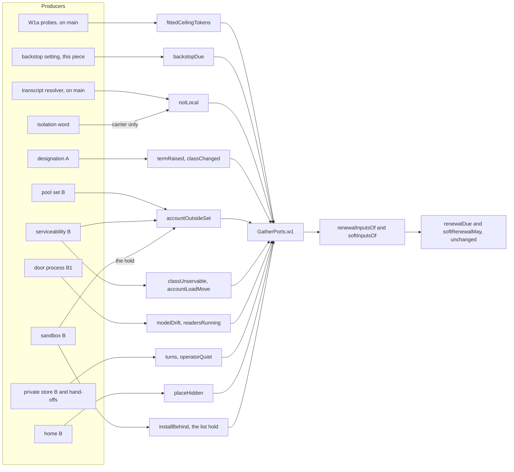
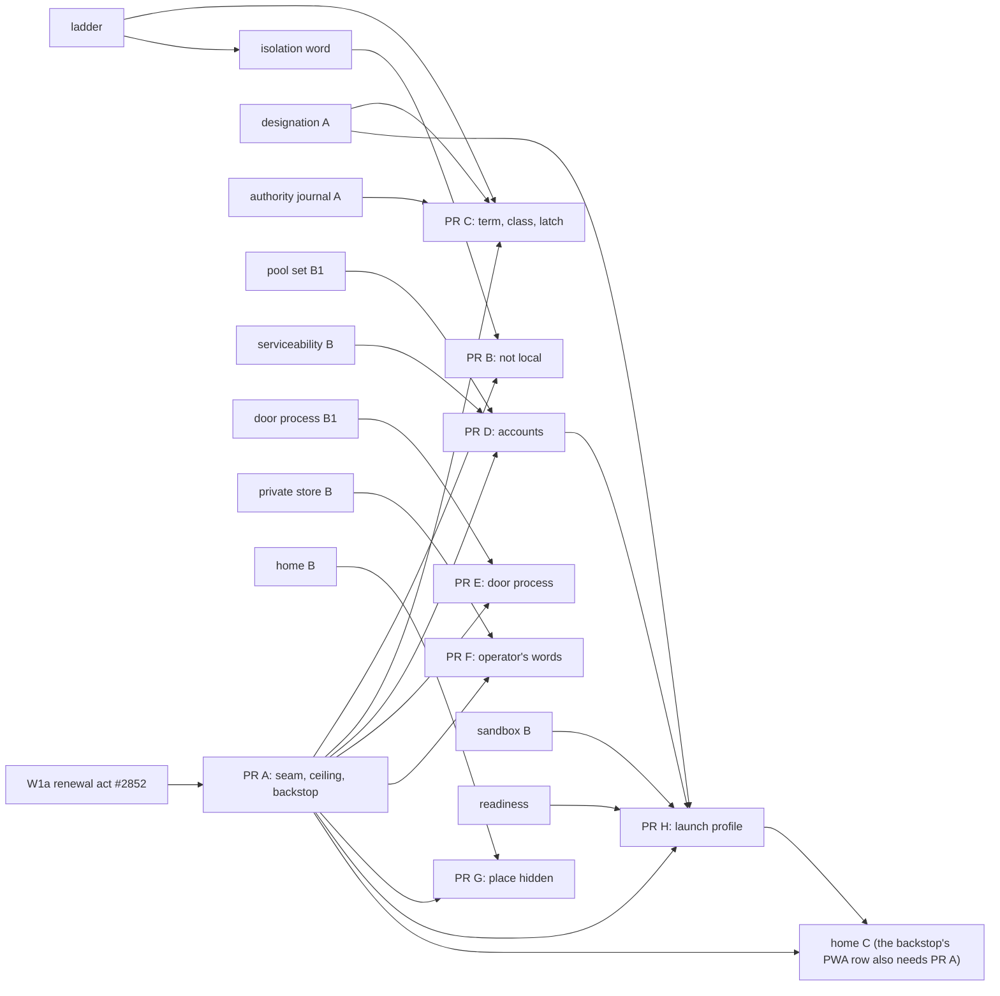

# Overlord W1: the Overlord's renewal readings Implementation Plan

> **For agentic workers:** REQUIRED SUB-SKILL: Use superpowers:subagent-driven-development (recommended) or
> superpowers:executing-plans to implement this plan task by task. Steps use checkbox (`- [ ]`) syntax for tracking.

**Goal:** every row of Table 3.3.11b that reads "later: W1" today reads a measurement, from the one reader of the
piece that produces it, and nothing else changes.

- `server/src/continuity/generationsLane.ts#renewalInputsOf` answers ten `RenewalInputs` fields as `W1`, unmeasured,
  today: `fittedCeilingTokens`, `turns`, `backstopDue`, `modelDrift`, `termRaised`, `accountOutsideSet`,
  `classUnservable`, `accountLoadMove`, `classChanged` and `notLocal`. Each comes to read its producer's answer: a
  `Reading<T>` measured, or unmeasured with the producer's own reason. A reading whose producer has not merged stays
  `W1`, never a default value, and an unmeasured reading never makes a renewal due (`renewalDue` names it in `blind`).
- The soft renewal's three inputs that the renewal act leaves `W1` (`softRenewal.ts#SoftInputs`'s
  `readersRunning`, `operatorQuietObservedMs` and `placeHiddenObservedMs`, for the Overlord) are filled the same way.
- The daily backstop's hour and time zone get their setting, their one writer and their session-gated server door.
- `notLocal` is this piece's own reading: the server's existing transcript resolver, reading the host that runs the
  session through its `FleetIO`, says whether the conversation of the generation's own start is present there. No ccd
  verb is added (fix round 1, F2 and F4).
- The ladder gains its `probes-failed-twice` latch row, raised on a live renewal whose probes fail twice.
- A start that loads something the launch profile does not list holds its account out of the Overlord's ordered list
  until the operator clears it, and renews (§3.6): a held account reads as outside the set, so the existing hard row
  `account-outside-set` renews the Overlord onto a served account (fix round 1, F7).
- The renewal act (#2852) owns every act. This piece supplies inputs, one latch raise and one list filter, and takes
  no act on a session.

**Why:** H13 ("measured triggers, measured preconditions"), Table 3.3.11b, R19, C46, C50, C56, C57 and §3.6. W1a built
`renewalDue` total over its rows and left the Overlord's own readings unmeasured until the pieces that measure them
exist (index slug `renewal-readings-not-rows`). Until they are wired, the Overlord's hard rows for model drift, a
raised term, an account outside the set, an unservable class, the account load and a conversation that is not local
can never fire, and nor can the soft rows for the fitted ceiling, turns, the backstop and a changed class.

**Architecture:** lane A, after W1a's renewal act. The readings ride the gather the renewal act built, and each
producer's piece adds its reading in a pull request of this plan that lands after it.

- `shared/renewal-readings.ts` (L0, K): the backstop's wire shape, its bounds and its default, and `heldOutOfList`,
  the ordered list's hold filter, which designation A's `overlordAccounts` calls (fix round 1, F11: L0, so
  `overlordDesignation.ts` still imports L0 and `poolrule.ts` only).
- `server/src/continuity/renewalReadings.ts` (C3, L1): pure mappers, one per reading, from a producer's answer to a
  `Reading<T>`, and the deciders this piece owns: `backstopDueOf`, `notLocalOf`, `fittedCeilingOf`, `termRaisedOf`,
  `classChangedOf`, `accountOutsideSetOf`, `classUnservableOf`, `accountLoadMoveOf`, `modelDriftInputOf`,
  `probesFailedTwiceOf`, `holdOfStart` and `overlordInstallBehindOf`. It imports L0 and other L1 modules only; the
  part of the transcript resolver's answer it reads is declared here, by the consumer, so it imports nothing from
  the resolver's L3 module.
- `server/src/continuity/renewalReadingsWiring.ts` (C3, L4): one optional gather port, `GatherPorts.w1`, which reads
  every producer for one generation and hands the mappers' answers to the lane, each read inside its own catch. It
  decides nothing. It reads ccd through one read verb only (`pool-answer`), and that is pinned.
- `generationsLane.ts` gains one optional field on `GenReadings` (`w1`) and spreads it over the `W1` defaults in
  `renewalInputsOf`, exactly as the renewal act spreads `GenReadings.soft` over the soft defaults in `softInputsOf`.
- `notLocal` reads the watcher's one memoized `TranscriptResolver` (`server/src/transcript/resolve.ts`), the same
  instance the name sweep and the idle nudge use.

**Tech Stack:** TypeScript (ESM), `node:sqlite` through `CoordStore`, `Intl.DateTimeFormat` for the backstop's time
zone (a global, no import), vitest, the mutation harness under `server/test/sim/`. No new dependency, no new lane row,
no new process, no ccd change.

**Spec:** `docs/superpowers/specs/2026-11-09-overlord-design.md`:

- §3.3.11, H12 and H13: Table 3.3.11b, every row whose "Roles" names `overlord`, and the `not-local` row for
  `coordinator` too (C50); "How long a trigger waits (R19)" with "Early, while away", the Setting and the
  preconditions; "The soft budget"; "`degraded`", with "Probes that fail twice after a renewal also latch the ladder at
  `chat`".
- §3.3.5: the fitted ceiling from closed-book spot probes (C41).
- §3.4: C45 (the model class), C46 (the account set and `ccd pool-answer`), C56 (never one account, "A later drop is
  told", the ordered list and "The server leaves out an account where a start loaded something the profile does not
  list, until the operator clears the item"), C57 (the load lines), Table 3.4b (`stranded`).
- §3.6: "One that the profile does not list refuses `launch-profile-unmet`. The server then leaves that account out of
  the Overlord's ordered list until the operator clears the item, and renews."
- §7.5, Table 7.5a, the row "Probes failed twice after a renewal | latch | cap `chat`".
- §11.5: time through the `Clock` port; observed time for durations (Table 11.5b).
- Table 11.1d, the Settings row: "the daily backstop hour and time zone (W1, where the Overlord's backstop row first
  reads them)", written by "the Settings door, on the operator's own tap".
- Table 13.1: H13 is `shape`, W1a (its table and door shipped there). H16 is `tightening`, W1. No call of this piece
  is a `shape` call of W1, so nothing here is owed to another piece's table or door.
- Appendix B, R19's row "The daily backstop: defaults to an hour inside the quiet hours".

The index is `docs/superpowers/plans/2026-11-14-overlord-w1.md` (on `main`). This plan builds on:

- its row "The Overlord's renewal readings" (lane A, last), and the index row "Isolation word" ("the host identity
  that the renewal readings' `notLocal` report carries (a carrier, not the measurement)");
- question 20 (`ladder-causes-join-with-their-inputs`), whose table gives this piece the row "Probes failed twice after
  a renewal | The Overlord's renewal readings, once W1a's renewal act has merged";
- "Where lanes meet": "`server/src/continuity/generationsLane.ts` and `softRenewal.ts`: W1a's renewal pieces own them.
  Lane A's renewal readings wire the W1 readings in last", the ladder's cause tables, and the door censuses;
- Figure W1's edges into `RR`, the carrier edge from the isolation word among them;
- the slug `renewal-readings-not-rows`.

The coordinator's brief for this plan (run 2181) binds over the index's text: each reading is read through its
producer's one reader and never re-derived; a producer not merged yet reads `unmeasured`, never a default value, and
`unmeasured` never triggers a renewal by itself; the renewal act owns the acts; `notLocal` asks ccd through an
already-granted verb or a new read-only one argued against `CLAUDE.md`; the operator item for an account count below
two (C56) is taken here or given an owner; the backstop's Settings door is the operator's, session-gated; and the
order lets each reading land as its producer does. The cross-plan rulings the brief restates (journal adapters in
authority journal A0, `appendInTx` answering `{ok:false}`, narrowings landing as their row, `designationRead()`'s
three arms, `keep-awake` as a capability token, slugs not numbers) bind here too, and are named where used.

The coordinator's rulings on review 2183 (fix round 1) bind as well. They are named where used as "fix round 1, F<n>"
or "Q<n>", the review's own finding and question numbers: F1 (the set test reads `side`), F2 and F4 (no new ccd verb;
`notLocal` reads the transcript resolver), F3 (the turn guard for `startup` and `clear` only), F5 (an unmeasured
candidate makes the reading unmeasured), F6 (unmeasured grades never count toward the fitted ceiling), F7 (a held
account is outside the set), F8 (the ladder's one raise path), F9 (designation B writes the list before each
`renew`), Q2 (the backstop default), Q5 (the digest mismatch is soft), Q6 (stands), and F10 to F21 as the review
says.

## Open questions

Each has a recommendation, which this plan builds unless the coordinator or the operator rules otherwise.

1. **Who raises the operator item when the Overlord's account count drops below two (C56, "A later drop is told")?**
   The designation plan recommended this piece, "beside `accountOutsideSet`, which reads the same list"
   (`w1-designation.md`, "Renewal readings"). **Recommendation: the readiness piece** (slug
   `count-below-two-item-is-readiness`). Three measured reasons:
   - C56 says "While a `stranded` item names the set as its cause, that item takes this one's place, so one cause
     raises one item". `stranded` and its item are readiness's (index row "Readiness": "serviceability B
     (`stranded`)", "a dead Overlord's one push"). One decider that sees both causes is the only way to keep "one
     cause, one item" without a second writer racing the first.
   - The generations lane is shadow by structure: "The lane imports nothing that sends: no `ccdargv`, no mail store
     method, no push" (the header of `generationsLane.ts`, pinned by `continuity-generations-lane.test.ts`). An item
     raise is a send (it pushes once push outbox B has merged). The renewal act raises items only from its acts
     side, and only for a coordinator: its `raiseDegraded` answers "no programme to raise an item on for role
     overlord" (`server/src/continuity/renewalActs.ts` on the renewal act's branch).
   - The count is not a renewal reading: it never makes a generation due. It is a standing fact about the set, which
     readiness already measures each pass from the same candidates (`overlordLoadCandidates`, serviceability B).

   This piece supplies nothing the readiness piece needs for it: the candidates are serviceability B's, and the count
   is theirs with `serves === 'yes'`. Index change: the readiness row gains "the account-count item (C56), and its
   place behind a `stranded` item".
2. **The backstop's default** (slug `backstop-default-is-a-starting-value`). **Ruled (fix round 1, Q2):** the quiet
   hours R19's result names, if it names them; otherwise 04:00 `UTC`, changeable in Settings, with no operator
   question. R19's result (Appendix B, "The daily backstop": "Defaults to an hour inside the quiet hours") and
   §3.3.11 ("The daily backstop's hour defaults to one inside the quiet hours") name the quiet hours but no hours:
   quiet hours are a W3 Setting with no default value (Table 11.1d: "quiet hours … (W3, with H35)"; §4.2's Settings
   list gives defaults for the push budget and the briefing times, none for quiet hours). So the migration seeds hour
   `4` in the zone `UTC`, marked `isDefault: true`. The backstop is soft, so it waits for a break (R19) whatever the
   hour, and its job in W1 is "at least once a day" (§3.4: "The daily backstop renewal makes this happen at least
   once a day"). The W3 piece that adds quiet hours moves a row still marked default inside them, and leaves an
   operator's choice alone.
3. **`no-depth-holds`** (slug `no-depth-holds-reads-unmeasured`). `fittedCeiling` answers `no-depth-holds` when the
   first depth bucket fails, and "how a consumer maps it is the piece that wires the ceiling"
   (`w1a-probes/departures.md`, `no-depth-holds-is-its-own-answer`). **Recommendation:** `fittedCeilingTokens` reads
   unmeasured `no depth holds`. The soft-ceiling row is then blind, so it never fires: a fresh generation of the same
   model class holds no better, and a 0-token ceiling would renew on every pass up to the soft budget. The hard cap
   still bounds the context. The probe rows stay the evidence, and M8 reports them.
4. **What counts as "the conversation is absent"** (slug `not-local-needs-a-written-conversation`). **Ruled (fix round
   1, F3):** the turn condition applies to `startup` and `clear` starts only. A fresh conversation has no transcript
   file until it has a message, so for those two sources `notLocal` is measured `true` only when the resolver finds no
   file for the start's uuid and the turn marker shows a turn in this generation (`working`, or a stop after the
   start's `reportedAt`); with no turn yet it is measured `false` (nothing is lost), and an unreadable marker makes it
   unmeasured. For `resume` and `compact` the conversation existed before the start (`shared/continuity.ts`'s
   `START_SOURCE_MAP`: "a stored conversation taken up again", "the same conversation, summarised"), so an absent
   transcript is the not-local case at once. `other`, a source word this build does not know, takes the turn
   condition: it can only delay the row, never fire it on a conversation that was never written.
5. **A launch-profile digest mismatch as a renewal reading** (sandbox question 5, ruled there: "a digest mismatch is a
   renewal reading only when the fleet node's build equals the server's … The renewal readings piece builds the
   reading with that condition"). **Ruled (fix round 1, Q5):** a soft trigger, the next soft renewal, because the spec
   says no harder (slug `digest-mismatch-rides-new-install`). §3.6 says the server "renews" with no class, and
   Table 3.3.11b has no digest row. A row-changing digest only comes with a release, which is the "A new ccrc install"
   row's own event, and that row is `soft` (Table 3.3.11b, and §3.3.8: "A new ccrc install is a soft trigger"). So
   no new trigger: for the Overlord, `installBehind` reads measured `true` when the roll's "behind" test is true or the
   start's digest differs from the server's while the builds agree, and unmeasured `build skew` while they differ, so
   a fresh start that ccd would refuse is never asked for (`overlordInstallBehindOf`). A coordinator's `installBehind`
   is unchanged. The spec-fixes run adds the sentence to the `new-install` row. While it waits, the gate's
   `launch-profile-unmet` refuses every Overlord door but card, probe and note (§11.6, its row), which fails closed.
6. **Where the hold's operator item lives** (§3.6: "until the operator clears the item"). The renewal act raises items
   on a coordinator's programme only, and the Overlord claims no programme. **Stands (fix round 1, Q6)** (slug
   `ordered-list-hold-is-a-row`): the hold is a row of its own, `overlord_account_holds`, written by the generations
   pass behind `holdOfStart` and cleared by the operator's session-gated door; the readings' wiring writes nothing
   (F12). The item that tells the operator is raised by the same owner as question 1's (readiness), which reads the
   holds through this piece's one reader. So every Overlord operator item has one raiser, and the hold's fact never
   depends on an item's state. The item's act reaches `clearAccountHold` through the clear door: home C's control
   beside the item, which calls the door.
7. **How home B reports the place hidden** (`softRenewal.ts#SoftInputs`'s `placeHiddenObservedMs`: "Overlord: observed
   time with no Overlord place visible (W1's console report)"). Home B has no plan yet, so this plan takes the
   interface from the spec (R19: "no visible Overlord place for five minutes, which the console reports over its live
   socket") and recommends its shape (slug `place-hidden-is-a-mark`): home B writes the console's "place visible"
   reports as W1a's operator mark under the key `@overlord-place`, whose `quiet` the generations lane already
   advances (`w1a-renewal-handoffs.md`, Task 3), so "observed time since the place was last visible" has the same one
   accumulator as the Overlord's operator quiet (private store question 13, `@overlord`). This piece reads the mark's
   `quiet` through the hand-offs piece's one mark reader. The mark advances its `quiet` between reports, so home B
   reports "visible" while the place stays visible, at a cadence under five minutes (`BREAK_PLACE_HIDDEN_MS`), not
   only on a change; otherwise a place that stays open would read as hidden (review 2183, N3). If home B rules
   otherwise, Task 10 reads whatever single reader home B ships, and the mapping stays this plan's.
8. **The cost of the reads per pass.** The lane runs every `RENEWAL_LANE_PERIOD_MS` (30 s, `shared/continuity.ts`).
   `notLocal` asks the watcher's memoized `TranscriptResolver` once per judged generation (the Overlord and each
   coordinator): a `found` answer is re-checked by one stat of its file, and a `fallback` is held for the resolver's
   own back-off (`RESOLVER_BACKOFF_MS`, 30 s), so a steady pass costs one stat per generation through the agent.
   `accountOutsideSet` asks ccd's `pool-answer` once per pass for the Overlord. **Recommendation:** every pass,
   measured at build on the fleet box with today's count of judged generations and reported in the pull request. If
   one pass's reads pass one second in total, the pull request adds a per-generation cadence (one read per five
   passes) as a memo in the wiring, never a stored fact.

9. **Who writes `acctorder` at a renewal?** **Ruled (fix round 1, F9):** designation B owns a write-set step before
   `renew` (slug `renewal-writes-the-list-before-renew`). Table 11.1a and the designation plan named "the renewal
   lane" as the second writer of the route record's `poolset` and `acctorder`, and no plan wrote it there. This pull
   request edits `w1-designation.md` to match: its PR B gains Task 10, which, before each `renew` of an Overlord
   generation, recomputes `overlordAccounts`' list with the holds and writes the set and the list through the body
   adapter's `writeSet`; its three sentences that gave the write to "the renewal lane" now name that step. It is an
   act, so it is not this piece's ("the renewal act owns the acts"), and the wiring here reads only. PR H ships the
   hold and the filter; the list it filters reaches ccd's fresh start at the next `renew` once designation B has
   merged, and at the next designation door before that.

Questions this plan builds on, with their rulings:

- **Index question 20** (ruled): the `probes-failed-twice` row is this piece's, after the ladder.
- **Index question 16** (settled): a lost witness refuses `unwitnessed`. Not read here.
- **Isolation question 16** (ruled, F10; slug `waking-host-key-in-memory-only`): `wakingHostKey()` answers
  `{ digest, keyEpoch }` or `unmeasured`, compared in memory only, never stored, served or logged.
- **Private store question 13** (ruled; slug `operator-quiet-is-observed-by-the-lane`): the Overlord's
  `operatorQuietObservedMs` is the `@overlord` mark's `quiet`, never a second accumulator.
- **Serviceability question 16** (slug `class-unservable-from-the-server-twin`): `classUnservable` reads the TypeScript
  twin over the tick's readings, and no ccd read is added for it.
- **Pool set question 4** (built; slug `pool-answer-takes-session-flag`): `ccd pool-answer --session <id>`, read `ran`
  first.
- **Designation X7**: `designationRead()` answers `designated`, `not-designated` or `unmeasured`, each with the row's
  view.
- **Door process**: `modelDriftOf` and `readersRunning` are door process B1's (Task 9 there), and the model-switch
  rows reach them from B2.
- **Sandbox question 7** (recommended there): this piece leaves an account out of the ordered list at a later start's
  failure. Question 6 above gives the item to readiness.

## Cross-plan seams

What this piece reads, from whom, and what it does with each answer. Every reader is the producer's own; nothing is
re-derived here.

| Reading | Producer and its one reader | Mapper here | Unmeasured when |
|---|---|---|---|
| `fittedCeilingTokens` | W1a probes, on `main`: `server/src/continuity/probes.ts#fittedCeiling` over closed-book spot probes of the generation's class graded `pass` or `fail`, with `hardCapTokens(window)` | `fittedCeilingOf` | window or class unknown; the probe read failed; `no-depth-holds` (question 3) |
| `backstopDue` | This piece: `renewal_backstop_settings` through `backstopRead()` | `backstopDueOf` | the row is unreadable; the zone is one `Intl` cannot read |
| `notLocal` | On `main`: `server/src/transcript/resolve.ts#resolveTranscript`, through the watcher's memoized `TranscriptResolver`, asked for the start's uuid; carried with the isolation word's `wakingHostKey()` | `notLocalOf` | the identity or the account's config dir is unread; the resolver could not look everywhere (`complete: false`) or threw; the start row is unread; the carrier changed or is unmeasured; for a `startup` or `clear` start, the turn marker is unread |
| `termRaised` | Designation A: `designationRead()`; its raiser is Confirm the restore (authority journal C) | `termRaisedOf` | the designation is unmeasured |
| `classChanged` | Designation A: `designationRead()`'s `model`; its changer is designation C's class door | `classChangedOf` | the designation is unmeasured; the generation predates the stamp |
| `accountOutsideSet` | Pool set B1: `ccd pool-answer` and `server/src/poolrule.ts#parsePoolAnswer`; serviceability B's candidates; this piece's `accountHolds` (PR H) | `accountOutsideSetOf` | not run, refused, unparsed; no set on the route record; `undecidable`; crossing `unreadable`; any candidate unmeasured; the holds unread when the pool verdict alone does not decide |
| `classUnservable` | Serviceability A and B: `shared/serviceability.ts#serviceability` and `server/src/accountLoad.ts#classUnservableReading`, `overlordLoadCandidates` | `classUnservableOf` | the twin answers `unmeasured`; any candidate unmeasured; class unknown |
| `accountLoadMove` | Serviceability B: `accountLoadMoveReading`; the turn marker | `accountLoadMoveOf` | the load reading is unmeasured and the session is not measured busy |
| `modelDrift` | Door process B1: `server/src/continuity/hookReports.ts#modelDriftOf` over `modelSwitchesSince` and the usage sidecar | as answered | its own reasons |
| `readersRunning` (soft) | Door process B1: `hookReports.ts#readersRunning` over `readerEventsSince` | as answered | its own reasons |
| `turns` | Private store B: `OperatorModelStore.messagesSince(startReportedAt)` | as answered | its own reasons |
| `operatorQuietObservedMs` (soft) | Renewal hand-offs (W1a) and private store B: the `@overlord` mark's `quiet` | as answered | its own reasons |
| `placeHiddenObservedMs` (soft) | Home B (question 7) | as answered | its own reasons |
| `installBehind` (Overlord only) | The roll's test (on `main`) and sandbox B's digest and build agreement | `overlordInstallBehindOf` | build skew (question 5) |

*Table 1. The readings and their producers.*


*Figure 1. Each reading comes from one producer's reader, through the one gather port, into the two input builders.
The deciders do not change.*

## What exists today

Measured on `main` at `a7d0c978a` (2026-11-15), and on the renewal act's branch `ws/overlord-renewal-act` at
`22c04d1eb` (#2852, accepted and landing), which every pull request here builds on.

- **The decider.** `server/src/continuity/renewalDue.ts#renewalDue` reads `RenewalInputs`, every field a
  `Reading<T>` (`renewalDue.ts#Reading`) except `role` and `renewNow`. `RENEWAL_ROWS.overlord` holds 21 rows and
  `RENEWAL_ROWS.coordinator` nine, `not-local` among them. A row whose input is unmeasured never fires and is named in
  `blind`. `measuredCount` is the one reader of a measured number. `TRIGGER_CLASS` gives `not-local`,
  `model-drift`, `term-raised`, `account-outside-set`, `class-unservable` and `account-load` the class `hard`, and
  `soft-ceiling`, `turns`, `daily-backstop` and `class-changed` the class `soft`.
- **The input builder.** `generationsLane.ts#renewalInputsOf(g, r, wave, nowMs, probeFailedUnfixed)` answers the ten
  fields above as `W1 = later('W1')`, and `entryRetired` and `evaluationDue` as `W1` too, which stay (W4 and W3).
  Its doc comment on `RenewalInputs.fittedCeilingTokens` says "the caller passes the hard cap until probes fit one".
  On the renewal act's branch the function is unchanged; it moves lower in the file.
- **The gather.** `generationsLane.ts#gatherGenerationReadings(coord, ports, memo)` makes the async fleet reads
  (`GatherPorts`: `usage`, `eventsStamp`, `journalStamp`, `compactions`, `turnMark`, `processStartedAt`, `release`)
  into `GenReadings` (`usage`, `compactions`, `turn`, `behind`). On the renewal act's branch `GatherPorts` gains an
  optional `drainOf`, and `GenReadings` gains optional `drain` and `soft`, the latter
  `Partial<Pick<SoftInputs, 'readersRunning' | 'operatorQuietObservedMs' | 'placeHiddenObservedMs'>>`, "which the
  hand-offs piece's gather and W1 will fill".
- **The soft assembly.** On the renewal act's branch, `generationsLane.ts#softInputsOf` builds `SoftInputs`:
  `readersRunning` is `not-applicable` for a coordinator and `later('W1')` otherwise; `operatorQuietObservedMs` is
  `later('operator-mark')` for a coordinator, `later('W1')` for the Overlord, `not-applicable` otherwise;
  `placeHiddenObservedMs` is `later('W1')` for the Overlord; then `...r?.soft` overrides. So the index's "nothing on
  `main` assembles yet" (F9a) is true on `main` and stale once #2852 lands.
- **The wiring.** `server/src/watch.ts#FleetWatcher.sweepGenerations` builds the gather's ports and calls
  `generationsPass`. On the renewal act's branch it also builds `renewalActsOf(...)` (`renewalWiring.ts`, L4) and
  passes `drainOf: acts.drainOf`.
- **The generation row.** `server/src/continuity/continuityStore.ts#GenRow` carries `term`, `model`, `prevModel`,
  `lane`, `host`, `startId`, `startReportedAt`, `probeRounds` and `observed`. `host` is written `null` at every mint
  (`generationsLane.ts`, the mint input). `GENERATIONS_TERM` is `1` ("the designation's term arrives with W1").
  `StartRow` (`shared/continuity.ts`) carries the start's `uuid`.
- **The machine.** `server/src/continuity/generationMachine.ts`: in `probing`, a `probes` event that did not pass with
  `probeRounds >= 1` steps to `degraded` through `degrade(g)`, whose actions are `release-deliveries` and
  `raise-item`. A `deadline` in `probing` degrades too.
- **The fitted ceiling.** `probes.ts#fittedCeiling(spots, modelClass, hardCap)` answers `{ kind: 'ceiling', tokens,
  fitted }` or `{ kind: 'no-depth-holds' }`. Nothing calls it (`git grep 'fittedCeiling(' server/src`). The probe rows
  are `continuity_probes`, read per generation by `continuityStore.ts#probeRows`; no read gathers spot probes across
  generations by class. Closed-book grading is `unmeasured` until door process B1 (`w1a-probes.md`,
  `closed-book-is-unmeasured-in-w1a`), so the ceiling is the hard cap, `fitted: false`, until then. `ProbeGrade`
  (`shared/continuity.ts`) has three words, `pass`, `fail` and `unmeasured` (the door could not grade the question
  as served), and `fittedCeiling` counts every spot it is given toward its window but only `pass` toward the rate, so
  an `unmeasured` grade handed to it would lower the ceiling (review 2183, F6).
- **The usage sidecar.** `shared/api.ts#SessionUsage` carries `model`, `class`, `ctxTokens`, `ctxWindow`, `ts` and
  `stale` (through `server/src/usage.ts#UsageRead`).
- **Settings rows.** Each operator setting is one row of its own table with a session-gated door, for example
  `plain_memory_settings` with `GET`/`POST /api/coord/plain-auto-memory` (commit `6f408451d`, W1a launch profiles
  PR B). That commit's census edits are the measured list a settings door touches: `server/src/auth/gate.ts`'s route
  count comment, `server/test/auth-gate.test.ts` (`scanRoutes` and `ROUTES.length`), `server/test/coord-pause-route.test.ts`,
  `server/test/secret-mask.test.ts` (a reasoned entry for an unmasked `GET`), `server/test/coordinator-skill.test.ts`
  (for `coord/routes.ts` only), `CLAUDE.md`'s box-token paragraph, `server/test/coord-db.test.ts`,
  `server/test/run-close-switch.test.ts`.
- **The continuity routes.** `server/src/continuity/routes.ts` registers the start report, card, notes, handover,
  timers and probe doors. Its two operator doors, `GET /api/sessions/:id/timers` and
  `POST /api/sessions/:id/timers/:timerId/cancel`, are `box-token-census.test.ts#CONTINUITY_SESSION_DOORS`, checked in
  both directions against the file, and named in `CLAUDE.md`'s box-token paragraph. The file is not growth-checked
  (`server/test/growthCheck.ts#GROWTH_FILES`). `coordinator-skill.test.ts` reads only `coord/routes.ts` and
  `reviewRoundsRoute.ts`.
- **The server's transcript resolver.** `server/src/transcript/resolve.ts#resolveTranscript(io, o)` walks §5.1's
  ladder over `FleetIO` (the fleet box's agent in remote mode) and answers a `TranscriptResolution`: `found`, with its
  rung, the uuid the answered path holds and optional `followedFrom`, `declinedTo` and `tailUnmeasured`; or
  `fallback`, with `complete`, where `complete: false` means "could not look everywhere" (a `readdir` answered null)
  and `true` means it looked and found nothing. Without `foreign` it never looks under another account (rung 6). The
  watcher holds one memoized instance (`server/src/watch.ts#FleetWatcher`'s `transcripts`, a `TranscriptResolver`),
  which the name sweep and the idle-compaction nudge ask with `configDirFor(cfg, wrapper)` and the registry workdir
  from `measuredIdentity(rec)`. In remote mode there is no live-cwd realpath, so the live rungs do not answer and the
  registry rungs and the uuid glob do.
- **The start reads.** `continuityStore.ts#startsSince(db, sinceId, limit)` and `startsOf(db, sessionId, limit)`. The
  second answers a session's newest N starts and takes no id, so a generation's own start can fall out of its window
  after enough later starts (review 2183, F16). No read takes a start by its id.
- **ccd libraries.** `ccd/lib/pool-set.sh` is on `main` (pool set A1, `58e0440d9`). This piece adds no ccd code.
- **Not on `main`:** the renewal act (#2852), the renewal hand-offs (operator marks), the designation, the ladder, the
  authority journal, the isolation word, pool set B, serviceability A and B, ccd's Overlord arms, door process B,
  private store B, home B and sandbox B. Each task names its interface from that piece's merged plan.

## Global Constraints

- **Architecture (`CLAUDE.md`).**
  - **One writer per fact.** The backstop row has one writer, `continuityStore.ts#setBackstop`, called only by the
    door. `designatedClass` on `continuity_generations` has one writer, the mint (the generations lane, already the
    table's one writer). `overlord_account_holds` has two writers, each a different move of the same fact: the hold
    (`holdAccount`, called only by the generations pass, behind `holdOfStart`) and the clear (`clearAccountHold`,
    called only by the operator's door); `writers-map.test.ts` names both. The wiring writes nothing. The latch row is the ladder's: this piece calls `raiseLatch`, the ladder's one
    writer. Every reading is its producer's; the mappers only map.
  - **Decide in L1, act in L4.** Every mapper and decider is in `renewalReadings.ts`, which imports L0 and L1 only. The
    wiring reads ports and calls mappers, and decides nothing. The lane's latch call is one line behind
    `probesFailedTwiceOf`.
  - **Consolidate.** No second gather, no second lane, no second accumulator, no second pool or serviceability
    decider, and no second transcript lookup: `notLocal` asks the server's one resolver, through the watcher's one
    memoized instance, and adds no ccd verb (fix round 1, F4). The one ccd read (`pool-answer`) uses the existing
    runner and capability check.
  - **No overloaded null at a seam.** Every reading is a `Reading<T>`; every port answer keeps the producer's arms.
    The resolver's `fallback` keeps `complete: true` (looked, nothing there) apart from `complete: false` (could not
    look everywhere), and `notLocalOf` maps them to measured and unmeasured.
- **Monotonic.** A reading is measured only from a measured answer. Every unmeasured arm stays unmeasured with its
  reason. A measured `false` is written only where the producer's answer decides the row (a busy session, a crossing
  that stands, no account to land on). An unmeasured candidate never folds into a proven absence: any candidate whose
  `serves` is `unmeasured` makes a candidate-reading reading unmeasured (fix round 1, F5). Each mapper has a test that
  replacing any measured input with its unmeasured arm never turns a `false` into a `true`.
- **Failure contracts (fail closed).**

  | Case | What the reading reads |
  |---|---|
  | The producer's piece has not merged | `W1`, as today |
  | A port is absent (a test, the simulator, an older wiring) | `W1`, as today |
  | One producer's read throws | that reading only: unmeasured `<reading> read failed`, caught per reading inside `renewalReadingsOf`, logged once per pass; the other readings and the other generations are unaffected (review 2183, F17) |
  | The resolver cannot look everywhere (an agent read timed out, a directory unreadable) | `complete: false`: unmeasured `transcript search incomplete` |
  | An older agent with no `pool-answer` row | `not-run`: unmeasured |
  | No designation | Overlord-only readings measured `false` (the row does not apply); `notLocal` for a coordinator unchanged |
  | The designation unreadable | unmeasured `designation unreadable` |
  | An older build reading `continuity_generations` with `designatedClass` | ignores the column; rows it mints leave it `NULL`, read unmeasured |
  | An older build opening a file with this piece's migrations | rule 3 of the migration runner: it warns, reads as-is and boots |

- **Shadow.** Every reading only changes the due record (`setGenerationDue`) and `blind`, which the lane writes in
  shadow and live alike. Nothing here acts. The latch is raised only on a live step (Task 6). The list hold changes
  what ccd picks only at a fresh start, which only the renewal act's live walk or the operator asks for.
- **Time.** Every time comes from the pass (`now`, the `Clock` port's wall time). The backstop is a wall-clock hour by
  definition; a wall step can make it due early once, which the soft budget bounds (three in six hours). Durations are
  observed (`quiet.ms`), never wall differences.
- **The public repository.** No host, path, account or pool name in any fixture: `lane-a`, `pool-a`, `project-a`.
  Time zones in fixtures are IANA names (`UTC`, `Europe/Berlin`, `America/New_York`), which name no deployment.
- **Mutation.** Every new L1 function joins `MUTANT_SETS` (`server/test/sim/mutation-floors.test.ts`) through a new
  `server/test/sim/renewalReadingSets.ts`, with floors in `server/test/sim/mutation-floors.json`, in the pull request
  that creates it. Every guard ships with the test that goes red without it, measured before and after.
- **Tests run through `ccrc test -- …`** (worker clause 18), one file at a time from inside the package.

## Review Focus

1. **Never a default.** For each reading, the producer-not-merged case reads `W1`, and each unmeasured arm of the
   producer reaches `renewalDue` unmeasured with its reason. The spread in `renewalInputsOf` cannot turn an absent
   field into anything but the default.
2. **Hard rows that fire wrongly are the cost.** `notLocal`, `accountOutsideSet`, `classUnservable`, `accountLoadMove`,
   `termRaised` and `modelDrift` are hard: a false `true` drains at the next turn end. Each has a test for every
   case its spec row says is not due (a crossing that stands, nothing to land on, a busy session, a rebind's other
   session, a conversation never written).
3. **`notLocal` reaches coordinators.** It is the one reading here that changes a coordinator's due record. Check that
   it asks for the start's own uuid, the turn guard (for `startup` and `clear` only), the carrier bracket, and that a
   coordinator's other inputs are untouched.
4. **`notLocal` never reads "could not look" as absent.** A `complete: false` fallback, an unread identity or config
   dir, and a thrown resolver each read unmeasured; the resolver is asked without `foreign`; and the wiring names no
   `CCD_ARGV` member but `poolAnswer`.
5. **The backstop's instant across daylight saving.** The gap and the fold each have a test, and the instant is never
   after `now`.
6. **The latch only on a live step,** never on a shadow walk, and only for the Overlord.
7. **The hold cannot fail open or strand.** A hold leaves the account out of the list and makes the account read as
   outside the set; a list that would be empty after the holds is written as it was, with the holds reported, never
   empty; and clearing the hold lets the account serve again.
8. **Censuses.** The two backstop doors, the hold's door, the two new tables, the new column and the new L1 module
   each touch every site named in their task.

## The PR split

One pull request per producer, each landing after its producer (brief: "plan the order so each reading lands as its
producer does"; slug `readings-in-several-prs`). Every pull request leaves the rest at `W1`.

| PR | Tasks | What it ships | Needs first | Growth-checked files, estimate |
|---|---|---|---|---|
| A, the seam, the ceiling and the backstop | 1, 2 | `shared/renewal-readings.ts`; `renewalReadings.ts` with `fittedCeilingOf` and `backstopDueOf`; `renewalReadingsWiring.ts` with `GatherPorts.w1`; `GenReadings.w1` and its spread; the spot-probe read; `renewal_backstop_settings`, its store and its two doors | the renewal act (#2852) | `server/src/coord/schema.ts` about +16 (one migration); `server/src/coord/store.ts` about +3 (three delegates); `server/src/watch.ts` about +2 (the wiring's construction and `w1:`); `server/src/server.ts` about +2 (the doors' deps); `shared/api.ts` 0; `server/src/coord/routes.ts` 0 |
| B, not local | 3, 4 | `startById`; the resolver handed to the wiring; `notLocalOf`; the carrier bracket | PR A, the isolation word (and so, behind it, the ladder and designation A) | `server/src/coord/store.ts` about +1 (the `startById` delegate); `server/src/watch.ts` about +1 (the watcher's resolver into the wiring's deps); no ccd file |
| C, the designation's readings and the latch | 5, 6 | `termRaisedOf`, `classChangedOf`, `designatedClass` stamped at the mint, `probesFailedTwiceOf` and the ladder's `probes-failed-twice` row | PR A, designation A, the ladder, authority journal A (the ladder's raise appends to it) | `server/src/coord/schema.ts` about +8 (one migration, one column); `server/src/coord/store.ts` 0; `server/src/watch.ts` 0 |
| D, the account readings | 7 | `accountOutsideSetOf`, `classUnservableOf`, `accountLoadMoveOf`; the pool-answer read; the candidates read once per pass | PR A, pool set B1, serviceability B (and so designation A and the ladder) | `server/src/watch.ts` about +2 (the limits and shares reads into the wiring's deps; 0 if serviceability B already hands the wiring its `AccountFacts`); others 0 |
| E, the door process's readings | 8 | `modelDrift` and the soft `readersRunning` | PR A, door process B1 | `server/src/coord/store.ts` 0 to +2 (delegates, if door process B1 adds none); others 0 |
| F, the operator's words | 9 | `turns` and the soft `operatorQuietObservedMs` | PR A, private store B (and so the renewal hand-offs) | `server/src/watch.ts` 0 to +1 (`operatorModel` into the wiring's deps); others 0 |
| G, the place hidden | 10 | the soft `placeHiddenObservedMs` | PR A, home B | 0 |
| H, the launch profile | 11 | `overlord_account_holds`, its store, its operator door and its reader; `heldOutOfList` in the ordered list; the hold read into `accountOutsideSet`; `overlordInstallBehindOf` | PR A, PR D, sandbox B, designation A, readiness (the hold's item) | `server/src/coord/schema.ts` about +16 (one migration); `server/src/coord/store.ts` about +4; `server/src/server.ts` about +2 (the door's deps; up to +4 if the designation doors' `AccountFacts` is built in `server.ts`); `server/src/watch.ts` 0 to +2 (the holds into the facts the watcher builds) |

*Table 2. The pull requests. Every estimate is under the 40-line check; none needs a waiver.*

Each pull request also grows `renewalReadings.ts`, `renewalReadingsWiring.ts` and their tests (not growth-checked),
and `generationsLane.ts` only in PR A (about +8: `GenReadings.w1`, `GatherPorts.w1`, the gather's call, the spread)
and PR C (about +10: the mint's stamp and the latch call). `generationsLane.ts` is not in `GROWTH_FILES`.

**Order.** PR A first, after #2852. Then each of B to G when its producer merges, in any order, and H after D. No
pull request of this plan waits on W1a beyond the renewal act, but none is early: the isolation word needs the ladder
(the index's row "Isolation word"), and the ladder needs designation A, so PR B lands no sooner than PR C's
producers; D and H are the latest (pool set B, serviceability B and readiness, and behind them designation A and the
ladder). A second pull request that lands beside another of this plan merges `main` once (worker clause 16) and
re-measures its migration slot.


*Figure 2. Each pull request after its producer. Home C's Settings row needs PR A's door; its account-hold control
needs PR H's.*

**The hold's window** (review 2183, F19). PR H lands after readiness, so the operator item that names a hold is
raised from the first hold. Until home C ships the clear control beside that item, the clear door exists but no
console control calls it, so a hold stands until home C merges. A hold only narrows: it leaves one account out of the
list and renews the Overlord off it, and the never-empty arm (Review Focus 7) keeps a list. So the window costs at most
one account out of rotation, never an Overlord with nowhere to start.

## Index changes

What the index should change, for the coordinator to fold in:

- **Table W1, the row "The Overlord's renewal readings":** size "8 PRs, 11 tasks", not "1 PR, 5 tasks", and "Needs
  first" per Table 2 here: A after the renewal act; B after the isolation word (and so the ladder and designation A);
  C after designation A, the ladder and authority journal A; D after pool set B1 and serviceability B; E after door
  process B1; F after private store B; G after home B; H after PR D, sandbox B, designation A and readiness. "What it
  ships" adds: `notLocal` read from the server's transcript resolver (no ccd verb); `designatedClass` stamped on the
  generation at its mint (for `classChanged`); the hold table `overlord_account_holds` with its operator door, a held
  account reading as outside the set; and the digest reading folded into the Overlord's `installBehind`. It drops
  "the operator item for a count below two", which goes to readiness (question 1). The phrase "which nothing on
  `main` assembles yet" (F9a) becomes "which the renewal act assembles, leaving them `W1`". The sentence "it asks ccd
  on the waking host whether the conversation is present there (ccd is the only component that names Claude Code's
  on-disk layout)" (F9b) becomes "it asks the server's transcript resolver, which reads the waking host through its
  `FleetIO`, whether the start's conversation is present there" (fix round 1, F4: the resolver falsifies F9b's
  premise).
- **The lane column:** "A, last" becomes "A, after each producer".
- **Table W1, the row "Readiness":** adds "the account-count item (C56), behind a `stranded` item naming the set" and
  "the operator item for an account the renewal readings hold out of the ordered list" (questions 1 and 6).
- **Table W1, the row "Designation", PR B:** adds "the set and the ordered list written before each `renew` of the
  Overlord" (question 9, ruled F9; `w1-designation.md` Task 10, edited in this pull request).
- **Table W1, the row "Serviceability and limits", PR B:** `accountLoadMoveReading` reads unmeasured when any counted
  other is unmeasured and none decides, never "no counted other" (fix round 1, F5: the same fold as here).
- **The serviceability and sandbox rows** that hand §3.6's "and renews" to this piece: it is the `account-outside-set`
  hard row, over a held account (F7).
- **Table W1, the row "Home and Settings", PR C:** adds the account-hold clear control beside the account rows, after
  PR H here. Home B's row adds "the place-visible report as the `@overlord-place` mark, sent while visible at a
  cadence under five minutes" (question 7), if ruled.
- **Figure W1:** the single `RR` node becomes the eight pull requests of Figure 2, or keeps one node with its edges:
  `RA --> RR`, `ISO --> RR` (already, the carrier), `DA --> RR` (new, through C and H), `LD --> RR` (new, through C),
  `AJA --> RR` (new, through C), `RD --> RR` (new, through H), `PB --> RR`, `SVB --> RR`, `DPB --> RR`,
  `PSB --> RR`, `HMB --> RR`, `SB --> RR` (new, through H). `DC --> RR` and `AJC --> RR` are no longer needed: the
  readings read the designation through designation A's reader, and the term and class changes reach them with no
  further pull request (slug `readings-wire-at-their-reader`). No `CA --> RR` edge: this piece adds no ccd code.
- **"Where lanes meet":** add
  - `server/src/continuity/routes.ts`: this piece adds the backstop's two operator doors and the hold's clear door,
    beside the timer doors;
  - `continuity_generations`: designation A re-stamps `term` and `identity`; this piece adds and stamps
    `designatedClass` at the mint;
  - designation A's ordered-list function (`overlordAccounts`): this piece adds the holds as an input (PR H), through
    `shared/renewal-readings.ts#heldOutOfList`;
  - `server/src/continuity/renewalActs.ts#renew`: designation B adds the write-set step before `renew` (question 9);
  - `server/src/watch.ts`'s `TranscriptResolver`: this piece adds a third asker (`notLocal`), beside the name sweep
    and the idle nudge.
- **Spec fixes:** the six listed under "Spec fixes" below.

## Tasks

### Task 1: The readings' module, the seam into the input builders, and the fitted ceiling (PR A)

**Files:**

- Create: `shared/renewal-readings.ts` (L0, K): `RenewalBackstop` (`{ hour: number; zone: string; isDefault: boolean;
  setAt: number }`), `BACKSTOP_HOURS` (0 to 23), `BACKSTOP_DEFAULT` (`{ hour: 4, zone: 'UTC' }`, question 2),
  `isBackstopZone(zone)` (true when `Intl.DateTimeFormat` accepts it); `heldOutOfList` joins it in PR H.
- Create: `server/src/continuity/renewalReadings.ts` (C3, L1): `W1Inputs` (the type of the ten fields:
  `Pick<RenewalInputs, 'fittedCeilingTokens' | 'turns' | 'backstopDue' | 'modelDrift' | 'termRaised' |
  'accountOutsideSet' | 'classUnservable' | 'accountLoadMove' | 'classChanged' | 'notLocal'>`, plus
  `installBehind` for PR H), `fittedCeilingOf`.
- Create: `server/src/continuity/renewalReadingsWiring.ts` (C3, L4): `renewalReadingsOf(deps, coord, records)`
  answering `{ w1(g, base): Promise<{ w1: Partial<W1Inputs>; soft: GenReadings['soft'] }> }`, with a per-pass memo of
  the fitted ceiling by class. `records` is the pass's `SessionRecord[]`, the same array `sweepGenerations` already
  hands `renewalActsOf`. Each producer's read and its mapper run inside their own `try`: a throw sets that one field
  to unmeasured `<reading> read failed` and is logged once per pass, so one failing producer never rejects the pass
  (review 2183, F17).
- Modify: `server/src/continuity/generationsLane.ts`: `GenReadings.w1?: Partial<W1Inputs>`; `GatherPorts.w1?`; the
  gather calls it after the base reads and sets `w1` and merges `soft`; `renewalInputsOf` spreads `...r?.w1` after its
  defaults (the `soft` spread is the renewal act's).
- Modify: `server/src/continuity/continuityStore.ts`: `closedSpotProbes(db, modelClass)`, the graded closed-book spot
  probes of a class (`kind = 'spot'`, `book = 'closed'`, `grade IN ('pass', 'fail')`, `depthTokens` not null), as
  `SpotProbe[]`, or `{ ok: false, detail }`; one statement, no new index (the table holds one row per question
  asked). An `unmeasured` grade never counts toward the ceiling's window or its rate (fix round 1, F6): the door could
  not grade the question as served, which says nothing of the session's recall.
- Modify: `server/src/coord/store.ts` (one delegate, `closedSpotProbes`); `server/src/coord/ports.ts`
  (`WatcherCoordPort` gains it, as the renewal act's members were added).
- Modify: `server/src/watch.ts#FleetWatcher.sweepGenerations` (`const w1 = renewalReadingsOf(this.deps, coord,
  records)` and `w1: w1.w1` in the ports: about +2).
- Modify: `server/test/continuity-generations-lane.test.ts`'s import allow-list for `generationsLane.ts` gains
  `./renewalReadings.js` (a type import here; Task 6 adds a value import), in the pull request that adds the import.
- Create: `server/test/continuity-renewal-readings.test.ts`, `server/test/continuity-renewal-readings-wiring.test.ts`,
  `server/test/sim/renewalReadingSets.ts`.
- Modify: `server/test/continuity-generations-lane.test.ts` (the spread), `server/test/sim/mutation-floors.test.ts`
  and `mutation-floors.json`, `server/test/continuity-generations-store.test.ts` (the new read).

**The seam.** The renewal act already built the shape this piece copies: a gather port (`drainOf`) and an optional
reading (`soft`) spread over the lane's defaults. `w1` is the same shape for `RenewalInputs`:

```ts
// generationsLane.ts
export interface GenReadings { /* … the renewal act's fields … */ readonly w1?: Partial<W1Inputs> }
export interface GatherPorts { /* … */ w1?(g: GenRow, base: GenReadings): Promise<Pick<GenReadings, 'w1' | 'soft'>> }
// renewalInputsOf's return: the defaults as today, then `...r?.w1`.
```

The wiring answers only the fields whose producer is wired in that pull request. A field it does not answer keeps the
lane's `W1`. The gather passes the base readings (`usage`, `turn`) so a mapper that needs them reads the same sample.

**The fitted ceiling.** For an `overlord` generation, `fittedCeilingOf(g, window, spots)`:

```ts
export function fittedCeilingOf(modelClass: string | null, window: Reading<number>,
  spots: { ok: true; spots: readonly SpotProbe[] } | { ok: false; detail: string }): Reading<number>;
```

- class `null` (the start's model unknown): unmeasured `model unknown`;
- the window unmeasured (or not a positive size): unmeasured with its reason (the cap needs it);
- the spots unread: unmeasured `probes unread: <detail>`;
- `fittedCeiling` answers `ceiling`: measured `tokens`, `fitted` or not (the hard cap until fitted, as
  `RenewalInputs`' comment and `w1a-probes.md` say: slug `fitted-ceiling-is-the-producers-answer`);
- `no-depth-holds`: unmeasured `no depth holds` (question 3).

Other roles: the field is not wired (their rows do not read it).

- [ ] **Step 1: Failing tests** (`continuity-renewal-readings.test.ts`): each arm above; the hard cap from
  `hardCapTokens(window)`; a class with no closed spots reads the hard cap; open-book and other-class spots ignored
  (through `fittedCeiling`, so one case, not a copy of its suite).
  (`continuity-generations-lane.test.ts`): with no `w1`, every one of the ten fields reads `W1` as today; with `w1`
  naming one field, only that field changes; `renewalDue` over a `w1` with a measured soft ceiling past 60% fires
  `soft-ceiling` for the Overlord and is blind on it with no `w1`.
  (`continuity-renewal-readings-wiring.test.ts`): a coordinator generation gets no `fittedCeilingTokens`; the spot
  read is made once per class per pass (a counting fake); a spot read that throws makes `fittedCeilingTokens`
  unmeasured `fitted ceiling read failed`, leaves every other field as its port answers, and the pass completes for
  every other generation (F17).
  (`continuity-generations-store.test.ts`): `closedSpotProbes` returns only closed spots of the class graded `pass`
  or `fail`, never a row graded `unmeasured` under `book = 'closed'` (F6), and `{ ok: false }` on a closed
  database.
- [ ] **Step 2: Run.** `ccrc test -- ./node_modules/.bin/vitest run test/continuity-renewal-readings.test.ts` and the
  other three files. Red.
- [ ] **Step 3: Implement.**
- [ ] **Step 4: Run** the four files, `continuity-generations-lane.test.ts`, `sim/generation-day.test.ts`,
  `test/rings/*`, `single-definition/*` and `ccrc test -- npx tsc --noEmit -p test/tsconfig.tests.json`. Green.
- [ ] **Step 5: Mutation.** `fittedCeilingOf` joins `MUTANT_SETS` through `renewalReadingSets.ts`: map `no-depth-holds`
  to 0, drop the window check, read `fitted` as a gate. By hand: remove the spread in `renewalInputsOf` (the one-field
  case goes red); widen the store's grade filter to `grade IS NOT NULL` (the unmeasured-grade case goes red); drop the
  wiring's per-reading `try` (the throwing-port case goes red). Floors in `mutation-floors.json`.
- [ ] **Step 6: Commit.** `feat(continuity): the renewal readings' seam, and the fitted ceiling read from the probes (Overlord W1)`

### Task 2: The backstop: its setting, its door and its reading (PR A)

**Files:**

- Modify: `server/src/coord/schema.ts` (one migration: `renewal_backstop_settings`, one row, seeded with
  `BACKSTOP_DEFAULT` and `isDefault = 1`; the slot re-measured at build and before merge, as every migration says).
- Modify: `server/src/continuity/continuityStore.ts` (`backstopRead(db)`: `{ ok: true, backstop }` or `{ ok: false,
  detail }`, narrowing the row through `BACKSTOP_HOURS` and `isBackstopZone`; `setBackstop(db, { hour, zone, at })`,
  one `tx()`, writes `isDefault = 0`); `server/src/coord/store.ts` (two delegates).
- Modify: `server/src/continuity/routes.ts` (`GET /api/continuity/renewal-backstop` and `POST
  /api/continuity/renewal-backstop`); `ContinuityRouteDeps` gains `backstop: { read(); set() }`, declared there.
- Modify: `server/src/server.ts` (the deps binding, about +2).
- Modify: `server/src/continuity/renewalReadings.ts` (`backstopInstantBefore`, `backstopDueOf`);
  `renewalReadingsWiring.ts` (reads the row once per pass).
- Census: `server/src/auth/gate.ts` (the header's route count, +2); `server/test/auth-gate.test.ts` (`ROUTES.length`
  +2 and its comments; the gated count; not EXEMPT); `server/test/box-token-census.test.ts`
  (`CONTINUITY_SESSION_DOORS` is keyed by path, one entry per registration, so the one backstop path is listed
  twice, once for the `GET` and once for the `POST`); `CLAUDE.md`'s box-token paragraph (the continuity sentence names
  the two doors, session-gated, no box token); `server/test/secret-mask.test.ts` (a reasoned entry for the `GET`:
  "an hour, an IANA zone name, a flag and a time: no session text"); `server/test/rings/fastify-l4.data.ts` (the
  continuity routes' reason gains "the renewal backstop"); `server/test/coord-db.test.ts` (the migration's describe
  and its count); `server/test/run-close-switch.test.ts` (its undo step and count);
  `server/test/single-definition/writers-map.test.ts` (`TABLES` gains `renewal_backstop_settings`, writer
  `setBackstop`).
- Create: `server/test/renewal-backstop-route.test.ts`.

**The door.** The operator's, session-gated when sign-in is armed, never EXEMPT, consulting no box token, the
`plain-auto-memory` shape. `GET` answers `{ ok: true, hour, zone, isDefault, setAt }`. `POST { hour, zone }` refuses
`bad-request` with a detail for an hour outside 0 to 23, a non-integer, or a zone `isBackstopZone` refuses, and on a
store failure answers 503 `unmeasured`. No step-up: the backstop grants no authority (Table 11.1d: "behind the
step-up where the change widens authority"), and it is not journalled (§7.6 journals authority only). The door lives in
`continuity/routes.ts`, beside the timer doors, because the setting is the renewal lane's (C3) and the file is not
growth-checked (slug `backstop-door-in-continuity-routes`).

**The reading.** For an `overlord` generation:

```ts
/** The latest instant at or before `nowMs` at which the wall clock in `zone` reads `hour`:00, or null for a zone Intl
 *  cannot read. In a daylight-saving gap the hour does not exist that day, and the instant is the first one after the
 *  gap. In a fold the hour happens twice, and the instant is the first. */
export function backstopInstantBefore(nowMs: number, hour: number, zone: string): number | null;
/** Due when the generation started before the latest backstop instant: it has lived through one. */
export function backstopDueOf(b: { ok: true; backstop: RenewalBackstop } | { ok: false; detail: string },
  startReportedAt: number, nowMs: number): Reading<boolean>;
```

- the row unread: unmeasured `backstop unread: <detail>`;
- the instant `null`: unmeasured `zone unreadable`;
- otherwise measured `startReportedAt < instant`.

One renewal clears it: the next generation starts after the instant. The soft budget and the break bound the rest
(R19). A generation minted minutes before the hour is due at the hour too: the spec allows it ("at least once a
day"), the least age (`LEAST_AGE_MS`) holds it until it has lived that long, and the soft budget bounds the count
(review 2183, N4).

- [ ] **Step 1: Failing tests.** `backstopInstantBefore`: `UTC` at 03:59 and 04:00 and 04:01; a zone east and one west
  of UTC; the spring gap in `Europe/Berlin` (02:00 does not exist on its last Sunday of March) and the autumn fold
  (02:00 twice on the last Sunday of October), each against a fixed instant; the answer is never after `now`.
  `backstopDueOf`: each arm. The door: `GET` with the seeded row; a good `POST` and its read; each refusal; the store
  failing; with sign-in armed and no session, 401 (the gate); the box token is neither needed nor enough. The store:
  the seed, the narrowing of a hand-written bad row to `{ ok: false }`, `isDefault` cleared by a set. The wiring:
  the row read once per pass; a coordinator gets no `backstopDue`.
- [ ] **Step 2: Run.** Red.
- [ ] **Step 3: Implement.**
- [ ] **Step 4: Run** the new suites, `auth-gate`, `box-token-census`, `secret-mask`, `coord-db`,
  `run-close-switch`, `single-definition/*`, `test/rings/*`, `continuity-generations-lane`, and the `tsc` run. Green.
- [ ] **Step 5: Mutation.** `backstopInstantBefore` and `backstopDueOf` join the sets: `<` for `<=` at the instant,
  the fold's second occurrence, the gap's earlier instant, a day added instead of taken. Floors.
- [ ] **Step 6: Commit.** `feat(continuity): the daily backstop's hour and zone, its door and its reading (R19, Overlord W1)`

**PR A ends here.** What its merge arms: nothing acts. The soft-ceiling and backstop rows read measurements for an
Overlord generation, which does not exist until the operator designates one.

### Task 3: `notLocal`'s reads: the start by its id, and the transcript resolver (PR B)

**Why the resolver is the one reader** (fix round 1, F2 and F4; slug `not-local-reads-the-transcript-resolver`). The
question "is this conversation's transcript on the host that runs the session" already has one owner on the server:
`server/src/transcript/resolve.ts#resolveTranscript`, which walks §5.1's ladder over `FleetIO`, so in remote mode it
reads the fleet box through the agent, exactly the host the session runs on. It keeps the distinction this reading
turns on: `fallback` with `complete: true` (it looked everywhere it may, and nothing is there) against
`complete: false` (a directory listing answered null, so it could not look). A new ccd verb over `_transcript_path`
would have folded the second into the first (`_transcript_path` answers an unchecked guess when it cannot search,
review 2183 F2), and would have been a second lookup of the same fact beside the resolver, which `CLAUDE.md`'s
"consolidate, don't duplicate" forbids without a recorded reason, and none exists. The watcher already holds one
memoized `TranscriptResolver` for its name sweep and idle nudge; `notLocal` is its third asker. Asked without
`foreign`, it never looks under another account: a conversation copied to another account is not "here" for the
account the session runs on.

**Files:**

- Modify: `server/src/continuity/continuityStore.ts` (`startById(db, id)`: `{ ok: true, row: StartRow | null }` or
  `{ ok: false, detail }`, one statement by primary key, the source word read through `startSourceOf` as
  `startsSince` does); `server/src/coord/store.ts` (one delegate); `server/src/coord/ports.ts` (`WatcherCoordPort`
  gains it). A generation's own start is read by its `startId`, never through `startsOf`'s newest-N window, which a
  run of later `/clear` or compact starts would push it out of (review 2183, F16).
- Modify: `server/src/continuity/renewalReadingsWiring.ts`: its deps gain `transcript(o: ResolveOpts):
  Promise<TranscriptResolution>`, which `watch.ts` binds to its own `transcripts.resolve` (about +1 in `watch.ts`).
  For a generation, the wiring finds the session's record in `records`, takes `measuredIdentity(rec)` and
  `configDirFor(cfg, wrapper)`, and asks `transcript({ configDir, dir: workdir, registryWorkdir: workdir, uuid:
  start.uuid })`, never with `foreign`. The live cwd is not used: the registry workdir is what the other askers pass
  in remote mode.
- Test: `server/test/continuity-generations-store.test.ts` (`startById`), `continuity-renewal-readings-wiring.test.ts`.

- [ ] **Step 1: Failing tests.** `startById`: a present id, an absent id (`row: null`), a closed database
  (`{ ok: false }`), and an unknown source word read as `other`. The wiring: the resolver is asked with the start's
  uuid, the registry workdir and the session's own account's config dir, and with no `foreign` key; a session with no
  record, an unmeasured identity or an account with no config dir is never asked, and reads unread; a resolver that
  throws reads unread, caught per reading (F17).
- [ ] **Step 2: Run.** Red. **Step 3: Implement.** **Step 4: Run** the two suites and the `tsc` run. Green.
- [ ] **Step 5: Mutation, by hand.** Read the start through `startsOf(sessionId, 20)` instead of by id, with 21 later
  starts in the fixture: red. Pass the other accounts as `foreign`: the cross-account case goes red.
- [ ] **Step 6: Commit.** `feat(continuity): a start read by its id, and the transcript resolver handed to the renewal readings (Overlord W1)`

### Task 4: `notLocal` (PR B)

**Files:**

- Modify: `server/src/continuity/renewalReadings.ts` (`notLocalOf`).
- Modify: `server/src/continuity/renewalReadingsWiring.ts` (the read, for every generation the gather reads, `overlord`
  and `coordinator`; the carrier read before and after it).
- Test: `continuity-renewal-readings.test.ts`, `continuity-renewal-readings-wiring.test.ts`.

```ts
type Carrier = { readonly digest: string; readonly keyEpoch: number } | 'unmeasured';
/** The part of `TranscriptResolution` this reading reads, declared by the consumer; the resolver's answer satisfies it
 *  structurally, and the L1 module imports nothing from `server/src/transcript/resolve.ts`. */
export type TranscriptAnswer = { readonly kind: 'found' } | { readonly kind: 'fallback'; readonly complete: boolean };
export type TranscriptAsk =
  | { readonly kind: 'asked'; readonly answer: TranscriptAnswer }
  | { readonly kind: 'unread'; readonly why: string };   // no record, identity unmeasured, no config dir, the resolver threw
export function notLocalOf(i: { ask: TranscriptAsk; start: { ok: true; row: StartRow | null } | { ok: false; detail: string };
  before: Carrier; after: Carrier; turn: TurnMarkRead; startReportedAt: number }): Reading<boolean>;
```

`notLocalOf`, first match:

1. the start unread, or no start row for the generation's `startId`: unmeasured `start unread` (the wiring asks
   nothing then, since the uuid is the start's);
2. the ask `unread`: unmeasured with its `why`;
3. either carrier `unmeasured`, or the two differ (digest or `keyEpoch`): unmeasured `host changed during the read`
   (slug `not-local-carrier-brackets-the-ask`). The carrier is compared in memory, within this call, and never
   stored, served or logged (isolation question 16);
4. `found`, at any rung: measured `false`. The start's own file exists on this host; a `followedFrom`,
   `declinedTo` or `tailUnmeasured` speaks of a successor, not of this file, and rung 6 (`foreign-glob`) cannot occur
   because `foreign` is never passed;
5. `fallback` with `complete: false`: unmeasured `transcript search incomplete`;
6. `fallback` with `complete: true` and the start's source `resume` or `compact`: measured `true` (the conversation
   existed before this start, so its absence is the not-local case at once; fix round 1, F3);
7. `fallback` with `complete: true` and any other source (`startup`, `clear`, `other`), and the turn marker unread:
   unmeasured `turn marker <reason>`;
8. the same, and no turn in this generation (the marker not `working`, and its `stopAt` null or before
   `startReportedAt`): measured `false` (question 4);
9. the same, after a turn: measured `true`.

The wiring reads the start through `coord.startById(g.startId)` (Task 3), the turn marker from the base readings, and
the carrier through the isolation word's `IsolationReader.wakingHostKey()` (the `deps.isolation` member that piece
adds), once before the ask and once after it. The pin (Review Focus 4): `renewalReadingsWiring.ts` names no
`CCD_ARGV` member but `poolAnswer`, read from its source in the wiring's test.

- [ ] **Step 1: Failing tests:** every rule above; a `found` at `uuid-glob` (another project directory of the same
  account) reads `false`; a `found` that followed a `continued-in` marker reads `false`; a `complete: false` fallback
  reads unmeasured after a turn (the case the dropped ccd verb would have read as `true`); a `resume` start with no
  file reads `true` before any turn, and a `startup` start with no file reads `false` before a turn and `true` after
  one; a coordinator's generation reads `notLocal` and nothing else changes in its inputs; the carrier changing between
  the two reads (a fake reader that answers two epochs) reads unmeasured; the source pin.
- [ ] **Step 2: Run.** Red. **Step 3: Implement.** **Step 4: Run** the two suites, `continuity-generations-lane`,
  `sim/generation-day`, `test/rings/*` and the `tsc` run. Green.
- [ ] **Step 5: Mutation.** `notLocalOf` joins the sets: read `complete: false` as `true`, read `found` as absent, drop
  the turn guard, apply the turn guard to `resume`, drop the source check, compare only the digest. Floors.
- [ ] **Step 6: Commit.** `feat(continuity): notLocal, read from the transcript resolver on the host that runs the session (Overlord W1)`

**PR B ends here.** What its merge arms: the coordinators' and the Overlord's due records gain the `not-local` row's
reading. In shadow it is recorded only. Once `continuity` is live, a long-lived session whose conversation is absent
on its host (at once for a resumed or compacted one, after a turn for a fresh one) renews by a fresh start, which is
the row's purpose (C50).

### Task 5: `termRaised`, `classChanged`, and the class the generation was minted under (PR C)

**Files:**

- Modify: `server/src/coord/schema.ts` (one migration: `ALTER TABLE continuity_generations ADD COLUMN designatedClass
  TEXT`, nullable, no default; the comment says an older build ignores it and leaves it `NULL`).
- Modify: `server/src/continuity/continuityStore.ts` (`GenRow.designatedClass: string | null`, read and narrowed to a
  class word or `null`; `MintInput` gains it; `mintGeneration` writes it).
- Modify: `server/src/continuity/generationsLane.ts` (the mint stamps `designatedClass` from `designationRead()`'s
  `row.model` when the row binds or holds pending this session, else `null`; `GenerationsCoord` gains
  `designationRead`). A mint whose `designationRead()` answers `unmeasured` stamps `null` too, so that generation's
  `classChanged` stays unmeasured `minted before the class was recorded` for its whole life: blind, never a default,
  and the next generation is stamped (review 2183, F13).
- Modify: `server/src/continuity/renewalReadings.ts` (`termRaisedOf`, `classChangedOf`);
  `renewalReadingsWiring.ts` (one designation read per pass).
- Modify: `server/src/coord/ports.ts` (`WatcherCoordPort` gains `designationRead` and, for Task 6, `raiseLatch`,
  where designation A and the ladder have not already added them; `CoordStore` satisfies both).
- Census: `coord-db.test.ts`, `run-close-switch.test.ts`, `continuity-generations-store.test.ts`,
  `single-definition/writers-map.test.ts` (the column's writer is `mintGeneration`).

**Why a column** (slug `designated-class-stamped-at-mint`). The row "The operator changed the designated class in
Settings" asks whether the class changed after the generation was minted. The generation's `model` is the class it
runs, which differs from the designated one on every fallback generation ("A fallback generation records the fallback
class"), so comparing against it would make `class-changed` due on every pass of a fallback. The designation row keeps
no change time (`w1-designation.md`, the table). So the generation records the designated class it was minted under,
through its own one writer, as `evaluationDue`'s digest will be stored at the mint in W3.

```ts
export function termRaisedOf(d: DesignationRead, g: { sessionId: string; term: number }): Reading<boolean>;
export function classChangedOf(d: DesignationRead, g: { sessionId: string; designatedClass: string | null }): Reading<boolean>;
```

- `unmeasured` designation: unmeasured `designation unreadable`;
- `not-designated`, or designated to another session (a rebind ends this one): measured `false`;
- designated to this session: `termRaised` is `d.term > g.term`; `classChanged` is unmeasured `minted before the class
  was recorded` when `designatedClass` is null, else `d.row.model !== g.designatedClass` (`DesignationRead`'s
  `designated` arm carries `sessionId`, `term` and `row`, designation plan Task 1).

**Wired at their reader** (slug `readings-wire-at-their-reader`). Both read designation A's reader, so they land with
it, before their changers: Confirm the restore raises the term (authority journal C), and designation C's door changes
the class. Until those merge each reading is a real measurement that reads `false`, never a default. When they merge,
the readings follow with no pull request of this plan.

- [ ] **Step 1: Failing tests:** each arm of both; a rebind's old generation reads `false`; a restore that raised the
  term makes `term-raised` due (a hard row) for the Overlord; a class change after the mint makes `class-changed`
  due (soft); a fallback generation (running `opus`, designated `fable`, unchanged) reads `false`; the mint stamps the
  class for a pending and a live binding, and `null` for a coordinator and for a mint whose designation read is
  unmeasured; an older row reads `null`.
- [ ] **Step 2: Run.** Red. **Step 3: Implement.** **Step 4: Run** the suites, `coord-db`, `run-close-switch`,
  `writers-map`, `continuity-generations-lane`, `sim/generation-day`, the `tsc` run. Green.
- [ ] **Step 5: Mutation.** `termRaisedOf` (`>=` for `>`, the other-session arm read as due) and `classChangedOf`
  (compare `g.model`'s class, drop the null arm) join the sets. Floors.
- [ ] **Step 6: Commit.** `feat(continuity): the raised term and the changed class, read from the designation (Overlord W1)`

### Task 6: The `probes-failed-twice` latch (PR C)

**Files:**

- Modify: the ladder's `LADDER_CAUSE_MAP` (`shared/overlord-ladder.ts`): one row, `probes-failed-twice`, kind
  `latch`, effect cap `chat`, notice `none`, raised by "the renewal readings" (the ladder plan's Table 2 spells the
  key). The row is the one place the cap is written.
- Modify: `server/src/continuity/renewalReadings.ts` (`probesFailedTwiceOf`).
- Modify: `server/src/continuity/generationsLane.ts`: `GatherPorts` (or the pass's options) gains an optional
  `latch?(cause: LadderLatchCause, detail: string, raisedBy: string): LadderWrite`. In the apply loop, after a written
  step, when `probesFailedTwiceOf` answers true, the lane calls `latch('probes-failed-twice', detail, 'renewal-lane')`
  and checks the answer: a refused one is logged once, never thrown. The lane passes no cap (fix round 1, F8).
- Modify: `server/src/watch.ts#FleetWatcher.sweepGenerations` binds `latch` to the ladder's one raise path,
  `raiseLatch(deps, cause, detail, raisedBy)` in `server/src/coord/overlordLadderRead.ts`, which opens the
  transaction, takes the cap from `LADDER_CAUSE_MAP` and calls `raiseLatchInTx` (about +1). The lane imports nothing
  of the ladder's L4 module, so its import pin ("nothing that sends") holds.
- Test: `continuity-renewal-readings.test.ts`, `continuity-generations-lane.test.ts`, the ladder's suite (the row).

```ts
/** A live Overlord step from `probing` to `degraded` on a second failed round (generationMachine's `probing` arm). */
export function probesFailedTwiceOf(i: { role: FleetRole; from: GenerationState; event: GenEvent; view: { probeRounds: number };
  next: GenerationState; column: GenColumn }): boolean;
```

True only when the role is `overlord`, the step was written to `state` (a live walk, never `shadowState`), `from` is
`probing`, the event is `probes` with `passed: false`, `probeRounds >= 1` and `next` is `degraded`. `probeRounds` is
read from the PRE-step row, the one `onStep` hands before `g = next`: `degrade` resets it to `0`
(`generationMachine.ts#degrade`), so the post-step row would never latch (review 2183, F8). A `deadline` in
`probing` is not two failed probes, and does not latch (slug `latch-raised-on-a-live-step-only`). The latch is a
narrowing, so it lands as its row on an incoherent journal (X3b), and a standing latch answers `changed: false`. The
operator clears it through the ladder's clear door. Raising it is no act on a session and no send: the lane's import
pin ("nothing that sends") holds.

- [ ] **Step 1: Failing tests:** the true case; each false case (a shadow column, a coordinator, a first failed round,
  a deadline, a pass); the lane hands `probeRounds` from the pre-step row (a test that hands the post-step row reads
  no latch); the lane raises once on the step and not again on later passes (the ladder's standing answer); the call
  carries no cap and the raised row's cap is `chat` from the table; a refused raise is logged and the pass continues.
- [ ] **Step 2: Run.** Red. **Step 3: Implement.** **Step 4: Run.** Green.
- [ ] **Step 5: Mutation.** `probesFailedTwiceOf` joins the sets: drop the column check, accept `deadline`, `>` for
  `>=`. Floors.
- [ ] **Step 6: Commit.** `feat(ladder): probes that fail twice after a renewal latch the ladder at chat (Overlord W1)`

**PR C ends here.**

### Task 7: The account readings (PR D)

**Files:**

- Modify: `server/src/continuity/renewalReadings.ts` (`accountOutsideSetOf`, `classUnservableOf`, `accountLoadMoveOf`).
- Modify: `server/src/continuity/renewalReadingsWiring.ts` (for the Overlord's generation: one `ccd pool-answer` read
  behind `ccdCan(state, 'poolAnswer')`, parsed by `parsePoolAnswer`; one `overlordLoadCandidates` per pass from
  `designationRead()`, the list, the roster, the limits and the shares; the lane facts of the account it runs on).
- Modify: `server/src/watch.ts` (the wiring's deps gain the watcher's limits and shares reads, about +2).
- Test: the two readings suites.

**`accountOutsideSet`** (Table 3.3.11b's row, C46):

```ts
type Holds = { readonly ok: true; readonly lanes: readonly string[] } | { readonly ok: false; readonly detail: string };
export function accountOutsideSetOf(a: ReturnType<typeof parsePoolAnswer>, c: Candidates, holds: Holds | 'not-wired'): Reading<boolean>;
```

`side` is the session's side as ccd's `_session_pool_side` printed it (`set:<spelling>`, `set-unreadable`,
`set-malformed`, or a project word); `poolSide` is the side the verdict was decided on, which `_pool_ok_set` sets to
`account` for every decided answer under a well-formed set (fix round 1, F1). So "has a set" is read from `side`, and
`poolSide` only names the reason. `holds` is `'not-wired'` until PR H, where it becomes this piece's `accountHolds`.
First match:

1. `not-run`, `refused`, `unparsed`: unmeasured, naming which;
2. `side` a project word (neither `set:…` nor `set-unreadable` nor `set-malformed`): unmeasured `no set on the route
   record`. A bad set passes here and arrives as `verdict=undecidable`, which rule 5 covers;
3. the answer's `account` held (a standing hold in `holds.lanes`): outside the set, go to rule 8 (fix round 1, F7;
   slug `held-account-is-outside-the-set`);
4. verdict `serve`: measured `false` when `holds` is `'not-wired'` or read and does not name the account; unmeasured
   `holds unread` when `holds` is `{ ok: false }` (the pool verdict alone does not decide, and the hold might);
5. verdict `undecidable`: unmeasured `undecidable: <poolState>` (a stale projection, a bad set);
6. `mismatch` with crossing `valid`: measured `false` (the operator's move stands until the next renewal), with the
   same hold proviso as rule 4;
7. `mismatch` with crossing `unreadable`: unmeasured `crossing unreadable`;
8. outside the set (`mismatch` with crossing `none`, or rule 3): the candidates, read once, decide. The candidates
   `unmeasured`, or any candidate whose `serves` is `unmeasured`: unmeasured (fix round 1, F5: an unmeasured candidate
   never folds into a proven absence). Otherwise, one whose `serves` is `yes`: measured `true`; none (every candidate
   `at-ceiling`, or the list empty): measured `false` (not due: no account in the set can take the renewal, and
   readiness reads `stranded`; slug `account-triggers-need-a-servable-account`).

A held account is left out of the ordered list (`heldOutOfList`), so it is never among the candidates, and the
`true` of rule 8 renews the Overlord onto a served account: §3.6's "and renews". Clearing the hold puts the account
back in the list and stops rule 3, so it serves again.

**`classUnservable`:**

```ts
export function classUnservableOf(own: Serviceability, c: Candidates): Reading<boolean>;
```

`own` is `serviceability(class, laneFacts, 'set-side', nowS)` for the generation's class (`familyClassOf(g.model)`)
on the account the session runs on, mapped by serviceability B's `classUnservableReading`. First match: that reading
`false`: measured `false`; that reading unmeasured: unmeasured; the candidates unmeasured, or any candidate other than
this account whose `serves` is `unmeasured`: unmeasured (F5); a candidate other than this account whose `serves` is
`yes`: measured `true`; otherwise (no other candidate serves): measured `false` (`stranded`, Table 3.4b). The class
unknown reads unmeasured `model unknown`.

**`accountLoadMove`:**

```ts
export function accountLoadMoveOf(load: Reading<boolean>, others: Candidates, turn: TurnMarkRead): Reading<boolean>;
```

`load` is serviceability B's `accountLoadMoveReading(current, others, nowS)`, with `current` the candidate for the
account the session runs on; an account not among the candidates reads unmeasured `account not a candidate`. The idle
half is the lane's ("Idleness is the renewal lane's, not this reading's", `w1-serviceability.md`; slug
`load-move-joins-idle-in-the-lane`): Kleene's and of `load` and "the turn marker reads idle" (`state !== 'working'`).
A measured busy session reads `false` whatever the load says; an unread marker with a `true` load reads unmeasured.
`accountLoadMoveReading` today reads "no counted other" as `false` and counts only `yes` others, so an `unmeasured`
other is dropped there (the same fold as F5); the index change asks serviceability B to read it as unmeasured. Until
it does, `accountLoadMoveOf` also takes the candidates and reads a `false` load as unmeasured when any other candidate
is `unmeasured`, so the fold never reaches `renewalDue` from this side.

- [ ] **Step 1: Failing tests:** each rule of each mapper; over a real `pool-answer` line taken from pool set B1's
  suite (`side=set:… verdict=mismatch pool-side=account … crossing=none`) with a servable candidate, the hard row
  `account-outside-set` fires (F1); the same line with `verdict=serve` reads `false`; `side=set-malformed` with
  `verdict=undecidable` reads unmeasured; one `yes` candidate and one `unmeasured` candidate read unmeasured, and only
  `at-ceiling` candidates read `false` (F5); a coordinator gets none of the three; the pool answer is asked once per
  pass and only for the Overlord; with no designation, the candidates read `not-designated` and the three read
  measured `false`; with the designation unreadable, unmeasured.
- [ ] **Step 2: Run.** Red. **Step 3: Implement.** **Step 4: Run** the suites, `continuity-generations-lane`,
  `sim/generation-day`, `test/rings/*` (the L1 imports of `server/src/poolrule.ts` and `server/src/accountLoad.ts`,
  C1 L1 into C3 L1, named in the module's header), the `tsc` run. Green.
- [ ] **Step 5: Mutation.** The three join the sets: test `poolSide` for the set again (F1), read crossing `none` as
  `valid`, drop the servable-account check, fold an `unmeasured` candidate into "none serves" (F5), drop the idle
  conjunct, read an unread marker as idle. Floors.
- [ ] **Step 6: Commit.** `feat(continuity): the account readings, outside the set, unservable and the load move (C46, C57, Overlord W1)`

### Task 8: The door process's readings (PR E)

**Files:** `renewalReadings.ts` (`modelDriftInputOf(usage, nowMs)`: the sidecar's `class` when the base usage reading
is measured and not `stale`, else unmeasured `usage stale` or the read's own reason; the freshness decision is L1, not
the wiring's, review 2183 F15); `renewalReadingsWiring.ts` (for the Overlord's generation: `modelDriftOf({ startClass:
familyClassOf(g.model), switches: modelSwitchesSince(sessionId, startReportedAt), sidecarClass:
modelDriftInputOf(base.usage, now) })`, and `readersRunning({ events: readerEventsSince(sessionId, startReportedAt),
generationStartedAt: startReportedAt, now })` into `soft`); `server/src/coord/store.ts` and `coord/ports.ts` only if
door process B1 adds no delegates for its two reads (measured at build); the two suites.

Both are door process B1's functions, passed through unchanged. Before door process B2 merges, no `model-switch` rows
exist, and `modelDriftOf` sees the sidecar only, which is the case it was written for ("only the sidecar is sure to see
it"). A coordinator's `readersRunning` stays `not-applicable` (the renewal act's).

- [ ] **Step 1: Failing tests:** a switch since the start makes `model-drift` due (hard); a `typed-refused` switch
  does not; a stale sidecar with no switch reads unmeasured; three reader starts with one stop read 2, and a start
  older than `READER_STALE_MS` with no stop reads unmeasured, so `softRenewalMay` waits `unmeasured`.
- [ ] **Step 2: Run.** Red. **Step 3: Implement.** **Step 4: Run.** Green.
- [ ] **Step 5: Mutation.** `modelDriftInputOf` joins the sets: read a `stale` sidecar as fresh, read an unread usage
  as no class. Floors.
- [ ] **Step 6: Commit.** `feat(continuity): model drift and the readers running, from the door process's reports (Overlord W1)`

### Task 9: The operator's words (PR F)

**Files:** `renewalReadingsWiring.ts` (for the Overlord's generation: `turns` from
`OperatorModelStore.messagesSince(startReportedAt)`, reached through the wiring's deps as `deps.operatorModel`, and the
soft `operatorQuietObservedMs` from the `@overlord` mark's `quiet.ms` through the hand-offs piece's one mark reader);
`server/src/watch.ts` (0 to +1, if `operatorModel` must be passed); the two suites.

`messagesSince` answers `Read<number>`, which is `Reading<number>` by shape, passed through. "Answered holds join the
count in W3" (private store, readers' contracts): the W3 piece widens the producer, not this mapper. With no
`operatorModel` in deps (a box where the private store is not open), `turns` stays `W1`. The quiet reading keeps the
hand-offs piece's rules: no mark is its measured "no activity", a read failure is unmeasured.

- [ ] **Step 1: Failing tests:** 41 messages since the start make `turns` due (soft); 40 do not; messages before the
  start are not counted; an unreadable store reads unmeasured; quiet past 20 minutes opens the break.
- [ ] **Step 2: Run.** Red. **Step 3: Implement.** **Step 4: Run.** Green.
- [ ] **Step 5: Mutation, by hand** (both readings pass through, so no L1 function joins the sets): count from `0`
  instead of `startReportedAt` (the before-the-start case goes red); read an unread mark as no activity (the
  unreadable case goes red).
- [ ] **Step 6: Commit.** `feat(continuity): turns and the operator's quiet, from the private store and the mark (Overlord W1)`

### Task 10: The place hidden (PR G)

**Files:** `renewalReadingsWiring.ts` (the soft `placeHiddenObservedMs` for the Overlord's generation, from home B's
reader: the `@overlord-place` mark's `quiet.ms` if question 7 is ruled so); the two suites.

- [ ] **Step 1: Failing tests:** five minutes hidden opens the break; a visible report resets it; an unread mark
  reads unmeasured, and `softRenewalMay` then waits `unmeasured` unless the quiet disjunct passes.
- [ ] **Step 2: Run.** Red. **Step 3: Implement.** **Step 4: Run.** Green.
- [ ] **Step 5: Mutation, by hand:** read an unread mark as `0` hidden (the unread case goes red).
- [ ] **Step 6: Commit.** `feat(continuity): the place hidden, from the console's report (R19, Overlord W1)`

### Task 11: The launch profile: the list hold and the digest reading (PR H)

**Files:**

- Modify: `server/src/coord/schema.ts` (one migration: `overlord_account_holds(lane TEXT PRIMARY KEY, cause TEXT NOT
  NULL CHECK (cause = 'launch-profile-unmet'), startId INTEGER NOT NULL, heldAt INTEGER NOT NULL, clearedAt INTEGER,
  clearedBy TEXT)`).
- Modify: `server/src/continuity/continuityStore.ts` (`holdAccount`, `clearAccountHold`, `accountHolds`: the standing
  holds, or `{ ok: false }`); `server/src/coord/store.ts` (three delegates); `coord/ports.ts`.
- Modify: `server/src/continuity/routes.ts` (`POST /api/continuity/account-holds/:lane/clear`, session-gated, the
  operator's; it records `clearedBy` from the auth gate's session actor) and `server/src/server.ts` (deps, about +2).
- Modify: `shared/renewal-readings.ts` (L0): `heldOutOfList` (fix round 1, F11).
- Modify: `server/src/continuity/renewalReadings.ts` (`holdOfStart`, `overlordInstallBehindOf`).
- Modify: designation A's `overlordAccounts(set, cls, f)` (`server/src/coord/overlordDesignation.ts`, its plan's
  Task 2): `AccountFacts` gains `held: { ok: true; lanes: readonly string[] } | { ok: false }`, and `list` is filtered
  by `heldOutOfList`. The module still imports L0 and `poolrule.ts` only. `counted` is unchanged: C56 counts the
  accounts that can serve, and a hold orders, it does not disable. Every caller of the list then leaves a held account
  out, so no second list exists. The callers that build `AccountFacts`, each reading `held` from `accountHolds` once
  per call: the designate door and the rebind door (designation A and B), the designation `GET` (its `counted`), the
  account set's Settings door (designation C), serviceability B's `overlordLoadCandidates` (through the watcher's
  facts), and designation B's write-set step before `renew` (question 9). A caller that cannot read the holds passes
  `{ ok: false }`, and the list is the unfiltered one, marked `holdsUnread`: an unread hold never empties a list, and
  `accountOutsideSet` reads it unmeasured (Task 7, rule 4).
- Modify: `server/src/continuity/generationsLane.ts`: on each pass, for the Overlord's live generation whose start has
  no settled hold verdict yet, one call: `holdOfStart(verdict, lane)` over sandbox B's verdict for that start, and
  `coord.holdAccount(...)` when it answers a hold, its answer checked. The verdict is keyed by `startId`. Sandbox B
  computes it at its start-loads report door, which can land after the mint, so the pass asks again each pass until
  the verdict is measured (pass or fail), and stops asking for that start then; an unmeasured verdict holds nothing
  and is asked again (review 2183, F10). The settled set is a per-process memo of start ids, and a restart re-asks,
  which the write's own idempotence absorbs. `GenerationsCoord` gains `holdAccount` and sandbox B's start-verdict
  read.
- Modify: `renewalReadingsWiring.ts` (the Overlord's `installBehind`, from the base `behind`, sandbox B's digest
  comparison and the profile lane's build agreement; and `accountHolds` handed to `accountOutsideSetOf` in place of
  `'not-wired'`).
- Census: as Task 2's for one door and one table (`auth-gate`, `box-token-census`'s `CONTINUITY_SESSION_DOORS`,
  `CLAUDE.md`, `fastify-l4.data.ts`, `coord-db`, `run-close-switch`, `writers-map` with two writers).

```ts
/** A start's hold: the account it ran on, when sandbox B's verdict failed a property that was loaded from the account's
 *  own config dir (a setting source, a hook, a tool server, a mod or an agent the profile does not list); null for a
 *  pass, a property the workspace loaded, or an unmeasured verdict (an unmeasured property never holds an account). */
export function holdOfStart(verdict: SandboxVerdict | 'unmeasured', lane: string | null): { readonly lane: string } | null;
/** (shared/renewal-readings.ts, L0) The ordered list with every held account left out, unless that leaves none: then
 *  the list as it was, and the holds are named for the operator (Review Focus 7). */
export function heldOutOfList(list: readonly string[], holds: readonly string[]): { list: readonly string[]; overridden: boolean };
/** The Overlord's `installBehind` (question 5): behind, or the start's digest differs from the server's while the builds
 *  agree; unmeasured under build skew. */
export function overlordInstallBehindOf(behind: Reading<boolean>, digestDiffers: Reading<boolean>, buildsAgree: Reading<boolean>): Reading<boolean>;
```

`overlordInstallBehindOf`: builds unmeasured or differing: unmeasured `build skew` (a fresh start ccd would refuse is
never asked for); otherwise Kleene's or of `behind` and `digestDiffers`. The hold is written once per start (keyed by
`startId`; a second write for the same start is `changed: false`). A clear stamps the row, and a later failing start
holds the account again. The item that tells the operator is readiness's (question 6), which reads `accountHolds`.

**The renewal off a held account** (§3.6, "and renews"; fix round 1, F7). A hold makes `accountOutsideSetOf`'s rule 3
read the running account as outside the set, so the existing hard row `account-outside-set` renews the Overlord at its
next turn end onto a served account, with no new row. The list designation B writes before that `renew` leaves the
held account out (question 9), so ccd's fresh start lands elsewhere. If no other account serves, rule 8 reads `false`
and readiness reads `stranded`.

- [ ] **Step 1: Failing tests:** a failing start holds its account and the next list leaves it out; with the hold
  standing, `accountOutsideSet` reads `true` for the Overlord running on that account when another account serves,
  and the hard row fires (F7); a clear puts the account back in the list and `accountOutsideSet` reads `false` again
  on a `serve` verdict (F7); holds that would empty the list leave it as it was and report `overridden`; an unread
  hold read leaves the list unfiltered and marked, and `accountOutsideSet` unmeasured on a `serve` verdict; a verdict
  that is unmeasured on the first pass and `fail` on the next holds on the next (F10), and a settled start is not asked
  again; `overlordInstallBehindOf` over every combination; the door's refusals and gate; the store's two writers and
  its read.
- [ ] **Step 2: Run.** Red. **Step 3: Implement.** **Step 4: Run** the suites and the censuses. Green.
- [ ] **Step 5: Mutation.** `holdOfStart`, `heldOutOfList` and `overlordInstallBehindOf` join the sets: hold on an
  unmeasured property, hold on a workspace-loaded property, drop the empty-list arm, read skew as agreement. By hand:
  drop rule 3 of `accountOutsideSetOf` (the held-account case goes red); stop asking after the first pass (the late
  verdict case goes red). Floors.
- [ ] **Step 6: Commit.** `feat(continuity): a start that loads what the profile does not list holds its account out of the Overlord's list, and renews it off (§3.6, Overlord W1)`

## Spec fixes

For the spec-fixes run:

- Table 3.3.11b, the "Not local" row's "How it is read": "the server's transcript resolver (§5.1's ladder over the
  agent), asked for the start's conversation on the host that runs the session; for a `startup` or `clear` start,
  only after the generation's first turn".
- Table 3.3.11b, the "A new ccrc install" row: "for the Overlord, also a launch-profile digest that differs from the
  server's while the builds agree; unmeasured under build skew" (question 5). The row stays `soft`.
- Table 3.3.11b, the "account outside the set" row: "an account held out of the ordered list (§3.6) reads as outside
  the set" (F7).
- Table 11.5b: the backstop's default, 04:00 `UTC`, until W3's quiet hours (question 2).
- Table 3.3.11b, the "operator changed the designated class" row: "the designation row's class against the class the
  generation was stamped with at its mint".
- Table 11.1d: the backstop's door, `GET`/`POST /api/continuity/renewal-backstop`, and the hold's clear door.

## Deviations found

Departures from the spec's or the index's text that this plan makes, by slug. The coordinator mints numbers.

- **`readings-in-several-prs`**: the index says one pull request, last. This plan lands one per producer (the brief).
- **`readings-ride-the-gather`**: the readings are read in the gather and spread over the `W1` defaults, the shape the
  renewal act built for `soft`; no new lane and no new pass.
- **`readings-wire-at-their-reader`**: `termRaised` and `classChanged` land with designation A, their reader, before
  their changers (authority journal C, designation C).
- **`fitted-ceiling-is-the-producers-answer`**: the hard cap until the probes fit one, as `fittedCeiling` answers.
- **`no-depth-holds-reads-unmeasured`** (question 3).
- **`unmeasured-grades-never-fit-the-ceiling`** (F6): only `pass` and `fail` closed spots reach `fittedCeiling`.
- **`not-local-reads-the-transcript-resolver`** (F2, F4): no new ccd verb; the index's F9b ("ccd is the only
  component that names Claude Code's on-disk layout") is corrected.
- **`not-local-needs-a-written-conversation`** (question 4, F3): for `startup` and `clear` starts only.
- **`not-local-carrier-brackets-the-ask`**: the isolation word's carrier, read before and after the resolver's
  answer, compared in memory.
- **`designated-class-stamped-at-mint`**: one new column on `continuity_generations`.
- **`account-triggers-need-a-servable-account`**: `accountOutsideSet` and `classUnservable` read measured `false`
  where no account could take the renewal (`stranded` is readiness's), and unmeasured where any candidate is
  unmeasured (F5).
- **`held-account-is-outside-the-set`** (F7): §3.6's "and renews" is the `account-outside-set` hard row.
- **`load-move-joins-idle-in-the-lane`**.
- **`backstop-default-is-a-starting-value`** (question 2).
- **`backstop-door-in-continuity-routes`**.
- **`latch-raised-on-a-live-step-only`**.
- **`count-below-two-item-is-readiness`** (question 1).
- **`digest-mismatch-rides-new-install`** (question 5).
- **`ordered-list-hold-is-a-row`** (question 6).
- **`place-hidden-is-a-mark`** (question 7, a recommendation to home B).
- **`renewal-writes-the-list-before-renew`** (question 9, ruled: designation B's Task 10).

## Where things stand

**Agreed:**

- Each reading reads its producer's one reader, and a producer not merged leaves `W1`.
- The renewal act owns every act; this piece adds inputs, one latch raise and one list filter.
- `notLocal` is the server's transcript resolver's answer on the host that runs the session, with no new ccd verb;
  the isolation word only carries the host identity (F2, F4).
- The turn guard for `startup` and `clear` only (F3); unmeasured candidates and grades never fold into a measured
  answer (F5, F6); a held account is outside the set (F7); the latch through the ladder's one raise path (F8).
- The backstop's door is the operator's, session-gated, with no box token; its default 04:00 `UTC` (Q2).
- The digest mismatch is soft, through the new-install row (Q5); the hold as a row, its item raised by readiness (Q6).
- Designation B writes the set and the list before each `renew` (F9), edited into `w1-designation.md` here.

**Waiting on you** (the coordinator's rulings):

- Question 1: the account-count item to readiness (the designation plan recommended this piece; the serviceability
  plan and this one recommend readiness).
- Question 7: home B's place-visible report as a mark, sent while visible.
- Question 8: the reads per pass, measured at build.
- The index changes above.

**Later:**

- `entryRetired` (W4, the privacy journal) and `evaluationDue` (W3) stay `W1` by name.
- Answered holds join `turns` in W3, through the private store's reader.
- The backstop's default moves inside the quiet hours with W3.
- A pay-per-use or other-provider lane in the candidates, when the operator's listing exists.
