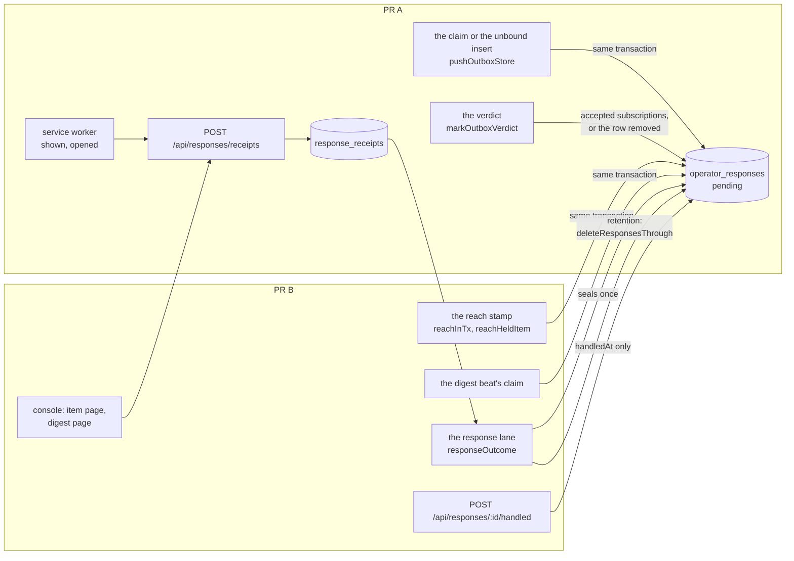

# Overlord W1: the response record, what the operator does with each message Implementation Plan

> **For agentic workers:** REQUIRED SUB-SKILL: Use superpowers:subagent-driven-development (recommended) or
> superpowers:executing-plans to implement this plan task-by-task. Steps use checkbox (`- [ ]`) syntax for tracking.

**Goal:** each message ccrc puts in front of the operator gets one row of `operator_responses`, written from facts the
server receives, and sealed once its window closes. A message is a push the push service accepted, a Waiting on you
row (an item or an ask), or a digest line. A chat reply is the fourth kind, and its writer waits on the operator's
answer to index question 10. Each push carries the outbox's random push id in its payload. The service worker reports
`shown` when it shows a push and `opened` when the operator taps it, and the console reports `opened` when it shows an
item's page or the digest. One session-gated door writes those receipts. The response lane seals each row by one L1
decider, `responseOutcome`, and deletes rows past the operator's retention period. The operator can mark a message "I
handled this elsewhere", in a column of its own. W1 only records: nothing reads a response to change a push, an
urgency or an authority.

**Why:** R20 (the operator, 2026-11-14): "measuring how you respond to each message". The budget of §4.2 admits pushes
and §6.7 records when each reached the operator, but nothing records what the operator then did, so W3's attention
budget would tune itself on guesses. Some of the facts are not measured today (a push returns no verdict, a tap names
no push), so W1 builds them, and until it has, the outcomes that need them read `unmeasured` (C66, C67).

**Architecture:**
- **L0, `shared/responses.ts` (new, C6):** the message kinds, the receipt kinds and sources, the delivery words, the
  stamps, the references a receipt names, the receipt body's parser (PR A); the outcomes, the ways an act is recorded,
  the reasons of an `unmeasured` row, and the retention bounds (PR B).
- **L1, `server/src/responses.ts` (new, C6):** `receiptVerdict` (PR A); `responseWindowEnd`, `responseOutcome`,
  `responseSealDue` and `responsesFor` (PR B). Pure: the time is a fact.
- **L3, `server/src/coord/responsesStore.ts` (new, C6):** both tables' functions, with one-line `CoordStore` delegates.
  The push outbox store (`server/src/coord/pushOutboxStore.ts`) calls its `*InTx` writers inside its own transactions,
  so a push's response row commits with the claim that sends it.
- **L4, `server/src/responses/` (new, C6):** `routes.ts` (the receipts door in PR A; the handled door, the read and the
  retention door in PR B), `stamp.ts` (the build and restore-generation stamp, the one module authority journal C
  edits), and `lane.ts` (the response lane's pass, PR B). `server.ts` registers the routes in one line beside the face
  and push routes, and `watch.ts` calls the lane on a new `LANE_SCHEDULE` row, `responses`.
- **The sender** (`server/src/pushSender.ts`, on `main`) is still the one sender: it carries the row's push id in the
  payload it sends and lands the verdict on the response row. No second sender and no second payload builder.
- **The service worker** (`pwa/public/push-sw.js`, outside its generated region) posts the two receipts. **The console**
  posts `opened` from the item page and the digest page, and offers "I handled this elsewhere" on both (PR B).

**Tech Stack:** TypeScript (ESM), `node:sqlite`, Fastify, React, the service worker's plain JavaScript, vitest.

**Spec:** `docs/superpowers/specs/2026-11-09-overlord-design.md`:
- §4.3 whole: Figure 11, C66 (one row per message, sealed when its window closes), Table 4.3a (the messages and what
  each fact means), Table 4.3b (`RESPONSE_OUTCOMES`, first match), the repeats, batches and tags bullets, "Where it
  lives" (one writer for each fact, the privacy controls, why no existing owner holds it), C67 (the push id, the row
  before the send, the per-send verdict, the receipts, the one door, what they prove), the response lane, and C69's "I
  handled this elsewhere". C68 (the classes and their moves) is W3's: W1 ships the record the classes will read.
- §6.7 (the push outbox, the reach stamps), which this piece builds on as merged.
- §7.6's privacy journal bullets ("A replayed wipe also deletes the response rows and receipts") and §9.4 rules 10 to
  12 (the 180-day retention, "wipe everything" removing the rows and receipts, a replayed wipe removing them again).
- Table 11.1a's rows `operator_responses` and `response_receipts`; Table 11.1b's row `RESPONSE_OUTCOMES`,
  `responseOutcome`, `responsesFor` (W1 for outcomes and figures, W3 for classes and moves); Table 11.1c's row "The
  response lane"; Table 11.1e's two door rows (the receipts door, "I handled this elsewhere"); Table 11.5's ten-minute
  `responses` cadence.
- §11.7: I18, and Table 11.7b's "exhaustive tests of first-match deciders, with a monotonicity property", which names
  `responseOutcome`; M37 (§12) names the tables this piece creates.
- Table 13a's C66, C67 and C69 (approved), and §14's W1 row ("the response record: `operator_responses`,
  `response_receipts` and the receipts door, the response lane, and 'I handled this elsewhere', recording only, with
  the per-send verdict of `PushService`, a random push id in each push's payload, and the service worker's `shown` and
  `opened` receipts"). No H call names this piece, so it ships no `shape` call of Table 13.1.

The W1 index is `docs/superpowers/plans/2026-11-14-overlord-w1.md`, row "Response record", lane E. This plan builds on
the index's questions 10 (held), 22, 23, 28 and 35, restated where each is used, and on the push outbox as merged
(#2838, #2859; its plan is `w1-push-outbox.md`, with its build notes in `w1-push-outbox/`).

## Open questions

Each is a place where the spec is unclear, does not match the tree, or leaves a choice to the plan. The plan builds the
recommendation unless the coordinator rules otherwise.

1. **Where the push id rides** (slug `push-id-from-the-row-at-the-attempt`). The index says "the outbox's push id
   carried in each payload". The outbox mints the id at `prepare` (`pushSender.ts#senderFor`) and keeps it on the row
   across a re-arm (`pushOutboxStore.ts#armBoundRowInTx` keeps `pushId` and takes the new payload). A re-arm prepares a
   new payload, and that `prepare` mints a new id, so an id written into the stored payload at `prepare` would differ
   from the row's after a re-arm. **Recommendation:** the stored payload stays as it is, and the sender's one attempt
   adds `pushId` from the row at the send: `claimOutboxRow` answers the row's `pushId` beside its payload, and an
   unbound send already holds the id it inserted. A send with no row (no store, no clock, a failed insert) carries no
   id (C67: "a push whose row could not be written is not sent with an id"). `noticePayload` stays the one builder of a
   push's text, and the id is not text.
2. **Which pushes get a row** (slug `pushes-with-a-kind-get-a-row`). §4.3: "A push from `notifyPushOnly` carries no
   kind and no row, so it gets no response row". **Recommendation:** a push gets a row when its sender call names a
   kind: every unbound push from the funnel's `raise` (`notice.ts`), which passes its notifier kind as the row's
   label in one more option to `send`, and every bound ask and item, whose label is its source (`ask` or `item`),
   known at every claim, the lane's retries included. `notifyPushOnly`'s two callers (the release push and
   `POST /api/notify`) pass none, so they get no row and change nothing.
3. **What a W1 push carries** (slug `a-w1-push-carries-its-bound-source`). A push row holds "the ids of the rows it
   carries". In W1 only a bound push names a row: its ask or its item. Every unbound push carries none, the digest's
   push among them. **Recommendation:** the row stores at most one carried reference, its bound source. An unbound push
   with no actions seals `not-actionable` (the disk alarm is the spec's example). An unbound push with actions (a
   top-level session's ask) seals by its receipts alone, because its act lands on no row the server owns (question 4).
   W3's batches add carried rows when a batch push exists.
4. **`push-action`, an act through a notification's action** (slug `push-action-needs-a-door-source`). Table 4.3b
   lists `push-action` among the ways an act is recorded. Today an action tap answers through the question door with a
   body the console also sends (`push-sw.js#askRequestOf`), so the ask's row records `answeredBy = 'operator'` and
   nothing says the answer came through a push. A receipt cannot stand in for it: a receipt is attribution from a
   device, and an act read from a receipt would let a forged receipt mint an act. **Recommendation:** `push-action`
   stays in the vocabulary with no writer in W1. A push whose carried ask was answered by the operator seals `acted`,
   how `answer`. The word gets its writer when the question door records where an answer came from, which is not this
   piece.
5. **The restore generation's stamp** (index question 35, ruled; slug `unmeasured-generation-never-proves-no-tap`).
   Authority journal PR C owns the counter and its accessor, `restoreGeneration()`, which answers
   `{kind: 'measured', n}` or `{kind: 'unmeasured', why: 'journal'}`, and switches "the response rows' insert
   (responses A's module)" from the constant `unmeasured` to that accessor "in this commit and nowhere else"
   (`w1-authority-journal.md`, Task 9). **This plan keeps that seam exactly:** responses A's module is
   `server/src/responses/stamp.ts`, its function `responseStampNow` returns the restore stamp as the constant
   `{kind: 'unmeasured'}` in one line, and authority C replaces that line. The stamp is stored in two columns,
   `restoreMeasured` and `restoreGeneration`, so `unmeasured` is never a number. **The rule the lane applies:** a push
   seals `not-opened` only when both stamps (build and restore) are measured at insert and at the seal and equal. Any
   unmeasured side makes the comparison unmeasured, and the row seals `unmeasured`, reason `receipts`. So until
   authority C lands, no push seals `not-opened`, which is the honest answer: nothing can yet prove that no restore
   happened inside the window.
6. **How the stamp reaches the writers without a ring slip** (slug `the-stamp-rides-the-deps`). Three writers insert
   rows: the sender (whose ring is the funnel's, `notice.ts`, by its facts; push outbox slug
   `sender-ring-is-the-funnels`), the reach transactions in `pushOutboxStore.ts` (L3), and the digest beat in
   `watch.ts` (L4). `restoreGeneration()` lives in an L4 module (`coord/overlordRestoreState.ts`), which the sender and
   the store may not import. **Recommendation:** `Deps` gains `responseStamp?: () => ResponseStamp`, set once by
   `index.ts` (L5) to `() => responseStampNow(build)`. The sender reads it from the deps each call is given, as it reads
   `time` and `masker`. The bound-row callbacks that build a `BoundWrite` (`pushSender.ts#itemBoundOf`, the questions
   outbox, `notice.ts#questionOutboxOf`) read it there too, and the digest beat reads `this.deps`. A deps object
   without it (a narrow
   test) writes no response row and sends as today (slug `no-stamp-no-response-row`, as the outbox's `no-clock-no-row`).
7. **A receipt that arrives before the verdict** (slug `a-receipt-before-the-verdict-is-kept`). The spec drops a
   receipt "that names a subscription outside the row's accepted set". A device can show a push, and post `shown`,
   before the sender has written the push service's verdict, so the accepted set is still empty. **Recommendation:**
   the door checks the set only once the verdict has landed. Before it, a worker receipt for a `pending` push row is
   kept, and the lane reads only the receipts whose subscription is in the row's accepted set at the seal. A terminal
   verdict that no subscription accepted (the outbox row moves to `unsent` or `failed`) removes a never-delivered row
   and every receipt it holds; a `retrying` verdict leaves the row `pending` for the retry, so a retry never has to
   write it again.
8. **Which digest lines are measured** (slug `digest-lines-are-the-correctable-rows`). Table 4.3a: a digest line's act
   is a correction, `POST /api/digest/correct`, which takes only a decision row (`DigestCorrectBody.rowKind`: `ask`,
   `approval`, `call`). The digest's drift lines and its closes line cannot be corrected. **Recommendation:** one row
   per decision line (`DigestAnswer.lines`), keyed `<day>:<rowKind>:<id>`. The drift and closes lines get none.
9. **When a digest correction happened** (slug `a-digest-correction-is-read-at-the-seal`). An ask's or approval's
   correction is a flag (`asks.corrected`, and the approvals' `corrected`), with no time; a big call's is
   `overturnedAt`. **Recommendation:** the lane reads the flag at the seal, and a call's `overturnedAt` against the
   window. A correction made between the window's end and the seal (at most one lane period, or the reader's deferral)
   counts as inside the window. That overcount is named in the decider's doc comment; adding a correction time to two
   tables owned by the digest is not this piece's.
10. **The ask's `opened` receipt** (slug `ask-opened-waits-for-the-ask-list`). An ask's Waiting on you row opens
    nothing the console can name: question rows are one per session (`pwa/src/ledgers/ledgerWords.ts#questionRows`),
    an `asks` row exists only for a child a parent holds a question for, and the console never holds the `asks` row's
    id. The answer marks plan's PR B gives the waiting view the asks the operator has, with their ids
    (`w1-delegation-marks.md`, lane M). **Recommendation:** in W1 an ask's row is measured by its acts, and seals
    `acted`, `settled-elsewhere` or `unmeasured`, never `opened`. The console's receipt for an ask joins in one line once
    marks B has merged, in whichever of the two lands second.
11. **Where "I handled this elsewhere" appears** (slug `handled-control-on-item-and-digest`). C69 puts it "on any
    measured message (the item, the push's landing page, the digest line, the reply)". The door marks any row.
    **Recommendation:** W1's console shows the control on an item's page (for the item's Waiting on you row and every
    push row that carried that item) and on each digest line. A push's landing page is a session page or a path the
    payload names, with nothing that says which push opened it, and adding that is a change to every push's tap.
    The landing-page control comes with W3's Week page, which lists the push rows themselves; the reply's control comes
    with the chat. The door is total from PR B either way.
12. **The class column** (slug `class-column-ships-with-the-classes`). Table 11.1a's row lists a class. Classes are
    W3's (`RESPONSE_CLASSES` beside `pushAdmission`), and no W1 push has one. **Recommendation:** W1 stores the
    notifier kind as `label` and creates no `class` column. W3's classes piece adds the column in its own migration.
    A row written before it has no class and never joins a class figure, which is what C68's window says anyway: a
    class's figures count only rows admitted after the class's last change of state, and the class's creation is one.
13. **Who reads `responsesFor` in W1** (slug `responses-for-ships-for-w3`). §14 calls W1's record "recording only",
    and the Week page and the board's Attention part are W3's. **Recommendation:** `responsesFor` ships total, with its
    tests and mutation floor, over the scope W1 has (a kind and a label), and no route serves figures in W1. W3 adds the
    class scope as a new arm. Its first reader is W3's Week page.
14. **The wipe** (slug `response-wipe-arm-waits-for-the-w4-wipe`). §9.4 rule 11 and §7.6 say "wipe everything" removes
    the rows and receipts, and a replayed wipe removes them again. The wipe door, its privacy journal record and its
    replay are W4's (Table 11.1e: "the learning controls (pause, exclude, export, wipe) … W4"). **Recommendation:** PR B
    ships the one deleter, `deleteResponsesThrough(db, at)`, which deletes every row inserted at or before `at` and
    every receipt they hold, in one transaction. The retention pass calls it with `now - retention`. W4's wipe calls it
    with the wipe's time inside its own transaction, and its replay with the journal record's time. So the rows have one
    deleter, and W4 adds a caller, never a second deleter. Until W4, retention is the rows' only removal.
15. **I18's predicate** (slug `i18-predicate-joins-with-the-seal`). The sequence and monitor plan says "responses A
    adds I18" unless it merged before sequence B (`w1-sequence-monitor.md`, question 11). I18 is about the seal, which
    is PR B's. **Recommendation:** PR B adds I18's predicate and its gatherer row, if sequence B has merged first;
    otherwise sequence B adds it, as that plan says. PR A adds none.
16. **Retention's bounds and an unreadable setting** (slug `retention-unreadable-deletes-nothing`). The spec gives a
    default (180 days) and "the operator's setting". **Recommendation:** a whole number of days from 7 to 3,650,
    starting values in `shared/responses.ts`. A setting the lane cannot read deletes nothing on that pass and logs once
    per cause; it is never read as the default, which could delete rows the operator chose to keep.

## What exists today

Measured on `main` at `a7d0c978a` (2026-11-15), after push outbox B (#2859) merged.

- **The one sender.** `server/src/pushSender.ts#senderFor` holds the only `PushService.notify` call
  (`notify-push.test.ts` counts it). `prepare(payload)` masks a payload and mints its push id with
  `time.entropy.hex(PUSH_ID_BYTES)` (16 bytes, 32 hex characters); `send(payload, opts)` inserts an unbound row claimed
  (`insertUnboundRow`) and sends; `sendRow(row, settledOf)` re-reads a bound row's source, asks `pushDue` at the claim,
  claims (`claimOutboxRow`) and sends. Each attempt's verdict lands by `claimSeq` through `markOutboxVerdict`, inside
  the attempt's `land` closure, with `outboxNextState` deciding the move. `SenderDeps` is `{ push, coord, time, masker }`,
  read per call.
- **The outbox store.** `server/src/coord/pushOutboxStore.ts`: `push_outbox` (migration 75) with a unique `pushId`,
  `sourceKind` and `sourceId` (null for an unbound push), the stored payload, `tag`, the state and the verdict as JSON.
  `insertUnboundRow` commits in its own `tx` and refuses inside an open one (push outbox slug
  `unbound-insert-commits-alone`). `claimOutboxRow` is one `UPDATE … RETURNING claimSeq, attempts, armedAt, payload`
  with no transaction of its own; `markOutboxVerdict` is one `UPDATE` keyed on `claimSeq`. `reachInTx` and `armInTx`
  run inside the raising transaction, and call `stampReach`, the one writer of `reachedOperatorAt`, whose answer says
  whether the row was stamped now. `reachHeldItem` is the held drain's per-item transaction. `BoundWrite` is
  `{ prepared, due, viewing }`, built by a `BoundOf` callback.
- **The verdict.** `PushService.notify` (`server/src/push.ts`) answers `PushSendVerdict`: `no-subscription`, or `sent`
  with one entry per subscription, `{ endpointHash, verdict, status }`. `endpointHash` is the hex SHA-256 of the
  endpoint (`createHash('sha256').update(sub.endpoint)`). `SubscriptionVerdict` is `accepted`, `refused`,
  `refused-for-good`, `gone`, `no-answer` or `unsendable` (`shared/push-outbox.ts`).
- **The payload.** `PushPayload` (`server/src/push.ts`) is `title`, `body`, `sessionId?`, `tag?`, `url?`, `actions?`.
  `pushOutbox.ts#noticePayload` builds every push's text, once a push, and `noticeTitle` its project suffix. The
  item's copy is `pushOutbox.ts#itemPushPayload`. `push-outbox-characterization.test.ts` pins every site's payload.
- **The service worker.** `pwa/public/push-sw.js`, `importScripts`'d into the generated worker. Its `push` handler
  shows the notification under `data.tag` with `renotify`, and keeps `sessionId`, a filtered `url` and the actions in
  the notification's `data`. Its `notificationclick` handler opens the app (`openApp`) for a plain tap, or answers an
  ask through the question door for an `ask:` action and then `replace()`s the notification with
  `data: { sessionId }` only. It sends nothing else, and it never reads its own subscription. Its generated region
  (`answer-lifecycle`) is held byte-equal by `pwa/test/push-sw.test.ts`; nothing here touches it.
- **The reach.** `asks.reachedOperatorAt` and `operator_items.reachedOperatorAt` (migration 75), written only by
  `stampReach`, inside the move that raises, releases or arms the row, or at an item's `heldUntil` by the held drain.
  An ask's row is `asks` (`server/src/coord/schema.ts`, migration 9): `childId`, `askKey`, `state` (`AskState`,
  `shared/api.ts`: `held`, `answering`, `answered`, `released`, `declined`, `stale`, `unknown`), `answeredBy` (a
  session id or `operator`), `answeredAt`, `releasedAt`, `corrected`. An item's moves are `operator_item_events` rows
  (`ledgersStore.ts#itemHistory`), whose `act` and `actor` follow `shared/ledgers.ts#ITEM_TRANSITIONS`: the operator's
  `tick`, `dismiss`, `act` and `decline`; the coordinator's `confirm`, `return` and `withdraw`; `ccrc`'s `settle`.
- **The digest.** `watch.ts`'s `digestBeat` (the `digestBeat` lane row) builds the day's digest (`coord/digest.ts`
  `buildDigest`), claims the day with `CoordStore.claimDigestDay(day, sentAt, count)` (one `INSERT OR IGNORE` into
  `digests`, no transaction), and pushes when the claim won and the count is above zero. A digest line on the wire is
  `DigestLine` (`shared/api.ts`): `rowKind` (`ask`, `approval`, `call`), `id`, `kind`, `corrected`. `GET /api/digest`
  and `POST /api/digest/correct` are in `server.ts`; the digest page is `pwa/src/screens/DigestScreen.tsx`.
- **The item page.** `pwa/src/ledgers/ItemView.tsx`, routed; `pwa/src/lib/api.ts` (growth-checked) holds the item
  calls (`tickItem`, `dismissItem`).
- **A routes file of its own.** The face's two doors are `server/src/face/routes.ts`, registered from `server.ts` in one
  line (`registerFaceRoutes`), session-gated and not EXEMPT, with no box token. Their census sites: `auth-gate.test.ts`
  (`scanRoutes('face/routes.ts')`, its count, and the gated list), `rings/fastify-l4.data.ts`, and, for its `GET`,
  `secret-mask.test.ts`'s `EXEMPT` reasons (its `routeFiles()` walks every route file). `box-token-census.test.ts` and
  `CLAUDE.md`'s box-token paragraph name neither face door, because neither is a coordination write. The architecture
  spec's C6 row names `face/**` and `push*.ts`.
- **Settings switches.** Each is a one-row settings table with a seed row (`face_settings`, `plain_memory_settings`),
  one `CoordStore` writer, and a `GET`/`POST` pair whose `GET` is on `secret-mask.test.ts`'s `EXEMPT` list.
- **The stamps.** `Deps.build` (`server/src/deps.ts`) is the build stamp `index.ts` reads once (`readBuildInfo`), or
  null on an unstamped box. No restore generation exists (authority journal PR C).
- **Lanes.** `server/src/laneSchedule.ts#LANE_SCHEDULE`; its `pushOutbox` row is driven by `FleetWatcher.sweepPushOutbox`
  from `tick()`. `server/test/laneQuiet.ts` quiets every row by name, and `watcher-quiet-census.test.ts` asks each
  test file that builds a watcher to quiet it.
- **Refusal words.** `shared/refusal.ts`'s `GENERIC_REFUSALS` has `not-found`, `bad-request`, `not-configured` and
  `unavailable`, so this piece needs no new word and Table 11.6 is not touched.
- **Censuses a new table touches:** `single-definition/writers-map.test.ts` (`TABLES`), `single-definition/time-ports.test.ts`
  (`TIME_PORT_FILES`), `single-definition/core-vocab.test.ts` (the coord handle holders, which `pushOutboxStore.ts`
  joined), `run-close-switch.test.ts` (the undo of every migration after 53, and its count), `coord-db.test.ts` (the
  order of migrations), and `sim/mutation-floors.test.ts` (`MUTANT_SETS`, `mutation-floors.json`).
- **Growth.** `server/test/growthCheck.ts#GROWTH_FILES`: of the files this piece touches, `server/src/watch.ts`,
  `server/src/coord/store.ts`, `server/src/coord/schema.ts`, `server/src/server.ts` and `pwa/src/lib/api.ts` (40 net lines a
  file a pull request). `shared/api.ts` has a cap (`server/test/growth-caps/shared-api-ts.json`) and is not touched.

## Global Constraints

- **Architecture (`CLAUDE.md`).** Decide in L1, act in L4. `receiptVerdict`, `responseWindowEnd`, `responseOutcome`,
  `responseSealDue` and `responsesFor` decide over facts; the door, the sender and the lane gather facts, ask, and
  write what they answer. `server/src/responses.ts` imports only `shared/`. `responsesStore.ts` imports no L4 module,
  and the stamp reaches it as data (question 6).
- **One writer for each fact** (§4.3 "Where it lives"; `writers-map.test.ts` names each):
  - a row's insert: the sender (a push, inside the claim's or the unbound insert's transaction), the reach transaction
    (a Waiting on you row, in the move that stamps `reachedOperatorAt`), the digest beat (a digest line, in the claim's
    transaction); the chat reply's insert waits on index question 10;
  - a push row's accepted subscriptions, `deliveredAt`, `sends`, and its removal when none accepted: the sender, inside
    `markOutboxVerdict`'s transaction;
  - `response_receipts`: the receipts door alone;
  - `shownAt`, `openedAt`, `outcome`, `how`, `why` and `sealedAt`: the response lane, at the seal alone, once;
  - `handledAt`: the handled door alone;
  - deletes: `deleteResponsesThrough` alone, called by the lane's retention pass (and by W4's wipe and its replay).
- **A response is never an answer and never authority.** No response writer moves an item, an ask, a run, mail or the
  outbox, and nothing that decides a push, an urgency, a hold or a rung reads a response in W1. The tables are not
  authority tables: nothing about them is journalled, and none joins `OVERLORD_AUTHORITY_TABLES`. "I handled this
  elsewhere" writes one column and nothing else.
- **Beside the answer marks, never across them** (the answer marks plan, `w1-delegation-marks.md`, lane M). On an
  item's page the operator sees both: the marks' two boxes (`answer_marks`, one writer, `POST /api/answer-marks`) and
  this piece's "I handled this elsewhere" with the page's `opened` receipt (`operator_responses` and
  `response_receipts`, their writers above). Neither door writes the other's table, neither reader joins the other's
  table in W1, and a mark change is not an act: `responseOutcome`'s acts are the item's moves and nothing else. A later
  reader that wants both joins them by the item's id, each read through its own owner. A mark says what the operator
  would delegate; a response says what the operator did with a message. Neither is an answer.
- **Never fold `unmeasured`.** Each stamp is two columns (`buildMeasured`, `buildSha`; `restoreMeasured`,
  `restoreGeneration`), with a `CHECK` that the value is present exactly when measured. A read that fails is
  `{ ok: false, detail }`, never an empty list. A fact the lane cannot read defers the seal, at most a day after the
  window closed, and then seals `unmeasured`, reason `reader`. An unreadable retention setting deletes nothing
  (question 16).
- **Fail closed toward the operator.** A failed response write never costs a push or a move.
  - *A push row.* The insert runs inside the claim's (or the unbound insert's) transaction, and a throw from it is
    caught there: the claim still commits and the push goes with its push id but no response row, logged once per
    cause through a `changeLatch` (Task 3).
  - *A Waiting on you row or a digest line.* The insert is an `INSERT OR IGNORE` on the unique index, so a repeat never
    throws. It runs inside the move that stamps the reach (or the digest's claim), and any other throw from it is caught
    there too and logged, so it never rolls back the move it rides (Task 6).
- **Ids, kinds and times only, never text.** No column holds a title, a body, a question, a label an operator typed or
  an endpoint. A subscription is its endpoint's hash, the hash `PushService` already computes.
- **Time and chance through ports.** `responsesStore.ts`, `responses/lane.ts` and `responses/routes.ts` read the clock
  from `Deps.time`; `server/src/responses.ts` takes `now` as a fact. Each joins `TIME_PORT_FILES` in the task that
  creates it. SQL never reads the clock.
- **One concern per file.** Every new wire type lives in `shared/responses.ts`. `shared/api.ts` is not touched, and no
  capability word is added (Table 11.1e: an older server has "no route", so pushes read `unmeasured`).
- **Shared files, by row.** This piece touches only these rows of files other lanes edit:
  - `server/src/pushSender.ts`: `SenderDeps` (gains `responseStamp`), `attempt` (adds the push id, lands the response
    verdict), `send` (passes the label and the stamp to the insert), `sendBound` (passes the stamp to the claim),
    `itemBoundOf` and `reachHeldItems` (pass the stamp);
  - `server/src/coord/pushOutboxStore.ts`: `insertUnboundRow`, `claimOutboxRow`, `markOutboxVerdict`, `reachInTx`,
    `reachHeldItem` and `BoundWrite`;
  - `server/src/notice.ts`: `raise`'s unbound `send` (the label), and `questionOutboxOf`'s `BoundWrite`;
  - `server/src/server.ts` (growth-checked): one import and one registration line beside `registerFaceRoutes`;
  - `server/src/watch.ts` (growth-checked): `digestBeat`'s claim call, and one `sweepResponses` beside
    `sweepPushOutbox`;
  - `server/src/coord/store.ts` (growth-checked): one-line delegates, and `claimDigestDay`'s optional in-transaction
    callback;
  - `pwa/src/ledgers/ItemView.tsx` (lane M adds its boxes there too; the second to land merges `main` once) and
    `pwa/src/screens/DigestScreen.tsx` (lane F adds its go-fleet door on another line);
  - `pwa/public/push-sw.js`, outside its generated region.
- **Tests.** From `server/`: `ccrc test -- ./node_modules/.bin/vitest run test/<file>.test.ts`; from `pwa/`, the same
  with pwa's vitest. Each task's last run adds both server `tsc` runs (`-p tsconfig.json`, `-p test/tsconfig.tests.json`),
  `test/typecheck-tests.test.ts`, and pwa's `tsc` when `shared/` or `pwa/` changed.
- **Mutation floors.** Every new L1 decider joins `MUTANT_SETS` through a new `server/test/sim/responsesSets.ts` and
  `server/test/sim/mutation-floors.json`, in the pull request that creates it: `receiptVerdict` in PR A;
  `responseWindowEnd`, `responseOutcome`, `responseSealDue` and `responsesFor` in PR B. Each floor is the measured score
  at build time, proved with `mutation-run.py`, never hand-rolled mutants.
- **Growth check.** Each pull request states its estimate below, and the builder measures it before pushing. A task
  that would take a growth-checked file past 40 lines in its pull request is split; no waiver.
- **Cite by symbol or `@anchor`. No private names:** fixtures use `lane-a-project-a`, `prog-a`, `sub-a` for an
  endpoint. No D-number is invented: the builder's departures go in a new note,
  `docs/superpowers/plans/2026-11-14-overlord-w1/w1-responses/<pr>.md`.

## Review Focus

1. **The row before the send.** For every push that gets a row (question 2), the response row commits in the same
   transaction as the claim (bound) or the unbound insert, before `PushService.notify` is called. No receipt can name
   a push id with no row, except one whose row a no-acceptance verdict removed.
2. **Never twice, never lost to a retry.** A retry or a re-arm of the same outbox row finds the row by `pushId` and
   adds nothing: no second row for one push id (a unique index), accepted subscriptions join the row's set, `sends`
   counts accepted attempts, and a removal happens only on a terminal outbox move (`unsent`, `failed`) of a row that
   was never delivered, so a retry never needs to write the row again.
3. **Pushes keep their payloads.** The characterization suite is unchanged except one named field, `pushId`, on each
   push that has a row. A push without a row carries no `pushId`. The worker's display is unchanged.
4. **The seal is once, and only from what the server received** (I18). `sealedAt` is written once (`WHERE sealedAt IS
   NULL`). `not-opened` only for a push, only with a `shown` from every accepted subscription, no `opened`, both stamps
   measured and equal, and no later push under the same tag replacing it on any of those subscriptions. A receipt
   never makes a row `acted`, `settled-elsewhere` or `not-actionable`.
5. **What a forged receipt reaches.** The door's receipt is attribution from the operator's own device: with sign-in
   armed it needs the session cookie; dark it is open, as every door is. A receipt that passes the door can only move
   a row among `opened`, `not-opened` and `unmeasured`, by adding `shownAt` or `openedAt`. It cannot create a row,
   change an act, move an outbox row, an ask, an item, mail or authority, or reach any other table. One receipt per row,
   kind, source and subscription is kept (a unique index), so a flood is bounded by the rows that exist. Its body
   carries no text, so it can carry no secret. Spec C67's own words name the other way an `opened` goes missing: a
   lost receipt, which reads as fewer opens, never as more.
6. **One deleter.** Retention, and later W4's wipe and its replay, delete through `deleteResponsesThrough` only, rows
   and their receipts together.

## The PR split

| PR | Tasks | What it ships | Needs first | Growth-checked files, estimate |
|---|---|---|---|---|
| A, the record of each push | 1 to 4 | The vocabulary and `receiptVerdict`; `operator_responses` and `response_receipts` with their writers; the push id in each payload; the push row written `pending` at the claim with the restore stamp `unmeasured`, and its verdict; the receipts door; the worker's `shown` and `opened` | push outbox B (#2859, merged) | `server/src/coord/schema.ts` about +38; `server/src/coord/store.ts` about +8; `server/src/server.ts` +2; `server/src/watch.ts` 0; `pwa/src/lib/api.ts` 0 |
| B, the seal, the other messages and the controls | 5 to 9 | The outcomes and their deciders; the Waiting on you rows and the digest lines; the response lane with retention and the one deleter; the handled door, the read and the retention door; the console's receipts and "I handled this elsewhere" | PR A | `server/src/coord/schema.ts` about +16; `server/src/coord/store.ts` about +14; `server/src/watch.ts` about +10; `server/src/server.ts` 0; `pwa/src/lib/api.ts` about +12 |

**Order:** PR A once push outbox B has merged (it has). PR B once PR A has merged. Authority journal PR C needs PR A
(index question 35), and the chat needs PR A (Table W1); home C needs PR B for the retention row.

**What the next pieces read.** Authority journal C edits `server/src/responses/stamp.ts#responseStampNow`'s restore line
and responses A's insert suite (one case changes from `unmeasured` to the measured value, one is added). The chat posts
the console's `opened` for a reply through PR A's door, and its reply rows wait on question 10. Home C draws the
retention row on PR B's door. W3 reads the sealed rows through `responsesFor` (adding the class scope and `class`), and
W4's wipe calls `deleteResponsesThrough`.


*Figure 1. The writers of the two tables. Each arrow into a table is that fact's one writer. W4's wipe adds a caller of
the one deleter.*

---

### Task 1: The vocabulary and the receipt rule (L0, L1)

**Files:**
- Create: `shared/responses.ts` (L0, C6; imports nothing)
- Create: `server/src/responses.ts` (L1, C6; imports only `shared/`)
- Create: `server/test/sim/responsesSets.ts`; Modify: `server/test/sim/mutation-floors.json` and `MUTANT_SETS`
- Modify: the architecture spec's C6 row (`docs/superpowers/specs/2026-08-10-architecture-ddd-clean-solid.md`): the
  server half gains `responses*.ts`, `responses/**` and `coord/responses*.ts`; the PWA half gains `responses/**`
- Modify: `server/test/single-definition/time-ports.test.ts` only if the scan asks for the L1 file (it takes `now` as a
  fact, so it should not)
- Test: `server/test/responses-vocab.test.ts`, `server/test/responses-receipt.test.ts` (new)

**Interfaces:**

```ts
// shared/responses.ts
const RESPONSE_KIND_MAP = {
  push: 'a push the push service accepted for at least one subscription',
  waiting: 'a Waiting on you row: an item or an ask, from its reach',
  digest: 'a decision line of a digest, from its claim',
  reply: "a chat reply of the Overlord (its writer waits on index question 10)",
} as const;
export type ResponseKind = keyof typeof RESPONSE_KIND_MAP;
export const RESPONSE_KINDS = Object.keys(RESPONSE_KIND_MAP) as ResponseKind[];

export type ReceiptKind = 'shown' | 'opened';                 // a Record map and a derived list, as every union here
export type ReceiptSource = 'worker' | 'console';
export type ResponseDelivery = 'at-once' | 'in-batch';      // W1 writes 'at-once' only; W3's batches write 'in-batch'
export type ResponseRowState = 'pending' | 'delivered' | 'sealed';

/** A stamp is measured or not, never a placeholder value (question 5). */
export type BuildStamp = { readonly kind: 'measured'; readonly sha: string } | { readonly kind: 'unmeasured' };
export type RestoreStamp = { readonly kind: 'measured'; readonly n: number } | { readonly kind: 'unmeasured' };
export interface ResponseStamp { readonly build: BuildStamp; readonly restore: RestoreStamp }

/** What a receipt names. A push by its id; a Waiting on you row by its source; a digest line by its key; a reply by its
 *  message id (the chat's, later). */
export type ResponseRef =
  | { readonly kind: 'push'; readonly pushId: string }
  | { readonly kind: 'item'; readonly id: number }
  | { readonly kind: 'ask'; readonly id: number }
  | { readonly kind: 'digest'; readonly key: string }        // `<day>:<rowKind>:<id>` (question 8)
  | { readonly kind: 'reply'; readonly id: number };

export type ReceiptFrom =
  | { readonly source: 'worker'; readonly version: number; readonly endpointHash: string }
  | { readonly source: 'console' };
export interface ReceiptIn { readonly ref: ResponseRef; readonly receipt: ReceiptKind; readonly from: ReceiptFrom }

export const RECEIPTS_MAX_PER_BODY = 50;                    // the digest page names one per decision line
export const RECEIPT_WORKER_VERSION = 1;                    // the receipt protocol's version, posted by push-sw.js
export function parseReceiptBody(body: unknown): { readonly ok: true; readonly receipts: readonly ReceiptIn[] }
  | { readonly ok: false; readonly detail: string };
export function digestLineKey(day: string, rowKind: DigestRowKind, id: number): string;
```

`parseReceiptBody` takes `{ v: 1, receipts: [...] }` and refuses (`detail` names the field, never echoes a value) an
unknown `v`, more than `RECEIPTS_MAX_PER_BODY` receipts, a ref outside the five kinds, a push id that is not 32
lowercase hex characters, an `endpointHash` that is not 64 lowercase hex characters, a worker version below 1, a digest
key that `digestLineKey` could not have produced, and any field beyond the ones above. `shared/responses.ts` imports
`DigestRowKind` by type only, from `shared/api.ts`, as other L0 siblings do; if the rings scan refuses a type import
between two L0 files, the type is repeated as a literal union and a test pins it equal to `DIGEST_ROW_KINDS`.

```ts
// server/src/responses.ts
export interface ReceiptFacts {
  readonly row: { readonly kind: ResponseKind; readonly state: ResponseRowState;
    readonly acceptedSubs: readonly string[] } | null;    // null: no row names the ref
}
export type ReceiptVerdict =
  | { readonly keep: true }
  | { readonly keep: false; readonly why: 'no-row' | 'sealed' | 'wrong-source' | 'not-accepted' };
export function receiptVerdict(r: ReceiptIn, f: ReceiptFacts): ReceiptVerdict;
```

**`receiptVerdict`'s rules, first match:**
1. No row: `no-row`.
2. A sealed row: `sealed`. A sealed row is never sealed again, so a late receipt changes nothing.
3. A worker's receipt for a row that is not a push, or a console's receipt for a push: `wrong-source`.
4. A console's `shown`: `wrong-source` (the console posts only `opened`, C67).
5. A worker's receipt for a `delivered` push whose `endpointHash` is not in `acceptedSubs`: `not-accepted`. A `pending`
   push's receipt is kept (question 7).
6. Otherwise `keep`.

- [ ] **Step 1: Failing tests.** Every map's keys equal its list, and each list is what `rings/wire-totality.test.ts`
  asks of an exported union; `parseReceiptBody` over a valid body of each ref kind and each source, and each refusal
  above (one case each, the detail naming the field and never the value); `digestLineKey` round-trips through the
  parser's key check; `receiptVerdict` over the full product of row kind, row state, source, receipt kind and whether
  the hash is in the set, against a table written in the test.
- [ ] **Step 2: Run.** Red. **Step 3: Implement.**
- [ ] **Step 4: Run** these suites, `test/sim/mutation-floors.test.ts`, `test/rings/*.test.ts`,
  `test/single-definition/*.test.ts`, both server `tsc` runs and pwa's. Green. Register `receiptVerdict`'s floor.
- [ ] **Step 5: Mutation.** By `mutation-run.py` over `receiptVerdict`: every mutant killed, floor recorded. By hand:
  drop rule 5's `delivered` test (a pending push's `shown` goes red); swap rules 1 and 2 (no change expected: name it
  in the commit); let a console `shown` through (red). Revert each.
- [ ] **Step 6: Commit.** `feat(responses): the response record's vocabulary, the receipt body and receiptVerdict (Overlord W1, §4.3 C67)`

### Task 2: The two tables and their writers (L3)

**Files:**
- Modify: `server/src/coord/schema.ts` (one migration, its slot measured at build time)
- Create: `server/src/coord/responsesStore.ts` (L3, C6)
- Modify: `server/src/coord/store.ts` (one-line delegates)
- Modify: `server/test/single-definition/writers-map.test.ts` (`TABLES` gains `operator_responses` and
  `response_receipts`, each with its writers named below)
- Modify: `server/test/single-definition/core-vocab.test.ts` (the coord handle holders gain `responsesStore.ts`, which
  names `node:sqlite` by `import type`, as `pushOutboxStore.ts` does)
- Modify: `server/test/single-definition/time-ports.test.ts` (`TIME_PORT_FILES` gains `server/src/coord/responsesStore.ts`)
- Modify: `server/test/run-close-switch.test.ts` (the migration's undo step and the replayed count, as it reads at
  build time) and `server/test/coord-db.test.ts` (the order)
- Test: `server/test/responses-store.test.ts` (new)

**Schema:**

```sql
CREATE TABLE operator_responses (
  id                INTEGER PRIMARY KEY,
  kind              TEXT NOT NULL,              -- ResponseKind
  label             TEXT NOT NULL,              -- the notifier kind, or 'item', 'ask', a digest row kind
  pushId            TEXT UNIQUE,                -- a push's id from push_outbox; NULL for every other kind
  refKind           TEXT,                       -- a waiting row's 'item' or 'ask', a digest line's 'digest'
  refId             INTEGER,                    -- that row's id; NULL for a digest line
  refKey            TEXT,                       -- a digest line's key; NULL otherwise
  carriesKind       TEXT,                       -- a push's bound source, 'ask' or 'item' (question 3)
  carriesId         INTEGER,
  hasActions        INTEGER NOT NULL DEFAULT 0, -- a push that offered actions
  tag               TEXT,                       -- a push's tag, to see a replacement under it
  delivery          TEXT NOT NULL,              -- ResponseDelivery
  state             TEXT NOT NULL,              -- ResponseRowState
  acceptedSubs      TEXT NOT NULL DEFAULT '[]', -- JSON array of endpoint hashes, sorted and unique
  sends             INTEGER NOT NULL DEFAULT 0, -- accepted attempts on this push id (a repeat counts here)
  buildMeasured     INTEGER NOT NULL,
  buildSha          TEXT,
  restoreMeasured   INTEGER NOT NULL,
  restoreGeneration INTEGER,
  insertedAt        INTEGER NOT NULL,
  admittedAt        INTEGER,                    -- W1: the delivery time; W3's deferral writes its own
  deliveredAt       INTEGER,
  windowCapAt       INTEGER,                    -- the window's latest end, set when the row is delivered
  shownAt           INTEGER, openedAt INTEGER, actedAt INTEGER,
  outcome           TEXT, how TEXT, why TEXT, sealedAt INTEGER,   -- the lane's, at the seal (PR B)
  handledAt         INTEGER,                    -- the operator's correction (PR B)
  CHECK ((buildMeasured = 1) = (buildSha IS NOT NULL)),
  CHECK ((restoreMeasured = 1) = (restoreGeneration IS NOT NULL)),
  CHECK ((kind = 'push') = (pushId IS NOT NULL)),
  CHECK ((carriesKind IS NULL) = (carriesId IS NULL))
);
CREATE UNIQUE INDEX operator_responses_one_per_ref ON operator_responses(kind, refKind, refId, refKey)
  WHERE kind IN ('waiting', 'digest', 'reply');
CREATE INDEX operator_responses_open ON operator_responses(state, windowCapAt);
CREATE INDEX operator_responses_by_insert ON operator_responses(insertedAt);
CREATE TABLE response_receipts (
  id           INTEGER PRIMARY KEY,
  responseId   INTEGER NOT NULL,                -- the row it names; deleted with it
  receipt      TEXT NOT NULL,                   -- ReceiptKind
  source       TEXT NOT NULL,                   -- ReceiptSource
  version      INTEGER,                         -- the worker's receipt version; NULL for the console
  endpointHash TEXT NOT NULL DEFAULT '',        -- the worker's subscription; '' for the console
  at           INTEGER NOT NULL,                -- the server's clock at arrival
  CHECK ((source = 'worker') = (version IS NOT NULL))
);
CREATE UNIQUE INDEX response_receipts_once ON response_receipts(responseId, receipt, source, endpointHash);
```

`response_receipts.endpointHash` uses `''` for the console because a unique index treats NULLs as distinct; the
`CHECK` on `version` keeps the source the one fact that says which. Every column is written by one function below. The
migration comment says, in its few lines: what the two tables are, that an older build ignores both (Table 11.1a:
"Ignores it: nothing is recorded"), and the re-measure command for its slot.

**Interfaces** (each opens no transaction unless it says so; each `*InTx` runs inside its caller's):

```ts
export interface PushResponseInsert {
  readonly pushId: string; readonly label: string; readonly carries: { kind: OutboxSource; id: number } | null;
  readonly hasActions: boolean; readonly tag: string; readonly stamp: ResponseStamp; readonly at: number;
}
/** The sender's insert, inside the claim's or the unbound insert's transaction: a `pending` push row, or nothing when
 *  a row with this push id already exists (a retry or a re-arm of the same outbox row). */
export function insertPushResponseInTx(db: DatabaseSync, r: PushResponseInsert): { inserted: boolean };
/** The sender's verdict, inside `markOutboxVerdict`'s transaction, after the outbox move it rides. `accepted` hashes
 *  join the row's set, `sends` adds one, and `deliveredAt`, `admittedAt` and `windowCapAt` are set at the first
 *  acceptance. With none accepted and a terminal outbox move (`unsent`, `failed`), a row never delivered is removed
 *  with its receipts. Any other answer changes nothing: a `retrying` move keeps the row `pending` for the retry, a
 *  delivered row is never removed, and an `unknown` move (no verdict) leaves it `pending`, which the lane seals
 *  `unmeasured`, `no-verdict`. */
export function landPushVerdictInTx(db: DatabaseSync, pushId: string,
  v: { readonly accepted: readonly string[]; readonly terminal: boolean } | null, at: number):
  { readonly changed: boolean; readonly removed: boolean };
/** The receipts door: one receipt, after `receiptVerdict` said keep. `INSERT OR IGNORE` on the unique index, in its own
 *  transaction with the read the verdict was decided on. */
export function insertReceipt(db: DatabaseSync, responseId: number, r: ReceiptIn, at: number): { readonly kept: boolean };
/** What a receipt names, as `receiptVerdict`'s facts: the row's id, kind, state and accepted set. */
export function responseRowForRef(db: DatabaseSync, ref: ResponseRef): ResponseRowRead;
export type ResponseRowRead =
  | { readonly ok: true; readonly row: { readonly id: number; readonly kind: ResponseKind; readonly state: ResponseRowState;
      readonly acceptedSubs: readonly string[] } | null }
  | { readonly ok: false; readonly detail: string };
```

A stored row whose `kind`, `state` or `acceptedSubs` this build does not know is never folded into a known row: a read
answers it as unreadable beside the rows that parse, logging its id once (the push outbox's
`one-unreadable-row-never-blinds-the-drain`). `writers-map.test.ts` names: `operator_responses`'
`insertPushResponseInTx` and `landPushVerdictInTx` (this task), and later `insertWaitingResponseInTx`,
`insertDigestResponsesInTx`, `sealResponse`, `markResponseHandled` and `deleteResponsesThrough` (PR B, each added by its
task); `response_receipts`' `insertReceipt` and `deleteResponsesThrough`.

- [ ] **Step 1: Failing tests** (`responses-store.test.ts`, over a fixture `coord.db` opened by `openCoordDb` in a
  `mkTmp` directory, as `push-outbox-store.test.ts` does): a `pending` insert and its read; a second insert with the same push id inserts nothing; a verdict with two
  accepted hashes sets the set, `sends` 1, `deliveredAt`, `windowCapAt` (24 hours on); a second verdict on the same
  push id joins a third hash and makes `sends` 2, keeping `deliveredAt`; a no-acceptance verdict on a never-delivered
  row with a terminal move removes it and its receipts; a `retrying` move with none accepted keeps it `pending`; the
  same terminal move on a delivered row changes nothing; a `null` verdict changes nothing;
  `insertReceipt` twice keeps one; each `CHECK` refuses its broken row (`buildMeasured` 1 with no sha, a push with no
  push id); a row whose `state` is an unknown word is answered unreadable, not dropped and not folded; the migration
  applies on a database at the previous `user_version` and the undo in `run-close-switch.test.ts` removes it.
- [ ] **Step 2: Run.** Red. **Step 3: Implement.**
- [ ] **Step 4: Run** this suite, `coord-db.test.ts`, `run-close-switch.test.ts`, `single-definition/*.test.ts`,
  `rings/*.test.ts`, both `tsc` runs. Green.
- [ ] **Step 5: Mutation.** By hand: drop the `WHERE` that keeps a delivered row on a no-acceptance verdict (red);
  let a second insert with the same push id write a row (the unique index throws: red, and the store must answer
  `inserted: false` rather than throw); store an unsorted set (the join test goes red). Revert each.
- [ ] **Step 6: Commit.** `feat(coord): operator_responses and response_receipts, each fact with one writer (Overlord W1, §4.3)`

### Task 3: The push id in each payload, and the row before each send

**Files:**
- Create: `server/src/responses/stamp.ts` (L4, C6: `responseStampNow`, the one place the stamp is read)
- Modify: `server/src/deps.ts` (`Deps.responseStamp?: () => ResponseStamp`) and `server/src/index.ts` (one line:
  `deps.responseStamp = () => responseStampNow(build)`)
- Modify: `server/src/push.ts` (`PushPayload` gains `pushId?: string`, with a comment: set by the sender from the
  outbox row, read by the worker's receipts)
- Modify: `server/src/pushSender.ts` (`SenderDeps.responseStamp`; `send` takes `opts.label` and inserts the response row
  with the unbound row; `sendBound` passes the stamp and the label to the claim; `attempt` sends `{ ...payload, pushId }`
  and lands the verdict on the response row)
- Modify: `server/src/coord/pushOutboxStore.ts` (`insertUnboundRow` and `claimOutboxRow` take an optional
  `response: Omit<PushResponseInsert, 'pushId' | 'at'>` and write it through `insertPushResponseInTx` in their
  transaction; `claimOutboxRow` becomes one `tx` around its `UPDATE … RETURNING` and the insert, and answers `pushId`;
  `markOutboxVerdict` calls `landPushVerdictInTx` in its transaction when the row's push id has a response row)
- Modify: `server/src/notice.ts` (`raise`'s unbound `send` passes `label: event.kind`; `notifyPushOnly` passes none)
- Modify: `server/test/push-outbox-characterization.test.ts` (each payload gains `pushId: expect.stringMatching(/^[0-9a-f]{32}$/)`
  where the push has a row, and none where it has not; nothing else changes)
- Test: `server/test/responses-sender.test.ts` (new), `server/test/push-sender.test.ts`, `server/test/push-outbox-store.test.ts`

```ts
// server/src/responses/stamp.ts
/** THE ONE PLACE a response row's stamp is read (index question 35, ruled). Authority journal PR C replaces the restore
 *  line with its accessor, `restoreGeneration()`, mapped to a `RestoreStamp`, in its Task 9 and nowhere else. */
export function responseStampNow(build: BuildInfo | null | undefined): ResponseStamp {
  return {
    build: typeof build?.sha === 'string' && build.sha !== '' ? { kind: 'measured', sha: build.sha } : { kind: 'unmeasured' },
    restore: { kind: 'unmeasured' },   // authority journal C: restoreStampOf(restoreGeneration())
  };
}
```

**The rules:**
- A row is written only when the push has a label (an unbound `send` that names one, or any bound claim, labelled by
  its source) and the deps carry `responseStamp` and the outbox port.
  With any of the three missing, the push goes as today with no response row (questions 2 and 6).
- The response insert commits with the outbox move that claims the attempt, so it is written before `notify` is
  called. A response insert that throws is caught inside that transaction's callback, logged once per cause, and the
  claim still commits, so a failed response write never costs a push (Global Constraints). The test proves it with a
  store whose `insertPushResponseInTx` throws.
- The payload sent is the stored payload plus the row's `pushId`. No other byte changes. The masker runs before the id
  is added and again in `notify`; the test proves a 32-hex id survives `notify`'s second mask under `SHAPE_ONLY_MASKER`
  and under a wired masker with a registered secret.
- The verdict lands on the response row only when the outbox verdict lands (`changed: true`), in the same transaction,
  so a late answer from an older attempt changes neither.
- `accepted` is the hashes of the subscriptions whose verdict is `accepted`; a `no-subscription` verdict and a verdict
  with none accepted are both "none accepted".

- [ ] **Step 1: Failing tests** (`responses-sender.test.ts`, through `senderFor` with a fixture store, a recording push
  double and fake time ports):
  - an unbound push with a label writes one `pending` row, sends a payload with that row's push id, and on an accepted
    verdict the row is `delivered` with its set;
  - a bound ask's send and a bound item's send each write a row carrying their source;
  - a retry after an all-`refused` verdict: the row stays `pending` through the retry, the drain's claim of the retry
    inserts nothing, and after the accepted retry one row stands with `sends` 1;
  - an outbox row that ends `failed` or `unsent` with none accepted: its never-delivered response row is gone;
  - a re-arm of a delivered item push: the same push id, one row, `sends` 2;
  - a `no-subscription` verdict (the outbox row moves to `unsent`) removes the row;
  - a deadline with no verdict leaves it `pending`;
  - no label (`notifyPushOnly`), no stamp, or no store: the push is sent with no row and no `pushId`;
  - a throwing response insert: the push is still sent, with its push id, the outbox row claimed, and one warning;
  - the characterization suite, updated only by the `pushId` field.
- [ ] **Step 2: Run.** Red. **Step 3: Implement.**
- [ ] **Step 4: Run** these suites, every `push-*.test.ts`, `notify-push.test.ts` (the one `notify` call is still the
  sender's), `notice.test.ts`, `secret-mask.test.ts`, `push-masker-pin.test.ts`, `push-composition-pin.test.ts`,
  `rings/*.test.ts`, `single-definition/*.test.ts`, both `tsc` runs. Green.
- [ ] **Step 5: Mutation.** By hand: insert the response row after `notify` instead of in the claim (the "row before
  the send" case, which asserts the row exists when the double is called, goes red); add the push id at `prepare`
  (the re-arm case goes red: the payload's id differs from the row's); land the response verdict on a lost
  `markOutboxVerdict` (the late-answer case goes red). Revert each.
- [ ] **Step 6: Commit.** `feat(push): each push carries its outbox push id, and its response row is written pending in the claim's transaction (Overlord W1, C67)`

### Task 4: The receipts door, and the worker's `shown` and `opened`

**Files:**
- Create: `server/src/responses/routes.ts` (L4, C6: `registerResponseRoutes`, with `POST /api/responses/receipts`)
- Modify: `server/src/server.ts` (one import, one `registerResponseRoutes(app, { coord: deps.coord, time: deps.time })`
  line beside `registerFaceRoutes`)
- Modify: `pwa/public/push-sw.js` (outside the generated region: `RECEIPT_WORKER_VERSION`, `endpointHash()`,
  `postReceipt()`, the `shown` receipt in the `push` handler, the `opened` receipt in `notificationclick`, and
  `replace()` keeping `pushId` in `data`)
- Modify: `server/test/auth-gate.test.ts` (`scanRoutes('responses/routes.ts')`, its count 1 with its comment line, the
  file count in "found all … files", the total route count, and the gated list's `POST /api/responses/receipts`)
- Modify: `server/test/rings/fastify-l4.data.ts` (`server/src/responses/routes.ts` with its reason)
- Modify: `server/test/single-definition/time-ports.test.ts` (`TIME_PORT_FILES` gains `server/src/responses/routes.ts`)
- Test: `server/test/responses-receipts-route.test.ts` (new), `pwa/test/push-sw.test.ts`

**The door.** `POST /api/responses/receipts`, body `{ v: 1, receipts: ReceiptIn[] }`. Session-gated when sign-in is
armed, like every route not in `auth/gate.ts`'s `EXEMPT`; open dark, as every door is. It reads no box token and
writes no coordination state, so it stays outside `box-token-census.test.ts` and `CLAUDE.md`'s box-token paragraph, as
`POST /api/push/subscribe` and the face's doors do (Table 11.1e). For each receipt it reads the row
(`responseRowForRef`), asks `receiptVerdict`, and writes the kept ones with the server's clock. It answers
`{ ok: true, kept: number, dropped: { [why]: number } }`: counts only, so it names no row and no id. A malformed body is
`bad-request` with the parser's detail; no store is `not-configured`; a failed read is `unavailable`, with nothing
written. The write answer passes the existing write-answer mask hook, as every non-exempt write does.

**The worker.**
- `endpointHash()`: `self.registration.pushManager.getSubscription()`, then the hex SHA-256 of its `endpoint` by
  `crypto.subtle.digest`, the same bytes `PushService` hashes. No subscription answers null, and a receipt with no
  hash is not sent (it would be dropped as `not-accepted`, and reads `unmeasured` either way).
- `postReceipt(pushId, receipt)`: `fetch('/api/responses/receipts', { method: 'POST', … })` with credentials
  `same-origin` (the default, so the cookie goes when sign-in is armed), never retried, its failure swallowed.
- In `push`: after `showNotification` resolves, `postReceipt(data.pushId, 'shown')`, both inside `event.waitUntil`. A
  payload with no `pushId` (an older server, or a push with no row) posts nothing. `data.pushId` joins the
  notification's `data`.
- In `notificationclick`: `postReceipt(pushId, 'opened')` is started first and not awaited, then `openApp(url)` (a
  plain tap) or the ask's answer runs as today; `event.waitUntil(Promise.all([receipt, rest]))` holds both. So a tap
  that only focuses a window counts, and the open never waits on the receipt (C67).
- `replace(title, body, sessionId, tag, pushId)` writes `data: { sessionId, pushId }`, so a tap on a replaced
  notification counts too.

- [ ] **Step 1: Failing tests.**
  - `responses-receipts-route.test.ts` (through `buildServer` with a fixture store): a worker `shown` for a delivered
    push from an accepted subscription is kept; from another subscription it is dropped `not-accepted`; for a pending
    push it is kept; a console `opened` for a push is dropped `wrong-source`; a receipt naming no row is dropped
    `no-row`; the same receipt twice keeps one; a body of 51 receipts is `bad-request`; with sign-in armed and no
    cookie the door answers 401 and writes nothing; the answer carries counts only.
  - `push-sw.test.ts` (the worker run in its existing harness): a push with a `pushId` shows its notification exactly
    as before (title, body, tag, `renotify`, icon, actions, and `data` with `pushId` added) and then posts one `shown`
    with the subscription's hash and version 1; a push with no `pushId` posts nothing; a plain tap posts `opened`
    before `openApp` resolves and opens the same url as before; an ask action posts `opened` and then answers as
    before; a failed receipt `fetch` changes nothing the operator sees; `replace()` keeps the push id; the generated
    region is byte-equal.
- [ ] **Step 2: Run.** Red. **Step 3: Implement.**
- [ ] **Step 4: Run** these suites, `auth-gate.test.ts`, `rings/*.test.ts`, `secret-mask.test.ts` (no `GET` here, so
  no census row), `box-token-census.test.ts` (unchanged, green), `pwa/test/push-sw.test.ts`, `pwa/test/answer-*.test.ts`,
  both server `tsc` runs and pwa's. Green.
- [ ] **Step 5: Mutation.** By hand: await the receipt before `openApp` (the open-first case goes red); drop the
  `pushId` from `replace()` (red); let the door skip `receiptVerdict` (the wrong-subscription case goes red). Revert
  each.
- [ ] **Step 6: Commit.** `feat(responses): the receipts door, and the service worker's shown and opened (Overlord W1, C67)`

**PR A ends here.** Its body lists the one named payload change (`pushId`), what an older worker and an older server
read (`unmeasured`), the restore stamp's constant and authority journal C's one-line switch, and the measured growth.

### Task 5: The outcomes and their deciders (L0, L1)

**Files:**
- Modify: `shared/responses.ts` (the outcomes, the ways an act is recorded, the reasons, the windows, the retention
  bounds)
- Modify: `server/src/responses.ts` (`responseWindowEnd`, `responseOutcome`, `responseSealDue`, `responsesFor`)
- Modify: `server/test/sim/responsesSets.ts` and `mutation-floors.json`
- Test: `server/test/responses-outcome.test.ts`, `server/test/responses-for.test.ts` (new)

```ts
// shared/responses.ts (PR B)
export type ResponseOutcome = 'acted' | 'settled-elsewhere' | 'not-actionable' | 'unmeasured' | 'opened' | 'not-opened';
export const RESPONSE_OUTCOMES: readonly ResponseOutcome[];          // Table 4.3b's order, which is the decider's
export type ActedHow = 'tick' | 'answer' | 'dismiss' | 'act' | 'decline' | 'correct' | 'reply' | 'push-action';
export type UnmeasuredWhy = 'no-verdict' | 'reader' | 'ask-ended' | 'receipts';
export const PUSH_WINDOW_MS = 24 * 3_600_000;
export const WAITING_WINDOW_MS = 7 * 86_400_000;
export const SEAL_DEFER_MS = 86_400_000;                              // a failed reader defers the seal at most a day
export const RESPONSE_RETENTION_DEFAULT_DAYS = 180;
export const RESPONSE_RETENTION_MIN_DAYS = 7;
export const RESPONSE_RETENTION_MAX_DAYS = 3_650;
```

`WAITING_WINDOW_MS` is a new seven-day quantity, so `token-shared.test.ts`'s census of seven-day holders counts one
more, a file the push outbox's build also met (its slug `outbox-keep-ruled-into-the-seven-day-census`). The builder
adds it there with the reason "a Waiting on you row's longest window (§4.3 Table 4.3a)", or, if the coordinator rules
the census should not grow, spells it `WAITING_WINDOW_DAYS = 7` and derives the milliseconds where it is read.

```ts
// server/src/responses.ts (PR B)
/** The owners' facts about what a row is about, read by the lane at the seal (Task 6's reader). */
export type OwnerFacts =
  | { readonly kind: 'none' }                                           // an unbound push: it carries no row
  | { readonly kind: 'item'; readonly acts: readonly { readonly act: ItemEventAct; readonly actor: ItemActor; readonly at: number }[] }
  | { readonly kind: 'ask'; readonly state: AskState; readonly answeredBy: string | null; readonly answeredAt: number | null;
      readonly endedAt: number | null }
  | { readonly kind: 'digest'; readonly corrected: boolean; readonly overturnedAt: number | null }
  | { readonly kind: 'gone' };                                          // the row it is about no longer exists
export interface SealFacts {
  readonly row: SealRow;                                                 // the row's own columns
  readonly owner: OwnerFacts;
  readonly receipts: readonly { readonly receipt: ReceiptKind; readonly source: ReceiptSource; readonly endpointHash: string; readonly at: number }[];
  readonly replacedOn: readonly string[];   // accepted subscriptions where a later push under the row's tag, another push id, was accepted inside the window
  readonly stampNow: ResponseStamp;
}
/** When a row's window ends: a push 24 hours after delivery or when its carried row settles; a Waiting on you row
 *  when it settles or seven days after its reach; a digest line at the next digest; a pending push 24 hours after its
 *  insert. Null while it is open with no end known. */
export function responseWindowEnd(row: SealRow, owner: OwnerFacts): number | null;
export type SealDecision =
  | { readonly seal: false }                                             // the window is open, or a reader failed inside the deferral
  | { readonly seal: true; readonly outcome: ResponseOutcome; readonly how: ActedHow | null; readonly why: UnmeasuredWhy | null; readonly actedAt: number | null;
      readonly shownAt: number | null; readonly openedAt: number | null };
/** Whether to seal now, given what the reader answered (a failed read is `unmeasured`). */
export function responseSealDue(row: SealRow, read: { readonly ok: true; readonly facts: SealFacts } | { readonly ok: false }, now: number): SealDecision;
/** Table 4.3b, first match, over measured facts only. */
export function responseOutcome(f: SealFacts, windowEnd: number): Exclude<SealDecision, { seal: false }>;
```

**`responseOutcome`'s rules, first match** (Table 4.3b; acts come from the owners' rows and need no receipts):
1. **`acted`**: an operator act inside the window on the row the message is about. An item's operator `tick`,
   `dismiss`, `act` or `decline` (how: that act); an ask answered with `answeredBy = 'operator'` (`answer`); a digest
   line corrected (`correct`, question 9). A push's act is its carried row's act. `reply` and `push-action` have no
   writer in W1 (questions 4 and 10).
2. **`settled-elsewhere`**: someone else settled the row first: an item withdrawn by its coordinator, confirmed after a
   tick that was not inside the window, or settled by `ccrc`; an ask answered by a session. A `gone` owner reads here
   too only when the row's own record says it closed; otherwise `unmeasured`, `reader`.
3. **`not-actionable`**: a push that carries no row and offered no actions.
4. **`unmeasured`**, with its reason: `no-verdict` (a push never delivered: its row is still `pending`); `ask-ended`
   (an ask that ended `stale` or `unknown`); `receipts`, for a push with no `opened` from an accepted subscription when
   any accepted subscription sent no `shown`, a later push under the same tag replaced it on one (`replacedOn`), or
   either stamp is unmeasured or changed between the insert and `stampNow`. (`reader` is `responseSealDue`'s, below.)
5. **`opened`**: an `opened` receipt inside the window: a worker's from an accepted subscription for a push, or the
   console's for any other kind.
6. **`not-opened`**: only a push, with a `shown` from every accepted subscription, no `opened`, and the stamps measured
   and equal.
7. Otherwise **`unmeasured`**, `receipts`: a Waiting on you row or a digest line with no open and no act ("no receipt
   shows it was on a screen").

`shownAt` and `openedAt` are the earliest counted receipt of each kind, or null. A receipt outside the accepted set, or
after the window, is not counted.

**`responseSealDue`'s rules:** a sealed row is never sealed again (the store also refuses it). A failed read seals
nothing until `windowEnd + SEAL_DEFER_MS` (with `windowEnd` taken from the row's `windowCapAt` when the owner could not
be read), and then seals `unmeasured`, `reader`, with no act. A read whose window has not ended seals nothing.
Otherwise it seals with `responseOutcome`.

**`responsesFor`** (question 13):

```ts
export type ResponseScope = { readonly by: 'label'; readonly kind: ResponseKind; readonly label: string };  // W3 adds { by: 'class' }
export interface ResponseFigures {
  readonly measured: number;   // delivered rows with a verdict, less settled-elsewhere, not-actionable, and unmeasured
                               // whose why is reader or ask-ended; unmeasured `receipts` rows count (C68)
  readonly acted: number; readonly actedAfterOpen: number; readonly elsewhere: number;
  readonly opened: number; readonly notOpened: number; readonly unmeasured: number;
  readonly medianActMs: number | null;
  readonly byDelivery: Readonly<Record<ResponseDelivery, Omit<ResponseFigures, 'byDelivery'>>>;
}
export function responsesFor(rows: readonly SealedRowView[], scope: ResponseScope, since: number, now: number): ResponseFigures;
```

It reads each row's correction first: a row with `handledAt` counts as `acted`, in `elsewhere`, whatever its seal said,
and moves into the measured count if its seal had left it out (C69). Then the seal. Only rows admitted inside
`[max(since, now - 28 days), now]`. `medianActMs` is the median of `actedAt - deliveredAt` over the acted rows with both
times; "against the next briefing time" (C68) is W3's, with the briefing times.

- [ ] **Step 1: Failing tests.** `responseOutcome` over the product of each owner arm, act or none (inside and outside
  the window), receipts (none, `shown` from some or all accepted, `opened` inside and after the window, from inside and
  outside the set), `replacedOn` empty or not, each stamp measured equal, measured different and unmeasured, and
  `hasActions`, against a first-match table written in the test; **monotonicity** (Table 11.7b): adding an operator act
  never moves a row away from `acted`, adding an `opened` never moves a row from `opened` to `not-opened`, and turning
  any measured stamp or fact into unmeasured never turns `unmeasured` into `not-opened`; `responseWindowEnd` per kind
  and owner; `responseSealDue` before, at and after the window and the deferral, and on a failed read; `responsesFor`'s
  denominator by reason, the correction read first, the 28-day bound, and the delivery split.
- [ ] **Step 2: Run.** Red. **Step 3: Implement.**
- [ ] **Step 4: Run** these suites, `mutation-floors.test.ts`, `rings/*.test.ts`, `single-definition/*.test.ts`,
  `token-shared.test.ts`, both server `tsc` runs and pwa's. Green. Register the four floors.
- [ ] **Step 5: Mutation.** By `mutation-run.py` over the four deciders, every surviving mutant named in the commit body
  with why it is equivalent. By hand: let `not-opened` ignore the stamps (red); count `reader` rows in the measured
  count (red); read the seal before the correction in `responsesFor` (red). Revert each.
- [ ] **Step 6: Commit.** `feat(responses): RESPONSE_OUTCOMES and responseOutcome first match, the seal's deferral, and responsesFor (Overlord W1, Table 4.3b, I18)`

### Task 6: The Waiting on you rows, the digest lines and the owners' reader

**Files:**
- Modify: `server/src/coord/responsesStore.ts` (`insertWaitingResponseInTx`, `insertDigestResponsesInTx`,
  `ownerFactsOf`, `replacedOnOf`, `receiptsOf`, `openResponseRows`)
- Modify: `server/src/coord/pushOutboxStore.ts` (`BoundWrite` gains `stamp?: ResponseStamp`; `reachInTx` and
  `reachHeldItem` insert the Waiting on you row when `stampReach` answers `changed` and a stamp is given)
- Modify: `server/src/pushSender.ts` (`itemBoundOf` and `reachHeldItems` pass `deps.responseStamp?.()`) and
  `server/src/notice.ts` (`questionOutboxOf`'s `BoundWrite` does the same)
- Modify: `server/src/coord/store.ts` (`claimDigestDay(day, sentAt, count, onClaim?)`: one `tx` around the insert and,
  when it won, the callback; and one-line delegates) and `server/src/watch.ts` (`digestBeat` passes the decision lines'
  keys and the stamp)
- Modify: `server/test/single-definition/writers-map.test.ts` (the two inserts)
- Test: `server/test/responses-rows.test.ts` (new), `server/test/push-outbox-asks.test.ts`,
  `server/test/push-outbox-items.test.ts`, and the digest beat's existing suite

**The rules:**
- A Waiting on you row is written in the transaction that stamps the reach, only when the stamp is new (`changed`), so
  a source has at most one (the unique index `operator_responses_one_per_ref` holds it; a duplicate is `INSERT OR
  IGNORE`, never a throw, so the move it rides never rolls back for it). It is `delivered` at once, at the reach time,
  with `windowCapAt` seven days on, `label` `item` or `ask`, and the stamp.
- A box with no push service still writes it: reaching the operator is not pushing (push outbox, F4), and a Waiting on
  you row is a message whether or not a push went.
- A digest line is written per decision line in the claim's transaction, only when the claim won, `delivered` at the
  claim, keyed by `digestLineKey`, `label` its `rowKind`, `windowCapAt` the next digest day's `toMs`
  (`digestWindow`). A day with no decision lines writes none, as it pushes none.
- `ownerFactsOf(row)` reads the row the message is about through its owner's existing reads: an item's events
  (`itemHistory`), an ask's `state`, `answeredBy`, `answeredAt` and its last change (`releasedAt` or `answeredAt`), a
  digest line's row's `corrected` or `overturnedAt`. A read that throws answers `{ ok: false }`, never a default.
- `replacedOnOf(row)` reads the push rows with the same tag, another push id, delivered after this row and inside its
  window, and answers the accepted subscriptions they share with this row.

- [ ] **Step 1: Failing tests** (`responses-rows.test.ts`): an item raised to the operator writes one Waiting on you row
  in the raise's transaction; a raise that rolls back writes none; a blocking toggle on a reached item (arm, no new
  stamp) writes none; a held item stamped by the held drain writes one at its `heldUntil`; an ask released by the lapse
  and one declined by its parent each write one; no push service still writes it; no stamp in the deps writes none;
  a digest claim that wins writes one row per decision line and a claim that loses writes none; `ownerFactsOf` per
  owner, and `{ ok: false }` on a throwing read; `replacedOnOf` with a same-tag push on a shared and on a disjoint
  subscription.
- [ ] **Step 2: Run.** Red. **Step 3: Implement.**
- [ ] **Step 4: Run** these suites, every `push-outbox-*.test.ts`, `push-sender.test.ts`, the digest suites,
  `single-definition/*.test.ts`, `rings/*.test.ts`, both `tsc` runs. Green.
- [ ] **Step 5: Mutation.** By hand: insert on every reach call, not only a changed stamp (the arm case goes red); write
  the digest rows outside the claim's transaction (the losing-claim case goes red under a forced loss). Revert each.
- [ ] **Step 6: Commit.** `feat(responses): Waiting on you rows with the reach stamp, and digest lines with the digest's claim (Overlord W1, Table 4.3a)`

### Task 7: The response lane, retention and the one deleter

**Files:**
- Create: `server/src/responses/lane.ts` (L4, C6: `runResponsesLane(port, stamp, now, warn)`)
- Modify: `server/src/coord/responsesStore.ts` (`sealResponse`, `deleteResponsesThrough`, `responseRetention`)
- Modify: `server/src/coord/schema.ts` (one migration: `response_settings`, one row seeded with the default)
- Modify: `server/src/laneSchedule.ts` (`LaneName` and `LANE_SCHEDULE` gain `responses`: ten minutes, monotonic,
  `flight: 'skip'`, `warnKey: 'ccrc-server: the responses lane failed'`)
- Modify: `server/src/watch.ts` (`sweepResponses`, called from `tick()` beside `sweepPushOutbox`, never awaited)
- Modify: `server/src/coord/ports.ts` (the watcher port gains the lane's store members, if the watcher reaches them
  through `WatcherCoordPort`) and `server/test/rings/*` where the port census asks
- Modify: `server/test/lane-schedule.test.ts` (the row and the count), `server/test/run-close-switch.test.ts` and
  `server/test/coord-db.test.ts` (the migration), `writers-map.test.ts` (`response_settings` and the two lane writers),
  `time-ports.test.ts` (`server/src/responses/lane.ts`)
- If sequence and monitor PR B has merged: Modify `server/src/coord/invariants.ts` (I18's predicate) and
  `server/src/coord/invariantFacts.ts` (its facts arm), with their tests (question 15)
- Test: `server/test/responses-lane.test.ts` (new)

**The pass**, in order, each step in its own `try` so one failure never stops the next:
1. **Seal.** For each row `delivered` or `pending` whose `windowCapAt` (or 24 hours after insert, for a pending push)
   has passed, or whose owner reads settled: read `SealFacts` (owner, receipts, `replacedOn`, the stamp now from
   `deps.responseStamp`), ask `responseSealDue`, and write what it answers with `sealResponse`, a compare-and-set on
   `sealedAt IS NULL`. A row with no stamp source this pass (no `responseStamp`) is left for the next pass.
2. **Retention.** Read `responseRetention()`. Readable: `deleteResponsesThrough(now - days)`. Unreadable: delete
   nothing, log once per cause (question 16).

`deleteResponsesThrough(db, at)` deletes, in one `tx`, every receipt whose row was inserted at or before `at`, then
those rows. It is the one deleter of both tables (question 14), and its doc comment names its three callers: this pass,
and W4's wipe and its replay.

**Older and newer.** An older build ignores `response_settings` and both tables. A database restored from a snapshot
brings back rows; the next pass seals them (each row's stamps tell the seal whether a restore or a build change fell
inside its window), and retention deletes again what is past the period (§7.6).

- [ ] **Step 1: Failing tests** (`responses-lane.test.ts`, with a fixture store and fake time): a push row sealed once
  at its window's end and never again; a pending push sealed `unmeasured`, `no-verdict`; an owner read that fails
  defers the seal, and seals `unmeasured`, `reader`, a day after the window; a Waiting on you row whose item the
  operator ticked seals `acted`, `tick`, before its seven days; a row inserted before a build change and sealed after
  seals `unmeasured`, `receipts` where it would have been `not-opened`; retention deletes rows and receipts past the
  period and keeps the rest; an unreadable setting deletes nothing and warns once over two passes; a failing seal does
  not stop retention; the lane row's cadence and clock (`lane-schedule.test.ts`).
- [ ] **Step 2: Run.** Red. **Step 3: Implement.**
- [ ] **Step 4: Run** these suites, `lane-schedule.test.ts`, `watcher-quiet-census.test.ts`, the watcher suites that
  tick (`laneQuiet.ts` quiets the new row by name), `coord-db.test.ts`, `run-close-switch.test.ts`,
  `single-definition/*.test.ts`, `rings/*.test.ts`, both `tsc` runs. Green.
- [ ] **Step 5: Mutation.** By hand: drop `sealedAt IS NULL` from `sealResponse` (the twice case goes red); let an
  unreadable setting fall back to the default (red); delete rows before their receipts in two transactions (the
  half-delete case, with a throw between, goes red). Revert each.
- [ ] **Step 6: Commit.** `feat(responses): the response lane seals each row once and keeps the operator's retention, through one deleter (Overlord W1, §4.3, §9.4)`

### Task 8: The handled door, the read and the retention door

**Files:**
- Modify: `server/src/responses/routes.ts` (`POST /api/responses/:id/handled`, `GET /api/responses`,
  `GET` and `POST /api/responses/retention`)
- Modify: `server/src/coord/responsesStore.ts` (`markResponseHandled`, `responsesForRef`, `setResponseRetention`)
- Modify: `server/test/auth-gate.test.ts` (`responses/routes.ts`'s count becomes 5, the total, and the gated list),
  `server/test/secret-mask.test.ts` (`EXEMPT` gains `/api/responses` with "ids, kinds, states and times of the response
  rows about one item or digest line: no session text" and `/api/responses/retention` with "one number of days, its
  default and its bounds")
- Modify: `server/test/single-definition/writers-map.test.ts` (`handledAt`'s writer; `response_settings`' writer)
- Test: `server/test/responses-doors.test.ts` (new)

**The doors.** Session-gated when armed, not EXEMPT, no box token, outside the box-token census, as Task 4's door. None
needs the step-up (C69: "None needs the step-up"; retention removes no authority).
- `POST /api/responses/:id/handled`: sets `handledAt` once (`WHERE handledAt IS NULL`) and answers the row's
  `{ id, handledAt }`; a repeat answers the first time, `changed: false`. An unknown id is `not-found`; a bad id is
  `bad-request`. It writes nothing else: no item, ask, mail, outbox row or seal.
- `GET /api/responses?ref=item:<id>|digest:<key>`: the rows about that item (its Waiting on you row and every push row
  that carried it) or that digest line, each `{ id, kind, label, state, outcome, handledAt }`. The console reads it to
  find the ids its control marks (question 11). A read failure is `unavailable`, never an empty list.
- `GET /api/responses/retention`: `{ days, default, min, max }`, or `days: null` with `unreadable: true` when the row
  cannot be read. `POST /api/responses/retention`, body `{ days }`: a whole number inside the bounds, else
  `bad-request`; one writer, `setResponseRetention`; a change is a record-only feed row naming the actor, as the
  roll-idle door's is (`coord/routes.ts`, `POST /api/coord/roll-idle`).

- [ ] **Step 1: Failing tests:** handled on a delivered and on a sealed row; twice; an unknown id; armed with no cookie
  (401, nothing written); a handled row read by `responsesFor` as `acted`, `elsewhere` (Task 5's function, over the
  stored row); the read for an item with a Waiting on you row and two push rows; the read for a digest key; the
  retention pair's bounds, its unreadable answer, and the feed row on a change.
- [ ] **Step 2: Run.** Red. **Step 3: Implement.**
- [ ] **Step 4: Run** these suites, `auth-gate.test.ts`, `secret-mask.test.ts`, `box-token-census.test.ts` (unchanged,
  green), `rings/*.test.ts`, `single-definition/*.test.ts`, both `tsc` runs. Green.
- [ ] **Step 5: Mutation.** By hand: let the handled door also write `outcome` (the I18 case, "the correction never
  rewrites the seal", goes red); drop the bounds (red). Revert each.
- [ ] **Step 6: Commit.** `feat(responses): "I handled this elsewhere", the response read, and retention's Settings server door (Overlord W1, C69, §9.4)`

### Task 9: The console's receipts and "I handled this elsewhere"

**Files:**
- Modify: `pwa/src/lib/api.ts` (growth-checked: `postResponseReceipts`, `responsesFor(ref)`, `markResponseHandled(id)`,
  `responseRetention()`, `setResponseRetention(days)`; the last two for home C's row)
- Create: `pwa/src/responses/responseWords.ts` (L1, C6: the control's words and its state from the read)
- Create: `pwa/src/responses/HandledElsewhere.tsx` (L4, C6: the control, optimistic, rolled back on a refusal)
- Create: `pwa/src/responses/useOpenedReceipt.ts` (L4, C6: posts `opened` once per ref per mount, never retried, its
  failure swallowed)
- Modify: `pwa/src/ledgers/ItemView.tsx` (posts `opened` for the item; shows the control for the item's rows)
- Modify: `pwa/src/screens/DigestScreen.tsx` (posts `opened` for the lines it shows, one body; the control on each line)
- Test: `pwa/test/responses-console.test.tsx` (new), `pwa/test/responseWords.test.ts` (new)

**The rules.** The receipts go with the page's first render, and their failure shows nothing (a lost receipt reads
`unmeasured`, never as no open). The control reads `GET /api/responses?ref=…`; while the read is pending or failed it
shows nothing. A row already handled reads "Marked handled elsewhere", with no undo (the spec has none). The control
sits in the item page's panel apart from the answer marks' boxes (lane M), and the digest's on each line beside the
existing correction control. Neither control changes how the page acts.

- [ ] **Step 1: Failing tests:** the item page posts one `opened` for its item and none on a re-render; the digest page
  posts one body naming each decision line it shows; the control marks every unhandled row the read lists and shows
  the handled sentence; a refusal rolls it back; a failed receipt shows nothing; `responseWords` over the read's states.
- [ ] **Step 2: Run.** Red. **Step 3: Implement.**
- [ ] **Step 4: Run** these suites, the item page's and the digest page's existing suites, the theme and contrast
  suites the design system runs on new components, pwa's `tsc`. Green. Measure `pwa/src/lib/api.ts`'s growth.
- [ ] **Step 5: Commit.** `feat(pwa): the console's opened receipts and "I handled this elsewhere" on an item and the digest (Overlord W1, C67, C69)`

**PR B ends here.** Its body lists the outcomes table, the forged-receipt reach (Review Focus 5), what W3 and W4 read,
and the measured growth.

## Growth, by pull request

| File | PR A | PR B |
|---|---|---|
| `server/src/coord/schema.ts` | about +38 (two tables, three indexes, the comment) | about +16 (`response_settings` and its seed) |
| `server/src/coord/store.ts` | about +8 (four delegates, one import) | about +14 (eight delegates, `claimDigestDay`'s callback) |
| `server/src/server.ts` | +2 (one import, one registration) | 0 (the same registration covers PR B's routes) |
| `server/src/watch.ts` | 0 | about +10 (`sweepResponses` and its call, `digestBeat`'s claim) |
| `pwa/src/lib/api.ts` | 0 | about +12 (five calls) |
| `shared/api.ts` (capped) | 0 | 0 |

If PR A's migration measures past 40 with its comment, the comment is shortened; if it still does not fit,
`response_receipts` moves to its own migration in the same pull request (two entries are two slots, re-measured
together). Never a waiver.

## Deviations found

Each entry is a departure from the spec's text, or from the index, by slug. The coordinator mints numbers.

- **`push-id-from-the-row-at-the-attempt`**: the push id is added at the send from the outbox row, not stored in the
  payload at `prepare`, so a re-arm keeps one id (question 1).
- **`pushes-with-a-kind-get-a-row`**: a push gets a row when its sender call names a kind; `notifyPushOnly`'s two
  callers get none, as §4.3 says (question 2).
- **`a-w1-push-carries-its-bound-source`**: a W1 push carries at most its bound ask or item; every unbound push carries
  none, the digest's push among them (question 3).
- **`push-action-needs-a-door-source`**: `push-action` has no writer in W1, because no owner's row records that an
  answer came through a notification, and a receipt must never mint an act (question 4).
- **`unmeasured-generation-never-proves-no-tap`**: until authority journal C, every push not opened reads `unmeasured`,
  `receipts`, never `not-opened` (question 5).
- **`the-stamp-rides-the-deps`**: the stamp reaches the writers as `Deps.responseStamp`, set by `index.ts` (question 6).
- **`a-receipt-before-the-verdict-is-kept`**: a worker receipt for a pending push is kept and checked against the
  accepted set at the seal (question 7).
- **`digest-lines-are-the-correctable-rows`** and **`a-digest-correction-is-read-at-the-seal`**: one row per decision
  line, and a correction flag read at the seal (questions 8 and 9).
- **`ask-opened-waits-for-the-ask-list`**: an ask's row is measured by its acts in W1 (question 10).
- **`handled-control-on-item-and-digest`**: the control is on the item page and the digest in W1; the door takes any
  row (question 11).
- **`class-column-ships-with-the-classes`**: no `class` column in W1; W3 adds it (question 12).
- **`responses-for-ships-for-w3`**: `responsesFor` ships total and tested, with no reader in W1 (question 13).
- **`response-wipe-arm-waits-for-the-w4-wipe`**: W1 ships the one deleter; the wipe and its replay are W4's callers
  (question 14).
- **`i18-predicate-joins-with-the-seal`**: I18's predicate is PR B's, not PR A's (question 15).
- **`retention-unreadable-deletes-nothing`**: an unreadable retention setting deletes nothing that pass (question 16).
- **`response-doors-in-their-own-routes-file`**: the index puts "the two response doors in `server/src/server.ts`". They
  live in `server/src/responses/routes.ts`, registered from `server.ts` in one line, as the face's are, so `server.ts`
  grows by two lines and the doors' censuses read one file. There are five routes, not two: the receipts door, the
  handled door, the read the console's control needs, and the retention pair the index assigns to this piece.

## Index changes

The index should carry these. The coordinator passes them to the index's own fix round.

- **Table W1, "Response record":** A also ships the stamp module `server/src/responses/stamp.ts` that authority journal
  C edits; B's doors are five routes in `server/src/responses/routes.ts` (slug `response-doors-in-their-own-routes-file`).
- **Lane E's file list:** `server/src/responses.ts`, `server/src/responses/**`, `server/src/coord/responsesStore.ts`,
  `shared/responses.ts`, `pwa/src/responses/**`; "the two response doors in `server/src/server.ts`" becomes "one
  registration line in `server/src/server.ts`"; the console's controls are on the item page (`ItemView.tsx`) and the
  digest page.
- **"Where lanes meet":**
  - `server/src/server.ts`: lane E's response line is one registration beside `registerFaceRoutes`;
  - `pwa/src/ledgers/ItemView.tsx`: lane M's boxes and lane E's control and receipt, on different lines; the second to
    land merges `main` once;
  - `server/src/coord/store.ts`: lane E's `claimDigestDay` gains an optional callback;
  - `server/src/deps.ts` and `server/src/index.ts`: `responseStamp`, one field and one line;
  - the door censuses gain `responses/routes.ts` (auth gate, fastify-l4, secret-mask's `EXEMPT` for its two `GET`s); the
    box-token census and `CLAUDE.md`'s box-token paragraph do not change;
  - `token-shared.test.ts`'s seven-day census may count `WAITING_WINDOW_MS` (Task 5).
- **"What a merge arms":** responses A adds one field, `pushId`, to every push that has an outbox row, which an older
  worker ignores; the worker then posts two receipts per push. Nothing a push shows changes. Responses B starts a lane
  that seals and deletes response rows only.
- **"States W2 may read":** the sealed response rows, read through `responsesFor`.
- **The sequence and monitor row:** I18's predicate is responses B's (slug `i18-predicate-joins-with-the-seal`).
- **The spec-fixes list:** Table 11.1a's `operator_responses` row lists a class that W3 adds; Table 4.3a's
  "push-action" has no writer until the question door records an answer's source; §14's W1 row's "I handled this
  elsewhere" is on the item page and the digest in W1.

## Where things stand

**Agreed:**
- The response record builds on push outbox A and B as merged: one sender, one payload builder, the outbox's push id.
- The restore stamp is the constant `unmeasured` in one line of `server/src/responses/stamp.ts`, and authority journal
  C switches it (index question 35, ruled).
- A response is never an answer and never authority, and it sits beside the answer marks without writing them.

**Waiting on the coordinator:** questions 1 to 16 above, each with its recommendation.

**Waiting on the operator:** nothing new. The chat reply's rows wait on index question 10 (operator item 327), as the
index says.

**Later:**
- W3: the classes (`RESPONSE_CLASSES`, `RESPONSE_CLASS_MOVES`, `response_classes`, the `class` column), the Week page,
  the board's Attention part, the push landing page's control, `in-batch` delivery and the batch's carried rows.
- W4: the wipe and its replay through `deleteResponsesThrough`, and export.
- The chat: reply rows (after question 10), the console's `opened` in the Overlord place, and the reply's control.
- The question door recording an answer's source, which gives `push-action` its writer.
