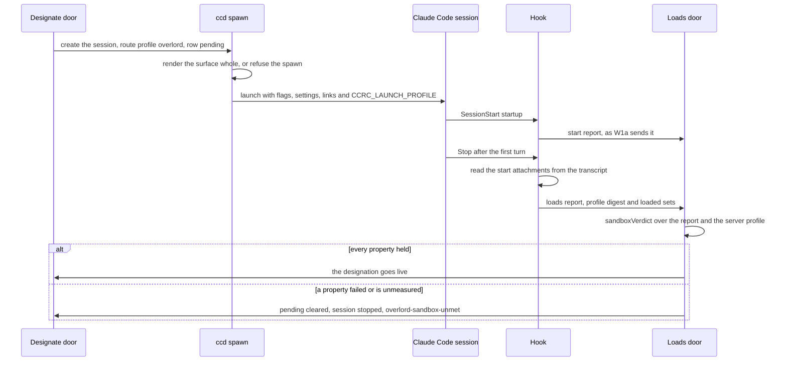

# Overlord W1: the launch profile and the sandbox check Implementation Plan

> **For agentic workers:** REQUIRED SUB-SKILL: Use superpowers:subagent-driven-development (recommended) or
> superpowers:executing-plans to implement this plan task by task. Steps use checkbox (`- [ ]`) syntax for tracking.

**Goal:** the `overlord` row of `FLEET_ROLES` carries the Overlord's whole launch surface as typed data: its tool
list, its deny rules (the cron tools included), its one declared reader type, its one tool server, its pinned setting
sources, ccrc's hook and status line registered by the profile itself, the bypass acceptance, the constitution file and
the staged `ccrc-overlord` skill. ccd renders that row at every launch, refuses to spawn the row when it cannot render
all of it, and puts the profile's digest in the session's environment. The hook reads the D-6798 no-model arm's pin
from the session, refuses any tool outside the profile, and reports what the running session loaded. The server keeps
that report, and a pure check decides from it whether the profile is engaged: on the first start of a pending
designation it moves the row to `live` or answers `overlord-sandbox-unmet`, and at a later start it is the ladder's
condition behind `launch-profile-unmet`.

**Why:** H1 (one launch profile per role holds all the body needs) and H4 (brain work only, as an absence of
capability, measured on the running session). W0 measured that the profile holds when it is applied whole (W0-15 to
W0-19), and named four things the profile must carry that nothing carries today: ccrc's own hook, because pinned
sources drop the account settings (proposal 4); the cron tools in the deny set (proposal 3); the bypass acceptance
(proposal 5); and the subagent-model pin, which today's no-model arm refuses (proposal 1). W1a built the launch
profile as a column with four scalar fields, enough for auto memory and compaction and not for a tool surface (index
question 12).

**Architecture:** the server composes, ccd renders, the hook measures, and the server decides.

- **L0.** `shared/fleetRoles.ts` gains a typed `surface` field on `LaunchProfile`, `null` on every row but `overlord`.
  A new one-concern sibling, `shared/overlord-sandbox.ts`, holds the report's wire shape, the property vocabulary and
  the list of agent types and skills that Claude Code lists of its own (question 4).
- **L1.** `server/src/continuity/launchProfile.ts` gains `launchRowOf`, the one projection of a role's profile into
  the row ccd reads, and `launchDigestOf`, its sha256. `ccd/lib/launch-profiles.json` stays the projection, now
  produced by that function. A new `server/src/continuity/sandboxCheck.ts` holds `sandboxVerdict` (per property:
  held, failed or unmeasured), `sandboxSettle` (what a verdict does to a pending designation) and the ladder's
  condition input. A new `server/src/continuity/startLoads.ts` narrows the report's body.
- **ccd (the anti-corruption layer).** `_profile_spawn_compose` renders the surface (flags, settings, environment, the
  two workspace links), drops `--remote-control` for the row, refuses the spawn when a surfaced row cannot be rendered
  whole, and exports `CCRC_LAUNCH_PROFILE=<role>:<digest>`. `ccd/lib/transcript.jq`, the one transcript reader on the
  ccd side, gains the entry that reads what the session loaded.
- **The hook (L4 on the fleet box).** The no-model arm reads the pin; a surface arm refuses a tool the profile does
  not list; and a loads report goes to a new box-token door at the first `Stop` after each `startup` or `resume`
  start.
- **The server (L3 and L4).** The door `POST /api/sessions/:id/start/loads` in `server/src/continuity/routes.ts`, one
  writer of a new table `continuity_start_loads`, and (PR B) the settle step at that door. No verdict is stored: every
  reader computes it from the newest report and the server's own profile, so a reader never sees a verdict computed
  against another build's profile.


*Figure 1. The first start of a designation. At a later start the same report feeds the ladder's condition, and only
the gate order reads it.*

**Tech Stack:** TypeScript (ESM), bash (`ccd/ccd`, `ccd/session-hook.sh`, `ccd/ccrc`), `jq`, vitest with
`makeCcdHarness`, the W0 rig (`server/test/delegation-rig/`). No new dependency.

**Spec:** `docs/superpowers/specs/2026-11-09-overlord-design.md`. Each section, and what this plan takes from it:

- §3.6, H1: the `overlord` profile's tool surface, model switches, memory and compaction, closed peer messaging,
  pinned sources, what is loaded, and the start report's lists. H2: Table 3.6a, the profile digest and the loaded-file
  report as fleet-host caches. H4: the sandbox check, its two steps, what the workspace must lack, the two modes, drift,
  and "a generation can still finish starting". The two "As measured" paragraphs (W0a and W0b).
- §3.2 and C2: designation is two steps, `pending` then `live` on the first start's check.
- §3.3.3 and §11.3: the constitution rides the workspace memory file the profile ships; "Enabled by one profile".
- §3.3.10, C55: readers are declared agent types passed at launch, with one read tool and no shell, on `sonnet`.
- §7.5, Table 7.5a: "the launch profile is not engaged" is a condition read by the gate order.
- §11.2: `launch-profile-unmet` is step 6, and the card, probe and note doors skip it.
- Table 11.1a (`overlord_designation`'s writers), Table 11.1e (the hook's reports), Table 11.6 (`overlord-sandbox-unmet`,
  `launch-profile-unmet`).
- Table 13.1: H1 and H2 are `shape` calls of W1a and W1, H4 is `tightening` in W1. This piece creates one table and one
  door, and both ship with it.
- The W0 results, `docs/superpowers/plans/2026-11-11-overlord-w0-spike-results.md`: W0-11, W0-15 to W0-19, and
  proposals 1, 3, 4 and 5.

**The index:** `docs/superpowers/plans/2026-11-14-overlord-w1.md` (PR #2814), row "Launch profile and sandbox check",
lane B. The skill piece (`w1-overlord-skill.md`, #2815) stages `~/.cc-sessions/overlord-skill`; this piece decides how
the Overlord's pinned launch loads that copy and no other skill.

## Open questions

Each carries the answer this plan builds. The index's questions this piece builds on are restated at the end of the
list with the answer taken.

1. **What the check measures, and from where** (slug `loaded-sets-read-from-the-transcript`).
   - **The facts.** No documented hook payload lists the skills, agents or tool servers a session loaded. A session's
     transcript records them at its first request, as attachments: `instructions` (each file's path and type),
     `skill_listing` (names), `agent_listing_delta` (type names, and how many are built in), `mcp_instructions_delta`
     and `deferred_tools_delta` (server and tool names), and `hook_success` (each SessionStart hook's command). Read
     from a live 2.1.323 session's own transcript; their order against the hook events is unmeasured, which Task 1
     measures. The main thread's non-deferred tools (`Bash`, `Read`, `Edit`) are recorded nowhere.
   - **The recommendation.** The hook reads those attachments through a new `transcript.jq` entry at the first `Stop`
     after a `startup` or `resume` start, and reports them with the profile digest from its own environment and the
     `permission_mode` of its own payload. The tools the transcript cannot show are covered twice: the digest proves ccd
     rendered the row whole (`--tools`, the deny rules), and the hook's surface arm refuses any tool the profile does
     not list, at every call. Reading the running process's argv was weighed and left out: `ps` joins argv with spaces,
     and `/proc` exists on Linux only.
2. **How the pinned launch loads the staged skill and the constitution** (slug `workspace-links-for-skill-and-constitution`).
   - **The facts.** Under `--setting-sources project` a project skill is listed and an account skill is not (W0-19). The
     skill is staged at `~/.cc-sessions/overlord-skill`. The constitution is "the workspace memory file the launch profile
     ships" (§3.3.3), so it must be a `CLAUDE.md` Claude Code loads as project memory.
   - **The recommendation.** The tree ships the constitution as `ccd/lib/overlord-constitution.md`, installed beside
     `launch-profiles.json` by the existing per-file sites. At every spawn of a surfaced row, ccd makes two links in the
     session's workspace: `.claude/skills/ccrc-overlord` to the staged skill and `CLAUDE.md` to the installed
     constitution, and writes both names into the repository's `info/exclude`, so they are never committed. A name that
     stands and is not ccd's link refuses the spawn. If Task 1 finds that Claude Code does not follow a linked skill or
     memory file, ccd copies both at each spawn instead (one writer, a cache refreshed every launch), in the same task.
3. **The designate door's answer** (slug `sandbox-unmet-is-an-outcome`).
   - **The facts.** The check needs the first turn's attachments, so it cannot finish inside the request that created
     the session. §3.6 says the door "answers `overlord-sandbox-unmet`".
   - **The recommendation.** The designation piece's door answers `pending` at once. The settle step (Task 7) records
     `overlord-sandbox-unmet` as the outcome of that attempt on the designation row, with the stopped session's id, and
     the console reads it there. The designation plan decides the row's columns. If designation PR A ships none, this
     piece's PR B adds them in one migration.
4. **Claude Code's own agent types and skills** (slug `claude-code-own-lists-are-measured`).
   - **The facts.** A session lists Claude Code's built-in agent types and bundled skills whatever its sources. The
     attachments name them beside loaded ones and do not mark which is which, beyond a count of built-in agent types.
   - **The recommendation.** `shared/overlord-sandbox.ts` holds the two lists Task 1 measures under the profile, with
     the builds they were read on. The check allows exactly the profile's names plus those lists. A build that adds a
     name fails closed: the board names the new entry, and a one-line change admits it. The surface arm (question 1) is
     the second line: an `Agent` call whose `subagent_type` is not the declared reader type, or a `Skill` call naming any
     skill but `ccrc-overlord`, is refused at the call.
5. **A release that changes the `overlord` row** (slug `profile-change-needs-a-start`). The check compares the running
   session's digest with the server's own profile. After a release that changes the row, the running Overlord reads
   `launch-profile-unmet` until its next start, and only the card, probe and note doors answer. **Recommendation:**
   build it as written, and the renewal readings piece counts a digest mismatch as a reason to renew (its index row
   gains the reading).
6. **Doctor's no-mods check** (slug `mods-measured-at-start-not-by-doctor`). W0b says the check "stands", and no piece of
   the index builds it. **Recommendation:** not built. A plugin shows at the start as a skill or tool server whose
   name carries the plugin's prefix, or a SessionStart hook that is not ccrc's, and the check fails closed on each and
   names it. A doctor list would only repeat what the board shows.
7. **Who raises the operator's item at a later start's failure** (§3.6: "the server then leaves that account out of the
   Overlord's ordered list until the operator clears the item"). **Recommendation:** the renewal readings piece, which
   the index already gives the ordered list's exclusion, raises the item beside it from this piece's verdict, so one
   piece owns both.
8. **The constitution's size** (slug `constitution-size-cap`). **Recommendation:** at most 8,000 bytes, pinned by its
   test. It sits in the cached prefix of every generation (§3.3.3) and carries one line for each of R1 to R20 and A1 to
   A15, plus what the Overlord is.

The index's questions:

- **Q12** (`launch-profile-gains-typed-surface`): built as recommended. `surface` is a typed field of `LaunchProfile`,
  so every row's type carries it, and `ccd/lib/launch-profiles.json` stays the projection (Task 2).
- **Q14** (`no-model-arm-reads-the-pin`): built as recommended. The arm reads the pin the launch applied, from the
  session's environment: `CLAUDE_CODE_SUBAGENT_MODEL_FORCE=1` with `CLAUDE_CODE_SUBAGENT_MODEL` set. No role is named
  (Task 4).
- **Q13 and Q30** (the door process): this piece fixes two names the door process serves under: the tool server
  `door`, and the readers' tool `mcp__door__read`, the names W0-15 measured. The door process piece adds its server's
  launch to the surface branch of `_profile_spawn_compose` with one line.
- **Q20** (`ladder-causes-join-with-their-inputs`): PR B adds the ladder's "the launch profile is not engaged" row.
- **Q36**: PR A needs nothing and is ready to build.

## What exists today

Measured on `origin/main` at `2d5d4d4ef` (2026-11-15).

- **The role table.** `shared/fleetRoles.ts#LaunchProfile` has four fields: `env`, `settings` (scalars only),
  `autoMemory` and `compaction`. The `overlord` row's profile sets `CLAUDE_CODE_FORK_SUBAGENT=0` and
  `CLAUDE_CODE_DISABLE_AGENT_VIEW=1`, auto memory off and the long-lived compaction columns. The file is L0 and takes
  type-only imports of its siblings. It is not growth-checked.
- **ccd's copy.** `ccd/lib/launch-profiles.json` holds per role `env`, `settings`, `autoMemory`, `compactionSettings`
  and `compactText`. `server/test/launch-profiles-file.test.ts` holds it equal to a projection the test itself builds,
  and pins its install sites: `ccd/ccrc#_inst_files`, `_upd_backup_set`, `_uninst_cc_sessions`, `deploy/deploy.sh`, and
  `server/test/installTreeFixture.ts`.
- **ccd's rendering.** `ccd/ccd#_profile_spawn_compose` reads the row a route's `profile` field names through
  `PROFILE_ROW_JQ`, merges its settings into the one `--settings` through `_spawn_settings_last` (after
  `FLEET_SPAWN_PINS`, so a profile pin wins), and adds its environment. It fails open: a row it cannot read spawns
  without the profile and warns. `_spawn_start` composes it last, after `_child_spawn_compose`, `_browser_spawn_compose`,
  `_account_spawn_compose` and `_fleet_spawn_compose`. `rcflag` is composed earlier, from `_rc_enabled` and the row's
  `rc` field. Both spawn lines pass `--dangerously-skip-permissions`. `_plat_sha256` is the portable digest.
- **The server's profile code.** `server/src/continuity/launchProfile.ts#compactThresholdFor` and
  `server/src/continuity/profileFor.ts#profileFor` (L1, C3), with mutant sets in `server/test/sim/launchProfileSets.ts`
  and floors in `server/test/sim/mutation-floors.json`. The profile lane writes the route's `profile`, `automem`,
  `compact` and `compactwindow` fields through `routeSet`.
- **The hook's events.** `shared/hook-events.ts#HOOK_EVENTS` lists the twelve events the hook handles.
  `ccd/install-session-hooks.sh` registers them in every account's settings with `HOOK_CMD`, `HOOK_TIMEOUT_S` (600, none
  on `SessionEnd`, matcher `*` on `PreToolUse`) and the status line `STATUSLINE_CMD`, which writes the context sidecar.
- **The no-model arm.** The D-6798 arm in `ccd/session-hook.sh` denies an `Agent` or `Task` call whose `tool_input`
  names no `model`. Under `CLAUDE_CODE_SUBAGENT_MODEL_FORCE=1` the payload carries no `model` even when the call named
  one, so the arm refuses every reader (W0-11). The hook already reads its environment (`CCRC_SESSION_GENERATION`).
- **The start report.** `_hook_start_report` in `ccd/session-hook.sh` reports every non-child, non-fork SessionStart to
  `POST /api/sessions/:id/start` (`server/src/continuity/routes.ts#registerContinuityRoutes`) through
  `ccrc-api sessions start`, spooled in `$REG/<id>.startpending`. Its one writer is
  `server/src/continuity/continuityStore.ts#insertStart`, into `continuity_starts` (migration 66). The body carries a
  `reportId` the hook mints. The door's census sites: `server/src/auth/gate.ts`'s EXEMPT entry,
  `server/test/auth-gate.test.ts`, `server/test/box-token-census.test.ts`'s `CONTINUITY_LANES`, `ccd/ccrc-api`'s
  `sessions.start` row with `server/test/ccrc-api.test.ts` and `server/test/ccrc-api-closed.test.ts`, the
  file's reason in `server/test/rings/fastify-l4.data.ts`, and `README.md`'s continuity paragraph.
- **The transcript reader.** `ccd/lib/transcript.jq` is the one transcript reader on the ccd side (ARCH-65), loaded with
  `jq -L` by `ccd/ccd`, `ccd/ccrc-doctor-checks` and the hook. It is not a growth-checked library (only `ccd/lib/*.sh`
  are).
- **The stop.** `POST /api/sessions/:id/stop` in `server/src/server.ts` runs `stopArgvFor`, a local function of
  `buildServer`. No other stop act exists.
- **The `overlord` project.** `ccd/ccd#cmd_project_add` with `--empty` makes a project cloned from a local bare origin
  ccd seeds with one empty commit. §3.2 says Start the Overlord makes the project that way.
- **The rig.** `server/test/delegation-rig/scenarios-overlord/ov-door.json` launched the W0 profile by hand-written
  flags; `server/test/delegation-rig-w0.test.ts` covers `rig.sh check-scenario`.
- **Not on `main`:** the designation, the ladder, the gates and the door process (W1 pieces planned beside this one),
  and the staged skill's installer (#2815 is the plan, its build is in flight). No `surface`, constitution, loads door or
  doctor no-mods check exists. Migrations on `main`: 73.

## Global Constraints

- **Architecture (`CLAUDE.md`).**
  - The server composes and ccd renders. ccd decides nothing about roles: every word it puts on an argv comes from the
    projection, checked by shape. The projection is `launchRowOf`, the one function the JSON test, the digest and the
    check all call.
  - One writer per fact: the profile is `FLEET_ROLES`; the report rows are `insertStartLoads`'; the designation's
    `live` and its failed attempt are the designation module's writers, which the settle step calls; the two workspace
    links are ccd's spawn step's.
  - `shared/overlord-sandbox.ts` imports nothing, and `shared/fleetRoles.ts` keeps type-only imports.
    `sandboxCheck.ts` and `startLoads.ts` are L1: no `fs`, no fastify, no clock. The door is L4 and decides nothing:
    it calls `startLoadsOf`, `sandboxVerdict` and `sandboxSettle` and acts on their answers.
  - Consolidate: the projection extends the existing projection, the hook reads through `transcript.jq`, the door joins
    the continuity routes, the stop is the stop route's own argv, and the ladder gets a row, never a mechanism.
- **Failure contracts (fail closed everywhere the Overlord is concerned).**
  - A surfaced row ccd cannot render whole refuses the spawn and journals it. Every other row keeps W1a's fail-open
    rule, byte for byte (Review Focus 1).
  - No loads report, an older hook, a door an older server lacks (404, kept and retried five times as the start report
    is), a transcript that cannot be read, or an attachment of a shape this build does not know: each property it
    touches reads `unmeasured`, and `unmeasured` is not `held`. At a pending first start nothing settles until a report
    lands, and the designation's own deadline fails the row. At a later start the gate refuses `launch-profile-unmet`.
  - A report whose start the server has not recorded yet answers `unknown-start`, which the hook keeps and resends.
  - A fleet box and a server on different builds compute different digests, so the check reads the profile as not
    engaged until both run one build and the Overlord starts again (question 5).
- **What a merge arms.** Nothing, in both pull requests. No route names the `overlord` profile until designation PR A
  writes one, the surface branch runs only for a surfaced row, the hook's new arms run only with `CCRC_LAUNCH_PROFILE`
  or the pin in the environment, and nothing reads the loads table until PR B. PR B's settle acts only on a `pending`
  designation, which nothing writes before designation PR A.
- **SAFETY (`CLAUDE.md`).** No new ccd verb: the surface rides the existing `profile` route field. ccd tests use fixture
  HOMEs (`makeCcdHarness`), never the live `$HOME`. The rig runs only in its own scratch HOME, by hand, as in W0. The
  report carries names, types and sha256 digests, never a file's contents or a hook command's text.
- **Growth check.** Every growth-checked file stays within 40 net lines a pull request, with no waiver. The estimates
  are in the PR split. A task that measures over its estimate splits as that table says, and never asks for a waiver.
- **Mutation floors.** `launchRowOf`, `startLoadsOf`, `sandboxVerdict` and `sandboxSettle` are new L1 deciders: each
  joins `MUTANT_SETS` (`server/test/sim/mutation-floors.test.ts`) and `server/test/sim/mutation-floors.json` in its
  task's pull request. Every new guard ships with a test that goes red when it is deleted.
- **Tests.** From `server/`: `ccrc test -- ./node_modules/.bin/vitest run test/<file>.test.ts`. A task's last run adds
  `ccrc test -- npx tsc --noEmit -p tsconfig.json` and `-p test/tsconfig.tests.json`, and for a `shared/` change
  `cd ../pwa && ccrc test -- ./node_modules/.bin/tsc --noEmit`. ccd and hook suites are load-sensitive: re-run a red one
  alone first.
- **Public repository.** Fixtures use `lane-a`, `project-a` and the `overlord` project. Cite by symbol or `@anchor`. No
  D-number is invented: this plan's departures are slugs under "Deviations found", and a builder's new ones go in
  `docs/superpowers/plans/2026-11-14-overlord-w1/w1-sandbox/notes.md`.

## Review Focus

1. **No surface, no change.** A row whose profile has no surface spawns exactly as on `main`, flags and environment byte
   for byte, and keeps W1a's fail-open rule. Only the `overlord` row has a surface.
2. **The surface is all or nothing.** ccd never spawns the `overlord` row with part of its surface: an unreadable row,
   a malformed word, a settings merge that fails or a link it cannot make refuses the spawn. A test drives each.
3. **Unmeasured is never held.** Every property of `sandboxVerdict` has a test where its input is missing or of an
   unknown shape, and each reads `unmeasured` and fails the verdict.
4. **One projection.** The JSON file, ccd's digest and the server's expected digest come from `launchRowOf`, and a test
   runs real `jq -cS` over the committed row to show ccd's digest equals `launchDigestOf`.
5. **The settle acts once.** A resent report of a start already settled changes nothing; a report for a session that is
   not the pending designated one changes nothing; and a failed check stops only the session the pending row names.

## The PR split

| PR | Tasks | What it ships | Needs first | Growth-checked files, estimate |
|---|---|---|---|---|
| A | 1 to 5 | The rig's load-path measurement; the typed surface, the `overlord` row's values, the projection in L1, the constitution; ccd's rendering; the hook's pin read, surface arm and loads report; the loads door and its table | nothing: **ready to build** | `ccd/ccd` about +34 (Task 3); `ccd/session-hook.sh` about +36 (Task 4); `ccd/ccrc` about +3 (Task 2: the constitution's install, backup and uninstall lines); `server/src/coord/schema.ts` about +24 (Task 5, one migration); `server/src/coord/store.ts` +2 (Task 5, one delegate); `shared/api.ts` 0; `server/src/server.ts` 0 |
| B | 6 and 7 | The check: `sandboxVerdict`, the ladder's condition input and its row; the settle step: `pending` to `live`, `overlord-sandbox-unmet`, the stop | PR A, designation A, ladder | `server/src/server.ts` about +6 (Task 7: two ports wired); `server/src/coord/schema.ts` 0, or about +12 if the designation row lacks the failed-attempt columns (question 3); `server/src/coord/store.ts` 0 to +2; `ccd/ccd` and `ccd/session-hook.sh` 0 |

**If a task measures over its estimate.** Task 4's surface arm moves to PR B, as a Task 6 step (PR B touches the hook
nowhere else). Task 3's link step splits into a PR A2 after PR A, with Tasks 4 and 5 waiting for it. Neither split
changes a task's tests.

For scale, the files that are not growth-checked change by about: `shared/fleetRoles.ts` +45,
`shared/overlord-sandbox.ts` +90 (new), `server/src/continuity/launchProfile.ts` +80,
`server/src/continuity/startLoads.ts` +70 (new), `server/src/continuity/sandboxCheck.ts` +170 (new),
`server/src/continuity/routes.ts` +70 (PR A) and +30 (PR B), `server/src/continuity/continuityStore.ts` +40,
`ccd/lib/transcript.jq` +35, `ccd/lib/launch-profiles.json` +40, `ccd/lib/overlord-constitution.md` about 7,500 bytes
(new).

## Index changes

The index (#2814) should carry these. Its row and lane lists name only what is shown here.

- **The row.** PR A also ships the loads door `POST /api/sessions/:id/start/loads` and its table
  `continuity_start_loads`, the constitution file, the hook's surface arm and the rig measurement. PR B stores no
  verdict (every reader computes it), and its settle step calls the designation module's writers.
- **Append-only registries.** `MIGRATIONS` gains the loads table (PR A), and possibly the designation's failed-attempt
  columns (PR B, question 3). The door censuses gain the loads door. `ccd/ccrc-api`'s `ROUTES` gains `sessions.loads`.
  `MUTANT_SETS` gains four deciders. `writers-map.test.ts`'s `TABLES` gains `continuity_start_loads`.
- **Lane B's files.** Add `ccd/lib/transcript.jq` (one entry), `ccd/lib/overlord-constitution.md`,
  `server/src/continuity/{startLoads,sandboxCheck}.ts` and `shared/overlord-sandbox.ts`. Lane B now touches `ccd/ccrc`
  (three install lines) and `deploy/deploy.sh` (two lines), beside lanes A and G.
- **The door process.** Its server is named `door` and its readers' tool `mcp__door__read`, as this piece's profile
  declares. Its `--mcp-config` joins the surface branch of `_profile_spawn_compose` with one line. Under the profile's
  `CLAUDE_CODE_SUBAGENT_MODEL_FORCE=1`, a reader call cannot name another model (W0-11), so its reader-model arm has
  nothing to refuse, and its plan may drop it.
- **The designation.** Start the Overlord sends the session a first prompt, so the first turn, and with it the loads
  report, happens (Task 4's report rides the first `Stop`). Its door answers `pending` at once, and the attempt's outcome
  carries `overlord-sandbox-unmet` (question 3). PR B calls its writers for `live` and for clearing a pending row.
- **The gates.** Step 6 reads the ladder's "the launch profile is not engaged" condition, which sandbox PR B adds. No
  edge is needed: nothing goes `live` before sandbox PR B, which owns that move.
- **The renewal readings.** A digest mismatch is a renewal reading (question 5), and that piece raises the operator's
  item at a later start's failure, beside the ordered list's exclusion (question 7).
- **Questions 12 and 14** are settled by this plan as recommended.

---

### Task 1: Measure the load path in the W0 rig (PR A)

**Files:**
- Create: `server/test/delegation-rig/scenarios-overlord/ov-sandbox.json`, and `ov-sandbox-rc.json` (the same launch
  with `--remote-control`)
- Create: `docs/superpowers/plans/2026-11-14-overlord-w1/w1-sandbox/load-path.md` (the results note)
- Modify: `server/test/delegation-rig/stubs/` only if a scenario needs a verb the rig lacks, with its test in
  `server/test/delegation-rig-w0.test.ts`

The scenario is `ov-door.json`'s launch with three changes: the project skill is a link to a directory outside the
repository, the repository's `CLAUDE.md` is a link to a file outside it, and the profile file carries
`skipDangerousModePermissionPrompt: true` and the status line. It runs on the two Claude Code builds the fleet runs most,
read from the update results as W0b did.

- [ ] **Step 1: Write both scenarios.** `rig.sh check-scenario` accepts each.
- [ ] **Step 2: Run them by hand** in the rig's scratch HOME, and record in the note, for each build:
  - M1: the linked skill is listed, and a `Skill` call loads it;
  - M2: the linked `CLAUDE.md` reaches the first request, and the requests after `/clear` and after `/compact`;
  - M3: whether a fresh config still shows the bypass dialog with the acceptance in `--settings`;
  - M4: which hook event first finds each start attachment in the transcript (SessionStart, UserPromptSubmit or
    `Stop`), and each attachment's shape, saved as a redacted fixture,
    `server/test/fixtures/start-loads/transcript-2.1.x.jsonl`, one per build;
  - M5: the agent types and skills listed with no project or account entry (Claude Code's own lists, question 4);
  - M6: what the transcript records with `--remote-control` and without it;
  - M7: the deferred tools under the profile, which must be the door stub's tools only.
- [ ] **Step 3: Select.** M1 and M2 decide links or copies (question 2). M3 decides whether the profile carries the
  acceptance or designation needs it as an operator precondition (an index change if so). M4 fixes the report's event,
  `Stop` unless an earlier one is measured. M5 fills `shared/overlord-sandbox.ts`'s lists in Task 2. M6 names the
  attachment the `remote-control` property reads, or, if none tells them apart, that property reads the digest alone,
  which the note says.
- [ ] **Step 4: Commit.** `test(rig): the Overlord's load path under the pinned profile, measured (W1 sandbox)`

### Task 2: The typed surface, the `overlord` row and the projection (PR A)

**Files:**
- Modify: `shared/fleetRoles.ts` (`LaunchSurface`, `LaunchProfile.surface`, the `overlord` row's values, `null` on the
  other six rows)
- Create: `shared/overlord-sandbox.ts` (`SANDBOX_PROPERTIES`, the report's wire shape, `CLAUDE_CODE_OWN_AGENT_TYPES`
  and `CLAUDE_CODE_OWN_SKILLS` with the builds they were read on)
- Modify: `server/src/continuity/launchProfile.ts` (`launchRowOf`, `launchDigestOf`, `LAUNCH_HOOK_COMMAND`,
  `LAUNCH_STATUSLINE_COMMAND`)
- Modify: `server/test/launch-profiles-file.test.ts` (it calls `launchRowOf`; its key-set case gains `surface`)
- Modify: `ccd/lib/launch-profiles.json` (regenerated)
- Create: `ccd/lib/overlord-constitution.md`, `server/test/overlord-constitution.test.ts`
- Modify: `ccd/ccrc` (`_inst_files`, `_upd_backup_set`, `_uninst_cc_sessions`: one line each for the constitution),
  `deploy/deploy.sh` (its install and backup lines), `server/test/installTreeFixture.ts`
- Modify: `server/test/fleet-roles.test.ts`, `server/test/sim/launchProfileSets.ts`, `server/test/sim/mutation-floors.json`

**Interfaces:**

```ts
/** The Overlord's tool surface (spec §3.6 H1, index question 12). Literals only; ccd puts them on an argv. */
export interface LaunchSurface {
  /** `--tools`: the main thread's built-in tools. */
  readonly tools: readonly string[];
  /** `permissions.deny`, merged into the one `--settings`. */
  readonly deny: readonly string[];
  /** `--agents`: the declared reader types, each with one tool and its model. */
  readonly readerTypes: Readonly<Record<string, { readonly description: string; readonly prompt: string;
    readonly model: 'sonnet'; readonly tools: readonly string[] }>>;
  /** The one tool server, under `--strict-mcp-config`. Its launch is the door process piece's. */
  readonly toolServer: 'door';
  /** `--setting-sources`. */
  readonly settingSources: readonly ('project' | 'local')[];
  /** The skills the session may list beside Claude Code's own. */
  readonly skills: readonly string[];
  /** The workspace links ccd makes at every spawn: the name in the workspace, and its target under `~/.cc-sessions`. */
  readonly links: Readonly<Record<string, string>>;
  /** sha256 of `ccd/lib/overlord-constitution.md`, held equal to the file by its test. */
  readonly constitutionSha256: string;
}
```

Every row's `LaunchProfile` gains `surface: LaunchSurface | null`. The `overlord` row:

- `env` gains `CLAUDE_CODE_SUBAGENT_MODEL: 'sonnet'` and `CLAUDE_CODE_SUBAGENT_MODEL_FORCE: '1'` (C55, W0-11).
  `settings` gains `enableWorkflows: false`, `switchModelsOnFlag: true` and `skipDangerousModePermissionPrompt: true`
  (proposal 5; Task 1's M3 may move the last one).
- `tools: ['Agent', 'Skill']`; `deny`: `Bash`, `Edit`, `Write`, `NotebookEdit`, `WebFetch`, `WebSearch`,
  `SendMessage`, `ListAgents`, `Workflow`, `CronCreate`, `CronList`, `CronDelete` (proposal 3);
  `readerTypes: { 'overlord-reader': … tools ['mcp__door__read'], model 'sonnet' }`; `settingSources: ['project']`;
  `skills: ['ccrc-overlord']`; `links: { '.claude/skills/ccrc-overlord': 'overlord-skill', 'CLAUDE.md':
  'lib/overlord-constitution.md' }`.

`launchRowOf(role)` returns the row ccd reads. For a surfaced row it adds `flags` (the words `--setting-sources project
--tools Agent,Skill --strict-mcp-config --agents <json>`), `surfaceSettings` (`permissions.deny`, ccrc's hook on every
`HOOK_EVENTS` event with `install-session-hooks.sh`'s command, timeout and matcher rules, and the status line), `links`,
`remoteControl: 'off'` and `failClosed: true`. `launchDigestOf(role)` is the sha256 of the row's compact, key-sorted
JSON: the bytes `jq -cS ".[\"$role\"]"` prints.

- [ ] **Step 1: Failing tests.**
  - `fleet-roles.test.ts`: only `overlord` has a surface; every `tools`, `deny` and `skills` word matches
    `^[A-Za-z0-9_]+$`; `toolServer` is `door`; every reader type's model is `sonnet` and its only tool is
    `mcp__door__read`.
  - `launch-profiles-file.test.ts`: the file equals `launchRowOf` for every role; real `jq -cS` over the committed file
    gives `launchDigestOf` for every role (Review Focus 4); every flag word but the agents value matches
    `^[A-Za-z0-9,._-]+$`, and the agents value is printable ASCII with no `'`; the hook command, timeout and status line
    equal `install-session-hooks.sh`'s `HOOK_CMD`, `HOOK_TIMEOUT_S` and `STATUSLINE_CMD` literals; the constitution's
    install lines are present.
  - `overlord-constitution.test.ts`: the file is at most 8,000 bytes; it has one line per ruling R1 to R20 and per
    anti-goal A1 to A15, each starting with its id; its sha256 is `constitutionSha256`; it names no shell command.
- [ ] **Step 2: Run.** Expected: red. **Step 3: Implement**, and write the constitution from §2's rulings and §15's
  anti-goals, one line each.
- [ ] **Step 4: Mutation.** `launchRowOf` joins `LAUNCH_PROFILE_MUTANT_SETS` with mutants that drop a flag, a deny
  word, the hook's matcher and `failClosed`; floor 1. The JSON test kills each.
- [ ] **Step 5: Run** the suites, `test/rings/shared-imports.test.ts`, `test/rings/wire-totality.test.ts`, both `tsc`
  runs and pwa's `tsc`. Expected: green.
- [ ] **Step 6: Commit.** `feat(roles): the overlord launch profile carries its tool surface, typed (H1, question 12)`

### Task 3: ccd renders the surface whole, or refuses the spawn (PR A)

**Files:**
- Modify: `ccd/ccd` (`PROFILE_ROW_JQ`, `_profile_spawn_compose`, its call in `_spawn_start`, the `rcflag` line)
- Create: `server/test/ccd-launch-surface.test.ts`
- Modify: `server/test/ccd-launch-profile.test.ts` (its characterization of a row with no surface stays green
  untouched)

**What it does.** For a row whose projection carries `surface` fields:
- `PROFILE_ROW_JQ` also checks each `flags` word by shape and emits them, with `surfaceSettings` merged after
  `settings` and `compactionSettings`;
- the flags join `PROFILE_SPAWN_FLAGS`, the agents value single-quoted;
- `rcflag` is cleared for a row whose `remoteControl` is `off`, whatever `_rc_enabled` says;
- each `links` entry is made in the workspace as a link to `$HOME/.cc-sessions/<target>` (Task 1 may make it a copy),
  and its name is added once to the file `git rev-parse --git-path info/exclude` names. A name that stands and is not
  that link refuses;
- `CCRC_LAUNCH_PROFILE=<role>:<digest>` joins the environment, the digest `_plat_sha256` over `jq -cS` of the row;
- when `failClosed` is true and any step fails, `_profile_spawn_compose` returns 1, `_spawn_start` starts no pane, and
  one `launch-profile-refused` line is journalled in `$REG/swap.log` with the step that failed.

- [ ] **Step 1: Characterize** what a refused `_spawn_start` does under `ccd supervise` today (its back-off and its
  journal), with a test green on `main`. The refusal must not spin: if the supervisor has no back-off for a refused
  spawn, this task stops and asks.
- [ ] **Step 2: Failing tests** in `ccd-launch-surface.test.ts`, on a fixture HOME with a stub wrapper that records its
  argv and environment:
  - the `overlord` row's spawn carries every flag, the merged deny rules and hooks, no `--remote-control` with the box
    file `on`, both links, the exclude lines and `CCRC_LAUNCH_PROFILE` with the digest the JSON test computes;
  - each failure refuses with no pane and one journal line: a malformed flag word, an agents value with `'`, a settings
    merge that fails, a `CLAUDE.md` that is a regular file, an unreadable profiles file;
  - a respawn finds its own links and makes nothing new;
  - a `coordinator` row spawns exactly as `ccd-launch-profile.test.ts` pins (Review Focus 1).
- [ ] **Step 3: Run.** Expected: red. **Step 4: Implement.** Measure the growth: `ccd/ccd` within 40 net lines, or
  split as the PR split says.
- [ ] **Step 5: Mutation.** Delete the `rcflag` clear, the fail-closed return, the link-ownership check and the
  digest: each turns a case red.
- [ ] **Step 6: Run** the new suite, `ccd-launch-profile`, `ccd-spawn-fleet-pins`, `ccd-spawn-account-settings`,
  `ccd-spawn-split` and `growth-check` armed. **Step 7: Commit.**
  `feat(ccd): render the overlord surface at every spawn, whole or not at all (H1)`

### Task 4: The hook reads the pin, guards the surface and reports what loaded (PR A)

**Files:**
- Modify: `ccd/session-hook.sh` (the D-6798 arm's pin read; the surface arm; `_hook_start_loads` and its call; one line
  in `_hook_start_report` that remembers the start's `reportId` for a surfaced session)
- Modify: `ccd/lib/transcript.jq` (entry `start_loads`)
- Modify: `ccd/ccrc-api` (row `sessions.loads`), `server/test/ccrc-api.test.ts`, `server/test/ccrc-api-closed.test.ts`
- Create: `server/test/session-hook-start-loads.test.ts`, `server/test/session-hook-surface-arm.test.ts`
- Modify: `server/test/session-hook-fan-out-routing.test.ts` (the D-6798 arm's suite: the pin cases)

**What it does.**
- **The pin (question 14).** With `CLAUDE_CODE_SUBAGENT_MODEL_FORCE` equal to `1` and `CLAUDE_CODE_SUBAGENT_MODEL` set,
  the arm does not judge an `Agent` or `Task` call: the call runs on the pinned model. A `Workflow` call is judged as
  today.
- **The surface arm.** With `CCRC_LAUNCH_PROFILE` set, the hook reads that role's row from `launch-profiles.json` and
  denies a `PreToolUse` whose tool is neither in the row's tools nor an `mcp__<toolServer>__` tool, an `Agent` call
  whose `subagent_type` is not a declared reader type, and a `Skill` call naming a skill not in the row's skills. An
  unreadable row denies (fail closed: the variable says the session runs under a surface).
- **The loads report.** At a surfaced session's `startup` or `resume` SessionStart, the hook writes `$REG/<id>.loadpending`
  holding the start's `reportId`. At each later `Stop`, while that file stands, it reads the transcript's start
  attachments through `start_loads`, composes the report (the role and digest from `CCRC_LAUNCH_PROFILE`, the
  `permission_mode` of its payload, each instruction file's type, base name, whether it lies in the workspace and its
  sha256, and the names of skills, agent types, tool servers and deferred tools, and each SessionStart hook command's
  sha256), and sends it through `ccrc-api sessions loads <id> --json -` inside a 3 s budget. A 202 removes the file; a
  404, 401, 5xx, no answer or `unknown-start` keeps it and counts a try; any other 4xx drops it; the fifth try drops it.
  A kind `start_loads` cannot read is sent as `unmeasured`, never left out.

- [ ] **Step 1: Failing tests.** The pin: FORCE with a model set allows a model-less `Agent` call; FORCE alone, or the
  model alone, denies it as today; a `Workflow` call with no model is denied either way. The surface arm: every denied
  and allowed shape above, and no effect without the variable. The report: driven from M4's fixtures, the body for each
  build; the kept, dropped and counted cases; a transcript with an unknown attachment shape sends that kind
  `unmeasured`; nothing at all for a session without the variable.
- [ ] **Step 2: Run.** Expected: red. **Step 3: Implement.** Measure the growth: `ccd/session-hook.sh` within 40 net
  lines, or move the surface arm to PR B.
- [ ] **Step 4: Mutation.** Delete the pin read, the surface arm's tool test, the reader-type test, the `unmeasured`
  fallback and the 404 keep: each turns a case red.
- [ ] **Step 5: Run** the new suites, `session-hook-fan-out-routing`, `session-hook-start-report`,
  `session-hook-roster-card` (the other `transcript.jq` reader in the hook), `session-hook`, `ccrc-api`,
  `ccrc-api-closed` and `growth-check` armed. **Step 6: Commit.**
  `feat(hook): the pin read, the surface arm and the loads report (questions 14, H4)`

### Task 5: The loads door and its table (PR A)

**Files:**
- Modify: `server/src/coord/schema.ts` (one migration: `continuity_start_loads`)
- Modify: `server/src/continuity/continuityStore.ts` (`insertStartLoads`, `newestStartLoads`)
- Modify: `server/src/coord/store.ts` (two one-line delegates)
- Create: `server/src/continuity/startLoads.ts` (`startLoadsOf`, the body's one narrowing)
- Modify: `server/src/continuity/routes.ts` (`POST /api/sessions/:id/start/loads`)
- Modify: `shared/refusal.ts` (`START_LOADS_REFUSALS`, `unknown-start`, and its status, 404, in the status map),
  `server/test/refusal-status.test.ts`
- Modify: `server/src/auth/gate.ts` (EXEMPT, one reason), `server/test/auth-gate.test.ts`,
  `server/test/box-token-census.test.ts` (`CONTINUITY_LANES` and its count word), `server/test/rings/fastify-l4.data.ts`
  (the file's reason), `README.md` (the continuity paragraph)
- Modify: `server/test/single-definition/writers-map.test.ts` (`TABLES`), `server/test/run-close-switch.test.ts` (its
  undo line and count)
- Create: `server/test/continuity-start-loads-route.test.ts`, `server/test/sim/startLoadsSets.ts`
- Modify: `server/test/sim/mutation-floors.test.ts`, `server/test/sim/mutation-floors.json`

**Schema:**

```sql
CREATE TABLE continuity_start_loads (
  startId     INTEGER PRIMARY KEY REFERENCES continuity_starts(id),
  sessionId   TEXT NOT NULL,
  profileRole TEXT,              -- from CCRC_LAUNCH_PROFILE, or null when the session had none
  profileDigest TEXT,            -- 64 lowercase hex, or null
  permissionMode TEXT,           -- the hook payload's word, or null
  loaded      TEXT NOT NULL,     -- JSON: per kind, a sorted list or "unmeasured"
  reportedAt  INTEGER NOT NULL,  -- the hook's clock, ms
  receivedAt  INTEGER NOT NULL   -- the server's clock, ms
);
CREATE INDEX continuity_start_loads_by_session ON continuity_start_loads(sessionId, receivedAt);
```

A new table, so an older build at this `user_version` reads as-is and boots. The slot is re-measured before the pull
request and before merge (`git show origin/main:server/src/coord/schema.ts | grep -c '^  // ── [0-9]*: user_version'`,
73 on `main` today).

**The door.** A box-token machine lane, as the start report is: the token first, then `fromId` is the path's session
(`not-owner`), then `startLoadsOf` (`bad-request` with the field), then attribution of `fromUuid`, then the start the
`reportId` names for that session (`unknown-start`, 404), then `insertStartLoads` (`write-failed`). A resend of a
recorded report answers `fresh: false`. `202 { ok, startId, fresh }`. `unknown-start` is a group of its own in
`shared/refusal.ts`, beside `CARD_REFUSALS`. Table 11.6 lacks it, so once the vocabulary piece's Table 11.6 test is on
`main`, the word also joins that test's exception list and wave map in this pull request (index question 23).

- [ ] **Step 1: Failing tests.** Each refusal in order; a resend; an over-long list, a kind word outside the set and a
  digest of the wrong shape refused by `startLoadsOf`; the row written as sent, `unmeasured` kept as a word; the census
  suites each name the door.
- [ ] **Step 2: Run.** Expected: red. **Step 3: Implement.** **Step 4: Mutation.** `startLoadsOf` joins `MUTANT_SETS`
  with mutants that accept each malformed field; floor 1.
- [ ] **Step 5: Run** the new suites, `continuity-start-route`, `auth-gate`, `box-token-census`, `rings/fastify-l4`,
  `writers-map`, `run-close-switch`, `mutation-floors`, `refusal-status`, `growth-check` armed and both `tsc` runs.
  **Step 6: Commit.**
  `feat(continuity): the loads door records what a start loaded (Table 11.1e)`

### Task 6: The check (PR B)

**Files:**
- Create: `server/src/continuity/sandboxCheck.ts` (`sandboxVerdict`, `profileEngagedOf`)
- Create: `server/test/sandbox-check.test.ts`, `server/test/sim/sandboxSets.ts`
- Modify: the ladder's condition table (named by the ladder plan; spec Table 7.5a's row "the launch profile is not
  engaged", kind condition, effect read by the gate order's step 6, no cap)
- Modify: `server/test/sim/mutation-floors.test.ts`, `server/test/sim/mutation-floors.json`

**Interfaces:**

```ts
export type SandboxProperty = 'profile' | 'tools' | 'tool-servers' | 'instructions' | 'skills' | 'agents' | 'hooks'
  | 'remote-control' | 'permission-mode' | 'workspace';
export interface PropertyVerdict { readonly property: SandboxProperty; readonly state: 'held' | 'failed' | 'unmeasured';
  readonly detail: string }
export interface SandboxVerdict { readonly engaged: boolean; readonly properties: readonly PropertyVerdict[] }
/** Total and pure: `engaged` only when every property is `held`. A null report reads every property `unmeasured`. */
export function sandboxVerdict(expected: ExpectedSurface, report: StartLoadsRow | null, workspace: WorkspaceFact): SandboxVerdict;
/** The ladder's condition input for the designated session: its newest `startup` or `resume` start's verdict. */
export function profileEngagedOf(...): 'engaged' | 'not-engaged';
```

`ExpectedSurface` comes from `launchRowOf('overlord')`. Each property and its rule (shared-user mode, §3.6's first
mode: the guards are engaged):
- `profile`: the role is `overlord` and the digest is `launchDigestOf('overlord')`.
- `tools`: every deferred tool is the tool server's.
- `tool-servers`: the only server is `door`.
- `instructions`: exactly one file, in the workspace, named `CLAUDE.md`, with the constitution's sha256.
- `skills`, `agents`: within the profile's names and Claude Code's own lists, and the profile's names present.
- `hooks`: every SessionStart hook is ccrc's (its command's sha256).
- `remote-control`: off, by M6's attachment, or by the digest alone where M6 found none.
- `permission-mode`: `bypassPermissions`.
- `workspace`: the registry row's project is the designation's project, the `overlord` project, whose repository is
  ccd's empty one (the slug `overlord-repository-is-its-own-empty-project`, under "Deviations found").

PR B reads `launch-profile-unmet` and `overlord-sandbox-unmet` from the vocabulary piece's W1 group in
`shared/refusal.ts`, which lands before designation PR A and so before this pull request.

A container's second mode (absence) is later: the vocabulary stays, and its rules join this decider then.

- [ ] **Step 1: Failing tests.** For each property, a held case, a failed case and an unmeasured case (Review Focus 3);
  a plugin skill, a plugin tool server and a foreign hook each fail; a report from another build's profile fails
  `profile`; `profileEngagedOf` reads `not-engaged` with no report, and reads a `compact` start through the newest
  `startup` or `resume` before it.
- [ ] **Step 2: Run.** Expected: red. **Step 3: Implement**, and add the ladder's row with its test in the ladder's
  suite.
- [ ] **Step 4: Mutation.** `sandboxVerdict` joins `MUTANT_SETS` with one mutant per property that reads `unmeasured`
  as `held`, and one that drops a property; floor 1.
- [ ] **Step 5: Run** the suites, the ladder's suite, `mutation-floors`, `time-ports` and both `tsc` runs. **Step 6:
  Commit.** `feat(continuity): the sandbox check, measured on the running session (H4)`

### Task 7: The settle step: `pending` to `live`, or `overlord-sandbox-unmet` (PR B)

**Files:**
- Modify: `server/src/continuity/sandboxCheck.ts` (`sandboxSettle`)
- Modify: `server/src/continuity/routes.ts` (the loads door, after its write)
- Modify: the designation module (named by the designation plan): its `live` writer and its pending-clear writer, added
  there if designation PR A does not ship them, with the failed attempt's columns (question 3)
- Modify: `server/src/server.ts` (the continuity routes' deps: the designation port and `stopCreated`, which runs
  `stopArgvFor` through the stop route's own path)
- Create: `server/test/sandbox-settle.test.ts`; extend `server/test/continuity-start-loads-route.test.ts`
- Modify: `server/test/sim/sandboxSets.ts`, `server/test/sim/mutation-floors.json`

**Interfaces:**

```ts
export type SettleAct = { kind: 'none' } | { kind: 'go-live' } | { kind: 'fail-pending'; properties: readonly PropertyVerdict[] };
/** Acts only for a `pending` designation whose session and registry generation are this report's, on its first
 *  `startup` report. Every other report is `none`. */
export function sandboxSettle(designation: DesignationRead, start: StartRow, verdict: SandboxVerdict): SettleAct;
```

**The door's step.** After `insertStartLoads`, the door reads the designation and the verdict and calls `sandboxSettle`.
`go-live` calls the designation's `live` writer. `fail-pending` calls the pending-clear writer, which records the
attempt's outcome `overlord-sandbox-unmet` and the session id, then stops that session through `stopCreated`. A stop
that fails is logged as `console.warn('ccrc-server: …')`, and the designation's deadline sweep tries again. An
unreadable designation acts on nothing. A rebind's first start reaches the same step when designation PR B lands:
there the old binding stands, which is that piece's writer.

- [ ] **Step 1: Failing tests.** `sandboxSettle`: every arm, a resend of a settled start (`none`), another session's
  report (`none`), a `resume` report at pending (`none`), an unmeasured verdict at pending (`fail-pending`). The door:
  `go-live` writes `live` once; `fail-pending` clears the row, records the outcome and calls `stopCreated` with that
  session alone; a stop that throws leaves the record and logs; an unreadable designation writes nothing.
- [ ] **Step 2: Run.** Expected: red. **Step 3: Implement.** **Step 4: Mutation.** `sandboxSettle` joins
  `MUTANT_SETS`: mutants that settle a `resume` report, settle a non-pending row, or go live on a failed verdict; floor 1.
- [ ] **Step 5: Run** the suites, the designation's suites, `mutation-floors`, both `tsc` runs and `growth-check`
  armed. **Step 6: Commit.** `feat(continuity): the first start decides the designation (H4, C2)`

## Deviations found

These are the departures from the spec's text that this plan makes, by slug. The coordinator mints the numbers.

- **`launch-profile-gains-typed-surface`** (index question 12): the surface is a typed field of `LaunchProfile`, `null`
  on every row but `overlord`.
- **`no-model-arm-reads-the-pin`** (index question 14): the D-6798 arm reads the pin from the session's environment
  and names no role.
- **`profile-digest-rides-the-environment`**: Table 3.6a lists the profile digest as a file ccd writes. It is an
  environment variable ccd composes on the spawn line, which the running process carries and the hook reads, so it
  cannot go stale and needs no lease.
- **`loaded-sets-read-from-the-transcript`** (question 1): the loaded sets are read from the transcript's start
  attachments, and the tools the transcript cannot show are covered by the digest and the surface arm.
- **`start-loads-is-its-own-report`**: §3.6 puts the lists in the start report. They arrive at the first `Stop` in a
  report of their own, which names the start it completes, because the attachments exist only after the first request.
- **`verdict-computed-on-read`**: no table holds a verdict. Every reader computes it from the newest report and the
  server's own profile.
- **`surfaced-profile-fails-closed`**: W1a's profile fails open. A surfaced row that cannot be rendered whole refuses
  the spawn instead, so the Overlord never runs as a session with a shell.
- **`workspace-links-for-skill-and-constitution`** (question 2): ccd links the staged skill and the installed
  constitution into the workspace at every spawn, excluded from git.
- **`overlord-repository-is-its-own-empty-project`**: "what the workspace must lack: a repository checkout" reads as a
  checkout of a project's code. The `overlord` project's own repository, which `project-add --empty` makes from a local
  origin with one empty commit, is the one checkout the workspace holds.
- **`surface-arm-refuses-what-the-profile-lacks`**: the hook refuses, at the call, any tool, agent type or skill the
  profile does not list. The spec names only the reader-scope and reader-model arms.
- **`statusline-registered-by-the-profile`**: pinned sources drop the account's status line with its hooks, so the
  profile registers both, and the context sidecar keeps its writer.
- **`claude-code-own-lists-are-measured`** (question 4): Claude Code's own agent types and skills are allowed from lists
  measured per build, and a new name fails closed.
- **`sandbox-unmet-is-an-outcome`** (question 3): the designate door answers `pending`, and `overlord-sandbox-unmet`
  is the attempt's recorded outcome.
- **`mods-measured-at-start-not-by-doctor`** (question 6): no doctor no-mods check; the start check names a plugin.
- **`profile-change-needs-a-start`** (question 5): a release that changes the row holds the Overlord at
  `launch-profile-unmet` until its next start.

## Where things stand

**Agreed:**
- From the brief and the index: lane B, two pull requests, PR A ready to build and PR B after PR A, designation A and
  the ladder; extend the W1a profile's row and decider, never a second profile mechanism; the skill piece stages the
  skill and this piece loads it.

**Waiting on the coordinator:** questions 1 to 8 stand as recommendations, and the index changes above.

**Waiting on the operator:** nothing. Task 1's M3 may turn the bypass acceptance into a designation precondition, which
would then be an operator act per account.

**Needs before it starts:** PR A, nothing beyond `main`. PR B: PR A, designation PR A and the ladder.
**What depends on it:** door process A (the profile and its names), designation B (rebind's first start through the
settle step), readiness, the board (the properties), home B, and the renewal readings (the digest reading and the
item).

**Later:**
- The container mode of the check (absence: no repository volume, no host token, egress to the server and the model
  provider only), when a session runs in its own sandbox.
- Retiring the surface arm's skill and agent-type cases if Claude Code gains a setting that hides its own lists.
- The board's and the Overlord place's rendering of the properties (board piece, home B).
