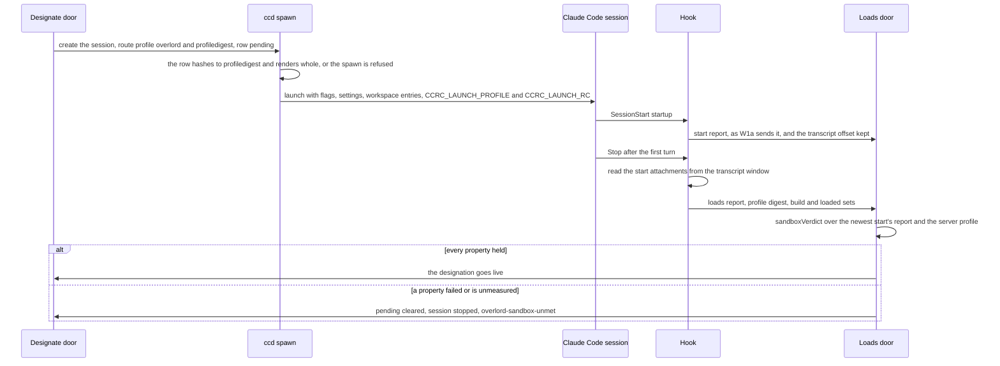

# Overlord W1: the launch profile and the sandbox check Implementation Plan

> **For agentic workers:** REQUIRED SUB-SKILL: Use superpowers:subagent-driven-development (recommended) or
> superpowers:executing-plans to implement this plan task by task. Steps use checkbox (`- [ ]`) syntax for tracking.

**Goal:** the `overlord` row of `FLEET_ROLES` carries the Overlord's whole launch surface as typed data: its tool
list, its deny rules (the cron tools included), its one declared reader type, its one tool server, its pinned setting
sources, ccrc's hook and status line registered by the profile itself, the bypass acceptance, the constitution file and
the staged `ccrc-overlord` skill. The server writes the row's expected digest as a route field when it gives a session
that profile. ccd renders the row at every launch, refuses the spawn when that field stands and the row it reads does
not hash to it or cannot be rendered whole, and puts the digest in the session's environment. The hook reads the D-6798
no-model arm's pin from the session, reports what the running session loaded, and (PR B) refuses any tool outside the
profile. The server keeps that report, and a pure check decides from it whether the profile is engaged: on the first
report of a pending designation it moves the row to `live` or records `overlord-sandbox-unmet`, and at a later start it
is the ladder's condition behind `launch-profile-unmet`. Doctor checks every account that can serve the Overlord for
mods.

**Why:** H1 (one launch profile per role holds all the body needs) and H4 (brain work only, as an absence of
capability, measured on the running session). W0 measured that the profile holds when it is applied whole (W0-15 to
W0-19), and named four things the profile must carry that nothing carries today: ccrc's own hook, because pinned
sources drop the account settings (proposal 4); the cron tools in the deny set (proposal 3); the bypass acceptance
(proposal 5); and the subagent-model pin, which today's no-model arm refuses (proposal 1). W0-19 and W0b keep doctor's
no-mods check required before designation. W1a built the launch profile as a column with four scalar fields, enough for
auto memory and compaction and not for a tool surface (index question 12).

**Architecture:** the server composes, ccd renders, the hook measures, and the server decides.

- **L0.** `shared/fleetRoles.ts` gains a typed `surface` field on `LaunchProfile`, `null` on every row but `overlord`.
  A new one-concern sibling, `shared/overlord-sandbox.ts`, holds the report's wire shape, the property vocabulary and
  Claude Code's own agent types and skills, keyed by the build they were measured on (question 4).
  `shared/api.ts#ROUTE_WRITABLE_FIELDS` gains the lane-only field `profiledigest`.
- **L1.** `server/src/continuity/launchProfile.ts` gains `launchRowOf`, the one projection of a role's profile into
  the row ccd reads, and `launchDigestOf`, its sha256. `profileFor` returns `profiledigest` beside `profile` for a
  surfaced role. `ccd/lib/launch-profiles.json` stays the projection, now produced by `launchRowOf`. A new
  `server/src/continuity/startLoads.ts` narrows the report's body. A new `server/src/continuity/sandboxCheck.ts` (PR B)
  holds `sandboxVerdict` (per property: held, failed or unmeasured), `profileEngagedOf` (the ladder's condition input)
  and `sandboxSettle` (what a verdict does to a pending designation).
- **ccd (the anti-corruption layer).** `_profile_spawn_compose` renders the surface (flags, settings, environment, and
  in PR A2 the two workspace entries), strips `--remote-control` for the row, and refuses the spawn when the route's
  `profiledigest` stands and the row is absent, unreadable, not that digest, or cannot be rendered whole. It exports
  `CCRC_LAUNCH_PROFILE=<role>:<digest>` and `CCRC_LAUNCH_RC=on|off`. `cmd_caps` advertises `launch-surface-v1` once the
  rendering is whole (PR A2). `ccd/lib/transcript.jq`, the one transcript reader on the ccd side, gains the entry that
  reads what the session loaded. Doctor gains the `overlord-mods` check.
- **The hook (L4 on the fleet box).** The no-model arm reads the pin; a loads report goes to a new box-token door at
  the first `Stop` after each `startup` or `resume` start; and (PR B) a surface arm refuses a tool the profile does not
  list.
- **The server (L3 and L4).** The door `POST /api/sessions/:id/start/loads` in `server/src/continuity/routes.ts`, one
  writer of a new table `continuity_start_loads`, and (PR B) the settle step at that door. No verdict is stored: every
  reader computes it from the report of the session's newest `startup` or `resume` start, joined by `startId`, and the
  server's own profile, so a reader never reads an older start's report and never sees a verdict computed against
  another build's profile.


*Figure 1. The first start of a designation. At a later start the same report feeds the ladder's condition, and only
the gate order reads it.*

**Tech Stack:** TypeScript (ESM), bash (`ccd/ccd`, `ccd/session-hook.sh`, `ccd/ccrc`, `ccd/ccrc-doctor-checks`),
`jq`, vitest with `makeCcdHarness`, the W0 rig (`server/test/delegation-rig/`). No new dependency.

**Spec:** `docs/superpowers/specs/2026-11-09-overlord-design.md`. Each section, and what this plan takes from it:

- §3.6, H1: the `overlord` profile's tool surface, model switches, memory and compaction, closed peer messaging,
  pinned sources, what is loaded, and the start report's lists. H2: Table 3.6a, the profile digest and the loaded-file
  report as fleet-host caches. H4: the sandbox check, its two steps, what the workspace must lack, the two modes, drift,
  and "a generation can still finish starting". The two "As measured" paragraphs (W0a and W0b), and the deny set's note
  that an installed mod can approve a denied call, so "doctor checks every account that can serve it".
- §3.2 and C2: designation is two steps, `pending` then `live` on the first start's check.
- §3.3.3 and §11.3: the constitution rides the workspace memory file the profile ships; "Enabled by one profile".
- §3.3.10, C55: readers are declared agent types passed at launch, with one read tool and no shell, on `sonnet`.
- §7.5, Table 7.5a: "the launch profile is not engaged" is a condition read by the gate order.
- §11.2: `launch-profile-unmet` is step 6, and the card, probe and note doors skip it.
- Table 11.1a (`overlord_designation`'s writers), Table 11.1e (the hook's reports), Table 11.6 (`overlord-sandbox-unmet`,
  `launch-profile-unmet`).
- Table 13.1: H1 and H2 are `shape` calls of W1a and W1, H4 is `tightening` in W1. This piece creates one table and one
  door, and both ship with it.
- The W0 results, `docs/superpowers/plans/2026-11-11-overlord-w0-spike-results.md`: W0-11, W0-15 to W0-19, and
  proposals 1, 3, 4 and 5.

**The index:** `docs/superpowers/plans/2026-11-14-overlord-w1.md` (#2814), row "Launch profile and sandbox check",
lane B. The skill piece (`w1-overlord-skill.md`, #2815) stages `~/.cc-sessions/overlord-skill`; this piece decides how
the Overlord's pinned launch loads that copy and no other skill. The pool set piece (`w1-pool-set.md`, #2816) owns the
release's `ccdCaps` and the update's capability floor, which this piece's word joins.

## Open questions

Each carries the answer this plan builds. Questions 3 to 6 were ruled by the coordinator in fix round 1 (review 2101);
the ruling is recorded with each. The index's questions this piece builds on are restated at the end of the list with
the answer taken.

1. **What the check measures, and from where** (slug `loaded-sets-read-from-the-transcript`).
   - **The facts.** No documented hook payload lists the skills, agents or tool servers a session loaded. A session's
     transcript records them at its first request, as attachments: `instructions` (each file's path and type),
     `skill_listing` (names), `agent_listing_delta` (type names, and how many are built in), `mcp_instructions_delta`
     and `deferred_tools_delta` (server and tool names), and `hook_success` (each SessionStart hook's command). They were
     read from a live 2.1.323 session's own transcript, not under the profile, and no fixture or document on `main`
     names the three delta kinds. Their order against the hook events, their shapes under the profile and what a
     `--resume` start writes are unmeasured, which Task 1 measures. The main thread's non-deferred tools (`Bash`,
     `Read`, `Edit`) are recorded nowhere.
   - **The recommendation.** The hook reads those attachments through a new `transcript.jq` entry at the first `Stop`
     after a `startup` or `resume` start, over a stated window (Task 4), and reports them with the profile digest from
     its own environment, the build, and the `permission_mode` of its own payload. The tools the transcript cannot show
     are covered by Claude Code's own enforcement (`--tools` and the deny rules, which W0-15 measured refusing `Bash`)
     and by the digest, which proves the row ccd composed. The hook's surface arm (PR B) is defence in depth, not a
     third enforcement: a hook that times out or fails before its arms lets the call run.
   - **Why not the process's argv.** `/proc/<pid>/cmdline` exists on Linux only, and macOS fleet boxes are supported.
     The digest's real limit is the same for either reading: it proves what ccd composed, not what the account wrapper
     (`$WRAPPER_DIR/<wrapper>`) adds to the command, which is an accepted gap (Global Constraints).
2. **How the pinned launch loads the staged skill and the constitution** (slug `workspace-links-for-skill-and-constitution`).
   - **The facts.** Under `--setting-sources project` a project skill is listed and an account skill is not (W0-19). The
     skill is staged at `~/.cc-sessions/overlord-skill`. The constitution is "the workspace memory file the launch profile
     ships" (§3.3.3), so it must be a `CLAUDE.md` Claude Code loads as project memory.
   - **The recommendation.** The tree ships the constitution as `ccd/lib/overlord-constitution.md`, installed beside
     `launch-profiles.json` by the existing per-file sites. The row names them by kind: `stagedSkills` (a skill name and
     its target under `~/.cc-sessions`) and `memory` (a target). ccd, which owns Claude Code's on-disk layout, maps the
     kinds to paths: at every spawn of a surfaced row it links `.claude/skills/<name>` to the staged skill and
     `CLAUDE.md` to the installed constitution, and writes both names into the repository's `info/exclude`, so they are
     never committed. A name that stands and is not ccd's link refuses the spawn, and so does any other project source
     in the workspace (Task 6). If Task 1 finds that Claude Code does not follow a linked skill or memory file, ccd
     copies both at each spawn instead (one writer, a cache refreshed every launch), in the same task.
3. **The designate door's answer** (slug `sandbox-unmet-is-an-outcome`). **Ruled: accepted.**
   - **The facts.** The check needs the first turn's attachments, so it cannot finish inside the request that created
     the session. §3.6 says the door "answers `overlord-sandbox-unmet`".
   - **The answer.** The designation piece's door answers `pending` at once. The settle step (Task 9) records
     `overlord-sandbox-unmet` as the outcome of that attempt on the designation row, with the stopped session's id, and
     the console reads it there. The designation plan decides the row's columns. If designation PR A ships none, this
     piece's PR B adds them in one migration. The coordinator carries the spec's wording to its next pass.
4. **Claude Code's own agent types and skills** (slug `claude-code-own-lists-are-keyed-by-build`). **Ruled: an unlisted
   build reads `unmeasured`, naming the build.**
   - **The facts.** A session lists Claude Code's built-in agent types and bundled skills whatever its sources. The
     attachments name them beside loaded ones and do not mark which is which, beyond a count of built-in agent types.
     The hook already derives the build from `CLAUDE_CODE_EXECPATH` for the delegation spool.
   - **The answer.** The report carries the build as an additive `claudeVersion`. `shared/overlord-sandbox.ts` holds
     `CLAUDE_CODE_OWN_LISTS`, keyed by build, each entry the agent types and skills Task 1 measured on it. The check
     allows exactly the profile's names plus that build's lists. A report from a build with no entry reads `skills` and
     `agents` as `unmeasured`, with the build named in the detail, so the check never blames an innocent name.
   - **The operator's cost, plainly.** After a Claude Code roll to a build ccrc has not measured, the Overlord does not
     go live, and a running one reads `launch-profile-unmet` at its next start, until a ccrc release carries that build's
     lists and is rolled out. The surface arm (PR B) still refuses, at the call, an `Agent` call whose `subagent_type`
     is not the declared reader type and a `Skill` call naming any skill but `ccrc-overlord`.
5. **A release that changes the `overlord` row** (slug `profile-change-needs-a-start`). **Ruled: a digest mismatch is
   a renewal reading only when the fleet node's build equals the server's.**
   - The check compares the running session's digest with the server's own profile. After a release that changes the
     row, the running Overlord reads `launch-profile-unmet` until its next start, and only the card, probe and note doors
     answer. That hold stands.
   - A mismatch counts as a renewal reading only when the fleet node's measured build equals the server's, read from the
     update control plane's per-node inventory (`GET /api/updates`). Under build skew (a `--server-first` rollout, or a
     fleet-first gap) a fresh start would render the fleet box's older row again, so renewing cannot cure it; the reading
     waits for the builds to agree. The renewal readings piece builds the reading with that condition.
   - The hook's surface arm enforces the row installed on the fleet box and judges no digest; the server owns the
     mismatch. Under skew the session's argv is the row it was spawned with, so the arm can only be stricter.
6. **Doctor's no-mods check** (slug none: built as the spec says). **Ruled: build it.** W0-19's outcome and W0b keep it
   required before designation, and the spec says doctor checks every account that can serve the Overlord. The start
   report cannot stand in for it: its `hooks` property sees only SessionStart, and the threat is a mod's hook on a
   permission or tool event that approves a denied call, or a plugin's commands. Task 7 builds the check; Task 1 adds
   M8, which measures whether a pinned launch loads an account's enabled plugin.
7. **Who raises the operator's item at a later start's failure** (§3.6: "the server then leaves that account out of the
   Overlord's ordered list until the operator clears the item"). **Recommendation:** the renewal readings piece, which
   the index already gives the ordered list's exclusion, raises the item beside it from this piece's verdict, so one
   piece owns both.
8. **The constitution's size** (slug `constitution-size-cap`). **Recommendation:** at most 8,000 bytes, pinned by its
   test. It sits in the cached prefix of every generation (§3.3.3) and carries one line for each of R1 to R20 and A1 to
   A15, plus what the Overlord is.

The index's questions:

- **Q12** (`launch-profile-gains-typed-surface`): built as recommended. `surface` is a typed field of `LaunchProfile`,
  so every row's type carries it, and `ccd/lib/launch-profiles.json` stays the projection (Task 2).
- **Q14** (`no-model-arm-reads-the-pin`): built, with one departure. The recommendation reads the pin "from the
  session's launch profile, a fact"; the arm reads it from the session's environment (a deviation, listed):
  `CLAUDE_CODE_SUBAGENT_MODEL_FORCE=1` with `CLAUDE_CODE_SUBAGENT_MODEL` set, which the launch put there. No role is
  named (Task 4).
- **Q13 and Q30** (the door process): this piece fixes two names the door process serves under: the tool server
  `door`, and the readers' tool `mcp__door__read`, the names W0-15 measured. The door process piece adds its server's
  launch to the surface branch of `_profile_spawn_compose` with one line. The check requires `door` present, so no
  designation goes live before door process A (index changes).
- **Q20** (`ladder-causes-join-with-their-inputs`): PR B adds the ladder's "the launch profile is not engaged" row.
- **Q36**: PR A needs nothing and is ready to build.

## What exists today

Measured on `origin/main` at `dce5c00cc` (2026-11-15). `main` moved past this plan's first base with D-8631 (#2825)
and the ccd split's Task 1 (#2810), both in `ccd/ccd`; every function named below was re-read there.

- **The role table.** `shared/fleetRoles.ts#LaunchProfile` has four fields: `env`, `settings` (scalars only),
  `autoMemory` and `compaction`. The `overlord` row's profile sets `CLAUDE_CODE_FORK_SUBAGENT=0` and
  `CLAUDE_CODE_DISABLE_AGENT_VIEW=1`, auto memory off and the long-lived compaction columns. The file is L0 and takes
  type-only imports of its siblings. It is not growth-checked.
- **ccd's copy.** `ccd/lib/launch-profiles.json` holds per role `env`, `settings`, `autoMemory`, `compactionSettings`
  and `compactText`. `server/test/launch-profiles-file.test.ts` holds it equal to a projection the test itself builds,
  holds every row's key set to those five, and pins its install sites: `ccd/ccrc#_inst_files`, `_upd_backup_set`,
  `_uninst_cc_sessions`, `deploy/deploy.sh`, and `server/test/installTreeFixture.ts`.
- **The route fields.** `shared/api.ts#ROUTE_WRITABLE_FIELDS` ends `profile`, `automem`, `compactwindow`, `precompact`;
  `ROUTE_LANE_ONLY_FIELDS` is derived as the slice from `profile` on, so a field appended there is lane-only with no
  further edit, and every door refuses it. `shared/api.ts` is capped (#2811), so an edit there must net zero code lines.
  ccd's `ROUTE_FIELDS` and the value check in its route verb hold each field's shape. A ccd that does not know a field
  refuses the whole call (`unknown routing field`). The launch-profile lane (`server/src/continuity/profileLane.ts`)
  writes the profile fields from `profileFor` through `CCD_ARGV.routeSet`, one argv per session, never a field whose
  value already stands. W1a's launch-profile PR A (#2763) lists every census a new route field touches.
- **ccd's rendering.** `ccd/ccd#_profile_spawn_compose` reads the row a route's `profile` field names through
  `PROFILE_ROW_JQ` (its output read with `IFS=$'\t' read`, which collapses an empty field, because a tab is IFS
  whitespace), merges its settings into the one `--settings` through `_spawn_settings_last` (after `FLEET_SPAWN_PINS`,
  so a profile pin wins), and adds its environment. It fails open: a row it cannot read spawns without the profile and
  warns (`ccd-launch-profile.test.ts`, "an unknown or unreadable profile never half-applies"). `_spawn_start` composes
  it last, after `_child_spawn_compose`, `_browser_spawn_compose` (which records what it applied in
  `$REG/<id>.browsermcp`), `_account_spawn_compose` and `_fleet_spawn_compose`. `rcflag` (`--remote-control '<id>'`,
  from `_is_anthropic_backend`, `_rc_enabled` and the row's `rc` field) is the first word of `launchflags`, built before
  every compose step. Both spawn lines pass `--dangerously-skip-permissions`, and `_accept_first_run_prompts` already
  answers Claude Code's first-run dialogs. `_plat_sha256` is the portable digest. Every caller of `_spawn_start` already
  writes `|| return $?`.
- **The ccd split.** `docs/superpowers/plans/2026-11-06-ccd-file-split.md` moves `_profile_spawn_compose` (slice 7,
  `mutation`) and `_spawn_start` and `_spawn_settings_last` (slice 8, `mutation-spawn`) into libraries. Neither slice
  has moved. Its rule is that a move yields to a feature: `preflight` refuses a slice while an open pull request has a
  hunk in one of its functions.
- **Capability words.** `ccd/ccd#cmd_caps` prints the verbs it implements, then capability tokens (`ws-add-base-v1` is
  the precedent for a flag's word). The pool set piece adds the release's `ccdCaps` (the whole `ccd caps` list in
  `build.json`) and `_upd_cap_floor_check`, which refuses an update or rollback to a build that lacks a word a standing
  fact on the box needs (its PR B1).
- **The server's profile code.** `server/src/continuity/launchProfile.ts#compactThresholdFor` and
  `server/src/continuity/profileFor.ts#profileFor` (L1, C3), with mutant sets in `server/test/sim/launchProfileSets.ts`
  and floors in `server/test/sim/mutation-floors.json`.
- **The hook's events.** `shared/hook-events.ts#HOOK_EVENTS` lists the twelve events the hook handles.
  `ccd/install-session-hooks.sh` registers them in every account's settings with `HOOK_CMD`, `HOOK_TIMEOUT_S` (600, none
  on `SessionEnd`, matcher `*` on `PreToolUse`) and the status line `STATUSLINE_CMD`, which writes the context sidecar.
- **The no-model arm.** The D-6798 arm in `ccd/session-hook.sh` denies an `Agent` or `Task` call whose `tool_input`
  names no `model`. Under `CLAUDE_CODE_SUBAGENT_MODEL_FORCE=1` the payload carries no `model` even when the call named
  one, so the arm refuses every reader (W0-11). The hook already reads its environment (`CCRC_SESSION_GENERATION`,
  `CLAUDE_CODE_EXECPATH`). Its header says the hook fails open, like every gate: it exits 0 on an unreadable id,
  registry, `jq` or event before any arm.
- **The start report.** `_hook_start_report` in `ccd/session-hook.sh` reports every non-child, non-fork SessionStart to
  `POST /api/sessions/:id/start` (`server/src/continuity/routes.ts#registerContinuityRoutes`) through
  `ccrc-api sessions start`, spooled in `$REG/<id>.startpending`, with `_hook_start_send` and `_hook_start_keep` for the
  send and the retry. Its one writer is `server/src/continuity/continuityStore.ts#insertStart`, into
  `continuity_starts` (migration 66: `source` is one of `startup`, `resume`, `clear`, `compact`, `fork`, `other`, and
  `reportedAt` is a session's start order). The body carries a `reportId` the hook mints. The hook writes
  `startpending` without the registry lock, so `_reg_purge` removes it a second time after `generation`. The door's
  census sites: `server/src/auth/gate.ts`'s EXEMPT entry and its count words, `server/test/auth-gate.test.ts`,
  `server/test/box-token-census.test.ts`'s `CONTINUITY_LANES` and `WORDS`, `ccd/ccrc-api`'s `ROUTES` (eighty-three
  rows, a scanned word) with `server/test/ccrc-api.test.ts` and `server/test/ccrc-api-closed.test.ts`, the file's
  reason in `server/test/rings/fastify-l4.data.ts`, and `README.md`'s continuity paragraph and its count of machine
  lanes (eighty-four).
- **The transcript reader.** `ccd/lib/transcript.jq` is the one transcript reader on the ccd side (ARCH-65), loaded with
  `jq -L` by `ccd/ccd`, `ccd/ccrc-doctor-checks` and the hook. It is not a growth-checked library (only `ccd/lib/*.sh`
  are).
- **The stop.** `POST /api/sessions/:id/stop` in `server/src/server.ts` runs `stopArgvFor`, a local function of
  `buildServer`. No other stop act exists.
- **Doctor.** `ccd/ccrc-doctor-checks#CCRC_DOCTOR_CHECKS` lists the checks; `_check_skills` walks every rostered home,
  skips a `server` box, and is the precedent for a per-account check.
- **The `overlord` project.** `ccd/ccd#cmd_project_add` with `--empty` makes a project cloned from a local bare origin
  ccd seeds with one empty commit. §3.2 says Start the Overlord makes the project that way.
- **The rig.** `server/test/delegation-rig/scenarios-overlord/ov-door.json` launched the W0 profile by hand-written
  flags; `server/test/delegation-rig-w0.test.ts` covers `rig.sh check-scenario`.
- **The growth check.** `server/test/growthCheck.ts`: a listed file grows at most 40 net code lines a pull request,
  waivers counting; nothing is frozen on `main`, and `shared/api.ts` is capped. `ccd/ccd`, `ccd/session-hook.sh`,
  `ccd/ccrc`, `ccd/ccrc-doctor-checks`, `server/src/coord/schema.ts`, `server/src/coord/store.ts` and
  `server/src/server.ts` are listed.
- **Not on `main`:** the designation, the ladder, the gates, the door process and the renewal readings (W1 pieces
  planned beside this one), the pool set's capability floor (its PR B1), and the staged skill's installer (#2815 is the
  plan, its build is in flight). No `surface`, constitution, loads door or doctor no-mods check exists. Migrations on
  `main`: 73.

## Global Constraints

- **Architecture (`CLAUDE.md`).**
  - The server composes and ccd renders. ccd decides nothing about roles: every word it puts on an argv comes from the
    projection, checked by shape, and whether a spawn fails closed comes from a route field the server wrote, never a
    role word in ccd. The projection is `launchRowOf`, the one function the JSON test, the digest, the route field and
    the check all call.
  - One writer per fact: the profile is `FLEET_ROLES`; `profiledigest` is the launch-profile lane's, like `profile`;
    the report rows are `insertStartLoads`'; the designation's `live` and its failed attempt are the designation
    module's writers, which the settle step calls; the workspace entries are ccd's spawn step's.
  - `shared/overlord-sandbox.ts` imports nothing, and `shared/fleetRoles.ts` keeps type-only imports.
    `sandboxCheck.ts` and `startLoads.ts` are L1: no `fs`, no fastify, no clock. The door is L4 and decides nothing:
    it calls `startLoadsOf`, `sandboxVerdict` and `sandboxSettle` and acts on their answers.
  - Consolidate: the projection extends the existing projection, the expected digest rides the existing route-field
    lane, the hook reads through `transcript.jq` and sends through `_hook_start_send` and `_hook_start_keep`, the door
    joins the continuity routes, the stop is the stop route's own argv, the capability word joins the pool set's floor,
    and the ladder gets a row, never a mechanism.
- **Failure contracts (fail closed everywhere the Overlord is concerned).**
  - A route with `profiledigest` standing refuses the spawn, journalled, when the `profile` field cannot be read, the
    profiles file cannot be read or lacks the row, the row does not hash to the field, or any step of the surface fails.
    A route without the field keeps W1a's fail-open rule, byte for byte (Review Focus 1).
  - A fleet-box ccd older than the rendering lacks `launch-surface-v1`, and the designate and rebind doors refuse
    `capability-missing` there, so no route names the profile on a box that would render it fail-open. A rollback below
    the word while a route carries `profiledigest` is refused by the update's capability floor. An older ccd that is
    sent the field anyway refuses the whole route call (`unknown routing field`), so nothing is written.
  - No loads report, an older hook, a door an older server lacks (404, kept and retried five times as the start report
    is), a transcript that cannot be read or exceeds its bound, a kind whose attachment the window does not hold, or an
    attachment of a shape this build does not know: each property it touches reads `unmeasured`, and `unmeasured` is
    not `held`. A start with no report reads not engaged; an older start's report never stands in for it.
  - A report whose start the server has not recorded yet answers `unknown-start`, which the hook keeps and resends.
  - A fleet box and a server on different builds compute different digests, so the check reads the profile as not
    engaged until both run one build and the Overlord starts again (question 5).
- **What the check proves, and the accepted residuals.** The spec's shared-user mode makes every guard here an
  accident guard: identity on the fleet is attribution, and any same-user process can read the box token. Stated once:
  - Any same-user session can post a loads report for the Overlord's start before the hook does. The first report is
    kept; a second report for the same start whose body differs reads every property `unmeasured`. So a forged report
    can only make the check fail, and a failing check at a pending designation stops the real session: a denial of
    service, accepted in shared-user mode.
  - The staged skill and the installed constitution are same-user writable after the check; their drift after the
    start is accepted in shared-user mode. The report hashes the constitution at the start and the skill not at all.
  - The digest proves the row ccd composed, not what the account wrapper adds to the command line, and not the argv the
    process read. `CCRC_LAUNCH_RC` is ccd's record of the flags it spliced, not a reading of the running session.
  - The surface arm is defence in depth: the hook fails open before its arms and on a timeout, and the enforcement is
    Claude Code's own (`--tools`, the deny rules).
- **What a merge arms.** Nothing, in any of the three pull requests. No route names the `overlord` profile or carries
  `profiledigest` until designation PR A writes one, which needs `launch-surface-v1`; the surface branch runs only for
  a surfaced row; the hook's new arms run only with `CCRC_LAUNCH_PROFILE` or the pin in the environment; doctor's new
  check only reports; and nothing reads the loads table until PR B. PR B's settle acts only on a `pending` designation,
  which nothing writes before designation PR A.
- **SAFETY (`CLAUDE.md`).** No new ccd verb: the surface rides the existing `profile` route field and a new lane-only
  field. ccd and doctor tests use fixture HOMEs (`makeCcdHarness`), never the live `$HOME`. The rig runs only in its own
  scratch HOME, by hand, as in W0. The report carries names, types and sha256 digests, never a file's contents or a hook
  command's text. Doctor reads account settings and never writes them.
- **Growth check.** Every growth-checked file stays within 40 net lines a pull request, with no waiver. The estimates
  are in the PR split, measured against `origin/main`. A task that measures over its estimate stops and asks; it never
  plans a waiver.
- **Mutation floors.** `launchRowOf`, `startLoadsOf`, `sandboxVerdict`, `profileEngagedOf` and `sandboxSettle` are new
  L1 deciders: each joins `MUTANT_SETS` (`server/test/sim/mutation-floors.test.ts`) and
  `server/test/sim/mutation-floors.json` in its task's pull request. Every new guard ships with a test that goes red
  when it is deleted.
- **Tests.** From `server/`: `ccrc test -- ./node_modules/.bin/vitest run test/<file>.test.ts`. A task's last run adds
  `ccrc test -- npx tsc --noEmit -p tsconfig.json` and `-p test/tsconfig.tests.json`, and for a `shared/` change
  `cd ../pwa && ccrc test -- ./node_modules/.bin/tsc --noEmit`. ccd and hook suites are load-sensitive: re-run a red one
  alone first.
- **Public repository.** Fixtures use `lane-a`, `project-a` and the `overlord` project. Cite by symbol or `@anchor`. No
  D-number is invented: this plan's departures are slugs under "Deviations found", and a builder's new ones go in
  `docs/superpowers/plans/2026-11-14-overlord-w1/w1-sandbox/notes.md`.

## Review Focus

1. **No field, no change.** A route without `profiledigest`, and a row whose profile has no surface, spawn exactly as
   on `main`, flags and environment byte for byte, and keep W1a's fail-open rule. Only the `overlord` row has a
   surface.
2. **The surface is all or nothing.** With `profiledigest` standing, ccd never spawns with part of the surface: an
   unreadable route field or profiles file, a missing row, a digest that differs, a malformed word, a settings merge
   that fails, an entry it cannot make, or a project source in the workspace refuses the spawn. A test drives each.
3. **Unmeasured is never held.** Every property of `sandboxVerdict` has a test where its input is missing or of an
   unknown shape, and each reads `unmeasured` and fails the verdict. An older start's report never answers for a newer
   start.
4. **One projection.** The JSON file, ccd's digest, the route field and the server's expected digest come from
   `launchRowOf`, and a test runs real `jq -cS` over the committed row to show ccd's digest equals `launchDigestOf`.
5. **The settle acts once.** A resent report of a start already settled changes nothing; a report for a session that is
   not the pending designated one changes nothing; and a failed check stops only the session the pending row names.

## The PR split

Net code lines, as `server/test/growthCheck.ts` counts them (comments and blank lines dropped), estimated against
`origin/main` at `dce5c00cc`.

| PR | Tasks | What it ships | Needs first | Growth-checked files, estimate |
|---|---|---|---|---|
| A | 1 to 5 | The rig's measurement; the typed surface, the `overlord` row, the projection, the route field, the constitution; ccd's digest check and rendering of flags, settings and environment; the hook's pin read and loads report; the loads door and its table | nothing: **ready to build** | `ccd/ccd` about +31 (Task 3; Task 4's `_reg_purge` edit nets 0); `ccd/session-hook.sh` about +31 (Task 4); `ccd/ccrc` about +3 (Task 2); `server/src/coord/schema.ts` about +16 (Task 5); `server/src/coord/store.ts` +2 (Task 5); `shared/api.ts` 0 (one line edited); `server/src/server.ts` 0 |
| A2 | 6 and 7 | The workspace entries and the workspace refusal; the word `launch-surface-v1` and its floor row; doctor's `overlord-mods` check | PR A | `ccd/ccd` about +24 (Task 6); `ccd/ccrc` about +4 (Task 6, the floor row, only if pool set B1 has landed; else pool set B1 carries it); `ccd/ccrc-doctor-checks` about +32 (Task 7) |
| B | 8 and 9 | The check: `sandboxVerdict`, `profileEngagedOf`, the ladder's row, the hook's surface arm; the settle step: `pending` to `live`, `overlord-sandbox-unmet`, the stop | PR A, PR A2, designation A, the ladder, door process A | `ccd/session-hook.sh` about +14 (Task 8, the surface arm); `server/src/server.ts` about +8 (Task 9: three ports wired); `server/src/coord/schema.ts` 0, or about +12 if the designation row lacks the failed-attempt columns (question 3); `server/src/coord/store.ts` 0 to +2 |

**Why the split is now, not a fallback.** Measured against `origin/main`, Task 3 with the workspace links sketches to
about 44 net lines in `ccd/ccd`, over 40; with the links in PR A2 it is about 31, and A2 is about 24. The surface arm
with the loads report sketches to about 45 in `ccd/session-hook.sh`; the arm moves to PR B, which leaves about 31 in
PR A and about 14 in PR B. No task plans a waiver; a task that measures over its row stops and asks. The capability word
ships in PR A2, the pull request that makes the rendering whole, so designation A, which needs the word, needs PR A2.

**The ccd split.** `_profile_spawn_compose` (slice 7) and `_spawn_start` and `_spawn_settings_last` (slice 8) are in
the ccd split's slices. While PR A or PR A2 is open with hunks in them, the split's `preflight` refuses those slices (a
move yields to a feature). If a slice moves first, the open pull request takes the functions from their new library,
where the growth check measures the library (`ccd/lib/*.sh`) instead of `ccd/ccd`, at the same 40-line limit.

For scale, the files that are not growth-checked change by about: `shared/fleetRoles.ts` +50,
`shared/overlord-sandbox.ts` +100 (new), `server/src/continuity/launchProfile.ts` +85,
`server/src/continuity/profileFor.ts` +6, `server/src/continuity/startLoads.ts` +90 (new),
`server/src/continuity/sandboxCheck.ts` +200 (new), `server/src/continuity/routes.ts` +70 (PR A) and +35 (PR B),
`server/src/continuity/continuityStore.ts` +55, `ccd/lib/transcript.jq` +50, `ccd/lib/launch-profiles.json` +45,
`ccd/lib/overlord-constitution.md` about 7,500 bytes (new).

## Index changes

The index (#2814) should carry these. Its row and lane lists name only what is shown here.

- **The row.** Three pull requests, A, A2 and B. PR A also ships the route field `profiledigest`, the loads door
  `POST /api/sessions/:id/start/loads` and its table `continuity_start_loads`, the constitution file and the rig
  measurement. PR A2 ships the workspace entries, the word `launch-surface-v1` and doctor's `overlord-mods` check. PR B
  ships the check, the surface arm and the settle step; it stores no verdict (every reader computes it), and its settle
  step calls the designation module's writers.
- **Append-only registries.** `ROUTE_WRITABLE_FIELDS` gains `profiledigest` (lane-only by derivation). `MIGRATIONS`
  gains the loads table (PR A), and possibly the designation's failed-attempt columns (PR B, question 3). The door
  censuses gain the loads door, and the machine-lane counts go from eighty-four to eighty-five (door process B's door
  changes the same counts, so the second to land re-counts). `ccd/ccrc-api`'s `ROUTES` gains `sessions.loads`.
  `cmd_caps` gains `launch-surface-v1`. `CCRC_DOCTOR_CHECKS` gains `overlord-mods`. `MUTANT_SETS` gains five deciders.
  `writers-map.test.ts`'s `TABLES` gains `continuity_start_loads`. ccd's registry gains `loadpending` (hook-written,
  removed a second time by `_reg_purge`) and the route field's file.
- **Lane B's files.** Add `ccd/lib/transcript.jq` (one entry), `ccd/lib/overlord-constitution.md`,
  `ccd/ccrc-doctor-checks` (one check), `server/src/continuity/{startLoads,sandboxCheck}.ts`,
  `server/src/continuity/profileFor.ts` and `shared/overlord-sandbox.ts`. Lane B now touches `ccd/ccrc` (the
  constitution's three install lines, and the floor row) and `deploy/deploy.sh` (two lines), beside lanes A and G, and
  `shared/api.ts` (one line edited).
- **The capability word (ruled, fix round 1).** Designation's `capability-missing` list for designate and rebind gains
  `launch-surface-v1`, and **designation A needs sandbox A2**. The pool set's `_upd_cap_floor_check` gains the standing
  fact "a registry row carries `profiledigest`" for that word, in whichever of sandbox A2 and pool set B1 lands second.
- **The door process.** Its server is named `door` and its readers' tool `mcp__door__read`, as this piece's profile
  declares. Its `--mcp-config` joins the surface branch of `_profile_spawn_compose` with one line. The check requires
  `door` present, so **sandbox B needs door process A** (a new edge). Under the profile's
  `CLAUDE_CODE_SUBAGENT_MODEL_FORCE=1`, a reader call cannot name another model (W0-11), so its reader-model arm has
  nothing to refuse, and its plan may drop it.
- **The designation.** Start the Overlord sends the session a first prompt, so the first turn, and with it the loads
  report, happens (Task 4's report rides the first `Stop`). Its door answers `pending` at once, and the attempt's outcome
  carries `overlord-sandbox-unmet` (question 3). PR B calls its writers for `live` and for clearing a pending row. Its
  deadline sweep (designation B) is what fails a pending row that never reports and retries a stop that failed; until
  it lands, the window is named under Task 9. The operator runs doctor's `overlord-mods` check before Start the
  Overlord; whether the designate door also reads it is the designation piece's choice.
- **The gates.** Step 6 reads the ladder's "the launch profile is not engaged" condition, which sandbox PR B adds. No
  edge is needed: nothing goes `live` before sandbox PR B, which owns that move.
- **The renewal readings.** A digest mismatch is a renewal reading only when the fleet node's build equals the
  server's (question 5), and that piece raises the operator's item at a later start's failure, beside the ordered
  list's exclusion (question 7).
- **Questions 12 and 14** are settled by this plan (14 with the environment departure).

---

### Task 1: Measure the load path in the W0 rig (PR A)

**Files:**
- Create: `server/test/delegation-rig/scenarios-overlord/ov-sandbox.json`, `ov-sandbox-rc.json` (the same launch
  with `--remote-control`) and `ov-sandbox-plugin.json` (the same launch over an account config with one enabled
  plugin)
- Create: `docs/superpowers/plans/2026-11-14-overlord-w1/w1-sandbox/load-path.md` (the results note)
- Modify: `server/test/delegation-rig/stubs/` only if a scenario needs a verb the rig lacks, with its test in
  `server/test/delegation-rig-w0.test.ts`

The scenario is `ov-door.json`'s launch with three changes: the project skill is a link to a directory outside the
repository, the repository's `CLAUDE.md` is a link to a file outside it, and the profile file carries
`skipDangerousModePermissionPrompt: true` and the status line. It runs on the two Claude Code builds the fleet runs most,
read from the update results as W0b did.

- [ ] **Step 1: Write the scenarios.** `rig.sh check-scenario` accepts each.
- [ ] **Step 2: Run them by hand** in the rig's scratch HOME, and record in the note, for each build:
  - M1: the linked skill is listed, and a `Skill` call loads it;
  - M2: the linked `CLAUDE.md` reaches the first request, and the requests after `/clear` and after `/compact`;
  - M3: whether a fresh config still shows the bypass dialog with the acceptance in `--settings`, and whether ccd's
    `_accept_first_run_prompts` answers it when it does;
  - M4: for a fresh launch and for a `--resume` of it, which hook event first finds each start attachment in the
    transcript (SessionStart, UserPromptSubmit or `Stop`), each attachment's shape, whether a kind with nothing to list
    is written empty or left out, whether a resume writes each kind again in full, as a delta against the resumed
    history, or not at all, and what marks the start's first request; saved as redacted fixtures,
    `server/test/fixtures/start-loads/transcript-<build>-startup.jsonl` and `-resume.jsonl`;
  - M5: the agent types and skills listed with no project or account entry (Claude Code's own lists, question 4);
  - M6: what the transcript, the hook payload or the session's environment records with `--remote-control` and
    without it;
  - M7: the deferred tools under the profile, which must be the door stub's tools only;
  - M8: whether the pinned launch loads the account's enabled plugin (its skills, commands, hooks or tool server) in
    `ov-sandbox-plugin.json`.
- [ ] **Step 3: Select.** M1 and M2 decide links or copies (question 2). M3 decides whether the profile carries the
  acceptance, ccd's acceptor covers it, or designation needs it as an operator precondition (an index change if so).
  M4 fixes the report's event (`Stop` unless an earlier one is measured), the window and each kind's absence rule at a
  resume (Task 4's table), and the first-request marker. M5 fills `CLAUDE_CODE_OWN_LISTS` for each build in Task 2. M6
  names the attachment the `remote-control` property reads; if none tells them apart, the property reads ccd's
  `CCRC_LAUNCH_RC`, which the note says. M7 rewords the `tools` property if the door tools are offered directly rather
  than deferred. M8 is recorded for the operator beside doctor's check (Task 7), and if the plugin loads, the note names
  what the report showed.
- [ ] **Step 4: Commit.** `test(rig): the Overlord's load path under the pinned profile, measured (W1 sandbox)`

### Task 2: The typed surface, the `overlord` row, the projection and the route field (PR A)

**Files:**
- Modify: `shared/fleetRoles.ts` (`LaunchSurface`, `LaunchProfile.surface`, the `overlord` row's values, `null` on the
  other six rows)
- Create: `shared/overlord-sandbox.ts` (`SANDBOX_PROPERTIES` and `SandboxProperty` derived from it, `START_LOAD_KINDS`,
  the report's wire shape, `CLAUDE_CODE_OWN_LISTS` keyed by build)
- Modify: `shared/api.ts` (`ROUTE_WRITABLE_FIELDS` gains `profiledigest`, appended after `precompact`, on the same
  line; its docstring names it)
- Modify: `server/src/continuity/launchProfile.ts` (`launchRowOf`, `launchDigestOf`, `LAUNCH_HOOK_COMMAND`,
  `LAUNCH_STATUSLINE_COMMAND`), `server/src/continuity/profileFor.ts` (`profiledigest` beside `profile` for a surfaced
  role, absent otherwise), `server/src/continuity/profileLane.ts` (`ProfileField` and the write set gain it)
- Modify: `server/test/launch-profiles-file.test.ts` (it calls `launchRowOf`; per-row key sets)
- Modify: `ccd/lib/launch-profiles.json` (regenerated)
- Create: `ccd/lib/overlord-constitution.md`, `server/test/overlord-constitution.test.ts`,
  `server/test/launch-surface-installer.test.ts`
- Modify: `ccd/ccrc` (`_inst_files`, `_upd_backup_set`, `_uninst_cc_sessions`: one line each for the constitution),
  `deploy/deploy.sh` (its install and backup lines), `server/test/installTreeFixture.ts`
- Modify: the route-field censuses #2763 touched for `compactwindow` (`route-fields-parse`, `launch-profile-route-wire`,
  `continuity-launch-profile`, `single-definition/continuity-values` and the rest that
  `git grep -l compactwindow server/test` names at build time)
- Modify: `server/test/fleet-roles.test.ts`, `server/test/sim/launchProfileSets.ts`, `server/test/sim/mutation-floors.json`

**Interfaces:**

```ts
/** The Overlord's tool surface (spec §3.6 H1, index question 12). Literals only; ccd puts them on an argv. ccd maps the
 *  `stagedSkills` and `memory` kinds to Claude Code's paths; this file names no path in Claude Code's layout. */
export interface LaunchSurface {
  /** `--tools`: the main thread's built-in tools. */
  readonly tools: readonly string[];
  /** `permissions.deny`, merged into the one `--settings`. */
  readonly deny: readonly string[];
  /** `--agents`: the declared reader types, each with one tool and its model. */
  readonly readerTypes: Readonly<Record<string, { readonly description: string; readonly prompt: string;
    readonly model: 'sonnet'; readonly tools: readonly string[] }>>;
  /** The one tool server, under `--strict-mcp-config`. Its launch is the door process piece's. */
  readonly toolServer: 'door';
  /** `--setting-sources`. */
  readonly settingSources: readonly ('project' | 'local')[];
  /** The skills the session may list beside Claude Code's own. */
  readonly skills: readonly string[];
  /** Skills ccd links into the workspace: the skill's name, and its target under `~/.cc-sessions`. */
  readonly stagedSkills: Readonly<Record<string, string>>;
  /** The workspace memory file ccd links: its target under `~/.cc-sessions`. */
  readonly memory: string;
  /** sha256 of `ccd/lib/overlord-constitution.md`, held equal to the file by its test. */
  readonly constitutionSha256: string;
}
```

Every row's `LaunchProfile` gains `surface: LaunchSurface | null`. The `overlord` row:

- `env` gains `CLAUDE_CODE_SUBAGENT_MODEL: 'sonnet'` and `CLAUDE_CODE_SUBAGENT_MODEL_FORCE: '1'` (C55, W0-11).
  `settings` gains `enableWorkflows: false`, `switchModelsOnFlag: true`, `skipDangerousModePermissionPrompt: true`
  (proposal 5; Task 1's M3 may move it), `crossSessionInbound: 'refuse'` (§3.6 H1: inbound peer messages refused; the
  fleet pin carries it too, and the row now says it itself) and `remoteControlAtStartup: false`.
- `tools: ['Agent', 'Skill']`; `deny`: `Bash`, `Edit`, `Write`, `NotebookEdit`, `WebFetch`, `WebSearch`,
  `SendMessage`, `ListAgents`, `Workflow`, `CronCreate`, `CronList`, `CronDelete` (proposal 3);
  `readerTypes: { 'overlord-reader': … tools ['mcp__door__read'], model 'sonnet' }`; `settingSources: ['project']`;
  `skills: ['ccrc-overlord']`; `stagedSkills: { 'ccrc-overlord': 'overlord-skill' }`;
  `memory: 'lib/overlord-constitution.md'`.

`launchRowOf(role)` returns the row ccd reads. A row with no surface keeps today's five keys. A surfaced row adds
`flags` (the words `--setting-sources project --tools Agent,Skill --strict-mcp-config --agents <json>`),
`surfaceSettings` (`permissions.deny`, ccrc's hook on every `HOOK_EVENTS` event with `install-session-hooks.sh`'s
command, timeout and matcher rules, and the status line), `stagedSkills`, `memory` and `remoteControl: 'off'`.

`launchDigestOf(role)` is the sha256 of the bytes `jq -cS ".[\"$role\"]"` prints for the row, its trailing newline
included: `JSON.stringify` of the key-sorted row, plus `\n`. jq and `JSON.stringify` agree on that only for printable
ASCII strings and integer numbers (measured differences: DEL, astral key order, exponent spellings), so the row is held
to both by test, with a comment saying why. The digest covers `compactText` too, so an edit to the compaction prose
alone holds a running Overlord at `launch-profile-unmet` until its next start (question 5), though that text never
rides the argv.

`profileFor` returns `profiledigest: launchDigestOf(role)` for a surfaced role and nothing for any other, so the lane
writes both fields in its one argv and, for every other row, never sends the new field (a field with no value to set
is never sent, so an older ccd sees nothing new).

- [ ] **Step 1: Failing tests.**
  - `fleet-roles.test.ts`: only `overlord` has a surface; every `tools`, `deny` and `skills` word matches
    `^[A-Za-z0-9_]+$`; every `stagedSkills` name matches `^[a-z0-9-]+$` and every target (and `memory`) matches
    `^[a-z0-9-]+(/[a-z0-9.-]+)*$` with no `..` segment; `toolServer` is `door`; every reader type's model is `sonnet`
    and its only tool is `mcp__door__read`; the row's settings carry `crossSessionInbound: 'refuse'`.
  - `launch-profiles-file.test.ts`: the file equals `launchRowOf` for every role; the key set of a row with no surface
    is today's five and of the `overlord` row those plus `flags`, `surfaceSettings`, `stagedSkills`, `memory` and
    `remoteControl`; real `jq -cS` over the committed file gives `launchDigestOf` for every role (Review Focus 4); every
    string in the file is printable ASCII and every number an integer; every flag word but the agents value matches
    `^[A-Za-z0-9,._-]+$`, and the agents value has no `'`; the constitution's install lines are present.
  - `launch-surface-installer.test.ts`: runs the real `ccd/install-session-hooks.sh --homes` on an empty fixture home
    and deep-equals the written `.hooks` and `.statusLine` with `launchRowOf('overlord').surfaceSettings`'s, so a rule
    that drifts in either is red (the `CHILD_DENY_RULES` precedent).
  - `overlord-constitution.test.ts`: the file is at most 8,000 bytes; it has one line per ruling R1 to R20 and per
    anti-goal A1 to A15, each starting with its id; its sha256 is `constitutionSha256`; it names no shell command.
  - `profileFor`'s suite: `profiledigest` for `overlord` equals `launchDigestOf('overlord')`; no other role has it. The
    route-field censuses: `profiledigest` is lane-only and every door refuses it by name.
- [ ] **Step 2: Run.** Expected: red. **Step 3: Implement**, and write the constitution from §2's rulings and §15's
  anti-goals, one line each. Measure `shared/api.ts`: zero net code lines.
- [ ] **Step 4: Mutation.** `launchRowOf` joins `LAUNCH_PROFILE_MUTANT_SETS` with mutants that drop a flag, a deny
  word, the hook's matcher and `remoteControl`; `profileFor`'s set gains one that drops `profiledigest`; floor 1. The
  JSON test and `profileFor`'s suite kill each.
- [ ] **Step 5: Run** the suites, `test/rings/shared-imports.test.ts`, `test/rings/wire-totality.test.ts`, the
  route-field suites, both `tsc` runs and pwa's `tsc`. Expected: green.
- [ ] **Step 6: Commit.** `feat(roles): the overlord launch profile carries its tool surface and its digest, typed (H1, question 12)`

### Task 3: ccd checks the digest and renders the surface, or refuses the spawn (PR A)

**Files:**
- Modify: `ccd/ccd` (`ROUTE_FIELDS` and the route verb's value check gain `profiledigest`, `^[0-9a-f]{64}$`;
  `PROFILE_ROW_JQ`; `_profile_spawn_compose`; its call in `_spawn_start`; `ccd/contexts.tsv` for any new function)
- Create: `server/test/ccd-launch-surface.test.ts`
- Modify: `server/test/ccd-launch-profile.test.ts` (its characterization of a route without the field stays green
  untouched), `server/test/ccd-route-fields.test.ts`

**What it does.** When `$REG/<id>.profiledigest` stands (read with `_route_get`):
- the `profile` field must read, the profiles file must read and hold the row, and `_plat_sha256` over `jq -cS` of the
  row must equal the field; otherwise the spawn is refused;
- `PROFILE_ROW_JQ` also checks each `flags` word by shape and emits them, with `surfaceSettings` merged after
  `settings` and `compactionSettings`. Its output is read with a separator that is not IFS whitespace (the unit
  separator), so an empty field keeps its place;
- the flags join `PROFILE_SPAWN_FLAGS`, the agents value single-quoted;
- for a row whose `remoteControl` is `off`, `--remote-control '<id>'` is stripped from the head of the flags string
  `_profile_spawn_compose` receives, whatever `_rc_enabled` said when `rcflag` was built;
- `CCRC_LAUNCH_PROFILE=<role>:<digest>` and `CCRC_LAUNCH_RC=on|off` join the environment, the second read from the
  final flags string both spawn lines splice;
- any failing step makes `_profile_spawn_compose` return 1; the call in `_spawn_start` becomes
  `_profile_spawn_compose … || return 1`, so no pane starts; and one `launch-profile-refused` line is journalled in
  `$REG/swap.log` with the step that failed.

A route without the field takes today's path unchanged, fail-open included. PR A renders no workspace entry; until PR
A2, no route carries the field (designation A needs PR A2's word), so a surfaced spawn never runs half-rendered.

- [ ] **Step 1: Characterize** what a refused `_spawn_start` does under `ccd supervise` today (its back-off and its
  journal), with a test green on `main`. The refusal must not spin: if the supervisor has no back-off for a refused
  spawn, this task stops and asks.
- [ ] **Step 2: Failing tests** in `ccd-launch-surface.test.ts`, on a fixture HOME with a stub wrapper that records its
  argv and environment:
  - the `overlord` row's spawn with its digest carries every flag, the merged deny rules and hooks, no
    `--remote-control` with the box file `on`, `CCRC_LAUNCH_PROFILE` with the digest the JSON test computes, and
    `CCRC_LAUNCH_RC=off`;
  - the merged settings carry `crossSessionInbound: 'refuse'` from the fleet pin and the row, which agree;
  - each failure refuses with no pane and one journal line: an unreadable profiles file, a missing row, a digest that
    differs, an unreadable `profile` field, a malformed flag word, an agents value with `'`, a settings merge that
    fails;
  - a row with an empty field reads its fields in place;
  - the same `overlord` route without `profiledigest` spawns as W1a does, fail-open (the field, not the role, decides);
  - a `coordinator` row spawns exactly as `ccd-launch-profile.test.ts` pins (Review Focus 1);
  - the route verb accepts a 64-hex `profiledigest` and refuses any other value.
- [ ] **Step 3: Run.** Expected: red. **Step 4: Implement.** Measure the growth against `origin/main`: `ccd/ccd` about
  +31, within 40, or stop and ask.
- [ ] **Step 5: Mutation.** Delete the digest comparison, the rcflag strip, the fail-closed return and the
  `|| return 1`: each turns a case red.
- [ ] **Step 6: Run** the new suite, `ccd-launch-profile`, `ccd-route-fields`, `ccd-spawn-fleet-pins`,
  `ccd-spawn-account-settings`, `ccd-spawn-split` and `growth-check` armed. **Step 7: Commit.**
  `feat(ccd): check the launch digest and render the overlord surface, whole or not at all (H1)`

### Task 4: The hook reads the pin and reports what loaded (PR A)

**Files:**
- Modify: `ccd/session-hook.sh` (the D-6798 arm's pin read; `_hook_start_loads` and its call, sending through
  `_hook_start_send` and `_hook_start_keep`; one line in `_hook_start_report` that writes `loadpending` for a session
  with `CCRC_LAUNCH_PROFILE`)
- Modify: `ccd/ccd` (`_reg_purge`'s second-pass `rm` gains `$REG/$id.loadpending`, on the same line, with its count
  comment: net 0)
- Modify: `ccd/lib/transcript.jq` (entry `start_loads`)
- Modify: `ccd/ccrc-api` (row `sessions.loads`, and its row count word), `server/test/ccrc-api.test.ts`,
  `server/test/ccrc-api-closed.test.ts`
- Modify: the pins the `_reg_purge` line turns red: `server/test/ccd-lifecycle-purge.test.ts` (its second-pass
  cases) and `server/test/single-definition/switches-history.test.ts` (its purge line); and
  `server/test/ccd-workspaces.test.ts`'s census of residue-asserting tests, if the new test asserts residue
- Create: `server/test/session-hook-start-loads.test.ts`
- Modify: `server/test/session-hook-fan-out-routing.test.ts` (the D-6798 arm's suite: the pin cases)

**What it does.**
- **The pin (question 14).** With `CLAUDE_CODE_SUBAGENT_MODEL_FORCE` equal to `1` and `CLAUDE_CODE_SUBAGENT_MODEL` set,
  the arm does not judge an `Agent` or `Task` call: the call runs on the pinned model. A `Workflow` call is judged as
  today.
- **The pending report.** At a session's `startup` or `resume` SessionStart, with `CCRC_LAUNCH_PROFILE` set, the hook
  writes `$REG/<id>.loadpending` holding the start's `reportId` and the transcript's byte size at that moment (the
  window's start). Like `startpending`, it is written without the registry lock while `generation` stands, so
  `_reg_purge` removes it a second time after `generation`.
- **The window.** At each later `Stop`, while that file stands, the hook reads the transcript through `start_loads`:
  the window is from the recorded offset to the end of the file; the delta kinds, which Claude Code writes against the
  history the model sees, are folded from the transcript's start (or its newest compaction boundary, as M4 fixes) to
  the window's end. The read is bounded: at most 16 MiB of transcript and the hook's own 3 s budget for the read and the
  send together. Past either bound, every kind it did not finish reads `unmeasured`; a long-lived Overlord then reads
  `launch-profile-unmet` at that start, which renewal cures with a fresh start.
- **The absence rule, per kind.** Nothing is measured until the window holds the start's first-request marker (M4);
  without it the report is not sent, and the file stands for the next `Stop`. After it:

  | Kind | Read from | Absent after the first request reads |
  |---|---|---|
  | `instructions` | the window | `unmeasured` (the constitution is always loaded, so absence is never an empty measurement) |
  | `skill_listing` | the window, or at a resume the newest before it if M4 shows a resume does not write it | `unmeasured` |
  | `agent_listing_delta` | the fold | empty only if M4 shows the kind is left out when there is nothing to list; else `unmeasured` |
  | `mcp_instructions_delta` | the fold | as above |
  | `deferred_tools_delta` | the fold | as above |
  | `hook_success` | the window | `unmeasured` (ccrc's own SessionStart hook always runs, so absence is never empty) |

  Task 1's M4 may only tighten this table (a kind read from the window instead of the fold, or an empty rule dropped);
  a loosening is an open question to the coordinator.
- **The report.** The role and digest from `CCRC_LAUNCH_PROFILE`; `CCRC_LAUNCH_RC`; the build as `claudeVersion` (from
  `CLAUDE_CODE_EXECPATH`, the delegation spool's derivation); the `permission_mode` of the payload; whether the payload's
  `cwd` lies in the registry row's `workdir`; and per kind: for `instructions`, a list of `{type, name, inWorkspace,
  sha256}` sorted by name; for `hooks`, the sorted sha256 of each SessionStart hook command; for skills, agent types,
  tool servers and deferred tools, the sorted names; or the word `unmeasured`. It goes through
  `ccrc-api sessions loads <id> --json -`. A 202 removes the file; a 404, 401, 5xx, no answer or `unknown-start` keeps it
  and counts a try; any other 4xx drops it; the fifth try drops it. A kind `start_loads` cannot read is sent as
  `unmeasured`, never left out.

- [ ] **Step 1: Failing tests.** The pin: FORCE with a model set allows a model-less `Agent` call; FORCE alone, or the
  model alone, denies it as today; a `Workflow` call with no model is denied either way. The report: driven from M4's
  fixtures, the body for each build at a startup and at a resume; a window with no first-request marker sends nothing
  and keeps the file; each row of the absence table; an older start's attachments before the offset are not read for a
  window kind; a transcript over the bound sends its kinds `unmeasured`; the kept, dropped and counted cases; a
  transcript with an unknown attachment shape sends that kind `unmeasured`; nothing at all for a session without the
  variable; `_reg_purge` removes a `loadpending` written after its glob pass.
- [ ] **Step 2: Run.** Expected: red. **Step 3: Implement.** Measure the growth against `origin/main`:
  `ccd/session-hook.sh` about +31, within 40, or stop and ask.
- [ ] **Step 4: Mutation.** Delete the pin read, the offset, the first-request gate, the `unmeasured` fallback and the
  404 keep: each turns a case red.
- [ ] **Step 5: Run** the new suite, `session-hook-fan-out-routing`, `session-hook-start-report`,
  `session-hook-roster-card` (the other `transcript.jq` reader in the hook), `session-hook`, `ccd-lifecycle-purge`,
  `single-definition/switches-history`, `ccd-workspaces`, `ccrc-api`, `ccrc-api-closed` and `growth-check` armed.
  **Step 6: Commit.** `feat(hook): the pin read and the loads report (question 14, H4)`

### Task 5: The loads door and its table (PR A)

**Files:**
- Modify: `server/src/coord/schema.ts` (one migration: `continuity_start_loads`)
- Modify: `server/src/continuity/continuityStore.ts` (`insertStartLoads`, `startLoadsOfNewestStart`)
- Modify: `server/src/coord/store.ts` (two one-line delegates)
- Create: `server/src/continuity/startLoads.ts` (`startLoadsOf`, the body's one narrowing; `startLoadsRowOf`, the read
  side's)
- Modify: `server/src/continuity/routes.ts` (`POST /api/sessions/:id/start/loads`)
- Modify: `shared/refusal.ts` (`START_LOADS_REFUSALS`, `unknown-start`, and its status, 404, in the status map),
  `server/test/refusal-status.test.ts`
- Modify: `server/src/auth/gate.ts` (EXEMPT, one reason; its count words, eighty-one to eighty-two machine lanes and
  eighty-four to eighty-five in all), `server/test/auth-gate.test.ts` (its counts and titles),
  `server/test/box-token-census.test.ts` (`CONTINUITY_LANES`, its count word, and `WORDS` gains `'eighty-five'`),
  `server/test/rings/fastify-l4.data.ts` (the file's reason), `README.md` (the continuity paragraph and the count of
  machine lanes)
- Modify: `server/test/coord-db.test.ts` (`COORD_SCHEMA_VERSION` and `MIGRATIONS.length` from 73 to 74, and a `SLOT`
  case for the new table), `server/test/single-definition/writers-map.test.ts` (`TABLES`),
  `server/test/run-close-switch.test.ts` (its undo line and count)
- Create: `server/test/continuity-start-loads-route.test.ts`, `server/test/sim/startLoadsSets.ts`
- Modify: `server/test/sim/mutation-floors.test.ts`, `server/test/sim/mutation-floors.json`

**Schema:**

```sql
CREATE TABLE continuity_start_loads (
  startId       INTEGER PRIMARY KEY REFERENCES continuity_starts(id),
  profileRole   TEXT,              -- from CCRC_LAUNCH_PROFILE, or null when the session had none
  profileDigest TEXT,              -- 64 lowercase hex, or null
  launchRc      TEXT,              -- CCRC_LAUNCH_RC: on | off, or null
  claudeVersion TEXT,              -- the build, or null
  permissionMode TEXT,             -- the hook payload's word, or null
  cwdInWorkspace INTEGER,          -- 1 | 0, or null when unmeasured
  loaded        TEXT NOT NULL,     -- JSON: per known kind, its sorted list or "unmeasured"
  bodySha256    TEXT NOT NULL,     -- the first report's narrowed body
  conflicted    INTEGER NOT NULL DEFAULT 0,  -- 1 once a second, different body arrived for this start
  reportedAt    INTEGER NOT NULL,  -- the hook's clock, ms
  receivedAt    INTEGER NOT NULL   -- the server's clock, ms
);
```

The session is the start's (`continuity_starts.sessionId`), so it is not stored twice, and every read joins by
`startId`. A new table, so an older build at this `user_version` reads as-is and boots. The slot is re-measured before
the pull request and before merge (`git show origin/main:server/src/coord/schema.ts | grep -c '^  // ── [0-9]*: user_version'`,
73 on `main` today).

**The narrowing.** `startLoadsOf` refuses a malformed value of a known kind, an over-long list, a digest or build of the
wrong shape (`bad-request` with the field). A kind word it does not know is ignored and dropped, never refused, so a
newer hook's report reaches an older server whole for every kind both know (the start door's precedent, which maps an
unknown `source` to `other`). `startLoadsRowOf` narrows a stored row on read: a kind or value this build does not know
reads `unmeasured` (the `startsSince` and `startsOf` precedent).

**The read.** `startLoadsOfNewestStart(sessionId)` returns the session's newest `startup` or `resume` start (by
`reportedAt`, then `id`) with its report joined by `startId`, or the start with a null report when none landed, or
nothing when the session has no such start. No reader picks a report by session alone.

```ts
export interface StartLoadsRow { readonly startId: number; readonly profileRole: string | null;
  readonly profileDigest: string | null; readonly launchRc: 'on' | 'off' | null; readonly claudeVersion: string | null;
  readonly permissionMode: string | null; readonly cwdInWorkspace: boolean | null;
  readonly loaded: Readonly<Record<StartLoadKind, readonly LoadedEntry[] | 'unmeasured'>>; readonly conflicted: boolean }
```

**The door.** A box-token machine lane, as the start report is: the token first, then `fromId` is the path's session
(`not-owner`), then `startLoadsOf` (`bad-request` with the field), then attribution of `fromUuid`, then the start the
`reportId` names for that session (`unknown-start`, 404), then `insertStartLoads` (`write-failed`). The first body for a
start is kept. A resend with the same body answers `fresh: false`; a second body that differs sets `conflicted`, which
reads every property `unmeasured`, and answers `fresh: false`. `202 { ok, startId, fresh }`. `unknown-start` is a group
of its own in `shared/refusal.ts`, beside `CARD_REFUSALS`. Table 11.6 lacks it, so once the vocabulary piece's Table 11.6
test is on `main`, the word also joins that test's exception list and wave map in this pull request (index question 23).

- [ ] **Step 1: Failing tests.** Each refusal in order; a resend; a conflicting second body; an over-long list, a
  malformed known kind and a digest of the wrong shape refused by `startLoadsOf`; an unknown kind ignored and the rest
  kept; the row written as sent, `unmeasured` kept as a word; `startLoadsRowOf` reading an unknown stored kind as
  `unmeasured`; `startLoadsOfNewestStart` returning a newer start with a null report over an older start's held report;
  the census suites each name the door.
- [ ] **Step 2: Run.** Expected: red. **Step 3: Implement.** **Step 4: Mutation.** `startLoadsOf` joins `MUTANT_SETS`
  with mutants that accept each malformed field and one that refuses an unknown kind; floor 1.
- [ ] **Step 5: Run** the new suites, `continuity-start-route`, `coord-db`, `auth-gate`, `box-token-census`,
  `rings/fastify-l4`, `writers-map`, `run-close-switch`, `mutation-floors`, `refusal-status`, `growth-check` armed and
  both `tsc` runs. **Step 6: Commit.**
  `feat(continuity): the loads door records what a start loaded (Table 11.1e)`

### Task 6: The workspace entries, the workspace refusal and the word (PR A2)

**Files:**
- Modify: `ccd/ccd` (`_profile_spawn_compose`'s workspace step; `cmd_caps` echoes `launch-surface-v1`, with a comment
  naming what it advertises; `ccd/contexts.tsv` for any new function)
- Modify: `ccd/ccrc` (`_upd_cap_floor_check`'s standing fact for the word, if pool set B1 is on `main`; else pool set
  B1 carries the row)
- Modify: `server/src/ccdargv.ts` (the word, spelled once, as `POOLS_CAP` is), `server/test/ccdCapTokens.ts`,
  `server/test/ccd-archive.test.ts` (`KNOWN_CAPABILITY_TOKENS`)
- Modify: `server/test/ccd-launch-surface.test.ts`

**What it does.** For a route with `profiledigest` standing, after the digest check:
- each `stagedSkills` entry is linked at `.claude/skills/<name>` and `memory` at `CLAUDE.md`, each to
  `$HOME/.cc-sessions/<target>` (Task 1 may make them copies), and each name is added once to the file
  `git rev-parse --git-path info/exclude` names. ccd re-checks each name and target by shape (`^[a-z0-9-]+$` for a
  name; a relative target of `[a-z0-9.-]` segments with no `..` and no leading `/`) before it makes anything. A name
  that stands and is not that link refuses;
- the spawn is refused when the workspace holds any other project source Claude Code reads under
  `--setting-sources project`: `.claude/settings.json`, `.claude/settings.local.json`, `.mcp.json`, `.claude/agents`,
  `.claude/commands`, `.claude/hooks`, `CLAUDE.local.md`, a skill under `.claude/skills` that is not ccd's link, or a
  `CLAUDE.md` below the workspace's top (one bounded `find`, `.git` pruned). So the project settings source holds
  nothing by construction, which is why the report lists no settings sources (deviation
  `settings-sources-refused-at-spawn-not-listed`);
- a failure is the same refusal as Task 3's, with the step named in the journal line.

The word ships here because this pull request makes the rendering whole: a ccd that echoes `launch-surface-v1` renders
every part of the surface or refuses the spawn. The update's capability floor gains the standing fact "a registry row
carries `profiledigest`" (any entry at `$REG/<id>.profiledigest`, `-e` or `-L`, measured by one listing of `$REG`), with
the floor's own answers for an absent, malformed or lacking target.

- [ ] **Step 1: Failing tests.** Both links and the exclude lines on a first spawn; a respawn finds its own links and
  makes nothing new; each refusal with no pane and one journal line: a `CLAUDE.md` that is a regular file, a link that
  points elsewhere, each listed project source, a nested `CLAUDE.md`, a name or target of a bad shape (fed through a
  doctored profiles file); `ccd caps` lists the word; the floor refuses a target build without the word while a row
  carries the field, and proceeds when none does.
- [ ] **Step 2: Run.** Expected: red. **Step 3: Implement.** Measure the growth against `origin/main` and PR A:
  `ccd/ccd` about +24, `ccd/ccrc` about +4, each within 40, or stop and ask.
- [ ] **Step 4: Mutation.** Delete the link-ownership check, the shape check, one listed source in the refusal and the
  word: each turns a case red.
- [ ] **Step 5: Run** the suites, `ccd-launch-profile`, `ccd-archive`, the capability-token suites, the floor's suite if
  present, and `growth-check` armed. **Step 6: Commit.**
  `feat(ccd): the overlord workspace, whole or refused, and the word launch-surface-v1 (H1, H4)`

### Task 7: Doctor's no-mods check (PR A2)

**Files:**
- Modify: `ccd/ccrc-doctor-checks` (`CCRC_DOCTOR_CHECKS` gains `overlord-mods`; `_check_overlord_mods`)
- Create: `server/test/ccrc-doctor-overlord-mods.test.ts`

**What it checks.** Every account that can serve the Overlord: every rostered home, as `_check_skills` walks them,
since any can serve until the designation's pool set narrows the list. A `server` box is skipped with its reason. For
each home it reads the account's `settings.json` (and `settings.local.json` where present) and its plugin directory, and
fails naming the account and the mod when it finds:
- an `enabledPlugins` entry whose value is `true`, or an installed plugin directory;
- a hook on any event whose command is not ccrc's (`HOOK_CMD`'s literal), on `PreToolUse`, `PermissionRequest` and
  every other event the account registers;
- a plugin command or skill directory under the account config.

It never writes: mods are the operator's settings, and the fix line says to disable or remove the mod. Task 1's M8 is
cited in the check's comment: whether a pinned launch loads an enabled plugin decides how urgent the line is, not
whether it fails. An unreadable settings file is its own line ("could not be read"), never a pass.

- [ ] **Step 1: Failing tests** on fixture HOMEs: a clean account passes; each mod above fails naming it; ccrc's own
  hook passes; an unreadable settings file reports unreadable; a `server` box skips.
- [ ] **Step 2: Run.** Expected: red. **Step 3: Implement.** Measure: `ccd/ccrc-doctor-checks` about +32, within 40,
  or stop and ask.
- [ ] **Step 4: Mutation.** Delete the plugin test, the foreign-hook test and the unreadable branch: each turns a case
  red.
- [ ] **Step 5: Run** the suite, the doctor suites that count `CCRC_DOCTOR_CHECKS` and `growth-check` armed. **Step 6:
  Commit.** `feat(doctor): the overlord-mods check, every account that can serve the Overlord (W0b)`

### Task 8: The check and the surface arm (PR B)

**Files:**
- Create: `server/src/continuity/sandboxCheck.ts` (`sandboxVerdict`, `profileEngagedOf`)
- Create: `server/test/sandbox-check.test.ts`, `server/test/sim/sandboxSets.ts`
- Modify: the ladder's condition table (named by the ladder plan; spec Table 7.5a's row "the launch profile is not
  engaged", kind condition, effect read by the gate order's step 6, no cap)
- Modify: `ccd/session-hook.sh` (the surface arm)
- Create: `server/test/session-hook-surface-arm.test.ts`
- Modify: `server/test/sim/mutation-floors.test.ts`, `server/test/sim/mutation-floors.json`

**Interfaces:**

```ts
/** From `SANDBOX_PROPERTIES` (`shared/overlord-sandbox.ts`, `as const`), never a second list. */
export type SandboxProperty = (typeof SANDBOX_PROPERTIES)[number];
export interface PropertyVerdict { readonly property: SandboxProperty; readonly state: 'held' | 'failed' | 'unmeasured';
  readonly detail: string }
export interface SandboxVerdict { readonly engaged: boolean; readonly properties: readonly PropertyVerdict[] }
/** What the server knows of the session's workspace: the registry row's project, read through the port
 *  `ContinuityRouteDeps.workspaceOf` (the registry reads `cardRegistry` uses), measured or not. */
export type WorkspaceFact = { readonly kind: 'measured'; readonly project: string } | { readonly kind: 'unmeasured'; readonly reason: string };
/** Total and pure: `engaged` only when every property is `held`. A null or conflicted report reads every property
 *  `unmeasured`. */
export function sandboxVerdict(expected: ExpectedSurface, report: StartLoadsRow | null, workspace: WorkspaceFact): SandboxVerdict;
/** The ladder's condition input: the verdict of the session's newest `startup` or `resume` start, by that start's own
 *  report (`startLoadsOfNewestStart`). A `clear` or `compact` start reads through the newest `startup` or `resume`
 *  before it, which `loadpending` follows too. No such start, or one with no report, reads `not-engaged`. */
export function profileEngagedOf(newest: { start: StartRow; report: StartLoadsRow | null } | null, expected: ExpectedSurface,
  workspace: WorkspaceFact): 'engaged' | 'not-engaged';
```

`ExpectedSurface` comes from `launchRowOf('overlord')` and `CLAUDE_CODE_OWN_LISTS`. Each property and its rule
(shared-user mode, §3.6's first mode: the guards are engaged):
- `profile`: the role is `overlord` and the digest is `launchDigestOf('overlord')`.
- `tools`: the deferred tools are exactly the tool server's tools (worded by M7: if the door tools are offered
  directly, the property reads them from where M7 found them), and at least one is present.
- `tool-servers`: exactly one server, and it is `door`. An empty set fails.
- `instructions`: exactly one file, in the workspace, named `CLAUDE.md`, with the constitution's sha256.
- `skills`, `agents`: within the profile's names and the report build's own lists, and the profile's names present. A
  build with no entry in `CLAUDE_CODE_OWN_LISTS` reads `unmeasured`, the build named.
- `hooks`: every SessionStart hook is ccrc's (its command's sha256), and ccrc's is present.
- `remote-control`: off, by M6's attachment, or by `launchRc` where M6 found none (ccd's record, an accepted gap).
- `permission-mode`: `bypassPermissions`.
- `workspace`: the registry row's project is `overlord`, the report's `cwdInWorkspace` is true, and every instruction
  file lies in the workspace. An unmeasured project or a null `cwdInWorkspace` reads `unmeasured`.

The port `workspaceOf(id)` joins `ContinuityRouteDeps` in PR B and is wired in `server/src/server.ts`; the door, which
is L4, reads it and passes the fact to the decider.

**The surface arm.** With `CCRC_LAUNCH_PROFILE` set, the hook reads that role's row from the installed
`launch-profiles.json` and denies a `PreToolUse` whose tool is neither in the row's tools nor an `mcp__<toolServer>__`
tool; an `Agent` or `Task` call (the hook treats them alike, and the row lists `Agent`) whose `subagent_type` is not a
declared reader type; and a `Skill` call naming a skill not in the row's skills. The skill name is read with the
role-skill arm's reader and then compared whole, so `x:ccrc-overlord` is refused. An unreadable row denies. It enforces
the installed row and judges no digest: a mismatch is the server's (question 5). It departs from the hook's
"fail-open, like every gate" header, for a recorded reason: the variable says the session runs under a surface, so an
unreadable row is a reason to refuse, not to allow (a safety direction opposite to the hook's other gates). Before its
arms the hook still fails open; that residual is stated under Global Constraints.

PR B reads `launch-profile-unmet` and `overlord-sandbox-unmet` from the vocabulary piece's W1 group in
`shared/refusal.ts`, which lands before designation PR A and so before this pull request.

A container's second mode (absence) is later: the vocabulary stays, and its rules join this decider then.

- [ ] **Step 1: Failing tests.** For each property, a held case, a failed case and an unmeasured case (Review Focus 3);
  `tool-servers` with no server fails; a plugin skill, a plugin tool server and a foreign hook each fail; a report from
  another build's profile fails `profile`; a build missing from the own lists reads `skills` and `agents` unmeasured,
  naming it; a conflicted report reads every property unmeasured; `profileEngagedOf` reads `not-engaged` with no start
  and with a start with no report, reads `not-engaged` for "an older held report, a newer start with none", and reads a
  `compact` or `clear` start through the newest `startup` or `resume` before it. The surface arm: every denied and
  allowed shape above, `Task` like `Agent`, a prefixed skill name refused, an installed row that differs from the
  session's digest enforced as installed, and no effect without the variable.
- [ ] **Step 2: Run.** Expected: red. **Step 3: Implement**, and add the ladder's row with its test in the ladder's
  suite. Measure: `ccd/session-hook.sh` about +14, within 40.
- [ ] **Step 4: Mutation.** `sandboxVerdict` joins `MUTANT_SETS` with one mutant per property that reads `unmeasured`
  as `held`, one that passes an empty `tool-servers`, and one that drops a property; `profileEngagedOf` joins with a
  mutant that falls back to an older start's report; floor 1. By hand: delete the arm's tool test, its reader-type
  test and its exact skill comparison, each red.
- [ ] **Step 5: Run** the suites, the ladder's suite, `session-hook`, `mutation-floors`,
  `single-definition/time-ports` (and `time-ports-contract`, `time-ports-sql-params`), `growth-check` armed and both
  `tsc` runs. **Step 6: Commit.** `feat(continuity): the sandbox check, measured on the running session, and the surface arm (H4)`

### Task 9: The settle step: `pending` to `live`, or `overlord-sandbox-unmet` (PR B)

**Files:**
- Modify: `server/src/continuity/sandboxCheck.ts` (`sandboxSettle`)
- Modify: `server/src/continuity/routes.ts` (the loads door, after its write; `workspaceOf` in its deps)
- Modify: the designation module (named by the designation plan): its `live` writer and its pending-clear writer, added
  there if designation PR A does not ship them, with the failed attempt's columns (question 3)
- Modify: `server/src/server.ts` (the continuity routes' deps: the designation port, `workspaceOf` and `stopCreated`,
  which runs `stopArgvFor` through the stop route's own path)
- Create: `server/test/sandbox-settle.test.ts`; extend `server/test/continuity-start-loads-route.test.ts`
- Modify: `server/test/sim/sandboxSets.ts`, `server/test/sim/mutation-floors.json`

**Interfaces:**

```ts
export type SettleAct = { kind: 'none' } | { kind: 'go-live' } | { kind: 'fail-pending'; properties: readonly PropertyVerdict[] };
/** Acts only for a `pending` designation whose session and registry generation are this report's, and only when the
 *  report's start is that session's newest `startup` or `resume` start (a respawn before the first `Stop` makes a
 *  `resume` start, and its report settles). Every other report is `none`, and so is a report for a start already
 *  settled. */
export function sandboxSettle(designation: DesignationRead, start: StartRow, newestStartId: number, verdict: SandboxVerdict): SettleAct;
```

**The door's step.** After `insertStartLoads`, the door reads the designation, the newest start and the verdict and
calls `sandboxSettle`. `go-live` calls the designation's `live` writer. `fail-pending` calls the pending-clear writer,
which records the attempt's outcome `overlord-sandbox-unmet` and the session id, then stops that session through
`stopCreated`. A stop that fails is logged as `console.warn('ccrc-server: …')`. An unreadable designation acts on
nothing. A rebind's first start reaches the same step when designation PR B lands: there the old binding stands, which
is that piece's writer.

**The window before designation B.** Designation B's deadline sweep fails a pending row that never reports and retries
a stop that failed. Between this pull request and designation B: a pending row whose session never reaches a `Stop`
stays `pending` (the console shows it, and the operator's stop ends it); a stop that failed is retried by nothing,
though the row is cleared and the session still runs under the surface ccd rendered. Nothing goes `live` in that window
without a held verdict.

- [ ] **Step 1: Failing tests.** `sandboxSettle`: every arm, a resend of a settled start (`none`), another session's
  report (`none`), a report for an older start than the newest (`none`), a `resume` report that is the newest start at
  pending (settles), an unmeasured verdict at pending (`fail-pending`). The door: `go-live` writes `live` once;
  `fail-pending` clears the row, records the outcome and calls `stopCreated` with that session alone; a stop that throws
  leaves the record and logs; an unreadable designation writes nothing.
- [ ] **Step 2: Run.** Expected: red. **Step 3: Implement.** **Step 4: Mutation.** `sandboxSettle` joins
  `MUTANT_SETS`: mutants that settle an older start's report, settle a non-pending row, or go live on a failed verdict;
  floor 1.
- [ ] **Step 5: Run** the suites, the designation's suites, `mutation-floors`, both `tsc` runs and `growth-check`
  armed. **Step 6: Commit.** `feat(continuity): the first report decides the designation (H4, C2)`

## Deviations found

These are the departures from the spec's text that this plan makes, by slug. The coordinator mints the numbers.

- **`launch-profile-gains-typed-surface`** (index question 12): the surface is a typed field of `LaunchProfile`, `null`
  on every row but `overlord`.
- **`no-model-arm-reads-the-pin`** (index question 14): the D-6798 arm reads the pin from the session's environment,
  not from the launch profile as the recommendation said, and names no role.
- **`profile-digest-rides-the-environment`**: Table 3.6a lists the profile digest as a file ccd writes. It is an
  environment variable ccd composes on the spawn line, which the running process carries and the hook reads, so it
  cannot go stale and needs no lease.
- **`expected-digest-rides-the-route`** (ruled, fix round 1): the server writes the expected digest as the lane-only
  route field `profiledigest`, and ccd refuses the spawn when the row it reads does not hash to it. The field, not a
  role word, makes a spawn fail closed.
- **`loaded-sets-read-from-the-transcript`** (question 1): the loaded sets are read from the transcript's start
  attachments over a bounded window, and the tools the transcript cannot show are covered by Claude Code's own
  enforcement and the digest.
- **`start-loads-is-its-own-report`**: §3.6 puts the lists in the start report. They arrive at the first `Stop` in a
  report of their own, which names the start it completes, because the attachments exist only after the first request.
- **`verdict-computed-on-read`**: no table holds a verdict. Every reader computes it from the report of the session's
  newest `startup` or `resume` start and the server's own profile.
- **`surfaced-profile-fails-closed`**: W1a's profile fails open. A route carrying `profiledigest` that cannot be
  rendered whole refuses the spawn instead, so the Overlord never runs as a session with a shell.
- **`workspace-links-for-skill-and-constitution`** (question 2): ccd links the staged skill and the installed
  constitution into the workspace at every spawn, excluded from git, and refuses a workspace holding any other project
  source.
- **`settings-sources-refused-at-spawn-not-listed`**: §3.6 H4 says the report lists the settings sources. The project
  source is refused at the spawn instead (no project settings file can stand in the workspace), so the report lists
  none.
- **`surface-arm-refuses-what-the-profile-lacks`**: the hook refuses, at the call, any tool, agent type or skill the
  profile does not list, and refuses on an unreadable row, opposite to its fail-open header. The spec names only the
  reader-scope and reader-model arms.
- **`statusline-registered-by-the-profile`**: pinned sources drop the account's status line with its hooks, so the
  profile registers both, and the context sidecar keeps its writer.
- **`claude-code-own-lists-are-keyed-by-build`** (question 4, ruled): Claude Code's own agent types and skills are
  allowed from lists measured per build; a build with no list reads `unmeasured`, naming the build.
- **`sandbox-unmet-is-an-outcome`** (question 3, ruled): the designate door answers `pending`, and
  `overlord-sandbox-unmet` is the attempt's recorded outcome.
- **`profile-change-needs-a-start`** (question 5, ruled): a release that changes the row holds the Overlord at
  `launch-profile-unmet` until its next start, and a digest mismatch is a renewal reading only when the fleet node's
  build equals the server's.
- **`remote-control-read-from-the-spawn-record`**: where the session records nothing that tells Remote Control apart
  (M6), the property reads ccd's `CCRC_LAUNCH_RC`, which says what ccd spliced, not what the running session did.

## Where things stand

**Agreed:**
- From the brief and the index: lane B, PR A ready to build and PR B after PR A, designation A and the ladder; extend
  the W1a profile's row and decider, never a second profile mechanism; the skill piece stages the skill and this piece
  loads it.
- From fix round 1 (review 2101), the coordinator's rulings: the server-written route field `profiledigest` (F2); the
  word `launch-surface-v1`, on the pool set's floor and designation's `capability-missing` list, with designation A
  needing this piece's word (F3, here PR A2); `profileEngagedOf` joined by `startId` (F1); the resume measurement and
  the per-kind absence rule (F4); doctor's no-mods check built (F5, question 6); an unlisted build reads `unmeasured`
  (F6, question 4); a digest mismatch as a renewal reading only at build equality (F15, question 5); the door answers
  `pending` (question 3); `WorkspaceFact` defined (F7); the split made now, with no waiver (F8); `door` required
  present, the window before designation B named, and the accepted residuals stated (F21).

**Waiting on the coordinator:** questions 1, 2, 7 and 8 stand as recommendations, and the index changes above.

**Waiting on the operator:** nothing. Task 1's M3 may turn the bypass acceptance into a designation precondition, which
would then be an operator act per account. Doctor's `overlord-mods` line, once it ships, is the operator's to clear
before Start the Overlord.

**Needs before it starts:** PR A, nothing beyond `main`. PR A2: PR A. PR B: PR A, PR A2, designation PR A, the ladder
and door process A.
**What depends on it:** designation A (the word, from PR A2), door process A (the profile and its names), designation
B (rebind's first start through the settle step), readiness, the board (the properties), home B, and the renewal
readings (the digest reading and the item).

**Later:**
- The container mode of the check (absence: no repository volume, no host token, egress to the server and the model
  provider only), when a session runs in its own sandbox.
- Retiring the surface arm's skill and agent-type cases if Claude Code gains a setting that hides its own lists.
- The board's and the Overlord place's rendering of the properties (board piece, home B).
