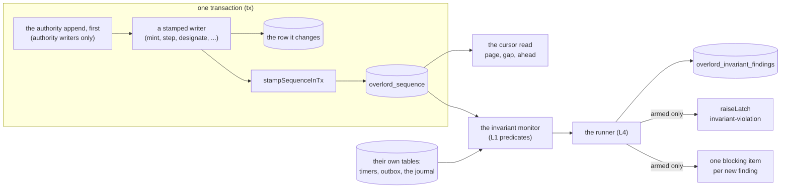
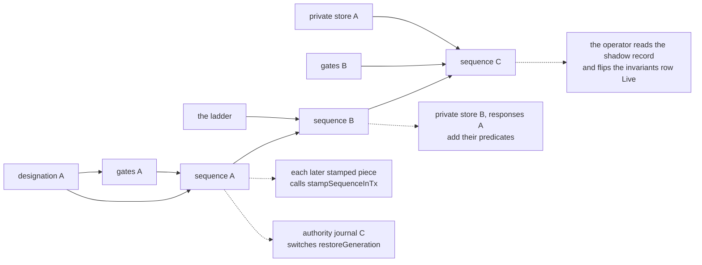

# Overlord W1: the one sequence, its cursor read, and the invariant monitor Implementation Plan

> **For agentic workers:** REQUIRED SUB-SKILL: Use superpowers:subagent-driven-development (recommended) or
> superpowers:executing-plans to implement this plan task-by-task. Steps use checkbox (`- [ ]`) syntax for tracking.

**Goal:** every change the Overlord design stamps is written, in one order, to one append-only table, and one monitor
checks the design's invariants against it on the live server.

- `overlord_sequence` is a new table in `coord.db`. Each line holds a sequence number, the changed row's kind and id,
  its new state, the actor and the actor's kind, and the time. One writer, `stampSequenceInTx`, adds a line inside the
  transaction that writes the row.
- Every stamped transaction on `main` when PR A is built calls that writer. Today that is the generations lane's mint
  and step, and, once designation A has merged, the designation's writers. Each later piece calls the writer itself.
- One cursor read serves the sequence. A cursor older than what the server keeps gets an explicit gap answer, never an
  empty page. A cursor past the head gets an explicit `ahead` answer, which is what a restored database looks like. A
  stored line this build cannot name is served as an opaque `unknown` line, never a failed page.
- The invariant monitor is a table of pure predicates, one per invariant of Table 11.7a. Each row names the tables it
  reads. A row whose tables do not exist yet reads `not-applicable`. An input that cannot be read reads `unmeasured`
  and is listed. Neither ever reads as a pass or as a violation.
- The monitor's runner is a lane on its own `LANE_SCHEDULE` row. It decides nothing. It ships in shadow, recording
  what it finds and raising nothing. Once the operator arms it on the Shadow lanes card, each new violation raises the
  ladder's `invariant-violation` latch through `raiseLatch` and one `blocking` operator item. A violation already open
  raises neither again. One that ends and comes back is a new finding, with its own latch raise and item.
- M24's figure, the count of violations in production, is read from the monitor's own record of what it found.

**Why:** H3, H27 and H33 (§10.4, §11.7). Outside readers and the server's own checker both need every change in one
order, and the design builds no event stream of its own. Six machines interact, and a red test per guard proves a
guard exists, not that the machines compose. So the invariants are stated once, as predicates, and the same
predicates run in the simulator and on the live server (D-8214). A violation is a latch on the ladder, cap `advise`,
and one operator item (Table 7.5a).

**Architecture:** three pull requests in lane H. The index sized this piece at two; question 1 says why the door is a
third.

- **PR A, the sequence (Tasks 1 to 3).** After designation A and gates A.
  - `shared/overlord-sequence.ts` (L0, K) holds the line's wire shape, the kind table and the cursor read's answer.
  - `server/src/coord/overlordSequence.ts` (C5, L1) holds the pure deciders: `sequenceLineVerdict`, `sequencePage`
    and `retentionCut`.
  - `server/src/coord/overlordSequenceStore.ts` (C5, L3) holds the two tables, the one writer, the pruner and the
    reads.
  - The stamped writers on `main` call the writer inside their own transactions.
  - The retention lane, `sequenceRetention`, is a new `LANE_SCHEDULE` row.
- **PR B, the monitor (Tasks 4 to 6).** After PR A and the ladder.
  - The simulator's `SequenceLine` moves to `shared/overlord-sequence.ts` and its `Violation` to
    `server/src/coord/invariants.ts`, in a move commit with characterization tests. The simulator's `Invariant` stays
    in the test tree (question 10).
  - `server/src/coord/invariants.ts` (C5, L1) holds the invariant table and the W1 predicates, pure.
  - `server/src/coord/invariantFacts.ts` (C5, L3) gathers each predicate's input in one synchronous read.
  - `server/src/coord/invariantFindingsStore.ts` (C5, L3) holds the findings table and its writers.
  - `server/src/coord/invariantLane.ts` (C5, L4) is the runner, on the `invariants` row of `LANE_SCHEDULE`, armed by
    the `invariants` row of the Shadow lanes card.
  - One row in the ladder's cause table, `invariant-violation`.
- **PR C, the doors (Task 7).** After PR B, gates B and private store A.
  - `GET /api/overlord/sequence`, the Overlord's cursor read, through the gate runner and the read ledger, with its
    `ccrc-api sequence` verb.
  - `GET /api/overlord/invariants`, the operator's read of the monitor's last pass, its findings and M24's counts.

**Tech Stack:** TypeScript (ESM), `node:sqlite`, Fastify, vitest. No new dependency. One PWA line: the Shadow lanes
card's per-row record (question 18). The board and the home read the doors later (question 13).

**Spec:** `docs/superpowers/specs/2026-11-09-overlord-design.md`:

- §10.4, whole: "One sequence", "The sequence has one home", "Why not `feed_events`", "Payloads carry ids, kinds,
  states and actors only", "No stream of its own" (the explicit gap answer), and "One invariant monitor" (I1 to I8 and
  I10 to I16 everywhere, I17 and I18 over their own tables, I9 in the simulator only; a violation latches the ladder at
  `advise` with one operator item; M24 counts its findings).
- §11.7, whole, with Table 11.7a (the invariants) and Table 11.7b (the tools: "The invariant monitor on the live
  sequence … The same predicates in production, except I9", W1). "Monotonic by construction" and "Every pull request
  carries its share" bind each new decider.
- §7.5 and Table 7.5a, the row "an invariant-monitor violation (§10.4) | latch | cap `advise`, one item". A drill's
  lines (§7.5, "Drills") carry a mark in a column the cursor read does not serve. That column is W3's (question 9).
- §7.6: the feeds' cursors carry the restore generation (question 7); "Confirm the restore" keeps the database wider
  than the journal until the operator confirms (question 11, I7).
- §11.5: what the oldest build a rollback reaches does with each new thing (question 19).
- Table 11.1a, the row `overlord_sequence` (C5, L3, `coord.db`, "One writer function, called inside each stamped
  transaction", kept 90 days, W1, in a snapshot, older build ignores it). Table 11.1b, the row "… the invariant monitor"
  (C3 and C5, L1). Table 11.1c, the row "The invariant monitor's runner" (C5, L4, "one latch and one item per
  violation", "On each `overlord_sequence` row", W1). Table 11.1e, the row "The sequence read: one cursor over
  `overlord_sequence`, which answers a gap explicitly" (C5, L4, the read ledger, W1, older build has no route).
- Table 11.5b, the row "90 days | How long `overlord_sequence` is kept | W1 | wall".
- §12, M24: "invariant-monitor violations in production … Zero violations".
- Table 13.1: H3 (`shape`, W1: "one sequence") and H27 (`shape`, W1, W2, W4) fix this table and its door, so both ship
  with this piece. H33 (`tightening`, W0 on) binds the monitor.

The index is `docs/superpowers/plans/2026-11-14-overlord-w1.md` (on `main`). This plan builds on:

- its row "Sequence and monitor" (lane H);
- its question 22 (`monitor-checks-what-exists`), question 31 (the message moves' sequence lines), question 20 (the
  ladder's cause rows join with their inputs) and question 36;
- its "Where lanes meet" bullets for `schema.ts`'s migrations, `LANE_SCHEDULE`, `writers-map`, `time-ports`,
  `MUTANT_SETS`, `overlordRoutes.ts`, and the ladder's cause table;
- "States W2 may read": `overlord_sequence`'s cursor.

The coordinator's brief for this plan (run 2165), its rulings on review 2170 (fix round 1), and the cross-plan rulings
of the authority journal (#2853), designation (#2856), private store (#2855) and ccd arms (#2854) fix rounds bind over
the index's text. The rulings this plan follows are marked "(ruled)".


*Figure 1. One sequence, one monitor. The writer adds its line inside the transaction that writes the row, so a line
and its row commit or roll back together. The authority journal's append comes before both, by the authority plan's
rule. The monitor reads the sequence and, for I2, I7 and I17, tables that stamp no line. In shadow it records findings
and raises nothing.*

## Open questions

The index's questions 22 and 31 are built as their recommendations say, with the refinements below. Each question
here is built as its recommendation says unless the coordinator or the operator rules otherwise. Fix round 1's rulings
are marked "(ruled)".

1. **The cursor read's door needs more than PR A has** (slug `sequence-door-rides-its-own-pr`). The index puts "the
   cursor read with its explicit gap" in PR A. But the door is an Overlord read (C47): it runs the gate order, so it
   calls gates B's `overlordGateRun`, and it leaves a read ledger line, which is private store A's `recordRead`.
   Neither is a need of PR A or PR B. **Recommendation:** PR A ships the read as an L1 decider and an L3 read, so the
   gap rule is built and tested with the table. A third pull request, PR C, ships the door after gates B and private
   store A. The operator's read of the monitor joins it, so the door censuses move once. Folding the door into PR B
   would hold the monitor back behind door process A, which gates B needs, for no gain.
2. **Which changes are stamped** (slug `sequence-stamps-state-changes`). §10.4 lists "every change of a request, a
   hold, a generation, the designation, a grant, the ladder, the readiness word, a proposal, a command or an operator
   message's state". **Recommendation:** a line is written when a row's state word changes, or a row is created or
   ends. A write that changes only counters, deadlines, an accumulator, a hash or a bookkeeping list stamps nothing.
   Each kind's table in Task 1 names its state words and the writers that change them. The census (Task 2) names every
   other writer of the same table as one that stamps nothing, with its reason, so a new writer must take a side.
3. **A shadow walk stamps nothing** (slug `shadow-walks-stamp-nothing`). The generations lane walks a generation in
   shadow by moving `shadowState`, never `state` (`server/src/continuity/continuityStore.ts`'s header: "shadow never
   moves `state`"). **Recommendation:** only moves of `state` are stamped. A mint writes a line for the generation it
   ends (`ended`) and one for the row it inserts, with that row's `state` (`carded` for a live walk, `active` for a
   shadow mint). `clearShadowWalk` stamps nothing.
4. **Every identity's generations are stamped, not only the Overlord's** (slug `every-generation-is-stamped`). The
   generation machine is shared by coordinators and the Overlord (§3.3.11), and §10.4's "a generation" is unqualified.
   **Recommendation:** stamp every identity. A filter by role would be a decision inside a writer. The volume is
   bounded by the mints: at most one line a state entered on a live walk, and a walk enters at most seven states
   (`GENERATION_STATES` less `ended`, plus the mint's two lines). The figure is read from the sequence itself once PR
   A has merged (question 18), never from a session's copy of the live database (ruled, F8).
5. **What a line's id is** (slug `sequence-line-names-its-subject`). The designation is a singleton row, so its row id
   says nothing. **Recommendation:** each kind's table names its id:
   - `generation`: the generation's row id;
   - `designation`: the session id the move concerns, the pending id for `pending` and `failed`, the bound id for
     `live` and `retired`;
   - `ladder-rung`: the fixed id `operator`; `ladder-latch`: the cause;
   - `message`: the message id.

   Every id is opaque text (H3: "opaque ids"), and no reader parses one.
6. **Each line stores its actor and the actor's kind at stamp time** (ruled, F4; slug
   `sequence-line-carries-its-actor-kind`). The line copies the actor text the stamped row records, and stores the
   actor's kind (`operator`, `session` or `server`, gates A's `ActorKind`) in a column of its own. The writer of an
   actor-carrying row reads the kind through gates A's `readActorColumns` from the row it is writing, inside the same
   transaction, and passes it to the writer as a typed value. A lane's line takes `server`. So no predicate and no
   reader ever parses an actor's text. PR A therefore needs gates A, which adds the actor columns to the designation
   row; gates A needs designation A only, so the order does not move.
7. **A restore and the cursor** (slug `sequence-read-carries-the-restore-generation`). A restored `coord.db` brings back
   the sequence as it was at the snapshot, so the next lines reuse numbers an outside reader may already hold.
   **Recommendation:**
   - a cursor past the head answers `ahead`, explicitly, never an empty page;
   - every answer carries `restoreGeneration`, which reads `unmeasured` until authority journal C's counter lands.
     Authority journal C switches it, in the same pull request that switches the response rows' stamp (index question
     35), so a reader that sees the counter move rewinds;
   - the sequence numbers come from `AUTOINCREMENT`, so a prune that empties the table never restarts them at 1.
8. **How the gap is known, and what the prune keeps** (slugs `sequence-gap-from-a-recorded-floor` and
   `newest-designation-line-is-kept`). A table emptied by the prune has no lowest number to read a gap from.
   **Recommendation:**
   - the pruner records the highest number it has ever deleted in a one-row table, `overlord_sequence_pruned`, in the
     same transaction as the delete. The cursor read answers a gap when the cursor is below that number, and the gap
     answer names it;
   - the prune never deletes the newest `designation` line (ruled, F4: "pick one and say why"). That line is the
     current binding's, and I5's term arm reads it as the window's baseline. Re-stamping on each renewal was the other
     choice. It was not taken, because it writes a line that records no change of state (question 2's rule) and leans
     on renewals happening. The kept line sits below the floor, so the cursor read never serves it again: a reader that
     resumed from the floor already passed it.
9. **The drill's mark** (W3). §7.5 gives drills a mark column on `overlord_sequence` that the cursor read does not serve.
   **Recommendation:** W3's drill piece adds the column in its own migration. The cursor read selects its columns by
   name, never `*`, and a test pins the served columns, so a later column is never served by accident.
10. **The predicate's input** (slug `predicates-take-lines-and-facts`). D-8214 says the simulator's predicate runs
    unchanged in the W1 monitor. I2, I7 and I17 read tables that stamp no line (§10.4). **Recommendation:** a live
    predicate is a `LivePredicate`, which takes `(lines, facts)`, where `facts` is the typed snapshot its row names. The
    simulator's `Invariant`, over the lines alone, stays in the test tree: no production code uses it (review F17). A
    one-line adapter in `server/test/sim/` wraps a `LivePredicate` with the scenario's facts as an `Invariant`, so a
    scenario runs the production predicate unchanged, which is what D-8214 asks. The timer day does so for I17 (Task 5,
    review F15). A live predicate never reads a database or a file: the gatherer does, and the predicate is pure.
11. **Which invariants run in W1** (index question 22, refined; slug `predicates-join-with-their-tables`). Each row of
    the invariant table names its tables and the piece that creates them. **Recommendation:** PR B ships the table's
    seventeen rows and these predicates:
    - **I2's structural arm**, over push outbox A's tables (on `main`, #2838): a source row with a reach stamp has
      exactly one bound outbox row, and a bound outbox row's source has its reach stamp (ruled, F10). Until push
      outbox B (#2859) calls `stampReach` from a live path, it holds over no rows. The state arm ("sent, silent,
      deferred to a stated time no later than its limit, or settled") waits for W3's deferral rows, because a W1
      outbox row may end `unsent`, `failed` or `unknown` for reasons I2 does not name.
    - **I7**, the authority fields the server acts on against the journal's fold, read only while the authority guard
      reads `coherent` (ruled, F2). While the guard reads `rolled-back`, a database wider than the journal is the
      normal state until the operator confirms the restore (§7.6), and `restore-detected` already caps the rung, so I7
      reads `unmeasured` with the guard's cause, never `violated`.
    - **I17**, the timers against their mail, joined by `continuity_timers.mailId`, never by the subject (ruled, F5).
    - **I5's term arm**, a line whose actor kind is `session` was written only while the latest `designation` line
      with state `live` binds that session (designation A), seeded from `designationRead()` for the current binding.

    I11's rung arm is not in W1 (ruled, F3). It needs the rung's history with the kind of the actor that moved it:
    `ladder-rung` lines stamped with an actor kind the ladder row records, which needs gates A's actor columns on
    `overlord_ladder`. Gates A adds them to the designation row only. "Later" names it.

    Each other row reads `not-applicable` and names the piece that adds its predicate. The piece that creates a row's
    tables adds the predicate and its gatherer, as a row and a function, in its own pull request, as the ladder's
    causes join (index question 20). In W1 that is private store B (I8, and I13's message half) and responses A (I18).
    If either has merged when PR B is built, PR B adds that predicate itself. I9 reads `simulator-only`.
12. **The monitor keeps a record of what it found, one row per episode** (ruled, F6; slug `monitor-keeps-its-findings`).
    Table 11.1c gives the runner "one latch and one item per violation", and §12 has M24 count the monitor's findings.
    **Recommendation:** one table, `overlord_invariant_findings`, one row per episode of a violation: the invariant, a
    subject key the predicate names, the mode it was found in (`shadow` or `live`), when it was found, and
    `resolvedAt`. At most one open row stands per invariant, subject and mode. A pass that measures the subject holding
    resolves the open row. A violation of the same key after its resolution is a new finding, with its own latch raise
    and its own item. The row is the deduplication and M24's count. Rows are never deleted in W1.
13. **Where the operator sees the monitor** (slug `invariants-read-is-an-operator-door`). **Recommendation:** the runner
    keeps its last pass in memory, one verdict per invariant, and writes one log line when an invariant's verdict word
    changes. PR C serves it at `GET /api/overlord/invariants`, an operator door with the verb class `view`, with the
    open and resolved findings in both modes and M24's counts.
14. **The invariant item** (ruled, F7; slug `invariant-items-sit-under-overlord`). An item needs a programme slug, a
    kind and a level. **Recommendation:** programme `overlord`, raised by `ccrc`, kind `do`, needed `blocking` (an
    invariant violation is the operator's to see at once; ruled). The programme slug is one neutral L0 constant,
    `OVERLORD_ITEM_PROGRAMME`, which the weekly replay quiz's `QUIZ_ITEM_PROGRAMME` (`server/src/continuity/quiz.ts`)
    is re-pointed to in a commit of its own, so one value has one home. The item is raised through a validated
    in-transaction path that runs `checkRaise`'s checks first (Task 6), never the unvalidated `raiseItemInTx`.
15. **The predicates of I1 in W3** (index question 22's last sentence; the ledger's note on D-8214 and D-8240). The
    simulator's coordinator-blocked reach invariant assumes the simulator's sweep phase. **Recommendation:** nothing is
    built for it in W1, because I1 reads held rows, which are W3's. The W3 piece inherits the ledger's rule: the live
    predicate keeps the looser bound `max(m + COORD_BLOCKED_HELD_MS, steadySince) + STALL_SWEEP_MS`, and D-8240's down
    rule does not run live, because a monitor that sees only boots cannot apply it.
16. **M24's simulator figures** (the simulator plan's question 5). M24 also counts simulator seeds run and red.
    **Recommendation:** not in this piece. The monitor runs on the live server and cannot see a test run. The
    coordinator rules whether a later piece records them.
17. **A message move with no `coord.db` transaction is the one exception** (ruled, F14; index question 31, refined).
    Question 31 has a message move's line written by the `coord.db` transaction that causes it: the mail lane's
    delivery, the prompt route's nudge, the settlement mark. Acknowledge (the inbox piece) moves a message in the
    private store and writes nothing to `coord.db`. **Ruled:** the inbox piece writes acknowledge's line in a
    `coord.db` transaction of its own, right after the private store commits. It is the one line written in a second
    transaction. The reason: the private store is a separate SQLite file behind the privacy boundary (C11), and no
    transaction spans both files (question 31). A crash between the two loses the line, and the monitor reads a message
    with no line as `unmeasured` for that message, never as a violation.
18. **The monitor ships in shadow** (ruled, F8; slug `invariant-monitor-starts-in-shadow`). No session copies or reads
    the live `coord.db`, so a predicate that is wrong about live data is found by running it there without effect.
    **Ruled:** PR B adds a row to the Shadow lanes card, `invariants` (`shared/lane-arm.ts#LANE_ARM_LANES`), seeded
    `shadow` by PR B's migration. In shadow the runner runs every pass and records each finding with mode `shadow`, and
    raises no latch and no item. The operator reads the shadow record at `GET /api/overlord/invariants` (PR C) and
    flips the row to Live on the card (`POST /api/coord/lane-arm`, the operator's session-gated switch). The row's text
    says to read at least seven days of shadow record first. The row has no gate of its own, but its card text names
    PR C, because the record is read there. Live, each new finding is recorded with mode `live` and raises its latch
    and item. An open shadow finding raises nothing when the row goes Live: the next live pass finds the same violation
    as a live finding, with its own latch and item.
19. **A line this build cannot name** (ruled, F9; slug `unknown-lines-are-served-opaque`). Kinds join piece by piece
    across W1, and a rollback reaches a build that lacks a later kind (§11.5 asks what the oldest rollback build does
    with each new thing). **Ruled:** a stored line whose kind or state the running build lacks is served as an opaque
    line with `known: false`, its kind and state text kept as stored, never a failed page. A predicate that reads one
    treats that line as `unmeasured` for itself only. An older build with no `overlord_sequence` reader at all ignores
    the table (Table 11.1a). A build that has the reader and lacks a kind serves the line opaque and keeps stamping its
    own kinds.

## What exists today

Measured on `origin/main` at `4b5ae49d5` (2026-11-15), after the weekly replay quiz (#2839) merged.

- **No sequence and no monitor.** `git grep overlord_sequence origin/main -- server shared` finds nothing. The
  simulator's sequence lives in the test tree: `server/test/sim/sequence.ts` defines `SequenceLine` (`seq`, `at`,
  `kind`, `id`, `state`, `actor`), `Violation` (`invariant`, `seq`, `message`), `Invariant` (`name`, `says`,
  `check(lines)`) and `SimSequence`. Its importers are `run.ts`, `timerDay.ts`, `coordBlockedDay.ts`, `generationDay.ts`
  and their test files. Its invariants are scenario invariants (`server/test/sim/timerDay.ts`'s `TIMER_DAY_INVARIANTS`,
  T1 to T5, and the coordinator-blocked day's), which read the simulator's own encodings in `state`. None is one of
  Table 11.7a's I-numbers.
- **The stamped transactions on `main`.** Of the kinds §10.4 lists, only the generation exists on `main`. Its table,
  `continuity_generations`, has one writer module, `server/src/continuity/continuityStore.ts`, called by the
  generations lane. `writers-map.test.ts` names its six writers:
  - `mintGeneration`: one `tx()` that ends the identity's live row (`state = 'ended'`) and inserts the next. Stamped.
  - `stepGeneration`: one `UPDATE`, not in a `tx()`, that moves `state` or `shadowState` and the walk's counters.
    Stamped only when a live walk enters a new state (questions 2 and 3). No caller on `main` calls it inside a
    transaction, so wrapping it in a `tx()` is safe.
  - `clearShadowWalk`, `setGenerationDue`, `advanceObserved` and `setHoldOff`: no change of `state`. Not stamped.
- **What arrives before PR A.** PR A needs designation A, whose plan (#2856) ships
  `server/src/coord/overlordDesignationStore.ts` with the writers `designatePending`, `bindPendingGeneration`,
  `goLive`, `failPending`, `retire` and `stopDone`, each one `tx()`, and `designationRead()` with three arms.
  `designatePending`, `goLive` and a live `retire` call the authority journal's `appendInTx` before they write the row;
  `failPending` and a pending-only `retire` append nothing. Of the six, `designatePending` (`pending`), `goLive`
  (`live`), `failPending` (`failed`) and `retire` (`retired`, and `failed` for an attempt it cancels) change the
  designation's state. Designation A also adds `restampOverlordGeneration` to `continuityStore.ts`, which moves a
  generation's identity and not its state. PR A also needs gates A (#2863, merged as a plan), which adds the
  designation row's actor columns and `readActorColumns`.
- **Kinds that may or may not be on `main` when PR A is built:** the ladder (`setRungInTx`, `raiseLatchInTx`,
  `clearLatchInTx`, `applyRestoreInTx`; its plan #2861) and private store B's message moves through the mail lane
  (question 31). Task 2 re-measures them. A stamped writer on `main` at PR A's build is wired by PR A. One that merges
  later calls the writer in its own pull request.
- **Transactions.** `server/src/coord/tx.ts#tx` opens `BEGIN IMMEDIATE` and does not nest. `DatabaseSync.isTransaction`
  says whether a transaction is open; `pushOutboxStore.ts` uses it to join a caller's transaction.
- **Lanes.** `server/src/laneSchedule.ts#LANE_SCHEDULE` has 45 rows, every one on the monotonic clock;
  `server/test/lane-schedule.test.ts` pins the count. The timers lane is the nearest model: one row (`timers`, a minute,
  `skip`, a `warnKey`), one `sweepTimers` method on `FleetWatcher` that calls `runLane('timers', …)`, and one
  never-awaited line in the tick. `server/test/watcher-quiet-census.test.ts` holds every test file that builds a
  `FleetWatcher` to a teardown form.
- **The Shadow lanes card.** `shared/lane-arm.ts#LANE_ARM_LANES` has four rows (`roster-card`, `continuity`,
  `launch-profile`, `anchor-slot`). A row lives in `lane_arm_settings`, seeded `shadow` by a migration, and is written
  only by `POST /api/coord/lane-arm`. `laneArmLive(stored, gate)` is the one rule every lane reads. A new row touches
  `LANE_ARM_LANES` and `LANE_ARM_TEXT` (`shared/lane-arm.ts`), a seed row in a migration,
  `pwa/src/fleet/ShadowLanesSection.tsx`'s `SHADOW_LOG` record (a `Record<LaneArmLane, …>`, so a missing row does not
  compile), and the tests that pin the list and the seeded rows: `continuity-generations-store.test.ts`,
  `coord-db.test.ts`, `lane-arm-route.test.ts` and `mail-routes.test.ts`.
- **Items.** `server/src/coord/ledgersStore.ts#raiseItem` runs `checkRaise` (the kind and level vocabulary, a decide
  item's recommendation) before it opens its `tx()`, then calls the private `raiseItemInTx`, which validates nothing.
  `raiseItemWithMail` does the same around a callback. Server callers raise with actor `ccrc`. The levels are
  `shared/ledgers.ts`'s `NEEDED_BY_LEVELS`: `blocking`, `soon` and `later`. The weekly replay quiz raises under
  programme `overlord` (`QUIZ_ITEM_PROGRAMME`, `server/src/continuity/quiz.ts`), kind `do`, needed `soon`.
- **The ladder** (its plan, #2861): `LADDER_CAUSE_MAP` in `shared/overlord-ladder.ts`; its Table 2 keys this piece's
  row `invariant-violation` (latch, cap `advise`, notice `item`). `raiseLatch(deps, cause, detail, raisedBy)` opens the
  transaction, takes the cap from the table and answers `changed: false` for a cause that stands. The ladder sends
  nothing itself.
- **The authority journal** (its plan, #2853): `OverlordAuthorityJournal.readVerified()`, `authorityFold(records)`
  answering an `AuthorityView` (the designation's term, session and generation, the rung, the latches, the account set,
  the model class), the guard's `state()` (`coherent`, `rolled-back` with its cause, or `unmeasured`), and
  `AuthorityGuardPort.writerFailed('trailing')` for a writer that fails after its append. Every authority writer
  appends inside its own `tx()` before it writes the row; the append is a file write, which a rollback does not undo.
- **Timers** (W1a, on `main`): `continuity_timers` (`setter`, `state`, `firedAt`, `mailId`, `cancelledAt`), written by
  `insertTimer`, `cancelTimer`, `markTimersFired` and `purgeTimers`. The lane fires every due timer of one setter with
  one mail in one transaction: `markTimersFired` stamps each fired row with that mail's id. The mail is `fromId`
  `TIMER_MAIL_SENDER` (`timer`) to the setter. Its subject lists the ids but cuts them past `MAIL_SUBJECT_MAX_BYTES`.
- **Push outbox A** (#2838, merged): `push_outbox`, one row per bound source (`push_outbox_one_per_source`), and the
  reach stamps `asks.reachedOperatorAt` and `operator_items.reachedOperatorAt`, written by
  `pushOutboxStore.ts#stampReach` alone. No live path calls `stampReach` until push outbox B (#2859, open).
- **Migrations.** The latest on `main` is 77. Each migration in this piece takes its number at build.
- **Censuses a new table, lane and door touch:** `server/src/coord/schema.ts#MIGRATIONS` with
  `server/test/run-close-switch.test.ts` and `server/test/coord-db.test.ts`;
  `server/test/single-definition/writers-map.test.ts`; `server/test/single-definition/time-ports.test.ts`
  (`TIME_PORT_FILES`); `server/src/coord/ports.ts` (`WatcherCoordMember`); `server/test/lane-schedule.test.ts`;
  `server/test/sim/mutation-floors.test.ts` with `mutation-floors.json`; for a door, `server/test/auth-gate.test.ts`,
  `server/test/box-token-census.test.ts`, `server/test/rings/fastify-l4.data.ts`, `server/test/secret-mask.test.ts`,
  `CLAUDE.md`'s box-token paragraph, gates A's `OVERLORD_DOORS`, and `ccd/ccrc-api`'s `ROUTES` with
  `server/test/ccrc-api.test.ts`.
- **Rings and contexts.** Every new `server/src/coord/` file takes context C5 from the architecture spec's `coord/**`
  row; its ring is read from its imports. `shared/*.ts` files import no `node:*` module.

## Global Constraints

- **Architecture (`CLAUDE.md`).**
  - **One writer per fact.** `overlord_sequence` has one inserting writer, `stampSequenceInTx`, and one deleting
    writer, `pruneSequenceThrough`, which also writes `overlord_sequence_pruned` in the same transaction.
    `overlord_invariant_findings` has two writers in one module: `recordFinding` inserts a row, and
    `resolveFindings` stamps `resolvedAt`. `writers-map` pins each.
  - **The order inside a stamped transaction** (ruled, F1). An authority writer appends its record first, by the
    authority plan's rule. Then it writes its row, then it stamps the line, all inside its `tx()`. A refused stamp
    throws inside the `tx()`, so the row rolls back with the line. After a successful append, that is a writer failure
    after the append: the writer calls `AuthorityGuardPort.writerFailed('trailing')`, the path the authority plan
    already takes for a row write that fails after its append. A writer with no append (a generation's, `failPending`,
    a pending-only `retire`) just rolls back.
  - **The stamped transactions keep their own writers.** A stamped writer gains one call, inside its existing
    transaction (or a `tx()` it opens around its one statement, for `stepGeneration`). No writer moves.
  - **Decide in L1, act in L4.** `overlordSequence.ts` and `invariants.ts` import L0 only: no `fs`, no Fastify, no
    clock, no database. The stores and the gatherer are L3. The runner reads facts, asks the predicates and acts on
    their answers, and holds no `if` over an invariant's name.
  - **Consolidate.** The line's shape is the simulator's `SequenceLine`, moved, not copied. The latch is the ladder's,
    through `raiseLatch`. The item is the programme ledger's, through `raiseItem`'s own checks. The lanes are rows of
    `LANE_SCHEDULE`, and the arming is a row of the Shadow lanes card. The sequence is legitimately different from
    `feed_events` (§10.4, "Why not `feed_events`": that table is pruned to 2,000 rows, carries titles and bodies, and
    older builds read its `kind`); the module header says so.
  - **No overloaded null at a seam.** The cursor read answers one of four arms (`page`, `gap`, `ahead`,
    `unmeasured`), and a caught-up reader gets `page` with no lines, never `null`. An unknown stored line is `known:
    false`, never a missing line. A predicate's verdict has six arms (Task 4). `restoreGeneration` is a number or the
    word `unmeasured`.
- **Failure contracts (fail closed).**
  - `stampSequenceInTx` never throws. It answers `{ ok: false, error }` outside a transaction, on a kind or state word
    the kind table lacks, and on a failed insert. Every caller checks the answer and writes no row on a refusal.
  - An unreadable sequence makes the cursor read answer `unmeasured` (the door answers 503 `unavailable`) and makes
    every sequence predicate answer `unmeasured`. A stored line this build cannot name is served opaque, and is
    `unmeasured` only for the predicate that reads it (question 19).
  - An unreadable table or journal makes the predicate that reads it answer `unmeasured`, listed with its reason. An
    authority guard that does not read `coherent` makes I7 `unmeasured` (question 11). The runner raises no latch and no
    item for an `unmeasured` input, and adding one never removes a finding (Task 4).
  - A refused `raiseLatch` or a refused item raise records no live finding, so the next pass retries. A latch that
    already stands answers `changed: false`, and the finding is still recorded.
  - An unreadable Shadow lanes row reads as shadow (`laneArmLive`'s rule): the runner then raises nothing.
  - An older server reads a newer `coord.db` and ignores the three new tables (Table 11.1a: "Ignores it") and the new
    lane-arm row (its `isLaneArmLane` refuses the word). An older `ccrc-api` has no `sequence` verb. A newer `ccrc-api`
    against an older server gets the server's own 404.
- **What a merge arms.**
  - PR A: every generation and designation move writes a line. Nothing reads the lines but the tests. The retention
    lane deletes nothing for 90 days.
  - PR B: the monitor runs in shadow. It records findings and raises nothing until the operator flips its row Live
    (question 18). Live, a violation raises a real latch (cap `advise`; in W1 the rung door stops at `chat`, index
    question 19, so the cap changes nothing a session sees) and one real `blocking` item.
  - PR C: two read doors. Nothing writes but read ledger lines.
- **SAFETY (`CLAUDE.md`).** No ccd verb, no argv, no marker file. Tests use an in-memory `coord.db`, a fixture journal
  directory and fixture HOMEs. No session copies, opens or reads the live `coord.db` (ruled, F8): what the monitor finds
  on live data is learnt from its shadow record.
- **Growth check.** Each growth-checked file grows by at most 40 net lines in each pull request, with no waiver. The
  estimates are in the PR split. A task that measures over its row stops and asks.
- **Mutation floors.** Every new L1 decider joins `MUTANT_SETS` through `server/test/sim/sequenceSets.ts`, and
  `mutation-floors.json` at its measured score, in the pull request that creates it. Each guard ships with a test that
  goes red when it is deleted, measured with `mutation-run.py` (the coordinator skill's references) as each task says.
- **Tests.** From `server/`: `ccrc test -- ./node_modules/.bin/vitest run test/<file>.test.ts`. A task's last run adds
  `ccrc test -- npx tsc --noEmit -p tsconfig.json` and `ccrc test -- npx tsc --noEmit -p test/tsconfig.tests.json`. For a
  `shared/` file, also `cd ../pwa && ccrc test -- ./node_modules/.bin/tsc --noEmit` and the agent's `tsc`.
- **Public repository.** Fixtures use `lane-a`, `lane-b`, `pool-a`, the `overlord` project and invariant names from
  Table 11.7a, or `inv-a` for a synthetic row. Cite by symbol or `@anchor`. No D-number is invented: a builder's new
  departure goes in `docs/superpowers/plans/2026-11-14-overlord-w1/w1-sequence-monitor/notes.md`.

## Review Focus

1. **A line and its row commit together.** Every stamped writer calls the writer inside the transaction that writes
   the row, after the authority append where there is one, checks its answer, and writes nothing on a refusal. No line
   is written in a second transaction, with one named exception: the inbox's acknowledge, whose message lives in the
   private store, a separate file behind the privacy boundary (question 17). A lost acknowledge line reads `unmeasured`.
2. **The census runs both ways.** Every writer of a stamped kind's table is either a stamper or listed as stamping
   nothing, with a reason; every call of `stampSequenceInTx` sits in a listed stamper.
3. **The gap is explicit.** A cursor below the recorded prune floor answers `gap`; a cursor past the head answers
   `ahead`; neither is ever an empty page. A prune that empties the table does not restart the numbers, and never
   deletes the newest designation line.
4. **No fold of `unmeasured`.** An unreadable input, an unknown line or a guard that is not coherent never reads as a
   pass, a violation, an empty page or "nothing designated".
5. **One latch and one item per episode.** A finding open in a mode raises its item once. A resolved finding that
   comes back is a new finding. A refused raise leaves no live finding, so the next pass retries. Shadow raises nothing.
6. **The predicates are pure and total.** Each answers one arm for every input in its domain. Adding a fault, an
   unknown or an unmeasured fact never removes a finding and never turns any arm into `holds`.
7. **The simulator still runs.** The move of `SequenceLine` and `Violation` changes only the simulator's imports, and
   every simulator suite is green before and after.

## The PR split

Net code lines, as `server/test/growthCheck.ts` counts them, estimated against `origin/main` at `4b5ae49d5` plus
the pieces each pull request needs first.

| PR | Tasks | What it ships | Needs first | Growth-checked files, estimate |
|---|---|---|---|---|
| A, the sequence | 1 to 3 | The vocabulary and the line verdict; `overlord_sequence` and `overlord_sequence_pruned`, the one writer and the stamp census; the generations lane's and the designation's writers stamped; the retention lane; `sequencePage` and the page read | designation A, gates A | `server/src/coord/schema.ts` about +16 (one migration: two tables); `server/src/coord/store.ts` about +4 (delegates `sequenceAfter`, `sequenceOldest`, `pruneSequenceThrough`); `server/src/watch.ts` about +8 (`sweepSequenceRetention` and its tick line); `shared/api.ts` 0; `server/src/server.ts` 0 |
| B, the monitor | 4 to 6 | The moved simulator types; the invariant table and the W1 predicates; the gatherer; `overlord_invariant_findings` and its writers; the runner on the `invariants` row; the `invariants` row of the Shadow lanes card; the ladder's `invariant-violation` row; the item programme's constant | PR A, the ladder | `server/src/coord/schema.ts` about +16 (one migration: one table, one partial unique index, one seed row); `server/src/coord/store.ts` about +5 (delegates `recordFinding`, `resolveFindings`, `openFindingKeys`, `findingCounts`); `server/src/watch.ts` about +9 (`sweepInvariants` and its tick line); `shared/api.ts` 0; `server/src/server.ts` 0; `pwa/src/lib/api.ts` 0 |
| C, the doors | 7 | `GET /api/overlord/sequence` through the gate runner and the read ledger; `GET /api/overlord/invariants`; `ccrc-api sequence`; every census | PR B, gates B, private store A | `server/src/server.ts` about +4 (the two doors' deps into `registerOverlordRoutes`); `server/src/coord/store.ts` 0; `server/src/coord/routes.ts` 0; `pwa/src/lib/api.ts` 0 |

Any file a growth cap names on `main` at build is measured too (`growthCheck.ts#growthFiles` reads the caps).

For scale, the files that are not growth-checked change by about:

- PR A: new `shared/overlord-sequence.ts` +100, `server/src/coord/overlordSequence.ts` +80,
  `server/src/coord/overlordSequenceStore.ts` +170, `server/src/coord/sequenceRetentionLane.ts` +40,
  `server/test/sim/sequenceSets.ts` +60; `server/src/continuity/continuityStore.ts` +22 (the mint's two lines, the
  step's `tx()` and its distinct refusal); `server/src/coord/overlordDesignationStore.ts` +24 (four writers, the actor
  kind read); `server/src/laneSchedule.ts` +6.
- PR B: new `server/src/coord/invariants.ts` +280, `server/src/coord/invariantFacts.ts` +180,
  `server/src/coord/invariantFindingsStore.ts` +130, `server/src/coord/invariantLane.ts` +130;
  `shared/overlord-sequence.ts` +12 (the moved line type, the programme constant); `server/test/sim/sequence.ts` −8;
  `shared/overlord-ladder.ts` +4 (one row); `shared/lane-arm.ts` +14 (one row and its card text);
  `pwa/src/fleet/ShadowLanesSection.tsx` +1; `server/src/coord/ledgersStore.ts` +5 (the checked in-transaction raise);
  `server/src/continuity/quiz.ts` ±1 (the re-pointed constant); `server/src/laneSchedule.ts` +6;
  `server/test/sim/sequenceSets.ts` +120.
- PR C: `server/src/coord/overlordRoutes.ts` +100 (two handlers); `server/src/coord/overlordDoors.ts` +4 (two rows);
  `ccd/ccrc-api` +4 (one route, the count word).


*Figure 2. Where the piece sits. The dashed arrows are the seams later pieces and the operator pick up: a later stamped
writer calls the writer, a later table brings its predicate, authority journal C fills the restore generation, and the
operator arms the monitor after reading its shadow record.*

## Index changes

The coordinator makes these in its own index edit. This plan edits no other plan.

- **Table W1, this piece's row:** three pull requests and seven tasks, not two and six (question 1). A: the
  sequence, its writer, the stamp census, the retention lane and the page read; needs designation A and gates A
  (question 6). B: the monitor in shadow, its findings, the runner, its Shadow lanes row and the cause row; needs PR A
  and the ladder. C: the two read doors; needs PR B, gates B and private store A. Figure W1 gains `GA --> SQA`,
  `SQB --> SQC`, `GB --> SQC` and `PSA --> SQC`, and loses `GA --> SQB`.
- **"Where lanes meet":**
  - `schema.ts`'s migrations: the sequence takes two migrations (PR A and PR B), not one.
  - `LANE_SCHEDULE`: `sequenceRetention` and `invariants` each add a row.
  - The Shadow lanes card gains the `invariants` row (question 18).
  - A new bullet, **the sequence writer**: each piece whose writer changes a stamped kind's state, and merges after
    sequence A, calls `stampSequenceInTx` inside its own transaction, after its authority append, adds its kind's row to
    `SEQUENCE_KIND_MAP` if the kind is new, and names its writers in the stamp census. In W1: the ladder (if it merges
    after sequence A; otherwise PR B wires it), private store B's message moves through the mail lane and the prompt
    route (question 31), designation B's rebind arms (with `restampOverlordGeneration`'s census row, because the rebind
    makes it end the old body's generation), the readiness word, and the inbox's acknowledge (question 17).
  - A new bullet, **the invariant table**: each piece that creates a table an invariant reads adds that invariant's
    predicate and its gatherer, as a row and a function: private store B (I8, I13's message half) and responses A
    (I18), unless either merged before sequence B.
  - `overlordRoutes.ts`: "the sequence's cursor" is PR C's, beside the operator's invariants read.
- **Authority journal C's row:** it also switches the cursor read's `restoreGeneration` from `unmeasured` to the
  counter, beside the response rows (question 7).
- **The inbox's row:** acknowledge writes its message line in a `coord.db` transaction of its own, the one named
  exception (question 17).
- **Question 22:** the predicate shape `(lines, facts)` (question 10); I2's structural arm in W1 (question 11); I7 read
  only while the authority guard is coherent (question 11); I11's rung arm later, with what it needs.
- **"States W2 may read":** the cursor read's four arms and the line's shape, `known: false` included.
- **Spec fixes:** the line's id per kind and its actor kind (questions 5 and 6); the prune floor, the kept designation
  line and the `ahead` arm (questions 7 and 8); the findings table per episode (question 12); the invariant item's
  programme and level (question 14); the monitor's shadow stage (question 18); I7's guard condition (question 11).

### Task 1: The vocabulary, the line verdict, the table and the one writer (PR A)

**Files:**
- Create: `shared/overlord-sequence.ts` (L0, K: imports only other `shared/` files)
- Create: `server/src/coord/overlordSequence.ts` (C5, L1)
- Create: `server/src/coord/overlordSequenceStore.ts` (C5, L3)
- Create: `server/test/sim/sequenceSets.ts`; Modify: `server/test/sim/mutation-floors.test.ts`,
  `server/test/sim/mutation-floors.json`
- Modify: `server/src/coord/schema.ts` (one migration), `server/src/coord/store.ts` (delegates)
- Modify: `server/test/single-definition/writers-map.test.ts`, `server/test/run-close-switch.test.ts`,
  `server/test/coord-db.test.ts`
- Test: `server/test/overlord-sequence.test.ts`, `server/test/overlord-sequence-store.test.ts` (new)

**Interfaces:**

```ts
// shared/overlord-sequence.ts
import { GENERATION_STATES } from './continuity.js';
import { DESIGNATION_SEQUENCE_STATES } from './overlord-designation.js';   // designation A's L0 file; see below
import type { ActorKind } from './overlord-identity.js';                   // gates A's L0 file

/** One line of the one sequence (§10.4): ids, kinds, states and actors only, never a body. `known` is false for a line
 *  whose kind or state this build lacks: its text is served as stored, opaque (question 19). */
export interface SequenceWireLine {
  readonly seq: number; readonly at: number; readonly kind: string; readonly id: string;
  readonly state: string; readonly actor: string; readonly actorKind: ActorKind | 'unknown'; readonly known: boolean;
}
/** Every stamped kind, its state words (from the kind's own L0 owner, never copied), how its id is chosen (question 5),
 *  and the spec text that stamps it. A later piece adds its kind here, beside its first stamped writer. */
export const SEQUENCE_KIND_MAP = {
  generation: { states: GENERATION_STATES, id: 'the generation row id', spec: '§10.4 "a generation"' },
  designation: { states: DESIGNATION_SEQUENCE_STATES, id: 'the session the move concerns', spec: '§10.4 "the designation"' },
} as const satisfies Readonly<Record<string, { states: readonly string[]; id: string; spec: string }>>;
export type SequenceKind = keyof typeof SEQUENCE_KIND_MAP;
export const SEQUENCE_KINDS = Object.keys(SEQUENCE_KIND_MAP) as SequenceKind[];
export function isSequenceKind(v: unknown): v is SequenceKind;
/** Bounds the writer checks (opaque text, never parsed). */
export const SEQUENCE_ID_MAX = 200;
export const SEQUENCE_ACTOR_MAX = 200;
/** Table 11.5b: kept 90 days, by the server's wall clock. */
export const SEQUENCE_KEEP_MS = 90 * 24 * 3_600_000;
/** The most lines one retention pass deletes, so a long-stopped server catches up over a few passes. */
export const SEQUENCE_PRUNE_BATCH = 5_000;
```

`DESIGNATION_SEQUENCE_STATES` is `['pending', 'live', 'failed', 'retired']`. It is one exported list in designation A's
L0 file, `shared/overlord-designation.ts`, which this pull request extends by one line if designation A did not add it,
so the designation's words have one home.

```ts
// server/src/coord/overlordSequence.ts (L1, imports L0 only)
export type LineRefusal = 'unknown-kind' | 'unknown-state' | 'bad-id' | 'bad-actor' | 'bad-actor-kind' | 'bad-at';
/** Whether a line may be written: its kind in the table, its state among the kind's words, its id and actor
 *  non-empty and within their bounds, its actor kind one of gates A's words, its time a finite non-negative integer.
 *  First match, in that order. */
export function sequenceLineVerdict(l: { kind: string; id: string; state: string; actor: string; actorKind: string; at: number }):
  { ok: true } | { ok: false; refusal: LineRefusal };
```

```sql
CREATE TABLE overlord_sequence (
  seq       INTEGER PRIMARY KEY AUTOINCREMENT,   -- never reissued, even after a prune empties the table (question 7)
  kind      TEXT NOT NULL,
  id        TEXT NOT NULL,
  state     TEXT NOT NULL,
  actor     TEXT NOT NULL,
  actorKind TEXT NOT NULL,                        -- gates A's ActorKind, written at stamp time (question 6)
  at        INTEGER NOT NULL CHECK (at >= 0)
);
CREATE TABLE overlord_sequence_pruned (
  one     INTEGER PRIMARY KEY CHECK (one = 1),
  through INTEGER NOT NULL CHECK (through >= 1)   -- the highest seq any prune has deleted (question 8)
);
```

No row is seeded. An absent `overlord_sequence_pruned` row means nothing was ever pruned. There is no index on `at`:
the retention lane reads the oldest lines by `seq`, the primary key.

```ts
// server/src/coord/overlordSequenceStore.ts (L3)
export type StampAnswer =
  | { readonly ok: true; readonly seq: number }
  | { readonly ok: false; readonly error: 'not-in-transaction' | LineRefusal | 'write-failed'; readonly detail: string };
/** THE one writer of `overlord_sequence` lines. Inside the caller's `tx()`, never outside, and it never throws. */
export function stampSequenceInTx(db: DatabaseSync,
  line: { kind: SequenceKind; id: string; state: string; actor: string; actorKind: ActorKind; at: number }): StampAnswer;
```

The module header names the sequence as legitimately different from `feed_events` (Global Constraints).

- [ ] **Step 1: Failing tests.**
  - `overlord-sequence.test.ts`: `sequenceLineVerdict` over the whole domain: each refusal at its position in the
    order, the bounds at their edges (an id of 200 and 201 characters, an empty actor, an actor kind outside gates A's
    words, `at` of -1, 1.5 and `NaN`), a state word of another kind refused; every kind's `states` equals its owner's
    list (`GENERATION_STATES`, `DESIGNATION_SEQUENCE_STATES`) by identity, never a copy.
  - `overlord-sequence-store.test.ts` (in-memory `coord.db` with every migration):
    - inside `tx()`, a stamp answers the next number and the line reads back with every column;
    - outside a transaction it answers `not-in-transaction` and writes nothing;
    - a refused line answers its word and writes nothing;
    - a stamp inside a `tx()` that then throws leaves no line;
    - numbers rise across transactions, and after every line is deleted the next stamp continues above the highest
      ever issued (AUTOINCREMENT);
    - SQLite refuses a second `overlord_sequence_pruned` row and a `through` of 0.
  - `writers-map.test.ts`: `TABLES` gains both tables; `overlord_sequence: [stampSequenceInTx, pruneSequenceThrough]`
    and `overlord_sequence_pruned: [pruneSequenceThrough]`, by `file#symbol`.
  - `run-close-switch.test.ts`'s undo step drops both tables, and its count moves; `coord-db.test.ts`'s count moves.
- [ ] **Step 2: Run.** Red.
- [ ] **Step 3: Implement**, with the migration (its number taken at build, never in the plan) and the delegates.
- [ ] **Step 4: Mutation.** Register `sequenceLineVerdict` in `sequenceSets.ts`, run `mutation-run.py` on it, and set its
  floor at the measured score. By hand: let the writer run outside a transaction (the `not-in-transaction` case goes
  red); drop `AUTOINCREMENT` (the emptied-table case goes red). Restore each from a saved copy.
- [ ] **Step 5: Run** both suites, `test/single-definition/*.test.ts`, `test/coord-db.test.ts`,
  `test/run-close-switch.test.ts`, `test/sim/mutation-floors.test.ts`, the growth check armed (`schema.ts`, `store.ts`),
  and every `tsc`. Green.
- [ ] **Step 6: Commit.** `feat(overlord): overlord_sequence and its one writer (Overlord W1, §10.4, H3)`

### Task 2: Every stamped transaction on `main` calls the writer, and the stamp census (PR A)

**Files:**
- Modify: `server/src/continuity/continuityStore.ts` (`mintGeneration`, `stepGeneration`)
- Modify: `server/src/continuity/generationsLane.ts` (one log line for a refused stamp)
- Modify: `server/src/coord/overlordDesignationStore.ts` (`designatePending`, `goLive`, `failPending`, `retire`)
- Modify: whichever stamped writers the re-measure below finds on `main`
- Create: `server/test/sequence-stamp-census.test.ts`
- Test: `server/test/continuity-generations-store.test.ts` and the designation store's suite (each gains cases)

**First, re-measure.** Before writing a test, run `git fetch origin main` and list every writer of a stamped kind on
`origin/main`: `git grep -n "continuity_generations\|overlord_designation\|overlord_ladder\|overlord_latches" origin/main
-- server/src`, and the private store's mail-lane branch (`git grep -n operatorMessage origin/main -- server/src/watch.ts
server/src/coord`). Put the list in the pull request's body. Each writer found joins the census below; a kind not yet on
`main` is left to its piece (the index's new bullet).

**The census** (`sequence-stamp-census.test.ts`). One table, `STAMPED_TABLES`, maps each kind to its table and to two
lists of `file#symbol`:

| Kind | Table | Stampers | Writers that stamp nothing, and why |
|---|---|---|---|
| `generation` | `continuity_generations` | `continuityStore.ts#mintGeneration`, `#stepGeneration` | `#clearShadowWalk` (shadow residue, question 3), `#setGenerationDue` (the due fields), `#advanceObserved` (the accumulator), `#setHoldOff` (the hold-off), `#restampOverlordGeneration` (the identity, not the state, in designation A; designation B's rebind makes it end the old body's generation and moves its row to the stampers, review F12) |
| `designation` | `overlord_designation` | `overlordDesignationStore.ts#designatePending`, `#goLive`, `#failPending`, `#retire` | `#bindPendingGeneration` (fills the pending generation once), `#stopDone` (the owed-stop list) |

It checks, using `server/test/scan/symbols.ts#sourceOfSymbol` (never the whole file as text):
- the two lists of each kind, together, equal `writers-map`'s list for that table, both ways;
- each stamper's source calls `stampSequenceInTx(` and reads its answer;
- every `stampSequenceInTx(` call in `server/src` sits in a listed stamper;
- every kind of `SEQUENCE_KIND_MAP` has a row here, and every row's kind is in the map.

**The calls.**
- `mintGeneration`: inside its `tx()`, after the `UPDATE` that ends the old row, a line `{ kind: 'generation', id:
  String(old.id), state: 'ended', actor: 'server', actorKind: 'server' }`; after the `INSERT`, a line for the new id
  with the `state` it wrote. A refused stamp throws a private `StampRefused` inside the `tx()`, which the existing
  catch maps to `{ ok: false, kind: 'write-failed' }`.
- `stepGeneration`: its one `UPDATE` moves into a `tx()`. When the update changed the row, the walk is live and the
  state is entered (`entering`), a line `{ kind: 'generation', id: String(id), state: next.state, actor: 'server',
  actorKind: 'server' }`. A refused stamp throws inside the `tx()`, and the function answers `{ changed: false, why:
  'stamp-refused' }`, distinct from a compare-and-set miss (`{ changed: false }`), and the generations lane logs one
  `ccrc-server: …` line for it (review F11). A shadow step and a step that stays in its state stamp nothing.
- The designation's four writers: each, inside its `tx()`, after its authority append (where it has one) and after the
  row write, one line with the state of question 5's table, the actor its row records (`actor`, or `pendingActor` for
  the attempt), and the actor's kind read through gates A's `readActorColumns` from the row just written. A live
  `retire` that cancels a pending attempt writes two lines: `failed` for the pending id, then `retired` for the bound
  id (review F12). A refused stamp throws inside the `tx()`, so no row is written. In `designatePending`, `goLive` and a
  live `retire` the append has already happened, so the writer calls `AuthorityGuardPort.writerFailed('trailing')`
  before it answers its failure arm (ruled, F1). A retire over an incoherent journal, which writes its row only
  (cross-plan ruling X3), still stamps: the line records the row the database holds.
- The `at` of every line is the `now` (or `at`) the writer already takes, so a line never reads the clock itself.

- [ ] **Step 1: Failing tests.**
  - the census suite, red until the calls exist;
  - generations: a mint with a live row writes `ended` for it and `carded` for the new id, in order; a first mint
    writes one line; a shadow mint writes `active`; a refused stamp (a fixture kind table that lacks `carded`, through
    a test seam on the writer's verdict) leaves neither row changed and answers `write-failed`; a live step entering
    `probing` writes one line, a step staying in `probing` writes none, a shadow step writes none, a step whose
    compare-and-set misses writes none and answers `{ changed: false }`, and a refused step answers `why:
    'stamp-refused'`;
  - designation: each of the four writers writes its line with its id, actor and actor kind; a live retire over a
    pending attempt writes `failed` then `retired`; a refused designation writes no row; a refused stamp after a
    successful append calls `writerFailed('trailing')` and leaves the journal with the record and no row, and the
    authority guard's next state reads `rolled-back: trailing` (the authority plan's path, its own test fixture); a
    pending-only retire writes `retired` for the pending id with no term raised;
  - the full generation day (`server/test/sim/generation-day.test.ts`) and the timer day stay green.
- [ ] **Step 2: Run.** Red.
- [ ] **Step 3: Implement.**
- [ ] **Step 4: Mutation, by hand.** Move the generations' stamp out of the `tx()` (after it): the refused-stamp case goes
  red. Stamp a step that stays in its state: red. Drop the `writerFailed` call: red. Drop a stamper from the census's
  list: red. Restore each.
- [ ] **Step 5: Run** the census, `test/continuity-*.test.ts`, the designation and authority suites,
  `test/sim/*.test.ts`, `test/single-definition/*.test.ts` and every `tsc`. Green.
- [ ] **Step 6: Commit.** `feat(overlord): the generation and designation moves stamp the sequence (Overlord W1, §10.4)`

### Task 3: The retention lane and the cursor read (PR A)

**Files:**
- Modify: `shared/overlord-sequence.ts` (the page's wire)
- Modify: `server/src/coord/overlordSequence.ts` (`retentionCut`, `sequencePage`)
- Modify: `server/src/coord/overlordSequenceStore.ts` (`sequenceOldest`, `pruneSequenceThrough`, `sequenceAfter`)
- Create: `server/src/coord/sequenceRetentionLane.ts` (C5, L4)
- Modify: `server/src/laneSchedule.ts` (`LaneName` and one row), `server/src/watch.ts` (`sweepSequenceRetention` and its
  tick line), `server/src/coord/ports.ts` (`WatcherCoordMember` gains `sequenceOldest` and `pruneSequenceThrough`),
  `server/src/coord/store.ts` (delegates)
- Modify: `server/test/lane-schedule.test.ts` (its row count, 45 on `main`, moves by one),
  `server/test/single-definition/time-ports.test.ts` (`TIME_PORT_FILES` gains the lane file)
- Test: `server/test/overlord-sequence.test.ts`, `server/test/overlord-sequence-store.test.ts`,
  `server/test/sequence-retention-lane.test.ts` (new)

**Interfaces:**

```ts
// shared/overlord-sequence.ts
/** The cursor read's answer (§10.4: "an explicit gap answer, never an empty page"). */
export type SequencePageWire =
  | { readonly kind: 'page'; readonly lines: readonly SequenceWireLine[]; readonly next: number; readonly head: number;
      readonly restoreGeneration: number | 'unmeasured' }
  | { readonly kind: 'gap'; readonly after: number; readonly prunedThrough: number; readonly head: number;
      readonly restoreGeneration: number | 'unmeasured' }
  | { readonly kind: 'ahead'; readonly after: number; readonly head: number;
      readonly restoreGeneration: number | 'unmeasured' }
  | { readonly kind: 'unmeasured'; readonly why: string };
/** The most lines one page serves. */
export const SEQUENCE_PAGE_MAX = 500;
```

```ts
// server/src/coord/overlordSequence.ts (L1)
export interface SequenceFacts {
  /** The highest seq ever issued (from `sqlite_sequence`), 0 before the first line. */
  readonly head: number;
  /** The highest seq any prune deleted, or null when nothing was pruned. */
  readonly prunedThrough: number | null;
}
/** First match: `after` above `head` is `ahead`; `after` below `prunedThrough` is `gap`; otherwise a page of the lines
 *  above `after`, at most `limit`, with `next` the last line's seq (or `after` when there are none). */
export function sequencePage(after: number, limit: number, f: SequenceFacts,
  lines: readonly SequenceWireLine[], restoreGeneration: number | 'unmeasured'): SequencePageWire;
/** What the retention lane deletes: of the oldest lines in seq order, the highest seq of the leading run older than
 *  `now - SEQUENCE_KEEP_MS`, skipping the newest designation line (question 8), or none. */
export function retentionCut(now: number, oldest: readonly { seq: number; at: number; keep: boolean }[]):
  { through: number; keep: readonly number[] } | { through: null };
```

`after` equal to `prunedThrough` is not a gap: the reader has every line above it. A page is served in seq order, and a
line is never served twice on one cursor. The read selects `seq, kind, id, state, actor, actorKind, at` by name
(question 9), and never serves a line at or below `prunedThrough`, so the kept designation line is not served again.

```ts
// server/src/coord/overlordSequenceStore.ts (L3)
export type SequenceRead<T> = { readonly kind: 'measured'; readonly value: T } | { readonly kind: 'unmeasured'; readonly why: string };
/** The lines above `after`, at most `limit`, in one read with the facts. A line whose kind or state this build lacks
 *  comes back `known: false` with its stored text (question 19). */
export function sequenceAfter(db: DatabaseSync, after: number, limit: number):
  SequenceRead<{ facts: SequenceFacts; lines: readonly SequenceWireLine[] }>;
/** The oldest `limit` lines in seq order, each with `keep` set on the newest designation line. */
export function sequenceOldest(db: DatabaseSync, limit: number):
  SequenceRead<readonly { seq: number; at: number; keep: boolean }[]>;
/** The prune: in one tx(), deletes every line with seq <= through except `keep`, and raises the floor to through
 *  (never lowers it). */
export function pruneSequenceThrough(db: DatabaseSync, through: number, keep: readonly number[]):
  { pruned: number } | { error: string };
```

`sequenceAfter` answers `unmeasured` only on a closed or unreadable database, never on a line it cannot name, and never
answers a partial page.

**The retention lane.** One `LANE_SCHEDULE` row:

```ts
// `sequenceRetention`: the sequence's 90 days (Table 11.5b, wall). One pass at a time, hourly; a pass deletes at most
// SEQUENCE_PRUNE_BATCH lines, so a long-stopped server catches up over a few passes.
{ name: 'sequenceRetention', cadenceMs: 60 * 60_000, derivedFrom: null, clock: 'mono', flight: 'skip',
  warnKey: 'ccrc-server: the sequence retention lane failed' },
```

The throttle is monotonic, as every row's is; the verdict reads `Clock.wall` through the time port, because Table
11.5b keeps 90 days by the wall clock. `sequenceRetentionLane.ts` reads `sequenceOldest(SEQUENCE_PRUNE_BATCH)`, asks
`retentionCut` and acts. `FleetWatcher.sweepSequenceRetention` runs it through `runLane('sequenceRetention', …)` with a
never-awaited line in the tick beside the timers lane's.

- [ ] **Step 1: Failing tests.**
  - `sequencePage` over its domain: `ahead` at head + 1; `gap` at `prunedThrough - 1` and none at `prunedThrough`; a
    page of `limit` lines with `next` the last seq; a caught-up reader (`after = head`) gets `page` with no lines and
    `next = after`; an emptied table with a floor answers `gap` below the floor and an empty page at it;
    `restoreGeneration` is passed through on every arm but `unmeasured`.
  - `retentionCut`: nothing when every line is younger; the highest old seq otherwise; the newest designation line is
    kept however old; a clock stepped back deletes nothing new.
  - The store: a prune raises the floor and keeps the kept line; a second prune with a lower `through` leaves the
    floor; a page after a prune never serves the kept line; a stored line with an unknown kind or state comes back
    `known: false` with its text and the rest of the page whole; a closed database answers `unmeasured`; the read
    never serves a column but the seven.
  - The lane (`sequence-retention-lane.test.ts`, on the fake clock): 91 days of lines lose the oldest day; a pass caps
    at the batch; the lane's watcher test quiets its watcher (`quietAtTestEnd`), so `watcher-quiet-census.test.ts` stays
    green.
  - `lane-schedule.test.ts` names the row and its count moves; `time-ports.test.ts` lists the lane file.
- [ ] **Step 2: Run.** Red. **Step 3: Implement.**
- [ ] **Step 4: Mutation.** Register `sequencePage` and `retentionCut`; floors at the measured scores. By hand: let a
  prune lower the floor (red); answer an empty page below the floor (red); prune the kept line (red); fail the page on
  an unknown line (red). Restore each from a saved copy.
- [ ] **Step 5: Run** this task's suites, `test/lane-schedule.test.ts`, `test/watcher-quiet-census.test.ts`,
  `test/single-definition/*.test.ts`, `test/rings/*.test.ts`, `test/sim/mutation-floors.test.ts`, the growth check
  armed (`watch.ts`, `store.ts`, `schema.ts`), every `tsc`, and `docs-grammar`, `anchors`, `citations`,
  `topology-clean` and `deviation-refs` from `server/`. Green.
- [ ] **Step 6: Commit.** `feat(overlord): the sequence's retention lane and its cursor read with an explicit gap (Overlord W1, §10.4)`

**PR A ends here.** Its body states: what a merge arms (lines are written, nothing reads them, nothing is pruned for 90
days); the re-measured list of stamped writers and which kinds were left to their pieces; the growth figures against
the estimates.

### Task 4: The simulator's line moves to production, and the invariant table (PR B)

**Files:**
- Modify: `shared/overlord-sequence.ts` (gains `SequenceLine`, moved from the simulator)
- Create: `server/src/coord/invariants.ts` (C5, L1): `Violation` (moved), `LivePredicate`, `InvariantInput`,
  `InvariantVerdict`, `INVARIANT_MAP`, `invariantVerdict`
- Modify: `server/test/sim/sequence.ts` (re-imports `SequenceLine` and `Violation`; `Invariant` and `SimSequence` stay)
- Modify: the simulator files that import the moved types, imports only
- Test: `server/test/invariants.test.ts` (new); the simulator suites, unchanged

**The move, characterization first.** Before the move, run every simulator suite and save the list of passing cases.
The move commit changes only imports: `server/test/sim/sequence.ts` re-exports `SequenceLine` and `Violation` from
their new homes, so a simulator file that is not edited still compiles. After it, the same list passes. `Invariant`,
whose only users are the simulator's, stays where it is (review F17).

**Interfaces:**

```ts
// server/src/coord/invariants.ts (L1, imports L0 only)
export interface Violation { readonly invariant: string; readonly seq: number; readonly message: string }   // moved

/** A finding: one subject a predicate measured as violated. `subject` is the predicate's own key for it. */
export interface Finding { readonly invariant: InvariantName; readonly subject: string; readonly seq: number | null; readonly message: string }
/** A subject the predicate could not measure, and why. */
export interface Unmeasured { readonly subject: string; readonly why: string }
/** Six arms (ruled, F4: the mixed arm). A violation always wins over what could not be measured, and carries it. */
export type InvariantVerdict =
  | { readonly kind: 'holds' }
  | { readonly kind: 'violated'; readonly findings: readonly Finding[]; readonly unmeasured: readonly Unmeasured[] }
  | { readonly kind: 'holds-where-measured'; readonly unmeasured: readonly Unmeasured[] }
  | { readonly kind: 'unmeasured'; readonly why: string }
  | { readonly kind: 'not-applicable'; readonly waitsOn: string }
  | { readonly kind: 'simulator-only' };
/** A facts arm, as the gatherer read it. */
export type FactsRead<F> = { readonly kind: 'measured'; readonly value: F } | { readonly kind: 'unmeasured'; readonly why: string } | { readonly kind: 'absent' };
/** What the gatherer gives the predicates: the window's lines (the whole retained sequence, the kept designation line
 *  first), and each predicate's facts. */
export interface InvariantInput {
  readonly lines: FactsRead<readonly SequenceLine[]>;
  readonly facts: { readonly [K in InvariantName]?: FactsRead<unknown> };
}
/** A live predicate: pure, total, over the lines and its own facts. */
export type LivePredicate<F> = (lines: readonly SequenceLine[], facts: F) => InvariantVerdict;

/** Table 11.7a's rows. `tables` names what the predicate reads; `waitsOn` names the piece that adds a missing
 *  predicate. A row with no predicate is not built in this wave. */
export const INVARIANT_MAP = {
  I1: { says: 'a held row is settled or reaches the operator by its deadline', tables: ['hold rows'], waitsOn: 'W3, the holds' },
  /* … I2 to I18, each with its tables and its waitsOn; I9 is `simulatorOnly: true` … */
} as const;
export type InvariantName = keyof typeof INVARIANT_MAP;
export const INVARIANT_NAMES = Object.keys(INVARIANT_MAP) as InvariantName[];
/** The one decider the runner asks per row: `simulator-only` for I9; `not-applicable` for a row with no predicate or
 *  whose facts arm is `absent`; `unmeasured` for an `unmeasured` facts or lines arm the predicate reads; otherwise the
 *  predicate's answer. */
export function invariantVerdict(name: InvariantName, input: InvariantInput): InvariantVerdict;
```

`SequenceLine` in production is `SequenceWireLine` (Task 1), so the simulator's lines gain `actorKind` and `known`. The
simulator's `SimSequence.append` fills them (`server` for a lane's line, `known: true`), in the move commit, which
changes no scenario's outcome. Every row of Table 11.7a is in the map, with its `says` in the table's own words,
shortened, and the test checks the names against the spec's table in both directions (a test that reads the spec
goes under `server/test/single-definition/`, which the fast plan runs as a guard, and `select-tests.mjs` is not edited,
as index question 23 rules for the refusal list).

- [ ] **Step 1: Failing tests** (`invariants.test.ts`): every name of Table 11.7a is in `INVARIANT_MAP` and nothing
  else; I9 answers `simulator-only` for every input; a row with no predicate answers `not-applicable` with its
  `waitsOn`; an `unmeasured` facts arm answers `unmeasured`, never `holds`; an `absent` facts arm answers
  `not-applicable`; a synthetic predicate with findings and unmeasured subjects answers `violated` carrying both.
- [ ] **Step 2: Run.** Red. **Step 3: Move, then implement.** The move commit first (imports only), then the table.
- [ ] **Step 4: Mutation.** Register `invariantVerdict`; floor at its measured score. By hand: let `unmeasured` fall
  through to the predicate (red); drop the unmeasured list from `violated` (red).
- [ ] **Step 5: Run** `test/invariants.test.ts`, every `test/sim/*.test.ts` (the saved list passes), every `tsc`. Green.
- [ ] **Step 6: Commits.** `refactor(sim): SequenceLine and Violation move to production, a pure move (Overlord W1, D-8214)`
  and `feat(overlord): the invariant table, one row per invariant of Table 11.7a (Overlord W1, §11.7, H33)`

### Task 5: The W1 predicates and their gatherer (PR B)

**Files:**
- Modify: `server/src/coord/invariants.ts` (the four predicates)
- Create: `server/src/coord/invariantFacts.ts` (C5, L3)
- Create: `server/test/sim/livePredicate.ts` (the adapter of question 10)
- Modify: `server/test/sim/timer-day.test.ts` (runs production I17 over the scenario's database)
- Test: `server/test/invariants.test.ts`, `server/test/invariant-facts.test.ts` (new)

**The ladder's lines first.** PR B needs the ladder, so the ladder is on `main` when PR B is built. If its writers
(`setRungInTx`, `raiseLatchInTx`, `clearLatchInTx`, `applyRestoreInTx`) do not stamp yet, because the ladder merged
after PR A, PR B wires them, with the kinds `ladder-rung` and `ladder-latch` and their census rows, in a commit before
the predicates, so the sequence holds every W1 change §10.4 lists.

**The predicates** (question 11). Each is pure, total over its input, and answers one arm of Task 4 with one finding
per subject.

| Row | Facts | Violated when | Subject key |
|---|---|---|---|
| I2, structural arm | the asks and items with `reachedOperatorAt`, and `push_outbox`'s bound rows (`sourceKind`, `sourceId`) | a reach-stamped source with no bound outbox row, or a bound outbox row whose source has no reach stamp | `ask:<id>` or `item:<id>` |
| I7 | the guard's `state()`; the journal's `AuthorityView` (`authorityFold` over `readVerified()`); the database's acted-on authority fields: the designation's bound session, generation and term, the model class and the account set (`designationRead()`), the operator's rung and the standing latches (`ladderRows`) | only when the guard reads `coherent`: the bound session or generation differs from the journal's, or the database binds and the journal does not; the term differs; the model class differs; the account set has a pool the journal's lacks, or is `untagged` where the journal's is not; the rung ranks above the journal's; a latch the journal holds is not standing. One-sided rung: an absent database row reads the ladder's default and an absent journal rung reads `off`, the reading the ladder plan gives a restore. Any other guard state answers `unmeasured` with the guard's cause | the field's name |
| I17 | `continuity_timers`' fired and cancelled rows, and the mail rows their `mailId`s name | a fired row whose `mailId` is null, names no mail, or names a mail not from `TIMER_MAIL_SENDER` or not to the row's `setter`; a cancelled row with a `mailId` | the timer id |
| I5, term arm | the window's lines, and `designationRead()` for the current binding | a line whose `actorKind` is `session` and whose actor is not the session of the latest `designation` line with state `live` before it, with no `retired` between. The kept designation line (question 8) is the baseline; with none before a line, the current binding from `designationRead()` is used when no designation line follows that line, and otherwise the line is `unmeasured` | the line's seq |

A line `known: false` is `unmeasured` for the predicate that reads it. I7 reads only fields the server acts on (ruled,
F2): the pending attempt, `pastIds` and the owed stops grant nothing and are not compared. If a row's tables are not on
`main` when PR B is built, its row reads `not-applicable` and names the piece.

**The gatherer.** `gatherInvariantInput(deps)` reads everything in one synchronous call: the window's lines, then each
row's facts, with no `await` between, so no writer of this process runs between two reads. It runs inside one `tx()`,
which writes nothing: `BEGIN IMMEDIATE` holds the write lock only for the gather, and costs nothing within one process
because the gather is synchronous. The journal file is read inside the same span as the rows it is compared with. Each
read failure becomes that row's `unmeasured` arm with its reason; a table whose migration is not applied becomes
`absent`.

**The simulator.** `server/test/sim/livePredicate.ts` wraps a `LivePredicate` and a facts reader as an `Invariant`.
The timer day gains a case that runs production I17 over its real `coord.db` after every pass and holds on every seed,
and catches a planted fault (a fired row stamped with another mail's id) on the seed that plants it (review F15).

- [ ] **Step 1: Failing tests.**
  - Each predicate, written as a first-match table and tested over its domain, with the monotonicity property: adding
    an unknown, an unmeasured fact or a `known: false` line never removes a finding and never turns any arm into
    `holds`.
  - I2: a stamped item with its outbox row holds; a stamped item without one, and an outbox row without a stamp, are
    violated; no stamped rows holds.
  - I7: a narrowing written row-only over a `rolled-back` guard reads `unmeasured`, never `violated`; under a
    `coherent` guard, a rung written without its record is violated, a model class that differs is violated, a term
    that differs is violated; an absent rung on one side follows the one-sided rule; a journal that cannot be read is
    `unmeasured`.
  - I17: each violation shape, built on a real `coord.db` through the timer lane's own writers, and one mail carrying
    three fired timers holds; a subject cut by the subject limit still holds (no subject is read).
  - I5: a window that starts mid-term reads its first lines against the kept designation line; a session line under a
    retired binding is violated; a `server` or `operator` line is never read.
  - The gatherer: an absent table reads `absent`; a closed database reads `unmeasured` for every row; the journal read
    happens in the same synchronous call (a spy proves no microtask runs between the reads).
  - The timer day's production-I17 case.
- [ ] **Step 2: Run.** Red. **Step 3: Implement.**
- [ ] **Step 4: Mutation.** Register each predicate; floors at their measured scores. By hand: compare I7's rung with
  `>=` (red); read I7 under a `rolled-back` guard (red); match I17's mail by subject (the cut-subject case goes red).
  Restore each.
- [ ] **Step 5: Run** both suites, `test/sim/*.test.ts`, `test/single-definition/*.test.ts`, `test/rings/*.test.ts`,
  every `tsc`. Green.
- [ ] **Step 6: Commit.** `feat(overlord): the W1 invariant predicates and their one gatherer (Overlord W1, Table 11.7a)`

### Task 6: The findings, the runner, its shadow row, the latch and the item (PR B)

**Files:**
- Create: `server/src/coord/invariantFindingsStore.ts` (C5, L3)
- Create: `server/src/coord/invariantLane.ts` (C5, L4)
- Modify: `server/src/coord/invariants.ts` (`findingMoves`, the decider that picks what to record and resolve)
- Modify: `shared/overlord-ladder.ts` (`LADDER_CAUSE_MAP` gains `invariant-violation`)
- Modify: `shared/lane-arm.ts` (`INVARIANTS_LANE`, `LANE_ARM_LANES`, `LANE_ARM_TEXT`'s row),
  `pwa/src/fleet/ShadowLanesSection.tsx` (`SHADOW_LOG`'s row, `null`)
- Modify: `shared/overlord-sequence.ts` (`OVERLORD_ITEM_PROGRAMME`), `server/src/continuity/quiz.ts`
  (`QUIZ_ITEM_PROGRAMME` re-pointed to it, a commit of its own)
- Modify: `server/src/coord/ledgersStore.ts` (`raiseItemCheckedInTx`)
- Modify: `server/src/coord/schema.ts` (one migration), `server/src/coord/store.ts` (delegates),
  `server/src/coord/ports.ts` (`WatcherCoordMember`), `server/src/laneSchedule.ts` (one row), `server/src/watch.ts`
  (`sweepInvariants` and its tick line)
- Modify: `server/test/single-definition/writers-map.test.ts`, `server/test/run-close-switch.test.ts`,
  `server/test/coord-db.test.ts` (the new table and the seeded lane-arm row), `server/test/lane-schedule.test.ts` (the
  count moves by one more), `server/test/single-definition/time-ports.test.ts`,
  `server/test/continuity-generations-store.test.ts`, `server/test/lane-arm-route.test.ts` and
  `server/test/mail-routes.test.ts` (the lane-arm list)
- Test: `server/test/invariant-findings-store.test.ts`, `server/test/invariant-lane.test.ts` (new)

**The table:**

```sql
CREATE TABLE overlord_invariant_findings (
  id         INTEGER PRIMARY KEY,
  invariant  TEXT NOT NULL,
  subject    TEXT NOT NULL,
  mode       TEXT NOT NULL CHECK (mode IN ('shadow', 'live')),
  seq        INTEGER,              -- the line that showed it; NULL for a finding over a table (I2, I7, I17)
  message    TEXT NOT NULL,        -- ids, kinds and states only, never a body (§10.4)
  foundAt    INTEGER NOT NULL,
  itemId     INTEGER,              -- the live finding's item; NULL in shadow
  latched    TEXT CHECK (latched IN ('raised', 'standing', 'row-only')),   -- NULL in shadow
  resolvedAt INTEGER,
  CHECK ((mode = 'live') = (itemId IS NOT NULL)),
  CHECK ((mode = 'live') = (latched IS NOT NULL))
);
CREATE UNIQUE INDEX overlord_invariant_findings_open ON overlord_invariant_findings (invariant, subject, mode)
  WHERE resolvedAt IS NULL;
INSERT INTO lane_arm_settings (lane, choice, updatedAt) VALUES ('invariants', 'shadow', 0);
```

**Interfaces:**

```ts
// shared/overlord-sequence.ts
/** The programme an Overlord-side server item is raised under (the quiz's and the monitor's). */
export const OVERLORD_ITEM_PROGRAMME = 'overlord';

// server/src/coord/invariants.ts (L1)
/** What a pass records and resolves, in one mode: each finding of a `violated` verdict whose (invariant, subject) has
 *  no open row is new; each open row whose subject the pass measured as holding (its invariant `holds`, or a
 *  `violated`/`holds-where-measured` verdict that names it in neither list) resolves. An `unmeasured`,
 *  `not-applicable` or `simulator-only` verdict, and a subject in an unmeasured list, resolve nothing. */
export function findingMoves(verdicts: ReadonlyMap<InvariantName, InvariantVerdict>,
  open: readonly { id: number; invariant: string; subject: string }[]):
  { record: readonly Finding[]; resolve: readonly number[] };

// server/src/coord/invariantFindingsStore.ts (L3)
/** In one tx(): for a live finding, the item (through `raiseItemCheckedInTx`: actor `ccrc`, programme
 *  `OVERLORD_ITEM_PROGRAMME`, kind `do`, needed `blocking`), then the row with its id and the latch answer; for a shadow
 *  finding, the row alone. A refused raise writes nothing. */
export function recordFinding(db: DatabaseSync, f: Finding, mode: 'shadow' | 'live',
  live: { latched: 'raised' | 'standing' | 'row-only' } | null, at: number):
  { ok: true; id: number; itemId: number | null } | { ok: false; error: string };
/** In one tx(): stamps `resolvedAt` on each open row named. */
export function resolveFindings(db: DatabaseSync, ids: readonly number[], at: number): { resolved: number } | { error: string };
export function openFindings(db: DatabaseSync, mode: 'shadow' | 'live'):
  SequenceRead<readonly { id: number; invariant: string; subject: string }[]>;
/** M24: live findings in all, open and per invariant; shadow findings the same, apart. */
export function findingCounts(db: DatabaseSync): SequenceRead<{
  live: { total: number; open: number; byInvariant: Readonly<Record<string, number>> };
  shadow: { total: number; open: number; byInvariant: Readonly<Record<string, number>> } }>;

// server/src/coord/ledgersStore.ts
/** `raiseItem`'s in-transaction form for a caller that holds the transaction: `checkRaise` first, then the insert. A
 *  refused input throws `RangeError` inside the caller's tx(), which rolls it back. */
export function raiseItemCheckedInTx(db: DatabaseSync, input: RaiseItemInput, now: number, actor: 'coordinator' | 'ccrc'): number;
```

`raiseItem` and `raiseItemWithMail` keep their own `checkRaise` and their own `tx()`, so `operator_items` keeps its one
writer, `raiseItemInTx`, behind three checked entries. If push outbox B has merged and widened the raise with a
bound-row callback, `raiseItemCheckedInTx` takes it as the others do.

**The cause row:**

```ts
'invariant-violation': {
  kind: 'latch', effect: { kind: 'cap', cap: 'advise' }, notice: 'item',
  spec: 'an invariant-monitor violation (Table 7.5a, §10.4)',
},
```

**The Shadow lanes row:** `INVARIANTS_LANE = 'invariants'`, appended to `LANE_ARM_LANES`, with `LANE_ARM_TEXT`'s row:
no gate; its shadow note says the monitor records what it finds and raises no latch and no item, that the record is
read at `GET /api/overlord/invariants` once PR C ships, and that at least seven days of record are read before Live.

**The runner** (`invariantLane.ts`, L4). One pass:
1. Read the row's arming (`laneArmLive` on the `invariants` row; an unreadable row is shadow). The mode is `live` or
   `shadow`.
2. If the sequence head has not moved since the last pass and the last pass was less than `INVARIANT_TABLE_SWEEP_MS`
   ago, end (the "on each row" trigger of Table 11.1c, measured as "the head moved"; I2, I7 and I17 also run on their
   own cadence, because their tables stamp no line).
3. Gather (Task 5), and ask `invariantVerdict` for every row.
4. Ask `findingMoves` with this mode's open rows, then `resolveFindings` for its `resolve` list.
5. For each finding in `record`: in shadow, `recordFinding(…, 'shadow', null, now)`. Live, first
   `raiseLatch(deps, 'invariant-violation', detail, 'invariants')`; on `{ ok: false }`, record nothing and log, and the
   next pass retries. On `changed: true` the latch answer is `raised`; on `changed: false`, `standing`; on a row-only
   write over an incoherent journal, `row-only`. Then `recordFinding(…, 'live', { latched }, now)`. A failed record
   logs, and the next pass retries; the latch it raised stands, which is the safe side.
6. Keep the verdicts in memory as the last pass, with the mode, and log one line when an invariant's verdict word
   changes.

The latch is raised in its own transaction, before the finding's (the ladder's `raiseLatch` opens its own `tx()`, and
`tx` does not nest). A crash between the two leaves a standing latch with no live finding, and the next pass records
the finding against the standing latch. A crash never leaves a live finding with no latch. The lane's `raisedBy` is its
own name, `invariants`, as the ladder plan asks of a raiser.

The `LANE_SCHEDULE` row:

```ts
// `invariants`: the invariant monitor's runner (Overlord spec §10.4, Table 11.1c). One pass at a time, a minute; a pass
// reads the sequence only when its head moved, and the table invariants at INVARIANT_TABLE_SWEEP_MS. Shadow until its
// row of the Shadow lanes card is Live.
{ name: 'invariants', cadenceMs: INVARIANT_SWEEP_MS, derivedFrom: null, clock: 'mono', flight: 'skip',
  warnKey: 'ccrc-server: the invariant monitor failed' },
```

`INVARIANT_SWEEP_MS` is a minute and `INVARIANT_TABLE_SWEEP_MS` ten minutes, both starting values in
`server/src/laneSchedule.ts` beside the row.

- [ ] **Step 1: Failing tests.**
  - `findingMoves`: a finding with an open row is skipped; two findings of one subject in one pass are one; a subject
    measured holding resolves its open row; a subject in an unmeasured list and an `unmeasured` verdict resolve
    nothing; a finding after its row resolved is recorded again.
  - The store: a live finding writes one `blocking` item under `overlord` and one row in one transaction; a shadow
    finding writes a row and no item; a second open row of the same invariant, subject and mode is refused by SQLite
    and writes no second item; a refused item (a level outside `NEEDED_BY_LEVELS`, through a test seam) writes nothing;
    `resolveFindings` stamps only open rows; M24's counts keep shadow and live apart; `raiseItemCheckedInTx` refuses
    what `raiseItem` refuses.
  - The runner (`invariant-lane.test.ts`, an in-memory `coord.db`, the ladder's real store and a fake
    `AuthorityAppender`):
    - in shadow, a planted I17 violation records a shadow finding and raises no latch and no item;
    - Live, it raises the latch with cap `advise` and one `blocking` item under `overlord`; a second pass raises
      nothing; a second, different violation raises a second item and answers `standing`; a refused latch records no
      finding, and the next pass records it;
    - the violation repaired, the next pass resolves the finding; planted again, a new finding raises a new item;
    - the row flipped Live with an open shadow finding: the next pass records a live finding and raises its item;
    - an unreadable lane-arm row runs in shadow; an `unmeasured` input raises nothing and is in the last pass; a head
      that did not move skips the sequence read. Its watcher test quiets its watcher.
  - The ladder's seams test gains the row: `effectiveRung` with an `invariant-violation` latch reads at most `advise`.
  - The lane-arm suites name the new row, seeded `shadow`; the PWA's `tsc` passes with `SHADOW_LOG`'s row.
  - `writers-map`, `run-close-switch`, `coord-db`, `lane-schedule` and `time-ports` move with the migration and the row.
- [ ] **Step 2: Run.** Red. **Step 3: Implement.**
- [ ] **Step 4: Mutation.** Register `findingMoves`; floor at its score. By hand: record the finding before raising the
  latch (the crash case goes red); raise an item for an `unmeasured` verdict (red); raise in shadow (red); resolve on
  an unmeasured subject (red). Restore each.
- [ ] **Step 5: Run** this PR's suites, the ladder's suites, the quiz's suites, the lane-arm suites, `test/sim/*.test.ts`,
  `test/watcher-quiet-census.test.ts`, `test/single-definition/*.test.ts`, `test/rings/*.test.ts`,
  `test/sim/mutation-floors.test.ts`, the growth check armed, every `tsc` (the PWA's included), and `docs-grammar`,
  `anchors`, `citations`, `topology-clean` and `deviation-refs`. Green.
- [ ] **Step 6: Commits.** `refactor(overlord): the Overlord item programme in one L0 constant, the quiz re-pointed` and
  `feat(overlord): the invariant monitor's runner, in shadow until armed, one latch and one item per violation (Overlord W1, §10.4, Table 7.5a)`

**PR B ends here.** Its body states: what a merge arms (the monitor in shadow, raising nothing until the operator flips
its row); which rows run and which read `not-applicable`, with the piece each waits on; the growth figures.

### Task 7: The cursor read door and the operator's invariants read (PR C)

**Files:**
- Modify: `server/src/coord/overlordRoutes.ts` (`GET /api/overlord/sequence`, `GET /api/overlord/invariants`)
- Modify: `server/src/coord/overlordDoors.ts` (`OVERLORD_DOORS` gains two rows)
- Modify: `server/src/server.ts` (the doors' deps into `registerOverlordRoutes`)
- Modify: `ccd/ccrc-api` (`ROUTES` gains `sequence`, and its count word)
- Modify: the census sites below, and `CLAUDE.md`'s box-token paragraph
- Test: `server/test/overlord-sequence-route.test.ts` (new), `server/test/ccrc-api.test.ts`

**The doors.**

| Key | Method and path | Group | Verb class | Write | Word | Others |
|---|---|---|---|---|---|---|
| `sequence` | `GET /api/overlord/sequence?after=<n>&limit=<m>` | overlord | view | no | `overlord-v1` | refuse |
| `invariants` | `GET /api/overlord/invariants` | operator | view | | | |

- `sequence` runs `overlordGateRun` with its key, then `sequenceAfter`, then `sequencePage` with the restore generation
  (`unmeasured` until authority journal C), and writes one read ledger line through `recordRead` (door `sequence`,
  scope `after=<n>`, count the lines served, outcome the arm's kind). `after` and `limit` must be non-negative integers
  and `limit` at most `SEQUENCE_PAGE_MAX`, else 400 `bad-request`. An `unmeasured` arm answers 503 `unavailable` and
  writes its ledger line with outcome `unmeasured`. A failed ledger write refuses the read, as the private store's
  readers do.
- `invariants` is an operator read: the session gate when armed, no box token, no step-up. It answers the mode, the
  runner's last pass (each invariant's verdict word, its findings and unmeasured subjects or reason, and the pass's
  time), the open and resolved findings of both modes, and `findingCounts`. Before the first pass it answers
  `{ kind: 'no-pass-yet' }`, never an empty list. It is where the operator reads the shadow record before arming
  (question 18).
- `ccrc-api sequence [--after <n>] [--limit <m>]` calls the first door with the box token and attribution, as the
  skill's `sequence` door says (the skill plan's door table, `overlord-v1`).

**Censuses:** `auth-gate.test.ts` (the count and sentences; `scanRoutes('coord/overlordRoutes.ts')` already reads the
file); `box-token-census.test.ts` (`invariants` joins `OVERLORD_OPERATOR_DOORS`; `sequence` joins the hand-kept list of
the Overlord's own doors that the first of the inbox, the board or this pull request creates, checked both ways);
`rings/fastify-l4.data.ts`; `secret-mask.test.ts` (both are `GET` routes; each serves ids, kinds, states, actors and
counts only, so each is listed as needing no mask, with that reason); `overlord-doors-census.test.ts` (gates A's, both
rows); `ccrc-api.test.ts` (`ROUTES`' length and `WORDS`); `CLAUDE.md`'s box-token paragraph names both doors in the
class each belongs to.

- [ ] **Step 1: Failing tests.**
  - `sequence`: the gate's refusals come first (`not-the-overlord` for another session, `capability-missing` without
    `overlord-v1`); a page, a gap and an `ahead` answer, each with its ledger line; a page holding a `known: false`
    line; a bad `after` is 400 with no line; an unreadable sequence is 503 with an `unmeasured` line; a failed ledger
    write refuses the read.
  - `invariants`: before a pass, `no-pass-yet`; after one, the mode, the verdicts, the findings and the counts; the
    session gate when armed.
  - `ccrc-api sequence` composes the route and refuses a bad flag.
  - Every census suite above.
- [ ] **Step 2: Run.** Red. **Step 3: Implement.**
- [ ] **Step 4: Mutation, by hand.** Serve the page before the gate (red); skip the ledger line on `gap` (red). Restore.
- [ ] **Step 5: Run** this task's suites, every census suite, `test/rings/*.test.ts`, `test/single-definition/*.test.ts`,
  the growth check armed (`server.ts`), every `tsc`, and `docs-grammar`, `anchors`, `citations`, `topology-clean` and
  `deviation-refs` for the `CLAUDE.md` edit. Green.
- [ ] **Step 6: Commit.** `feat(overlord): the sequence's cursor read door and the operator's invariants read (Overlord W1, §10.4, Table 11.1e)`

**PR C ends here.** Its body states: what a merge arms (two read doors, nothing written but read ledger lines); the
census sites moved; that `restoreGeneration` reads `unmeasured` until authority journal C; and that the operator can now
read the monitor's shadow record and arm it.

## Deviations found

Each entry is a departure from the spec's or the index's text, or a choice the spec leaves open, by slug. The
coordinator mints numbers.

- **`sequence-door-rides-its-own-pr`**: the index puts the cursor read in PR A and sizes the piece at two pull requests.
  The door needs gates B and private store A, so it is a third pull request; PR A ships the read without its door
  (question 1).
- **`sequence-stamps-state-changes`**: a line is written when a row's state word changes, or a row is created or ends;
  other writes stamp nothing, and the census names each (question 2).
- **`shadow-walks-stamp-nothing`**: a generation's shadow walk moves no `state` and writes no line (question 3).
- **`every-generation-is-stamped`**: coordinators' generations are stamped as well as the Overlord's (question 4).
- **`sequence-line-names-its-subject`**: a line's id is chosen per kind; the designation's is the session the move
  concerns (question 5).
- **`sequence-line-carries-its-actor-kind`**: the line stores the actor's kind at stamp time, read from the row being
  written, so PR A needs gates A (question 6, ruled).
- **`sequence-read-carries-the-restore-generation`**: the cursor read answers `ahead` past the head and carries the
  restore generation, `unmeasured` until authority journal C (question 7).
- **`sequence-gap-from-a-recorded-floor`** and **`newest-designation-line-is-kept`**: the gap is decided from a recorded
  prune floor, and the prune never deletes the newest designation line (question 8, ruled).
- **`predicates-take-lines-and-facts`**: a live predicate takes the lines and a typed snapshot of its tables; the
  simulator's lines-only `Invariant` stays in the test tree (question 10).
- **`predicates-join-with-their-tables`**: each missing predicate joins with the piece that creates its tables; I2's
  structural arm runs in W1; I7 is read only under a coherent guard; I11's rung arm waits (question 11, ruled).
- **`monitor-keeps-its-findings`**: a findings table, not named in Table 11.1a, one row per episode, deduplicates the
  items and holds M24's count (question 12, ruled).
- **`invariants-read-is-an-operator-door`**: the monitor's last pass is served by an operator read door (question 13).
- **`invariant-items-sit-under-overlord`**: an invariant item is raised under `overlord`, needed `blocking`, through a
  checked in-transaction raise (question 14, ruled).
- **`acknowledge-line-is-the-one-second-transaction`**: the inbox's acknowledge writes its line in a second
  transaction, the one exception (question 17, ruled).
- **`invariant-monitor-starts-in-shadow`**: the spec names no shadow stage; the monitor ships on a Shadow lanes row and
  raises nothing until the operator arms it (question 18, ruled).
- **`unknown-lines-are-served-opaque`**: a line this build cannot name is served with `known: false` (question 19,
  ruled).

## Where things stand

**Agreed:**
- One writer, `stampSequenceInTx`, called inside each stamped transaction, after the authority append where there is
  one, checked by every caller, which writes no row on a refusal; a refusal after an append is the authority plan's
  `writerFailed('trailing')` (the brief's rulings; fix round 1, F1).
- No line is written in a second transaction, with one named exception: the inbox's acknowledge, because the private
  store is a separate file behind the privacy boundary; a lost line reads `unmeasured` (fix round 1, F14).
- The gap is explicit, never an empty page; an unreadable input reads `unmeasured` and is listed, never a pass or a
  violation; a line this build cannot name is served opaque (the brief; F9).
- The predicates are L1 and pure; the runner is L4, on its own `LANE_SCHEDULE` row, with the watcher-quiet census
  (the brief).
- One latch per violation through the ladder's `raiseLatch`, with one row in its cause table, `invariant-violation`,
  and one deduplicated `blocking` item per episode through the programme ledger's checked raise (the brief; F6, F7).
- The monitor ships in shadow on the Shadow lanes card's `invariants` row, and the operator arms it after reading the
  shadow record; no session reads the live `coord.db` (F8).
- I7 compares only acted-on fields and reads `unmeasured` unless the guard is coherent (F2); I11's rung arm waits (F3);
  each line carries its actor kind, the newest designation line is kept, and the verdict has a mixed arm (F4); I17
  joins by `mailId` (F5); I2's structural arm runs in W1 (F10).
- The stamped transactions on `main` today are the generations lane's `mintGeneration` and `stepGeneration`; designation
  A's four writers join when PR A is built after it. Each later piece calls the writer itself (index question 31).

**Waiting on the coordinator** (each built as recommended unless ruled otherwise):
- Question 1: three pull requests, the door in PR C.
- Questions 2 to 5, 7 and 9: what is stamped, the line's id, the restore generation and the drill's column.
- Questions 10 and 13: the predicate's input and the operator's read.
- Question 16: whether a later piece records M24's simulator figures.

**Later:**
- W2 and W3 stamp their own kinds (acts, requests, holds, grants, proposals, commands) and add I1, I3, I4, I6, I10, I12,
  I14, I15 and I16 with their tables, and I2's state arm with W3's deferral rows; I1 keeps the looser sweep bound
  (question 15). W3's drills add their mark column (question 9).
- I11's rung arm, once the ladder's row carries gates A's actor columns, so its rung lines carry the kind of the actor
  that moved the rung (question 11).
- Private store B adds I8 and I13's message half; responses A adds I18; the readiness piece stamps the readiness word.
- Authority journal C fills `restoreGeneration`.
- The operator reads the shadow record and arms the monitor; the board or the home may draw its verdicts.
- The spec fixes listed under "Index changes".
