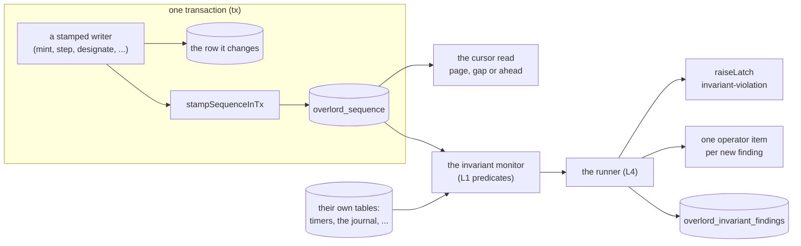
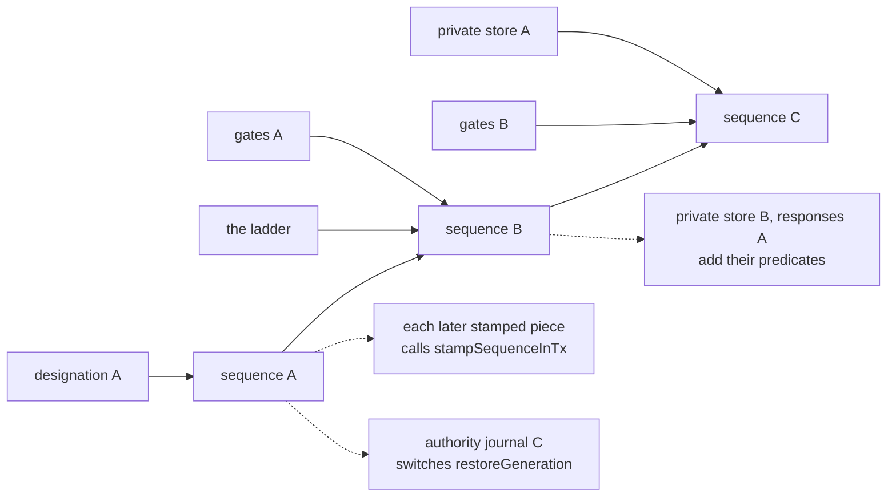

# Overlord W1: the one sequence, its cursor read, and the invariant monitor Implementation Plan

> **For agentic workers:** REQUIRED SUB-SKILL: Use superpowers:subagent-driven-development (recommended) or
> superpowers:executing-plans to implement this plan task-by-task. Steps use checkbox (`- [ ]`) syntax for tracking.

**Goal:** every change the Overlord design stamps is written, in one order, to one append-only table, and one monitor
checks the design's invariants against it on the live server.

- `overlord_sequence` is a new table in `coord.db`. Each line holds a sequence number, the changed row's kind and id,
  its new state, the actor and the time. One writer, `stampSequenceInTx`, adds a line inside the transaction that
  makes the change.
- Every stamped transaction on `main` when PR A is built calls that writer. Today that is the generations lane's mint
  and step, and, once designation A has merged, the designation's writers. Each later piece calls the writer itself.
- One cursor read serves the sequence. A cursor older than what the server keeps gets an explicit gap answer, never an
  empty page. A cursor past the head gets an explicit `ahead` answer, which is what a restored database looks like.
- The invariant monitor is a table of pure predicates, one per invariant of Table 11.7a. Each row names the tables it
  reads. A row whose tables do not exist yet reads `not-applicable`. A row whose input cannot be read reads
  `unmeasured` and is listed. Neither ever reads as a pass or as a violation.
- The monitor's runner is a lane on its own `LANE_SCHEDULE` row. It decides nothing. For each new violation it raises
  the ladder's `invariant-violation` latch through `raiseLatch` and raises one operator item. A violation already
  recorded raises neither again.
- M24's figure, the count of violations in production, is read from the monitor's own record of what it found.

**Why:** H3, H27 and H33 (§10.4, §11.7). Outside readers and the server's own checker both need every change in one
order, and the design builds no event stream of its own. Six machines interact, and a red test per guard proves a
guard exists, not that the machines compose. So the invariants are stated once, as predicates, and the same
predicates run in the simulator and on the live server (D-8214). A violation is a latch on the ladder, cap `advise`,
and one operator item (Table 7.5a).

**Architecture:** three pull requests in lane H. The index sized this piece at two; question 1 says why the door is a
third.

- **PR A, the sequence (Tasks 1 to 3).** After designation A.
  - `shared/overlord-sequence.ts` (L0, K) holds the line's wire shape, the kind table and the cursor read's answer.
  - `server/src/coord/overlordSequence.ts` (C5, L1) holds the pure deciders: `sequenceLineVerdict`, `sequencePage`
    and `retentionCut`.
  - `server/src/coord/overlordSequenceStore.ts` (C5, L3) holds the two tables, the one writer, the pruner and the
    page read.
  - The stamped writers on `main` call the writer inside their own transactions.
  - The retention lane, `sequenceRetention`, is a new `LANE_SCHEDULE` row.
- **PR B, the monitor (Tasks 4 to 6).** After PR A, the ladder and gates A.
  - The simulator's `SequenceLine`, `Violation` and `Invariant` move from `server/test/sim/sequence.ts` into
    `shared/overlord-sequence.ts` and `server/src/coord/invariants.ts`, in a move commit with characterization tests.
  - `server/src/coord/invariants.ts` (C5, L1) holds the invariant table and the W1 predicates, pure.
  - `server/src/coord/invariantFacts.ts` (C5, L3) gathers each predicate's input in one synchronous read.
  - `server/src/coord/invariantFindingsStore.ts` (C5, L3) holds the findings table and its one writer.
  - `server/src/coord/invariantLane.ts` (C5, L4) is the runner, on the `invariants` row of `LANE_SCHEDULE`.
  - One row in the ladder's cause table, `invariant-violation`.
- **PR C, the doors (Task 7).** After PR A, PR B, gates B and private store A.
  - `GET /api/overlord/sequence`, the Overlord's cursor read, through the gate runner and the read ledger, with its
    `ccrc-api sequence` verb.
  - `GET /api/overlord/invariants`, the operator's read of the monitor's last pass and M24's counts.

**Tech Stack:** TypeScript (ESM), `node:sqlite`, Fastify, vitest. No new dependency. No PWA code: the board and the home
read the doors later (question 13).

**Spec:** `docs/superpowers/specs/2026-11-09-overlord-design.md`:

- §10.4, whole: "One sequence", "The sequence has one home", "Why not `feed_events`", "Payloads carry ids, kinds,
  states and actors only", "No stream of its own" (the explicit gap answer), and "One invariant monitor" (I1 to I8 and
  I10 to I16 everywhere, I17 and I18 over their own tables, I9 in the simulator only; a violation latches the ladder at
  `advise` with one operator item; M24 counts its findings).
- §11.7, whole, with Table 11.7a (the invariants) and Table 11.7b (the tools: "The invariant monitor on the live
  sequence … The same predicates in production, except I9", W1). "Monotonic by construction" and "Every pull request
  carries its share" bind each new decider.
- §7.5 and Table 7.5a, the row "an invariant-monitor violation (§10.4) | latch | cap `advise`, one item". A drill's
  lines (§7.5, "Drills") carry a mark in a column the cursor read does not serve. That column is W3's (question 9).
- §7.6: the feeds' cursors carry the restore generation (question 7).
- Table 11.1a, the row `overlord_sequence` (C5, L3, `coord.db`, "One writer function, called inside each stamped
  transaction", kept 90 days, W1, in a snapshot, older build ignores it). Table 11.1b, the row "… the invariant monitor"
  (C3 and C5, L1). Table 11.1c, the row "The invariant monitor's runner" (C5, L4, "one latch and one item per
  violation", "On each `overlord_sequence` row", W1). Table 11.1e, the row "The sequence read: one cursor over
  `overlord_sequence`, which answers a gap explicitly" (C5, L4, the read ledger, W1, older build has no route).
- Table 11.5b, the row "90 days | How long `overlord_sequence` is kept | W1 | wall".
- §12, M24: "invariant-monitor violations in production … Zero violations".
- Table 13.1: H3 (`shape`, W1: "one sequence") and H27 (`shape`, W1, W2, W4) fix this table and its door, so both ship
  with this piece. H33 (`tightening`, W0 on) binds the monitor.

The index is `docs/superpowers/plans/2026-11-14-overlord-w1.md` (on `main`). This plan builds on:

- its row "Sequence and monitor" (lane H);
- its question 22 (`monitor-checks-what-exists`), question 31 (the message moves' sequence lines), question 20 (the
  ladder's cause rows join with their inputs) and question 36;
- its "Where lanes meet" bullets for `schema.ts`'s migrations, `LANE_SCHEDULE`, `writers-map`, `time-ports`,
  `MUTANT_SETS`, `overlordRoutes.ts`, and the ladder's cause table;
- "States W2 may read": `overlord_sequence`'s cursor.

The coordinator's brief for this plan (run 2165) and the cross-plan rulings of the authority journal (#2853),
designation (#2856), private store (#2855) and ccd arms (#2854) fix rounds bind over the index's text. The rulings this
plan follows are marked "(ruled)".


*Figure 1. One sequence, one monitor. The writer adds its line inside the transaction that changes the row, so a line
and its change commit or roll back together. The monitor reads the sequence and, for I7 and I17, the tables that stamp
no line.*

## Open questions

The index's questions 22 and 31 are built as their recommendations say, with the refinements below. Each question
here is built as its recommendation says unless the coordinator or the operator rules otherwise.

1. **The cursor read's door needs more than PR A has** (slug `sequence-door-rides-its-own-pr`). The index puts "the
   cursor read with its explicit gap" in PR A, which needs only designation A. But the door is an Overlord read
   (C47): it runs the gate order, so it calls gates B's `overlordGateRun`, and it leaves a read ledger line, which is
   private store A's `recordRead`. Neither is a need of PR A or PR B. **Recommendation:** PR A ships the read as an L1
   decider and an L3 read, so the gap rule is built and tested with the table. A third pull request, PR C, ships the
   door after gates B and private store A. The operator's read of the monitor joins it, so the door censuses move once.
   The other way is to fold the door into PR B and add gates B and private store A to PR B's needs. That would hold
   the monitor back behind door process A, which gates B needs, for no gain.
2. **Which changes are stamped** (slug `sequence-stamps-state-changes`). §10.4 lists "every change of a request, a
   hold, a generation, the designation, a grant, the ladder, the readiness word, a proposal, a command or an operator
   message's state". **Recommendation:** a line is written when a row's state word changes, or a row is created or
   ends. A write that changes only counters, deadlines, an accumulator, a hash or a bookkeeping list stamps nothing.
   Each kind's table in Task 1 names its state words and the writers that change them. The census (Task 1) names every
   other writer of the same table as one that stamps nothing, with its reason, so a new writer must take a side.
3. **A shadow walk stamps nothing** (slug `shadow-walks-stamp-nothing`). The generations lane walks a generation in
   shadow by moving `shadowState`, never `state` (`server/src/continuity/continuityStore.ts`'s header: "shadow never
   moves `state`"). A shadow walk is the lane's rehearsal and changes nothing a reader acts on. **Recommendation:** only
   moves of `state` are stamped. A mint writes a line for the generation it ends (`ended`) and one for the row it
   inserts, with that row's `state` (`carded` for a live walk, `active` for a shadow mint). `clearShadowWalk` stamps
   nothing.
4. **Every identity's generations are stamped, not only the Overlord's** (slug `every-generation-is-stamped`). The
   generation machine is shared by coordinators and the Overlord (§3.3.11). **Recommendation:** stamp every identity.
   A filter by role would be a decision inside a writer, and coordinators' renewals are part of what the Overlord and
   the monitor watch. The volume is small: a generation moves through at most seven states per renewal. Task 2 measures
   a week of the live `continuity_generations` before the writer is wired and states the figure in the pull request.
5. **What a line's id is** (slug `sequence-line-names-its-subject`). The design calls the line's id "the row's id". The
   designation is a singleton row, so its row id says nothing. **Recommendation:** each kind's table names its id:
   - `generation`: the generation's row id;
   - `designation`: the session id the move concerns, the pending id for `pending` and `failed`, the bound id for
     `live` and `retired`;
   - `ladder-rung`: the fixed id `operator`; `ladder-latch`: the cause;
   - `message`: the message id.

   Every id is opaque text (H3: "opaque ids"), and no reader parses one.
6. **The line's actor is the stamped row's own** (slug `sequence-actor-is-the-rows-own`). The line copies the actor
   text the stamped row records: the account gate's actor for an operator door, the session id for a session's call,
   and `server` for a lane. **Recommendation:** no second actor vocabulary. Gates A's `ActorWire` adds the actor's
   kind, issuer and strength to the rows that carry an actor. When the monitor needs a line's actor kind (Task 5, I11's
   rung arm), it reads it from the stamped row through gates A's `readActorColumns`, never by parsing the text.
7. **A restore and the cursor** (slug `sequence-read-carries-the-restore-generation`). A restored `coord.db` brings back
   the sequence as it was at the snapshot, so the next lines reuse numbers an outside reader may already hold.
   **Recommendation:**
   - a cursor past the head answers `ahead`, explicitly, never an empty page;
   - every answer carries `restoreGeneration`, which reads `unmeasured` until authority journal C's counter lands.
     Authority journal C switches it, in the same pull request that switches the response rows' stamp (index question
     35), so a reader that sees the counter move rewinds;
   - the sequence numbers come from `AUTOINCREMENT`, so a prune that empties the table never restarts them at 1.
8. **How the gap is known** (slug `sequence-gap-from-a-recorded-floor`). "Older than what the server keeps" could be
   read from the lowest number still in the table. A table emptied by the prune has no lowest number.
   **Recommendation:** the pruner records the highest number it has ever deleted in a one-row table,
   `overlord_sequence_pruned`, in the same transaction as the delete. The cursor read answers a gap when the cursor is
   below that number. The gap answer names the number, so the reader resumes from it and knows what it lost.
9. **The drill's mark** (W3). §7.5 gives drills a mark column on `overlord_sequence` that the cursor read does not serve.
   **Recommendation:** W3's drill piece adds the column in its own migration. The cursor read selects its columns by
   name, never `*`, and a test pins the served columns, so a later column is never served by accident.
10. **The predicate's input** (slug `predicates-take-lines-and-facts`). D-8214 says the simulator's predicate runs
    unchanged in the W1 monitor. The simulator's `Invariant` reads the lines alone. I17 and I18 read their own tables,
    which stamp no line (§10.4), and I7 compares coord.db with a journal file. **Recommendation:** an invariant takes
    `(lines, facts)`, where `facts` is the typed snapshot its row names. The simulator's existing invariants are the
    case with no facts, and keep running unchanged after the move (Task 4). A live predicate never reads a database
    or a file: the gatherer does, and the predicate is pure.
11. **Which invariants run in W1** (index question 22, refined; slug `predicates-join-with-their-tables`). Each row of
    the invariant table names its tables and the piece that creates them. **Recommendation:** PR B ships the table's
    seventeen rows and the predicates whose tables are on `main` when it is built:
    - **I7**, the authority fields against the journal's fold (authority journal A, designation A, the ladder);
    - **I17**, the timers against their mail (W1a's timers, on `main`);
    - **I5's term arm**, a line written by the Overlord's session only while the latest designation line binds that
      session (designation A);
    - **I11's rung arm**, a rise of the operator's rung only by an operator actor (the ladder). Question 22 lists I11
      as having no W1 tables, but the ladder's rung door is W1 and widens. This arm is the cheapest check of the one
      widening W1 has (slug `i11-rung-arm-runs-in-w1`).

    Each other row reads `not-applicable` and names the piece that adds its predicate. The piece that creates a row's
    tables adds the predicate and its gatherer, as a row and a function, in its own pull request, as the ladder's
    causes join (index question 20). In W1 that is private store B (I8, and I13's message half) and responses A (I18).
    If either has merged when PR B is built, PR B adds that predicate itself. I9 reads `simulator-only` (Table 11.7a's
    caption).
12. **The monitor keeps a record of what it found** (slug `monitor-keeps-its-findings`). Table 11.1c gives the runner
    "one latch and one item per violation", and §12 has M24 count the monitor's findings. The ladder's latch is one row
    per cause, and an item carries no key the runner could match on. **Recommendation:** one table,
    `overlord_invariant_findings`, one row per distinct violation, keyed by the invariant and a subject key the
    predicate names (for I17, the timer's id). Its one writer records the finding, raises its item and stores the
    item's id, in one transaction. The row is the deduplication and M24's count. It is never deleted in W1: it is the
    record M24 reads, and a violation should be rare.
13. **Where the operator sees the monitor** (slug `invariants-read-is-an-operator-door`). "Listed" needs a place.
    **Recommendation:** the runner keeps its last pass in memory, one verdict per invariant, and writes one log line
    when an invariant's verdict word changes. PR C serves it at `GET /api/overlord/invariants`, an operator door with the
    verb class `view`, with M24's counts. The board's "Brakes and the ladder" part reads the latch already, and a later
    board piece may draw the verdicts. No PWA code ships here.
14. **Which programme an invariant item belongs to** (slug `invariant-items-sit-under-overlord`). An item needs a
    programme slug (`operator_items.program`, free text). A violation belongs to no coordinator's programme.
    **Recommendation:** the slug `overlord`, the project the Overlord lives in (C2), raised by `ccrc`, kind `do`, needed
    by `now`. The operator's Waiting list shows every programme's items, so it is seen there.
15. **The predicates of I1 in W3** (index question 22's last sentence; the ledger's note on D-8214 and D-8240). The
    simulator's coordinator-blocked reach invariant assumes the simulator's sweep phase. **Recommendation:** nothing is
    built for it in W1, because I1 reads held rows, which are W3's. This plan records the rule the ledger states, so the
    W3 piece inherits it: the live predicate keeps the looser bound `max(m + COORD_BLOCKED_HELD_MS, steadySince) +
    STALL_SWEEP_MS`, and D-8240's down rule does not run live, because a monitor that sees only boots cannot apply it.
16. **M24's simulator figures** (the simulator plan's question 5). M24 also counts simulator seeds run and red.
    **Recommendation:** not in this piece. The monitor runs on the live server and cannot see a test run. CI's summary
    already reports the simulator's suites. The coordinator rules whether a later piece records them.
17. **A message move with no `coord.db` transaction** (index question 31, refined). Question 31 has a message move's
    line written by the `coord.db` transaction that causes it: the mail lane's delivery, the prompt route's nudge, the
    settlement mark. Acknowledge (the inbox piece) moves a message in the private store and writes nothing to
    `coord.db`. **Recommendation:** the inbox piece writes acknowledge's line in a `coord.db` transaction of its own
    right after the private store commits. A crash between the two loses the line, and the boot pass re-derives the
    private store's state (I8), so the monitor reads a message with no line as `unmeasured` for that message, never as
    a violation. The inbox's plan decides it, and this plan names the seam.

## What exists today

Measured on `origin/main` at `2a061d7a1` (2026-11-15).

- **No sequence and no monitor.** `git grep overlord_sequence origin/main -- server shared` finds nothing. The
  simulator's sequence lives in the test tree: `server/test/sim/sequence.ts` defines `SequenceLine` (`seq`, `at`,
  `kind`, `id`, `state`, `actor`), `Violation` (`invariant`, `seq`, `message`), `Invariant` (`name`, `says`,
  `check(lines)`) and `SimSequence`. Its invariants are scenario invariants, `server/test/sim/timerDay.ts`'s
  `TIMER_DAY_INVARIANTS` (T1 to T5) and the coordinator-blocked day's, which read the simulator's own encodings in
  `state` (`mails=1;to=…`). None is one of Table 11.7a's I-numbers.
- **The stamped transactions on `main`.** Of the kinds §10.4 lists, only the generation exists on `main`. Its table,
  `continuity_generations` (migration 68), has one writer module, `server/src/continuity/continuityStore.ts`, called by
  the generations lane (`server/src/continuity/generationsLane.ts`). `writers-map.test.ts` names its six writers:
  - `mintGeneration`: one `tx()` that ends the identity's live row (`state = 'ended'`) and inserts the next. Stamped.
  - `stepGeneration`: one `UPDATE`, not in a `tx()`, that moves `state` or `shadowState` and the walk's counters.
    Stamped only when a live walk enters a new state (questions 2 and 3).
  - `clearShadowWalk`, `setGenerationDue`, `advanceObserved` and `setHoldOff`: no change of `state`. Not stamped.
- **What arrives before PR A.** PR A needs designation A, whose plan (#2856, at its pushed tip) ships
  `server/src/coord/overlordDesignationStore.ts` with the writers `designatePending`, `bindPendingGeneration`,
  `goLive`, `failPending`, `retire` and `stopDone`, each one `tx()`, and `designationRead()` with three arms. Of these,
  `designatePending` (`pending`), `goLive` (`live`), `failPending` (`failed`) and `retire` (`retired`) change the
  designation's state. Designation B's rebind arms call the writer themselves. Designation A also adds
  `restampOverlordGeneration` to `continuityStore.ts`, which moves a generation's identity and not its state, so it
  stamps nothing.
- **Kinds that may or may not be on `main` when PR A is built:** the ladder (`setRungInTx`, `raiseLatchInTx`,
  `clearLatchInTx`, `applyRestoreInTx`; its plan #2861), and private store B's message moves through the mail lane
  (question 31). Task 2 re-measures them. A stamped writer on `main` at PR A's build is wired by PR A. One that merges
  later calls the writer in its own pull request (the index's "each later piece calls it itself").
- **Transactions.** `server/src/coord/tx.ts#tx` opens `BEGIN IMMEDIATE` and does not nest. `DatabaseSync.isTransaction`
  says whether a transaction is open; `pushOutboxStore.ts` uses it to join a caller's transaction
  (`db.isTransaction ? write() : tx(db, write)`).
- **Lanes.** `server/src/laneSchedule.ts#LANE_SCHEDULE` has 44 rows, every one on the monotonic clock. The timers lane
  is the nearest model: one row (`timers`, a minute, `skip`, a `warnKey`), one `sweepTimers` method on `FleetWatcher`
  that calls `runLane('timers', …)`, and one never-awaited line in the tick. `server/test/watcher-quiet-census.test.ts`
  holds every test file that builds a `FleetWatcher` to a teardown form (`quietAtTestEnd`, `quietWatcher`,
  `drainWatcher`), with a shrink-only exemption list.
- **Items.** `server/src/coord/ledgersStore.ts#raiseItem` writes an open item and its `raise` event in one `tx()`;
  `raiseItemInTx` is private and "`tx` does not nest". `raiseItemWithMail` runs a callback inside the item's
  transaction. Server callers raise with actor `ccrc` (`reviewRelease.ts`, `runCloseRefusals.ts`, `endRequest.ts`).
  `operator_items.program` is free text. Push outbox A and B (#2859, in the queue) widen `raiseItem` and
  `raiseItemWithMail` with a bound-row callback; Task 6 measures the signature on `main` and calls it as it is.
- **The ladder** (its plan, #2861): `LADDER_CAUSE_MAP` in `shared/overlord-ladder.ts`, keyed by cause; its Table 2 keys
  this piece's row `invariant-violation` (latch, cap `advise`, notice `item`). `raiseLatch(deps, cause, detail,
  raisedBy)` in `server/src/coord/overlordLadderRead.ts` opens the transaction, takes the cap from the table and
  answers `changed: false` for a cause that stands. The ladder sends nothing itself: the raiser sends the notice.
- **The authority journal** (its plan, #2853): `OverlordAuthorityJournal.readVerified()` answers the verified records,
  `authorityFold(records)` answers an `AuthorityView` (the designation's term and binding, the rung, the latches, the
  account set and the class), and the guard's `state()` answers `coherent`, `rolled-back` or `unmeasured`. Every
  authority writer appends inside its own `tx()` before it writes the row.
- **Timers** (W1a, on `main`): `continuity_timers` with its writers `insertTimer`, `cancelTimer`, `markTimersFired` and
  `purgeTimers`; the lane fires each due timer with its one mail in one transaction (`continuity/timerLane.ts`).
- **Censuses a new table, lane and door touch:** `server/src/coord/schema.ts#MIGRATIONS` with
  `server/test/run-close-switch.test.ts` (it drops every migration from 55 by hand) and `server/test/coord-db.test.ts`;
  `server/test/single-definition/writers-map.test.ts` (`TABLES` and the writer lists);
  `server/test/single-definition/time-ports.test.ts` (`TIME_PORT_FILES`); `server/src/coord/ports.ts`
  (`WatcherCoordMember`); `server/test/lane-schedule.test.ts`; `server/test/sim/mutation-floors.test.ts` with
  `mutation-floors.json`; for a door, `server/test/auth-gate.test.ts`, `server/test/box-token-census.test.ts`,
  `server/test/rings/fastify-l4.data.ts`, `server/test/secret-mask.test.ts`, `CLAUDE.md`'s box-token paragraph, gates
  A's `OVERLORD_DOORS`, and `ccd/ccrc-api`'s `ROUTES` with `server/test/ccrc-api.test.ts`.
- **Rings and contexts.** Every new `server/src/coord/` file takes context C5 from the architecture spec's `coord/**`
  row; its ring is read from its imports. `shared/*.ts` files import no `node:*` module.

## Global Constraints

- **Architecture (`CLAUDE.md`).**
  - **One writer per fact.** `overlord_sequence` has one inserting writer, `stampSequenceInTx`, and one deleting
    writer, `pruneSequenceThrough`. `overlord_sequence_pruned` has one writer, the same prune, in the same transaction.
    `overlord_invariant_findings` has one writer, `recordFindingInTx`. `writers-map` pins each.
  - **The stamped transactions keep their own writers.** A stamped writer gains one call, inside its existing
    transaction (or a `tx()` it opens around its one statement, for `stepGeneration`). No writer moves.
  - **Decide in L1, act in L4.** `overlordSequence.ts` and `invariants.ts` import L0 only: no `fs`, no Fastify, no
    clock, no database. The stores and the gatherer are L3. The runner reads facts, asks the predicates and acts on
    their answers, and holds no `if` over an invariant's name.
  - **Consolidate.** The line's shape is the simulator's `SequenceLine`, moved, not copied (question 10). The latch is
    the ladder's, through `raiseLatch`. The item is the programme ledger's, through `raiseItem`. The lanes are rows of
    `LANE_SCHEDULE`. The sequence is legitimately different from `feed_events` (§10.4, "Why not `feed_events`": that
    table is pruned to 2,000 rows, carries titles and bodies, and older builds read its `kind`); the module header says
    so, as the consolidation spec's catalogue asks.
  - **No overloaded null at a seam.** The cursor read answers one of four arms (`page`, `gap`, `ahead`,
    `unmeasured`), and a caught-up reader gets `page` with no lines, never `null`. A predicate answers `holds`,
    `violated`, `unmeasured` or `not-applicable`, each a separate arm. `restoreGeneration` is a number or the word
    `unmeasured`.
- **Failure contracts (fail closed).**
  - `stampSequenceInTx` never throws. It answers `{ ok: false, error }` outside a transaction, on a kind or state word
    the kind table lacks, and on a failed insert. Every caller checks the answer and writes no row on a refusal: a
    caller that wrote its row first throws its own private error inside its `tx()`, so the row rolls back with the line
    (the cross-plan rule for `appendInTx`, applied here).
  - An unreadable sequence makes the cursor read answer `unmeasured` (the door answers 503 `unavailable`) and makes
    every sequence predicate answer `unmeasured`. It is never an empty page and never a pass.
  - An unreadable table or journal makes the predicate that reads it answer `unmeasured`, listed with its reason. The
    runner raises no latch and no item for it.
  - A refused `raiseLatch` (the ladder's `{ ok: false }`) or a failed item raise rolls back the finding, so the next
    pass tries again. A latch that already stands answers `changed: false` and the finding is still recorded.
  - An older server reads a newer `coord.db` and ignores the three new tables (Table 11.1a: "Ignores it"). An older
    `ccrc-api` has no `sequence` verb. A newer `ccrc-api` against an older server gets the server's own 404.
- **What a merge arms.**
  - PR A: every generation move writes a line. Nothing reads the lines but the tests. The retention lane deletes
    nothing for 90 days.
  - PR B: the monitor runs on the live server. A violation raises a real latch, which caps the rung at `advise`. In W1
    the rung door stops at `chat` (index question 19), so the cap changes nothing a session sees. A violation also
    raises one real operator item. Before the pull request merges, Task 6 runs the monitor against a copy of the live
    `coord.db` in a scratch directory and states what it would have raised, so a predicate that is wrong about live data
    is found before it raises an item.
  - PR C: two read doors. Nothing writes.
- **SAFETY (`CLAUDE.md`).** No ccd verb, no argv, no marker file. Tests use an in-memory `coord.db`, a fixture journal
  directory and fixture HOMEs. The live `coord.db` is read only as a copy (`sqlite3 … .backup` into the session's temp
  root), never opened by a test.
- **Growth check.** Each growth-checked file grows by at most 40 net lines in each pull request, with no waiver. The
  estimates are in the PR split. A task that measures over its row stops and asks.
- **Mutation floors.** Every new L1 decider joins `MUTANT_SETS` through `server/test/sim/sequenceSets.ts`, and
  `mutation-floors.json` at its measured score, in the pull request that creates it. Each guard ships with a test that
  goes red when it is deleted, measured with `mutation-run.py` (the coordinator skill's references) as each task says.
- **Tests.** From `server/`: `ccrc test -- ./node_modules/.bin/vitest run test/<file>.test.ts`. A task's last run adds
  `ccrc test -- npx tsc --noEmit -p tsconfig.json` and `ccrc test -- npx tsc --noEmit -p test/tsconfig.tests.json`. For a
  `shared/` file, also `cd ../pwa && ccrc test -- ./node_modules/.bin/tsc --noEmit` and the agent's `tsc`.
- **Public repository.** Fixtures use `lane-a`, `lane-b`, `pool-a`, the `overlord` project and invariant names from
  Table 11.7a, or `inv-a` for a synthetic row. Cite by symbol or `@anchor`. No D-number is invented: a builder's new
  departure goes in `docs/superpowers/plans/2026-11-14-overlord-w1/w1-sequence-monitor/notes.md`.

## Review Focus

1. **A line and its change commit together.** Every stamped writer calls the writer inside the transaction that makes
   the change, checks its answer, and writes nothing on a refusal. No line is written in a second transaction.
2. **The census runs both ways.** Every writer of a stamped kind's table is either a stamper or listed as stamping
   nothing, with a reason; every call of `stampSequenceInTx` sits in a listed stamper.
3. **The gap is explicit.** A cursor below the recorded prune floor answers `gap`; a cursor past the head answers
   `ahead`; neither is ever an empty page. A prune that empties the table does not restart the numbers.
4. **No fold of `unmeasured`.** An unreadable input never reads as a pass, a violation, an empty page or "nothing
   designated".
5. **One latch and one item per violation.** A finding recorded once raises its item once. A latch that stands is not
   raised twice. A refused raise leaves no finding, so the next pass retries.
6. **The predicates are pure and total.** Each answers one of its four arms for every input in its domain, and adding a
   fault or an unknown never turns `violated` or `unmeasured` into `holds`.
7. **The simulator still runs.** The move of `SequenceLine`, `Violation` and `Invariant` changes only the simulator's
   imports, and every simulator suite is green before and after.

## The PR split

Net code lines, as `server/test/growthCheck.ts` counts them, estimated against `origin/main` at `2a061d7a1` plus
the pieces each pull request needs first.

| PR | Tasks | What it ships | Needs first | Growth-checked files, estimate |
|---|---|---|---|---|
| A, the sequence | 1 to 3 | The vocabulary and the line verdict; `overlord_sequence` and `overlord_sequence_pruned`, the one writer and the stamp census; the generations lane's and the designation's writers stamped; the retention lane; `sequencePage` and the page read | designation A | `server/src/coord/schema.ts` about +18 (one migration: two tables and one index); `server/src/coord/store.ts` about +4 (delegates `sequenceAfter`, `pruneSequenceThrough`, `sequenceHead`); `server/src/watch.ts` about +8 (the `sweepSequenceRetention` method and its tick line); `shared/api.ts` 0; `server/src/server.ts` 0 |
| B, the monitor | 4 to 6 | The moved simulator types; the invariant table and the W1 predicates; the gatherer; `overlord_invariant_findings` and its writer; the runner on the `invariants` row; the ladder's `invariant-violation` row | PR A, the ladder, gates A | `server/src/coord/schema.ts` about +14 (one migration: one table and one index); `server/src/coord/store.ts` about +4 (delegates `recordFinding`, `findingCounts`, `findingKeys`); `server/src/watch.ts` about +9 (`sweepInvariants` and its tick line); `shared/api.ts` 0; `server/src/server.ts` 0 |
| C, the doors | 7 | `GET /api/overlord/sequence` through the gate runner and the read ledger; `GET /api/overlord/invariants`; `ccrc-api sequence`; every census | PR A, PR B, gates B, private store A | `server/src/server.ts` about +4 (the two doors' deps into `registerOverlordRoutes`: the page read, the monitor's last pass, the read ledger); `server/src/coord/store.ts` 0; `server/src/coord/routes.ts` 0; `pwa/src/lib/api.ts` 0 |

Any file a growth cap names on `main` at build is measured too (`growthCheck.ts#growthFiles` reads the caps).

For scale, the files that are not growth-checked change by about:

- PR A: new `shared/overlord-sequence.ts` +90, `server/src/coord/overlordSequence.ts` +80,
  `server/src/coord/overlordSequenceStore.ts` +150, `server/src/coord/sequenceRetentionLane.ts` +40,
  `server/test/sim/sequenceSets.ts` +60; `server/src/continuity/continuityStore.ts` +20 (the mint's two lines, the
  step's `tx()`); `server/src/coord/overlordDesignationStore.ts` +16 (four calls); `server/src/laneSchedule.ts` +6.
- PR B: new `server/src/coord/invariants.ts` +260, `server/src/coord/invariantFacts.ts` +160,
  `server/src/coord/invariantFindingsStore.ts` +110, `server/src/coord/invariantLane.ts` +120;
  `shared/overlord-sequence.ts` +20 (the moved types); `server/test/sim/sequence.ts` −15 (the moved types, re-exported);
  `shared/overlord-ladder.ts` +4 (one row); `server/src/laneSchedule.ts` +6; `server/test/sim/sequenceSets.ts` +120.
- PR C: `server/src/coord/overlordRoutes.ts` +90 (two handlers); `server/src/coord/overlordDoors.ts` +4 (two rows);
  `ccd/ccrc-api` +4 (one route, the count word).


*Figure 2. Where the piece sits. The dashed arrows are the seams later pieces pick up: a later stamped writer calls the
writer, a later table brings its predicate, and authority journal C fills the restore generation.*

## Index changes

The coordinator makes these in its own index edit. This plan edits no other plan.

- **Table W1, this piece's row:** three pull requests and seven tasks, not two and six (question 1). A: the
  sequence, its writer, the stamp census, the retention lane and the page read; needs designation A. B: the monitor,
  its findings, the runner and the cause row; needs PR A, the ladder and gates A. C: the two read doors; needs PR A,
  PR B, gates B and private store A. Figure W1 gains `SQB --> SQC`, `GB --> SQC` and `PSA --> SQC`.
- **"Where lanes meet":**
  - `schema.ts`'s migrations: the sequence takes two migrations (PR A and PR B), not one.
  - `LANE_SCHEDULE`: `sequenceRetention` and `invariants` each add a row.
  - A new bullet, **the sequence writer**: each piece whose writer changes a stamped kind's state, and merges after
    sequence A, calls `stampSequenceInTx` inside its own transaction, adds its kind's row to `SEQUENCE_KIND_MAP` if the
    kind is new, and names its writers in the stamp census. In W1: the ladder (if it merges after sequence A), private
    store B's message moves through the mail lane and the prompt route (question 31), designation B's rebind arms, the
    readiness word, and the inbox's acknowledge (question 17).
  - A new bullet, **the invariant table**: each piece that creates a table an invariant reads adds that invariant's
    predicate and its gatherer, as a row and a function: private store B (I8, I13's message half) and responses A
    (I18), unless either merged before sequence B.
  - `overlordRoutes.ts`: "the sequence's cursor" is PR C's, beside the operator's invariants read.
- **Authority journal C's row:** it also switches the cursor read's `restoreGeneration` from `unmeasured` to the
  counter, beside the response rows (question 7).
- **The inbox's row:** acknowledge writes its message line in a `coord.db` transaction of its own (question 17).
- **Question 22:** add "I11's rung arm runs in W1" (question 11) and the predicate shape `(lines, facts)` (question 10).
- **"States W2 may read":** the cursor read's four arms and the line's shape are the contract W2 reads.
- **Spec fixes:** the line's id per kind (question 5); the prune floor and the `ahead` arm (questions 7 and 8); the
  findings table (question 12); the invariant item's programme (question 14).

### Task 1: The vocabulary, the line verdict, the table and the one writer (PR A)

**Files:**
- Create: `shared/overlord-sequence.ts` (L0, K: imports only other `shared/` files)
- Create: `server/src/coord/overlordSequence.ts` (C5, L1)
- Create: `server/src/coord/overlordSequenceStore.ts` (C5, L3)
- Create: `server/test/sim/sequenceSets.ts`; Modify: `server/test/sim/mutation-floors.test.ts`,
  `server/test/sim/mutation-floors.json`
- Modify: `server/src/coord/schema.ts` (one migration), `server/src/coord/store.ts` (delegates)
- Modify: `server/test/single-definition/writers-map.test.ts`, `server/test/run-close-switch.test.ts`,
  `server/test/coord-db.test.ts`
- Test: `server/test/overlord-sequence.test.ts`, `server/test/overlord-sequence-store.test.ts` (new)

**Interfaces:**

```ts
// shared/overlord-sequence.ts
import { GENERATION_STATES } from './continuity.js';
import { DESIGNATION_SEQUENCE_STATES } from './overlord-designation.js';   // designation A's L0 file; see below

/** One line of the one sequence (§10.4): ids, kinds, states and actors only, never a body. */
export interface SequenceWireLine {
  readonly seq: number; readonly at: number; readonly kind: SequenceKind; readonly id: string;
  readonly state: string; readonly actor: string;
}
/** Every stamped kind, its state words (from the kind's own L0 owner, never copied), how its id is chosen (question 5),
 *  and the spec text that stamps it. A later piece adds its kind here, beside its first stamped writer. */
export const SEQUENCE_KIND_MAP = {
  generation: { states: GENERATION_STATES, id: 'the generation row id', spec: '§10.4 "a generation"' },
  designation: { states: DESIGNATION_SEQUENCE_STATES, id: 'the session the move concerns', spec: '§10.4 "the designation"' },
} as const satisfies Readonly<Record<string, { states: readonly string[]; id: string; spec: string }>>;
export type SequenceKind = keyof typeof SEQUENCE_KIND_MAP;
export const SEQUENCE_KINDS = Object.keys(SEQUENCE_KIND_MAP) as SequenceKind[];
export function isSequenceKind(v: unknown): v is SequenceKind;
/** Bounds the writer checks (opaque text, never parsed). */
export const SEQUENCE_ID_MAX = 200;
export const SEQUENCE_ACTOR_MAX = 200;
/** Table 11.5b: kept 90 days, by the server's wall clock. */
export const SEQUENCE_KEEP_MS = 90 * 24 * 3_600_000;
```

`DESIGNATION_SEQUENCE_STATES` is `['pending', 'live', 'failed', 'retired']`. It is one exported list in designation A's
L0 file, `shared/overlord-designation.ts`, which this pull request extends by one line if designation A did not add it,
so the designation's words have one home.

```ts
// server/src/coord/overlordSequence.ts (L1, imports L0 only)
export type LineRefusal = 'unknown-kind' | 'unknown-state' | 'bad-id' | 'bad-actor' | 'bad-at';
/** Whether a line may be written: its kind in the table, its state among the kind's words, its id and actor
 *  non-empty and within their bounds, its time a finite non-negative integer. First match, in that order. */
export function sequenceLineVerdict(l: { kind: string; id: string; state: string; actor: string; at: number }):
  { ok: true } | { ok: false; refusal: LineRefusal };
```

```sql
CREATE TABLE overlord_sequence (
  seq   INTEGER PRIMARY KEY AUTOINCREMENT,   -- never reissued, even after a prune empties the table (question 7)
  kind  TEXT NOT NULL,
  id    TEXT NOT NULL,
  state TEXT NOT NULL,
  actor TEXT NOT NULL,
  at    INTEGER NOT NULL CHECK (at >= 0)
);
CREATE INDEX overlord_sequence_at ON overlord_sequence (at);
CREATE TABLE overlord_sequence_pruned (
  one     INTEGER PRIMARY KEY CHECK (one = 1),
  through INTEGER NOT NULL CHECK (through >= 1)   -- the highest seq any prune has deleted (question 8)
);
```

No row is seeded. An absent `overlord_sequence_pruned` row means nothing was ever pruned.

```ts
// server/src/coord/overlordSequenceStore.ts (L3)
export type StampAnswer =
  | { readonly ok: true; readonly seq: number }
  | { readonly ok: false; readonly error: 'not-in-transaction' | LineRefusal | 'write-failed'; readonly detail: string };
/** THE one writer of `overlord_sequence` lines. Inside the caller's `tx()`, never outside, and it never throws. */
export function stampSequenceInTx(db: DatabaseSync,
  line: { kind: SequenceKind; id: string; state: string; actor: string; at: number }): StampAnswer;
```

The module header names the sequence as legitimately different from `feed_events` (Global Constraints).

- [ ] **Step 1: Failing tests.**
  - `overlord-sequence.test.ts`: `sequenceLineVerdict` over the whole domain: each refusal at its position in the
    order, the bounds at their edges (an id of 200 and 201 characters, an empty actor, `at` of -1, 1.5 and `NaN`), a
    state word of another kind refused; every kind's `states` equals its owner's list (`GENERATION_STATES`,
    `DESIGNATION_SEQUENCE_STATES`) by identity, never a copy.
  - `overlord-sequence-store.test.ts` (in-memory `coord.db` with every migration):
    - inside `tx()`, a stamp answers the next number and the line reads back with every column;
    - outside a transaction it answers `not-in-transaction` and writes nothing;
    - a refused line answers its word and writes nothing;
    - a stamp inside a `tx()` that then throws leaves no line;
    - numbers rise across transactions, and after every line is deleted the next stamp continues above the highest
      ever issued (AUTOINCREMENT);
    - SQLite refuses a second `overlord_sequence_pruned` row and a `through` of 0.
  - `writers-map.test.ts`: `TABLES` gains both tables; `overlord_sequence: [stampSequenceInTx, pruneSequenceThrough]`
    and `overlord_sequence_pruned: [pruneSequenceThrough]`, by `file#symbol`.
  - `run-close-switch.test.ts`'s undo step drops both tables, and its count moves; `coord-db.test.ts`'s count moves.
- [ ] **Step 2: Run.** Red.
- [ ] **Step 3: Implement**, with the migration (its number taken at build, never in the plan) and the delegates.
- [ ] **Step 4: Mutation.** Register `sequenceLineVerdict` in `sequenceSets.ts`, run `mutation-run.py` on it, and set its
  floor at the measured score. By hand: let the writer run outside a transaction (the `not-in-transaction` case goes
  red); drop `AUTOINCREMENT` (the emptied-table case goes red). Restore each from a saved copy.
- [ ] **Step 5: Run** both suites, `test/single-definition/*.test.ts`, `test/coord-db.test.ts`,
  `test/run-close-switch.test.ts`, `test/sim/mutation-floors.test.ts`, the growth check armed (`schema.ts`, `store.ts`),
  and every `tsc`. Green.
- [ ] **Step 6: Commit.** `feat(overlord): overlord_sequence and its one writer (Overlord W1, §10.4, H3)`

### Task 2: Every stamped transaction on `main` calls the writer, and the stamp census (PR A)

**Files:**
- Modify: `server/src/continuity/continuityStore.ts` (`mintGeneration`, `stepGeneration`)
- Modify: `server/src/coord/overlordDesignationStore.ts` (`designatePending`, `goLive`, `failPending`, `retire`)
- Modify: whichever stamped writers the re-measure below finds on `main`
- Create: `server/test/sequence-stamp-census.test.ts`
- Test: `server/test/continuity-generations-store.test.ts` and the designation store's suite (each gains cases)

**First, re-measure.** Before writing a test, run `git fetch origin main` and list every writer of a stamped kind on
`origin/main`: `git grep -n "continuity_generations\|overlord_designation\|overlord_ladder\|overlord_latches" origin/main
-- server/src`, and the private store's mail-lane branch (`git grep -n operatorMessage origin/main -- server/src/watch.ts
server/src/coord`). Put the list in the pull request's body. Each writer found joins the census below; a kind not yet on
`main` is left to its piece (the index's new bullet).

**The census** (`sequence-stamp-census.test.ts`). One table, `STAMPED_TABLES`, maps each kind to its table and to two
lists of `file#symbol`:

| Kind | Table | Stampers | Writers that stamp nothing, and why |
|---|---|---|---|
| `generation` | `continuity_generations` | `continuityStore.ts#mintGeneration`, `#stepGeneration` | `#clearShadowWalk` (shadow residue, question 3), `#setGenerationDue` (the due fields), `#advanceObserved` (the accumulator), `#setHoldOff` (the hold-off), `#restampOverlordGeneration` (the identity, not the state) |
| `designation` | `overlord_designation` | `overlordDesignationStore.ts#designatePending`, `#goLive`, `#failPending`, `#retire` | `#bindPendingGeneration` (fills the pending generation once), `#stopDone` (the owed-stop list) |

It checks, using `server/test/scan/symbols.ts#sourceOfSymbol` (never the whole file as text):
- the two lists of each kind, together, equal `writers-map`'s list for that table, both ways;
- each stamper's source calls `stampSequenceInTx(` and checks its answer (the call's result is read);
- every `stampSequenceInTx(` call in `server/src` sits in a listed stamper;
- every kind of `SEQUENCE_KIND_MAP` has a row here, and every row's kind is in the map.

**The calls.**
- `mintGeneration`: inside its `tx()`, after the `UPDATE` that ends the old row, a line `{ kind: 'generation', id:
  String(old.id), state: 'ended', actor: 'server' }`; after the `INSERT`, a line for the new id with the `state` it
  wrote. A refused stamp throws `Superseded`'s sibling, a private `StampRefused`, which the existing catch maps to
  `{ ok: false, kind: 'write-failed' }`.
- `stepGeneration`: its one `UPDATE` moves into a `tx()`. When the update changed the row, the walk is live and the
  state is entered (`entering`), a line `{ kind: 'generation', id: String(id), state: next.state, actor: 'server' }`. A
  refused stamp throws inside the `tx()`, and the function answers `{ changed: false }` as it does for any failure
  today. A shadow step and a step that stays in its state stamp nothing.
- The designation's four writers: each, inside its `tx()` and after the row write, one line with the state of question
  5's table and the actor its row records (`actor`, or `pendingActor` for the attempt). A refused stamp answers the
  writer's own failure arm and writes no row (the throw-inside-`tx()` pattern). A retire over an incoherent journal,
  which writes its row only (cross-plan ruling X3), still stamps: the line records the row the database holds.
- The `at` of every line is the `now` (or `at`) the writer already takes, so a line never reads the clock itself.

- [ ] **Step 1: Failing tests.**
  - the census suite, red until the calls exist;
  - generations: a mint with a live row writes `ended` for it and `carded` for the new id, in order; a first mint
    writes one line; a shadow mint writes `active`; a refused stamp (a fixture kind table that lacks `carded`, through
    a test seam on the writer's verdict) leaves neither row changed and answers `write-failed`; a live step entering
    `probing` writes one line, a step staying in `probing` writes none, a shadow step writes none, and a step whose
    compare-and-set misses writes none;
  - designation: each of the four writers writes its one line with its id and actor; a refused designation writes no
    row; a pending-only retire writes `retired` for the pending id with no term raised;
  - the full generation day (`server/test/sim/generation-day.test.ts`) and the timer day stay green.
- [ ] **Step 2: Run.** Red.
- [ ] **Step 3: Implement.**
- [ ] **Step 4: Mutation, by hand.** Move the generations' stamp out of the `tx()` (after it): the refused-stamp case goes
  red. Stamp a step that stays in its state: red. Drop a stamper from the census's list: red. Restore each.
- [ ] **Step 5: Run** the census, `test/continuity-*.test.ts`, the designation suites, `test/sim/*.test.ts`,
  `test/single-definition/*.test.ts` and every `tsc`. Green. Measure a week of generation moves on a copy of the live
  `coord.db` (`SELECT count(*) FROM continuity_generations WHERE enteredAt > …`, read-only, in the session's temp root)
  and put the expected lines a day in the pull request (question 4).
- [ ] **Step 6: Commit.** `feat(overlord): the generation and designation moves stamp the sequence (Overlord W1, §10.4)`

### Task 3: The retention lane and the cursor read (PR A)

**Files:**
- Modify: `shared/overlord-sequence.ts` (the page's wire)
- Modify: `server/src/coord/overlordSequence.ts` (`retentionCut`, `sequencePage`)
- Modify: `server/src/coord/overlordSequenceStore.ts` (`pruneSequenceThrough`, `sequenceFacts`, `sequenceAfter`)
- Create: `server/src/coord/sequenceRetentionLane.ts` (C5, L4)
- Modify: `server/src/laneSchedule.ts` (`LaneName` and one row), `server/src/watch.ts` (`sweepSequenceRetention` and its
  tick line), `server/src/coord/ports.ts` (`WatcherCoordMember` gains `sequenceRetentionFacts` and
  `pruneSequenceThrough`), `server/src/coord/store.ts` (delegates)
- Modify: `server/test/lane-schedule.test.ts`, `server/test/single-definition/time-ports.test.ts` (`TIME_PORT_FILES`
  gains the lane file)
- Test: `server/test/overlord-sequence.test.ts`, `server/test/overlord-sequence-store.test.ts`,
  `server/test/sequence-retention-lane.test.ts` (new)

**Interfaces:**

```ts
// shared/overlord-sequence.ts
/** The cursor read's answer (§10.4: "an explicit gap answer, never an empty page"). */
export type SequencePageWire =
  | { readonly kind: 'page'; readonly lines: readonly SequenceWireLine[]; readonly next: number; readonly head: number;
      readonly restoreGeneration: number | 'unmeasured' }
  | { readonly kind: 'gap'; readonly after: number; readonly prunedThrough: number; readonly head: number;
      readonly restoreGeneration: number | 'unmeasured' }
  | { readonly kind: 'ahead'; readonly after: number; readonly head: number;
      readonly restoreGeneration: number | 'unmeasured' }
  | { readonly kind: 'unmeasured'; readonly why: string };
/** The most lines one page serves. */
export const SEQUENCE_PAGE_MAX = 500;
```

```ts
// server/src/coord/overlordSequence.ts (L1)
export interface SequenceFacts {
  /** The highest seq ever issued (from `sqlite_sequence`), 0 before the first line. */
  readonly head: number;
  /** The highest seq any prune deleted, or null when nothing was pruned. */
  readonly prunedThrough: number | null;
}
/** First match: `after` above `head` is `ahead`; `after` below `prunedThrough` is `gap`; otherwise a page of the lines
 *  above `after`, at most `limit`, with `next` the last line's seq (or `after` when there are none). */
export function sequencePage(after: number, limit: number, f: SequenceFacts,
  lines: readonly SequenceWireLine[], restoreGeneration: number | 'unmeasured'): SequencePageWire;
/** What the retention lane deletes: every line older than `now - SEQUENCE_KEEP_MS`, as the highest such seq, or none. */
export function retentionCut(now: number, oldest: readonly { seq: number; at: number }[]): { through: number } | { through: null };
```

`after` equal to `prunedThrough` is not a gap: the reader has every line above it. A page is served in seq order, and a
line is never served twice on one cursor. The read selects `seq, kind, id, state, actor, at` by name (question 9).

```ts
// server/src/coord/overlordSequenceStore.ts (L3)
export type SequenceRead<T> = { readonly kind: 'measured'; readonly value: T } | { readonly kind: 'unmeasured'; readonly why: string };
export function sequenceFacts(db: DatabaseSync): SequenceRead<SequenceFacts>;
/** The lines above `after`, at most `limit`, in one read transaction with the facts. */
export function sequenceAfter(db: DatabaseSync, after: number, limit: number):
  SequenceRead<{ facts: SequenceFacts; lines: readonly SequenceWireLine[] }>;
/** The prune: in one tx(), deletes every line with seq <= through and raises the floor to through (never lowers it). */
export function pruneSequenceThrough(db: DatabaseSync, through: number): { pruned: number } | { error: string };
```

`sequenceAfter` answers `unmeasured` on a closed or unreadable database and on a stored line whose kind or state the
current table lacks (an older build reading a newer row it cannot narrow); it never answers a partial page.

**The retention lane.** One `LANE_SCHEDULE` row:

```ts
// `sequenceRetention`: the sequence's 90 days (Table 11.5b, wall). One pass at a time, hourly; a pass deletes at most
// SEQUENCE_PRUNE_BATCH lines, so a long-stopped server catches up over a few passes.
{ name: 'sequenceRetention', cadenceMs: 60 * 60_000, derivedFrom: null, clock: 'mono', flight: 'skip',
  warnKey: 'ccrc-server: the sequence retention lane failed' },
```

The throttle is monotonic, as every row's is; the verdict reads `Clock.wall` through the time port, because Table
11.5b keeps 90 days by the wall clock. `sequenceRetentionLane.ts` reads the oldest lines, asks `retentionCut` and acts.
`FleetWatcher.sweepSequenceRetention` runs it through `runLane('sequenceRetention', …)` with a never-awaited line in the
tick beside the timers lane's.

- [ ] **Step 1: Failing tests.**
  - `sequencePage` over its domain: `ahead` at head + 1; `gap` at `prunedThrough - 1` and none at `prunedThrough`; a
    page of `limit` lines with `next` the last seq; a caught-up reader (`after = head`) gets `page` with no lines and
    `next = after`; an emptied table with a floor answers `gap` below the floor and an empty page at it;
    `restoreGeneration` is passed through on every arm but `unmeasured`.
  - `retentionCut`: nothing when every line is younger; the highest old seq otherwise; a clock stepped back deletes
    nothing new.
  - The store: a prune raises the floor, a second prune with a lower `through` leaves it; a page after a prune; an
    unreadable stored state answers `unmeasured`; the read never serves a column but the six.
  - The lane (`sequence-retention-lane.test.ts`, on the fake clock): 91 days of lines lose the oldest day; a pass caps
    at the batch; the lane's watcher test quiets its watcher (`quietAtTestEnd`), so `watcher-quiet-census.test.ts` stays
    green.
  - `lane-schedule.test.ts` names the row; `time-ports.test.ts` lists the lane file.
- [ ] **Step 2: Run.** Red. **Step 3: Implement.**
- [ ] **Step 4: Mutation.** Register `sequencePage` and `retentionCut`; floors at the measured scores. By hand: let a
  prune lower the floor (red); answer an empty page below the floor (red). Restore each from a saved copy.
- [ ] **Step 5: Run** this task's suites, `test/lane-schedule.test.ts`, `test/watcher-quiet-census.test.ts`,
  `test/single-definition/*.test.ts`, `test/rings/*.test.ts`, `test/sim/mutation-floors.test.ts`, the growth check
  armed (`watch.ts`, `store.ts`, `schema.ts`), every `tsc`, and `docs-grammar`, `anchors`, `citations`,
  `topology-clean` and `deviation-refs` from `server/`. Green.
- [ ] **Step 6: Commit.** `feat(overlord): the sequence's retention lane and its cursor read with an explicit gap (Overlord W1, §10.4)`

**PR A ends here.** Its body states: what a merge arms (lines are written, nothing reads them, nothing is pruned for 90
days); the re-measured list of stamped writers and which kinds were left to their pieces; the week's generation
figure; the growth figures against the estimates.

### Task 4: The simulator's types move to production, and the invariant table (PR B)

**Files:**
- Modify: `shared/overlord-sequence.ts` (gains `SequenceLine`, as an alias of the wire line with a string `kind`)
- Create: `server/src/coord/invariants.ts` (C5, L1): `Violation`, `Invariant`, `InvariantVerdict`, `INVARIANT_MAP`
- Modify: `server/test/sim/sequence.ts` (re-imports the moved types; `SimSequence` stays)
- Modify: every simulator file that imports the moved types (`timerDay.ts`, `coordBlockedDay.ts`, `generationDay.ts`,
  `run.ts`, and any other `git grep "from './sequence.js'" -- server/test/sim` finds), imports only
- Test: `server/test/invariants.test.ts` (new); the simulator suites, unchanged

**The move, characterization first.** Before the move, run every simulator suite and save the list of passing cases.
The move commit changes only imports: `server/test/sim/sequence.ts` re-exports `SequenceLine`, `Violation` and
`Invariant` from their new homes, so a simulator file that is not edited still compiles. After it, the same list
passes. Any behaviour change is a commit of its own (`CLAUDE.md`, "Characterization tests first when moving code").

**Interfaces:**

```ts
// server/src/coord/invariants.ts (L1, imports L0 only)
export interface Violation { readonly invariant: string; readonly seq: number; readonly message: string }
/** The simulator's shape, unchanged: a predicate over the lines alone (question 10). */
export interface Invariant { readonly name: string; readonly says: string; check(lines: readonly SequenceLine[]): Violation | null }

/** A live finding: the violation, and the key that makes it one finding however many passes see it. */
export interface Finding { readonly invariant: InvariantName; readonly subject: string; readonly seq: number | null; readonly message: string }
export type InvariantVerdict =
  | { readonly kind: 'holds' }
  | { readonly kind: 'violated'; readonly findings: readonly Finding[] }
  | { readonly kind: 'unmeasured'; readonly why: string }
  | { readonly kind: 'not-applicable'; readonly waitsOn: string }
  | { readonly kind: 'simulator-only' };

/** Table 11.7a's rows. `tables` names what the predicate reads; `waitsOn` names the piece that adds a missing
 *  predicate. A row with no `check` is not built in this wave. */
export const INVARIANT_MAP = {
  I1: { says: 'a held row is settled or reaches the operator by its deadline', tables: ['hold rows'], waitsOn: 'W3, the holds' },
  /* … I2 to I18, each with its tables and its waitsOn; I9 is `simulatorOnly: true` … */
} as const;
export type InvariantName = keyof typeof INVARIANT_MAP;
export const INVARIANT_NAMES = Object.keys(INVARIANT_MAP) as InvariantName[];
/** The one decider the runner asks per row: `simulator-only` for I9; `not-applicable` for a row with no predicate or
 *  whose facts arm is `absent`; `unmeasured` for an `unmeasured` facts arm; otherwise the predicate's answer. */
export function invariantVerdict(name: InvariantName, input: InvariantInput): InvariantVerdict;
```

`InvariantInput` is the lines read since the window start, each predicate's facts arm (`measured`, `unmeasured` or
`absent`), and the window's own state (`complete` or `unmeasured`). Task 5 fills it. Every row of Table 11.7a is in the
map, with its `says` in the table's own words, shortened, and the test checks the names against the spec's table in both
directions (the spec file joins the test-selection map's untraced inputs for this test, as index question 23 does for
the refusal list).

- [ ] **Step 1: Failing tests** (`invariants.test.ts`): every name of Table 11.7a is in `INVARIANT_MAP` and nothing
  else; I9 answers `simulator-only` for every input; a row with no predicate answers `not-applicable` with its
  `waitsOn`; an `unmeasured` facts arm answers `unmeasured`, never `holds`; an `absent` facts arm answers
  `not-applicable`.
- [ ] **Step 2: Run.** Red. **Step 3: Move, then implement.** The move commit first (imports only), then the table.
- [ ] **Step 4: Mutation.** Register `invariantVerdict`; floor at its measured score. By hand: let `unmeasured` fall
  through to the predicate (red).
- [ ] **Step 5: Run** `test/invariants.test.ts`, every `test/sim/*.test.ts` (the saved list passes), every `tsc`. Green.
- [ ] **Step 6: Commits.** `refactor(sim): SequenceLine, Violation and Invariant move to production, a pure move (Overlord W1, D-8214)`
  and `feat(overlord): the invariant table, one row per invariant of Table 11.7a (Overlord W1, §11.7, H33)`

### Task 5: The W1 predicates and their gatherer (PR B)

**Files:**
- Modify: `server/src/coord/invariants.ts` (the four predicates)
- Create: `server/src/coord/invariantFacts.ts` (C5, L3)
- Test: `server/test/invariants.test.ts`, `server/test/invariant-facts.test.ts` (new)

**The predicates** (question 11). Each is pure, total over its input, and answers `holds` or `violated` with one finding
per subject.

| Row | Facts | Violated when | Subject key |
|---|---|---|---|
| I7 | the journal's `AuthorityView` (authority journal A's `authorityFold` over `readVerified()`), and the database's authority rows: the designation's binding and term, the operator's rung, the standing latches, the account set | a database field is wider than the journal's: a rung above the journal's (the ladder's default read as `chat` when neither holds one), a latch the journal holds that the database lacks, a bound session the journal does not bind, an account set with a pool the journal's lacks, or `untagged` where the journal's is not | the field's name |
| I17 | `continuity_timers`' fired and cancelled rows of the window, and the mail rows that name a timer (the timer lane's own subject form) | a fired timer with no mail or more than one, a fired timer's mail to another identity than its setter, a cancelled timer with a mail, a timer marked fired twice | the timer id |
| I5, term arm | the window's lines | a line whose actor is a session id that, at that line, is not the session of the latest `designation` line with state `live` and no later `retired` | the line's seq |
| I11, rung arm | the window's `ladder-rung` lines and each line's actor kind, read through gates A's `readActorColumns` from the ladder's row | a rung line whose rung ranks above the previous rung line's, by an actor whose kind is not `operator` | the line's seq |

A line the window cannot place (its previous rung line, or the designation line before it, was pruned or precedes the
window) makes that line `unmeasured` for its arm, listed by seq, and never a violation. PR B needs the ladder, so the
ladder is on `main` when PR B is built. If its writers (`setRungInTx`, `raiseLatchInTx`, `clearLatchInTx`,
`applyRestoreInTx`) do not stamp yet, because the ladder merged after PR A and did not wire them, PR B wires them, with
the kinds `ladder-rung` and `ladder-latch` and their census rows, in a commit before the predicates, so I11's arm has
its lines.

**The gatherer.** `gatherInvariantInput(deps)` reads everything in one synchronous call, inside one read transaction:
the window's lines, then each row's facts. It has no `await`, so no writer of this process runs between two reads, and
the journal file is read in the same synchronous span as the rows it is compared with. Each read failure becomes that
row's `unmeasured` arm with its reason; a table whose migration is not applied becomes `absent`. The window is the whole
retained sequence: at the volume Task 2 measured, 90 days of lines are read in well under the lane's cadence, and Task 5
measures it on the copy of the live database.

- [ ] **Step 1: Failing tests.**
  - Each predicate, written as a first-match table and tested over its domain, with the monotonicity property: adding
    an unknown or an unmeasured fact never turns `violated` into `holds`.
  - I7: a narrowing written row-only over an incoherent journal (the database narrower) holds; a rung written without
    its record (the database wider) is violated; a journal that cannot be read is `unmeasured`.
  - I17: each violation shape, built on a real `coord.db` through the timer lane's own writers, not by hand-written SQL
    where a writer exists.
  - I5 and I11: a window that starts mid-term reads `unmeasured` for the lines it cannot place.
  - The gatherer: an absent table reads `absent`; a closed database reads `unmeasured` for every row; the journal read
    happens in the same synchronous call (a spy proves no microtask runs between the reads).
- [ ] **Step 2: Run.** Red. **Step 3: Implement.**
- [ ] **Step 4: Mutation.** Register each predicate; floors at their measured scores. By hand: compare I7's rung with
  `>=` (red); count a cancelled timer's mail as fired (red). Restore each.
- [ ] **Step 5: Run** both suites, `test/sim/*.test.ts`, `test/single-definition/*.test.ts`, `test/rings/*.test.ts`,
  every `tsc`. Green.
- [ ] **Step 6: Commit.** `feat(overlord): the W1 invariant predicates and their one gatherer (Overlord W1, Table 11.7a)`

### Task 6: The findings, the runner, the latch and the item (PR B)

**Files:**
- Create: `server/src/coord/invariantFindingsStore.ts` (C5, L3)
- Create: `server/src/coord/invariantLane.ts` (C5, L4)
- Modify: `server/src/coord/invariants.ts` (`newFindings`, the decider that picks what to record)
- Modify: `shared/overlord-ladder.ts` (`LADDER_CAUSE_MAP` gains `invariant-violation`)
- Modify: `server/src/coord/schema.ts` (one migration), `server/src/coord/store.ts` (delegates),
  `server/src/coord/ports.ts` (`WatcherCoordMember`), `server/src/laneSchedule.ts` (one row), `server/src/watch.ts`
  (`sweepInvariants` and its tick line)
- Modify: `server/test/single-definition/writers-map.test.ts`, `server/test/run-close-switch.test.ts`,
  `server/test/coord-db.test.ts`, `server/test/lane-schedule.test.ts`,
  `server/test/single-definition/time-ports.test.ts`
- Test: `server/test/invariant-findings-store.test.ts`, `server/test/invariant-lane.test.ts` (new)

**The table:**

```sql
CREATE TABLE overlord_invariant_findings (
  id         INTEGER PRIMARY KEY,
  invariant  TEXT NOT NULL,
  subject    TEXT NOT NULL,
  seq        INTEGER,              -- the line that showed it; NULL for a finding over a table (I7, I17)
  message    TEXT NOT NULL,        -- ids, kinds and states only, never a body (§10.4)
  foundAt    INTEGER NOT NULL,
  itemId     INTEGER NOT NULL,
  latched    TEXT NOT NULL CHECK (latched IN ('raised', 'standing', 'row-only')),
  UNIQUE (invariant, subject)
);
```

**Interfaces:**

```ts
// server/src/coord/invariants.ts (L1)
/** The findings not yet recorded: each finding of every `violated` verdict whose (invariant, subject) is not in `known`. */
export function newFindings(verdicts: ReadonlyMap<InvariantName, InvariantVerdict>, known: ReadonlySet<string>): readonly Finding[];

// server/src/coord/invariantFindingsStore.ts (L3)
/** THE one writer. In one tx(): the item (raiseItem's in-transaction form, actor `ccrc`, programme `overlord`, kind `do`,
 *  needed by `now`), then the finding's row with the item id and the latch answer. */
export function recordFindingInTx(db: DatabaseSync, f: Finding, latched: 'raised' | 'standing' | 'row-only', at: number):
  { ok: true; id: number; itemId: number } | { ok: false; error: string };
export function findingKeys(db: DatabaseSync): SequenceRead<ReadonlySet<string>>;
/** M24: the findings, in all and per invariant. */
export function findingCounts(db: DatabaseSync): SequenceRead<{ total: number; byInvariant: Readonly<Record<string, number>> }>;
```

`raiseItemInTx` is private to `ledgersStore.ts` today. This task adds an exported `raiseItemInTxFor(db, input, now,
actor)` beside it, one line, which `raiseItem` keeps calling, so the item keeps its one writer and the finding joins
its transaction. If push outbox B has merged and widened the raise with a bound-row callback, the call passes it as
`raiseItem`'s other callers do.

**The cause row:**

```ts
'invariant-violation': {
  kind: 'latch', effect: { kind: 'cap', cap: 'advise' }, notice: 'item',
  spec: 'an invariant-monitor violation (Table 7.5a, §10.4)',
},
```

**The runner** (`invariantLane.ts`, L4). One pass:
1. If the sequence head has not moved since the last pass and the last pass was less than `INVARIANT_TABLE_SWEEP_MS`
   ago, end (the "on each row" trigger of Table 11.1c, measured as "the head moved"; I7 and I17 also run on their own
   cadence, because their tables stamp no line).
2. Gather (Task 5), and ask `invariantVerdict` for every row.
3. Ask `newFindings` with the recorded keys.
4. For each new finding: `raiseLatch(deps, 'invariant-violation', detail, 'server')`. On `{ ok: false }`, record nothing
   and log; the next pass retries. On `changed: true`, `latched: 'raised'`; on `changed: false`, `'standing'`; on a
   row-only write over an incoherent journal, `'row-only'`. Then `recordFindingInTx`. A failed record logs, and the
   next pass retries; the latch it raised stands, which is the safe side.
5. Keep the verdicts in memory as the last pass, and log one line when an invariant's verdict word changes.

The latch is raised in its own transaction, before the finding's (the ladder's `raiseLatch` opens its own `tx()`, and
`tx` does not nest). A crash between the two leaves a standing latch with no finding, and the next pass records the
finding against the standing latch. A crash never leaves a finding with no latch.

The `LANE_SCHEDULE` row:

```ts
// `invariants`: the invariant monitor's runner (Overlord spec §10.4, Table 11.1c). One pass at a time, a minute; a pass
// reads the sequence only when its head moved, and the table invariants at INVARIANT_TABLE_SWEEP_MS.
{ name: 'invariants', cadenceMs: INVARIANT_SWEEP_MS, derivedFrom: null, clock: 'mono', flight: 'skip',
  warnKey: 'ccrc-server: the invariant monitor failed' },
```

`INVARIANT_SWEEP_MS` is a minute and `INVARIANT_TABLE_SWEEP_MS` ten minutes, both starting values in
`server/src/laneSchedule.ts` beside the row.

- [ ] **Step 1: Failing tests.**
  - `newFindings`: a known key is skipped; two findings of one subject in one pass are one; `unmeasured`,
    `not-applicable` and `simulator-only` give none.
  - The store: one finding writes one item and one row in one transaction; a second record of the same key is refused
    by SQLite and writes no second item; a failed item rolls back the row; M24's counts.
  - The runner (`invariant-lane.test.ts`, an in-memory `coord.db`, the ladder's real store and a fake
    `AuthorityAppender`): a planted I17 violation raises the latch with cap `advise` and one item under `overlord`; a
    second pass raises nothing; a second, different violation raises a second item and answers `standing` for the
    latch; a refused latch records no finding, and the next pass records it; an `unmeasured` input raises nothing and is
    in the last pass; a head that did not move skips the sequence read. Its watcher test quiets its watcher.
  - The ladder's seams test gains the row: `effectiveRung` with an `invariant-violation` latch reads at most `advise`.
  - `writers-map`, `run-close-switch`, `coord-db`, `lane-schedule` and `time-ports` move with the migration and the row.
- [ ] **Step 2: Run.** Red. **Step 3: Implement.**
- [ ] **Step 4: Mutation.** Register `newFindings`; floor at its score. By hand: record the finding before raising the
  latch (the crash case goes red); raise an item for an `unmeasured` verdict (red). Restore each.
- [ ] **Step 5: Measure on live data, read-only.** Copy the live `coord.db` with `sqlite3 <db> ".backup <temp-root>/coord.db"`,
  run one gather and one verdict pass against the copy from a scratch script under the session's temp root (never the
  work tree), and put in the pull request each invariant's verdict and the count of findings it would raise. A finding
  on live data is investigated before merge: either the predicate is wrong and is fixed, or the violation is real and
  is reported to the coordinator.
- [ ] **Step 6: Run** this PR's suites, the ladder's suites, `test/sim/*.test.ts`, `test/watcher-quiet-census.test.ts`,
  `test/single-definition/*.test.ts`, `test/rings/*.test.ts`, `test/sim/mutation-floors.test.ts`, the growth check
  armed, every `tsc`, and `docs-grammar`, `anchors`, `citations`, `topology-clean` and `deviation-refs`. Green.
- [ ] **Step 7: Commit.** `feat(overlord): the invariant monitor's runner, one latch and one item per violation (Overlord W1, §10.4, Table 7.5a)`

**PR B ends here.** Its body states: what a merge arms (a real latch and a real item on a violation, while the rung
stops at `chat`); the live-data measurement; which rows run and which read `not-applicable`, with the piece each waits
on; the growth figures.

### Task 7: The cursor read door and the operator's invariants read (PR C)

**Files:**
- Modify: `server/src/coord/overlordRoutes.ts` (`GET /api/overlord/sequence`, `GET /api/overlord/invariants`)
- Modify: `server/src/coord/overlordDoors.ts` (`OVERLORD_DOORS` gains two rows)
- Modify: `server/src/server.ts` (the doors' deps into `registerOverlordRoutes`)
- Modify: `ccd/ccrc-api` (`ROUTES` gains `sequence`, and its count word)
- Modify: the census sites below, and `CLAUDE.md`'s box-token paragraph
- Test: `server/test/overlord-sequence-route.test.ts` (new), `server/test/ccrc-api.test.ts`

**The doors.**

| Key | Method and path | Group | Verb class | Write | Word | Others |
|---|---|---|---|---|---|---|
| `sequence` | `GET /api/overlord/sequence?after=<n>&limit=<m>` | overlord | view | no | `overlord-v1` | refuse |
| `invariants` | `GET /api/overlord/invariants` | operator | view | | | |

- `sequence` runs `overlordGateRun` with its key, then `sequenceAfter`, then `sequencePage` with the restore generation
  (`unmeasured` until authority journal C), and writes one read ledger line through `recordRead` (door `sequence`,
  scope `after=<n>`, count the lines served, outcome the arm's kind). `after` and `limit` must be non-negative integers
  and `limit` at most `SEQUENCE_PAGE_MAX`, else 400 `bad-request`. An `unmeasured` arm answers 503 `unavailable` and
  writes its ledger line with outcome `unmeasured`. A failed ledger write refuses the read, as the private store's
  readers do.
- `invariants` is an operator read: the session gate when armed, no box token, no step-up. It answers the runner's last
  pass (each invariant's verdict word, its findings or reason, and the pass's time) and `findingCounts`. Before the first
  pass it answers `{ kind: 'no-pass-yet' }`, never an empty list.
- `ccrc-api sequence [--after <n>] [--limit <m>]` calls the first door with the box token and attribution, as the
  skill's `sequence` door says (the skill plan's door table, `overlord-v1`).

**Censuses:** `auth-gate.test.ts` (the count and sentences; `scanRoutes('coord/overlordRoutes.ts')` already reads the
file); `box-token-census.test.ts` (`invariants` joins `OVERLORD_OPERATOR_DOORS`; `sequence` joins the hand-kept list of
the Overlord's own doors that the first of the inbox, the board or this pull request creates, checked both ways);
`rings/fastify-l4.data.ts`; `secret-mask.test.ts` (both are `GET` routes; `sequence` serves ids, kinds, states and
actors only, so it is listed as needing no mask, with that reason); `overlord-doors-census.test.ts` (gates A's, both
rows); `ccrc-api.test.ts` (`ROUTES`' length and `WORDS`); `CLAUDE.md`'s box-token paragraph names both doors in the
class each belongs to.

- [ ] **Step 1: Failing tests.**
  - `sequence`: the gate's refusals come first (`not-the-overlord` for another session, `capability-missing` without
    `overlord-v1`); a page, a gap and an `ahead` answer, each with its ledger line; a bad `after` is 400 with no line;
    an unreadable sequence is 503 with an `unmeasured` line; a failed ledger write refuses the read.
  - `invariants`: before a pass, `no-pass-yet`; after one, the verdicts and the counts; the session gate when armed.
  - `ccrc-api sequence` composes the route and refuses a bad flag.
  - Every census suite above.
- [ ] **Step 2: Run.** Red. **Step 3: Implement.**
- [ ] **Step 4: Mutation, by hand.** Serve the page before the gate (red); skip the ledger line on `gap` (red). Restore.
- [ ] **Step 5: Run** this task's suites, every census suite, `test/rings/*.test.ts`, `test/single-definition/*.test.ts`,
  the growth check armed (`server.ts`), every `tsc`, and `docs-grammar`, `anchors`, `citations`, `topology-clean` and
  `deviation-refs` for the `CLAUDE.md` edit. Green.
- [ ] **Step 6: Commit.** `feat(overlord): the sequence's cursor read door and the operator's invariants read (Overlord W1, §10.4, Table 11.1e)`

**PR C ends here.** Its body states: what a merge arms (two read doors, nothing written but read ledger lines); the
census sites moved; that `restoreGeneration` reads `unmeasured` until authority journal C.

## Deviations found

Each entry is a departure from the spec's or the index's text, or a choice the spec leaves open, by slug. The
coordinator mints numbers.

- **`sequence-door-rides-its-own-pr`**: the index puts the cursor read in PR A and sizes the piece at two pull requests.
  The door needs gates B and private store A, so it is a third pull request; PR A ships the read without its door
  (question 1).
- **`sequence-stamps-state-changes`**: a line is written when a row's state word changes, or a row is created or ends;
  other writes stamp nothing, and the census names each (question 2).
- **`shadow-walks-stamp-nothing`**: a generation's shadow walk moves no `state` and writes no line (question 3).
- **`every-generation-is-stamped`**: coordinators' generations are stamped as well as the Overlord's (question 4).
- **`sequence-line-names-its-subject`**: a line's id is chosen per kind; the designation's is the session the move
  concerns (question 5).
- **`sequence-actor-is-the-rows-own`**: the line copies the stamped row's actor text, and the actor's kind is read from
  the row through gates A's reader (question 6).
- **`sequence-read-carries-the-restore-generation`**: the cursor read answers `ahead` past the head and carries the
  restore generation, `unmeasured` until authority journal C (question 7).
- **`sequence-gap-from-a-recorded-floor`**: the gap is decided from a recorded prune floor, not from the lowest line
  kept (question 8).
- **`predicates-take-lines-and-facts`**: a live predicate takes the lines and a typed snapshot of its tables, and the
  simulator's lines-only invariants are the case with no facts (question 10).
- **`predicates-join-with-their-tables`** and **`i11-rung-arm-runs-in-w1`**: each missing predicate joins with the piece
  that creates its tables; I11's rung arm runs in W1, though question 22 lists I11 as having no W1 tables (question 11).
- **`monitor-keeps-its-findings`**: a findings table, not named in Table 11.1a, deduplicates the items and holds M24's
  count (question 12).
- **`invariants-read-is-an-operator-door`**: the monitor's last pass is served by an operator read door (question 13).
- **`invariant-items-sit-under-overlord`**: an invariant item's programme slug is `overlord` (question 14).

## Where things stand

**Agreed:**
- One writer, `stampSequenceInTx`, called inside each stamped transaction, never in a second one, checked by every
  caller, which writes no row on a refusal (the brief's rulings; the cross-plan rule for `appendInTx`).
- The gap is explicit, never an empty page; an unreadable input reads `unmeasured` and is listed, never a pass or a
  violation (the brief).
- The predicates are L1 and pure; the runner is L4, on its own `LANE_SCHEDULE` row, with the watcher-quiet census
  (the brief).
- One latch per violation through the ladder's `raiseLatch`, with one row in its cause table, `invariant-violation`,
  and one deduplicated item per violation through the programme ledger (the brief).
- The stamped transactions on `main` today are the generations lane's `mintGeneration` and `stepGeneration`; designation
  A's four writers join when PR A is built after it. Each later piece calls the writer itself (index question 31).

**Waiting on the coordinator** (each built as recommended unless ruled otherwise):
- Question 1: three pull requests, the door in PR C.
- Questions 2 to 9: what is stamped, the line's id and actor, the restore generation, the prune floor and the drill's
  column.
- Questions 10 to 14: the predicate's input, the W1 predicate set with I11's rung arm, the findings table, the operator's
  read, and the item's programme.
- Question 16: whether a later piece records M24's simulator figures.

**Later:**
- W2 and W3 stamp their own kinds (acts, requests, holds, grants, proposals, commands) and add I1, I2, I3, I4, I6, I10,
  I12, I14, I15 and I16 with their tables; I1 keeps the looser sweep bound (question 15). W3's drills add their mark
  column (question 9).
- Private store B adds I8 and I13's message half; responses A adds I18; the readiness piece stamps the readiness word.
- Authority journal C fills `restoreGeneration`.
- The board or the home may draw the monitor's verdicts from `GET /api/overlord/invariants`.
- The spec fixes listed under "Index changes".
