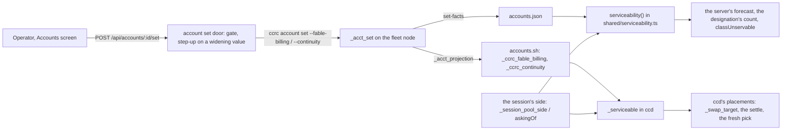
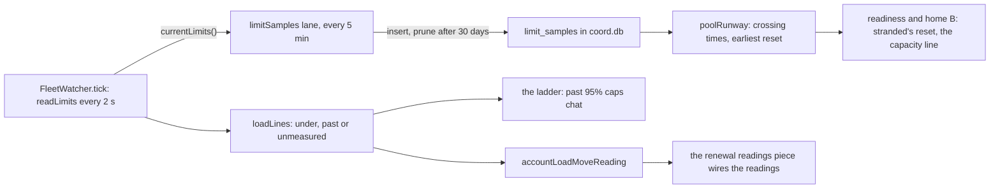

# Overlord W1: serviceability and limits (the account facts, the three inputs, `limit_samples` and `poolRunway`) Implementation Plan

> **For agentic workers:** REQUIRED SUB-SKILL: Use superpowers:subagent-driven-development (recommended) or
> superpowers:executing-plans to implement this plan task-by-task. Steps use checkbox (`- [ ]`) syntax for tracking.

**Goal:** the one serviceability answer learns who is asking. For a session whose pool side is a set (the Overlord, and
later the replay body), it reads two new roster facts the operator sets: each account's **billing fact** (does Fable on
this account bill usage credits) and each lane's **continuity record** (has the operator recorded that this lane keeps
the Overlord's guards and hooks). Fable on an account that bills credits, or whose billing fact nobody set, is unservable
for it, and no class serves it on a lane without a continuity record. Both twins, `shared/serviceability.ts` and ccd's
`_serviceable`, answer the same way over one fixture table. The operator sets both facts from the existing account
`set` door. Then the server keeps a history of each account's limits, `limit_samples`, and one L1 decider,
`poolRunway`, answers when a pool runs out. Three load lines (70%, 85% and 95%) are read off the Overlord's accounts,
and the 95% line becomes the ladder's cause row that caps the rung at `chat`.

**Why:** H16 makes the serviceability answer the one owner of "may this lane run this class now", and the Overlord's
answer differs from every other session's on the same lane: Fable billed to credits is spend (O2), and a lane nobody
has checked may not carry its reads (H16, continued). C57 moves the Overlord before a limit bites, which needs a load
history and a runway, and §6.8's 95% line stops everything but chat (Table 7.5a). Readiness reads `stranded`'s earliest
reset from `poolRunway` (C57), and the renewal readings take two readings from this piece.

**Architecture:** L0: the account facts' vocabulary in a new `shared/accountFacts.ts`, and the load lines with the
runway's wire words in a new `shared/loadLines.ts`. The roster (`shared/roster.ts`, its bare-Node mirror and the
`accounts.sh` generator) carries the two facts. The serviceability answer widens in L0 and in bash. L1: `poolRunway`
in a new `server/src/poolRunway.ts`, and the load lines' reading with the two renewal readings in a new
`server/src/accountLoad.ts`. L3: `limit_samples` in `coord.db` behind a new `server/src/coord/limitSamplesStore.ts`.
L4: the sampler, `server/src/limitSampler.ts`, on a new `LANE_SCHEDULE` row, fed by the reading the watcher already
takes each tick. The door is today's `POST /api/accounts/:id/set`, widened. Two pull requests.

**Tech Stack:** TypeScript (ESM), bash (ccd), `node:sqlite`, Fastify, vitest.

**Spec:** `docs/superpowers/specs/2026-11-09-overlord-design.md` §3.4: H16 ("One answer", "Four more inputs", "Fable
is judged as for any session", "Unmeasured keeps the current class", "The return waits, and ccd owns the hold-down")
and "H16, continued. A lane serves the Overlord only with a continuity record"; C46 ("The asking session's id … by the
route record the server wrote on their rows"); C56 ("Fable on its accounts is shared", Table 3.4a); C57 ("A history
of limits", "When everything is limited", Table 3.4b); §6.8 ("The load lines", Table 6.8a); §7.5, Table 7.5a's row "the
Overlord's accounts past the 95% load line"; Table 11.1a's rows `limit_samples` and "A billing fact per account, and a
continuity record per lane"; Table 11.1b's row "`shared/serviceability.ts` with four more inputs … `poolRunway`";
Table 11.5b's load-line rows; Table 13.1's H16 (`tightening`, W1). The W1 index is
`docs/superpowers/plans/2026-11-14-overlord-w1.md` (row "Serviceability and limits", lane A). This plan builds on the
index's questions 7, 8, 20 and 34, and on the ccd arms plan's question 3 (ruled).

Written against `main` at `4fda398e4` (2026-11-15).

## Open questions

The first four are rulings this plan builds on. Each other question is open with a recommendation, which this plan
builds unless the coordinator rules otherwise.

1. **Three new inputs, not four (ruled; slug `three-inputs-not-four`).** H16, Table 11.1a, Table 11.1b and Appendix B
   list four: the billing fact, the hold-down, the continuity record and the asking session's id. The hold-down is
   ccd's alone, decided at the settle (the ccd arms plan's question 3, ruled for its PR B). So this piece adds three,
   and neither twin carries a hold-down. The H16 and Appendix B fix goes to the operator through the spec-fixes run.
   This plan depends on that ruling and names it in PR A's body.
2. **The asking session's id is threaded into `_serviceable` and `_class_gate` (ruled).** The ccd arms' fresh pick and
   settle (its PRs C1 and C2) call `_class_gate` with the id. This piece owns that seam: PR A adds the optional third
   argument to both functions and passes it at every caller that holds a session id today. The ccd arms' calls pass
   it when they land.
3. **ccd is the authority for placement (ruled).** The server forecasts and refuses with the TypeScript twin and never
   places. Nothing in this piece writes a route, a marker or a registry file.
4. **The account facts are set from Settings (index question 34, ruled).** Their writer is "the operator, from
   Settings" (Table 11.1a). This piece ships the server door and widens `ACCOUNT_KEYS`. Home PR C ships the PWA row.
   A hand edit of `accounts.json` is no W1 path.
5. **What the asking session's id selects** (slug `set-side-selects-the-overlord-arms`). H16 says the answer "knows
   those two by the route record the server wrote on their rows (C46)". The route record that marks them is the set:
   the designation writes `poolset` on the Overlord's row, and the replay lane writes the Overlord's set on the replay
   body's (Table 11.1c). **Recommendation:** the strict arms apply when the session's side, read by the one reader of a
   session's side, is a set or an undecidable set. In bash that is `ccd/lib/pool-set.sh#_session_pool_side` answering
   `set <spelling>`, `set-unreadable` or `set-malformed`; in TypeScript, `askingOf(side)` over the same
   `SessionPoolSide`. No role list and no new projected column: a list of role names in ccd would be a second
   definition of the roles, and a projected column would read as absent on a box whose `launch-profiles.json` is
   older, which would drop the strict arms from the Overlord. Every project word, `unreadable` included, reads as not a
   set. An unsearchable `$REG` also answers `unreadable`, and there the pool rule already refuses every placement, so
   nothing is placed either way.
6. **What an unset or unread fact answers** (slug `unread-facts-refuse-with-their-own-words`). The spec says "an account
   with no billing fact reads as billing Fable to credits" (H16), and W0b recorded the same conservative branch ("an
   account whose billing fact is unread is treated as if credits were on"). It says "a lane without one never serves
   the Overlord" for the continuity record. **Recommendation:** for a set-side asker these refuse, the fail-closed
   direction, and each keeps its own word so the remedy stays visible: `credits` (the fact says credits),
   `billing-unset` (the roster has no fact), `billing-unread` (this box's `accounts.sh` predates the fact), and
   `no-continuity` or `continuity-unread`. None of them is `unmeasured`: an absent record is the fact "no record", and
   reading it as unmeasured would keep the Overlord on a lane nobody checked, because an unmeasured lane stays eligible
   at every placement path.
7. **What the settle does on a lane with no continuity record** (slug `continuity-refusal-degrades-nothing`).
   `ccd/ccd#_spawn_start`'s settle answers an unservable class by stamping the class one rung down. With no continuity
   record no rung serves, so a stamp would claim a fallback that does not exist. **Recommendation:** on `no-continuity`
   or `continuity-unread` the settle stamps nothing, composes the intended class, and writes one `swap.log` line,
   `continuity-unmet <id>: <lane>`, as the ladder's bottom rung does today. The renewal lane's `classUnservable`
   reading (Task 7) then reads the generation unservable, a hard trigger, and the next fresh start's pick leaves the
   lane. Every planned placement already skips the lane, because `_class_gate` answers 1 there.
8. **Where the server door is** (slug `facts-ride-the-account-set-door`). The index asks for a Settings server door.
   `POST /api/accounts/:id/set` (`server/src/accounts/routes.ts`) is already the operator's door for one account's
   settings, behind the account gate, and `ccrc account set` is already its verb. **Recommendation:** widen that door
   with two body keys, `fableBilling` and `continuity`, and the verb with two flags, rather than open a second door for
   the same account (CLAUDE.md, "Consolidate, don't duplicate"). No route is added, so no door census moves. The
   step-up applies whenever the body names a widening value (`fableBilling: 'included'` or `continuity: 'on'`), whatever
   the stored value, so the door never compares against a roster mirror that may lag the fleet box's file. Narrowing
   needs none (Table 11.1d's rule for settings: "behind the step-up where the change widens authority").
9. **The facts' spellings** (slug `account-fact-spellings`). **Recommendation:** `fableBilling`, `"included"` (Fable
   runs inside the plan's limits) or `"credits"` (Fable bills usage credits), absent when nobody set it; and
   `continuity`, `{"recordedAt": <epoch seconds>}` when the operator recorded the lane, absent otherwise. The record's
   time is written by the verb's own clock when the operator sets it, so the console can show how old a record is. An
   explicit `null` in the file is refused, as `pool`'s is.
10. **Whether this piece lands before pool set B** (slug `serviceability-a-before-pool-set-b`). Table 11.1a says an
    older ccd ignores the fields. A designation needs `pool-set`, which pool set B adds last. **Recommendation:** PR A
    merges before pool set B, so every ccd that advertises `pool-set` also carries the strict arms, and no new
    capability word is needed. If the coordinator prefers to land pool set B first, the gap is a fleet box whose ccd
    places the Overlord without the two facts until its next update, and the designation's own count (which reads the
    TypeScript twin) still refuses a set with fewer than two recorded lanes.
11. **The load lines live in one constants module (index question 7).** **Recommendation:** `shared/loadLines.ts` holds
    70, 85 and 95 as starting values, beside the freshness bound and the runway's bounds. The spec-fixes run adds the
    95% row to Table 11.5b (70% and 85% are there already, from the W1 index's `load-lines-are-starting-values`).
12. **The sampler's cadence, retention and reader (index question 8).** Measured (What exists today): the watcher reads
    every account's limits once a tick, every 2 seconds, and publishes the reading as `currentLimits()`. A reading
    changes whenever a session on that account renders its statusline, and an idle account's reading is refreshed by
    the telemetry keepalive at most every 30 minutes. **Recommendation:** the sampler is a `LANE_SCHEDULE` row,
    `limitSamples`, every 5 minutes, writing the tick's published reading. It adds no read of its own. It writes one
    row per account per new reading time, so an idle account adds no rows, and keeps rows 30 days. That is at most 288
    rows an account a day.
13. **How old a reading may be** (slug `load-reading-fresh-for-an-hour`). Today a five-hour reading counts until its
    own reset passes, or until it is 18,000 seconds old (`server/src/limits.ts#readLimits`), so a reading nearly five
    hours old still reads as the account's load. ccd's pick keeps that rule (the ccd arms plan, "What the decider
    reads, and how old"). **Recommendation:** the server's load lines and `poolRunway` bound it. A reading older than
    `LOAD_FRESH_S`, one hour, is unmeasured for them. One hour is longer than the keepalive's 30-minute window plus its
    15-minute timer, so on a box that runs the keepalive every account stays measured, and a test pins that relation.
    The bound changes no placement: ccd's readers are untouched, and a maximum age for them stays the ccd arms plan's
    "Later" item.
14. **A load line never folds an unmeasured account into a value** (slug `under-is-proven-past-needs-all`). §6.8
    measures a line "on the least-loaded account that can serve the Overlord now". **Recommendation:** "under the line"
    is proven by any one candidate with a fresh reading under it. "Past the line" needs every candidate measured and
    fresh, because an unmeasured account might be the least loaded. Otherwise the line reads unmeasured, which §6.8
    says stops item holds (W3) and caps no rung.
15. **What `poolRunway` answers** (slug `runway-is-a-line-crossing`). C57: "a time, 'not before reset', or
    unmeasured", and "either line may also read 'projected past the line before the next renewal'". **Recommendation:**
    one rule answers both. For a line, the pool crosses it when its last account does, and an account crosses when its
    first window does, projected on a straight line from the window's samples. Running out is crossing the ceiling
    (`SEVEN_DAY_CEILING_PCT`, 98, the figure placement already refuses at). The decider answers a crossing time per
    line and for the ceiling, and the caller compares a line's time with the next renewal it knows. It also answers the
    earliest reset at which an exhausted account regains headroom, which `stranded`'s item names.
16. **Where `classUnservable` comes from** (slug `class-unservable-from-the-server-twin`). Table 3.4b says "ccd's
    serviceability answer, asked by the renewal lane on each sweep". **Recommendation:** the renewal lane asks the
    TypeScript twin over the tick's readings, which the shared fixture table holds equal to ccd's answer, and no new
    ccd read is added. `ccd pool-answer` stays the pool set's one read verb.
17. **`fable` judged lane by lane** (slug `fable-lane-by-lane-waits-for-the-listing`). H16 changes "`fable` is
    unservable on every lane that is not an Anthropic backend" to "unservable on a lane whose registry has no `fable`
    slot". In W1 no lane outside Anthropic can serve the Overlord: the operator's listing of another provider's lane
    (C56) does not exist yet, and the fresh pick admits Anthropic lanes only (`_fresh_pick_ok`, the ccd arms plan).
    **Recommendation:** not in this piece. The piece that adds the operator's listing changes the `backend` arm in both
    twins, with its fixture rows. Until then the `backend` word keeps every non-Anthropic lane off Fable, which is the
    narrower answer.
18. **The shared Fable test (C46's open question for W1).** C46 leaves to W1 whether W0-24 still informs the shared
    Fable test. **Recommendation:** no change. `FABLE_SHARE_CEILING_PCT` stays 40 and the test stays the same for every
    session (H16, "Fable is judged as for any session"). The sweep found no priced Fable use on any account (W0b), so
    there is nothing yet to calibrate it against.

## What exists today

Measured on `main` at `4fda398e4`.

- **The serviceability answer.** `shared/serviceability.ts#serviceability(cls, lane, nowS)` answers `skipped`
  (`default`), `servable` with the figure, `unservable` (`ceiling` with the figure, or `backend`) or `unmeasured`
  (`no-figure`, `stale`). `LaneFacts` is `{ anthropic, seven, share }`. It imports only `shared/models.ts`. Its bash
  twin is `ccd/ccd#_serviceable` (`wrapper class`, rc 0 servable, 1 unservable, 2 unmeasured, 3 skipped, and the word
  or figure on stdout), with `ccd/ccd#_class_gate` folding `skipped` into 0 and `ccd/ccd#_share_pct` reading the
  sweep. One fixture table, `server/test/fixtures/serviceability.ts#SERVICEABILITY_CASES`, drives both through
  `server/test/serviceability.test.ts` and `server/test/ccd-serviceable.test.ts`, whose lanes are the fixture roster's
  `claude` (Anthropic) and `gpt` (codex).
- **Its callers.** TypeScript: one, `server/src/limits.ts#projectHome`, which filters out a lane measured
  `unservable`; `projectPlacement` composes it. `server/test/projected-home.test.ts` drives it against
  `_ws_least_loaded` over `server/test/fixtures/leastLoaded.ts`. Bash, by function:
  - with a session id in hand: `_swap_target` (five `_class_gate` calls; `$1` is the id), `_affinity_cur_serves`
    (`$1`), and `_spawn_start`'s settle (`_serviceable "$wrapper" "$rclass"`, with `$id` in scope);
  - with no session: `_ws_least_loaded`, `_ws_lane_why` and `_place_for_class`, which place a workspace by project and
    class. Table 3.4d leaves them unchanged: they are not the Overlord's placer.
- **The settle.** `_spawn_start`'s `case "$srv"` restores a degraded class on rc 0 and on rc 1 stamps the class one
  rung down through `_route_degrade`, reading the word `_serviceable` printed. At `haiku` nothing is stamped.
- **The session's side.** `ccd/lib/pool-set.sh#_session_pool_side id [project]` (pool set A2, merged) is the one
  reader of a session's pool side. With a project argument passed, even an empty one, it reads no registry field
  beyond the `poolset` entry. `shared/poolrule.ts#SessionPoolSide` is its TypeScript type.
- **The roster.** `shared/roster.ts#AccountDef` carries `id`, `label`, `configDirSuffix`, `exec`, `homeAble`, `hue`,
  `telemetry`, `hidden` and `pool`. `ACCOUNT_KEYS` (not exported) names them for `warnUnknownKeys`, which warns and
  never fails. `pool` is required on the type, `null` when absent, and a written `null` is refused. The bare-Node
  mirror is `shared/roster-json.mjs`, held equal by `server/test/roster-exec-parity.test.ts`, and the README's
  roster-mirror table is pinned cell by cell by `server/test/readme-roster-mirror.test.ts` against both files and
  `server/test/gen-accounts.test.ts`'s cases. `shared/generate.mjs` writes `~/.ccrc/accounts.sh`, and emits
  `_ccrc_pool` always, so `declare -F _ccrc_pool` tells ccd whether the box's projection knows pools. The browser's
  copy is `shared/api.ts#RosterWire`, which `extends RosterKindWire`; its builder is `GET /api/accounts`'s roster in
  `server/src/server.ts`.
- **The account set door.** `POST /api/accounts/:id/set` (`server/src/accounts/routes.ts`) takes the account gate with
  `cap` and no step-up, accepts the body keys `stated` and `placement` (`onlyKeys`), writes one account audit row, and
  runs `ccrc account set` through the `AccountOps` port (`server/src/accounts/ops.ts`): on the fleet node through the
  agent's `account` op in remote mode, locally otherwise. `shared/account-argv.ts#buildAccountArgv` bounds each field
  for both arms (`set`'s fields today: `placement`, `limit`, `limitReset`). `ccd/ccrc#_acct_set` parses the flags,
  takes `_acct_lane_lock`, writes through `deploy/account-op.mjs` (`opSetPlacement`, op `set-placement`) and then
  `_acct_projection`, which regenerates `accounts.sh`. `ccrc account set` is already one of the subs no session may
  run (`shared/api.ts#ACCOUNT_DENY_RULES`, CLAUDE.md "Account management is never a session's").
- **Limits.** `server/src/limits.ts#readLimits` reads every `~/.cc-limits/<id>.json`. A window whose reset passed, or
  a reading older than its window (18,000 s and 604,800 s), is rolled over: its figure reads 0 with the flag set.
  `measured()` is the larger of the two windows, `null` unless both are measured and neither rolled (a lane with no
  five-hour window, `fiveWindowMinutes: 0`, ranks on its weekly figure). `FleetWatcher.tick` (`server/src/watch.ts`)
  calls `readLimits` once a tick over the tick's own listing and publishes it as `currentLimits()`. The watcher's
  interval is 2,000 ms (`FleetWatcher`'s constructor).
- **How old a reading is.** The only writer of a limits file is `ccd/statusline-command.sh`, at each render of a
  session on that account. An idle account is refreshed by `ccd/ccd-telemetry-keepalive`, which takes one turn on an
  account that has not reported for `CCRC_KEEPALIVE_FRESH` (1,800 s) on a 15-minute timer
  (`deploy/systemd/ccd-telemetry-keepalive.timer`), on a box that installs it. ccd's own pre-emptive freshness is
  `SWAP_FRESH=1800`.
- **The renewal inputs.** `server/src/continuity/renewalDue.ts#RenewalInputs` declares `classUnservable` and
  `accountLoadMove` as `Reading<boolean>`, and `server/src/continuity/generationsLane.ts#renewalInputsOf` answers both
  `W1` ("later") today. The renewal readings piece wires them.
- **No history of limits.** No `limit_samples` table, sampler, `poolRunway` or load line exists in the tree
  (`git grep` for each).
- **Censuses a new table, lane or decider touches.** `MUTANT_SETS` in `server/test/sim/mutation-floors.test.ts` with
  `server/test/sim/mutation-floors.json` (one `*Sets.ts` file per piece, such as `poolSetSets.ts`); `LANE_SCHEDULE`
  and `LaneName` in `server/src/laneSchedule.ts`, pinned by `server/test/lane-schedule.test.ts`, with
  `server/test/laneQuiet.ts` and `server/test/watcher-quiet-census.test.ts`; `TABLES` in
  `server/test/single-definition/writers-map.test.ts`; `TIME_PORT_FILES` in
  `server/test/single-definition/time-ports.test.ts`; `server/src/coord/ports.ts#WatcherCoordMember` with
  `server/test/rings/watcher-store-port.data.ts`; the C1 row of the architecture spec's path table
  (`docs/superpowers/specs/2026-08-10-architecture-ddd-clean-solid.md`), which lists `limits.ts` and `pools.ts` by name;
  and for a migration, `server/test/run-close-switch.test.ts` and `server/test/coord-db.test.ts`.
- **Growth.** `server/test/growthCheck.ts#GROWTH_FILES` holds `ccd/ccd`, `ccd/ccrc`, `deploy/account-op.mjs`,
  `server/src/watch.ts`, `server/src/coord/store.ts`, `server/src/coord/schema.ts`, `server/src/server.ts` and
  `shared/api.ts` among others, at 40 net lines a pull request. `shared/roster.ts`, `shared/generate.mjs`,
  `server/src/accounts/routes.ts` and `server/src/limits.ts` are not listed.

## Global Constraints

- **Architecture (`CLAUDE.md`).** Decide in L1, act in L4. `serviceability`, `askingOf`, `factsChangeWidens`,
  `poolRunway`, `loadLines`, `classUnservableReading` and `accountLoadMoveReading` are pure. The door, the sampler and
  the ladder's assembly gather facts and act on the answer. No L1 module imports an adapter or a lane.
- **One writer per fact.**
  - The billing fact and the continuity record: `deploy/account-op.mjs`'s new `set-facts` op, reached only through
    `ccrc account set`, reached from the console only through the account set door. `accounts.sh`'s two new functions
    are a projection with one writer, the generator.
  - `limit_samples`: the sampler, through `limitSamplesStore.ts`'s insert and prune. `writers-map.test.ts` names both.
  - The hold-down: ccd's settle, untouched here (question 1).
- **ccd places; the server forecasts.** The TypeScript twin answers the forecast, the designation's count and the
  renewal readings. ccd's answer decides every placement. The fixture table holds them equal.
- **No overloaded null at a seam.** An unset fact, an unread fact and a refusing fact are three words. A load line
  answers `under`, `past` or `unmeasured`, and `poolRunway` answers a time, "not before reset" or `unmeasured`, each
  with the reason. A stale reading is unmeasured, never "under" (question 13).
- **Behaviour for every session that is not a set-side asker is unchanged.** Its answer is byte for byte today's: the
  new arms run only for a set side (question 5), and the new facts are not read otherwise. The fixture table carries
  every existing row unchanged with the asker `other`.
- **No account-name list in shipped source.** Fixtures use neutral lanes (`lane-a`, `lane-b`, `lane-c`) and pools
  (`pool-a`, `pool-b`). The existing fixture rows keep their lanes.
- **Account management stays the operator's.** The new flags ride a sub no session may run. A refused form in
  `account-deny.test.ts` proves the deny matches the new flags too (Task 3).
- **Wire discipline.** `RosterWire` gains two optional fields through a sibling interface. An older server omits them,
  and their one reader (home PR C) reads absence as "not set". `FLEET_PROTO` is not bumped.
- **One concern per file** (the index's `wire-types-in-sibling-modules`). New wire types go in `shared/accountFacts.ts`
  and `shared/loadLines.ts`. `shared/api.ts` gains one import and one `extends` member.
- **Tests.** From `server/`: `ccrc test -- ./node_modules/.bin/vitest run test/<file>.test.ts`. Each task's last run
  adds both `tsc` runs (`ccrc test -- npx tsc --noEmit -p tsconfig.json` and `-p test/tsconfig.tests.json`),
  `test/typecheck-tests.test.ts`, and pwa's `tsc` when `shared/` changed. A task that touches `ccd/ccd` runs
  `test/shellcheck-ratchet.test.ts` and `test/ccd-contexts.test.ts` too.
- **Mutation floors.** Every new L1 decider joins `MUTANT_SETS` through `server/test/sim/serviceabilitySets.ts`
  (PR A) and `server/test/sim/accountLoadSets.ts` (PR B), with its floor in `mutation-floors.json`, in the pull request
  that creates it. Mutants are built with `mutation-run.py`, never by hand.
- **Growth check.** Each pull request states its estimate (The PR split) and the builder measures it before pushing.
- Cite by symbol or `@anchor`. No private names. No D-number invented: the builder's departures go in
  `docs/superpowers/plans/2026-11-14-overlord-w1/w1-serviceability/departures.md`.

## Review Focus

1. **Parity.** Every row of `SERVICEABILITY_CASES`, old and new, answers the same kind and word in both twins, the new
   asker and fact columns included. A new arm in one twin with no row reds the table's coverage check.
2. **Unchanged for everyone else.** No answer changes for an asker that is not a set side. The existing rows pass
   unedited, and `projected-home.test.ts` passes unedited.
3. **Fail closed, never folded.** An unset or unread billing fact refuses Fable for a set side, and an absent or unread
   continuity record refuses every class, each with its own word. A load reading older than `LOAD_FRESH_S`, rolled
   over or absent is unmeasured. A line reads `past` only when every candidate is measured.
4. **The settle never claims a fallback that does not exist.** On `no-continuity` it stamps nothing.
5. **The door steps up on every widening value.** `included` or `on` in the body takes the step-up, whatever is stored.
   A narrowing never needs one. No new door, so no census moves.
6. **One writer each.** The facts are written only by `set-facts`, and `limit_samples` only by the sampler.

## Figures


*Figure 1. PR A: the two facts, their one writer, their two readers, and who reads each twin.*


*Figure 2. PR B: one read a tick, sampled every five minutes, and the four readers of what it measures.*

## The PR split

| PR | Tasks | What it ships | Needs first | Growth-checked files, estimate |
|---|---|---|---|---|
| A, the facts and the three inputs | 1 to 3 | The billing fact and the continuity record in the roster, its mirror, `accounts.sh` and `RosterWire`; the three inputs in both twins, the id threaded to every caller that holds one, and the settle's continuity arm; the widened account set door and verb | pool set A3 merged (`_session_pool_side`, A2, is on `main`). Lands before pool set B (question 10) | `ccd/ccd` about +16 (`_serviceable` +11, `_class_gate` +1, the settle +4, the seven callers rewritten in place); `ccd/ccrc` about +11; `deploy/account-op.mjs` about +24; `shared/api.ts` +2; `server/src/server.ts` +1 |
| B, limits, runway and the 95% line | 4 to 7 | `shared/loadLines.ts`; `poolRunway`, `loadLines` and the two renewal readings; `limit_samples` and its store; the sampler lane; the ladder's 95% cause row | PR A and the ladder merged (and so designation A, for `overlordAccounts` and `designationRead()`) | `server/src/coord/schema.ts` about +18; `server/src/coord/store.ts` about +3; `server/src/watch.ts` about +6 |

No task needs a waiver. If a measurement at build time shows `ccd/ccd` past 40, the settle's arm moves to its own
helper in the same file, and nothing else moves.

**States the next pieces read.** Home PR C reads `RosterWire.fableBilling` and `RosterWire.continuity` and writes
through the widened door. The designation's count reads `serviceability` with the asker `set-side`. The ccd arms' pick
and settle pass the id to `_class_gate`. Readiness reads `poolRunway`'s earliest reset for `stranded`'s item, and home
B reads its crossings for the capacity line. The renewal readings piece wires `classUnservableReading` and
`accountLoadMoveReading` into `renewalInputsOf`.

---

### Task 1: The two facts in the roster, its mirror, `accounts.sh` and the wire (PR A)

**Files:**
- Create: `shared/accountFacts.ts` (L0, C1).
- Modify: `shared/roster.ts` (`AccountDef`, `ACCOUNT_KEYS`, `parseAccount`), `shared/roster-json.mjs` (the same gates),
  `shared/generate.mjs` (two emitted functions), `shared/api.ts` (`RosterWire`), `server/src/server.ts` (the roster
  wire builder), `README.md` (two rows of the roster-mirror table, and the `accounts.sh` function list if it has one).
- Test: `server/test/roster.test.ts`, `server/test/roster-exec-parity.test.ts`, `server/test/gen-accounts.test.ts`,
  `server/test/roster-generate.test.ts`, `server/test/readme-roster-mirror.test.ts`,
  `server/test/accounts-route.test.ts`.

```ts
// shared/accountFacts.ts — L0: imports nothing.
/** H16: does Fable on this account bill usage credits. Absent in the file means nobody set it. */
export const FABLE_BILLINGS = ['included', 'credits'] as const;
export type FableBilling = (typeof FABLE_BILLINGS)[number];
/** H16, continued: the operator recorded that this lane keeps the Overlord's guards, hooks and reader types. */
export interface ContinuityRecord { readonly recordedAt: number }   // epoch seconds, the verb's clock
/** What `RosterWire` carries, both optional: an older server omits them, and absence reads as "not set". */
export interface AccountFactsWire { readonly fableBilling?: FableBilling; readonly continuity?: ContinuityRecord }
/** The door's body: a change to either fact. */
export interface AccountFactsChange { readonly fableBilling?: FableBilling; readonly continuity?: 'on' | 'off' }
/** True when the change names a widening value, whatever is stored (question 8): the door steps up. */
export function factsChangeWidens(c: AccountFactsChange): boolean;
export function accountFactsWireOf(a: { fableBilling: FableBilling | null; continuity: ContinuityRecord | null }):
  AccountFactsWire;
```

- `AccountDef` gains `fableBilling: FableBilling | null` and `continuity: ContinuityRecord | null`, required on the type
  with `null` for absent, as `pool` is. `parseAccount` refuses a written `null`, a word outside `FABLE_BILLINGS`, a
  `continuity` that is not an object with one non-negative integer `recordedAt`, and extra keys in it, each with a
  `RosterError` whose remedy names the field. `roster-json.mjs` makes the same refusals, and the parity suite drives
  both over the same bytes.
- `generate.mjs` emits `_ccrc_fable_billing` (`<id>) echo included ;;` or `credits`) and `_ccrc_continuity`
  (`<id>) echo <recordedAt> ;;`) always, even with no arms, so `declare -F` tells ccd whether this box's projection
  knows the facts, as `_ccrc_pool` does. Only a value the parser admitted is emitted.
- `RosterWire` becomes `extends RosterKindWire, AccountFactsWire`. The builder spreads `accountFactsWireOf(a)`.
- [ ] **Step 1: Failing tests.**
  - `roster.test.ts`: a roster with neither field parses with both `null`; each refusal above; the two keys raise no
    unknown-key warning; `fableBilling: "credits"` and a record parse.
  - `roster-exec-parity.test.ts`: every new refusal is refused by both parsers, every accepted row accepted by both.
  - `gen-accounts.test.ts` and `roster-generate.test.ts`: the two functions are emitted with no arms for a roster with
    no facts, and with one arm per account that has one; `bash -n` passes; sourcing it answers the values.
  - `readme-roster-mirror.test.ts`: the two new table rows resolve in all three files.
  - `accounts-route.test.ts`: `GET /api/accounts`'s roster carries the two fields for an account that has them, and
    omits both for one that has neither.
- [ ] **Step 2: Run.** Red. **Step 3: Implement.** **Step 4: Run** the suites above, the pwa suite's roster readers
  (`pwa/test/accounts*.test.tsx`), and the `tsc` runs. Green.
- [ ] **Step 5: Mutation.** Let the parser accept a written `null`: the refusal case goes red. Drop the
  always-emitted empty function: the `declare -F` case goes red. Mutants of `factsChangeWidens` join
  `serviceabilitySets.ts` in Task 2.
- [ ] **Step 6: Commit.** `feat(roster): each account's billing fact and continuity record, in the roster, its mirror, accounts.sh and the wire (H16)`

### Task 2: The three inputs, in both twins and at every caller (PR A)

**Files:**
- Modify: `shared/serviceability.ts`, `server/src/limits.ts#projectHome` (one call), `ccd/ccd` (`_serviceable`,
  `_class_gate`, `_swap_target`, `_affinity_cur_serves`, `_spawn_start`).
- Modify: `server/test/fixtures/serviceability.ts` (two columns and the new rows), `server/test/serviceability.test.ts`,
  `server/test/ccd-serviceable.test.ts` (the harness writes the case's `poolset` entry and an `accounts.sh` built from
  the case's facts), `server/test/ccd-route-degrade.test.ts` (the settle's new arm), `server/test/ccd-swap-target-class.test.ts`
  (the id reaches the gate; the builder adds any other suite `git grep _swap_target server/test` names).
- Create: `server/test/sim/serviceabilitySets.ts`; modify `server/test/sim/mutation-floors.test.ts` and
  `mutation-floors.json`.

```ts
// shared/serviceability.ts, the widening. It imports only sibling `shared/` modules, as today.
/** Whose question (question 5): a session whose side is a set, or an undecidable set, gets the Overlord's arms. */
export type Asking = 'set-side' | 'other';
export function askingOf(side: SessionPoolSide): Asking;   // set, set-unreadable, set-malformed -> 'set-side'
export interface LaneFacts {
  anthropic: boolean;
  seven: number | null;
  share: ShareReading | null;
  /** The roster's fact, or `unset` (no fact), or `unread` (a projection that predates the fact: bash only). */
  fableBilling: FableBilling | 'unset' | 'unread';
  continuity: 'recorded' | 'none' | 'unread';
}
export type Serviceability =
  | { kind: 'skipped' }
  | { kind: 'servable'; figurePct: number }
  | { kind: 'unservable'; why: 'ceiling'; figurePct: number; ceilingPct: number }
  | { kind: 'unservable'; why: 'backend' | 'credits' | 'billing-unset' | 'billing-unread'
      | 'no-continuity' | 'continuity-unread' }
  | { kind: 'unmeasured'; why: 'no-figure' | 'stale' };
export function serviceability(cls: ModelClass | 'default', lane: LaneFacts, asking: Asking, nowS: number):
  Serviceability;
```

The order, first match wins: `default` is `skipped` (unchanged: the Overlord's route always names `fable` or `opus`,
which are the only classes the designation records); for a `set-side` asker, a continuity record that is not
`recorded` refuses every class (`no-continuity`, `continuity-unread`); `fable` on a non-Anthropic lane is `backend`
(unchanged); for a `set-side` asker, `fable` with a billing fact other than `included` is `credits`, `billing-unset` or
`billing-unread`; then today's share and seven-day tests, unchanged. `asking` is required, so every TypeScript caller
says which it means. `projectHome` passes `'other'` and the lane's facts through one helper beside it, so its answer
does not change. The designation's count passes `'set-side'` (What the index should change).

```bash
_serviceable() {   # wrapper class [id] -> as today; with an id whose side is a set, the Overlord's arms too
  # local side=""; [[ -n "${3:-}" ]] && side=$(_session_pool_side "$3" "")   # "" for the project: no registry read
  # case "$side" in "set "*|set-unreadable|set-malformed) strict=1 ;; esac   # question 5
  # after the default/empty fold:
  #   strict: declare -F _ccrc_continuity || { printf 'continuity-unread'; return 1; }
  #           [[ -n "$(_ccrc_continuity "$w")" ]] || { printf 'no-continuity'; return 1; }
  # in the fable arm, after the backend test:
  #   strict: declare -F _ccrc_fable_billing || { printf 'billing-unread'; return 1; }
  #           case "$(_ccrc_fable_billing "$w")" in included) ;; credits) printf 'credits'; return 1 ;;
  #             *) printf 'billing-unset'; return 1 ;; esac
}
_class_gate() {    # wrapper class [id] -> as today, passing the id through
}
```

- The seven callers that hold an id pass it: `_swap_target`'s five `_class_gate` calls (`"$1"`),
  `_affinity_cur_serves` (`"$1"`) and the settle (`"$id"`). The three without a session pass none.
- The settle (question 7): in `_spawn_start`'s rc 1 arm, a word of `no-continuity` or `continuity-unread` stamps
  nothing and writes `continuity-unmet <id>: <wrapper> (<word>)` to `swap.log`. Every other word keeps today's arm.
- `ccd/contexts.tsv` is unchanged: no function is added.
- [ ] **Step 1: Failing tests.** New fixture columns `asking` (`other` by default, so every existing row is unedited)
  and `facts` (`fableBilling`, `continuity`, or `projection: 'old'` for an `accounts.sh` without the two functions).
  New rows, each in both twins:
  - `set-side`, `fable`, billing `included`, recorded, share 39: `servable` 39;
  - `set-side`, `fable`, billing `credits`: `unservable credits`; unset: `billing-unset`; old projection:
    `billing-unread`;
  - `set-side`, `opus`, billing `credits`, recorded, seven 50: `servable` 50 (billing is Fable's alone);
  - `set-side`, `opus` and `fable`, no record: `no-continuity`; old projection: `continuity-unread`;
  - `set-side` on `set-malformed` and `set-unreadable` sides: the strict arms (question 5);
  - `other`, `fable`, billing `credits`, no record, share 39: `servable` 39 (unchanged for everyone else);
  - `set-side`, `default`: `skipped`;
  - `set-side`, `fable` on the codex lane: `backend`, before billing.
  
  The table's coverage check: every `why` word of `Serviceability` appears in at least one row.
  Callers: `_swap_target` with a set-side session skips a candidate with no continuity record and picks the next;
  `_affinity_cur_serves` answers 1 on a lane that bills credits for a set-side `fable` session; the settle on a
  no-continuity lane composes the intended class, writes no `degraded` stamp and one `continuity-unmet` line; the
  settle for a plain session on the same lane composes as today.
- [ ] **Step 2: Run.** Red. **Step 3: Implement**, the TypeScript twin first, then bash, then the callers, then the
  settle, each its own commit. **Step 4: Run** the suites above, `projected-home.test.ts` (unedited),
  `ccd-pool-ok.test.ts`, `ccd-swap*.test.ts`, the ratchet and contexts suites, and the `tsc` runs. Green.
- [ ] **Step 5: Mutation.** `serviceabilitySets.ts` mutates the order (billing before backend; continuity after the
  `default` fold for `other`), each new word, `askingOf`'s three set arms and `factsChangeWidens`; every mutant must
  red a table row. In bash: drop the third argument at one `_swap_target` call: the candidate case goes red. Let the
  settle stamp on `no-continuity`: its case goes red.
- [ ] **Step 6: Commit.** `feat(serviceability): the billing fact, the continuity record and the asking session's side, in both twins (H16)`,
  then `feat(ccd): thread the asking session's id to every serviceability caller that holds one (H16)`, then
  `feat(ccd): the settle stamps no fallback on a lane with no continuity record (H16)`.

### Task 3: The account set door and verb learn the two facts (PR A)

**Files:**
- Modify: `server/src/accounts/routes.ts` (`POST /api/accounts/:id/set`), `shared/account-argv.ts` (`set`'s fields),
  `ccd/ccrc#_acct_set`, `deploy/account-op.mjs` (`opSetFacts`, its ops-table row `set-facts`).
- Test: `server/test/ccrc-account-set.test.ts`, `server/test/accounts-route.test.ts` (or a new
  `accounts-set-facts-route.test.ts` if the file is crowded), `server/test/account-op-set-facts.test.ts` (new, beside
  `account-op-set-placement.test.ts`), `server/test/account-op-twins.test.ts`, the `buildAccountArgv` suite, and
  `server/test/account-deny.test.ts` (one refused form with the new flags).

The door:
1. Takes the account gate with `cap` and no step-up, as today, and reads the body. `onlyKeys` admits `stated`,
   `placement`, `fableBilling` and `continuity`, and at least one must be present. `fableBilling` must be a word of
   `FABLE_BILLINGS` and `continuity` `on` or `off`, else `bad-request` with one audit row.
2. When `factsChangeWidens(body)`, takes the gate again with `stepUp: true`, as remove does.
3. Passes `fableBilling` and `continuity` as op fields. The verb writes `stated`, then `placement`, then the facts,
   each under the lane lock, and reports what it wrote.
4. Answers `AccountSwitchAnswer` as today, whose roster now carries the facts.

The verb: `ccrc account set --id <id> --fable-billing included|credits --continuity on|off`, either flag alone or
beside the others. `set-facts` reads the roster under the lane lock, writes `fableBilling`, writes `continuity` as
`{"recordedAt": <now>}` on `on` and removes it on `off`, checks the result with `rosterAdmits`, and writes once. Then
`_acct_projection` regenerates `accounts.sh`. An unchanged value writes nothing and still regenerates nothing. The
usage line and the `unknown-argument` sentence name the two flags.

Failure contracts: an older fleet node's `ccrc` refuses the flags `unknown-argument`, and the door relays the refusal
as it relays any verb's, having written nothing. An older agent's `buildAccountArgv` refuses the field before any
spawn, the same way. A timeout answers `outcome-unknown`, as every account act does.

- [ ] **Step 1: Failing tests.**
  - Door: `{fableBilling:'credits'}` and `{continuity:'off'}` pass without a step-up; `{fableBilling:'included'}` and
    `{continuity:'on'}` need one, also when the stored value is already that; a word outside the vocabulary is
    `bad-request` with one audit row and no op; the four keys together run one op; the answer's roster carries the new
    values.
  - Verb: each flag writes its field; `off` removes the key; `on` writes a `recordedAt` from the fixture clock; a bad
    value refuses `bad-value` and writes nothing; an unknown flag still refuses `unknown-argument`; `accounts.sh` is
    regenerated and answers the new value; a second `set` with the same value changes no byte of the roster.
  - The deny: `ccrc account set --id lane-a --continuity on` is refused on a session's prompt.
- [ ] **Step 2: Run.** Red. **Step 3: Implement.** **Step 4: Run** the suites above, `account-op-set-placement.test.ts`,
  `accounts-route-lanes.test.ts`, `account-ops.test.ts`, `auth-gate.test.ts` (unchanged: no route added) and the `tsc`
  runs. Green.
- [ ] **Step 5: Mutation.** Skip the second gate: the widening cases go red. Compare against the stored value instead
  of the body: the already-included case goes red. Let `off` write `null`: the parser case goes red.
- [ ] **Step 6: Commit.** `feat(accounts): the operator sets an account's billing fact and continuity record from its set door (H16, index question 34)`

**PR A ends here.** Its body says: three inputs, not four (question 1, the ccd arms' ruling); the strict arms reach
only a set-side asker, and no set exists until the designation writes one, so nothing a running session sees changes;
and the settle's new arm. It asks the coordinator to land it before pool set B (question 10).

---

### Task 4: The load lines, `poolRunway` and the load readings (L0, L1; PR B)

**Files:**
- Create: `shared/loadLines.ts` (L0, C1), `server/src/poolRunway.ts` (L1, C1), `server/src/accountLoad.ts` (L1, C1).
- Modify: the architecture spec's C1 row (`poolRunway.ts`, `accountLoad.ts`, `limitSampler.ts`,
  `coord/limitSamples*.ts`).
- Test: `server/test/pool-runway.test.ts`, `server/test/account-load.test.ts` (new); `server/test/sim/accountLoadSets.ts`
  (new), `mutation-floors.test.ts`, `mutation-floors.json`.

```ts
// shared/loadLines.ts — L0: imports nothing. Starting values (index question 7; Table 6.8a, Table 11.5b).
export const LOAD_LINE_PCT = { soft: 70, hard: 85, chat: 95 } as const;
export type LoadLine = keyof typeof LOAD_LINE_PCT;
/** A reading older than this is unmeasured for the server's lines and runway (question 13). */
export const LOAD_FRESH_S = 3_600;
/** The sampler's beat and what it keeps (index question 8). */
export const LIMIT_SAMPLE_MS = 5 * 60_000;
export const LIMIT_SAMPLES_KEEP_S = 30 * 86_400;
/** The runway's fit: samples of the current window inside this span, and at least this much time between them. */
export const RUNWAY_FIT_S = { five: 7_200, seven: 86_400 } as const;
export const RUNWAY_MIN_SPAN_S = 900;

export type Crossing =
  | { readonly kind: 'at'; readonly atS: number }                  // atS <= now: already past
  | { readonly kind: 'not-before-reset'; readonly resetS: number }
  | { readonly kind: 'unmeasured'; readonly why: 'no-sample' | 'stale' | 'rolled' | 'thin' | 'no-reset' };
export interface PoolRunwayAnswer {
  readonly out: Crossing;                                   // crossing SEVEN_DAY_CEILING_PCT
  readonly lines: Readonly<Record<LoadLine, Crossing>>;
  readonly earliestResetS: number | null;                   // when an exhausted account regains headroom
}
export type LineState =
  | { readonly kind: 'under' }
  | { readonly kind: 'past'; readonly leastPct: number }
  | { readonly kind: 'unmeasured'; readonly why: 'no-candidate' | 'stale' | 'not-designated' };
```

```ts
// server/src/poolRunway.ts — L1.
export interface WindowSample { readonly ts: number; readonly pct: number; readonly resetAt: number | null }
export interface AccountSamples { readonly five: readonly WindowSample[] | 'no-window'; readonly seven: readonly WindowSample[] }
export function windowCrossing(line: number, samples: readonly WindowSample[], fitS: number, nowS: number): Crossing;
export function poolRunway(accounts: readonly AccountSamples[], nowS: number): PoolRunwayAnswer;

// server/src/accountLoad.ts — L1.
export interface Candidate { readonly id: string; readonly limits: AccountLimits | undefined; readonly canServe: boolean | 'unmeasured' }
export function loadLines(cands: readonly Candidate[], nowS: number): Readonly<Record<LoadLine, LineState>>;
export function classUnservableReading(s: Serviceability): Reading<boolean>;
export function accountLoadMoveReading(current: Candidate, others: readonly Candidate[], nowS: number): Reading<boolean>;
export function overlordLoadCandidates(/* the designation, overlordAccounts' list, roster, limits, shares, nowS */):
  readonly Candidate[];
```

The rules, each a test row:
- **A window's crossing.** Samples of the current window only: the same `resetAt`, not rolled over, inside the fit
  span. The newest must be within `LOAD_FRESH_S` (`stale`). At or past the line: `at` the newest sample's time. Fewer
  than two samples, or less than `RUNWAY_MIN_SPAN_S` between the first and the newest: `thin`. A rate at or under
  zero: `not-before-reset`. Otherwise the line is reached at `newest.ts + (line - newest.pct) / rate`; at or after
  `resetAt` that is `not-before-reset`, before it `at`. No `resetAt`: `no-reset`.
- **An account's crossing.** The earlier window's `at`; `not-before-reset` only when every window it has says so (the
  later reset); otherwise `unmeasured` with the first window's reason. `no-window` (a lane with no five-hour window)
  leaves the weekly window alone.
- **A pool's crossing.** `not-before-reset` when any account says so (that account carries the pool to its reset);
  `at` the latest account time when every account is `at`; otherwise `unmeasured`. An empty pool is `unmeasured`
  `no-sample`.
- **The earliest reset.** For each account whose newest fresh sample is at or past the ceiling in a window, the latest
  reset among those windows; the least of these over the pool; `null` when no account is exhausted.
- **A line now** (question 14). A candidate's load is `measured()` (the larger window) from a fresh, unrolled reading.
  A candidate whose `canServe` is `false` is left out. `under` when any candidate with `canServe === true` reads under
  the line; `past` with the least load when every candidate is `true` and fresh and all read at or past it;
  otherwise `unmeasured`.
- **The candidates.** `overlordAccounts`' list (designation A), each with `canServe` from `serviceability(…,
  'set-side', …)` on the designated class or the fallback (`opus`): `true` if either is `servable`, `false` if both
  are `unservable`, else `'unmeasured'`. Disabled or signed-out accounts are `false`. Without a designation, every
  line is `unmeasured` `not-designated`.
- **`classUnservableReading`.** `unservable`: measured `true`; `servable` or `skipped`: measured `false`; `unmeasured`:
  unmeasured with its word.
- **`accountLoadMoveReading`** (C57, Table 3.4b). Measured `true` when the current account is fresh and at or past
  `hard`, and another candidate with `canServe === true` is fresh and under `soft`. Measured `false` when the current
  account is fresh and under `hard`, or when every other candidate is measured and none is under `soft`. Otherwise
  unmeasured. Idleness is the renewal lane's, not this reading's.
- **The pins.** `LOAD_LINE_PCT.soft` equals ccd's `FRESH_PICK_SOFT_PCT`, harvested from `ccd/lib/long-lived.sh` as
  `SEVEN_DAY_CEILING_PCT` is harvested today. That test lands in whichever of this PR and ccd arms PR C1 merges second.
  `LOAD_FRESH_S` is greater than the keepalive's default window plus its timer's `OnUnitActiveSec`, both harvested from
  the tree, so a later change to either reds here.
- [ ] **Step 1: Failing tests** for every rule above, with a fixture clock, including: a stale newest sample; a
  rolled-over window; a window that resets before it would cross; a two-account pool where one account lasts to its
  reset; a lane with no five-hour window; a line with one fresh account under and one stale account (`under`); every
  account fresh and past (`past` with the least); one unmeasured and the rest past (`unmeasured`); no designation.
- [ ] **Step 2: Run.** Red. **Step 3: Implement.** **Step 4: Run** the two suites, `mutation-floors.test.ts` and the
  `tsc` runs. Green.
- [ ] **Step 5: Mutation.** `accountLoadSets.ts` mutates each comparison (`<` for `<=` at the line and at the reset),
  the freshness test, the any-under and all-past quantifiers, the `not-before-reset` carry and the earliest-reset
  minimum. Floors in `mutation-floors.json`.
- [ ] **Step 6: Commit.** `feat(limits): the load lines, poolRunway and the load readings, never folding an unmeasured account (C57, §6.8)`

### Task 5: `limit_samples` and its store (L3; PR B)

**Files:**
- Modify: `server/src/coord/schema.ts` (one migration; its number is taken at build time), `server/src/coord/store.ts`
  (three one-line delegates), `server/src/coord/ports.ts#WatcherCoordMember` (the sampler's two members).
- Create: `server/src/coord/limitSamplesStore.ts` (L3, C1).
- Test: `server/test/limit-samples-store.test.ts` (new), `server/test/coord-db.test.ts`,
  `server/test/run-close-switch.test.ts` (its undo step and count), `server/test/single-definition/writers-map.test.ts`
  (`TABLES` gains `limit_samples`, writers `insertLimitSamples` and `pruneLimitSamples`),
  `server/test/rings/watcher-store-port.data.ts`.

```sql
CREATE TABLE limit_samples (
  account TEXT NOT NULL, ts INTEGER NOT NULL,        -- the reading's own time, from its limits file
  five REAL, seven REAL, five_reset_at INTEGER, seven_reset_at INTEGER,
  five_rolled INTEGER NOT NULL, seven_rolled INTEGER NOT NULL, five_window_minutes INTEGER,
  sampled_at INTEGER NOT NULL,
  PRIMARY KEY (account, ts)
) WITHOUT ROWID;
CREATE INDEX limit_samples_ts ON limit_samples(ts);
```

- `insertLimitSamples(rows, sampledAt)`: `INSERT OR IGNORE`, so one reading is one row however many beats see it.
- `limitSamplesSince(accounts, sinceS)`: rows by account, oldest first.
- `pruneLimitSamples(beforeS)`: deletes rows older than the bound, answering the count.
- A restored older `coord.db` has a gap, which reads as `thin` or `no-sample` until samples accrue. An older server
  ignores the table (Table 11.1a). Rows hold percentages and times, nothing private.
- [ ] **Step 1: Failing tests:** a reading inserted twice is one row; rows read back oldest first and only for the asked
  accounts; prune deletes only older rows; the migration refuses to start a database whose `user_version` is ahead,
  as every migration does; `writers-map` names exactly the two writers.
- [ ] **Step 2: Run.** Red. **Step 3: Implement** in `continuityStore.ts`'s prepared-statement shape. **Step 4: Run**
  the suites above. Before pushing, `git grep` the tree's duration censuses for a new 30-day holder
  (`2_592_000`, `30 * 86_400`) and add `LIMIT_SAMPLES_KEEP_S` to any that lists holders. Green.
- [ ] **Step 5: Mutation.** Drop `OR IGNORE`: the twice case goes red. Prune with `<=` for `<`: the boundary case goes
  red.
- [ ] **Step 6: Commit.** `feat(coord): limit_samples, one row per account reading, kept 30 days (C57)`

### Task 6: The sampler lane (L4; PR B)

**Files:**
- Create: `server/src/limitSampler.ts` (L4, C1).
- Modify: `server/src/laneSchedule.ts` (`LaneName` gains `limitSamples`; one row), `server/src/watch.ts` (one throttled
  call in `tick`, after `readLimits`).
- Test: `server/test/limit-sampler.test.ts` (new), `server/test/lane-schedule.test.ts`,
  `server/test/watcher-quiet-census.test.ts`, `server/test/consolidation-census.test.ts` if it counts lanes.

```ts
// server/src/limitSampler.ts — L4. Reads no clock and no file: the watcher hands it the tick's reading and time.
export function limitSamplePass(store: LimitSampleStore, limits: Readonly<Record<string, AccountLimits>>, nowS: number):
  { readonly inserted: number; readonly pruned: number };
// LANE_SCHEDULE row:
// { name: 'limitSamples', cadenceMs: LIMIT_SAMPLE_MS, derivedFrom: null, clock: 'mono', flight: 'skip',
//   warnKey: 'ccrc-server: the limit sampler failed' }
```

- A row is written for each account whose reading has a `ts`. An account with no reading, or a `disabled` row with no
  telemetry, writes nothing. A rolled-over window is stored with its flag, so the runway can leave it out.
- An unlistable tick has no reading, and the pass does not run. A store that throws is the row's `warnKey`, and the
  next beat tries again. Nothing retries inside a beat.
- Neither module reads a clock, so `TIME_PORT_FILES` does not change. If the builder makes the sampler read one, it
  joins the list in this task.
- [ ] **Step 1: Failing tests:** a pass writes one row per measured account and prunes past the bound; a second pass
  over the same reading writes none; a tick in a harness runs the pass at the lane's cadence and not between; a
  throwing store warns once with the row's sentence; the lane census lists the row, and a test that builds a watcher
  drains it (`laneQuiet.ts`).
- [ ] **Step 2: Run.** Red. **Step 3: Implement.** **Step 4: Run** the suites above and every suite that builds a
  `FleetWatcher` (`git grep -l "new FleetWatcher" server/test`), since a new row must be quiet at their ends. Green.
- [ ] **Step 5: Mutation.** Run the pass on every tick: the cadence case goes red. Drop the `ts` guard: the no-reading
  case goes red.
- [ ] **Step 6: Commit.** `feat(limits): the limit sampler, a lane row beside the tick's one read (C57, index question 8)`

### Task 7: The ladder's 95% cause row, and the readings for the next pieces (PR B)

**Files:**
- Modify: the ladder's condition table and its inputs type (the ladder plan names the module, under
  `server/src/coord/`), and the ladder's assembly of its inputs, where it already reads `designationRead()`.
- Test: the ladder's suite (the ladder plan names it), `server/test/account-load.test.ts`.

The ladder ships the vocabulary, `effectiveRung`, the latch and condition tables and the `degraded` cause, and each
later cause row ships with its input (index question 20). This task adds one condition row, from Table 7.5a: "the
Overlord's accounts past the 95% load line (§6.8) | condition | cap `chat`". Its input is
`loadLines(overlordLoadCandidates(…), nowS).chat`. Only `past` caps the rung. `under` and `unmeasured` cap nothing
(§6.8: "An unmeasured load … caps no rung"). The assembly reads the watcher's `currentLimits()`, the shares read, the
roster and `designationRead()`. A `not-designated` or `unmeasured` designation reads `not-designated`, which caps
nothing. A condition lifts by itself, so the row needs no clear.

This task wires no renewal reading. It exports `classUnservableReading` and `accountLoadMoveReading` for the renewal
readings piece, and `poolRunway` with `limitSamplesSince` for readiness and home B.

- [ ] **Step 1: Failing tests:** with every candidate fresh and past 95, `effectiveRung` is at most `chat` and the
  cause names the row; with one candidate under 95, no cap; with a stale candidate and the rest past, no cap and the
  cause list does not name the row; with no designation, no cap; the row's input is read once per evaluation.
- [ ] **Step 2: Run.** Red. **Step 3: Implement.** **Step 4: Run** the ladder's suites, Task 4's, and the `tsc` runs.
  Green.
- [ ] **Step 5: Mutation.** Let `unmeasured` cap: the stale case goes red. Read the `hard` line for the row: the
  one-under case at 90 goes red.
- [ ] **Step 6: Commit.** `feat(ladder): past the 95% load line caps the rung at chat (Table 7.5a, §6.8)`

**PR B ends here.** Its body says that the sampler is the only behaviour that runs at merge, and that the 95% row
changes nothing until an Overlord exists.

## What a merge arms

- **PR A.** No set exists until the designation writes one, so no session's answer changes. The account set door
  takes two more keys, and an older fleet node refuses them. A box's `accounts.sh` gains two functions at its next
  regeneration (`ccrc update`, or any account act). The settle's new arm runs only for a set-side session.
- **PR B.** The sampler writes rows every five minutes, at most one per account per reading. Nothing reads them until
  readiness and home B land. The 95% row caps nothing until an Overlord exists.
- **Rollback.** Below PR A, an older ccd ignores the facts (Table 11.1a), and an older server ignores the two keys in
  the file (`warnUnknownKeys` warns). Below PR B, an older server ignores `limit_samples`.

## Deviations found

Each entry is a departure from the spec's text that this plan makes, by slug. The coordinator mints numbers.

- **`three-inputs-not-four`** (ruled): H16, Tables 11.1a and 11.1b and Appendix B count four inputs. The hold-down is
  ccd's settle's alone, so serviceability takes three (question 1).
- **`set-side-selects-the-overlord-arms`**: the asking session's id selects the strict arms through the session's pool
  side, not through a role name (question 5).
- **`unread-facts-refuse-with-their-own-words`**: unset and unread facts refuse for a set side, each with its own word,
  never `unmeasured` (question 6).
- **`continuity-refusal-degrades-nothing`**: the settle stamps no rung below on a lane with no continuity record
  (question 7).
- **`facts-ride-the-account-set-door`**: the facts' Settings door is the existing account set door, widened, not a new
  door (question 8).
- **`account-fact-spellings`**: `fableBilling: included|credits` and `continuity: {recordedAt}` (question 9).
- **`load-reading-fresh-for-an-hour`**: the server's lines and runway bound a reading's age at one hour; ccd's
  placement readers keep no bound (question 13).
- **`under-is-proven-past-needs-all`**: §6.8's "least-loaded account" is read without folding an unmeasured account
  (question 14).
- **`runway-is-a-line-crossing`**: `poolRunway` answers crossing times, and its caller compares them with the next
  renewal (question 15).
- **`class-unservable-from-the-server-twin`**: Table 3.4b's "ccd's serviceability answer, asked by the renewal lane" is
  the TypeScript twin over the tick's readings, held equal to ccd's by the fixture table (question 16).
- **`fable-lane-by-lane-waits-for-the-listing`**: H16's lane-by-lane Fable test is deferred to the piece that adds the
  operator's listing of another provider's lane (question 17).
- **`ninety-five-line-is-a-starting-value`**: Table 11.5b lacks the 95% line. It is a starting value in
  `shared/loadLines.ts` until the spec-fixes run adds the row (question 11).

## Where things stand

**Agreed:**
- Three inputs, the hold-down being ccd's (question 1).
- The asking session's id threaded into `_serviceable` and `_class_gate` by PR A (question 2).
- ccd places, the server forecasts and refuses (question 3).
- The facts are set from Settings, through a session-gated operator door (question 4).

**Waiting on you** (the coordinator):
- Questions 5 to 18, each with its recommendation above.
- Question 10's order: PR A before pool set B.

**What the index should change:**
- The serviceability row: "three more inputs" (question 1); A is three tasks and B four; the server door is the
  widened `POST /api/accounts/:id/set` (question 8), so the row and question 34 say so, and "Where lanes meet" gains
  `server/src/accounts/routes.ts`, `shared/account-argv.ts`, `deploy/account-op.mjs` and `ccd/ccrc#_acct_set` for lane
  A; B's needs read "PR A and the ladder (so designation A)".
- Figure W1: an edge serviceability A → pool set B (question 10), and serviceability A → designation A, because the
  designation's count calls `serviceability` with the asker `set-side`. The designation plan's sentence "the count
  follows with no edit here" becomes one edit, whichever lands second.
- Home PR C reads the facts from `RosterWire` and writes them through the widened door.
- The ccd arms' pick and settle pass the session id to `_class_gate` once PR A has merged.
- C56's "a later drop is told" item, when a narrowing fact leaves fewer than two accounts that can serve the Overlord,
  has no owner in Table W1. This piece's door does not refuse it (C56: told, never refused). Readiness, which already
  measures `stranded`, is the recommended owner.

**Spec fixes for the spec-fixes run:**
- H16's "four more inputs", Table 11.1a's and Table 11.1b's count, and Appendix B's row (with the ccd arms plan).
- Table 11.5b: the 95% line, and `LOAD_FRESH_S` with its reason.
- Table 3.4b's "asked by the renewal lane on each sweep": the server's twin.
- H16's billing fact and continuity record: their spellings and the four refusal words.

**Later:**
- H16's lane-by-lane Fable test, with the operator's listing of another provider's lane (question 17).
- A maximum age for ccd's placement readers, for every reader at once (the ccd arms plan's "Later").
- The 70% and 85% lines' other readers: background work (W2) and item holds (W3).
