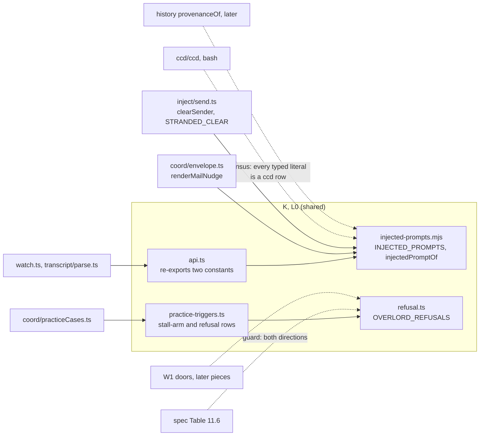

# Overlord W1: the vocabulary, what ccrc types and the W1 refusal words Implementation Plan

> **For agentic workers:** REQUIRED SUB-SKILL: Use superpowers:subagent-driven-development (recommended) or
> superpowers:executing-plans to implement this plan task by task. Steps use checkbox (`- [ ]`) syntax for tracking.

**Goal:** three pieces of L0 vocabulary that every later W1 piece reads, each declared once.

- **`INJECTED_PROMPTS`:** one list of every fixed string the server or ccd types into a session's pane. Each row has
  its text, how it matches (whole text or head) and its typer (`server` or `ccd`). The server's typers reference the
  list's constants instead of spelling the strings. ccd keeps spelling its own strings in bash, and a census test holds
  every string ccd types against the list's `ccd` rows in both directions. A pure reader, `injectedPromptOf`, answers
  which row a transcript line is, so history's later `ccrc-injected` tag has one matcher to call. Its input is a user
  row's text, or, for a slash command Claude Code recorded as a command envelope, the command's name and its arguments
  joined by one space (question 11).
- **The W1 refusal words:** one group, `OVERLORD_REFUSALS`, in `shared/refusal.ts`. It holds every word a W1 door
  answers (spec Table 11.6) plus `read-ceiling`, each with its one status, spread into `REFUSAL_STATUS`. A guard test
  reads Table 11.6 from the spec and checks it against the code in both directions. It carries two data lists: a
  shrink-only exception list of the code's words the table lacks, and a wave map of the table's words that no build
  has yet, each with the wave that adds it. The test is green on the day this lands, so no order against the
  spec-fixes run is needed.
- **The trigger table's refusal kind:** the W1a trigger table (`shared/practice-triggers.ts`) gains its second kind,
  `refusal`, with one row per word of `OVERLORD_REFUSALS`, derived from the group and never a hand list.

Nothing changes in behaviour. Every string typed into a pane is the same byte for byte. No refusal is sent by any new
door, because no W1 door exists yet, and no row is written under the new trigger kind.

**Why:** spec §3.8 (H7) says text ccrc types is tagged: "One L0 list, `INJECTED_PROMPTS`, holds every fixed string the
server or ccd types into a pane". Today those strings are spelled in four places, `/clear` twice. History tags each
typed one `operator`, because nothing names them. The resume prompt that rides Claude Code's resume variable is the
exception: it lands as an `isMeta` row, which history already tags `harness`. §11.6 says every refusal the design adds is one word in
`shared/refusal.ts`. Nothing checks those words against the table, so W1a's words and the table drifted twice (spec
Appendix B, "The refusal list"). §9.7 says the trigger table "grows with refusal words from W1". All three are
vocabulary that later pieces consume. Landing them first lets the designation, ladder, gates, sandbox, door process,
history and inbox pieces each reach their words from one home, never spelling a second copy.

**Architecture:** three L0 modules and two guard suites.

- `shared/injected-prompts.mjs` is new, with its types in `shared/injected-prompts.d.mts`. It imports nothing.
  It is an `.mjs` twin so that `ccd/history/lib.mjs`, which is plain JavaScript, can import the same list later
  (question 1).
- `shared/refusal.ts` gains one group.
- `shared/practice-triggers.ts` gains one kind.

The server's typers (`server/src/inject/send.ts`, `server/src/coord/envelope.ts`, `server/src/watch.ts` through
`shared/api.ts`) reference the list. `shared/api.ts` keeps its two prompt constants as one re-export line, so no
importer changes. Two new guard suites live under `server/test/single-definition/`, so every fast pull request's first
run and every merge-queue run runs them, a docs-only one included (question 4). One pull request, four tasks. No door, table, migration, lane, wire field,
capability word or ccd edit.

**Tech Stack:** TypeScript and plain ESM JavaScript (`.mjs` with a `.d.mts`), vitest. No new dependency.

**Spec:** `docs/superpowers/specs/2026-11-09-overlord-design.md`.

- §3.8, H7, the bullet "Text ccrc types is tagged": the list, its six named strings, "Each is a referenced constant in
  TypeScript", "ccd is bash and spells its own … so a census test pins every string ccd types against the list", and
  "History's `provenanceOf` tags an exact match `ccrc-injected`, a change the history programme owns".
- §3.8, "Bodies are never typed": only the one-line nudge enters a pane.
- §11.6 and Table 11.6: every word, its door, its meaning and its call. "Grouped by door, each with its status
  (`REFUSAL_STATUS`)". "A refusal names its cause".
- Appendix B, the row "The refusal list (Table 11.6)": measured both ways, nothing checks them in W1a.
- §9.7, the trigger key: "a typed key from an L0 table: a refusal word, a stall arm or a health word", and "The trigger
  table starts there with the stall arms, and grows with refusal words from W1".
- Table 11.1b, two rows: "`INJECTED_PROMPTS`; the refusal-word list, generated from §11.6 | K, L0 | … | W1, growing" and
  "The trigger table (stall arms in W1a, refusal words from W1, health words from W2) | C5, L0 and L1 | … | W1a,
  growing".
- Table 13.1, H7 (`shape`, W1): the operator's words are server rows, which is why injected text must be told apart
  from them. The refusal words ride every H call of their rows' "Call" column, and each later piece ships its door.

The index is `docs/superpowers/plans/2026-11-14-overlord-w1.md` (#2814): its row "Vocabulary" (lane K, ready to build),
its questions 18, 23 and 32, "Where lanes meet" (`shared/refusal.ts`), "What a merge arms" and "Where things stand".

## Open questions

Each is a place where the spec, the index and the tree do not meet exactly. The index's questions are restated with
their state. The plan builds the recommendation everywhere nothing is ruled.

1. **Where the list lives** (slug `injected-prompts-in-an-mjs-twin`). Table 11.1b says "K, L0". The obvious home is a
   `shared/*.ts` file. But the list's second reader is history's `provenanceOf` in `ccd/history/lib.mjs`, which runs as
   plain Node on the fleet box and cannot import TypeScript. It already imports `shared/workflow-ids.mjs` and
   `shared/redact.mjs`. **Recommendation:** `shared/injected-prompts.mjs`, which imports nothing, with
   `shared/injected-prompts.d.mts` for its types, after the pattern of `shared/workflow-ids.mjs` and its `.d.mts`.
   The PWA may reach a builtin-free `.mjs` file (`server/test/rings/mjs-node.test.ts` already reaches
   `shared/models.mjs` and `shared/base-url.mjs`). Installing it beside `redact.mjs` on the fleet box is the history
   programme's change, with its tag.
2. **The two prompt constants already in `shared/api.ts` move to the list** (slug
   `prompt-constants-move-to-the-list`). `IDLE_COMPACT_NUDGE_PROMPT` and `RESUME_PROMPT_PREFIX` are declared in
   `shared/api.ts` today. A list that held its own copies would be a second definition of each. **Recommendation:**
   both move into `shared/injected-prompts.mjs` and `shared/api.ts` keeps `export { IDLE_COMPACT_NUDGE_PROMPT,
   RESUME_PROMPT_PREFIX } from './injected-prompts.mjs';`. Their ten importers (server source and tests) change no
   line. Their doc comments move with them. The move commit is behind Task 1's characterization of both values.
3. **What the census counts as typed** (the index's question 18, open with a recommendation: cut the function bodies
   out of `ccd/ccd` as `ccd-limit-no-keys.test.ts` does, and tag each literal with its typer, so the match runs both
   ways). Measured on `main`, ccd types from five functions (see "What exists today"). Three of their literals are not
   prompts, and the census must still close over them. **Recommendation:**
   - Every `send-keys` argument after `-l` is text. A quoted literal with no `$` must equal a `ccd` row's text, or be
     on a named list of non-prompt literals with a reason. Today that list holds one entry, `s`, a picker's select key
     typed by `_route_type_model` and `_route_type_effort`.
   - A spliced argument (one with `$`) must be on a named map from its function to a row or to `operator-supplied`:
     `_auto_compact_check` to `compact`, `_redrive_after_spawn` to `resume`, and `cmd_clip` to `operator-supplied` (the
     path of a clip the operator filed). **Ruled (F2): each entry names its own rule**, and a mapped function holds
     exactly the one splice its entry names, so a second splice added inside it is red:
     - `head` (`compact`): the argument's literal text before its first `$` equals the row's text;
     - `prompt-var` (`resume`): the argument is exactly `$(_resume_prompt_for "$id")`, `_resume_prompt_for` starts its
       prompt from `RESUME_PROMPT`, and `RESUME_PROMPT`'s value begins with the row's text;
     - `none` (`operator-supplied`, `operator-secret`): no text rule. The argument is pinned as written, so a change to
       it is red.
   - Every `send-keys` argument without `-l` must be a key from a closed set: `Enter`, `Escape`, `Left`, `Right`, `Up`
     and `Down`. Any other argument is a splice, and is red unless its function is on the same map. So a new typer
     cannot hide as a key.
   - `ccd/ccd-account-auth` is a bash file that sends keys. It was not read for this plan, because the session hook
     refuses a session's reads of it. The builder expects the census to find its sends on the first run, and maps each
     one by its function to `operator-secret`: a sign-in code typed into a pane is the operator's, and secret.
   - **Nothing the census prints is a typed value.** Every failure message names the file, the function, the line and
     the mapped word, and never the argument's text, so a sign-in code can never reach a test log.
   - The "tag naming its typer" is the row's `typer` field, so ccd needs no edit: rows tagged `ccd` must each be typed
     by ccd, and every string ccd types must be on a `ccd` row.

   Accepted residual: an operator who types `/clear` or `/model` themselves matches a row, so history will tag that
   prompt `ccrc-injected`. The list cannot tell who typed a string, only which string it is.
4. **The Table 11.6 test is a guard suite** (the index's question 23, open with a recommendation; slug
   `refusal-table-test-is-a-guard-suite`). The index says to add the spec file to the test-selection map's untraced
   inputs for this test, because CI's fast selection does not trace a server test that reads a `docs/` file. Measured:
   `.github/ci/fast-plan.mjs#GUARD_TESTS` already runs every `server/test/single-definition/*.test.ts` file on every
   fast pull request, "whatever changed", and the merge queue runs the fast plan for a docs-only group.
   **Recommendation:** the test lives at `server/test/single-definition/refusal-table.test.ts`, and the selection map is
   not edited. A spec pull request that changes Table 11.6 runs it on its first fast run, before it can red `main`. A
   docs-only follow-up push to that pull request skips the server jobs (D-8396, `.github/ci/docs-followup.mjs`), so a
   second edit of the table is first checked in the merge queue, which runs every guard suite before anything lands.
   The injected-prompts census sits beside it for the same reason: it reads `ccd/ccd` as text, which no import
   reaches.
5. **Which words are W1's, and which stay with W1a's own plans** (slug `w1a-words-stay-with-w1a-plans`). The index
   says the vocabulary piece adds every W1 word at once. Measured on `main`, four table words that no build has yet are
   W1a's, and approved W1a plans already add them to `shared/refusal.ts`:
   - `renewing`, `renew-pending` and `renew-not-long-lived` (`w1a-renewal-handoffs.md`, Task 2 and its Renew now task);
   - `baseline-missing` (`w1a-replay-quiz.md`, via `shared/lane-arm.ts`).

   **Recommendation:** this piece leaves those four to their plans and puts them on the wave map as `W1a`. Each of
   those pull requests then takes its word off the map in the same pull request, because the test reds a map entry
   whose word the code now holds. The coordinator tells those builders (Index changes).
6. **`capability-missing` becomes a route word** (slug `capability-missing-becomes-a-route-word`). In W1a it is the
   client's word only: `ccrc-api timer` answers it locally, and
   `server/test/continuity-timers-vocab.test.ts` asserts `expect(ROUTE_REFUSALS).not.toContain('capability-missing')`
   with the comment "the client's word only in W1a (Task 11)". W1's designate, rebind and every Overlord door answer it
   from the server (Table 11.6). **Recommendation:** the group adds it, and Task 3 changes that one assertion to its
   opposite, in the same commit, with the reason in the commit message. The client's local answer is unchanged. Its
   status is question 7's.
7. **The statuses** (slug `overlord-refusal-statuses-chosen`). Table 11.6 gives no status. **Recommendation:** each is
   CHOSEN, not measured, by the family rule the file already states:
   - 403 for a caller that is not allowed, as `not-owner`;
   - 409 for a state of the world, as `note-not-asked`;
   - 429 for a rate, as `timer-rate`;
   - 501 for a build that lacks what the door needs, as `unsupported` (the file: "A missing ccd cap answers the
     existing `unsupported` (501)") and `auth-off`;
   - 503 for a box fault, as `journal-unreadable` and `unreachable`.

   **Ruled (F6): `capability-missing` is 501** (slug `capability-missing-is-501`). The build lacks a capability word,
   which is the `unsupported` case, not a conflict with the state of the world. `overlord-not-a-coordinator` stays 403,
   unlike its neighbour `not-coordinator` (409, the digest routes). The spec gives no status, so this is the family
   rule's call, not the spec's. `not-coordinator` refuses a session whose role can change, because a session becomes a
   coordinator by opening a run. `overlord-not-a-coordinator` refuses an identity: the designated session may never
   open a run, so it sits with `not-the-overlord` and `overlord-uses-its-doors`. Task 3 lists each word's status. A
   later piece that needs a different status changes it in its own pull request, with the reason, before any door
   sends the word.
8. **The trigger table's refusal rows are the Overlord group's words** (slug `refusal-triggers-are-the-overlord-group`).
   §9.7 says "a refusal word" and names no list. The tree has several hundred route refusal words, and most are not the
   Overlord's. **Recommendation:** the refusal kind's rows are exactly `OVERLORD_REFUSALS`' words, derived from the
   group. A later wave's words join the triggers by joining the group. No W1 code records a refusal as a case
   observation, so the kind has rows and no writer until W4b's `practiceFor` (§9.7, "When it ships").
9. **`read-ceiling`** (the index's question 32, open with a recommendation: the vocabulary piece adds it to the W1
   group, on question 23's exception list until the spec-fixes run adds it to Table 11.6). Built as recommended, with
   status 429.
10. **The exception list on landing holds one word** (slug `code-only-list-is-read-ceiling`). The brief and the index
    say the code's words the table lacks include `timer-not-found`. Measured on `main` at `2d5d4d4ef`: Table 11.6 now
    has a `timer-not-found` row (the spec-fixes run, #2812), and every W1a Overlord word in code (the card's, the
    notes', the probes', the timers' and `lane-gated`) is in the table. So the shrink-only list starts as
    `read-ceiling` alone. The pool set's undecidable words `set-unreadable` and `set-malformed` are state words of the
    pool rule, not route refusals, so this test does not read them. If the pool-set piece puts them in a refusal group
    the test reads, that pull request adds them to the list.
11. **What `injectedPromptOf` is given** (slug `injected-reader-takes-the-command-line`). Claude Code records a slash
    command typed into a pane as a command envelope, not as its raw text. `server/src/transcript/parse.ts`'s
    `harnessEnvelope` reads the envelope's `command-name` member. So no transcript row's raw text equals `/clear`,
    `/compact`, `/effort` or `/model`, and `/effort ultracode` arrives as the name `/effort` with the argument
    `ultracode`. The mail nudge and the idle nudge are plain user rows. The resume prompt that rides
    `CLAUDE_CODE_RESUME_PROMPT` is an `isMeta` row, and the one ccd types (`_redrive_after_spawn`) is a plain user row.
    **Recommendation:** the reader's contract names its input. For a command envelope it is the command name and its
    arguments joined by one space, so `/effort ultracode` matches `effort-ultracode`; for every other row it is the
    row's text. The reader does no envelope parsing of its own, because the parsers own that.

## What exists today

Measured on `main` at `2d5d4d4ef` (2026-11-15). The typing sites, the `send-keys` counts and the helpers were measured
again at `dce5c00cc` for fix round 1. The ccd split's first task moved no typing function, and `ccdSource()` now splices
`CCD_LIBS` back into `ccd/ccd`'s text.

- **What the server types into a pane.** Two primitives type text, both in `server/src/inject/send.ts`, and both call
  `TmuxExec.sendLiteral` (`server/src/exec.ts`, which sends `send-keys -t <target> -l -- <text>`):
  - `sendPrompt` types a prompt. It has four callers:
    - `watch.ts#FleetWatcher`'s mail sweep types `renderMailNudge(d.toId)`
      (`server/src/coord/envelope.ts#renderMailNudge`). That is a template whose fixed head is
      `ccrc-mail: you have new mail.`, and whose only variable part, the recipient id, lands after the 24-character
      echo needle `sendPrompt` uses;
    - the idle-compaction nudge lane types `shared/api.ts#IDLE_COMPACT_NUDGE_PROMPT`;
    - `send.ts#clearSender` types `'/clear'` as an inline literal. `coord/dispatch.ts` holds it as its `sendClear` port,
      for a resumed worker;
    - the console's prompt route in `server/src/server.ts` types the operator's own text (`body.text`).
  - `answerDialogText` types the operator's answer into a dialog's free-text row. Its one caller is `server.ts`'s
    `pressDialogText`, which is operator text too.
  - `send.ts#STRANDED_CLEAR` is a private second copy of `'/clear'`, which `ownStrandedClear` compares against.
  - Keys are sent apart, by `TmuxExec.sendKey(id, key)`, which takes any string. Its literal keys are `Enter`,
    `M-Enter`, `C-u`, `C-s`, `Tab`, `Up` and `Escape`. Four callers pass a computed key:
    - `send.ts#walkCursor` passes `Down` or `Up`;
    - `send.ts#moveDialogTab` passes `Left` or `Right`;
    - `send.ts#answerDialogMulti` passes `String(k)`, a digit;
    - `server/src/inject/ask.ts#answerAsk` passes `String(i + 1)`, a digit.

    `send-keys` is spelled in `server/src` only in `exec.ts`. Keys are not prompts, but Task 2's census closes over
    them (F13), so no text can travel as a key.
  - The server types no `/model`, `/effort` or `/compact`: a tap on the model or effort sheet writes a route field,
    and ccd types (the comment above the route in `server.ts`).
- **What ccd types.** Every `-l` send is in `ccd/ccd`, through `_tmx send-keys -t "$t" -l …`: eight of them, five
  with no `$` in the argument and three spliced. There is no `ccd/lib/*.sh` sender, and `ccd/session-hook.sh` and
  `ccd/ccrc*` hold no `send-keys`. `ccd/ccd-account-auth`, a bash file, sends keys and no `-l` text. It was not read
  for this plan, because the session hook refuses a session's reads of it (question 3).

  | Function | Text typed | Spliced part |
  |---|---|---|
  | `_auto_compact_check` | `/compact`, then `Enter` | `${ctext:+ $ctext}`, the launch profile's compaction text |
  | `_route_type_effort` | `/effort ultracode`; or `/effort`, then `Left` and `Right` presses and the literal `s` | none |
  | `_route_type_model` | `/model`, then `Down` or `Up` presses and the literal `s` | none |
  | `_redrive_after_spawn` | `$(_resume_prompt_for "$id")` | the whole resume prompt, built from `RESUME_PROMPT` |
  | `cmd_clip` | `"$dest "`, a clip's path and a space | the path |

  `RESUME_PROMPT` in `ccd/ccd` begins with `shared/api.ts#RESUME_PROMPT_PREFIX` (`Continue from where you left off.`),
  as that constant's comment says. Its comment in `ccd/ccd` names `shared/api.ts`'s `RESUME_PROMPT_PREFIX`, which stays
  true through the re-export (question 2), so `ccd/ccd` needs no edit. Keys without `-l`: `Enter`, `Escape`, `Left`,
  `Right`, `Up` and `Down`.
- **Readers of those strings, not typers.** `server/src/transcript/parse.ts` matches the idle nudge's whole text and
  the resume prefix. `ccd/session-hook.sh`'s roster wake arm spells `ROSTER_WAKE_MAIL` and `ROSTER_WAKE_IDLE`, which
  `server/test/session-hook-roster-card.test.ts` holds equal to `renderMailNudge`'s head and to
  `IDLE_COMPACT_NUDGE_PROMPT`. Neither changes here.
- **History's provenance.** `ccd/history/lib.mjs#provenanceOf` tags rows by structure only (`model`, `harness`,
  `summary`, `tool`, `recall-echo`, `operator`), so every typed injected string lands as `operator`. A row with
  `isMeta`, such as the resume prompt Claude Code submits from `CLAUDE_CODE_RESUME_PROMPT`, is already `harness`
  (`server/test/history-lib.test.ts`, "provenanceOf: by structure, never by text"). The `ccrc-injected` tag is the
  history programme's (§3.8).
- **No list exists.** Nothing in `shared/` or `server/src` is called `INJECTED_PROMPTS` or names injected prompts.
- **The refusal words.** `shared/refusal.ts` (538 lines; not growth-checked, no cap) holds `RouteRefusal`,
  `REFUSAL_STATUS` and the derived `ROUTE_REFUSALS`. W1a's Overlord groups follow two idioms:
  - word-to-status objects spread into the table: `TIMER_REFUSALS`, whose eleven words each carry their status;
  - name-to-word objects with statuses keyed in the table: `CARD_REFUSALS`, `NOTE_REFUSALS` and `PROBE_REFUSALS`.

  `lane-gated` comes from `shared/lane-arm.ts#LANE_ARM_REFUSALS`. `server/test/refusal-status.test.ts` holds one
  status per word, that every literal inline send's word is a `RouteRefusal` with its status, and that every
  `GENERIC_REFUSALS` word is still sent. That last check does not reach a typed group, so a group whose doors are not
  built yet is legal, as the W1a groups were.
- **Table 11.6, measured against the code.** It has 78 rows: 75 refusal words and three release-reason patterns
  (`not-ready:<word>`, `server-gap`, `released:<cause>`). Against `ROUTE_REFUSALS`:
  - Present: 21. These are `auth-off` and W1a's twenty: `card-changed`; the five note words (with
    `reference-unknown`); the two probe words; the eleven timer words; and `lane-gated`.
  - Absent: 54. Of these, 17 are W1's (Task 3), 4 are W1a's (question 5), and 33 belong to W2 to W5 (Task 3's wave
    map).
  - Three words are spelled elsewhere in `shared/` with another meaning, so a text search would miscount them:
    `stale-generation` is a ccd lease-mark answer (`shared/api.ts#LEASE_MARK_REFUSALS`); `defer` is in `shared/api.ts`;
    and `entry-retired`, `coordinator-paused` and `mail-disabled` appear as other vocabulary (`shared/continuity.ts`,
    `shared/switches.ts`). The test reads `ROUTE_REFUSALS`, never the text.
- **The trigger table.** `shared/practice-triggers.ts` (W1a, L0) holds:
  - `TRIGGER_KIND_TABLE`, with one kind, `stall-arm`;
  - `TriggerSignature`, which is `{ kind: 'stall-arm'; key: StallArm }`;
  - `TRIGGER_TABLE`, derived from `shared/stall-watch.ts#STALL_ARMS`;
  - `signatureText`, which writes `<kind>:<key>`, and `parseSignature`, its one reader.

  It has two readers:
  - `server/src/coord/practiceCases.ts`, whose `SIGNATURE_OF` map keys each row by `key` alone, kind not checked, and
    whose `casesDue` reads only stall details;
  - the `practice_cases.signature` column (`server/src/coord/schema.ts`).

  The rows are pinned by `server/test/practice-triggers.test.ts`. One of its cases expects
  `refusal:capability-missing` to read null: "a later wave's kind included". Its definition is pinned by
  `server/test/single-definition/vocabularies.test.ts`, the describe "the trigger table has one definition": one
  declaration each of the type, the list and the reader, and "TRIGGER_TABLE is derived from STALL_ARMS, never a hand
  list". `shared/practice-triggers.ts` is already in
  `server/test/single-definition/time-ports.test.ts#TIME_PORT_FILES`.
- **Growth.** Of the files this piece changes, only `shared/api.ts` is growth-checked. It carries a cap of 5,140 code
  lines (`server/test/growth-caps/shared-api-ts.json`, D-8635), which judges it in place of the 40-line check.
  `shared/refusal.ts`, `shared/practice-triggers.ts`, `server/src/inject/send.ts`, `server/src/coord/envelope.ts` and
  `server/src/coord/practiceCases.ts` are neither listed nor capped. `ccd/ccd`, `ccd/session-hook.sh` and
  `server/src/watch.ts` are not edited.
- **Mutation sets** live in `server/test/sim/*Sets.ts`, registered in `server/test/sim/mutation-floors.test.ts`'s
  `MUTANT_SETS`, keyed `<file>#<symbol>`, with floors in `server/test/sim/mutation-floors.json`. The face's sets show a
  module outside `server/src` can be a set's subject.

*Figure 1. The imports after this piece. Solid edges are this pull request's. Dotted edges are a guard test's reading
or a later piece's import. No arrow points outward: L0 imports only L0.*

## Global Constraints

- **No behaviour change.** Every byte typed into a pane is the same before and after: Task 1 pins each text on `main`
  and is untouched by every later task. No door sends a new word, and no row is written under the new trigger kind.
- **One definition each.**
  - `INJECTED_PROMPTS`, `injectedPromptOf`, `IDLE_COMPACT_NUDGE_PROMPT` and `RESUME_PROMPT_PREFIX` are declared in
    `shared/injected-prompts.mjs` and nowhere else. `shared/api.ts` re-exports the two constants and declares neither.
  - `/clear` is spelled once in `server/src`, as the list's row. `clearSender` and `STRANDED_CLEAR` both read it.
  - Every word of `OVERLORD_REFUSALS` is declared in that group only: no other group, and no `GENERIC_REFUSALS` entry,
    holds it.
  - `TRIGGER_TABLE` is derived from `STALL_ARMS` and `OVERLORD_REFUSALS`, never a hand list.
- **Ownership.** Each list has one writer, the module that declares it. None is a runtime fact, a table or a file, so
  no store, lane, port or migration is involved. Every reader reaches its list by an inward import:
  - `server/src` (L1 to L4) imports L0;
  - `shared/api.ts` and `shared/practice-triggers.ts` import sibling L0 files;
  - nothing in `shared/` imports `server/src`, `pwa/src` or `ccd/`.
- **Rings.**
  - `shared/injected-prompts.mjs` imports nothing, so it is builtin-free, as `server/test/rings/mjs-node.test.ts`
    requires of a file the PWA reaches through `shared/api.ts`.
  - `shared/refusal.ts` and `shared/practice-triggers.ts` keep importing only `shared/` files.
  - `server/src/coord/practiceCases.ts` stays L1: its one change is pure.
  - No file is added under `server/src` or `pwa/src`, so `server/test/rings/totality.test.ts` and the architecture
    spec's path table need no row.
- **Failure contracts.**
  - **`injectedPromptOf`:** total. A non-string, an empty string and any text no row matches all answer `null`. It
    never throws, and it never coerces a non-string. A string matches at most one row: the texts are unique, exact rows
    are tried first, and Task 2 holds that no head row's text is a word-boundary prefix of another row's text. Its
    input is a row's text, or a command envelope's name and arguments joined by one space (question 11).
  - **`parseSignature`:** an unknown kind, an unknown key, a key of the wrong kind and an inherited name such as
    `constructor` all answer `null`. An older build reads a `refusal:<word>` signature as `null` (the case that already
    pins it), so a newer build's row is skipped, never misread, by an older server.
  - **The guard tests fail closed.** The Table 11.6 test reds on any of these: a spec file it cannot read; a table it
    cannot find by its heading and its caption; a header row other than `| Word | Door or lane | Meaning | Call |`; or
    fewer than 70 rows. It never passes over an empty parse. Its shrink-only check resolves the merge base first, and
    reds when it cannot (Task 3). The census reds when it finds fewer typers than Task 1 pins: four `sendPrompt`
    callers, two `sendLiteral` callers, five ccd functions and eight `-l` sends.
  - **Wire.** No frame, field or capability word changes. A W1 word travels in a route's `error` as every refusal does.
    An older console that meets one shows the raw code, as `pwa/src/lib/refusalWords.ts` does for any unknown word.
    No W1 door exists until its own piece, which also ships the console sentence where an operator door needs one.
- **Census sites this piece touches, and the ones it does not.**
  - It touches `time-ports.test.ts#TIME_PORT_FILES`, `vocabularies.test.ts`' trigger-table describe,
    `practice-triggers.test.ts`, `continuity-timers-vocab.test.ts`' one assertion (question 6), `MUTANT_SETS` and
    `mutation-floors.json`. The new `.mjs` joins `TIME_PORT_FILES` because spec §11.5's rule binds every new Overlord
    module, and the file's name falls outside the list's `overlord` and `continuity` families. It reads no clock today.
    The entry is there so that an edit which later reads `Date.now()` in the list is red.
  - It adds no door, so it touches none of the box-token and auth-gate censuses (`auth/gate.ts`'s `EXEMPT`,
    `auth-gate.test.ts`, `box-token-census.test.ts`, `rings/fastify-l4.data.ts`, `coord-pause-route.test.ts`).
  - It adds no table or migration (`writers-map.test.ts`, `run-close-switch.test.ts`), no port (`coord/ports.ts`,
    `test/rings/*`), no ccd library, function or context row (`ccd/contexts.tsv`), and no capability word.
- **SAFETY (`CLAUDE.md`).** No ccd verb runs. The census reads `ccd/ccd` as text only, never executes it, and touches
  no tmux, no registry and no live `$HOME`.
- **Tests.** Run from `server/` as `ccrc test -- ./node_modules/.bin/vitest run test/<file>.test.ts`. The last run of
  each task adds `ccrc test -- npx tsc --noEmit -p tsconfig.json`, `ccrc test -- npx tsc --noEmit -p
  test/tsconfig.tests.json`, and, because `shared/` changes, pwa's `ccrc test -- npx tsc --noEmit` from `pwa/`.
- **Source pins** over `server/src` files read through `server/test/scan/symbols.ts`' `parsedFile` (its calls and their
  `CallArg`s), never `readFileSync` and a string method: the ARCH-06 ratchet
  (`single-definition/advance-switches.test.ts`) gives a file with no row ceiling 0. Reading `ccd/ccd` and the spec
  as text is the census's job and has precedent (`ccdWsHelpers.ts#ccdSource`, the growth check's spec read).
- **Public repository.** No private names: fixtures use `lane-a-project-a`. Cite by symbol or `@anchor`. No D-number is
  invented: this plan's slugs are under "Deviations found", and the coordinator mints numbers.

## Review Focus

1. **Byte identity of everything typed.** Task 1's file is green on `main` and untouched after. `renderMailNudge`'s
   whole text, the idle nudge, `/clear` and the resume prefix are the same strings, and `sendPrompt`'s 24-character
   echo needle still sees the mail nudge's fixed head.
2. **The census cannot be satisfied by a new typer.** Each of these reds, proven by Task 2's planted controls:
   - a new `sendPrompt` caller passing a string literal, or a template literal, or reaching `sendPrompt` through an
     alias;
   - a new `sendLiteral` caller outside the two primitives;
   - a `sendKey` with a key outside the server's closed set;
   - a new ccd `send-keys -l` literal, a spliced send in a new function, or a second splice in a mapped one;
   - a ccd key outside the closed set.

   Rows and typers match in both directions, and no census message prints a typed value.
3. **The Table 11.6 test is honest.**
   - It reads the table's own rows, not a copy.
   - It checks the code's `ROUTE_REFUSALS`, never a text search, so the words spelled elsewhere with other meanings
     (`stale-generation`, `defer`) do not count as present.
   - No W1 word is on the wave map.
   - Every map entry names a wave from a closed list.
   - A stale entry is red in either list.
   - The exception list cannot grow against the merge-base.
4. **The group is complete and alone.** Every word answered by a W1 door in Table 11.6, and `read-ceiling`, is in
   `OVERLORD_REFUSALS`. None of its words is in another group. Each status follows the family rule its comment names.
5. **The trigger kind is derived and inert.** The refusal rows come from the group. `practiceCases.ts` still reads stall
   rows only, now by kind as well as key. Nothing writes a refusal signature.

## The PR split

| PR | Tasks | What it ships | Needs first | Growth-checked files, estimate |
|---|---|---|---|---|
| One | 1 to 4 | The characterization of what is typed; `INJECTED_PROMPTS` with its census; the W1 refusal group with the Table 11.6 guard, its exception list and its wave map; the trigger table's refusal kind; the mutant sets | nothing: **ready to build** | `shared/api.ts`: about −2 code lines (the two declarations become one re-export line, doc comments moved), so it stays under its 5,140 cap. No other growth-checked file is touched |

For scale, the files that are not growth-checked change by about:

| File | Change |
|---|---|
| `shared/injected-prompts.mjs` | +80, new (the two moved constants and their comments included) |
| `shared/injected-prompts.d.mts` | +30, new |
| `shared/refusal.ts` | +45 (the group, its comment, its union arm and its spread) |
| `shared/practice-triggers.ts` | +15 |
| `server/src/inject/send.ts` | +2, −2 (`clearSender` and `STRANDED_CLEAR` read the row) |
| `server/src/coord/envelope.ts` | +2, −1 (the head comes from the row) |
| `server/src/coord/practiceCases.ts` | +1, −1 |
| `server/test/single-definition/injected-prompts.test.ts` | +260, new |
| `server/test/single-definition/refusal-table.test.ts` | +170, new |
| `server/test/single-definition/refusal-table.data.json` | +60, new |
| `server/test/injected-prompts-characterization.test.ts` | +90, new |
| `server/test/sim/vocabularySets.ts` | +80, new |

The four commits land in order: the characterization, the list, the refusal group, then the trigger kind. Every later
W1 piece that answers one of these words reads it from the group. The other-lane refusals piece names this piece in its
"Needs first" (the index's order). It is the only one that does.

## Index changes

The index (#2814) should carry these. They are for the coordinator to pass to the index's next revision.

- **Question 23.** The mechanism is placement, not a selection-map edit. The test is
  `server/test/single-definition/refusal-table.test.ts`, a guard suite that every fast pull request's first run and
  every merge-queue run runs, a docs-only one included. A docs-only follow-up push skips it, so the queue is the net
  there. Its exception list starts as `read-ceiling` alone, because Table 11.6 on `main` already has
  `timer-not-found` (question 10).
- **Lane K's files:**
  - `shared/injected-prompts.mjs` and `shared/injected-prompts.d.mts`;
  - one group in `shared/refusal.ts`;
  - `shared/practice-triggers.ts`;
  - the server typers' one-line references in `server/src/inject/send.ts` and `server/src/coord/envelope.ts`;
  - `server/src/coord/practiceCases.ts`'s kind filter;
  - the two guard suites and `refusal-table.data.json` under `server/test/single-definition/`.
- **"Where lanes meet", `shared/api.ts`:** lane K's re-export line, which removes two declarations (about −2 code lines).
- **W1a's builders.** The renewal hand-offs builder (`renewing`, `renew-pending`, `renew-not-long-lived`) and the
  replay quiz builder (`baseline-missing`) each take their words off the wave map in the pull request that adds them,
  if this piece lands first (question 5). A W1a pull request that adds a new `*_REFUSALS` group naming the Overlord
  also registers it in the test's `OVERLORD_GROUPS`, or the discovery reds. One that adds a word straight to
  `REFUSAL_STATUS`, as the renewal hand-offs plan adds `renewing`, needs no group change.
- **The spec-fixes run.** Adding `read-ceiling` to Table 11.6 takes it off the exception list in the same pull request.
  Adding any other row to Table 11.6 puts its word on the wave map, unless its piece's code is already on `main`. That
  pull request touches `server/test/single-definition/refusal-table.data.json` as well as the spec.
- **Every later W1 piece that answers a word** reads it from `OVERLORD_REFUSALS`. If it needs a word the group lacks, it
  adds the word to the group and, if the table lacks it, to the exception list, in the same pull request (the index's
  "Where lanes meet", `shared/refusal.ts`).
- **The history programme** reads `INJECTED_PROMPTS` through `injectedPromptOf` for its `ccrc-injected` tag, and
  installs `shared/injected-prompts.mjs` beside `redact.mjs` on the fleet box.

---

### Task 1: Characterize what is typed, green on `main`

**Files:**
- Create: `server/test/injected-prompts-characterization.test.ts`

The file imports only homes that no later task moves: `../src/coord/envelope.js`, `../src/inject/send.js` and
`../../shared/api.js` (the re-export keeps `shared/api.js` importable). So the later commits leave it untouched, and
the move commit changes only imports (`CLAUDE.md`, "Characterization tests first when moving code"). Every expected
value is a literal measured once on `main` and pasted in, never computed in the test from the code under test.

Cases:
- **The server's texts.**
  - `renderMailNudge('lane-a-project-a')` as one literal. Its first 29 characters as a literal. It places the id after
    character 24.
  - `IDLE_COMPACT_NUDGE_PROMPT` and `RESUME_PROMPT_PREFIX` as literals.
  - **`clearSender`'s text, by value (ruled, F1).** `clearSender` runs over a scripted tmux runner, the shape of
    `server/test/dispatch-live-gate.test.ts`'s runner and its `CLEAR_PANES`. The test records the `send-keys` argv, and
    the token after `-l --` is the literal `/clear`. The value is pinned, not the argument's shape, so Task 2's change of
    the literal to a reference leaves this case green and unedited.
- **The server's typers, by `parsedFile`.** Exactly these callers, each recorded as its file and its enclosing symbol
  only:
  - `sendPrompt` has four callers: `server/src/watch.ts` (twice: `renderMailNudge(d.toId)` and
    `IDLE_COMPACT_NUDGE_PROMPT`), `server/src/server.ts` (`body.text`) and `server/src/inject/send.ts#clearSender`
    (the string `/clear`);
  - `sendLiteral` has two callers, both in `send.ts`, inside `sendPrompt` and `answerDialogText`;
  - `answerDialogText` has one caller, in `server.ts`;
  - `sendKey`'s literal keys, as a set. Its four computed-key sites are recorded by file and symbol: `walkCursor`,
    `moveDialogTab`, `answerDialogMulti` and `ask.ts#answerAsk`.
- **ccd's texts.** From `ccdSource()` (`server/test/ccdWsHelpers.ts`), each `send-keys` line of the five functions in
  "What exists today", reduced to its function, its `-l` argument and its keys: eight `-l` sends, five with no `$` and
  three spliced. Also the first 33 characters of `RESUME_PROMPT`'s value.

- [ ] **Step 1: Measure** the literals on `main`. Write the cases.
- [ ] **Step 2: Run** the file. It is green on `main`: it is a characterization, not a red-first test.
- [ ] **Step 3: Bite check** with the coordinator skill's `references/mutation-run.py`, which builds mutants in memory
  and removes its temp tree. Each of these mutants must red at least one case:
  - change one character of `renderMailNudge`'s head;
  - change `clearSender`'s `'/clear'` to `'/clear '`;
  - drop `ccd/ccd`'s `ultracode` literal.

  Record the table for the pull request body.
- [ ] **Step 4: Commit.** `test(vocabulary): characterize every string the server and ccd type into a pane (Overlord W1)`

### Task 2: `INJECTED_PROMPTS`, its reader and its census

**Files:**
- Create: `shared/injected-prompts.mjs` (K, L0; it imports nothing)
- Create: `shared/injected-prompts.d.mts`
- Modify: `shared/api.ts` (the two declarations become one re-export line)
- Modify: `server/src/inject/send.ts` (`clearSender` types the row's text; `STRANDED_CLEAR` is the row's text)
- Modify: `server/src/coord/envelope.ts` (`renderMailNudge` begins with the row's text)
- Modify: `server/test/single-definition/time-ports.test.ts` (`TIME_PORT_FILES` gains `shared/injected-prompts.mjs`)
- Create: `server/test/single-definition/injected-prompts.test.ts`
- Create: `server/test/sim/vocabularySets.ts` (the `injectedPromptOf` set; Task 4 adds the second)
- Modify: `server/test/sim/mutation-floors.test.ts` (`MUTANT_SETS`) and `server/test/sim/mutation-floors.json`

**The list.** Eight rows, keyed by a kebab name. Each row is `{ text, match, typer }`. `match` is `exact` (the whole
text, trimmed of a trailing newline) or `head` (the text begins with the row's). `typer` is `server` or `ccd`.

| Key | Text | Match | Typer |
|---|---|---|---|
| `mail-nudge` | `ccrc-mail: you have new mail.` | head | server |
| `idle-compact-nudge` | `IDLE_COMPACT_NUDGE_PROMPT`'s sentence | exact | server |
| `clear` | `/clear` | exact | server |
| `resume` | `RESUME_PROMPT_PREFIX`, `Continue from where you left off.` | head | ccd |
| `compact` | `/compact` | head | ccd |
| `effort` | `/effort` | exact | ccd |
| `effort-ultracode` | `/effort ultracode` | exact | ccd |
| `model` | `/model` | exact | ccd |

The module exports these:
- `INJECTED_PROMPTS`, frozen;
- `INJECTED_PROMPT_KEYS`, derived with `Object.keys`. The `.d.mts` declares it as a readonly tuple of the eight keys and
  derives `InjectedPromptKey` from the tuple, after `shared/model-advance.d.mts`. A census case holds the tuple's
  literal list equal to `Object.keys(INJECTED_PROMPTS)` (F17);
- `IDLE_COMPACT_NUDGE_PROMPT` and `RESUME_PROMPT_PREFIX`, which the rows reference by binding, so each text is spelled
  once;
- `injectedPromptOf(text: unknown): InjectedPromptKey | null`.

The reader tries `exact` rows before `head` rows. A head row matches only at a word boundary: its text followed by the
end of the input, a space or a newline. So `/compactfoo` is no row's, and `/effort ultracode` is `effort-ultracode`,
never `effort`. Its doc comment states its input (question 11): a row's text, or a command envelope's name and
arguments joined by one space. The `.d.mts` declares `InjectedPromptMatch`, `InjectedPromptTyper`, `InjectedPrompt`
and the exports.

**The server's references.**
- `renderMailNudge` builds `${INJECTED_PROMPTS['mail-nudge'].text} Use the client, …`. Its output is byte-identical,
  which Task 1 proves.
- `clearSender` passes `INJECTED_PROMPTS.clear.text`, and `STRANDED_CLEAR` is bound to the same text.
- `watch.ts` and `transcript/parse.ts` keep importing `IDLE_COMPACT_NUDGE_PROMPT` from `shared/api.js`, and change no
  line.

**The census, `injected-prompts.test.ts`.** Tests written red first, before the list exists: the import fails.

- **Rows.**
  - Keys are kebab and unique.
  - Texts are non-empty, single-line and unique, and no head row's text is a word-boundary prefix of another row's
    text, so no input matches two rows. (`/effort` is a prefix of `/effort ultracode`, but both are exact rows.)
  - `injectedPromptOf` answers each row's own key for its text, and for a head row also for its text plus a space and
    a word.
  - It answers `null` for `''`, a non-string, `/clear now` (an exact row with a tail), `/compactfoo`, `constructor`,
    an operator sentence, and each text with one character changed.
- **Server, by `parsedFile` over `server/src`.** A `CallArg` is only `string`, `regex` or `other`, with an `other`'s
  text flattened, so every allow rule matches the argument's whole text with an anchored pattern, never a prefix (F11).
  - Every `sendPrompt` call's text argument is one of two things:
    - a reference to the list, matching exactly one of `^INJECTED_PROMPTS(\.[a-z]+|\['[a-z-]+'\])\.text$`,
      `^IDLE_COMPACT_NUDGE_PROMPT$` and `^renderMailNudge\([\w.]+\)$`;
    - a site on `OPERATOR_TEXT_SITES`. The prompt route is an anonymous arrow inside `app.post`, which the symbol table
      does not key, so a site is keyed by its file, its callee and its argument's exact text (`server.ts`,
      `sendPrompt`, `body.text`), with a count per file.
  - A string literal or a template literal is red.
  - Every `sendLiteral` call is inside `sendPrompt` or `answerDialogText`.
  - Every `answerDialogText` call is on `OPERATOR_TEXT_SITES` (`server.ts`, `answerDialogText`, `text`, the
    `pressDialogText` arrow).
  - **Keys (F13).** Every `sendKey` call's key is a string in `SERVER_KEYS` (`Enter`, `M-Enter`, `C-u`, `C-s`, `Tab`,
    `Up`, `Escape`), or the call is on `COMPUTED_KEY_SITES` (the four sites Task 1 pins), each with its derivation: a
    direction word, or a digit from an index.
  - **No alias.** Over each file's `parsedFile(f).text`, with comments blanked by `server/test/rings/ring.ts#codeOnly`,
    the names `sendPrompt`, `sendLiteral`, `sendKey` and `answerDialogText` appear only as a callee, in an import, or at
    their own definitions. So `const f = sendPrompt` is red.
  - The string `send-keys` is spelled in `server/src` only in `exec.ts`, comments excluded.
  - Every `server` row has at least one typer that references it.
  - `renderMailNudge('x')` matches `mail-nudge`.
  - `send.ts` spells the string `/clear` nowhere, comments excluded.
- **ccd, read once each (F10).** `ccdSource()` stands for `ccd/ccd` and every `CCD_LIBS` file, which it splices back
  into `ccd/ccd`'s text. Every other file under `ccd/` is read raw if it is `ccd/lib/*.sh` or its first line is a `bash`
  or `sh` shebang. `ccd/lib/disk-retention.sh`, which has no shebang, is read as a library. The list is
  de-duplicated, and no file is read twice. Comment lines are excluded. Each `send-keys` invocation, through `_tmx` or
  `tmux`, is read with its enclosing function, the nearest `name() {` line above it.
  - After `-l`: a literal with no `$` equals a `ccd` row's text, or is on `CCD_NON_PROMPT_LITERALS` (`s`, with its
    reason).
  - **A splice (ruled, F2).** Any other argument, after `-l` or not, that is not in `CCD_KEYS` is a splice. Its function
    must be on `CCD_SPLICED_SITES`. Each entry names its row or word and its own rule: `head`, `prompt-var` or `none`
    (question 3). A mapped function holds exactly the one splice its entry names.
    - `_auto_compact_check`: `compact`, `head`.
    - `_redrive_after_spawn`: `resume`, `prompt-var`.
    - `cmd_clip`: `operator-supplied`, `none`.
    - Each send `ccd/ccd-account-auth` makes: `operator-secret`, `none`. The builder adds these entries after the
      first run names their functions.
  - Without `-l`: each argument that is not a splice is in `CCD_KEYS` (`Enter`, `Escape`, `Left`, `Right`, `Up`,
    `Down`).
  - Every `ccd` row is typed by at least one site.
  - Floors: at least five functions, and eight `-l` sends, five with no `$` and three spliced (F12), so the scan cannot
    go vacuous.
  - **No typed value in a message (F9).** Every failure names the file, the function, the line and the mapped word. It
    never names the argument's text.
- **Controls.** Each is a planted source string run through the same scanner functions, and each must red:
  - a `sendPrompt(d, id, 'hello')` call;
  - a `sendLiteral` call in a new function;
  - a ccd function typing `-l "/exit"`;
  - a ccd function typing `-l "$x"` that is not on the map;
  - a second splice inside `_redrive_after_spawn`;
  - a `send-keys -t "$t" C-c`;
  - a `sendPrompt` call with a template literal, and a `const f = sendPrompt` alias;
  - a `sendKey(id, '/')`;
  - a `send-keys` string in a server file other than `exec.ts`;
  - a row no site types.

  A control that plants a value checks that the failure message does not contain it.
- **One definition.** `export const INJECTED_PROMPTS`, `export function injectedPromptOf`,
  `IDLE_COMPACT_NUDGE_PROMPT =` and `RESUME_PROMPT_PREFIX =` are each declared in `shared/injected-prompts.mjs` alone.
  The scan reads `single-definition/helpers.ts`' `ALL` (the `.ts` and `.tsx` roots) and `ALL_MJS` together (F3).
  `ALL` alone never sees the `.mjs`, and `ALL_MJS` alone never sees a second copy in a `.ts` file. `shared/api.ts`
  holds the re-export line and no declaration.

**The mutant set** `server/test/sim/vocabularySets.ts#INJECTED_PROMPT_SET`, keyed
`shared/injected-prompts.mjs#injectedPromptOf`. Its mutants (F7: each can be killed; "try head rows first" and
"read a non-string as `''`" are equivalent mutants over these rows, so they are not in the set):
- drop the word-boundary check;
- match `exact` as `head`;
- return the first row for any string;
- coerce a non-string with `String(text)`, which turns `['/clear']` into `/clear`;
- compare without case.

Its suite runs the census's "Rows" cases against the mutated module.

- [ ] **Step 1: Write** `injected-prompts.test.ts`. Run it: red, because the module does not exist.
- [ ] **Step 2: Create** the module and its `.d.mts`. Move the two constants and their comments out of `shared/api.ts`,
  and add its re-export line. Point `renderMailNudge`, `clearSender` and `STRANDED_CLEAR` at the list.
- [ ] **Step 3: Run** the census, Task 1's file (unchanged, green), `session-hook-roster-card.test.ts`,
  `transcript-parse.test.ts`, `coord-envelope.test.ts`, `mail-sweep.test.ts`, `idle-compact-nudge-lane.test.ts`,
  `lane-draft-never-blocks.test.ts`, `dispatch-live-gate.test.ts`, `rings/mjs-node.test.ts`,
  `rings/shared-imports.test.ts`, `single-definition/time-ports.test.ts`, and the three `tsc` runs. All green.
- [ ] **Step 4: Red check.** Try each change below, confirm it reds a case, and revert it:
  - put `'/clear'` back as a literal in `clearSender`;
  - add a `-l "/exit"` line to a copy of `ccd/ccd` held in memory (the scanner takes source text);
  - delete the `model` row;
  - re-declare `RESUME_PROMPT_PREFIX` in `shared/api.ts`.
- [ ] **Step 5: Measure the floor** with `test/sim/mutation-floors.test.ts`, and record it in `mutation-floors.json`.
  If `mutate.ts` cannot load an `.mjs` subject, say so in the pull request, and run the set against a `.ts` shim that
  re-exports the function. Never skip it silently.
- [ ] **Step 6: Commit.** `feat(vocabulary): INJECTED_PROMPTS, one list of what ccrc types, with its reader and a census of every typer (Overlord W1)`

### Task 3: The W1 refusal group and the Table 11.6 guard

**Files:**
- Modify: `shared/refusal.ts` (`OVERLORD_REFUSALS`, `OverlordRefusal`, `OVERLORD_REFUSAL_WORDS`, `isOverlordRefusal`;
  the union arm; the spread into `REFUSAL_STATUS`)
- Modify: `server/test/continuity-timers-vocab.test.ts` (the one `capability-missing` assertion, question 6)
- Create: `server/test/single-definition/refusal-table.test.ts`
- Create: `server/test/single-definition/refusal-table.data.json` (the exception list and the wave map)

**The group,** in `TIMER_REFUSALS`' idiom: a word-to-status object, `as const`, spread into `REFUSAL_STATUS`, with
`OverlordRefusal = keyof typeof OVERLORD_REFUSALS` in the `RouteRefusal` union and
`OVERLORD_REFUSAL_WORDS = Object.keys(OVERLORD_REFUSALS)`. `isOverlordRefusal(v: unknown)` is its guard, in the
`includes` form, never `in`, as `isStallWatchRefusal` is, so `constructor` is never a word; Task 4's reader uses it
(F16). Its comment names "Overlord", says the words are W1's, grouped by door, and says each status is CHOSEN, not
measured, by the file's family rule (question 7). It says later waves' words join this group.

| Word | Status | Door (Table 11.6) | Answered from |
|---|---|---|---|
| `not-the-overlord` | 403 | every Overlord door | gates B |
| `capability-missing` | 501 (ruled, F6) | every Overlord door; designate and rebind | designation A, every door |
| `overlord-off` | 409 | every Overlord door but card, probe and note | ladder |
| `rung-below` | 403 | every Overlord write door | ladder |
| `overlord-exists` | 409 | designate | designation A |
| `overlord-body-alive` | 409 | rebind | designation B |
| `overlord-single-account` | 409 | designate, rebind, the account set's Settings row | designation A and C |
| `overlord-sandbox-unmet` | 409 | designate, rebind | sandbox B |
| `launch-profile-unmet` | 409 | every Overlord door but card, probe and note | sandbox B |
| `authority-rolled-back` | 503 | every Overlord door but card, probe and note | authority journal A |
| `stale-designation` | 409 | every Overlord write door | gates B |
| `stale-generation` | 409 | every Overlord write door | gates B |
| `card-unread` | 409 | every Overlord door but card, probe and note | gates B |
| `unwitnessed` | 409 | every Overlord write door | gates B, door process B |
| `overlord-uses-its-doors` | 403 | peer mail, item raise, claims, the claimant's question door, coordinator intent | other-lane refusals |
| `overlord-not-a-coordinator` | 403 | run open | other-lane refusals |
| `history-unreachable` | 503 | the history door | board and history B |
| `read-ceiling` | 429 | every Overlord read door (not yet in Table 11.6) | inbox |

**The data,** `refusal-table.data.json`:
- `codeOnly`: the code's words the table lacks, each with its reason. It holds `read-ceiling` alone on landing
  (question 10).
- `waveMap`: the table's words no build has yet, each with its wave from a closed list, `W1a`, `W2`, `W3`, `W4`, `W4b`,
  `W5` and `W6`. `W1` is not in the list, so no W1 word can be deferred.
- `releaseReasons`: the three pattern rows, with `W3` (the holds, §6.7).

| Wave | Words |
|---|---|
| W1a | `renewing`, `renew-pending`, `renew-not-long-lived`, `baseline-missing` |
| W2 | `act-ceiling`, `server-not-isolated`, `said-not-operator`, `operator-has-it`, `operator-only`, `identity-too-weak`, `relay-carries-method`, `egress-refused`, `request-not-yours`, `dependency-cycle`, `goal-conflict-open` |
| W3 | `proposal-stale`, `proposal-limit`, `no-new-evidence`, `default-not-safest`, `class-unstated`, `evidence-too-weak`, `ask-is-cheaper`, `defer`, `mail-disabled`, `prediction-late` |
| W4 | `entry-retired`, `entry-unsourced`, `entry-clash`, `entry-masked`, `entry-stated` |
| W4b | `practice-retired`, `practice-contradicts` |
| W5 | `split-overlaps`, `portfolio-full`, `overlord-cap`, `kickoff-names-overlord`, `coordinator-paused` |

*Table 1. The wave map on landing: 37 words. Each word's wave is the first wave that ships a door the row names (Table
14): the act catalogue, `overlordMayAct`, requests and the relay door in W2; proposals, briefs, predictions, the answer
doors and grants in W3; the entries in W4; practice entries in W4b; and the start and re-kick doors in W5. A row with
two doors takes the earlier one, so `operator-has-it` is W2 for the request moves, though the answer doors that also
answer it are W3.*

**The test, `refusal-table.test.ts`.** Tests written red first: it is written before the group exists, and reds on
each of the 17 W1 words.

- **The parse.**
  - It reads `docs/superpowers/specs/2026-11-09-overlord-design.md`.
  - It takes the rows between the heading `### 11.6 Refusal words` and the caption line that begins
    `*Table 11.6.`.
  - It takes each row's first cell, a backquoted word.
  - It fails closed (Global Constraints).
- **Table to code.** Every word is one of three things:
  - in `ROUTE_REFUSALS` (`shared/refusal.ts`);
  - on `waveMap`;
  - a pattern row (one containing `:<`, or `server-gap`) on `releaseReasons`.

  A map entry whose word is in `ROUTE_REFUSALS` is red, with the message "take it off the wave map in this pull
  request". A map or pattern entry the table no longer has is red too.
- **Code to table.** Every word of the Overlord's groups is in the table, or on `codeOnly`. The groups are listed in
  `OVERLORD_GROUPS`: `OVERLORD_REFUSALS`, `CARD_REFUSALS`, `NOTE_REFUSALS`, `PROBE_REFUSALS`, `TIMER_REFUSALS` and
  `lane-gated` from `LANE_ARM_REFUSALS`. A `codeOnly` entry the table now has is red.
- **Shrink-only (F5).** `codeOnly`'s words are a subset of its words at the merge base. The check does not use
  `server/test/mergeBase.ts#mergeBaseText`, whose one `null` stands both for a missing `origin/main` and for a file
  absent at the base (an overloaded null; it would fail open here). It takes two steps:
  - It resolves the base with `git merge-base origin/main HEAD`. A failure is red, with the message "fetch origin main".
    CI checks out with `fetch-depth: 0`, so the pull request and queue runs always have `origin/main`.
  - It asks `git cat-file -e <base>:<path>`. An absent file is the pull request that creates the list, and is skipped
    with a warning. A present file is parsed and compared.

  `waveMap` may grow, but only by words the table has.
- **Discovery (F4).** Every exported `*_REFUSALS` binding in `shared/*.ts` whose leading doc comment names "Overlord"
  is in `OVERLORD_GROUPS`. `parsedFile`'s `Binding` carries no export flag and no comment, so the test walks each
  file's top-level exported variable statements with the TypeScript API that `server/test/scan/parse.ts` re-exports
  (`ts`), and reads each statement's leading JSDoc with `ts.getLeadingCommentRanges`. A planted control proves the
  discovery sees a new group and reds when it is not registered. Measured: the rule finds `CARD_REFUSALS`,
  `NOTE_REFUSALS`, `PROBE_REFUSALS` and `TIMER_REFUSALS`, plus this group. `lane-gated` is hand-registered, because
  `LANE_ARM_REFUSALS`' comment does not name the Overlord. Accepted residual: a later Overlord word placed in a group
  whose comment omits the name escapes the code-to-table direction. So every Overlord group's comment names
  "Overlord", as the four W1a groups' do, and review checks it.
- **The group.**
  - Its words are exactly Table 1's W1 rows and `read-ceiling`.
  - None of its words is in another route-refusal group (F18). These are the vocabularies the test reads: every
    exported `*_REFUSALS` and `*_REFUSAL_STATUS` value of `shared/refusal.ts`, `GENERIC_REFUSALS` and the W1a groups.
    `stale-generation` is also in `shared/api.ts#LEASE_MARK_REFUSALS`, `LEASE_AUDIT_REFUSALS` and
    `delegation-lease-state.ts`' act refusals. Those are ccd answers, never route words, and are outside the check.
  - Each status is the one in the table above.
  - `OVERLORD_REFUSAL_WORDS` equals `Object.keys(OVERLORD_REFUSALS)`.
  - Every word is in `ROUTE_REFUSALS` with its status in `REFUSAL_STATUS`.

`continuity-timers-vocab.test.ts`' assertion becomes `expect(ROUTE_REFUSALS).toContain('capability-missing')`, with the
comment "a route word from W1 (the vocabulary piece); `ccrc-api timer` still answers it on the client for `timers-v1`".

- [ ] **Step 1: Write** the test and the data. Run them: red on each W1 word.
- [ ] **Step 2: Add** the group to `shared/refusal.ts`. Change the one timers assertion.
- [ ] **Step 3: Run** the test, `refusal-status.test.ts`, `continuity-timers-vocab.test.ts`, `mail-routes.test.ts`,
  `workspace-refusal-census.test.ts`, every `single-definition/*.test.ts`, and the three `tsc` runs. All green.
- [ ] **Step 4: Red check.** Try each change below, confirm it reds a case, and revert it:
  - drop `history-unreachable` from the group;
  - put `rung-below` on the wave map as `W2`;
  - add a word to `codeOnly` that the merge-base lacks (with a stand-in merge-base text);
  - rename the caption to `*Table 11.7.`;
  - give `read-ceiling` status 409, and `capability-missing` status 409;
  - make the base resolution answer null, and confirm the shrink check reds rather than skips;
  - a planted `/** Overlord … */ export const X_REFUSALS` group not in `OVERLORD_GROUPS`.
- [ ] **Step 5: Commit.** `feat(vocabulary): the Overlord's W1 refusal words in one group, checked against Table 11.6 both ways (Overlord W1)`

### Task 4: The trigger table's refusal kind

**Files:**
- Modify: `shared/practice-triggers.ts` (the second kind and its rows; `parseSignature`'s refusal arm)
- Modify: `server/src/coord/practiceCases.ts` (an exported `stallSignatureMap(rows)` builds `SIGNATURE_OF` from
  stall-arm rows only; its comment updated)
- Modify: `server/test/practice-triggers.test.ts`
- Modify: `server/test/single-definition/vocabularies.test.ts` (the trigger-table describe)
- Modify: `server/test/sim/vocabularySets.ts` (the `parseSignature` set), `server/test/sim/mutation-floors.test.ts`
  and `server/test/sim/mutation-floors.json`

**The change.**
- `TRIGGER_KIND_TABLE` gains `refusal: 'a route refusal word of the Overlord's group answered a call (W1; served from
  W4b)'`.
- `TriggerSignature` becomes a union by kind: `{ kind: 'stall-arm'; key: StallArm } | { kind: 'refusal'; key:
  OverlordRefusal }`.
- `TRIGGER_TABLE` is `[...STALL_ARMS.map(…), ...OVERLORD_REFUSAL_WORDS.map(…)]`, stall arms first, so W1a's rows keep
  their order.
- `parseSignature` reads `refusal:<word>` through an `isOverlordRefusal` guard. The guard is the `includes` form, never
  `in`, as `isStallWatchRefusal` is, so `constructor` is never a word. A stall arm under the refusal kind, and a
  refusal word under the stall-arm kind, both answer `null`.
- `practiceCases.ts` gains `export function stallSignatureMap(rows: readonly TriggerSignature[])`, which keeps the rows
  whose kind is `stall-arm`, and `SIGNATURE_OF = stallSignatureMap(TRIGGER_TABLE)` (F14). Today no stall arm shares a
  key with a W1 word, but a map keyed by key alone across two kinds would let a later word shadow an arm. The seam lets
  a test hand it planted rows, since `SIGNATURE_OF` is a module constant built at import.
- **Comments the change makes false (F15).** `shared/practice-triggers.ts`' first line ("imports only
  `./stall-watch.js`") becomes "imports `./stall-watch.js` and `./refusal.js`", and its lines on W1's refusal words say
  they are here. `practiceCases.ts`' comment above `SIGNATURE_OF` ("this file spells no kind") says it spells one, the
  kind it reads.

**Tests, red first.**
- `practice-triggers.test.ts`:
  - The kinds are `['stall-arm', 'refusal']`.
  - The table is the stall arms' signatures, then `refusal:<w>` for each group word in order.
  - Every signature reads back.
  - The null cases keep every W1a case but one: `refusal:capability-missing` moves from null to a row, which is the
    intended change, in this commit. They add `refusal:`, `refusal:not-a-word`, `refusal:quiet` (a stall arm under the
    wrong kind), `stall-arm:capability-missing` (a word under the wrong kind) and `refusal:constructor`.
- `practice-cases.test.ts`: a new case. `stallSignatureMap` over the real table plus a planted refusal row whose key is a
  stall arm's (`{ kind: 'refusal', key: 'quiet' }`, cast) maps `quiet` to `stall-arm:quiet`. Over refusal rows alone
  it is empty.
- `vocabularies.test.ts`: "TRIGGER_TABLE is derived from STALL_ARMS and OVERLORD_REFUSAL_WORDS, never a hand list". Its
  binding's init names both. The three one-definition rows are unchanged.

**The mutant set** `vocabularySets.ts#TRIGGER_PARSE_SET`, keyed `shared/practice-triggers.ts#parseSignature`. Its
mutants:
- accept any key under `refusal`;
- drop the kind check;
- read the key before the first `:` as the kind's key;
- use `in` for the guard.

Its suite runs `practice-triggers.test.ts`' cases against the mutated module.

- [ ] **Step 1: Write** the test changes. Run them: red.
- [ ] **Step 2: Make** the change.
- [ ] **Step 3: Run** `practice-triggers.test.ts`, `practice-cases.test.ts`, `cases-lane.test.ts`, every
  `single-definition/*.test.ts`, `sim/mutation-floors.test.ts`, and the three `tsc` runs. All green.
- [ ] **Step 4: Red check.** Try each change below, confirm it reds a case, and revert it:
  - build `SIGNATURE_OF` from every row;
  - make `TRIGGER_TABLE` a hand list of two refusal rows;
  - let `parseSignature` accept `refusal:quiet`.
- [ ] **Step 5: Measure the floor**, and record it in `mutation-floors.json`.
- [ ] **Step 6: Commit.** `feat(vocabulary): the trigger table's refusal kind, one row per Overlord refusal word (Overlord W1)`

**The pull request ends here.** Its body says it lands after #2814, and lists:
- every typer the census found;
- the two constants that moved, and the re-export that keeps their importers;
- the group's words and statuses, with the family rule for each (`capability-missing` 501, ruled);
- the wave map, the exception list and why `timer-not-found` is not on it;
- why the guard is a single-definition suite and not a selection-map edit;
- the `capability-missing` assertion that changed, and why;
- Task 1's bite table, and Tasks 2 and 4's floors.

It ends `Refs #2491`.

## Deviations found

These are the departures from the spec's text, or the index's, that this plan makes, by slug. The coordinator mints the
numbers.

- **`injected-prompts-in-an-mjs-twin`**: Table 11.1b's "K, L0" list is a builtin-free `shared/*.mjs` file with a
  `.d.mts`, not a `.ts` file, so history's `.mjs` code can import it (question 1).
- **`prompt-constants-move-to-the-list`**: `IDLE_COMPACT_NUDGE_PROMPT` and `RESUME_PROMPT_PREFIX` move from
  `shared/api.ts` into the list, which re-exports them, so each string has one definition (question 2).
- **`census-closes-ccd-keys-and-literals`**: §3.8 names six strings. The census also closes over what ccd types that is
  not a prompt: a picker key, a clip path and the key names (question 3).
- **`refusal-table-test-is-a-guard-suite`**: the index's question 23 adds the spec to the selection map's untraced
  inputs. This plan places the test among the guard suites, which run on every fast pull request, and edits no map
  (question 4).
- **`w1a-words-stay-with-w1a-plans`**: four words of Table 11.6 that no build has yet stay with the W1a plans that
  already add them, on the wave map as `W1a` (question 5).
- **`capability-missing-becomes-a-route-word`**: W1a pinned `capability-missing` as the client's word only. W1 makes it
  a route word too, and changes that one assertion (question 6).
- **`overlord-refusal-statuses-chosen`**: Table 11.6 gives no status. Each W1 word's status is chosen by the file's
  family rule (question 7).
- **`capability-missing-is-501`**: the build lacks a capability word, which is the file's `unsupported` case (501), not
  a state-of-the-world conflict (ruled, F6; question 7).
- **`injected-reader-takes-the-command-line`**: §3.8 says history tags "an exact match". Claude Code records a typed
  slash command as an envelope, so the reader's input is the command name and its arguments joined by one space, not a
  row's raw text (question 11).
- **`refusal-triggers-are-the-overlord-group`**: §9.7's "a refusal word" is read as a word of the Overlord's group, not
  every route word (question 8).
- **`code-only-list-is-read-ceiling`**: the brief and the index expected `timer-not-found` on the exception list.
  Table 11.6 on `main` has it, so the list starts with `read-ceiling` alone (question 10).

## Where things stand

**Agreed:**
- From the brief: a plan, lane K, one pull request of about four tasks, ready to build, in the shape of the merged W1
  piece plans.
- From the index: `INJECTED_PROMPTS` with a census of what ccd types (question 18). One group in `shared/refusal.ts`
  with `read-ceiling` (question 32). The trigger table's refusal kind.
- Ruled (review 2088 F7): the Table 11.6 test carries a named, shrink-only exception list and a wave map, and waits
  for no spec fix.
- Ruled in fix round 1 (review 2102):
  - F1: Task 1 pins `clearSender`'s typed value, not its argument's shape.
  - F2: each spliced site names its own rule, and a second splice in a mapped function is red.
  - F6: `capability-missing` is 501, and `overlord-not-a-coordinator` stays 403, for the reason in question 7.
  - The report's other findings, F3 to F5 and F7 to F20, are applied as it directed.

**Waiting on the coordinator:** questions 1, 2, 4, 5, 8, 10 and 11 stand as recommendations, and so do question 3's
census rules other than F2's splice rules. Question 4 replaces the index's selection-map step, and question 5 leaves
four words to W1a's plans. Question 7's other statuses stand as recommendations. Question 9 is the index's own
recommendation, built as written.

**Waiting on the operator:** nothing.

**Needs before it starts:** nothing beyond `main`. **What depends on it:** the other-lane refusals piece, by the index's
order. Every later W1 piece that answers a word reads it from the group. The history programme's `ccrc-injected` tag
reads the list.

**Later:**
- History's `provenanceOf` tags `ccrc-injected` through `injectedPromptOf`. The fleet box's history install gains
  `shared/injected-prompts.mjs` (the history programme's).
- The session hook's `ROSTER_WAKE_MAIL` and `ROSTER_WAKE_IDLE` are readers held equal by their own test. Whether they
  should be generated from the list is that hook's owner's call.
- The spec-fixes run: `read-ceiling` and a wave column in Table 11.6, which retires `waveMap` into the table.
- W2 onward: each wave's words join `OVERLORD_REFUSALS` with their doors, and each leaves the wave map in the same pull
  request.
