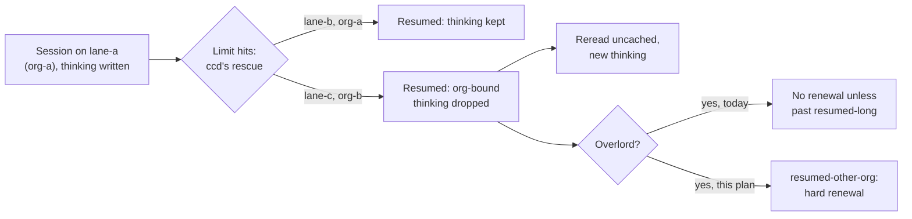
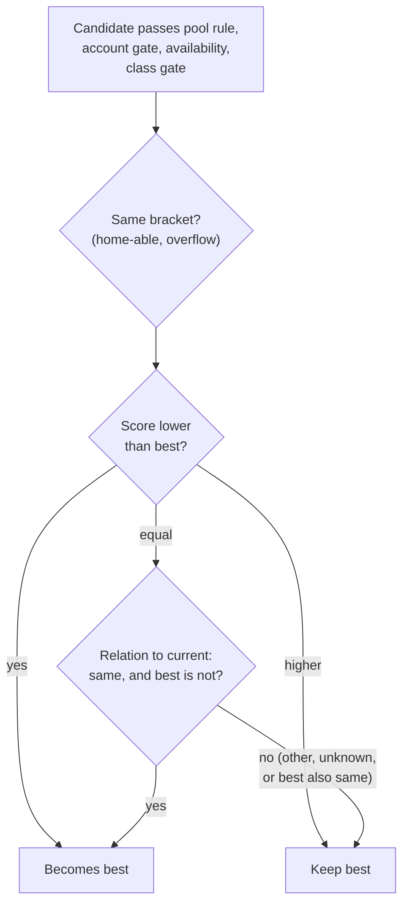
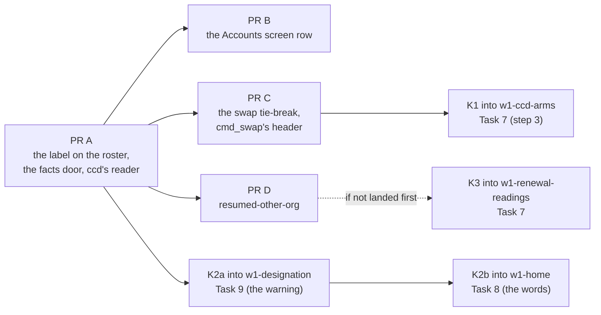

# The account's organization: its label, the swap preference and the Overlord's renewal on it

> **For agentic workers:** REQUIRED SUB-SKILL: Use superpowers:subagent-driven-development (recommended) or
> superpowers:executing-plans to implement this plan task by task. Steps use checkbox (`- [ ]`) syntax for tracking.

**Plan** · 2026-11-16 · Programme: Overlord (`overlord`, #2491) · Issue: #2909 · Spec:
`docs/superpowers/specs/2026-11-09-overlord-design.md` (§3.3.8, Table 3.3.11b, §3.4: C46, C56, C57, Table 3.4b)

## In short

When `ccd` resumes a session on an account in another Claude organization, the thinking of some models is dropped
without an error. The session keeps its transcript, but it rereads the whole history with no thinking, and it thinks
again. ccrc does not know which organization an account belongs to, so the swap cannot avoid this. The Overlord does not
renew on it either.

This plan gives each account an **organization label**, set by the operator like `pool`. It is never the
organization's id. Three things use the label:

- **The swap breaks ties toward the session's current organization.** This is `_swap_target`, and the Overlord's
  pick at step 3. It is a tie-break only: it never beats serviceability, the pool rule, home or a lower load.
- **The Overlord renews at once** after a start that resumed its conversation in another organization. This is a new
  hard row of Table 3.3.11b, `resumed-other-org`, read from `otherOrg` beside `otherClass`.
- **Settings warns** when the Overlord's account set spans organizations. It never refuses, because R14 needs at
  least two accounts.

An unknown organization is never read as "the same organization". The plan has four pull requests, plus three carries
into W1 plans that are not built yet. The one question for the operator is in §9: should ccrc take a slightly fuller
account to keep a session's thinking?

## 1. Why: what the platform does with thinking across organizations

This section states the platform's rule and where ccrc meets it.

**The rule** (sourced: the preserved-thinking docs, "Accounts and cloud platforms" and "What counts as your account on
each platform",
<https://platform.claude.com/docs/en/build-with-claude/preserved-thinking>, read 2026-11-16):

- "Thinking blocks from Claude Fable 5.2, Claude Mythos 5.2, Claude Sonnet 5.5, and Claude Haiku 5.5 work only in the
  account that produced them or a linked one. In any other account, the API drops them, with no error."
- On the Claude API, "your account" is your **organization**.
- A dropped block is not removed from the conversation. Back in the first organization it is read again: "the API never
  changes your `messages`".
- Separately, the API may leave out a block that another account produced "if that account is no longer in good
  standing". That clause covers more models, Claude Opus 5.5 among them.
- Claude Opus 5.5 and Claude Fable 5.1 are not on the organization-bound list. Their thinking survives a move between
  organizations.

**Where ccrc meets it** (sourced: the tree at `3499b905e`):

- `ccd/ccd#cmd_swap` carries the transcript into the target config dir and resumes. Its header says transcripts are
  "plain JSONL with no account binding". That holds for the file, but not for the thinking inside it.
- `ccd/ccd#_swap_target` ranks candidates by load (`_limit_score`, the larger of the five-hour and weekly
  percentages). Ties go to roster order. It knows nothing of organizations. Only `_rescue_target` calls it, from
  `_auto_swap_check` and from the limit watchdog's rescue.
- `shared/roster.ts` `ACCOUNT_KEYS` has no organization fact. A grep of `ccd/`, `server/src`, `shared/`, `agent/src`
  and `pwa/src` for organization terms finds only Linear, GitHub and OpenAI meanings.
- **The Overlord.** Every planned move is a fresh start from the card (C57), so it carries no thinking across. The
  one gap is ccd's hard-block rescue, which resumes. A same-class rescue into another organization below
  `resumed-long`'s threshold makes no renewal due today (`server/src/continuity/renewalDue.ts#PREDICATES`).

*Figure 1. One rescue, two landings. Landing in another organization drops the organization-bound models' thinking.
Today nothing in ccrc sees this. This plan prefers the first landing when loads tie, and renews the Overlord after the
second.*

## 2. The organization fact: measured where possible, and the choice

This section records what could be measured without reading account secrets, and the arm chosen.

**What was measured** (2026-11-16; key names only, no value printed):

- Claude Code keeps an `oauthAccount` record with `organizationUuid`, `organizationName`, `organizationRole` and
  `organizationType`. `claude auth status` prints JSON whose `orgId` comes from that record for a claude.ai login
  (source: the CLI reference, <https://code.claude.com/docs/en/cli-reference>, and the field names in the installed
  build). Claude Code also reads `CLAUDE_CODE_ORGANIZATION_UUID` and `ANTHROPIC_ORGANIZATION_ID`.
- One fleet config dir, this session's own, had **no `oauthAccount` key** in its `.claude.json`. Its top-level key
  names were listed with `jq 'keys'`. So on this fleet the non-secret record is not reliably on disk. The other ways
  to learn the organization are `claude auth status` and the profile endpoint, and both use the account's credential.
- Reading another account's config dir or credential from a session is account management, which is never a
  session's (CLAUDE.md SAFETY, D-6202). This plan adds no such path.

**The choice.**

| Option | What it is | For | Against | Status |
|---|---|---|---|---|
| (a) Measured | The box reads each config dir's `organizationUuid`, and the roster wire carries an opaque key, a hash and never the id | No operator step. Cannot drift from the truth | The record is absent in at least one config dir measured. The other routes use the credential. A box-side reader of every account's state is a new reader of account files | Later |
| (b) Operator label | An optional roster field, `org`, shaped like `pool`. The operator names it (`org-a`) on the Accounts screen | Same mechanism as `pool` and the facts. No account files read. Untagged means unknown, which is no preference | The operator must set it. A wrong label gives a wrong tie-break, but never a refusal | Agreed |

Slug `org-is-an-operator-label`. **Why (b):** it is the only arm measurable today without reading account files. A
wrong or missing label costs at most a tie-break or an extra renewal. The measured arm (a) stays under "Later" (§10).
If it is ever built, it checks the labels and never writes them (slug `org-measured-arm-later`).

**What the label is not:**
- It is never the organization's id or name. The parse refuses a value shaped like a UUID (8-4-4-4-12 hex) or like 32
  hex digits (`org-looks-like-an-id`; slug `org-label-refuses-id-shapes`). The `pool` shape (`POOL_NAME_RE`, at most 32
  characters) already refuses a 36-character UUID by length. The new check also catches the unhyphenated form.
- It is operator data, like pool names. No public text carries a real one, and fixtures use `org-a` and `org-b`.
- **Unknown is never "same".** An account with no label has an unknown organization. Comparing it with anything gives
  `unknown`, except comparing it with itself: one account is one organization (slug `same-account-is-same-org`).

**The one relation.** Every reader asks the same question, "how do these two accounts relate?", and gets one of three
words:

| Accounts `a` and `b` | Answer |
|---|---|
| `a == b` | `same` |
| Both labelled, labels equal | `same` |
| Both labelled, labels differ | `other` |
| Either unlabelled, accounts differ | `unknown` |

*Table 1. The organization relation. Written once in TypeScript (`shared/accountOrg.ts#orgRelation`) and once in bash
(`ccd/ccd#_org_rel`). One shared fixture holds the two equal (slug `org-relation-has-two-twins`).*

## 3. The swap prefers the current organization

This section says where the tie-break sits in each picker, and what it never overrides.

**`_swap_target` today** (sourced: `ccd/ccd#_swap_target`): stay when home is the current account and serves; return
home when it has recovered; stay while the current account is still available; otherwise loop over `_pool_for`'s
candidates. The loop skips a candidate that fails the pool rule, the account gate, availability or the class gate. It
scores the rest by `_limit_score` (unmeasured scores 100, signed-out scores 101). It keeps the strict minimum in two
brackets, home-able first and overflow lanes second. Equal scores go to the first in roster order.

**The change** (slug `org-tie-break-only`): in both brackets, a candidate with an equal score replaces the best so far
only when it relates `same` to the current account and the best so far does not. The comparison becomes
`(score, not-same-org, roster position)`. Everything before the loop is unchanged: the stay rules, the return home,
the pool rule's force and the class passes. Organization never moves a candidate past a lower score, a bracket, or a
gate.

*Figure 2. The tie-break inside `_swap_target`'s loop. Organization decides only between equal scores. `unknown`
never wins a tie, and when the current account has no label every candidate is `unknown`, so roster order decides as
today.*

**Unknown is no preference** (slug `unknown-org-is-no-preference`). With an unlabelled current account, every
candidate relates `unknown`, and the pick is exactly today's. An unlabelled candidate never wins a tie over a `same`
one, and never loses one to an `other` one.

**The Overlord's pick (C56).** `_fresh_pick_to` is planned in `w1-ccd-arms.md` Task 7 and is not built
(`ccd/lib/long-lived.sh` does not exist on `main`). Steps 1 and 2 take the first listed account under the soft line,
in the operator's order, so they have no ties to break. Step 3 takes "the least loaded … ties go to the earlier
listed". This plan's carry K1 (§7) makes it "ties go to `same`, then to the earlier listed", through the same
`_org_rel`. A fresh start carries no thinking, so the tie-break buys little there. It is kept so that one rule reads
the same in both pickers, as the brief directed (judgement).

**The twins.** No server twin of `_swap_target` exists. The server's forecast twin is `projectHome` /
`projectPlacement` (`server/src/limits.ts`) against `_ws_least_loaded`, pinned by `projected-home.test.ts`. That
pair places a **new** session or re-seeds `.home` (the `cmd_ensure` re-home), so no conversation moves and no thinking
is at stake. Placement ignores organization, in bash and TypeScript alike (slug `placement-ignores-org`). PR C gives
the shared least-loaded fixture rows labels, so the parity test still holds with labels present. A later change that
reads organization on one side reds that test until the other side matches. The relation itself has its two twins
held equal by Table 1's fixture.

**The swap's log line** gains two measurements on the `_lc_done` record of a rescue: `meas.org same|other|unknown`,
the landing's relation to the account it left, and `meas.orgnear`. `meas.orgnear` is the lowest score of a `same`
candidate that lost to a lower-scored `other` one, and it is empty when there was none. That is the evidence for §9's
question, and it decides nothing.

## 4. The Overlord renews after a resume into another organization

This section adds the row, says how `otherOrg` is read, and names the piece that carries it.

**The row** (slug `resumed-other-org-hard-row`). This is a new row, not a wider `resumed-other-class`, so each cause
keeps its own name in the feed and its own blind reason:

| Trigger | Class | Roles | How it is read |
|---|---|---|---|
| A start that resumed the conversation in another organization | hard | overlord | The start report's `otherOrg`: the organization relation (Table 1) between the generation's account and the previous generation's account. An unknown relation is unmeasured, so the row is blind, never "same" |

*Table 2. The new row of Table 3.3.11b. It sits after `resumed-other-class` in `RENEWAL_ROWS.overlord`.*

**The reading** (slug `other-org-reading-apart`). `RenewalInputs` gains `startOtherOrg: Reading<boolean>`, apart from
`startResumed`, which keeps its shape. If the organization were a third field of `startResumed`, an unknown
organization would make that whole reading unmeasured. That would blind `resumed-other-class` and `resumed-long` too.
`generationsLane.ts#renewalInputsOf` computes it:

| Start | `startOtherOrg` |
|---|---|
| Not resumed | measured `false` |
| Resumed, previous account unknown (`prevLane` null) | unmeasured, `previous account unknown` |
| Resumed, relation `same` | measured `false` |
| Resumed, relation `other` | measured `true` |
| Resumed, relation `unknown` | unmeasured, `organization unknown` |

*Table 3. How `startOtherOrg` is read. The relation is `orgRelation` over the roster the server holds when the lane
reads it.*

The start report says "`otherOrg` beside `otherClass`". On the generation row that is a new column, `prevLane`,
written by the mint alone, exactly as `prevModel` is (`continuityStore.ts`'s insert takes the newest row's `lane`).
The reading is derived from `lane`, `prevLane` and the roster, and never stored. Task D1's first step confirms that
`GenRow.lane` names the account the start ran on (the registry's `wrapper`) before anything relies on it. If it names
something else, the task reads the account from the start report and records the difference as a deviation.

**No model table** (slug `no-model-table-for-org`). The row fires on any resume into another organization, whatever
the model. A table of organization-bound models would be a second copy of the platform's list, and it goes stale when
a model ships. The good-standing clause also reaches models that are not on the list. The cost of one extra renewal
after a rare event is one fresh start. The rejected alternative: fire only for a class whose models are on the list.

**Coordinators.** The row is the Overlord's only, like `resumed-other-class`. A coordinator's long resume is already
bounded by `resumed-long`, and its usual class, Opus 5.5, is not organization-bound (§6).

**Which piece carries it.** The natural host is `w1-renewal-readings.md` Task 7, "The account readings" (its PR D),
which is not built. It is not the cheaper host: `startResumed`, the generation row and `prevModel`'s pattern are
already built in W1a's generations lane, and `otherOrg` needs no producer from the readings plan, only the roster's
label from PR A. So this plan carries it in its own **PR D**, after PR A. If PR D has not landed when Task 7 starts,
Task 7 takes D1 and D2 as written (carry K3).

## 5. Settings warns when the Overlord's set spans organizations

This section adds a warning beside C56's count. It is never a refusal.

R14 says "never one account", and C56 refuses fewer than two accounts that can serve. A rule of one organization
could leave the Overlord with fewer than two, so organization only warns (slug `org-spread-warns-never-refuses`).

| Accounts the set admits that can serve it (C56's count) | Settings says |
|---|---|
| All labelled, one label | Nothing |
| Labelled with two or more labels | "Accounts in this set belong to `<n>` organizations. A rescue between them drops some models' thinking, and the Overlord renews after it." |
| Some labelled, some not, one label among the labelled | "`<m>` accounts in this set have no organization set, so ccrc cannot tell whether a rescue keeps the Overlord's thinking." |
| None labelled | Nothing. The operator has not opted in, so there is nothing to compare |
| C56's count unmeasured | Nothing. A stale figure says nothing, as C56's count does |

*Table 4. The warning. One L0 decider, `shared/accountOrg.ts#orgSpread`, answers `{ kind: 'one' | 'many' |
'partly' | 'none' | 'unmeasured', orgs, unlabelled }`. The server attaches it to the set door's answer beside
`unknown-pool`, and the PWA words it.*

It rides two carries, both into W1 plans that are not built (§7). The server half is K2a, in `w1-designation.md` Task 9
(`accountSetVerdict`'s answer gains the warning beside `unknown-pool`). The console half is K2b, in `w1-home.md` Task 8
(Settings › Overlord's account set row shows it).

## 6. Coordinators and workers

This section states the effect on the roles that are not the Overlord, and whether the tie-break is enough.

- **Workers** usually run Sonnet 5.5, which is organization-bound. A rescue into another organization drops their
  thinking for the rest of the conversation, or until they return. The tie-break avoids that only when loads tie
  exactly. They renew at no trigger: a worker's conversation is a wave's, and the next wave's `/clear` ends it.
- **Coordinators** usually run Opus 5.5, which is not organization-bound, so a move between organizations costs them
  nothing in thinking. A coordinator on Sonnet or Haiku is exposed like a worker. Its `resumed-long` row already
  renews a long resume, and the tie-break covers the rest.
- **Plain sessions** are like workers or coordinators, by their model.

**Is the tie-break enough?** For coordinators, yes. For workers it is enough as a first step, though not as a full
answer. `_limit_score` is a whole percentage, so two candidates rarely tie exactly. The tie-break will change few
picks. A band, where a `same` candidate within a few points beats a lower `other` one, would change more. It would
also send sessions onto fuller accounts, which is a trade between load and thinking that nobody has ruled on. This
plan ships the exact tie and measures the near misses (`meas.orgnear`, §3). §9 asks the operator whether to widen it
once a week of those measurements exists.

## 7. Pull requests and carries

This section lists the pieces in landing order and what each one waits for.

*Figure 3. The order. PR A comes first. B, C and D are independent of each other. A carry lands with its host task,
and never before the PR it reads.*

| PR | Tasks | Waits for | Main files and growth estimate | Status |
|---|---|---|---|---|
| A | A1 to A3 | nothing | `shared/roster.ts` +25, `shared/roster-json.mjs` +12, `shared/rosterFacts.ts` +6, `shared/accountOrg.ts` new (about 60), `shared/generate.mjs` +6, `deploy/account-op.mjs` +14, `server/src/accounts/routes.ts` +4, `server/src/server.ts` +1, `ccd/ccd` +6 | To do |
| B | B1 | A | `pwa/src/lib/api.ts` +2, the Accounts facts sheet +30, its words +12 | To do |
| C | C1, C2 | A | `ccd/ccd` +22 (`_org_rel`, the loop's tie, two `meas.` fields, the header) | To do |
| D | D1, D2 | A | `server/src/continuity/renewalDue.ts` +6, `generationsLane.ts` +10, `continuityStore.ts` +3, `server/src/coord/schema.ts` one migration (+3) | To do |
| K1 | in `w1-ccd-arms.md` Task 7 | C, and that plan's PR C1 | `ccd/lib/long-lived.sh` +3 over its plan | To do |
| K2a | in `w1-designation.md` Task 9 | A | `server/src/coord/overlordDesignation.ts` +8 | To do |
| K2b | in `w1-home.md` Task 8 | K2a | the account set row +10, its words +6 | To do |
| K3 | in `w1-renewal-readings.md` Task 7 | only if PR D has not landed | as PR D | Later |

*Table 5. The pieces. Figures are estimates in lines. `ccd/ccd` is a growth-checked file, so PR A and PR C run
growth-check armed.*

## 8. Tasks

**Global constraints.**
- CLAUDE.md is binding: DDD, Clean Architecture and SOLID. `shared/accountOrg.ts` is L0 (it imports nothing, because
  the PWA bundles it). The relation is decided in L0 and L1, and acted on in L4.
- No account-name list in shipped source. Fixtures use `lane-a`, `lane-b` and `org-a`, `org-b`.
- Account management is never a session's. The label is written only by the operator's door
  (`POST /api/accounts/:id/set`) and the operator's shell, both through `deploy/account-op.mjs`'s `set-facts` op. No
  session path is added.
- Wire discipline: `org` is optional and additive on `RosterFactsWire`, with absence meaning unlabelled. No
  `FLEET_PROTO` bump.
- Every ccd test uses a fixture HOME (`makeCcdHarness`). Every test runs through `ccrc test -- …` from inside its
  package, in the foreground.
- A new guard ships with a test that goes red when the guard is removed, measured with
  `ccd/coordinator-skill/references/mutation-run.py` (`--help` for its use). Numbers come from the coordinator,
  and this plan names decisions by slug.

### Task A1: The label on the roster (PR A)

**Files:** `shared/roster.ts` (`AccountDef.org`, `ACCOUNT_KEYS`, `parseRoster`, `ORG_ID_SHAPES`),
`shared/roster-json.mjs` and `.d.mts` (the mirror gate), `shared/generate.mjs` (`_ccrc_org` arms),
`shared/rosterFacts.ts` (`RosterFactsWire.org`, `rosterFactsWireOf`), `server/src/server.ts`. Tests:
`server/test/roster-org.test.ts` (new), `server/test/gen-accounts.test.ts`.

- [ ] **Step 1: Failing tests.**
  - An absent `org` parses to `null`, and a written `"org": null` is refused, as for `pool`.
  - A value off `POOL_NAME_RE` is refused, and so are a UUID-shaped value and a 32-hex value
    (`org-looks-like-an-id`).
  - `roster-json.mjs` answers the same for every case (the mirror parity).
  - `generateAccountsSh` emits one `_ccrc_org` arm per labelled account, and the function even with no arms.
  - The wire carries `org` only when set.
- [ ] **Step 2:** run them, red:
  `cd server && ccrc test -- ./node_modules/.bin/vitest run test/roster-org.test.ts` and
  `ccrc test -- ./node_modules/.bin/vitest run test/gen-accounts.test.ts`.
- [ ] **Step 3:** build. `org` reuses `POOL_NAME_RE` by import and never copies it (the single-definition scan).
- [ ] **Step 4:** green. Also run `roster.test.ts`, `roster-exec-parity.test.ts`, `single-definition/roster-bash.test.ts`,
  `readme-roster-mirror.test.ts` and `wrapper-roster-fixture.test.ts`.
- [ ] **Step 5: Mutation.** Mutants: drop the id-shape refusal, accept a written `null`, and emit no `_ccrc_org`
  function when no account is labelled. Each must red a test.
- [ ] **Step 6: Commit.** `feat(roster): an optional organization label per account, never the organization's id (#2909)`

### Task A2: The relation, in TypeScript and in bash (PR A)

**Files:** `shared/accountOrg.ts` (new, L0: `orgRelation`, `orgSpread`), `ccd/ccd` (`_acct_org`, beside `_acct_pool`
with its `declare -F` guard; `_org_rel`; `_ccrc_org` in `_CCD_ROSTER_FNS`), `ccd/contexts.tsv`,
`server/test/fixtures/orgRelation.ts` (new, the shared cases). Tests: `server/test/org-relation.test.ts` (new, both
twins over the shared cases).

- [ ] **Step 1: Failing tests.** Every row of Table 1, both twins. An `accounts.sh` without `_ccrc_org` (an older
  roster) makes every pair of distinct accounts `unknown` in bash. `orgSpread` gives every row of Table 4.
- [ ] **Step 2:** red: `cd server && ccrc test -- ./node_modules/.bin/vitest run test/org-relation.test.ts`.
- [ ] **Step 3:** build. `_org_rel` prints one word and always returns 0.
- [ ] **Step 4:** green. Also `ccd-contexts`, `rings` and `single-definition`.
- [ ] **Step 5: Mutation.** Mutants: read two unlabelled distinct accounts as `same`, read one account against itself
  as `unknown`, and count an unmeasured C56 figure as `none`.
- [ ] **Step 6: Commit.** `feat(roster): the organization relation, one rule in each language (#2909)`

### Task A3: The facts door writes the label (PR A)

**Files:** `deploy/account-op.mjs` (`set-facts` gains `--org <label>|none`), `ccd/ccrc` (the account `set` sub passes
`--org` through), `server/src/accounts/routes.ts` (`POST /api/accounts/:id/set` takes `{ org }`). Tests:
`server/test/account-op-set-facts.test.ts`, `server/test/account-routes-write.test.ts`.

- [ ] **Step 1: Failing tests.**
  - `--org org-a` writes the label and `--org none` clears it.
  - An id-shaped value is refused before any write (`org-looks-like-an-id`).
  - The route takes `{ org }` behind the account gate with no step-up, because a label widens no authority
    (`factsChangeWidens` stays false for it).
  - An off-shape value is refused before any verb runs.
- [ ] **Step 2:** red. **Step 3:** build. **Step 4:** green, plus `box-token-census` (no new door is added).
- [ ] **Step 5: Mutation.** Mutants: skip the shape check in the route, and make `org` widen.
- [ ] **Step 6: Commit.** `feat(accounts): the operator sets an account's organization label (#2909)`

### Task B1: The Accounts screen shows and sets the label (PR B)

**Files:** `pwa/src/lib/api.ts` (`accountSet`'s body type gains `org`), the account facts sheet beside the billing
fact and continuity record, and its `*Words.ts`. Test: `pwa/test/account-org.test.tsx` (new).

- [ ] **Step 1: Failing tests.** The row reads "Organization: `org-a`" or "Organization: not set", with the hint "A
  name you choose, the same for accounts in one Claude organization. Never paste the organization's id." A save
  moves only on the server's ack. `org-looks-like-an-id` toasts its own words.
- [ ] **Step 2 to 5:** as A3. Run with `cd pwa && ccrc test -- ./node_modules/.bin/vitest run test/account-org.test.tsx`.
- [ ] **Step 6: Commit.** `feat(pwa): the account's organization label on the Accounts screen (#2909)`

### Task C1: `_swap_target` breaks ties toward the current organization (PR C)

**Files:** `ccd/ccd` (`_swap_target`'s loop, both brackets; the rescue's `_lc_done` record). Test:
`server/test/ccd-swap-target-org.test.ts` (new, fixture HOME).

- [ ] **Step 1: Failing tests.**
  - Two candidates at an equal score: the `same` one wins over the earlier-listed `other` one.
  - A lower-scored `other` candidate beats a higher-scored `same` one. Organization never overrides load.
  - A `same` overflow lane never beats a home-able one.
  - An unlabelled current account picks by roster order, exactly as before.
  - An unlabelled candidate never wins a tie over a `same` one.
  - Home recovered is returned to whatever its organization.
  - The record carries `meas.org` and `meas.orgnear`.
  - CONTROL: with no labels at all, every existing `_swap_target` case answers as on `main`
    (`ccd-swap-target-class.test.ts` stays green, unchanged).
- [ ] **Step 2:** red: `cd server && ccrc test -- ./node_modules/.bin/vitest run test/ccd-swap-target-org.test.ts`.
- [ ] **Step 3:** build. **Step 4:** green, plus `ccd-swap-target-class`, `projected-home` (with the labelled fixture
  rows, §3) and `ccd-contexts`.
- [ ] **Step 5: Mutation.** Mutants: compare organization before score, prefer `other`, treat `unknown` as `same`,
  and break the tie only in the home-able bracket.
- [ ] **Step 6: Commit.** `feat(ccd): a rescue breaks load ties toward the session's own organization (#2909)`

### Task C2: `cmd_swap`'s header says what the transcript carries (PR C)

**Files:** `ccd/ccd` (`cmd_swap`'s header comment only).

- [ ] **Step 1:** replace "Transcripts are plain JSONL with no account binding (validated 2026-07-03)" with: the
  transcript file has no account binding, so it carries. The thinking of some models inside it is bound to the
  organization that wrote it, and in another organization the API drops it without an error (the preserved-thinking
  docs). Name `_org_rel` and the tie-break.
- [ ] **Step 2:** `citations` and `anchors` stay green.
- [ ] **Step 3: Commit.** `docs(ccd): cmd_swap's header says which part of a conversation is bound to an organization (#2909)`

### Task D1: The generation row keeps the previous account (PR D)

**Files:** `server/src/coord/schema.ts` (a migration adding `prevLane TEXT` to `continuity_generations`; its number is
taken at landing), `server/src/continuity/continuityStore.ts` (`GenRow.prevLane`, the insert's `newest?.lane`).
Test: `server/test/continuity-generations-org.test.ts` (new).

- [ ] **Step 1: Confirm the source.** Read the path from the registry to `GenRow.lane`, and record that it is the
  start's account. If it is not, stop and report it as a deviation (§4).
- [ ] **Step 2: Failing tests.** A mint over an existing generation records its `lane` as `prevLane`. The first mint
  records `null`. An older row without the column reads `null`.
- [ ] **Step 3:** red. **Step 4:** build. **Step 5:** green, plus the schema and migration suites. A new migration
  can red pins outside the obvious set, so run the whole `test/coord*` set once.
- [ ] **Step 6: Commit.** `feat(continuity): the generation row keeps the previous generation's account (#2909)`

### Task D2: `resumed-other-org` (PR D)

**Files:** `server/src/continuity/renewalDue.ts` (`RenewalInputs.startOtherOrg`, the `resumed-other-org` predicate,
`TRIGGER_CLASS` hard, after `resumed-other-class` in `RENEWAL_ROWS.overlord`), `generationsLane.ts`
(`renewalInputsOf` computes Table 3). Tests: `server/test/continuity-renewal-due.test.ts`,
`continuity-generations-org.test.ts`.

- [ ] **Step 1: Failing tests.**
  - Every row of Table 3.
  - The row fires hard for the Overlord and is absent from the coordinator's list.
  - An unmeasured `startOtherOrg` makes the row blind and leaves `resumed-other-class` and `resumed-long` measured.
  - The feed names it `resumed-other-org`.
- [ ] **Step 2:** red: `cd server && ccrc test -- ./node_modules/.bin/vitest run test/continuity-renewal-due.test.ts`.
- [ ] **Step 3:** build. **Step 4:** green, plus `continuity-renewal-acts`, `continuity-renewal-feed` and
  `continuity-soft-renewal`.
- [ ] **Step 5: Mutation.** Mutants: fold an unmeasured `startOtherOrg` to `false`, fold `unknown` to `same`, put the
  row in the coordinator's list, and class it soft.
- [ ] **Step 6: Commit.** `feat(continuity): the Overlord renews after a resume into another organization (#2909)`

### Carries into W1 plans

These carries change only the named task of each host plan. They land with that task, and the host plan's worker reads
this section.

- **K1, `w1-ccd-arms.md` Task 7.** Step 3's "ties go to the earlier listed" becomes "ties go to an account whose
  `_org_rel` to the current account is `same`, then to the earlier listed". It adds one failing test: two equally loaded
  listed accounts, the later one `same`, and the later one is picked. Its mutant reverses the order.
- **K2a, `w1-designation.md` Task 9.** `accountSetVerdict`'s `set` answer carries `orgSpread` over the accounts C56
  counts. It is a warning beside `unknown-pool` and never a refusal. Failing test: a set across two labels saves and
  warns, and below two it still refuses `overlord-single-account` with no organization word. Its mutant makes `many`
  refuse.
- **K2b, `w1-home.md` Task 8.** The account set row shows Table 4's words under the count.
- **K3, `w1-renewal-readings.md` Task 7.** Only if PR D has not landed first: take D1 and D2 as written.

## 9. Open questions

This section lists each question with its recommendation, and who decides it.

| # | Question | Recommendation | Who | Status |
|---|---|---|---|---|
| Q1 | Measure the organization, or have the operator label it? | Label it (§2). Measuring needs account files on this fleet | Author, from the brief's two arms | Agreed |
| Q2 | Should ccrc put a session on a slightly fuller account to keep its thinking? | Not yet. Ship the exact tie, measure the near misses for a week (`meas.orgnear`), then decide with the figures | The operator: a trade between load and thinking | Waiting |
| Q3 | Should the renewal fire only for organization-bound models? | No. A model table would copy the platform's list and go stale (§4) | Author | Agreed |
| Q4 | Should coordinators get the row too? | No. Opus 5.5 is not bound, and `resumed-long` bounds the rest (§6) | Author | Agreed |
| Q5 | Which piece carries the row? | Its own PR D, cheaper than the readings plan's Task 7 (§4) | Author | Agreed |
| Q6 | Should Settings warn when only some accounts are labelled? | Yes, once at least one account is labelled, and never before (Table 4) | Author | Agreed |

*Table 6. The open questions. Only Q2 waits on the operator, and nothing in this plan waits on its answer.*

## 10. Deviations found, and what the spec gains

This plan records its decisions by slug. The coordinator issues numbers when it folds them into the ledger.

- `org-is-an-operator-label`, `org-measured-arm-later`, `org-label-refuses-id-shapes`, `same-account-is-same-org`,
  `org-relation-has-two-twins` (§2)
- `org-tie-break-only`, `unknown-org-is-no-preference`, `placement-ignores-org` (§3)
- `resumed-other-org-hard-row`, `other-org-reading-apart`, `no-model-table-for-org` (§4)
- `org-spread-warns-never-refuses` (§5)
- The brief assumed a server forecast twin of `_swap_target`. None exists. The server's only twin is placement's
  (`projectHome`), which this plan keeps in agreement by leaving organization out of both sides (§3).

**The spec delta, in this PR** (`docs/superpowers/specs/2026-11-09-overlord-design.md`): an "Organizations and
thinking" note in §3.3.8, the new row in Table 3.3.11b, notes on organizations in C46, C56 and C57, a row in
Table 3.4b, the Settings warning in C46's set row, and Table B9 in Appendix B.

## Where things stand

### Agreed
- The label, its shape, and the rule that unknown is never "same" (§2).
- The tie-break in `_swap_target` and in the Overlord's step 3, never past a gate, a bracket or a lower load (§3).
- `resumed-other-org`, a hard row for the Overlord, read apart from `startResumed`, in PR D (§4).
- The Settings warning, never a refusal (§5).
- `cmd_swap`'s header corrected (Task C2).

### Waiting on you
- **Q2.** Should ccrc put a session on a slightly fuller account to keep its thinking? The recommendation is not yet.
  Ship the exact tie, measure a week of near misses, then decide with the figures.

### Later
- The measured arm (a): a box-side check of each label against Claude Code's own `organizationUuid`, once Claude Code
  keeps that record on disk for every login type. It warns on a disagreement and never writes the label.
- A band for the tie-break, if Q2's answer asks for one.
- K3, only if PR D is overtaken by the readings plan's Task 7.
