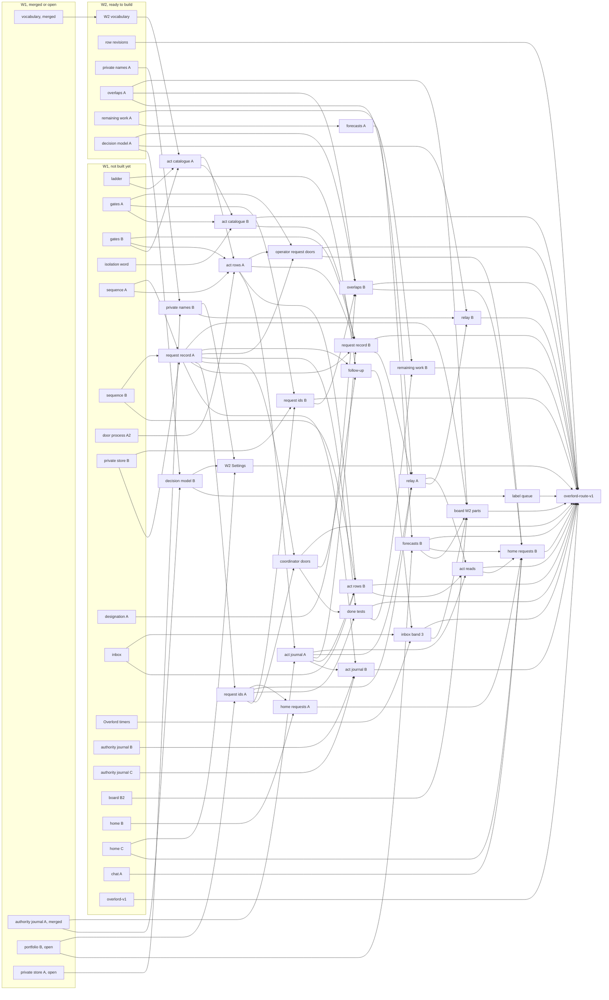

# The Overlord programme: the W2 index, route and follow up

This file is the index of W2, "route and follow up" (spec §14, Table 14's W2 row). It names the pieces, the lanes and
their files, and the order, so that several plan writers can each take one piece at once without colliding. It holds no
piece plan. Each piece's plan will live in `docs/superpowers/plans/2026-11-16-overlord-w2/` as `w2-<piece>.md`.

The spec is `docs/superpowers/specs/2026-11-09-overlord-design.md`, and the programme's ledger is
`docs/superpowers/programs/overlord.md`. The W1 index, whose shape this file follows, is
`docs/superpowers/plans/2026-11-14-overlord-w1.md`. This file defines no D-numbers: every departure below is a plain slug
until the coordinator mints numbers (cross-plan ruling X9).

Written against `main` at `9cf263d44` (2026-11-16), while W1 is building, and revised in fix round 1 (review 2253). The
fix round's rulings are the coordinator's and are marked "(ruled, fix round 1)". The operator asked for the programme to
run side by side to its end, so W2 is planned now and each W2 piece starts the moment its W1 inputs land.

## In short

- **Twenty-four pieces in 36 pull requests** build W2. Each piece is one plan of at most nine tasks.
- **Eight lanes:** vocabulary, acts, requests, egress, follow-up, programmes, the decision model and the console.
- **Eleven pull requests can be built before W1 finishes.** Nine read only what is already on `main`. Six of those are
  ready now: the W2 vocabulary, row revisions, private names A, overlaps A, remaining work A and decision model A.
  Decision model B, forecasts A and the label queue follow them. Private names B and forecasts B join once private store
  A (#2896) and portfolio B (#2904), both open, merge.
- **Nothing a running session sees changes at merge,** apart from the portfolio facts of question 20, which are
  additive. Every Overlord door refuses `capability-missing` until the last piece, `overlord-route-v1`, moves that word
  into `SERVER_CAP_MAP` and opens the rung `advise`.
- **No question waits on the operator.** Item 357 answered question 1, what the operator can rule on a pair of
  programmes whose goals conflict. Every open question carries a recommendation for the coordinator.

## Open questions

The question numbers are stable: piece plans cite them by number. Each question is in one of three states: waiting on
the operator, open with a recommendation, or settled. A piece plan builds the recommendation of an open question unless
the coordinator or the operator rules otherwise, and restates the questions it builds on.

### Waiting on the operator

None. Question 1 was answered by item 357 and is settled below.

### Open, with a recommendation

- **Q2. Routing is a relay** (Table 5.1b; slug `route-moves-ride-the-relay`). Table 5.1b has the Overlord's moves route,
  re-relay and route elsewhere, and the relay door is the one writer of `doneTest`. Each of the three sends the request
  to an owner with a done test. **Recommendation:** the relay door makes all three moves, with a `move` field (`route`,
  `re-relay`, `route-elsewhere`). The Overlord's request doors are open, drop, `close-request` and escalate (question
  7). Re-relay spends no authority (§5.1).
- **Q3. The operation key: its header, its lookup and its binding** (§10.1; slugs `op-key-header` and
  `op-key-reused-is-a-new-word`). The spec gives the key "a header of its own in W2" and names none. The door-process
  plan keeps `x-ccrc-witness-key` for the witness and leaves `x-ccrc-op-key` to W2 (its F20). This fix round's edit of
  `w1-gates.md` makes gates B build the witness header as `x-ccrc-witness-key` too (ruled, fix round 1).
  **Recommendation, amended (ruled, fix round 1):**
  - The header is `x-ccrc-op-key`: a fresh random key that the door process mints for each write tool call and sends
    again unchanged on a retry. A read carries none.
  - **Where the lookup sits:** in gates B's runner, after the step-7 fence and before step 7a (the witness), scoped to the
    session and the generation. A hit returns the stored row and outcome, consumes no witness and counts toward no
    latch, so a retry after a lost response never meets a spent witness.
  - **What the key is bound to:** it is stored with its door, act kind, natural key and a hash of the canonical body.
  - **A repeat whose body hash differs** refuses with a new word, `op-key-reused`, which act rows A adds to
    `OVERLORD_REFUSALS` with its Table 11.6 row. It never falls through as a fresh call.
  - Act rows A builds the store, the lookup and the word, and adds the lookup step to gates B's runner. If gates B has
    not landed, act rows A waits for it.
- **Q4. The act journal's file and grammar** (§7.6, Table 11.1a; slug `act-journal-grammar-in-the-plan`). The spec
  names no file, record kinds or verifier. **Recommendation:** `overlord-acts.jsonl`, beside
  `server/src/coord/overlordAuthority.ts#OVERLORD_AUTHORITY_BASENAME`, on `chainedJournal.ts` and
  `chainedJournalFile.ts`. It has three record kinds: `intent`, `settle`, and `open-request`, which carries the
  request's id. Every record carries the operation key and no operator words. The journal has its own domain in the
  signed head, since the journal-kernel plan foresees the act journal as the kernel's second user, and a row in
  `chained-journal-formats.test.ts#FORMATS`.
- **Q5. Revisions are a column, raised by what an answer acts on** (Table 11.1e: "row revisions W2" on asks and items;
  slug `revision-is-a-counter-column`). **Recommendation, amended (ruled, fix round 1):**
  - `revision INTEGER NOT NULL DEFAULT 0` on asks, items and `overlord_requests`.
  - A revision is raised only by a writer that changes what an answer acts on: the state, the options, the question
    text, the answer, the release, the hold, and `askAt` or `askKey`. It is raised in that writer's transaction.
  - Bookkeeping stamps leave it alone: the reach stamps, `corrected`, `neededBy` and the retention wipes. Otherwise every
    Overlord act would read `operator-has-it`.
  - The census is a closed classification of every `UPDATE asks` and `UPDATE operator_items` in the tree,
    `server/src/coord/pushOutboxStore.ts` included. Each writer reads `raises` or `bookkeeping`, and an unclassified
    writer is red. The coordinator tells W1's builders that a new writer of either table must be classified.
  - An Overlord door that carries an older revision changes nothing, and answers `operator-has-it` with the row and the
    act that moved it. An operator's tap is never refused for a stale revision: it is applied, and the raced act's
    outcome becomes `superseded`, `concurred` or `overturned` (H18).
  - The column on asks and items needs nothing from W1, so it is its own small piece and ready now.
- **Q6. W2's refusal words land at once** (slug `w2-words-at-once`). Eleven W2 words wait on the vocabulary's wave map:
  `act-ceiling`, `dependency-cycle`, `egress-refused`, `goal-conflict-open`, `identity-too-weak`, `operator-has-it`,
  `operator-only`, `relay-carries-method`, `request-not-yours`, `said-not-operator` and `server-not-isolated`.
  **Recommendation:** the W2 vocabulary piece moves all eleven into `shared/refusal.ts#OVERLORD_REFUSALS` in one pull
  request and takes them off the wave map, as W1's vocabulary did for W1. Each later piece reads its words from the
  group. The W1 inbox plan also adds `said-not-operator`; whichever lands second finds it present and adds nothing. As
  in W1, the vocabulary adds no console sentence: an older console shows the raw code, and the piece that ships a door
  ships its words' sentences in `pwa/src/lib/refusalWords.ts`.
- **Q7. The doors the spec does not name** (Table 11.1e; slug `w2-door-paths`). The spec names only
  `POST /api/overlord/requests` and `POST /api/overlord/relay`. **Recommendation**, amended with the escalate door, the
  label door's gate, the row-state door and the act read's projection (ruled, fix round 1); each piece plan may refine
  a path:

  | Door | Path | Gate |
  |---|---|---|
  | Drop, close, escalate (the Overlord's) | `POST /api/overlord/requests/:id/drop`, `.../close`, `.../escalate` | Overlord door |
  | Read-back and the owner's moves | `POST /api/requests/:id/ack`, `decline`, `blocked`, `failed` | box token, attribution, owner |
  | The operator's request doors | `POST /api/requests/:id/answer`, `confirm`, `withdraw`, `take`, `hand-back` | session |
  | Remaining work and edges | `POST /api/coord/programmes/:slug/remaining` | box token, attribution, `claimsProgramme` |
  | The act read | `GET /api/acts?programme=<slug>` | box token (kind, target, authority, state and term only) or session (the whole row) |
  | Seen on an act | `POST /api/acts/:id/seen` | session |
  | Rule a goal-conflict pair | `POST /api/programme-pairs/:key/rule` | session |
  | Upload the private-name list | `PUT /api/overlord/private-names` | session, step-up |
  | A decision-model row's state | `POST /api/decision-model/rows/:id/state` (`off`, `shadow`, `armed`) | session; step-up for every move but `shadow` to `off` |
  | A decision-model row's daily ceiling; the key | `POST /api/decision-model/rows/:id/ceiling`; `PUT /api/decision-model/key` | session, step-up |
  | Label cards | `GET /api/labels`, `POST /api/labels/:id` | session, through the account gate, refusing `auth-off` |
  | The operator's requests read | `GET /api/requests` | session |

  The escalate door (slug `escalate-moves-a-request-to-needs-you`; ruled, fix round 1) moves a request from `received`
  or `declined` to `needs-you` with one of three reasons, `needs-start`, `needs-proposal` or `unnamed-widening`, and
  writes an act row. It sends no mail, so it is not a relay move. It is how W2 carries question 28. Its act kind is
  `escalate-request`: class none, reversible, refused at `chat` and allowed at `advise` and `full`. It is named apart
  from Table 7.1a's `escalate`, which hands a held ask or item to the operator and is W3's.

  Every operator door goes through the account gate and refuses `auth-off` while sign-in is dark. A label must come
  from an event under the sign-in cookie (§3.7). The request doors register from a new routes file,
  `server/src/coord/requestRoutes.ts`, which is a lane source of its own for every census. The remaining-work door goes
  beside `server/src/coord/coordCallsRoute.ts`. The Overlord's doors go in `coord/overlordRoutes.ts`.
- **Q8. Where "its relay carried the widening" is recorded** (§5.5; slug `relay-act-records-the-widening`). `goals
  modify` with a `requestId` must check that the request's relay carried the widening, and nothing stores that.
  **Recommendation, amended (ruled, fix round 1):** `widens` and the widened programme are columns of
  `overlord_acts`, in act rows A's migration, and the relay writes them on its act row. Request ids A builds the
  ownership half of the `goals modify` check. Relay A builds the `widens` half: the goals door looks for a `relay` act
  row of that request and programme with `widens` set, and refuses `reference-unknown` otherwise. Request ids A cannot
  build that half, because no relay row exists before relay A.
- **Q9. No list, an empty list, and an unreadable list** (Table 11.1a, "Ignores it: no egress check runs"; slug
  `no-name-list-is-not-an-empty-list`). **Recommendation, refined (ruled, fix round 1):** "a list was uploaded" is a
  durable fact in the private store.
  - **Never uploaded:** the name check is skipped, and the act row records `skipped: no-list`.
  - **An uploaded empty list** is a list: the check runs and finds nothing.
  - **An uploaded list that cannot be read, or a lost server key,** refuses `egress-refused`, and the act row records the
    reason. Two conditions a caller treats differently never share one answer.
- **Q10. Asks of a private-state row on a hosted model** (§3.7, ruling 5; slug
  `private-state-rows-never-asked-hosted`). The spec arms a row that carries the operator's words only on `local` or
  `zero-retention`, and is silent on shadow. **Recommendation:** such a row is never asked of a `hosted` adapter, in
  `shadow` or `armed` (question 29's states). It answers `not-asked`, writes no record and gathers no label.
- **Q11. Read-back flags while their rows are not armed** (§5.5; slug `shadow-flags-record-only`). `readback.omits` and
  `readback.adds` ship `off`. **Recommendation:** while a row is `off` it is not asked; in `shadow` its answer is a
  record only, and no inbox row is written. The band-3 row kind ships with the inbox piece and fills once the operator
  arms the row on an admitted line.
- **Q12. A fired timer's mail and its band-3 row** (§3.3.12; slug `timer-row-and-mail-are-one-fire`). In W1 a fired
  timer reaches the Overlord as mail only. From W2 it is also a row of band 3. **Recommendation:** the mail still sends,
  under W1's contract. The band-3 row is the same fire, read through `firedTimersOf('overlord', stamp, since)`, and it
  leaves the inbox when the mail is acked. The row declares no nudge of its own, so the coalesced wake counts it once.
- **Q13. One owner for the done-test predicates** (Table 5.5a; slug `done-test-predicates-owned-once`). Done tests
  close requests, and the server clears a programme edge "when it measures the target using Table 5.5a predicates".
  **Recommendation:** the done-tests piece owns the predicate vocabulary and its one reader. Remaining work B clears
  edges through that reader, so it lands after done tests.
- **Q14. No rollback floor for `overlord-route-v1`** (§11.5; slug `route-v1-has-no-floor`). **Recommendation:** no row in
  `CAP_FLOOR_ROWS`. W2 holds nothing, so an older server ignores the new tables and columns (Table 11.5: "Ignored"), and
  a request left open re-measures when the newer build returns: its follow-up comes due after the gap (§11.5). W3's
  floor, below `push-outbox-v1`, is the first server-word floor. Table 11.5 still asks for one measurement on a
  rollback to a W1 build with `overlord` mail queued: `server/src/watch.ts`'s `mailSender` reads a `fromId` that is no
  role as a session id, for the park notice and its push. Request ids B measures it and says what an older build does
  (ruled, fix round 1).
- **Q15. The kickoff's sender parameter waits for the start door** (§11.2; slug `kickoff-sender-waits-for-the-start`).
  `queueProgramKickoff` gains a sender parameter and a sender-scoped dedupe only when something sends a kickoff as the
  Overlord, which is W5's start door. W2 teaches `SYSTEM_MAIL_SENDER_MAP` and `MAIL_ROLE_IDS`
  (`server/src/coord/rundefs.ts`) and their three readers the `overlord` sender, because the relay sends as it.
- **Q16. The label queue's cadence** (§3.7; slug `label-queue-picks-weekly-shows-daily`). **Recommendation:** a weekly lane
  picks at most ten cards, in the spec's order: a gate row before an advice row, then the row nearest its line, with
  each row that has a waiting case getting a card at least every fourth week. The cards show on the daily view behind
  the operator's own items until answered. They are never rows of the Overlord's inbox.
- **Q17. Where the operator sees and rules a goal conflict** (§5.6; slug `goal-conflict-shown-on-the-home`). The board
  is served only to the designated session, yet the spec has the operator rule "from that board row".
  **Recommendation:** the board's Goal conflicts part is the Overlord's view. The operator sees a standing pair on the
  home's portfolio strip and on the Requests rows it blocks, and rules it from the pair's row there.
- **Q19. The act ceilings are this wave's plan's to set** (Table 11.5b: "set by the plan before W2"). The act-catalogue
  plan proposes each act kind's ceiling per programme and in all, from the relay's 30 and 6 an hour as the model. The
  coordinator approves the values at that plan's review, as W1's question 25 did for the read ceilings. The ceiling
  check is a pure decider that takes the counts as an input; act rows A wires the counts from `overlord_acts`, which act
  catalogue A cannot read because the table does not exist yet.
- **Q20. Portfolio facts are live without the Overlord** (slug `portfolio-facts-live-at-merge`). Remaining work, edges,
  forecasts and health describe programmes, not the Overlord's authority, and §11.4 gates only `request ack` and the act
  read on `overlord-route-v1`. **Recommendation, accepted with bounds (ruled, fix round 1):** the remaining-work door,
  the forecast lane and `programmeHealth` are live at their merge, gated only by the box token and ownership. Their
  history starts when coordinators begin stating remaining work, which clause 22 asks for only under `overlord-v1`. The
  door bounds each field, the reason and the wave range, as `server/src/coord/coordCallsRoute.ts` bounds a call's text,
  and masks text on the way in and out.
- **Q21. A nudge passes the relay's checks** (Table 7.1a; slug `nudge-owner-passes-egress`). `nudge-owner` carries no
  quote and spends no authority. **Recommendation:** it still passes every check on the Overlord's own part, the private
  names, `overlord-only` entries and `relay.method` included, and counts against the relay's ceilings.
- **Q22. What a request cost** (§5.6; slug `request-spend-through-run-ids`). **Recommendation:** a request's spend is the
  window use, by model class, of the sessions of the runs that carry its `requestId`, read from what the usage sweep
  already measures and marked "attributed". A programme's spend is the same over its runs. No new writer.
- **Q23. W2 pieces start before W1 closes** (slug `w2-pieces-start-before-w1-closes`). Figure 8 draws W1 before W2. The
  operator asked for this parallel work, as W1's question 36 did for W1a. The eleven pull requests that can be built
  before W1 finishes are listed under Table W2.

### Settled

Settled by W1's index, by the spec's own text, by the operator's answer to an item, or by the coordinator's
rulings in fix round 1 (ruled, fix round 1). Each is built as stated.

- **Q24. `advise` names `overlord-route-v1`.** W1's question 19 settled it: the rung door refuses `advise` with
  `capability-missing` naming `overlord-route-v1`, and `full` names `overlord-answer-v1` (W3). W2's last piece moves
  `overlord-route-v1` from the ladder's `RUNG_WORDS_NOT_YET_SHIPPED` into `SERVER_CAP_MAP`.
- **Q25. The catalogue takes over `RUNG_CELLS`.** The ladder plan's slug `rung-cells-seed-the-act-catalogue`: W2's
  catalogue takes over `RUNG_CELLS` in a move commit and adds its other columns.
- **Q26. The private-name matcher is already in `shared/`** (slug `private-names-already-in-shared`). §9.4 says the
  tokenizer and matcher move from `server/test/private-names.mjs` to `shared/private-names.mjs`. That move shipped with
  the Linear hierarchy's wave 2 (#2661): `shared/private-names.mjs` holds the matcher and `server/test/private-names.mjs`
  re-exports it. W2 gives `hashEntry` its key argument and adds `privateNameHits`. This is a spec fix.
- **Q27. Grants and commands stay dormant in W2.** `overlordMayAct` is built whole with its grant and command branches,
  and W2 passes it no grants and no commands, which ship in W3. In W2 only three answers can fire: the class-none
  allow, `identity-too-weak` and `operator-only`. `evidence-too-weak` is W3's, and `server-not-isolated` applies only
  when an act rests on a grant or a command (H24).
- **Q28. Before W3 and W5 a proposal or a start goes to the operator** (§14). W2 moves such a request to `needs-you`
  through the escalate door (question 7), and nothing raises an item before W3.
- **Q1. What the operator can rule on a goal conflict** (§5.6, Table 11.1e; slug `goal-conflict-choices`). Answered by
  operator item 357: three choices.
  - **Both stand:** not a real conflict; relays to either proceed.
  - **A goes first:** relays that deepen the conflict on B's side say so and wait for A's next landing.
  - **B goes first:** the same, the other way round.

  Every choice lifts `goal-conflict-open`, and the relay quotes the choice to the owning coordinator. A later
  `goals.conflict` flag on the same pair raises nothing new until either programme's goals change.
- **Q18. The timer doors keep `act: null`** (ruled, fix round 1, overturning the first draft's `set-timer`). A timer is
  not an act kind: no rung and no `overlordMayAct` apply, and a timer writes no act row (spec §3.3.12 and §11.2). The
  W1 timers plan's `OverlordDoorRow.act: LadderActKind | null` stands, with its census holding that only the three
  timer rows are null. The act catalogue adds no timer kind.
- **Q29. A decision-model row's three states** (§3.7; slug `decision-model-row-states`; ruled, fix round 1). A row is
  `off`, `shadow` or `armed`, and every row ships `off`. An `off` row is never asked. The operator switches a row to
  `shadow` (session, step-up, under the daily ceiling), and only then is it asked; its answers are records that gather
  labels and admit a line. The order is: set the key, then the admission asks, then arm. Arming is the operator's, on an
  admitted line. Switching an armed gate row off is an authority change: it takes the step-up and is journalled.
  Shadow on a hosted host is spend (O2), so it is the operator's act too.

## Prerequisites, as measured

Measured on 2026-11-16 with `git log origin/main`, `gh pr list` and `git grep origin/main`.

| W1 piece W2 reads | State on `main` | PR |
|---|---|---|
| Vocabulary | **merged** | #2840 |
| Journal kernel | **merged** | #2848 |
| Authority journal A0, A | **merged** | #2880, #2895 |
| Authority journal B, C | not built | plan #2853 |
| Portfolio A | **merged** | #2842 |
| Portfolio B | open, not in the merge queue | #2904 |
| Push outbox A, B | **merged** | #2838, #2859 |
| Responses A; B | **merged**; open | #2884; #2914 |
| Private store A | open, not in the merge queue | #2896 |
| Private store B | not built | plan #2855 |
| Designation A, B, C | not built | plan #2856 |
| Ladder | not built | plan #2861 |
| Gates A, B | not built | plan #2863 |
| Isolation word | not built | plan #2867 |
| Sequence and monitor A, B, C | not built | plan #2869 |
| Door process A1 to B2 | not built | plan #2864 |
| Inbox and reads | not built | plan #2866 |
| Board and history B1, B2 | not built (A is merged, #2841) | plan #2829 |
| The Overlord's timers | not built | plan #2874 |
| Home A, B, C | not built | plan #2883 |
| `overlord-v1` | not planned yet | none |

The highest migration on `main` is 82 (`COORD_SCHEMA_VERSION = MIGRATIONS.length`). Portfolio B's open pull request
carries 83, and other W1 builds take the next slots as they land.

D-8126's A2 (the goals read, `doneWhen`) and A3 (`coordinator_calls`, #2606) are merged, and W2 reads both: the
remaining-work door uses A3's gate, and `callsFor` replaces A3's own read in each reader. `continuity-v1`, the recall
clause and the renewal hand-offs (W1a) are not merged. W2 reads none of them directly. It meets them only through W1's
designation and `overlord-v1`.

## The large-file programme, and where new code goes

W2 keeps W1's ruling (slug `wire-types-in-sibling-modules`): new wire types go in one-concern `shared/*.ts` siblings,
and `shared/api.ts` takes only one `SERVER_CAP_MAP` row, `overlord-route-v1`. The siblings W2 adds:

- `shared/overlord.ts`: `OVERLORD_ACT_KINDS`, the act states and `ACT_TRANSITIONS`.
- `shared/overlordRequests.ts`: `REQUEST_TRANSITIONS`, the request states, the decline reasons and the done-test
  vocabulary.
- `shared/decisionModel.ts`: `DECISION_QUESTIONS` and the outcome words.
- `shared/programmeFacts.ts`: remaining work, edges, forecasts and the health words.
- `shared/nextSteps.ts`: the next-step controls' three texts.

W2 adds no ccd verb, no ccd library and no capability token, and `ccd/ccd` is untouched. It does edit ccd's tree:
`ccd/door-process.mjs` and `ccd/ccrc-api` (the operation-key header and the new tool rows), `ccd/ccrc-doctor-checks`
(the act journal's chain check) and the skill's references. Its growth-checked files are `server/src/coord/schema.ts`,
`server/src/coord/store.ts`, `server/src/coord/routes.ts`, `server/src/server.ts`, `server/src/watch.ts`,
`pwa/src/lib/api.ts`, `shared/api.ts` and `ccd/ccrc-doctor-checks`. Every pull request keeps each of them within its 40
lines, with no waiver. #2811's caps merged on 2026-11-15, so `shared/api.ts` also has a total cap
(`server/test/growth-caps/shared-api-ts.json`), which W2's one line must fit. Each piece plan measures the caps on
`main` when it is written.

## W2, route and follow up: the pieces, the lanes and their order

Twenty-four pieces build W2, in 36 pull requests. Each piece is sized for one worker and one plan of at most nine
tasks, and a piece with several pull requests ships them from one plan. Every plan names the files it creates or
changes. Every new L1 decider joins `MUTANT_SETS` (`server/test/sim/mutation-floors.test.ts`) and
`server/test/sim/mutation-floors.json` in the pull request that creates it. Every guard ships with the test that goes
red without it. Every new routes file, table, lane and time-port user carries its census rows in the same pull request,
including `server/test/single-definition/time-ports.test.ts`'s module list. Every first-match decider ships with
exhaustive tests and a monotonicity property (Table 11.7b), and `programmeHealth`, `forecastProgramme` and
`overturnableNow` each get their input table in their own plan, because the spec gives none.

**When a pull request starts.** A pull request starts when its "Needs first" are met. Figure W2 is the order. A lane's
order in Table W2 is only the tie-break for its one builder.

| Piece | Plan | What it ships | Size | Needs first | Lane |
|---|---|---|---|---|---|
| W2 vocabulary | `w2-vocabulary.md` | The eleven W2 words of the wave map in `OVERLORD_REFUSALS` at once, off the wave map (question 6); `refusal-table.test.ts` green both ways. No console sentence: each door's piece ships its words' sentences | 1 PR, 2 tasks | vocabulary (#2840, merged): **ready to build** | K |
| Row revisions | `w2-revisions.md` | A `revision` column on asks and items (question 5), raised only by a writer that changes what an answer acts on, in its transaction; bookkeeping stamps leave it alone; a characterization test of each raising writer first; the census, a closed classification of every `UPDATE asks` and `UPDATE operator_items` in the tree (`server/src/coord/store.ts`, `server/src/coord/ledgersStore.ts`, `server/src/coord/questions.ts` and `server/src/coord/pushOutboxStore.ts` among them), each `raises` or `bookkeeping`, red on an unclassified writer; the column read on the wire, additive | 1 PR, 4 tasks | nothing: **ready to build** | C |
| Act catalogue | `w2-act-catalogue.md` | A: `OVERLORD_ACT_KINDS` in `shared/overlord.ts` (C25, H24), taking over the ladder's `RUNG_CELLS` in a move commit (question 25), completed from D-8126's §3 and the SAFETY list, with `escalate-request` (question 7) and no timer kind (question 18); its three tests: single definition, the D-8126 class map that fails on a row set lower, and the compensator test; the act ceilings per programme and in all (question 19), as a pure decider that takes the counts as an input; `rung-below` by act kind and `act-ceiling` at gate step 10, in gates B's decider. B: `overlordMayAct(act, effect, target, grants, facts, now)` (C5, L1), first match, exhaustive with monotonicity, with its nine answers, of which W2 can reach three (question 27); `identity-too-weak` from `CallerIdentity`'s strength, `server-not-isolated` from `IsolationRead` on an act that rests on a grant or command, `operator-only`; the grant and command branches built and fed nothing; the `OverlordPolicy` port (L2), whose default adapter allows everything, so that an outside authoriser can only refuse | 2 PRs, 8 tasks (A 4, B 4) | A: ladder, gates B, W2 vocabulary. B: PR A, isolation word, gates A | C |
| Act rows and settling | `w2-act-rows.md` | A: `overlord_acts`, one migration with every column (actor, identity strength, isolation, natural key as target and revision, `widens` and the widened programme (question 8), `summary` up to 200 and `why` up to 600 characters, outcome, `seenAt`, `dependsSince`, `divergedAt`, the decision-model checks run or skipped); the act states and `ACT_TRANSITIONS` (Table 10.1b) in `shared/overlord.ts`; the one writer; the natural key's unique index (I3); the `act` row of `SEQUENCE_KIND_MAP`; the act ceilings' counts wired into act catalogue A's decider. The operation key (question 3): `x-ccrc-op-key`, minted in `ccd/door-process.mjs` and sent by `ccd/ccrc-api`; stored with its door, act kind, natural key and a hash of the canonical body; looked up in gates B's runner after the step-7 fence and before 7a, scoped to the session and generation, a hit returning the stored row and outcome with no witness consumed and no latch counted; a repeat whose body hash differs refused `op-key-reused`, with its Table 11.6 row. B: the settling lane on its own `LANE_SCHEDULE` row with its boot pass, re-measuring every `pending` row, sending `unknown` and `refused` to the operator; `acknowledge` writes its act row; I3's predicate in the monitor; M32 | 2 PRs, 9 tasks (A 6, B 3) | A: act catalogue A, sequence A, door process A2, gates B. B: PR A, act journal A, inbox, sequence B | C |
| Act journal | `w2-act-journal.md` | A: `overlord-acts.jsonl` (question 4) on the kernel, with its grammar, its `FORMATS` row and its kinds census; each record appended in the store's transaction before the row, through the act writer; the head signed daily with `server/src/coord/approvalsign.ts` under a domain-separated preimage, unsigned on `shared-user` or `approvals-disabled`, its daily lane; one doctor chain check over both the authority journal and the act journal, since W1 left the authority journal's own check for later and `ccd/ccrc-doctor-checks` is growth-checked; the head's line in the digest; the console keeps each head and checks that the next extends it. B: the epoch's third term; the witness tuple's `act` field, `'absent'` in W1, now the head, and `highestIds` with acts and requests (`shared/authorityWitness.ts`, `agent/src/witness.ts`, `pwa/src/lib/witness.ts`); boot coherence (a settle record with no row refuses `authority-rolled-back`); the reconciliation pass in Confirm the restore, a row of `restoreStricter`'s table, writing `divergedAt` rows, sending touched asks and items to the operator and requests to `needs-you`; act ids above the highest after Confirm | 2 PRs, 8 tasks (A 4, B 4) | A: act rows A, authority journal A (#2895, merged). B: PR A, authority journal B and C, request record A | C |
| Act reads, Seen and overturn | `w2-act-reads.md` | The act read, for the owning coordinator (clause 22's check, projected to kind, target, authority, state and term) and for the console (the whole row); the Seen door (`seenAt`); overturn through `POST /api/digest/correct` (in `server/src/server.ts`) with kind `overlord-act`, decided by `overturnableNow` (L1, with its input table), its compensator taken from the catalogue (a correction mail for a relay); `callsFor` (C6, L1) in place of D-8126's own reads, `callsForRun` (`server/src/coord/routes.ts`) and `callsForOperator` (`server/src/coord/ledgersRoutes.ts`), with the plan measuring whether the digest reads `coordinator_calls` too; M4 | 1 PR, 5 tasks | act rows B, act journal A, the relay A | C |
| `overlord-route-v1` | `w2-overlord-route-v1.md` | The word moved from `RUNG_WORDS_NOT_YET_SHIPPED` into `SERVER_CAP_MAP`; the rung door accepts `advise`; W2's `off` effects in `setRungInTx`'s transaction (cancelled nudges, and every open unacknowledged request to `needs-you`); Table 7.5a's caps at `advise` reachable; `ccrc-api`'s W2 verbs and the console's W2 doors follow the word; the skill's door table checked against every W2 door | 1 PR, 4 tasks | every other W2 piece, and W1's `overlord-v1` | C, last of all |
| Request record | `w2-requests.md` | A: `overlord_requests` (Table 5.1a), one migration, each cited message id beside its sha256, with `expectedPaths`, `takenFrom`, `counters`, `nudges` and `revision`; `REQUEST_TRANSITIONS` in `shared/overlordRequests.ts`, shaped as `shared/ledgers.ts#ITEM_TRANSITIONS`, with its tests (no non-terminal state without an exit; hand back as three rows; close and close-unverified apart); the one move writer, stamping the `request` row of `SEQUENCE_KIND_MAP`; one message founds one root request within 24 hours, by a unique index, with the message's `spent` copy and the private store's citation adapter and `spent` arm (`moveMessage(id, 'settle' \| 'spend', 'citing-door')`); I12's predicate. B: the Overlord's doors, open, drop, `close-request` and escalate (questions 2 and 7), each with its `OVERLORD_DOORS` row through `overlordGateRun`, an act row per move, `said-not-operator` on a cited id, `operator-has-it` on a stale revision; the code shortlist (§5.3, Table 3.7a), a pure decider naming at most six candidate programmes by matching `expectedPaths` against live claims and history's `touched` (an empty `expectedPaths` matching live claims alone), which the open door returns and decision model A takes as `programme.pick`'s input; their `ccrc-api` and `DOOR_TOOLS` rows | 2 PRs, 9 tasks (A 4, B 5) | A: private store B, sequence A and B. B: PR A, gates B, act rows A, act journal A, act catalogue B | R |
| Request ids | `w2-request-ids.md` | A: `requestId` on runs, on mail rows and on goals versions, in one migration; `POST /api/runs` refuses `request-not-yours` unless the request's owner is the run's programme; the mail ingress checks the sender owns the request and stamps `lastNewsAt` and a line of news in its transaction; check 7 of `POST /api/mail` lifts its `unknown-recipient` refusal for `toId:'overlord'` only from a session that owns the named `requestId`, the mail recorded as news and an unread report, resolved through the designation as the timers' `deliverTo` is, with no wake and no nudge, and everything else unchanged, behind a red-first test (ruled, fix round 1); the reports' quota, 60 an hour from one coordinator to `overlord`, beside the peer quotas it skips; `goals modify` checks ownership (the `widens` half is relay A's, question 8); `ratifiedBy` gains `{ kind: 'request' }` with its `requestId`. B: `GET /api/mail/:id` serves `overlord` mail only to its recipient or the console and renders the attested quote from the private store at fetch ("withdrawn by the operator" after a wipe, "no longer on record" on a hash mismatch); `SYSTEM_MAIL_SENDER_MAP` and `MAIL_ROLE_IDS` learn `overlord`, with the park-notice lane, the mail-revive lane and the last-move reader (question 15); Table 11.5's rollback measurement of `server/src/watch.ts`'s `mailSender` (question 14) | 2 PRs, 9 tasks (A 5, B 4) | A: request record A, portfolio B (#2904). B: PR A, private store B, gates A | R |
| Coordinator request doors | `w2-coordinator-doors.md` | `ack` (the read-back: the outcome in one line, the done test accepted or countered, first news due within seven days), the counter (two move the request to `needs-you`), `decline` with its closed reasons, `blocked` (`dependsOn`, `dependency-cycle`) and `failed`; in `server/src/coord/requestRoutes.ts`, box token, attribution and owner, a lane source for the census; `ccrc-api request ack`, `decline`, `blocked` and `failed`; the read-back handed to the `readback.*` shadow asks when the decision model is present | 1 PR, 5 tasks | request record A, request ids A | R |
| Done tests | `w2-done-tests.md` | The done-test vocabulary (Table 5.5a's predicates) and its one reader (question 13); the done-test lane, on news, closing `done` or `done-unverified`; start-parent, close-parent in the closing transaction with its boot re-measure, resume-parent and unblock; the moves to `needs-you`; M5's and M20's reads | 1 PR, 6 tasks | request record A, coordinator doors, request ids A | R |
| The operator's request doors | `w2-operator-request-doors.md` | Answer, confirm `done-unverified`, withdraw, take (storing `takenFrom`, with `operator-took-it` on the move's news row) and hand back (three rows); session-gated, the actor through `CallerIdentity` at `operator` strength; never refused for a stale revision, the raced act's outcome written instead; the operator's requests read with Table 4b's groups (L1); a census list of these doors beside `OVERLORD_OPERATOR_DOORS` | 1 PR, 5 tasks | request record A, gates A, act rows A | R |
| Private names | `w2-private-names.md` | A: the key threaded through the matcher: `hashEntry` takes it, and so do `entryFrom`, `lookup` and `hashOf`'s per-process `HASHES` cache, which is keyed on the text and the key, so a wrong key can never match silently; the committed entries keep the public salt; `privateNameHits` (K, L0) in `shared/private-names.mjs` (question 26); characterization first of every consumer (`server/src/linking/publicTextClasses.ts`, `topology-clean.test.ts`, `private-names.test.ts`, `license.test.ts` and `public-text.test.ts`), and a keyed-list test with a real hit. B: the hashed list in the private store, under a server-held key, with no plain copy anywhere new; "a list was uploaded" as a durable fact; the upload door behind the step-up (question 7); never uploaded, empty and unreadable (question 9), with a red-first test | 2 PRs, 6 tasks (A 3, B 3) | A: nothing, **ready to build**. B: PR A, private store A (#2896) | X |
| Relay | `w2-relay.md` | A: `POST /api/overlord/relay` and `nudge-owner`, with the three route moves (question 2); its typed body (the attested quote by ids, the Overlord's part up to 1,500 characters, the priority from `portfolio_rank`, the `requestId`); mail, act row and request move in one transaction; the one writer of `doneTest` and the refiner of `expectedPaths`; one relay per owner per root request, and a child for an unnamed owner to `needs-you`; widening through `goals modify` only when the cited words name the programme, with the relay's `widens` written on its act row and the `widens` half of the goals door's check (question 8); the ceilings, 30 an hour in all and 6 to one target; `goal-conflict-open` from `programme_pairs`. B: the egress checks: the part's shape and cap, `overlord-only` entries (none exist before W4; the check is wired), `privateNameHits` on the part (`egress-refused`, counted and throttled), a hit on the rendered quote less the recipient's own names waiting for the operator's tap, and `relay.method` while its row is in `shadow` or `armed`; the same checks on a nudge (question 21); M12 and M21 | 2 PRs, 9 tasks (A 6, B 3) | A: request record B, request ids A, act journal A, overlaps A. B: PR A, private names B, decision model A | X |
| Follow-up | `w2-follow-up.md` | `followUpDue` (L1, first match, exhaustive with monotonicity) over its six reasons; `followUpAt` stamped at the §5.4 moves, capped at an hour or the read-back's promise; the follow-up arm on a `LANE_SCHEDULE` row of its own, never the timers row (C65); armed at `advise` and `full`, and at `chat` or `off` a due follow-up moves the request to `needs-you`; two nudges with no measured movement move it to `needs-you`; after a gap only follow-ups that came due in it are timed again, spread after boot; notices keyed on their subject | 1 PR, 5 tasks | request record A, coordinator doors, ladder | I |
| Inbox band 3 | `w2-inbox-band-3.md` | Band 3 in `server/src/coord/overlordInbox.ts`: request moves, follow-ups, read-back flags (question 11) and the Overlord's fired timers (question 12), oldest first, as `INBOX_KIND_MAP` rows in `shared/overlordInbox.ts`; the band joins the coalesced wake by declaring no nudge; a report is news and wakes nothing; reports that arrive while no Overlord is `ready` are kept, listed on the next card, and counted for the board | 1 PR, 4 tasks | follow-up, inbox, the Overlord's timers | I |
| Overlaps and goal conflicts | `w2-overlaps.md` | A: `programme_pairs` (pair key, kind, first seen, `ruled`); the overlap decider (L1) over `shared/api.ts#ClaimConflict` pairs and the landing radar's conflict pairs whose holders are in different programmes; the goal-conflict code signals (one programme's files changed, then another's, then the first's within 14 days; or a revert of another programme's commit); the overlaps arm recording each new pair, live at merge. B: one mail to the Overlord per new pair, written through `insertSystemMailTx` with `deliverTo`, never through `POST /api/mail`; `goals.conflict` asked behind the signals only while its row is in `shadow` or `armed`; the operator's ruling door with question 1's three choices; the relay's `goal-conflict-open` read | 2 PRs, 7 tasks (A 4, B 3) | A: nothing, **ready to build**. B: PR A, designation A, request ids B, decision model A | P |
| Remaining work and edges | `w2-remaining-work.md` | A: `programme_remaining` (append-only, a range of waves with a reason) and `programme_edges` (`needs-landed`, `needs-decision`), one migration; the coordinator's remaining-work door with D-8126's gate (box token, attribution, `claimsProgramme`, else `not-your-programme`), live at merge (question 20), each field bounded and its text masked on the way in and out, registered as `registerCoordCallsRoute` is; `ccrc-api` verb `programme remaining`. B: the server clears an edge on measurement, through the done-test predicates (question 13) | 2 PRs, 5 tasks (A 3, B 2) | A: nothing, **ready to build**. B: PR A, done tests | P |
| Forecasts and health | `w2-forecasts-health.md` | A: `forecastProgramme(history, remaining, seed)` (L1, Monte Carlo through the `Entropy` port, the programme's own cycle times from 20 on, else the fleet's, abandons and rework apart), with its input table; sealed forecasts and the forecast lane at each wave boundary, scored at the date, "uncalibrated" after four weeks outside 75 to 90% (M30). B: `programmeHealth`, one word with its evidence row, first match, with its input table; the health words in the trigger table (`shared/practice-triggers.ts`), with the `TRIGGER_KINDS` pin in `server/test/sim/vocabularySets.ts` moving with them, and a change to a worse word an event; `portfolioFor` gains health, the median and 85% dates, the edges, spend per wave and the critical path; the spend read per programme (question 22) | 2 PRs, 8 tasks (A 4, B 4) | A: remaining work A. B: PR A, portfolio B (#2904) | P |
| Decision-model port | `w2-decision-model.md` | A: the `DecisionModel` port (L2) and its `hosted`, `local` and `zero-retention` adapters on one wire contract, with its outcome words, its 2 s deadline and one retry, its request checked before sending; `DECISION_QUESTIONS` in `shared/decisionModel.ts`, each row's revision hash pinned and its attacker fields stated; W2's rows `programme.pick` with `programme.any` (its input the code shortlist that request record B ships; this piece takes the shape from this index), `scope.widens`, `relay.method`, `readback.omits` and `readback.adds`, and `goals.conflict`; both orders with opaque ids, disagreement read as `unsure`; the server's one caller, gathering before the act's transaction and asking only a row in `shadow` or `armed`; the records, never asked twice under one key; every row ships `off` (question 29). B: the row-state door (`off`, `shadow`, `armed`) and the daily ceiling, behind the step-up, each authority change journalled through `OverlordAuthorityJournal.appendInTx`; the key in a server-level slot of the operator-secrets store; the order key, then admission asks, then arm; private-state rows never asked of `hosted` (question 10); line admission by the one-sided bound; the injection canary; the anchor-set lane, daily; M19 | 2 PRs, 9 tasks (A 5, B 4) | A: nothing, **ready to build**. B: PR A, authority journal A (#2895, merged): **ready once A lands** | J |
| Label queue | `w2-label-queue.md` | The weekly lane (C5) that picks at most ten cards (question 16); the label sources (`operator-answer`, `overturn`, `routed-to`, `label-queue`, `outcome`), an outcome label outranking and retiring an answer or overturn label, and no card for a row whose labels can all come from outcomes; the label doors, through the account gate and refusing `auth-off`, and the cards (C6) on the daily view, behind the operator's own items (`pwa/src/labels/`) | 1 PR, 5 tasks | decision model B | J |
| Board's W2 parts | `w2-board.md` | Requests, Unread reports, Overlaps and Goal conflicts on `GET /api/overlord/board`, and the Portfolio part's health, dates and blocks; `shared/overlordBoard.ts` gains the parts additively | 1 PR, 4 tasks | board and history B2, request record A, overlaps A, forecasts B, inbox band 3 | F |
| Home: requests and next steps | `w2-home-requests.md` | A: the next-step controls (`shared/nextSteps.ts`'s three fixed texts and the L1 decider from the linked pull request's state, through the existing PR reader); the prompt route's tap to the owning coordinator, stamping news and `operator-at-programme`, with no `operator_messages` row; the spend read per request, through the runs that carry its `requestId` (question 22). B: the Requests part (Table 4a's row 6) in Table 4b's groups, each row's owner, last news, age and spend; under each operator message in the chat, the request ids it founded and the names they matched (§5.1, §5.3), drawn from the requests read (ruled, fix round 1); a standing goal conflict on the rows it blocks and on the portfolio strip, with the ruling control (question 17); "since you were last here" with request changes; the portfolio strip's health and 85% dates; the readiness line's own spend; the operator's request doors' controls and Seen on an act | 2 PRs, 9 tasks (A 3, B 6) | A: request ids A, home B. B: PR A, operator request doors, act reads, overlaps B, forecasts B, home C, chat A | F |
| W2 Settings | `w2-settings.md` | The Settings PWA rows: each decision-model row's state (`off`, `shadow`, `armed`) and daily ceiling, its key, and the private-name list's upload, each behind the step-up through its own server door | 1 PR, 3 tasks | decision model B, private names B, home C | F |

*Table W2. The pieces and their lanes.*

**Where each Table 14 item went.** Every item of Table 14's W2 row, and every W2 half of a W1 item, is in exactly one
piece:

| Table 14, W2 | Piece |
|---|---|
| The act catalogue | Act catalogue A |
| `overlordMayAct` | Act catalogue B |
| Revisions and operation keys | Row revisions (asks, items), request record A (requests), act rows A (the operation key) |
| Two-step acts and the act journal | Act rows (states, settling), act journal |
| Requests as contracts | Request record, coordinator request doors, done tests |
| `requestId` on runs, mail and `goals modify` | Request ids |
| The request doors | Request record B (the Overlord's, the escalate door and the code shortlist among them), coordinator request doors, the operator's request doors |
| The home's Requests groups, the one-tap next steps | Home: requests and next steps |
| What each request and programme cost | Forecasts and health B (per programme), home requests A (per request), home requests B (the rows) |
| Band 3 of the inbox | Inbox band 3 |
| The relay door with its checks | Relay |
| The door that uploads the private-name list | Private names B, W2 Settings |
| `followUpDue` and its `LANE_SCHEDULE` row | Follow-up |
| Overlaps and goal conflicts, the ruling door | Overlaps and goal conflicts |
| Remaining work, forecasts, health and edges | Remaining work and edges, forecasts and health |
| The decision-model port, its W2 rows in shadow | Decision-model port |
| The label queue and its cards | Label queue |
| The ladder at `advise` | `overlord-route-v1` |
| `overlord-route-v1` | `overlord-route-v1` |
| The board's W2 parts (from W1's board plan) | Board's W2 parts |
| `acknowledge`'s act row (Table 11.1e) | Act rows B |
| `callsFor`, `overturnableNow`, Seen and overturn (Table 11.1c, 11.1e) | Act reads, Seen and overturn |
| The act journal's head in the witness, the reconciliation pass (W1's authority-journal plan) | Act journal B |
| W2's refusal words (W1's vocabulary wave map) | W2 vocabulary |
| Health words in the trigger table (Table 11.1b) | Forecasts and health B |
| The `overlord` mail sender (Table 11.1e) | Request ids B |

**Ready to build now** (question 23): the W2 vocabulary, row revisions, private names A, overlaps A, remaining work A
and decision model A. Decision model B follows A, forecasts A follows remaining work A, the label queue follows
decision model B, and these nine read nothing that is not already on `main`. Private names B and forecasts B join them
once private store A (#2896) and portfolio B (#2904) merge; both are open and not in the merge queue. These eleven pull
requests can all be built before W1 finishes.

**Brief planners first** for the pieces that can be built now and for the spine every other piece waits on:

1. Decision-model port (lane J): the biggest ready piece, with two pull requests buildable before W1 ends.
2. Remaining work and edges, then forecasts and health (lane P): ready now, and live at merge (question 20).
3. Overlaps and goal conflicts (lane P): PR A is ready now, and item 357 answered question 1 for PR B.
4. W2 vocabulary (lane K), row revisions (lane C) and private names (lane X): small and ready.
5. Act catalogue, act rows and act journal (lane C): the spine of every Overlord write door, waiting on the ladder,
   gates and sequence.
6. Request record (lane R): every request piece waits on its PR A, which waits on private store B.

**Eight lanes, one builder each.** A lane's builder takes its next pull request whose "Needs first" are met.

- **Lane K, the vocabulary:** `shared/refusal.ts`'s `OVERLORD_REFUSALS` and
  `server/test/single-definition/refusal-table.data.json`'s wave map.
- **Lane C, acts and authority:** row revisions, the act catalogue, act rows and settling, the act journal, act reads,
  and `overlord-route-v1` last.
  - **Revisions:** `server/src/coord/questions.ts`, the ask writers in `server/src/coord/store.ts`, the item writers in
    `server/src/coord/ledgersStore.ts`, the reach stamps in `server/src/coord/pushOutboxStore.ts` (classified as
    bookkeeping), and one migration.
  - **The catalogue:** `shared/overlord.ts`, the ladder's `RUNG_CELLS` (moved out of its module), gates B's step 10
    decider, and the new L1 module for `overlordMayAct` with the `OverlordPolicy` port under `server/src/coord/`.
  - **Act rows:** `overlord_acts` and its store under `server/src/coord/`, the settling lane, the `x-ccrc-op-key` header in
    `ccd/door-process.mjs` and `ccd/ccrc-api`, the operation-key lookup in gates B's runner, `op-key-reused` in
    `shared/refusal.ts` with its Table 11.6 row in the spec, and `acknowledge`'s handler in `overlordRoutes.ts`.
  - **The act journal:** its module beside `server/src/coord/overlordAuthorityJournal.ts`, the witness files
    (`shared/authorityWitness.ts`, `agent/src/witness.ts`, `pwa/src/lib/witness.ts`), `restoreStricter`'s table, the
    digest's head line, and one doctor chain check for both journals in `ccd/ccrc-doctor-checks`.
  - **Reads and overturn:** the act read and Seen door, `POST /api/digest/correct`'s new kind in `server/src/server.ts`,
    and `callsFor` in place of `callsForRun` and `callsForOperator`.
- **Lane R, requests:** the request record, request ids, the coordinator request doors, done tests and the operator's
  request doors.
  - **The record:** `shared/overlordRequests.ts`, `overlord_requests` and its store, and the private store's citation
    adapter (`server/src/operatorModel/`).
  - **The ids:** `POST /api/runs`, the mail ingress and check 7's `overlord` recipient in `server/src/coord/routes.ts`,
    `goals modify`'s ownership check in
    `server/src/coord/ledgersRoutes.ts`, `ratifiedBy`'s source in the portfolio module, the mail fetch,
    `server/src/coord/rundefs.ts`'s sender map with its three readers, and the `mailSender` measurement in
    `server/src/watch.ts`.
  - **The doors:** `server/src/coord/requestRoutes.ts` (a new lane source), the Overlord's in `overlordRoutes.ts` with
    the code shortlist's decider, and `ccd/ccrc-api`'s `request` verbs.
  - **Done tests:** the predicate vocabulary and the done-test lane.
- **Lane X, egress:** private names, then the relay.
  - `shared/private-names.mjs`, with `server/test/private-names.mjs`'s re-export unchanged in shape.
  - The hashed list in the private store's migrations, and the upload door.
  - The relay's handler in `overlordRoutes.ts`, its egress module, its `DOOR_TOOLS` and `ccrc-api` rows, and the
    `widens` half of `goals modify`'s check in `server/src/coord/ledgersRoutes.ts`.
- **Lane I, follow-up:** `followUpDue`, the follow-up arm and its `LANE_SCHEDULE` row, then band 3 in
  `server/src/coord/overlordInbox.ts` and `shared/overlordInbox.ts`.
- **Lane P, programmes:** overlaps and goal conflicts, remaining work and edges, forecasts and health.
  - `shared/programmeFacts.ts`, `programme_pairs`, `programme_remaining`, `programme_edges` and the sealed forecasts.
  - The remaining-work door beside `server/src/coord/coordCallsRoute.ts`.
  - `shared/portfolio.ts` and `server/src/coord/portfolio.ts` (`portfolioFor`'s new measures), and
    `shared/practice-triggers.ts` (the health words).
- **Lane J, the decision model:** the port, then the label queue.
  - `shared/decisionModel.ts`, the port and its adapters under `server/src/`, the records, the arming settings and the
    key slot, the anchor-set lane, and the label lane with `pwa/src/labels/`.
- **Lane F, the console:** the board's W2 parts, home requests, and W2 Settings.
  - `server/src/coord/overlordBoard.ts`, `overlordBoardRead.ts` and `shared/overlordBoard.ts`.
  - `shared/nextSteps.ts`, the prompt route's tap in `server/src/server.ts`, `pwa/src/overlord/**` and
    `pwa/src/stores/overlord.ts`, and the Settings screen's W2 rows.

**All piece plans can be written at once.** Each piece plan reads the spec, this index and the W1 plans whose states it
reads, not another W2 piece's plan. A plan for a piece that needs an unmerged interface takes the interface from the
spec's tables, or from the W1 plan that defines it, and says so.

*Figure W2. The order: a pull request starts when every arrow into it is met. The top two boxes are W1: the first holds
what is merged or has an open pull request, the second what is planned and not built. The "W2, ready to build" box
holds the pieces that read only merged W1 states. Decision model B, forecasts A and the label queue follow them on the
same footing, and private names B and forecasts B join once private store A and portfolio B merge, so eleven pull
requests can be built before W1 finishes. Item 357 answered question 1, so nothing waits on the operator. Every W2
piece can be planned now. `overlord-route-v1` waits for every other W2 piece and for W1's `overlord-v1`.*

**Where lanes meet.** Files are disjoint across lanes except the files below, and each is shared only as below. The
second piece to land merges `main` once (worker clause 16) and re-measures its slot or count. Every growth-checked
file keeps each pull request within its 40 lines, with no waiver.

- **The migrations' order rule:** `server/src/coord/schema.ts`'s `MIGRATIONS` is positional. A plan names no number.
  Each new table or column takes the next free slot when its pull request lands: the one that lands second merges
  `main`, renumbers its migration to the next free slot, and edits the pins that count migrations:
  `server/test/run-close-switch.test.ts`'s undo step and count (it returns a database to version 53 by hand, dropping
  every later migration), and `server/test/coord-db.test.ts`'s version pins (`toBe(82)` today, three of them). W2's `coord.db` migrations, in no fixed order: row revisions,
  `overlord_acts`, `overlord_requests`, the three `requestId` columns (one migration), `programme_pairs`,
  `programme_remaining` with `programme_edges`, the sealed forecasts, the decision-model records and arming, and the
  label queue. The private store's own list (`server/src/operatorModel/`) takes the hashed name list under the same
  rule. W1's migrations still in flight take their slots first only by landing first; nothing reserves a number.
- **The door censuses:** `server/src/auth/gate.ts`'s `EXEMPT`, `server/test/auth-gate.test.ts`'s `scanRoutes` list,
  `server/test/box-token-census.test.ts` (with its `word(ALL_LANES.length)` number words, re-derived after merging
  `main`), `server/test/rings/fastify-l4.data.ts`, `server/test/secret-mask.test.ts`,
  `server/test/coord-pause-route.test.ts`, `server/test/routeRegistrations.ts` (once W1's other-lanes piece creates it),
  the README's auth paragraph and
  `CLAUDE.md`'s box-token paragraph. `server/src/coord/requestRoutes.ts` is a new lane source: the request record's
  PR B creates it with every census site, and the coordinator doors and the operator's doors add their routes to it.
  The session-gated W2 doors (the operator's request doors, Seen, the ruling door, the label doors, the list upload and
  the decision-model doors) each join `CLAUDE.md`'s list of session-gated coordination writes and the census's
  session-only list in the pull request that adds them.
- **`server/src/coord/overlordDoors.ts#OVERLORD_DOORS`:** every W2 Overlord door adds its row in its own pull request:
  open, drop, close, escalate and the relay, through `overlordGateRun`, each with its act kind from the catalogue. The
  three timer rows keep `act: null` (question 18).
- **`server/src/coord/overlordRoutes.ts`:** the request record B, the relay, act rows B (`acknowledge`'s act row) and
  the board's W2 parts each add their handlers. Different handlers.
- **`LANE_SCHEDULE`** (`server/src/laneSchedule.ts`): the settling lane, the act journal's daily head signing, the
  done-test lane, the follow-up arm (its own row, never the timers row), the overlaps arm, the forecast lane, the
  anchor-set lane and the label lane each add a row, named in their plans.
- **`SEQUENCE_KIND_MAP` and the stamp census:** act rows A adds `act` and the request record A adds `request`. Each
  writer that moves a stamped kind calls `stampSequenceInTx` in its own transaction, after its journal append.
- **The invariant table:** W1's sequence B creates it. Act rows B adds I3's predicate and the request record A adds
  I12's, so both need sequence B. The act catalogue B's plan says whether I4's request arm can be gathered in W2 or waits
  for W3's grants.
- **`server/test/single-definition/writers-map.test.ts`'s `TABLES`,** `time-ports.test.ts`'s `TIME_PORT_FILES`, and
  `MUTANT_SETS` with `mutation-floors.json`: each new table, time-port user and decider joins in its own pull request.
- **`server/test/chained-journal-formats.test.ts#FORMATS`:** act journal A adds the act journal's row.
- **`ccd/ccrc-api`'s `ROUTES`,** its count word and `server/test/ccrc-api.test.ts`'s length and `WORDS`; and
  `ccd/door-process.mjs`'s `DOOR_TOOLS`: the request record B, the relay, the coordinator doors, remaining work A and act
  reads each add rows. The second to land re-derives the count words. Act rows A adds the operation-key header to both
  files, and every later write tool sends it.
- **`shared/refusal.ts`:** the W2 vocabulary adds every W2 word at once (question 6). A later piece that needs a word the
  group lacks adds it, with its Table 11.6 row in the same pull request: act rows A adds `op-key-reused` (question 3).
  Each piece that ships a door adds its words' sentences to `pwa/src/lib/refusalWords.ts`.
- **`shared/api.ts`** (growth-checked, and under its total cap): `overlord-route-v1`'s one `SERVER_CAP_MAP` row, last of
  all. Nothing else.
- **`server/src/coord/routes.ts`** (growth-checked):
  - Request ids A: the `POST /api/runs` field, the mail-ingress check, check 7's lifted `unknown-recipient` for
    `toId:'overlord'` from a session that owns the named request (ruled, fix round 1), and the reports' quota.
  - One registration line each for `server/src/coord/requestRoutes.ts` (request record B) and the remaining-work route
    (remaining work A), registered as `registerCoordCallsRoute` is.
  - Act reads: `callsFor` in place of `callsForRun`'s read.
  - Different lines; the second to land merges `main` once.
- **`server/src/coord/ledgersRoutes.ts`:** request ids A's ownership check on `goals modify`, relay A's `widens` half of
  the same check (question 8), and act reads' `callsFor` in place of `callsForOperator`'s read. Request ids A lands first.
- **`server/src/coord/store.ts` and `ledgersStore.ts`** (growth-checked): row revisions raise `revision` in each ask and
  item writer. Act reads' `callsFor` reads `coordinator_calls` through a new L1 reader, not through these writers.
  Different functions.
- **The portfolio module** (`shared/portfolio.ts`, `server/src/coord/portfolio.ts`, `portfolioStore.ts`): request ids A
  adds `ratifiedBy`'s `request` source, after portfolio B; forecasts B adds `portfolioFor`'s measures. Different
  functions; the second to land merges `main` once.
- **`server/src/coord/overlordInbox.ts` and `shared/overlordInbox.ts`:** lane I's band 3 only. The inbox's contract is
  W1's, and band 3 adds kinds and changes nothing a W1 caller reads (Table 11.1e).
- **The private store** (`server/src/operatorModel/`): the request record A's citation adapter and `spent` arm, private
  names B's hashed list and its migration, and request ids B's quote renderer at mail fetch. Different functions.
- **`shared/private-names.mjs`:** lane X alone. Its consumers (`server/src/linking/publicTextClasses.ts`, and through
  `server/test/private-names.mjs` the suites `topology-clean.test.ts`, `private-names.test.ts`, `license.test.ts` and
  `public-text.test.ts`) keep their imports, and characterization tests pin their answers before the key lands.
- **The witness:** `shared/authorityWitness.ts`, `agent/src/witness.ts` and `pwa/src/lib/witness.ts` are W1's authority
  journal B's. Act journal B widens the tuple's `act` field and `highestIds` additively, after B lands.
- **`restoreStricter`'s table and Confirm the restore:** W1's authority journal C owns Confirm. Act journal B adds the
  reconciliation pass as one row of the table, after C lands.
- **The digest builder:** act journal A's head line and act reads' `callsFor`. Different lines.
- **`server/src/server.ts`** (growth-checked): home requests A's tap in the prompt route, about five lines (W1's private
  store owns the route's body, and the tap is a branch beside it); act reads' `overlord-act` kind on
  `POST /api/digest/correct`. Different handlers.
- **`server/src/watch.ts`** (growth-checked): each W2 lane's call, if its plan wires it there rather than in its own
  lane module, and request ids B's `mailSender` change if its measurement calls for one. The lane modules are
  preferred, so the file grows little.
- **Gates B's runner** (W1): act rows A adds the operation-key lookup after the step-7 fence and before 7a, and act
  catalogue A adds the act kind's lookup at step 10. `w1-gates.md` builds the witness header as `x-ccrc-witness-key`
  and names this lookup.
- **`ccd/ccrc-doctor-checks`** (growth-checked): act journal A's one chain check for both journals.
- **`pwa/src/lib/api.ts`** (growth-checked): lane F's calls, the label queue's two calls, and the act journal's head
  read. The second to land merges `main` once.
- **The skill's door tables** (`ccd/overlord-skill/references/*.md`): the skill shipped whole in W1 and names W2's
  doors. A W2 piece whose door differs from the name the skill gives fixes the reference in its own pull request, and
  `overlord-skill.test.ts` stays green. `overlord-route-v1` checks every W2 door against the tables.
- **The architecture spec's path table:** each piece that creates a new `server/src` root file, or a file in a new
  directory, adds its row in the same pull request: the decision-model port, `requestRoutes.ts`, the act journal
  module and the new `shared/*.ts` siblings among them. C5 owns the request, act and programme-fact modules and the
  label lane, C6 `callsFor` and the label cards, C11 the hashed list, and K `privateNameHits`.

**What a merge arms.** Nothing in W2 changes what a running session sees or does at merge, except the portfolio facts of
question 20, which are additive, and the reads below.

- **Every Overlord door refuses `capability-missing` naming `overlord-route-v1`** until its last piece. So do `ccrc-api
  request ack` and the act read (§11.4). The rung door refuses `advise` until then.
- **Coordinators gain one live door at merge:** remaining work A's door, which writes only `programme_remaining` and
  `programme_edges` and changes nothing a session reads. Clause 22, which asks for it, acts only under `overlord-v1`.
- **`requestId` is an optional field.** A run, a mail or a `goals modify` without it behaves as today. An older server
  ignores the column (Table 11.5).
- **Lanes that write and send nothing:** the overlaps arm is live at merge, records pairs and sends no mail until
  overlaps B and a designated Overlord; the forecast lane writes sealed forecasts; the settling lane and the done-test
  lane have no rows to move until a door writes one.
- **The Overlord's own reads gain rows at merge, under `overlord-v1`:** band 3's fired-timer rows and the board's
  Overlaps, Goal conflicts and Portfolio additions. They are reads and change no act. Requests, and so request moves
  and follow-ups, exist only once `overlord-route-v1` opens the doors that make them.
- **The decision model is off.** Every row ships `off`, and nothing calls a model until the operator sets the key and
  switches a row to `shadow` (question 29). Shadow or armed on a hosted host is spend (O2), so it is the operator's
  act.
- **Revisions are a new column,** raised by today's writers. Nothing refuses on it before an Overlord door reads it.
- **The private-name check runs only once a list has been uploaded,** and an uploaded list that cannot be read refuses
  (question 9).
- **The act journal file appears with its first act,** and its daily head line appears in the digest from then on.
- **After `overlord-route-v1`:** the operator may raise the rung to `advise`, behind the step-up, and only where the
  ladder's conditions allow; on a one-box install `advise` is also the ceiling until the split install exists. From
  there the Overlord opens requests, relays and follows up. Nothing is held, and every question still reaches the
  operator as today (§14).

## Capability words

W2 adds one word and reads the W1 words below it. It adds no ccd or agent word, so the capability floor's table
`CAP_FLOOR_ROWS` gains no row (question 14).

| Word | Kind | Added by | What its absence does |
|---|---|---|---|
| `overlord-route-v1` | server | `overlord-route-v1`, last of all | Every W2 Overlord door, `ccrc-api request ack` and the act read refuse `capability-missing` naming it; the rung door refuses `advise`; the console shows no W2 door. The portfolio facts of question 20 work without it |

W2 reads `overlord-v1` (W1, the Overlord's doors at all), `push-outbox-v1` (W1, merged; the label cards and follow-up
notices reach the operator through the outbox's one sender) and `timers-v1` (W1a, merged; the fired timers in band 3).

## Deviations found

Each entry is a departure from the spec's text that this index makes, by slug. The coordinator mints numbers.

- **`route-moves-ride-the-relay`**: Table 5.1b lists route, re-relay and route elsewhere as Overlord moves without a door.
  The relay door makes all three (question 2).
- **`op-key-header`**: the spec names no header for the operation key. It is `x-ccrc-op-key`, looked up after the
  step-7 fence and before 7a, and bound to its door, act kind, natural key and body hash (question 3).
- **`op-key-reused-is-a-new-word`**: Table 11.6 has no word for a reused operation key with a different body. It is
  `op-key-reused` (question 3).
- **`act-journal-grammar-in-the-plan`**: the spec names no file or grammar for the act journal. The index proposes both
  (question 4).
- **`revision-is-a-counter-column`**: the spec says "row revisions" and defines no column. It is an integer raised only
  by a writer that changes what an answer acts on, over a closed classification of writers (question 5).
- **`w2-door-paths`**: the spec names two of W2's doors. The index proposes the rest (question 7).
- **`escalate-moves-a-request-to-needs-you`**: Table 5.1b gives the move to `needs-you` to the server with no trigger. An
  Overlord door, escalate, makes it, under the act kind `escalate-request` (questions 7 and 28).
- **`relay-act-records-the-widening`**: §5.5's "its relay carried the widening" has no record. The relay's act row holds
  it, and relay A checks it (question 8).
- **`no-name-list-is-not-an-empty-list`**: Table 11.1a's "Ignores it" reads one way. Never uploaded skips, an empty list
  checks, and an unreadable list or a lost key refuses (question 9).
- **`decision-model-row-states`**: §3.7 says "off by default" and "in shadow" and never says who moves a row between
  them. A row is `off`, `shadow` or `armed`, and the operator moves it (question 29).
- **`goal-conflict-shown-on-the-home`**: §5.6 has the operator rule from the board, which only the Overlord reads. The
  operator rules from the home (question 17).
- **`private-names-already-in-shared`**: §9.4's move of the matcher into `shared/` shipped with #2661 (question 26).
- **`kickoff-sender-waits-for-the-start`**: §11.2 puts the kickoff's sender parameter beside W2's mail. It ships with
  W5's start door (question 15).
- **`w2-pieces-start-before-w1-closes`**: Figure 8 draws W1 before W2. Eleven W2 pull requests are built before W1
  finishes, six of them at once, by the operator's request (question 23).

## States W3 may read

Each piece plan that exposes a state names it. W3 adds rows, kinds and columns to these and changes nothing a W2 caller
reads.

- **The act catalogue:** `OVERLORD_ACT_KINDS` and its rung cells; W3 adds the `full` rung's behaviour and its doors'
  kinds (`attach-brief`, `answer-item`, `answer-ask`, the proposals) behind `overlord-answer-v1` and
  `overlord-brief-v1`.
- **`overlordMayAct`:** its signature and nine answers, with the grant and command branches built and fed empty; W3 feeds
  live grants and commands and arms `ask-is-cheaper` and `evidence-too-weak` through `askOrAct`.
- **`overlord_acts`:** its states and outcomes, the staged states (written by nothing until W3's staging), the
  natural key and the operation key; `overturnableNow`'s table, to which W3 adds answer overturns and W5 start overturns.
- **The act journal:** its grammar, its epoch term and its head in the witness tuple; W3 adds record kinds for holds and
  grants.
- **Revisions on asks and items:** the column W3's hold columns (`overlordUntil`, `overlordOutcome`) sit beside, and the
  stale-revision answer `operator-has-it`.
- **Requests:** `overlord_requests`, `REQUEST_TRANSITIONS` and the moves to `needs-you`; W3 raises items where W2 only
  moves a request, and W5's start door turns a `needs-you` start into an act.
- **`requestId` on runs, mail and goals,** and the attested quote at mail fetch, which W3's answer and brief doors reuse.
- **The relay's egress checks and `privateNameHits`:** W3's answer, kickoff and brief doors call the same checks.
- **`followUpDue` and the follow-up arm:** its arming by rung, to which W3 adds `hands-off` and the 30-minute pause after
  `operator-at-programme`.
- **The inbox's band 3:** its kinds and order; W3 adds band 2 (deadline rows) ahead of it and changes nothing band 3
  serves.
- **`programme_pairs` and the ruling door:** W3 raises one O3 item on a new goal-conflict pair.
- **The decision model:** `DECISION_QUESTIONS`, the records, the lines and the label queue; W3's rows (`class.raise`,
  `precedent.same`, `grant.inside`, `answer.maps`, `passage.instructs`, `audit.*`) join the catalogue and share the
  queue's ten cards.
- **Forecasts, health and `portfolioFor`'s W2 measures:** W4b reads the health words in the trigger table, W5 reads
  `portfolioFor` for `portfolioFocus`, and W6 ranks by it.
- **The next-step controls:** their decider and texts, which W3's attention budget counts as taps.
- **`callsFor`:** the one reader of `coordinator_calls`, which W3's briefs cite.

## Where things stand

**Agreed:**
- The index's shape follows W1's.
- The pieces are planned in parallel, and the eleven pull requests that read only `main`, or W1 pieces whose pull
  requests are open, start before W1 closes.
- No piece plan is written here.
- Fix round 1's rulings (review 2253) are applied, each marked "(ruled, fix round 1)": question 1 answered by item 357;
  question 18 overturned (timer doors keep `act: null`); questions 3, 5, 7, 8, 9 and 20 amended; the escalate door, the
  code shortlist, the decision model's row states (question 29), the `overlord` recipient for request owners, and the
  edge from sequence B into the request record added. This pull request also edits `w1-gates.md` so that gates B builds
  the witness header as `x-ccrc-witness-key` and names W2's operation-key lookup.

**Waiting on the operator:** nothing.

**Waiting on the coordinator:**
- The open questions with recommendations above (2 to 17 and 19 to 23). Each piece plan restates the questions it builds
  on, with the ruling.
- Briefing the planners, in the order under Table W2.
- Telling W1's builders that a new writer of `asks` or `operator_items` must be classified for the revision census
  (question 5): readiness's settle, sequence B's raise, and the push outbox's reach stamps among them.

Later operator acts:
- Raising the rung to `advise` once `overlord-route-v1` is live.
- Uploading the private-name list, so the relay's name check runs.
- Setting the decision model's key, switching a row to `shadow`, and arming it once its line is admitted. Shadow or
  armed on a hosted host is spend.

**Spec fixes for the spec-fixes run** (the sentences this index showed wrong or missing):
- §9.4's move of the private-name matcher, which has already happened (question 26).
- Table 11.6 and Table 11.1e, which name no path for most W2 doors (question 7) and no header for the operation key
  (question 3); Table 11.6 gains `op-key-reused` with act rows A.
- §11.2's gate order, which places no operation-key lookup (question 3).
- Table 11.1a, which gives the act journal no file, and the act-journal comparison at boot no verdict table (question 4).
- Table 7.1a, which lists `raise-item`, `escalate`, `attach-brief`, `return-over-asked` and the proposals as allowed at
  `advise` though their doors are W3's. Their cells hold, and their doors refuse `capability-missing` naming their own
  wave's word until then. It gains `escalate-request` (question 7).
- Table 5.1b, whose server move to `needs-you` has no trigger (question 7's escalate door).
- §3.7, which defines no row states between "off" and "armed" (question 29).
- Table 5.2a, which has no wave column, so the board's W2 parts are read from the board plan.
- §5.6's "the operator rules on the pair from that board row", though the board is served only to the Overlord
  (question 17).

**Later:**
- The ledger's W2 rows, on a `ledger/overlord` branch.
- Each piece plan, in `docs/superpowers/plans/2026-11-16-overlord-w2/`, folds its "Index changes" into this file in a
  later revision, as W1's fold did.
